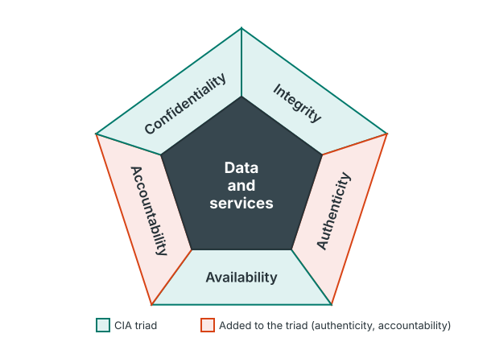
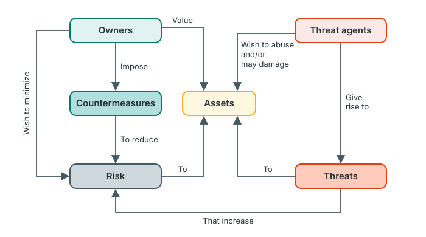
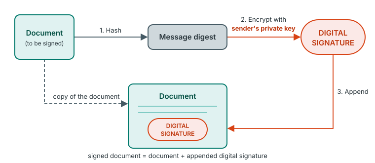
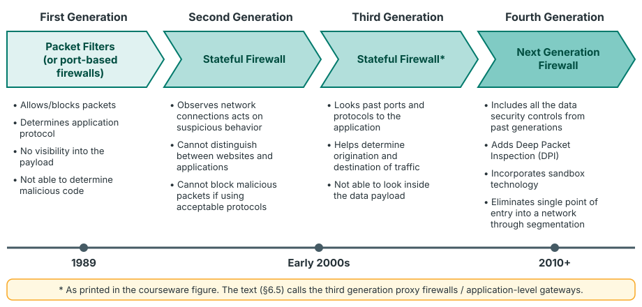
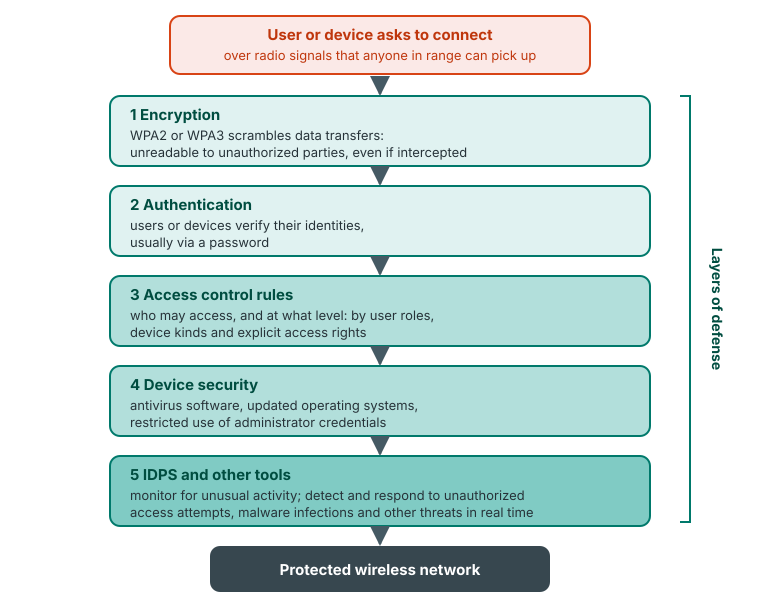
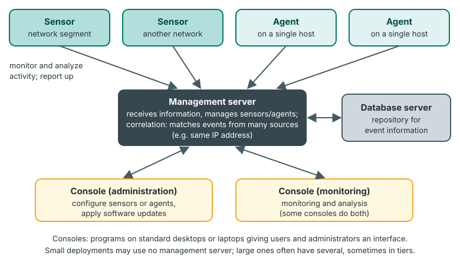

# Crash course

The whole course on one page, for the last days before the exam. The essentials are always visible; open a box for the explanation or a worked example. Follow the links into the units for the full wording.

!!! info "Beyond the notes"
    The groupings, memory aids and worked examples on this page are **the site's**. The lists themselves, and their counts, are the courseware's. For the counts of every list, see [High-yield lists and their counts](exam-technique.md#high-yield-lists-and-their-counts). For the places where the courseware's own counts are odd, see [Questions whose counts don't match the courseware](exam-technique.md#questions-whose-counts-dont-match-the-courseware).

## The course in six big ideas

1. **The CIA triad is the yardstick.** Every attack, control and policy is judged by what it does to confidentiality, integrity and availability, plus authenticity and accountability. *Units 1, 2, 4, 6, 11.*
2. **Defense in depth.** No single control is enough, so controls are layered: Unit 1's *layering* principle, Unit 7's wireless *layers of defense*, Unit 9's three protection *stages*, Unit 11's *defense in depth* for databases, and the NGFW of Unit 5 blending many capabilities. *Units 1, 5, 7, 9, 11.*
3. **Give the least access needed.** Least privilege, fail-safe defaults and complete mediation (Unit 1) reappear as OS access control (Unit 3), the five access control models (Unit 8) and database access controls (Unit 11).
4. **Known versus unknown threats.** Signatures catch what is already known. Behaviour and anomaly methods catch what is new, at the cost of false positives. *Units 9, 12, and Unit 5's firewall evolution.*
5. **People and policy matter as much as technology.** Human attack surface, awareness and training, policy components and weaknesses, and the ethics of professionals. *Units 1, 2, 6, 10.*
6. **Authorization is the line.** The same activity is an attack or a legitimate test depending on permission and scope. *Units 2, 8, 10.*

??? note "How to use the big ideas in an answer"
    End a long answer with one sentence that links to a big idea. Examples: "This is an application of defense in depth: if the firewall fails, the IDPS still detects the attack." Or: "Without authorization this test would be unauthorized access, a legal issue." It shows understanding beyond the list.

## Practical frameworks toolkit

These are the models and classifications that applied questions are built on. For each: what it is, its items with a memory aid, how to apply it, and a worked mini-example.

### 1. CIA triad, authenticity and accountability

**What:** the security objectives ([Unit 1](../unit-1-security-concepts.md#what-computer-security-means-the-cia-triad)).

**Items:**

- **Confidentiality:** data confidentiality, privacy.
- **Integrity:** data integrity, system integrity.
- **Availability.**
- Plus **authenticity** and **accountability**. With the triad, they make the five requirements of Fig. 1.

*Memory aid: CIA + AA.*

**Apply:** for any incident, ask which property was lost. Disclosure means confidentiality, unauthorised change means integrity, an outage means availability, a fake origin means authenticity, and actions that can't be traced mean accountability.

??? example "Worked mini-example"
    A hospital's records system is down for a day after a DoS attack: **availability**. A clerk quietly changes a patient's blood group: **data integrity**. Everyone shares one login, so no one can tell who did it: **accountability**.

### 2. Impact levels

**What:** how serious the loss of C, I or A would be ([Unit 1](../unit-1-security-concepts.md#impact-levels-of-a-security-breach)).

**Items:**

- **Low:** a *limited* adverse effect.
- **Moderate:** a *serious* adverse effect.
- **High:** a *severe or catastrophic* adverse effect.

Each level has four example effects: (i) degradation in mission capability, (ii) damage to assets, (iii) financial loss, (iv) harm to individuals. They scale from minor (low), to significant (moderate), to major or severe (high). At high, the organisation is *not able* to perform one or more primary functions, and harm can involve loss of life.

*Memory aid: "limited, serious, severe".*

**Apply:** quote the scenario's facts against the four effects, then choose the level.

??? example "Worked mini-example"
    A bank's website is defaced for an hour. Customers can still bank through the app, and the bank loses little money. The organisation can still perform its primary functions with only *noticeably* reduced effectiveness, the damage and financial loss are minor, and no one is harmed: **low**. If the core banking system were down for a week, with significant financial loss: **moderate**, or **high** if the bank could no longer perform its primary functions.

### 3. Fundamental security design principles

**What:** thirteen principles for designing secure systems ([Unit 1](../unit-1-security-concepts.md#fundamental-security-design-principles)).

**Items:** economy of mechanism; fail-safe defaults; complete mediation; open design; separation of privilege; least privilege; least common mechanism; psychological acceptability; isolation; encapsulation; modularity; layering; least astonishment.

*Memory aid: four groups (the site's).*

- **Keep it simple:** economy of mechanism, modularity, encapsulation.
- **Deny by default and check everything:** fail-safe defaults, complete mediation.
- **Minimise power:** least privilege, separation of privilege, least common mechanism, isolation.
- **Design for people and attackers:** open design, psychological acceptability, least astonishment, layering.

**Apply:** name the principle the scenario breaks, then the fix that restores it.

??? example "Worked mini-example"
    "New staff accounts get full access until someone removes it" breaks **fail-safe defaults**. Fix: no access until rights are granted. "The admin reads email while logged in as admin" breaks **least privilege**. Fix: use an ordinary account for everyday work.

### 4. Passive and active attacks

**What:** the two main categories of attack ([Unit 2](../unit-2-attacks.md#what-a-security-attack-is)).

**Items:**

- **Passive:** learns or uses information without affecting resources, e.g. eavesdropping. It threatens confidentiality.
- **Active:** alters resources or their operation. The courseware gives six categories: **masquerade, replay, modification of messages, MitM, DoS/DDoS, APT**.

*Memory aid: "Many Robbers Make Mischief Dressed As..." for Masquerade, Replay, Modification, MitM, DoS, APT.*

**Apply:** ask whether anything was *changed*. If not, the attack is passive and the defence is prevention (encryption). If so, classify which active attack it is.

??? example "Worked mini-example"
    A captured payment message is sent again an hour later: **replay**, since nothing was altered. A message is intercepted, its amount changed and passed on: **modification of messages**. Someone logs in with a stolen password: **masquerade**.

### 5. Vulnerability → threat → measure

**What:** Unit 3's chain for operating systems ([Unit 3](../unit-3-os-security.md#vulnerability-threat-measure-how-the-lists-connect)).

**Items:** 8 vulnerabilities, 8 threats and 13 measures (two points each).

**Apply:** for a scenario, name the weakness (vulnerability), the danger exploiting it (threat), and the measure that closes it.

??? example "Worked mini-example"
    A server still runs an old OS version: the **unpatched software** vulnerability. It is open to a **malware** threat, and the measure is **regular updates and patching** (keep up to date; enable automatic updates).

### 6. Choosing symmetric, asymmetric or hashing

**What:** which cryptographic tool fits which job ([Unit 4](../unit-4-cryptography.md#choosing-between-symmetric-asymmetric-and-hashing)).

**Items:**

- **Symmetric:** one shared key; fast; bulk data (AES).
- **Asymmetric:** a key pair; key exchange and digital signatures (RSA, ECC, DH, DSA).
- **Hashing:** one-way; integrity and password storage (SHA-2, SHA-3).

*Memory aid: "bulk, bootstrap, fingerprint".*

**Apply:** need speed on a lot of data → symmetric. Need to start a secure exchange or prove who you are → asymmetric. Need to detect change, with no need to read the data back → hash.

??? example "Worked mini-example"
    Encrypting a 50 GB backup: **AES**. Getting a session key to a new app user: **asymmetric key exchange**. Storing user passwords: a **hash**, because the system never needs the password back, only to compare.

### 7. Digital signature and digital certificate

**What:** proof of origin and integrity, and proof of who owns a key ([Unit 4](../unit-4-cryptography.md#digital-certificate-vs-digital-signature)).

**Items:**

- **Sign:** hash the document; encrypt the hash with the sender's **private** key; append the signature.
- **Verify:** hash the document; decrypt the signature with the sender's **public** key; compare the two.
- **Certificates:** issued by a CA; three types (TLS/SSL, code signing, client); TLS/SSL certificates come in three forms (DV, OV, EV).

**Apply:** "who sent it and was it changed?" → signature. "Can I trust this public key or website?" → certificate.

??? example "Worked mini-example"
    A university sends signed PDF transcripts. An employer verifies each transcript with the university's public key, and trusts that key because a CA's certificate vouches for it.

### 8. Firewall generations

**What:** the four phases of firewall evolution ([Unit 5](../unit-5-firewalls.md#comparing-the-four-firewall-types)).

**Items:**

1. **Stateless packet filter:** header rules only; fast and cheap, but no visibility into packet sequencing.
2. **Stateful:** tracks connections; more protection, at a cost to performance.
3. **Application-level gateway (proxy):** works at Layer 7 as an intermediary.
4. **NGFW:** adds DPI, IPS, DLP, sandboxing, ZTNA and more.

*Memory aid: "Please Stop All Nonsense".*

**Apply:** match the threat to the lowest generation that sees it. Header facts (address, port) need only a packet filter. Content or application behaviour needs an NGFW. Say why a lower generation can't see the threat.

??? example "Worked mini-example"
    A firm needs to block malware hidden inside allowed web traffic, and stop staff uploading customer files. A packet filter sees only headers, and a stateful firewall tracks connections but not content. Recommend an **NGFW**, whose DPI inspects packet contents and whose DLP blocks the data disclosure.

### 9. Wireless security protocols

**What:** the four Wi-Fi protocols, from weakest to strongest ([Unit 7](../unit-7-wireless-mobile.md#the-four-wireless-network-security-protocols)).

**Items:**

- **WEP (1997):** RC4; obsolete.
- **WPA (2003):** TKIP; Personal and Enterprise (RADIUS) modes.
- **WPA2 (2004):** AES; KRACK weakness.
- **WPA3 (2018):** enhanced encryption, dictionary-attack protection, Wi-Fi Easy Connect; Personal, Enterprise and Enhanced Open types.

*Memory aid: "97, 03, 04, 18".*

**Apply:** recommend WPA3 (or at least WPA2). Give the reason (encryption and brute-force protection) and the drawback (older devices may not support it).

??? example "Worked mini-example"
    A café still on WEP: replace it with WPA3 or WPA2, change the router's default admin password, and update the firmware. These are among the six wireless security measures.

### 10. Access control models

**What:** five ways to decide who gets access ([Unit 8](../unit-8-access-control.md#types-of-access-control-systems)).

**Items:**

- **DAC:** the owner decides; least restrictive.
- **MAC:** one person decides, using clearances and labels; high security.
- **RBAC:** based on job function.
- **ABAC:** based on attributes.
- **RuBAC:** based on rules or conditions.

*Memory aid: "D-M-R-A-R", from the owner, to the boss, to the role, to attributes, to rules.*

**Apply:** match the organisation. A military or classified setting → MAC. A large organisation with clear jobs → RBAC. Context-dependent decisions → ABAC. Simple conditions → RuBAC. A small, low-risk office → DAC.

??? example "Worked mini-example"
    In a hospital, nurses, doctors and the pharmacy each need different records by job: **RBAC**. Why not DAC? Letting each data owner decide is the least restrictive model and is not recommended for sensitive data.

### 11. Malware stages and types

**What:** when malware is caught, and what kind it is ([Unit 9](../unit-9-malware.md#the-three-malware-protection-stages)).

**Items:**

- **Stages:** pre-execution (signatures), runtime (behaviour and ML), post-execution response (isolate, terminate, quarantine, roll back).
- **Types:** 15 numbered, 16 named. Recognise them by **symptoms**:
    - files encrypted plus a ransom note → ransomware;
    - typed passwords reused by others → keylogger or spyware;
    - a fake useful program → Trojan;
    - a slow machine with high CPU → cryptojacking.

**Apply:** identify the type from the symptoms, then respond through the three stages.

??? example "Worked mini-example"
    After someone installs a "free PDF converter", passwords start being stolen but no files change. The likely culprits are a **Trojan** delivering a **keylogger**. Response: isolate the PC and terminate the process, then change the passwords from a clean device, add behavioural (runtime) detection, and train staff.

### 12. IDPS detection methods and IPS responses

**What:** how intrusions are found, and what an IPS does about them ([Unit 12](../unit-12-idps.md#choosing-a-detection-methodology)).

**Items:**

- **Detection:**
    - **signature-based:** for known attacks;
    - **anomaly-based:** catches previously unknown attacks, with false positives;
    - **stateful protocol analysis:** checks against protocol profiles; resource-intensive.
- **IPS responses:**
    - stops the attack itself;
    - changes the security environment;
    - changes the attack's content.

*Memory aids: "S-A-S"; "stop it, change the place, change the payload".*

**Apply:** a known pattern → signature. A deviation from normal behaviour → anomaly. A protocol misuse, such as commands in the wrong state → stateful protocol analysis. If damage must be prevented, not just reported → an IPS.

??? example "Worked mini-example"
    An account downloads 40 GB at 3 a.m. No signature describes this, but it is a big deviation from the account's profile, so **anomaly-based** detection catches it. An IPS can **stop the attack itself** by blocking the account.

### 13. Ethical versus legal, and ethical hacking

**What:** what a professional may do ([Unit 10](../unit-10-ethics-legal.md#ethical-vs-legal-issues)).

**Items:**

- **Ethics:** right and wrong, enforced through professional codes and policies.
- **Law:** compliance with applicable laws, with penalties.
- **Ethical hacking:** five requirements: authorization, defined scope, defined objectives, rules of engagement, responsible reporting.

**Apply:** test each action against authorization and scope first, then against the nine ethical principles (avoid unnecessary harm, protect information, report responsibly…).

??? example "Worked mini-example"
    A tester finds a flaw and then copies the customer database "to prove it". The finding is in scope, but copying the data causes unnecessary harm and breaks confidentiality. They should document the flaw and report it responsibly instead.

### 14. Policy components and weaknesses

**What:** what an information security policy contains, and how policies fail ([Unit 6](../unit-6-security-policy.md#components-of-an-information-security-policy)).

**Items:**

- **17 components:** policy statement, roles and responsibilities, access control … monitoring and auditing.
- **6 weaknesses:**
    - no written policy;
    - no disaster recovery plan;
    - no policy for software and hardware additions or changes;
    - no security monitoring;
    - employment policies;
    - internal policies.

**Apply:** spot the weakness in the scenario, then name the component that fixes it.

??? example "Worked mini-example"
    "Staff install their own software and no one checks the logs." The weaknesses are no policy for software and hardware additions or changes, and no security monitoring. The fixing components are change management and acceptable use, and monitoring and auditing.

### 15. Database security best practices

**What:** ten practices for protecting databases ([Unit 11](../unit-11-database-security.md#database-security-best-practices)).

**Items:**

1. access controls;
2. separate servers;
3. encrypt in transit and at rest;
4. database firewalls;
5. strengthen authentication;
6. monitor activity;
7. backup and disaster recovery;
8. patch;
9. limit physical access;
10. penetration testing.

**Apply:** match each threat to its practice:

- SQL injection → database firewall;
- insiders → access controls and monitoring;
- password sharing → strengthen authentication;
- ransomware → backups.

??? example "Worked mini-example"
    The public website and the database share one server, so separate them. That minimises lateral movement: a hacked website no longer gives direct access to the data.

## Unit cards

**[Unit 1: Security concepts](../unit-1-security-concepts.md).** The vocabulary of the whole course: what security protects, how bad a loss can be, and the practices and principles that guide defence.

- CIA triad, with its five sub-concepts, plus authenticity and accountability (Fig. 1).
- Three impact levels, four assets, eight terms.
- 17 essential practices and 13 design principles → toolkit [1](#1-cia-triad-authenticity-and-accountability), [2](#2-impact-levels), [3](#3-fundamental-security-design-principles).

**[Unit 2: Attacks](../unit-2-attacks.md).** Where systems can be attacked, and how.

- Attack surface: 5 examples and 3 categories; attack surface analysis.
- 7 avenues of attack; passive versus active attacks; 6 active categories (Figs 2.1 and 2.2).
- Hackers, crackers and scriptkiddies → toolkit [4](#4-passive-and-active-attacks).

**[Unit 3: OS security](../unit-3-os-security.md).** Why the OS is the backbone, and how to protect it.

- 8 vulnerabilities, 8 threats, 13 measures with two points each.
- Privilege escalation is listed as a vulnerability; ISO 27001 is called a benchmark.
- Security is a continuous process → toolkit [5](#5-vulnerability-threat-measure).

**[Unit 4: Cryptography](../unit-4-cryptography.md).** The longest unit, with the most named items.

- Symmetric, asymmetric and hashing: their algorithms, and the 6 working points and 6 properties of hashes.
- TLS (handshake and record protocols), SSL (5 features, 6 handshake steps), SSH (7 points, 4 authentication methods).
- Digital signatures (Figs 4.1 and 4.2) and certificates: 3 types, DV/OV/EV, 5 benefits → toolkit [6](#6-choosing-symmetric-asymmetric-or-hashing), [7](#7-digital-signature-and-digital-certificate).

**[Unit 5: Firewalls](../unit-5-firewalls.md).** What firewalls do, and how they evolved.

- Inbound and outbound protection; firewall versus antivirus; NAT and VPN.
- Four generations (Fig. 6.1); stateless versus stateful; NGFW capabilities (Fig. 6.3).
- Hybrid mesh firewalls: 3 form factors → toolkit [8](#8-firewall-generations).

**[Unit 6: Security policy](../unit-6-security-policy.md).** Rules that guide people's behaviour.

- Two definitions; 7 reasons to have a policy.
- 17 components (only 2 explained in the courseware); 6 weaknesses → toolkit [14](#14-policy-components-and-weaknesses).

**[Unit 7: Wireless and mobile](../unit-7-wireless-mobile.md).** Securing radio-based networks.

- 6 security measures; 5 layers of defense in order; 5 things wireless security involves.
- WEP, WPA, WPA2, WPA3, and their 6-row comparison table → toolkit [9](#9-wireless-security-protocols).

**[Unit 8: Access control](../unit-8-access-control.md).** Who may use what.

- Physical versus logical access control; 3 benefits (GDPR, HIPAA, PCI DSS).
- 5 models; 5 components; 4 challenges; 5 best practices.
- NAC: 7 advantages; pre-admission and post-admission types → toolkit [10](#10-access-control-models).

**[Unit 9: Malware](../unit-9-malware.md).** Protection is broader than antivirus.

- 3 stages; 6 technologies; 16 types; 11 best practices; 3 organisational strategies.
- AI-powered detection; protection versus antivirus on 5 factors; 5 ways to strengthen real-time protection → toolkit [11](#11-malware-stages-and-types).

**[Unit 10: Ethics and legal](../unit-10-ethics-legal.md).** Doing security work rightly and lawfully.

- 6 ethical issues and 5 legal issues; ethical hacking (5 requirements).
- Digital forensics (5 activities); 9 ethical principles; the 4-row ethical versus legal table; the case study → toolkit [13](#13-ethical-versus-legal-and-ethical-hacking).

**[Unit 11: Database security](../unit-11-database-security.md).** Protecting where the data lives.

- 6 threats; 10 best practices; 5 architecture principles.
- The cloud shared responsibility model; 3 database types; 3 emerging trends → toolkit [15](#15-database-security-best-practices).

**[Unit 12: IDPS](../unit-12-idps.md).** Detecting and stopping intrusions.

- IDS versus IPS; 5 uses; 3 groups of IPS response.
- 3 detection methods with examples; 4 components; tuning (thresholds, blacklists and whitelists, alert settings, code editing); 4 technology types → toolkit [12](#12-idps-detection-methods-and-ips-responses).

## Traps

1. **Hashing is not encryption.** The courseware calls hashing an "encryption" category, but a hash is one-way.
2. **TLS protects data in transit.** Unit 11 says TLS covers data at rest; it doesn't. Data at rest needs storage encryption.
3. **A passive attack changes nothing**, and threatens confidentiality only.
4. **The courseware has six active attack categories**, including MitM and APT, not the textbook's four.
5. **Least astonishment** is the 13th design principle, even though the courseware never explains it.
6. **There are 16 malware types**, numbered 1–15, because the worm sits inside item 1.
7. **The digital certificate benefits are five**, though numbered i–iv, iv.
8. **DAC is the least restrictive** model, and therefore the least recommended for business.
9. **In MAC, one person** (e.g. the CSO) has sole discretion, not each data owner.
10. **Stateless firewalls have zero visibility into packet sequencing**; stateful firewalls cost performance.
11. **An IDS detects; an IPS also responds** to stop the attack.
12. **Signature-based detection fails on unknown attacks**; anomaly-based detection's major benefit is catching them.
13. **The WPA3 "Authentication" cell** in the comparison table repeats the encryption entry. WPA3 really authenticates with SAE (Personal) or 802.1X (Enterprise).
14. **The courseware's MitM definition is "intercepting and altering"**, yet an attacker in the middle who only reads is making a passive attack.
15. **Something legal can still be unethical.**

## Confusable pairs

| A | B | The one-line difference |
|---|---|---|
| Vulnerability | Threat | A weakness, versus a circumstance or event with the potential to cause harm by exploiting it |
| Threat | Attack | A potential for harm, versus malicious activity actually attempted |
| Data integrity | System integrity | Information changed only in authorised ways, versus the system doing its job unimpaired |
| Passive attack | Active attack | Only learns or monitors, versus alters resources or their operation |
| Replay | Modification of messages | A valid message repeated or delayed unchanged, versus a message removed, altered and reinserted |
| Masquerade | Man-in-the-middle | Pretends to be an authorised user, versus sits between two parties intercepting and altering |
| Symmetric | Asymmetric | One shared secret key, versus a public and private key pair |
| Digital signature | Digital certificate | Proves who signed and that nothing changed, versus binds a public key to an identity, issued by a CA |
| TLS | SSL | The current protocol (handshake + record), versus its older, superseded predecessor from Netscape |
| Stateless firewall | Stateful firewall | Checks each packet's header alone, versus tracks the state of active connections |
| Firewall | Antivirus | Controls network traffic in and out, versus finds and removes malicious programs on devices |
| DAC | MAC | The data owner decides, versus one central authority with clearances and labels |
| RBAC | ABAC | Access by job role, versus access by a set of attributes |
| IDS | IPS | Detects and alerts, versus also attempts to stop the incident |
| Signature-based | Anomaly-based | Matches known patterns, versus flags deviations from normal profiles |
| Antivirus | Malware protection | One signature-based component, versus the whole layered approach across endpoints, networks and cloud |
| Ethical issue | Legal issue | Right or wrong by professional codes, versus compliance with laws, with penalties |

## Answer outlines

??? note "1. \"Define X.\" (2–4 marks)"
    Give the courseware definition, as close to its wording as you can, then add **one** clarifying example. Example: *"A vulnerability is a weakness in an information system, system security procedures, internal controls, or implementation that could be exploited or triggered by a threat source. For example, an unpatched operating system."*

??? note "2. \"List and explain N items.\" (6–10 marks)"
    Start with a one-line definition of the topic. Then write "The courseware lists N …" and give one bold heading per item, each with one or two sentences. Example: *"The courseware lists five components of an effective access control system. **Authentication** verifies identity using methods such as passwords, biometric scans or MFA. **Authorization** …"*

??? note "3. \"Differentiate between X and Y.\" (4–8 marks)"
    Define both, then use a table with one row per criterion; take the criteria from the question or choose two or three. End with a sentence on when to use each. Example: *"Stateless firewalls inspect each packet's header alone; stateful firewalls track connections. Stateless is faster and cheaper; stateful gives more protection but costs performance."*

??? note "4. \"With the aid of a diagram, explain X.\" (6–8 marks)"
    Draw the diagram first, large and labelled, then explain it with numbered points that refer to the labels. Example: for Fig. 4.1, draw document → hash → digest → encrypt with the sender's private key → signature, appended. Then explain each arrow.

??? note "5. Scenario: \"Identify and recommend.\" (6–10 marks)"
    Use I-A-J-A for each issue: identify the concept, apply it to quoted facts, justify from the courseware, and act with "why not the alternative". Example: *"The shared nurse login is password sharing, a common database threat. Because every nurse uses one account, actions can't be traced, which defeats accountability. Recommend unique accounts with MFA (strengthen authentication), not simply a stronger shared password, which would still be shared."*

??? note "6. Ethical dilemma: \"Should the professional…?\" (4–8 marks)"
    Separate the legal question (authorization, laws) from the ethical one (the nine principles). Decide what should be done, and say what evidence to keep and whom to tell. Example: *"Accessing more data to 'test the severity' would go beyond any authorization, so it is unauthorized access. The student should stop, document the discovery and report it through the university's authorized channel."*

## Quick sketches

Practise each of these in under two minutes.

??? example "Fig. 1: the five security requirements"
    **Steps:** a circle labelled "Data and services"; five segments around it: Confidentiality, Integrity, Availability, Authenticity, Accountability.

    { .diagram }

??? example "Security concepts and relationships"
    **Steps:** Owners on the left and Threat agents on the right, with Assets in the middle. Owners → *value* → Assets; Owners → *impose* → Countermeasures → *reduce* → Risk; Threat agents → *give rise to* → Threats → *increase* → Risk → *to* → Assets.

    { .diagram }

??? example "Hash-based digital signature (Fig. 4.1)"
    **Steps:** document → hash → message digest → encrypt with the sender's **private** key → digital signature → append it to the document.

    { .diagram }

??? example "Firewall evolution (Fig. 6.1)"
    **Steps:** four chevrons left to right: packet filters (1st generation) → stateful (2nd) → application/proxy (3rd) → next-generation (4th). Add two characteristics under each.

    { .diagram }

??? example "Wireless layers of defense"
    **Steps:** a vertical arrow from "device connects" through 1 encryption → 2 authentication → 3 access control → 4 device security → 5 intrusion detection.

    { .diagram }

??? example "IDPS components"
    **Steps:** sensors and agents at the top → management server (correlation) → database server; a console connected to the management server.

    { .diagram }

## Flashcards

??? question "What are the five essential network and computer security requirements of Fig. 1?"
    Confidentiality, integrity, availability, authenticity, accountability.

??? question "What two concepts does confidentiality cover?"
    Data confidentiality and privacy.

??? question "What separates the low, moderate and high impact levels?"
    A limited, a serious, and a severe or catastrophic adverse effect.

??? question "Name the four categories of system assets."
    Hardware; software; data; communication facilities and networks.

??? question "How many essential security practices and design principles are there?"
    17 practices and 13 principles.

??? question "Which design principle is listed but never explained?"
    Least astonishment.

??? question "Fail-safe defaults in one line?"
    Base access decisions on permission rather than exclusion: the default is no access.

??? question "Name the six active attack categories."
    Masquerade, replay, modification of messages, MitM, DoS/DDoS, APT.

??? question "What are the three attack surface categories?"
    Network, software and human.

??? question "How many OS vulnerabilities, threats and measures are there?"
    8, 8 and 13 (two points per measure).

??? question "Give three other names for symmetric encryption."
    Secret key cryptography, private key cryptography, symmetric key encryption.

??? question "Which key signs a document, and which key verifies it?"
    The sender's private key signs; the sender's public key verifies.

??? question "Name the six properties of a cryptographic hash function."
    Deterministic, fast computation, pre-image resistance, second pre-image resistance, collision resistance, avalanche effect.

??? question "What are the two protocols of TLS?"
    The handshake protocol and the record protocol.

??? question "What are the three forms of TLS/SSL certificate?"
    Domain validated (DV), organization validated (OV), extended validation (EV).

??? question "How many benefits of digital certificates are there?"
    Five (security, scalability, authenticity, reliability, public trust), despite the "iv, iv" numbering.

??? question "What does NAT do?"
    It changes the source or destination addresses of packets passing through the firewall, so many devices can share one IP address.

??? question "What is the main weakness of a stateless firewall?"
    Zero visibility into packet sequencing.

??? question "Give the release years of WEP, WPA, WPA2 and WPA3."
    1997, 2003, 2004, 2018.

??? question "What are the three types of WPA3?"
    WPA3-Personal, WPA3-Enterprise and Wi-Fi Enhanced Open.

??? question "Name the five access control models."
    DAC, MAC, RBAC, ABAC, RuBAC.

??? question "What are the four challenges in access control?"
    Distributed IT environments, password fatigue, orphaned accounts, complexity of systems.

??? question "What are the three malware protection stages?"
    Pre-execution detection, runtime detection, post-execution response.

??? question "How many malware types are there?"
    15 numbered items, 16 types (the worm is inside item 1).

??? question "What does the 3-2-1 backup rule say?"
    Keep three copies of data, on two kinds of media, with one copy off-site. See [Unit 9](../unit-9-malware.md#malware-protection-best-practices).

??? question "Name the five requirements for ethical hacking."
    Authorization, defined scope, defined objectives, rules of engagement, responsible reporting.

??? question "How many ethical principles for security professionals are there?"
    Nine.

??? question "Which database best practice does the courseware get wrong?"
    Best practice 3 says TLS encrypts data at rest; TLS protects data in transit only.

??? question "What are the three IDPS detection methodologies?"
    Signature-based detection, anomaly-based detection and stateful protocol analysis.

??? question "What are the three groups of IPS response?"
    The IPS stops the attack itself; changes the security environment; changes the attack's content.

??? question "What are the four types of IDPS technology?"
    Network-based, wireless, network behavior analysis (NBA) and host-based.
