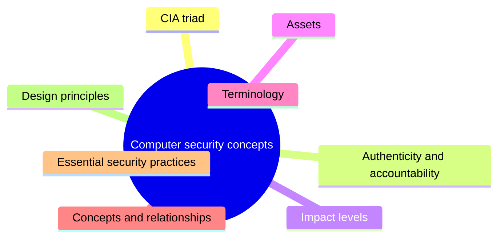
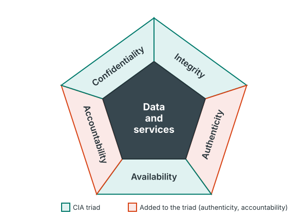
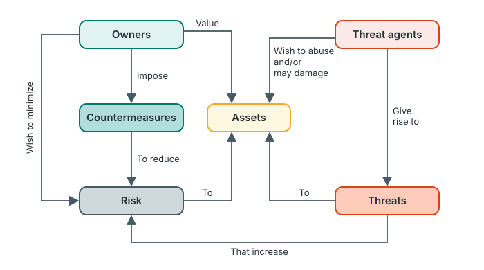
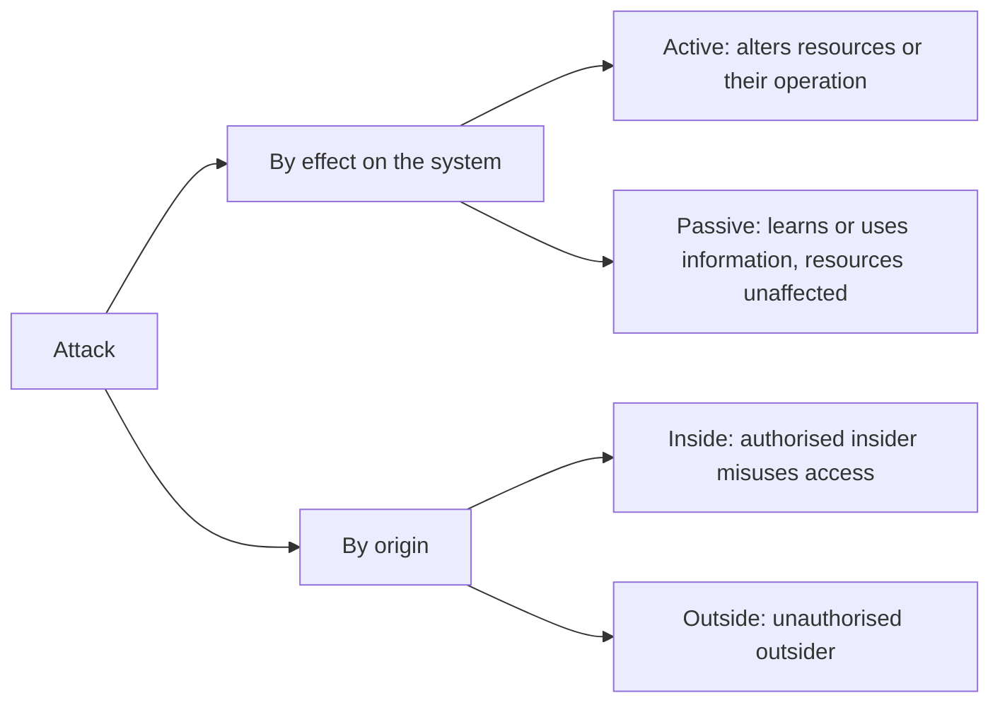
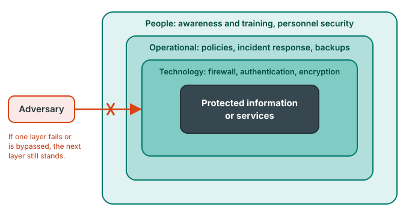

# Unit 1: Computer security concepts

*Courseware Chapter 1, pages 2–14.*

## At a glance

This unit sets up the vocabulary for the whole course. It answers five questions:

- **What is computer security for?** To protect the confidentiality, integrity and availability (the **CIA triad**) of system assets, plus **authenticity** and **accountability**.
- **How bad is a breach?** The three **impact levels**: low, moderate and high.
- **What are we protecting, and from what?** The four categories of **assets**, and the eight core **terms** (threat, vulnerability, risk, attack, …) and how they relate.
- **What should an organisation do?** The 17 **essential security practices**.
- **How should secure systems be designed?** The 13 **fundamental security design principles**.

## What you should be able to do

*The courseware lists no learning outcomes; these are written for this site.*

- Define computer security and explain each element of the CIA triad, including its sub-concepts, and the two extra requirements (authenticity and accountability).
- Draw Fig. 1 and the security concepts and relationships diagram, and explain every label.
- Describe the three impact levels of a security breach and classify a given breach into one of them.
- List the four categories of computer system assets with examples.
- Define the eight security terms and distinguish threat, vulnerability, risk and attack; classify attacks as active or passive, and inside or outside.
- State and explain the 17 essential security practices and recommend the right ones for a scenario.
- List and explain the 13 fundamental security design principles, and spot which principle a design obeys or violates.

## What computer security means: the CIA triad

Chapter 1 opening · p.2

The courseware opens with one definition, and the rest of the chapter grows out of it.

> **Computer Security:** Measures and controls that ensure confidentiality, integrity, and availability of information system assets including hardware, software, firmware, and information being processed, stored, and communicated.

> This definition introduces three key objectives that are at the heart of computer security:
>
> • **Confidentiality:** This term covers two related concepts:
>
> ——**Data confidentiality:** Assures that private or confidential information is not made available or disclosed to unauthorized individuals.
>
> ——**Privacy:** Assures that individuals control or influence what information related to them may be collected and stored and by whom and to whom that information may be disclosed.
>
> • **Integrity:** This term covers two related concepts:
>
> ——**Data integrity:** Assures that information and programs are changed only in a specified and authorized manner.
>
> ——**System integrity:** Assures that a system performs its intended function in an unimpaired manner, free from deliberate or inadvertent unauthorized manipulation of the system.
>
> • **Availability:** Assures that systems work promptly and service is not denied to authorized users.
>
> These three concepts form what is often referred to as the **CIA triad**. The three concepts embody the fundamental security objectives for both data and for information and computing services.

!!! note "In plain terms"
    - **Confidentiality = "only the right people can see it".** *Data confidentiality* is about the organisation keeping secrets from outsiders; *privacy* is about **the individual** deciding what is collected about them and who it is shared with.
    - **Integrity = "nobody changed it wrongly".** *Data integrity* protects the information and programs; *system integrity* protects the **system's behaviour** (it does its job, unmanipulated). Note the phrase "deliberate **or inadvertent**": an accidental misconfiguration is also an integrity failure.
    - **Availability = "it works when the right people need it".**

    The definition also names *what* is protected: **hardware, software, firmware and information**, and information in all three states: **processed, stored and communicated**.

| Objective | Sub-concepts (courseware) | Question it answers | Example of a breach *(site example)* |
|---|---|---|---|
| **Confidentiality** | Data confidentiality; privacy | Who can **see** it? | Exam questions leaked before the exam; a hospital sells patients' records without consent (privacy) |
| **Integrity** | Data integrity; system integrity | Has it been **changed** improperly? | A student's grade altered in the results database (data); malware makes the payroll system pay the wrong accounts (system) |
| **Availability** | (none) | Can authorised users **use** it promptly? | The course-registration portal is knocked offline in registration week |

!!! tip "Exam angle"
    "Define computer security" and "explain the CIA triad" are the most predictable questions in the course. Learn the definition word for word, and remember that **confidentiality and integrity each have two sub-concepts** (four definitions to know) while availability has none. "Differentiate data confidentiality from privacy" and "data integrity from system integrity" are easy (b)-part questions.

!!! warning "Courseware note"
    The courseware prints "Data confidentiality:**1**". The "1" is a footnote marker left over from the original textbook; no footnote appears in the notes. It is not part of the definition.

!!! info "Beyond the notes"
    Chapter 1 closely follows Stallings and Brown, *Computer Security: Principles and Practice*, Chapter 1, which takes the definition of computer security from the NIST *Computer Security Handbook*. The same book's chapter also lists the "essential security practices" (from the US standard FIPS 200) and the impact levels (from FIPS 199). Knowing this helps if you want a second explanation of any point, but answer the exam from the courseware wording.

**Check your understanding**

An online shop collects customers' browsing history and sells it to advertisers without telling them. The data never leaks to hackers. Which concept is violated?

<ul class="quiz-options">
  <li>Data confidentiality</li>
  <li data-correct>Privacy</li>
  <li>Data integrity</li>
  <li>Availability</li>
</ul>

Privacy assures that **individuals control or influence** what information about them is collected and to whom it is disclosed. Here the data is disclosed by the organisation itself, against the individuals' wishes. Data confidentiality is about information being disclosed to **unauthorised individuals**, which is the tempting answer, but the shop is authorised to hold the data; the problem is the individuals' lack of control (CIA triad, p.2).

An administrator accidentally misconfigures a server so that it silently drops some transactions while appearing to work. Which concept is most directly violated?

<ul class="quiz-options">
  <li>Data confidentiality</li>
  <li>Availability</li>
  <li data-correct>System integrity</li>
  <li>Accountability</li>
</ul>

System integrity assures that a system performs its intended function in an unimpaired manner, free from **deliberate or inadvertent** unauthorised manipulation. "Inadvertent" covers accidents. Availability is tempting, but the service is not denied: it is running, just not doing its intended function correctly (CIA triad, p.2).

## Beyond the triad: authenticity and accountability

Chapter 1 opening · p.2; Fig. 1 · p.3

The CIA triad is not the whole story. The courseware adds two more requirements.

> **Authenticity:** The property of being genuine and being able to be verified and trusted; confidence in the validity of a transmission, a message, or message originator. This means verifying that users are who they say they are and that each input arriving at the system came from a trusted source.

> **Accountability:** The security goal that generates the requirement for actions of an entity to be traced uniquely to that entity. This supports nonrepudiation, deterrence, fault isolation, intrusion detection and prevention, and after-action recovery and legal action. Because truly secure systems are not yet an achievable goal, we must be able to trace a security breach to a responsible party. Systems must keep records of their activities to permit later forensic analysis to trace security breaches or to aid in transaction disputes.

!!! note "In plain terms"
    - **Authenticity asks "is it genuine?"** Is this user really who they claim to be (e.g. the login really comes from the account owner)? Did this message really come from the bank? Two targets: the **user** and each **input**.
    - **Accountability asks "who did it?"** Every action must be traceable **uniquely** to one entity. The courseware's reasoning: perfect security is not achievable, so when a breach happens we must at least be able to find the responsible party. That is why systems **keep records** (logs).

    Accountability **supports five things**: nonrepudiation (the person cannot deny the action), deterrence (people behave when they know they are traceable), fault isolation, intrusion detection and prevention, and after-action recovery and legal action.

Together with the triad, these give the five requirements of Fig. 1.

{ .diagram }

Fig. 1: Essential network and computer security requirements (redrawn). The colour coding, separating the CIA triad from the two added requirements, is added by this site.

!!! tip "Exam angle"
    "With the aid of a diagram, explain the essential network and computer security requirements" means: draw the pentagon with **data and services** in the centre and the **five** requirements around it, then define each. Also learn the **five things accountability supports**: a classic "state five…" question.

!!! example "Example"
    When you pay with a bank transfer in a Nigerian bank app, a one-time code sent to your phone supports **authenticity** (it is really you). The bank's transaction log, tied to your account and device, supports **accountability**: if you later claim "I never made that transfer", the log helps resolve the **transaction dispute** (nonrepudiation).

**Check your understanding**

Which of these is NOT listed by the courseware as something accountability supports?

<ul class="quiz-options">
  <li>Nonrepudiation</li>
  <li>Fault isolation</li>
  <li data-correct>Data confidentiality</li>
  <li>After-action recovery and legal action</li>
</ul>

Accountability supports nonrepudiation, deterrence, fault isolation, intrusion detection and prevention, and after-action recovery and legal action. Data confidentiality is a separate objective (part of the CIA triad); tracing actions does not stop disclosure (Authenticity and accountability, p.2).

In Fig. 1, what sits at the centre of the five security requirements?

<ul class="quiz-options">
  <li>Assets</li>
  <li data-correct>Data and services</li>
  <li>Security policy</li>
  <li>Users</li>
</ul>

Fig. 1 places **data and services** in the centre, protected by confidentiality, integrity, availability, authenticity and accountability. This matches the triad's wording: objectives "for both data and for information and computing services" (Fig. 1, p.3).

## Impact levels of a security breach

Impact Levels of Security Breach · pp.3–4

Not every breach is equally serious. The courseware defines three levels of impact for a loss of confidentiality, integrity or availability.

> **Low:** The loss could be expected to have a limited adverse effect on organizational operations, organizational assets, or individuals. A limited adverse effect means that, for example, the loss of confidentiality, integrity, or availability might:
>
> (i) cause a degradation in mission capability to an extent and duration that the organization is able to perform its primary functions, but the effectiveness of the functions is noticeably reduced;
>
> (ii) result in minor damage to organizational assets;
>
> (iii) result in minor financial loss; or
>
> (iv) result in minor harm to individuals.

> **Moderate:** The loss could be expected to have a serious adverse effect on organizational operations, organizational assets, or individuals. A serious adverse effect means that, for example, the loss might:
>
> (i) cause a significant degradation in mission capability to an extent and duration that the organization is able to perform its primary functions, but the effectiveness of the functions is significantly reduced;
>
> (ii) result in significant damage to organizational assets;
>
> (iii) result in significant financial loss; or
>
> (iv) result in significant harm to individuals that does not involve loss of life or serious life-threatening injuries.

> **High:** The loss could be expected to have a severe or catastrophic adverse effect on organizational operations, organizational assets, or individuals. A severe or catastrophic adverse effect means that, for example, the loss might:
>
> (i) cause a severe degradation in or loss of mission capability to an extent and duration that the organization is not able to perform one or more of its primary functions;
>
> (ii) result in major damage to organizational assets;
>
> (iii) result in major financial loss; or
>
> (iv) result in severe or catastrophic harm to individuals involving loss of life or serious life-threatening injuries.

The levels differ in one keyword per criterion. This table lines them up:

| Criterion | Low | Moderate | High |
|---|---|---|---|
| **Adverse effect** | Limited | Serious | Severe or catastrophic |
| **(i) Mission capability** | Degraded; primary functions still performed, effectiveness **noticeably** reduced | Significantly degraded; primary functions still performed, effectiveness **significantly** reduced | Severely degraded or lost; **not able** to perform one or more primary functions |
| **(ii) Damage to assets** | Minor | Significant | Major |
| **(iii) Financial loss** | Minor | Significant | Major |
| **(iv) Harm to individuals** | Minor | Significant, **no** loss of life or serious life-threatening injury | Severe or catastrophic, **involving** loss of life or serious life-threatening injury |

!!! note "In plain terms"
    The two sharpest dividing lines are:

    - **Can the organisation still perform its primary functions?** Yes for low and moderate (just less effectively); **no** (for at least one function) for high.
    - **Is anyone killed or seriously endangered?** Only at **high**. Moderate explicitly excludes loss of life.

    Each level affects the same three targets: **organizational operations, organizational assets, or individuals**.

!!! example "Example"
    For a university portal: a slow login page for an afternoon is **low**; the results database being corrupted so that results are delayed by weeks is **moderate**; for a hospital, ransomware that stops the emergency unit from accessing patient records, putting lives at risk, is **high**.

!!! tip "Exam angle"
    Expect "state the three impact levels and explain each" (recall) and "classify this breach and justify" (scenario). In a scenario answer, quote the deciding criterion: "*the organisation can still perform its primary functions, but effectiveness is significantly reduced, so this is moderate, not high*".

!!! warning "Courseware note"
    The courseware puts a bullet before "High" but not before "Low" and "Moderate". This is only layout: all three are parallel levels.

## Assets of a computer system

Assets · p.4

> The assets of a computer system can be categorized as follows:
>
> • **Hardware:** Including computer systems and other data processing, data storage, and data communications devices.
>
> • **Software:** Including the operating system, system utilities, and applications.
>
> • **Data:** Including files and databases, as well as security-related data, such as password files.
>
> • **Communication facilities and networks:** Local and wide area network communication links, bridges, routers, and so on.

!!! note "In plain terms"
    Four categories: **H**ardware, **S**oftware, **D**ata, **C**ommunication facilities and networks (memory aid: "**H**ard **S**oft **D**ata **C**ommunicates"). Note two details examiners like: **password files** count as *data* (security-related data), and **routers and bridges** count as *communication facilities*, not hardware.

!!! example "Example"
    In a bank branch: ATMs and servers (hardware); the core banking application and the server operating system (software); customer account records and the password database (data); the leased line linking the branch to head office and its routers (communication facilities and networks).

**Check your understanding**

A ransomware attack shuts down a state hospital's patient-records system for three days. Doctors cannot see patient histories in the emergency unit, and two critically ill patients suffer life-threatening complications. What impact level is this?

<ul class="quiz-options">
  <li>Low</li>
  <li>Moderate</li>
  <li data-correct>High</li>
  <li>It cannot be classified without the financial loss</li>
</ul>

High: the hospital is **not able to perform one of its primary functions** and there is **serious life-threatening injury** to individuals. Moderate is wrong because it explicitly covers harm "that does not involve loss of life or serious life-threatening injuries". One criterion is enough; you don't need all four (Impact levels, pp.3–4).

Under the courseware's four asset categories, a file of hashed user passwords belongs to which category?

<ul class="quiz-options">
  <li>Software</li>
  <li data-correct>Data</li>
  <li>Hardware</li>
  <li>Communication facilities and networks</li>
</ul>

The courseware lists "security-related data, such as password files" under **Data**. Software is tempting because passwords are used by the operating system, but the operating system itself is the software asset; the password file is data (Assets, p.4).

## Computer security terminology

Computer Security Terminologies · pp.4–5

The courseware defines eight terms. Learn all eight word for word: they are the building blocks of every later unit.

> **Adversary (threat agent)**
>
> Individual, group, organization, or government that conducts or has the intent to conduct detrimental activities.

> **Attack**
>
> Any kind of malicious activity that attempts to collect, disrupt, deny, degrade, or destroy information system resources or the information itself.

> **Countermeasure**
>
> A device or techniques that has as its objective the impairment of the operational effectiveness of undesirable or adversarial activity, or the prevention of espionage, sabotage, theft, or unauthorized access to or use of sensitive information or information systems.

> **Risk**
>
> A measure of the extent to which an entity is threatened by a potential circumstance or event, and typically a function of ;
>
> 1) the adverse impacts that would arise if the circumstance or event occurs; and
>
> 2) the likelihood of occurrence.

> **Security Policy**
>
> A set of criteria for the provision of security services. It defines and constrains the activities of a data processing facility in order to maintain a condition of security for systems and data.

> **System Resource (Asset)**
>
> A major application, general support system, high impact program, physical plant, mission critical system, personnel, equipment, or a logically related group of systems.

> **Threat**
>
> Any circumstance or event with the potential to adversely impact organizational operations (including mission, functions, image, or reputation), organizational assets, individuals, other organizations, or the Nation through an information system via unauthorized access, destruction, disclosure, modification of information, and/or denial of service.

> **Vulnerability**
>
> Weakness in an information system, system security procedures, internal controls, or implementation that could be exploited or triggered by a threat source.

!!! note "In plain terms: the house analogy"
    | Term | In a house | In a bank's online banking system *(site example)* |
    |---|---|---|
    | **Asset** (system resource) | The house and its contents | Customer accounts, the banking application, staff |
    | **Vulnerability** | A back-door lock that doesn't catch | An unpatched login page that accepts unlimited password guesses |
    | **Threat** | The *possibility* of a burglary | The *possibility* of account takeover via password guessing |
    | **Adversary** (threat agent) | A burglar | A fraud gang |
    | **Attack** | The actual break-in | The gang actually running a password-guessing script |
    | **Countermeasure** | A new lock, burglar bars | Account lockout after five failed attempts; two-factor login |
    | **Risk** | How likely a break-in is × how bad it would be | Likelihood of takeover × the money and trust lost |
    | **Security policy** | House rules ("lock the gate at 9 pm") | "Staff must use two-factor login; passwords change every 90 days" |

    The key distinctions: a **vulnerability** is a *weakness*; a **threat** is a *potential* harmful event; an **attack** is a threat *carried out*; **risk** combines **impact** and **likelihood**.

!!! tip "Exam angle"
    "Differentiate between threat, vulnerability and risk" is a very likely (b) or (c) part. Use the definitions, then the analogy. For risk, always state **both factors**: adverse impact and likelihood of occurrence. For threat, the means are five: **unauthorized access, destruction, disclosure, modification of information, and/or denial of service**.

!!! warning "Courseware note"
    Minor slips in the courseware wording: "A device or techniques that has…" (countermeasure) should read "a device or technique that has…", and "typically a function of ;" has a stray space before the semicolon. They don't change the meaning; quote the definitions as given.

**Check your understanding**

A university's student portal runs an old web server with a known, unpatched flaw. Which term describes the flaw itself?

<ul class="quiz-options">
  <li>Threat</li>
  <li data-correct>Vulnerability</li>
  <li>Attack</li>
  <li>Risk</li>
</ul>

A vulnerability is a **weakness** in an information system or its implementation that could be exploited by a threat source. A threat is the *potential* event (someone exploiting it); an attack is the exploitation actually happening; risk is the measure combining impact and likelihood (Terminology, p.5).

According to the courseware, risk is typically a function of which two factors?

<ul class="quiz-options">
  <li>Threats and vulnerabilities</li>
  <li>Assets and countermeasures</li>
  <li data-correct>The adverse impacts if the event occurs, and the likelihood of occurrence</li>
  <li>The cost of countermeasures and the value of assets</li>
</ul>

The courseware defines risk as a function of (1) the adverse impacts that would arise if the circumstance or event occurs and (2) the likelihood of occurrence. "Threats and vulnerabilities" is a popular textbook shorthand, and is the tempting wrong answer, but it is not the courseware's wording (Terminology, p.5).

## Security concepts and relationships

Security Concepts and relationships · pp.5–6

The courseware draws the eight terms into one picture: who wants what, and how risk goes up or down.

{ .diagram }

Security concepts and relationships (redrawn; the figure is unnumbered in the courseware, p.6). Colours added by this site: owner side teal, threat side orange.

Read the diagram as two opposing sides around the **assets**:

| Side | Arrow (courseware label) | Meaning |
|---|---|---|
| Owners | **Value** → assets | Owners value their assets, which is why they protect them |
| Owners | **Impose** → countermeasures | Owners put countermeasures in place… |
| Countermeasures | **To reduce** → risk | …to reduce the risk |
| Owners | **Wish to minimize** → risk | Owners' goal is to minimise risk |
| Risk | **To** → assets | The risk is a risk *to* the assets |
| Threat agents | **Wish to abuse and/or may damage** → assets | Adversaries want to misuse or harm the assets |
| Threat agents | **Give rise to** → threats | Adversaries create threats |
| Threats | **To** → assets | Threats are directed at the assets |
| Threats | **That increase** → risk | Threats push the risk up |

So **risk sits in the middle of a tug-of-war**: threats increase it, countermeasures reduce it.

The courseware then explains how attacks fit in:

> An attack is a threat that is carried out (threat action) and, if successful, leads to an undesirable violation of security, or threat consequence. The agent carrying out the attack is referred to as an attacker or threat agent. We can distinguish two types of attacks:
>
> • **Active attack:** An attempt to alter system resources or affect their operation.
>
> • **Passive attack:** An attempt to learn or make use of information from the system that does not affect system resources. We can also classify attacks based on the origin of the attack:
>
> • **Inside attack:** Initiated by an entity inside the security perimeter (an "insider"). The insider is authorized to access system resources but uses them in a way not approved by those who granted the authorization.
>
> • **Outside attack:** Initiated from outside the perimeter, by an unauthorized or illegitimate user of the system (an "outsider"). On the Internet, potential outside attackers range from amateur pranksters to organized criminals, international terrorists, and hostile governments.

The two ways the courseware classifies attacks (drawn for this site from the text on p.6).

!!! note "In plain terms"
    - **Threat action** = the attack itself (the threat carried out). **Threat consequence** = the security violation that results if it succeeds.
    - The two classifications are **independent**: every attack is either active or passive **and** either inside or outside. An employee secretly copying customer data is *inside + passive*; a hacker defacing the website is *outside + active*.
    - An **insider is authorised**: the problem is that they use their access "in a way not approved". An **outsider is unauthorised or illegitimate**.
    - Outside attackers range over **four** kinds: amateur pranksters, organized criminals, international terrorists and hostile governments.

!!! tip "Exam angle"
    "With the aid of a diagram, explain the relationship between threats, assets, risk and countermeasures": draw the six boxes and label all nine arrows. "Distinguish between active and passive attacks" and "between inside and outside attacks" are near-certain short questions. Active and passive attacks are covered in more detail in [Unit 2](unit-2-attacks.md).

**Check your understanding**

In the security concepts and relationships diagram, which two things are shown acting on risk in opposite directions?

<ul class="quiz-options">
  <li>Owners increase it; threat agents reduce it</li>
  <li data-correct>Countermeasures reduce it; threats increase it</li>
  <li>Assets increase it; vulnerabilities reduce it</li>
  <li>Security policy reduces it; adversaries increase it</li>
</ul>

Owners impose countermeasures **to reduce** risk, and threats **that increase** risk. Vulnerabilities and security policy do not appear in the diagram at all, so options mentioning them are distractors from the terminology list (Security concepts and relationships, p.6).

A bank's IT officer uses her legitimate database access to quietly read and copy customers' account details to sell them. How is this attack classified?

<ul class="quiz-options">
  <li>Outside, active</li>
  <li>Outside, passive</li>
  <li>Inside, active</li>
  <li data-correct>Inside, passive</li>
</ul>

She is **authorised** but uses her access in a way not approved: an **inside** attack. She only reads and copies, without altering resources or their operation: a **passive** attack. It would be active if she changed balances or deleted records (p.6).

## Essential security practices

Essential Security Practices · pp.6–9

Having defined what can go wrong, the courseware lists what an organisation should do about it. It lists **17** practices (the courseware does not number or count them; the count is ours). Several have numbered sub-points (i), (ii)…, and a "list and explain" answer should include them.

| # | Practice | Sub-points | In one line *(site summary)* |
|---|---|---|---|
| 1 | Access Control | – | Only authorised users, processes and devices, doing only permitted transactions |
| 2 | Awareness and Training | 2 | Make people aware of risks and rules; train staff for their security duties |
| 3 | Audit and Accountability | 2 | Keep audit records; trace actions to individual users |
| 4 | Certification, Accreditation, and Security Assessments | 4 | Assess controls, fix deficiencies, authorise operation, monitor continually |
| 5 | Configuration Management | 2 | Baseline configurations and inventories; enforce secure settings |
| 6 | Contingency Planning | – | Emergency response, backup operations, disaster recovery |
| 7 | Identification and Authentication | – | Identify and verify users, processes and devices before access |
| 8 | Incident Response | 2 | Incident-handling capability; track, document, report incidents |
| 9 | Maintenance | 2 | Timely maintenance; control maintenance tools and people |
| 10 | Media Protection | 3 | Protect media, limit access, sanitise or destroy before disposal |
| 11 | Physical and Environmental Protection | 5 | Physical access, plant, utilities, hazards, environmental controls |
| 12 | Planning | – | Security plans: controls and rules of behaviour |
| 13 | Personnel Security | 3 | Trustworthy staff; protect systems at termination or transfer; sanctions |
| 14 | Risk Assessment | – | Periodically assess risk from operating the systems |
| 15 | Systems and Services Acquisition | 4 | Resources, secure life cycle, software restrictions, secure third parties |
| 16 | System and Communications Protection | 2 | Protect communications at boundaries; secure architecture and engineering |
| 17 | System and Information Integrity | 3 | Fix flaws, protect from malicious code, act on alerts |

The courseware wording, in full:

> **Access Control:** Limit information system access to authorized users, processes acting on behalf of authorized users, or devices (including other information systems) and to the types of transactions and functions that authorized users are permitted to exercise.

> **Awareness and Training:** (i) Ensure that managers and users of organizational information systems are made aware of the security risks associated with their activities and of the applicable laws, regulations, and policies related to the security of organizational information systems; and (ii) ensure that personnel are adequately trained to carry out their assigned information security-related duties and responsibilities.

> **Audit and Accountability:** (i) Create, protect, and retain information system audit records to the extent needed to enable the monitoring, analysis, investigation, and reporting of unlawful, unauthorized, or inappropriate information system activity; and (ii) ensure that the actions of individual information system users can be uniquely traced to those users so they can be held accountable for their actions.

> **Certification, Accreditation, and Security Assessments:** (i) Periodically assess the security controls in organizational information systems to determine if the controls are effective in their application; (ii) develop and implement plans of action designed to correct deficiencies and reduce or eliminate vulnerabilities in organizational information systems; (iii) authorize the operation of organizational information systems and any associated information system connections; and (iv) monitor information system security controls on an ongoing basis to ensure the continued effectiveness of the controls.

> **Configuration Management:** (i) Establish and maintain baseline configurations and inventories of organizational information systems (including hardware, software, firmware, and documentation) throughout the respective system development life cycles; and (ii) establish and enforce security configuration settings for information technology products employed in organizational information systems.

> **Contingency Planning:** Establish, maintain, and implement plans for emergency response, backup operations, and post disaster recovery for organizational information systems to ensure the availability of critical information resources and continuity of operations in emergency situations.

> **Identification and Authentication:** Identify information system users, processes acting on behalf of users, or devices, and authenticate (or verify) the identities of those users, processes, or devices, as a prerequisite to allowing access to organizational information systems.

> **Incident Response:** (i) Establish an operational incident-handling capability for organizational information systems that includes adequate preparation, detection, analysis, containment, recovery, and user-response activities; and (ii) track, document, and report incidents to appropriate organizational officials and/or authorities.

> **Maintenance:** (i) Perform periodic and timely maintenance on organizational information systems; and (ii) provide effective controls on the tools, techniques, mechanisms, and personnel used to conduct information system maintenance.

> **Media Protection:**
>
> (i) Protect information system media, both paper and digital;
>
> (ii) limit access to information on information system media to authorized users; and
>
> (iii) sanitize or destroy information system media before disposal or release for reuse.

> **Physical and Environmental Protection:**
>
> (i) Limit physical access to information systems, equipment, and the respective operating environments to authorized individuals;
>
> (ii) protect the physical plant and support infrastructure for information systems;
>
> (iii) provide supporting utilities for information systems;
>
> (iv) protect information systems against environmental hazards; and
>
> (v) provide appropriate environmental controls in facilities containing information systems.

> **Planning:** Develop, document, periodically update, and implement security plans for organizational information systems that describe the security controls in place or planned for the information systems and the rules of behavior for individuals accessing the information systems.

> **Personnel Security:** (i) Ensure that individuals occupying positions of responsibility within organizations (including third-party service providers) are trustworthy and meet established security criteria for those positions; (ii) ensure that organizational information and information systems are protected during and after personnel actions such as terminations and transfers; and (iii) employ formal sanctions for personnel failing to comply with organizational security policies and procedures.

> **Risk Assessment:** Periodically assess the risk to organizational operations (including mission, functions, image, or reputation), organizational assets, and individuals, resulting from the operation of organizational information systems and the associated processing, storage, or transmission of organizational information.

> **Systems and Services Acquisition:**
>
> (i) Allocate sufficient resources to adequately protect organizational information systems;
>
> (ii) employ system development life cycle processes that incorporate information security considerations;
>
> (iii) employ software usage and installation restrictions; and
>
> (iv) ensure that third-party providers employ adequate security measures to protect information, applications, and/or services outsourced from the organization.

> **System and Communications Protection:** (i) Monitor, control, and protect organizational communications (i.e., information transmitted or received by organizational information systems) at the external boundaries and key internal boundaries of the information systems; and (ii) employ architectural designs, software development techniques, and systems engineering principles that promote effective information security within organizational information systems.

> **System and Information Integrity:**
>
> (i) Identify, report, and correct information and information system flaws in a timely manner;
>
> (ii) provide protection from malicious code at appropriate locations within organizational information systems; and
>
> (iii) monitor information system security alerts and advisories and take appropriate actions in response.

!!! note "In plain terms: a memory aid"
    Seventeen items is a lot. One way to hold them is to sort them by **who does the work** (this grouping is the site's, not the courseware's):

    - **People (3):** Awareness and Training; Personnel Security; Planning (rules of behaviour).
    - **Management and oversight (4):** Risk Assessment; Certification, Accreditation, and Security Assessments; Systems and Services Acquisition; Configuration Management.
    - **Keeping things running (5):** Contingency Planning; Incident Response; Maintenance; Media Protection; Physical and Environmental Protection.
    - **Technical controls (5):** Access Control; Identification and Authentication; Audit and Accountability; System and Communications Protection; System and Information Integrity.

    Some practices pair with the definitions earlier in the unit: **Audit and Accountability** delivers *accountability*; **Identification and Authentication** delivers *authenticity*; **Contingency Planning** protects *availability*; **System and Information Integrity** protects *integrity*.

!!! example "Example"
    A Lagos fintech fires a developer. **Personnel Security (ii)** requires that his access is removed on the day of termination. **Access Control** limits what he could do while employed; **Audit and Accountability** means the logs show what he did; **Incident Response** handles it if he tries to get back in; **Media Protection (iii)** requires his laptop's disk to be wiped before it is given to someone else.

!!! tip "Exam angle"
    You are unlikely to be asked for all 17 in one go, but "explain any five essential security practices" or "explain *Media Protection* and *Physical and Environmental Protection*" are realistic. The practices are also your **toolkit for scenario recommendations**: when a scenario describes a failure, name the practice that would have prevented it and quote its sub-point.

!!! info "Beyond the notes"
    These 17 practices are the minimum security requirements of the US standard **FIPS 200** (2006), each matching a "family" of controls in NIST SP 800-53. Later units go deeper into several of them: [access control](unit-8-access-control.md), [security policy and planning](unit-6-security-policy.md), [malware protection](unit-9-malware.md) and [intrusion detection](unit-12-idps.md).

**Check your understanding**

An organisation gives old office computers to a school without wiping the hard disks. Which essential security practice did it fail?

<ul class="quiz-options">
  <li>Configuration Management</li>
  <li>Maintenance</li>
  <li data-correct>Media Protection</li>
  <li>Physical and Environmental Protection</li>
</ul>

Media Protection (iii): "sanitize or destroy information system media before disposal or release for reuse". Physical and Environmental Protection is tempting because computers are physical, but it covers physical access, plant, utilities and hazards, not data left on disposed media (Essential security practices, p.8).

Which essential security practice includes an incident-handling capability covering "preparation, detection, analysis, containment, recovery, and user-response activities"?

<ul class="quiz-options">
  <li>Contingency Planning</li>
  <li data-correct>Incident Response</li>
  <li>System and Information Integrity</li>
  <li>Audit and Accountability</li>
</ul>

That is Incident Response (i). Contingency Planning is the close neighbour, but it is about plans for **emergency response, backup operations and post-disaster recovery** to keep operations running, not about handling security incidents step by step (Essential security practices, p.7).

## Fundamental security design principles

Fundamental Security Design Principles · pp.9–10

> Despite years of research and development, it has not been possible to develop security design and implementation techniques that systematically exclude security flaws and prevent all unauthorized actions. In the absence of such foolproof techniques, it is useful to have a set of widely agreed design principles that can guide the development of protection mechanisms. The National Centers of Academic Excellence in Information Assurance/Cyber Defense, which is jointly sponsored by the U.S. National Security Agency and the U. S. Department of Homeland Security, list the following as fundamental security design principles:
>
> - Economy of mechanism
> - Fail-safe defaults
> - Complete mediation
> - Open design
> - Separation of privilege
> - Least privilege
> - Least common mechanism
> - Psychological acceptability
> - Isolation
> - Encapsulation
> - Modularity
> - Layering
> - Least astonishment

!!! note "In plain terms"
    **Why principles?** Nobody has found a way to build systems with *no* security flaws. So instead of a foolproof recipe, designers follow agreed rules of thumb. The list comes from the **National Centers of Academic Excellence in Information Assurance/Cyber Defense**, sponsored by the **US National Security Agency (NSA)** and the **US Department of Homeland Security (DHS)**.

    **Memory aid (13 = 8 + 5):** the first **eight** are the classic principles (see the Beyond box below); the last **five** are newer.

    - The 8: "**E**very **F**riendly **C**at **O**pens **S**ardines, **L**icks **L**ightly, **P**urrs" (Economy, Fail-safe, Complete mediation, Open design, Separation of privilege, Least privilege, Least common mechanism, Psychological acceptability).
    - The 5: "**I** **E**at **M**angoes, **L**eaving **L**eftovers" (Isolation, Encapsulation, Modularity, Layering, Least astonishment).

!!! info "Beyond the notes"
    The first eight principles were published by Jerome Saltzer and Michael Schroeder in 1975 ("The Protection of Information in Computer Systems") and are still the core of secure design teaching.

### Economy of mechanism

Fundamental Security Design Principles · p.10

> Economy of mechanism means the design of security measures embodied in both hardware and software should be as simple and small as possible. The motivation for this principle is that relatively simple, small design is easier to test and verify thoroughly. With a complex design, there are many more opportunities for an adversary to discover subtle weaknesses to exploit that may be difficult to spot ahead of time. The more complex the mechanism is, the more likely it is to possess exploitable flaws. Simple mechanisms tend to have fewer exploitable flaws and require less maintenance.

**Keep it simple and small.** Simple designs are easier to test and verify, have fewer exploitable flaws, and need less maintenance. *Violation (site example):* a login system with ten optional legacy routes, each with its own checks.

### Fail-safe defaults

Fundamental Security Design Principles · pp.10–11

> Fail-safe default means access decisions should be based on permission rather than exclusion. That is, the default situation is lack of access, and the protection scheme identifies conditions under which access is permitted. This approach exhibits a better failure mode than the alternative approach, where the default is to permit access. A design or implementation mistake in a mechanism that gives explicit permission tends to fail by refusing permission, a safe situation that can be quickly detected. On the other hand, a design or implementation mistake in a mechanism that explicitly excludes access tends to fail by allowing access, a failure that may long go unnoticed in normal use. For example, most file access systems work on this principle and virtually all protected services on client/server systems work this way.

**Default deny.** Start from "no access" and list who *is* allowed (a permission list), not "everyone" minus a blacklist.

| | Default **deny** (based on permission) | Default **permit** (based on exclusion) |
|---|---|---|
| A mistake causes… | Refusing permission | Allowing access |
| Is the mistake noticed? | **Quickly**: the legitimate user complains | May **long go unnoticed** in normal use |
| Verdict | Fail-safe (better failure mode) | Unsafe |

### Complete mediation

Fundamental Security Design Principles · p.11

> Complete mediation means every access must be checked against the access control mechanism. Systems should not rely on access decisions retrieved from a cache. In a system designed to operate continuously, this principle requires that, if access decisions are remembered for future use, careful consideration be given to how changes in authority are propagated into such local memories. File access systems appear to provide an example of a system that complies with this principle. However, typically, once a user has opened a file, no check is made to see of [sic] permissions change. To fully implement complete mediation, every time a user reads a field or record in a file, or a data item in a database, the system must exercise access control. This resource-intensive approach is rarely used.

**Check every access, every time.** Don't trust a remembered ("cached") decision, because permissions may have changed since. The catch: full complete mediation is **resource-intensive**, so it is **rarely used**. The courseware's example: file systems check permission when a file is *opened*, but not again if permissions change while it is open.

!!! warning "Courseware note"
    "no check is made to see **of** permissions change" should read "to see **if** permissions change".

### Open design

Fundamental Security Design Principles · p.11

> Open design means the design of a security mechanism should be open rather than secret. For example, although encryption keys must be secret, encryption algorithms should be open to public scrutiny. The algorithms can then be reviewed by many experts, and users can therefore have high confidence in them. This is the philosophy behind the National Institute of Standards and Technology (NIST) program of standardizing encryption and hash algorithms, and has led to the widespread adoption of NIST-approved algorithms.

**Secret keys, public algorithms.** Security must not depend on hiding *how* the mechanism works; many experts reviewing it builds confidence. This is the thinking behind **NIST's** standardisation of encryption and hash algorithms. See [Unit 4](unit-4-cryptography.md) for those algorithms.

!!! info "Beyond the notes"
    This is often called **Kerckhoffs's principle**, and its opposite, relying on a secret design, is called "security through obscurity".

### Separation of privilege

Fundamental Security Design Principles · p.11

> Separation of privilege is described as a practice in which multiple privilege attributes are required to achieve access to a restricted resource. A good example of this is multifactor user authentication, which requires the use of multiple techniques, such as a password and a smart card, to authorize a user. The term is also now applied to any technique in which a program is divided into parts that are limited to the specific privileges they require in order to perform a specific task. This is used to mitigate the potential damage of a computer security attack.
>
> One example of this latter interpretation of the principle is removing high privilege operations to another process and running that process with the higher privileges required to perform its tasks. Day-to-day interfaces are executed in a lower privileged process.

Two meanings:

1. **More than one key to open the door:** access needs multiple privilege attributes, e.g. **multifactor authentication** (password **and** smart card).
2. **Split the program:** divide it into parts, each with only the privileges its task needs. Example: high-privilege operations run in a separate process; the day-to-day interface runs with low privileges. Purpose: to **limit the damage** of an attack.

### Least privilege

Fundamental Security Design Principles · p.12

> Least privilege means every process and every user of the system should operate using the least set of privileges necessary to perform the task. A good example of the use of this principle is role-based access control. The system security policy can identify and define the various roles of users or processes. Each role is assigned only those permissions needed to perform its functions. Each permission specifies a permitted access to a particular resource (such as read and write access to a specified file or directory, and connect access to a given host and port). Unless permission is granted explicitly, the user or process should not be able to access the protected resource.

**Give only what the task needs.** The courseware's example is **role-based access control (RBAC)**: define roles, give each role only the permissions it needs, and allow nothing that is not explicitly granted. Role-based access control is covered in [Unit 8](unit-8-access-control.md#role-based-access-control-rbac).

!!! example "Example"
    In a university, a lecturer's role can enter marks only for the courses they teach; the exams officer's role can approve results but not change marks; a student's role can only read their own results.

### Least common mechanism

Fundamental Security Design Principles · p.12

> Least common mechanism means the design should minimize the functions shared by different users, providing mutual security. This principle helps reduce the number of unintended communication paths and reduces the amount of hardware and software on which all users depend, thus making it easier to verify if there are any undesirable security implications.

**Share as little as possible between users.** Shared mechanisms (a shared temporary folder, a shared account) are paths through which one user can affect another. Fewer shared parts means **fewer unintended communication paths** and less that **everyone depends on**, so it is easier to verify.

### Psychological acceptability

Fundamental Security Design Principles · p.12

> Psychological acceptability implies the security mechanisms should not interfere unduly with the work of users, and at the same time meet the needs of those who authorize access. If security mechanisms hinder the usability or accessibility of resources, users may opt to turn off those mechanisms. Where possible, security mechanisms should be transparent to the users of the system or at most introduce minimal obstruction. In addition to not being intrusive or burdensome, security procedures must reflect the user's mental model of protection. If the protection procedures do not make sense to the user or if the user, must translate his or her image of protection into a substantially different protocol, the user is likely to make errors.

**Security people will actually use.** If security gets in the way, users turn it off or work around it. Mechanisms should be **transparent or minimally obstructive** and should match the **user's mental model**, or users make errors. *Violation (site example):* forcing a 20-character password that changes weekly, so staff write it on sticky notes.

### Isolation

Fundamental Security Design Principles · pp.12–13

> Isolation is a principle that applies in three contexts. First, public access systems should be isolated from critical resources (data, processes, etc.) to prevent disclosure or tampering. In cases where the sensitivity or criticality of the information is high, organizations may want to limit the number of systems on which that data are stored and isolate them, either physically or logically. Physical isolation may include ensuring that no physical connection exists between an organization's public access information resources and an organization's critical information. When implementing logical isolation solutions, layers of security services and mechanisms should be established between public systems and secure systems that is responsible for protecting critical resources. Second, the processes and files of individual users should be isolated from one another except where it is explicitly desired. All modern operating systems provide facilities for such isolation, so individual users have separate, isolated process space, memory space, and file space, with protections for preventing unauthorized access. And finally, security mechanisms should be isolated in the sense of preventing access to those mechanisms. For example, logical access control may provide a means of isolating cryptographic software from other parts of the host system and for protecting cryptographic software from tampering and the keys from replacement or disclosure. For example, system programs or administrators who have special privileges should have those privileges only when necessary; when they are doing ordinary activities the privileges should be withdrawn.

The **three contexts** of isolation:

| Context | What is isolated from what | How *(courseware)* |
|---|---|---|
| **1. Public vs critical** | Public access systems from critical resources (data, processes) | **Physical** isolation: no physical connection at all; **logical** isolation: layers of security services and mechanisms between public and secure systems |
| **2. User vs user** | Each user's processes and files from other users' | Operating systems give each user separate process space, memory space and file space |
| **3. Security mechanisms** | The security mechanisms themselves from access | e.g. logical access control isolating cryptographic software from tampering and keys from replacement or disclosure |

!!! warning "Courseware note"
    The last sentence of the Isolation paragraph ("system programs or administrators who have special privileges should have those privileges only when necessary…") describes **least privilege** applied over time (hold privileges only while you need them), not isolation. It appears to have been displaced from the least privilege paragraph (this is an inference). If asked about isolation, give the three contexts; you may use this sentence as an example of least privilege.

### Encapsulation

Fundamental Security Design Principles · p.13

> Encapsulation can be viewed as a specific form of isolation based on object oriented functionality. Protection is provided by encapsulating a collection of procedures and data objects in a domain of its own so that the internal structure of a data object is accessible only to the procedures of the protected subsystem and the procedures may be called only at designated domain entry points.

**Isolation, object-oriented style.** Data and the procedures that use it are wrapped in their own domain. Outsiders can't reach the data directly; they can only call the procedures, and only at **designated entry points**. Think of a bank teller's window: you can't walk into the vault; you can only ask at the counter.

### Modularity

Fundamental Security Design Principles · p.13

> Modularity in the context of security refers both to the development of security functions as separate, protected modules, and to the use of a modular architecture for mechanism design and implementation. With respect to the use of separate security modules, the design goal here is to provide common security functions and services, such as cryptographic functions, as common modules. For example, numerous protocols and applications make use of cryptographic functions. Rather than implementing such functions in each protocol or application, a more secure design is provided by developing a common cryptographic module that can be invoked by numerous protocols and applications. The design and implementation effort can then focus on the secure design and implementation of a single cryptographic module, including mechanisms to protect the module from tampering. With respect to the use of a modular architecture, each security mechanism should be able to support migration to new technology or upgrade of new features without requiring an entire system redesign. The security design should be modular so that individual parts of the security design can be upgraded without the requirement to modify the entire system.

Two senses:

1. **Separate security modules:** build common security functions once, e.g. **one common cryptographic module** used by many protocols and applications, so all the effort goes into making that one module secure and tamper-proof.
2. **Modular architecture:** each part of the security design can be **upgraded or migrated to new technology without redesigning the whole system**.

### Layering

Fundamental Security Design Principles · pp.13–14

> Layering refers to the use of multiple, overlapping protection approaches addressing the people, technology, and operational aspects of information systems. By using multiple, overlapping protection approaches, the failure or circumvention of any individual protection approach will not leave the system unprotected. This approach is often used to provide multiple barriers between an adversary and protected information or services. This technique is often referred to as defense in depth.

**Several overlapping barriers**, covering **people, technology and operational** aspects, so that if one fails or is bypassed the system is still protected. Also called **defense in depth**.

{ .diagram }

Layering (defense in depth). Drawn for this site: the three layers are the courseware's "people, technology, and operational aspects"; the examples in each layer are ours.

### Least astonishment

Fundamental Security Design Principles · p.10

!!! warning "Courseware note"
    **Least astonishment** is the 13th principle in the list, but the courseware **never explains it**: the descriptions stop at Layering. Learn it as part of the list of 13, and use the explanation below if you are asked to explain it.

!!! info "Beyond the notes"
    **Least astonishment** means a program or user interface should always respond in the way that is **least likely to astonish (surprise) the user**. For example, the way authorisation works should be clear enough that a user has a good intuitive understanding of how the security goals map to the security mechanisms. It is close to psychological acceptability: users make mistakes when security behaves in unexpected ways. *Example:* a "Delete" button that only hides a file, while the file stays visible to others, astonishes users and leads to leaks.

### Telling similar principles apart

| Pair | First | Second | One-line difference |
|---|---|---|---|
| Least privilege vs separation of privilege | Each user/process gets the **minimum** privileges for the task | **Multiple** privilege attributes are needed for access (e.g. two factors), or a program is split by privilege | Least = *how much* each one gets; separation = *how many keys* are needed |
| Least privilege vs least common mechanism | Minimises each user's **privileges** | Minimises the **functions shared** between users | Individual rights vs shared components |
| Isolation vs encapsulation | Separates systems, users, or mechanisms (3 contexts) | A **specific form of isolation** based on object-oriented functionality, with designated entry points | Encapsulation is one kind of isolation |
| Layering vs modularity | **Overlapping** barriers in depth | **Separate**, replaceable security modules | Layers stack; modules plug in |
| Economy of mechanism vs open design | Keep the mechanism **simple and small** | Keep the mechanism's design **public** | Size vs secrecy |
| Fail-safe defaults vs complete mediation | **What** the default decision is (deny) | **How often** access is checked (every time) | Default vs frequency |

!!! tip "Exam angle"
    Expect "list the fundamental security design principles" (know all **13**, in order if you can), "explain any four with examples", and a scenario where you must **name the violated principle**. For scenarios, look for these signals: a cached or once-only check (complete mediation); everyone has admin rights (least privilege); a secret home-made algorithm (open design); security users switch off (psychological acceptability); a single firewall and nothing else (layering); "allow all except…" rules (fail-safe defaults).

**Check your understanding**

A firewall rule set ends with "allow everything not listed above". Which principle does this violate?

<ul class="quiz-options">
  <li>Complete mediation</li>
  <li data-correct>Fail-safe defaults</li>
  <li>Least common mechanism</li>
  <li>Economy of mechanism</li>
</ul>

Fail-safe defaults: access decisions should be based on **permission rather than exclusion**, with lack of access as the default. A mistake in an "allow unless excluded" scheme fails by allowing access and may long go unnoticed. Complete mediation is about checking **every** access, not about what the default is (Fail-safe defaults, pp.10–11).

A bank requires both a password and a hardware token before a staff member can approve a large transfer. Which principle does the courseware use this kind of example for?

<ul class="quiz-options">
  <li>Least privilege</li>
  <li>Layering</li>
  <li data-correct>Separation of privilege</li>
  <li>Isolation</li>
</ul>

The courseware's example of separation of privilege is **multifactor user authentication** (a password and a smart card): multiple privilege attributes are needed to access a restricted resource. Least privilege is about the *amount* of privilege, not the number of attributes; layering is about overlapping protection approaches across people, technology and operations (p.11).

Which principle does the courseware describe as "resource-intensive" and "rarely used" in its full form?

<ul class="quiz-options">
  <li>Layering</li>
  <li>Open design</li>
  <li>Encapsulation</li>
  <li data-correct>Complete mediation</li>
</ul>

Fully implementing complete mediation means exercising access control every time a user reads a field or record or a data item, which is resource-intensive and rarely used. Layering adds several barriers but is described as commonly used ("often used to provide multiple barriers") (p.11).

## Key terms

Computer security
:   Measures and controls that ensure confidentiality, integrity, and availability of information system assets including hardware, software, firmware, and information being processed, stored, and communicated.

CIA triad
:   Confidentiality, integrity and availability: the three fundamental security objectives for both data and for information and computing services.

Data confidentiality
:   Assures that private or confidential information is not made available or disclosed to unauthorized individuals.

Privacy
:   Assures that individuals control or influence what information related to them may be collected and stored, and by whom and to whom it may be disclosed.

Data integrity
:   Assures that information and programs are changed only in a specified and authorized manner.

System integrity
:   Assures that a system performs its intended function in an unimpaired manner, free from deliberate or inadvertent unauthorized manipulation.

Availability
:   Assures that systems work promptly and service is not denied to authorized users.

Authenticity
:   The property of being genuine and able to be verified and trusted; confidence in the validity of a transmission, a message, or message originator.

Accountability
:   The security goal that requires actions of an entity to be traced uniquely to that entity; supports nonrepudiation, deterrence, fault isolation, intrusion detection and prevention, and after-action recovery and legal action.

Impact levels
:   The three levels of adverse effect of a security breach: low (limited), moderate (serious) and high (severe or catastrophic).

Adversary (threat agent)
:   Individual, group, organization, or government that conducts or has the intent to conduct detrimental activities.

Attack
:   Any kind of malicious activity that attempts to collect, disrupt, deny, degrade, or destroy information system resources or the information itself; a threat that is carried out (threat action).

Countermeasure
:   A device or technique whose objective is to impair adversarial activity, or prevent espionage, sabotage, theft, or unauthorized access to or use of sensitive information or information systems.

Risk
:   A measure of the extent to which an entity is threatened by a potential circumstance or event; typically a function of the adverse impacts if it occurs and the likelihood of occurrence.

Security policy
:   A set of criteria for the provision of security services; it defines and constrains the activities of a data processing facility to maintain security for systems and data.

System resource (asset)
:   A major application, general support system, high impact program, physical plant, mission critical system, personnel, equipment, or a logically related group of systems.

Threat
:   Any circumstance or event with the potential to adversely impact operations, assets, individuals, other organizations, or the Nation through an information system via unauthorized access, destruction, disclosure, modification of information, and/or denial of service.

Vulnerability
:   Weakness in an information system, system security procedures, internal controls, or implementation that could be exploited or triggered by a threat source.

Threat consequence
:   The undesirable violation of security that results from a successful attack (threat action).

Active attack
:   An attempt to alter system resources or affect their operation.

Passive attack
:   An attempt to learn or make use of information from the system that does not affect system resources.

Inside attack
:   An attack initiated by an authorized entity inside the security perimeter (an insider) who uses resources in a way not approved.

Outside attack
:   An attack initiated from outside the perimeter by an unauthorized or illegitimate user of the system (an outsider).

Essential security practices
:   The 17 practices listed in Chapter 1, from access control to system and information integrity, that an organisation should carry out to protect its information systems.

Economy of mechanism
:   Security measures in hardware and software should be as simple and small as possible.

Fail-safe defaults
:   Access decisions should be based on permission rather than exclusion; the default is lack of access.

Complete mediation
:   Every access must be checked against the access control mechanism, without relying on cached decisions.

Open design
:   The design of a security mechanism should be open rather than secret (keys secret, algorithms public).

Separation of privilege
:   Multiple privilege attributes are required to access a restricted resource; also, dividing a program into parts limited to the privileges each needs.

Least privilege
:   Every process and user should operate using the least set of privileges necessary to perform the task.

Least common mechanism
:   The design should minimize the functions shared by different users, providing mutual security.

Psychological acceptability
:   Security mechanisms should not interfere unduly with users' work and should reflect the user's mental model of protection.

Isolation
:   Separating public systems from critical resources, users' processes and files from each other, and security mechanisms from access.

Encapsulation
:   A specific form of isolation based on object-oriented functionality: data reachable only through the protected subsystem's procedures at designated entry points.

Modularity
:   Developing security functions as separate protected modules, and using a modular architecture so parts can be upgraded without redesigning the whole system.

Layering (defense in depth)
:   Using multiple, overlapping protection approaches addressing people, technology and operations, so that one failure does not leave the system unprotected.

Least astonishment
:   Listed as a design principle but not explained in the courseware; a system should respond in the way least likely to surprise the user.

---

## Unit summary

- **Computer security** = measures and controls ensuring the **confidentiality, integrity and availability** of information system assets (hardware, software, firmware, information processed, stored and communicated).
- **CIA triad:** confidentiality (data confidentiality + privacy); integrity (data integrity + system integrity); availability. Plus **authenticity** (genuine, verifiable: users are who they say; inputs from trusted sources) and **accountability** (actions traced uniquely to an entity; supports nonrepudiation, deterrence, fault isolation, intrusion detection and prevention, after-action recovery and legal action; requires records for forensic analysis and transaction disputes). **Fig. 1** puts all five around *data and services*.
- **Impact levels:** low (limited), moderate (serious), high (severe or catastrophic), each judged on (i) mission capability, (ii) damage to assets, (iii) financial loss, (iv) harm to individuals. Only high stops primary functions or involves loss of life.
- **Assets (4):** hardware; software; data (including password files); communication facilities and networks.
- **Terminology (8):** adversary (threat agent), attack, countermeasure, risk (impact × likelihood), security policy, system resource (asset), threat, vulnerability.
- **Concepts and relationships:** owners value assets, impose countermeasures to reduce risk, wish to minimise risk; threat agents wish to abuse or damage assets and give rise to threats, which increase risk to assets. **Attacks** are threats carried out (threat action → threat consequence): **active vs passive** by effect, **inside vs outside** by origin.
- **Essential security practices (17):** access control; awareness and training; audit and accountability; certification, accreditation and security assessments; configuration management; contingency planning; identification and authentication; incident response; maintenance; media protection; physical and environmental protection; planning; personnel security; risk assessment; systems and services acquisition; system and communications protection; system and information integrity.
- **Design principles (13)** from the NSA/DHS-sponsored National Centers of Academic Excellence: economy of mechanism, fail-safe defaults, complete mediation, open design, separation of privilege, least privilege, least common mechanism, psychological acceptability, isolation (3 contexts), encapsulation, modularity (2 senses), layering (defense in depth), least astonishment (listed but not explained).

## Mixed review

Keeping detailed, tamper-protected logs so that every action can be traced to a specific user most directly delivers which security requirement, through which essential practice?

<ul class="quiz-options">
  <li>Authenticity, through Identification and Authentication</li>
  <li data-correct>Accountability, through Audit and Accountability</li>
  <li>Integrity, through System and Information Integrity</li>
  <li>Availability, through Contingency Planning</li>
</ul>

Accountability requires that actions be traced uniquely to an entity, and the courseware says systems must keep records for later forensic analysis. The practice Audit and Accountability (i) creates, protects and retains audit records and (ii) ensures actions can be uniquely traced. Authenticity is about verifying identity *before* access, not tracing actions afterwards.

An attacker floods a university's e-learning server so that students cannot submit assignments for two days. Which pair is correct?

<ul class="quiz-options">
  <li>Passive attack; violates confidentiality</li>
  <li data-correct>Active attack; violates availability</li>
  <li>Active attack; violates data integrity</li>
  <li>Passive attack; violates availability</li>
</ul>

Flooding affects the server's **operation**, so it is active, and it denies service to authorised users, so it violates availability. Passive attacks only learn or use information without affecting resources, so they cannot deny service.

Which statement correctly links a design principle to an essential security practice?

<ul class="quiz-options">
  <li>Open design is the same as the Planning practice</li>
  <li data-correct>Least privilege supports the Access Control practice's limit on "the types of transactions and functions that authorized users are permitted to exercise"</li>
  <li>Layering is the same as Configuration Management</li>
  <li>Fail-safe defaults require Media Protection</li>
</ul>

Access Control limits users to permitted transactions and functions, and least privilege says each user gets only the privileges the task needs: the principle guides how the practice is designed. The other links are made up: Planning is about security plans, Configuration Management about baselines and settings.

Which item is a <em>vulnerability</em> rather than a threat, attack or countermeasure?

<ul class="quiz-options">
  <li>A hacking group that targets Nigerian banks</li>
  <li>An attempted login using stolen passwords</li>
  <li data-correct>Staff who have never been trained to recognise phishing emails</li>
  <li>Two-factor authentication on staff accounts</li>
</ul>

Untrained staff are a weakness in "system security procedures [or] internal controls" that a threat source could exploit: a vulnerability. The hacking group is an adversary (threat agent), the login attempt is an attack, and two-factor authentication is a countermeasure. The fix is the Awareness and Training practice.

## Recall drill

Every definition, list, comparison and figure in Chapter 1, as a short question. Answer aloud or on paper, then open the answer.

### Computer security and the CIA triad

**R1.** Define *computer security*.

??? success "Answer"
    Measures and controls that ensure confidentiality, integrity, and availability of information system assets including hardware, software, firmware, and information being processed, stored, and communicated.

**R2.** State the three key objectives introduced by the definition of computer security. What are they collectively called?

??? success "Answer"
    Confidentiality, integrity and availability, collectively the **CIA triad**. They embody the fundamental security objectives for both data and for information and computing services.

**R3.** Confidentiality covers two related concepts. Name and define them.

??? success "Answer"
    **Data confidentiality:** assures that private or confidential information is not made available or disclosed to unauthorized individuals. **Privacy:** assures that individuals control or influence what information related to them may be collected and stored and by whom and to whom that information may be disclosed.

**R4.** Integrity covers two related concepts. Name and define them.

??? success "Answer"
    **Data integrity:** assures that information and programs are changed only in a specified and authorized manner. **System integrity:** assures that a system performs its intended function in an unimpaired manner, free from deliberate or inadvertent unauthorized manipulation of the system.

**R5.** Define *availability*.

??? success "Answer"
    Assures that systems work promptly and service is not denied to authorized users.

**R6.** Differentiate between data confidentiality and privacy.

??? success "Answer"
    Data confidentiality is about keeping private or confidential information from **unauthorized individuals**. Privacy is about **individuals** controlling or influencing what information **about them** is collected, stored, and disclosed, by whom and to whom. A breach of privacy can occur even when only authorised parties handle the data.

**R7.** Differentiate between data integrity and system integrity.

??? success "Answer"
    Data integrity protects **information and programs** from being changed except in a specified and authorized manner. System integrity protects the **system's function**: it performs as intended, unimpaired, free from deliberate or inadvertent unauthorized manipulation.

**R8.** State the four kinds of information system assets named in the definition of computer security, and the three states of information.

??? success "Answer"
    Hardware, software, firmware, and information; information being **processed, stored, and communicated**.

### Authenticity, accountability and Fig. 1

**R9.** Define *authenticity*. What does it mean in practice?

??? success "Answer"
    The property of being genuine and being able to be verified and trusted; confidence in the validity of a transmission, a message, or message originator. In practice: verifying that users are who they say they are and that each input arriving at the system came from a trusted source.

**R10.** Define *accountability*.

??? success "Answer"
    The security goal that generates the requirement for actions of an entity to be traced uniquely to that entity.

**R11.** List five things that accountability supports.

??? success "Answer"
    Nonrepudiation; deterrence; fault isolation; intrusion detection and prevention; after-action recovery and legal action.

**R12.** Why, according to the courseware, must systems be able to trace a security breach to a responsible party, and what must they do to make this possible?

??? success "Answer"
    Because truly secure systems are not yet an achievable goal. Systems must keep records of their activities to permit later forensic analysis to trace security breaches or to aid in transaction disputes.

**R13.** With the aid of a diagram, state the five essential network and computer security requirements (Fig. 1).

??? success "Answer"
    A pentagon with **data and services** at the centre, surrounded by **confidentiality, integrity, availability, authenticity and accountability**. (See the [Fig. 1 redrawing](#beyond-the-triad-authenticity-and-accountability).)

### Impact levels

**R14.** Name the three impact levels of a security breach and the type of adverse effect for each.

??? success "Answer"
    **Low:** limited adverse effect. **Moderate:** serious adverse effect. **High:** severe or catastrophic adverse effect. Each is an effect on organizational operations, organizational assets, or individuals.

**R15.** Explain the *low* impact level and state its four example effects.

??? success "Answer"
    The loss could be expected to have a limited adverse effect on organizational operations, organizational assets, or individuals. The loss might (i) cause a degradation in mission capability to an extent and duration that the organization is able to perform its primary functions, but the effectiveness of the functions is noticeably reduced; (ii) result in minor damage to organizational assets; (iii) result in minor financial loss; or (iv) result in minor harm to individuals.

**R16.** Explain the *moderate* impact level and state its four example effects.

??? success "Answer"
    The loss could be expected to have a serious adverse effect. It might (i) cause a significant degradation in mission capability to an extent and duration that the organization is able to perform its primary functions, but the effectiveness of the functions is significantly reduced; (ii) result in significant damage to organizational assets; (iii) result in significant financial loss; or (iv) result in significant harm to individuals that does not involve loss of life or serious life-threatening injuries.

**R17.** Explain the *high* impact level and state its four example effects.

??? success "Answer"
    The loss could be expected to have a severe or catastrophic adverse effect. It might (i) cause a severe degradation in or loss of mission capability to an extent and duration that the organization is not able to perform one or more of its primary functions; (ii) result in major damage to organizational assets; (iii) result in major financial loss; or (iv) result in severe or catastrophic harm to individuals involving loss of life or serious life-threatening injuries.

**R18.** Differentiate between moderate and high impact in terms of mission capability and harm to individuals.

??? success "Answer"
    **Mission capability:** moderate = significant degradation, but the organization can still perform its primary functions; high = severe degradation or loss, the organization is **not able** to perform one or more primary functions. **Harm:** moderate = significant harm **not** involving loss of life or serious life-threatening injuries; high = severe or catastrophic harm **involving** loss of life or serious life-threatening injuries.

### Assets

**R19.** List and explain the four categories of assets of a computer system.

??? success "Answer"
    **Hardware:** computer systems and other data processing, data storage, and data communications devices. **Software:** the operating system, system utilities, and applications. **Data:** files and databases, as well as security-related data, such as password files. **Communication facilities and networks:** local and wide area network communication links, bridges, routers, and so on.

### Terminology

**R20.** Define *adversary (threat agent)*.

??? success "Answer"
    Individual, group, organization, or government that conducts or has the intent to conduct detrimental activities.

**R21.** Define *attack*.

??? success "Answer"
    Any kind of malicious activity that attempts to collect, disrupt, deny, degrade, or destroy information system resources or the information itself.

**R22.** Define *countermeasure*.

??? success "Answer"
    A device or techniques that has as its objective the impairment of the operational effectiveness of undesirable or adversarial activity, or the prevention of espionage, sabotage, theft, or unauthorized access to or use of sensitive information or information systems.

**R23.** Define *risk* and state the two factors it is typically a function of.

??? success "Answer"
    A measure of the extent to which an entity is threatened by a potential circumstance or event, and typically a function of (1) the adverse impacts that would arise if the circumstance or event occurs; and (2) the likelihood of occurrence.

**R24.** Define *security policy*.

??? success "Answer"
    A set of criteria for the provision of security services. It defines and constrains the activities of a data processing facility in order to maintain a condition of security for systems and data.

**R25.** Define *system resource (asset)*.

??? success "Answer"
    A major application, general support system, high impact program, physical plant, mission critical system, personnel, equipment, or a logically related group of systems.

**R26.** Define *threat*. Through which five means can a threat impact an organisation via an information system?

??? success "Answer"
    Any circumstance or event with the potential to adversely impact organizational operations (including mission, functions, image, or reputation), organizational assets, individuals, other organizations, or the Nation through an information system via **unauthorized access, destruction, disclosure, modification of information, and/or denial of service**.

**R27.** Define *vulnerability*.

??? success "Answer"
    Weakness in an information system, system security procedures, internal controls, or implementation that could be exploited or triggered by a threat source.

**R28.** Differentiate between threat, vulnerability and risk.

??? success "Answer"
    A **vulnerability** is a *weakness* that could be exploited by a threat source. A **threat** is a *potential* circumstance or event that could adversely impact the organisation (e.g. by exploiting a vulnerability). **Risk** *measures* how far the entity is threatened, as a function of the adverse impact and the likelihood of occurrence.

**R29.** Differentiate between a threat and an attack.

??? success "Answer"
    A threat is a **potential** circumstance or event with the potential to cause harm. An attack is a threat that is **carried out** (threat action): malicious activity that attempts to collect, disrupt, deny, degrade, or destroy resources or information.

### Security concepts and relationships

**R30.** With the aid of a diagram, explain the relationships between owners, assets, countermeasures, risk, threat agents and threats.

??? success "Answer"
    Owners **value** assets; owners **impose** countermeasures **to reduce** risk; owners **wish to minimize** risk; risk is **to** assets. Threat agents **wish to abuse and/or may damage** assets; threat agents **give rise to** threats; threats are **to** assets; threats **increase** risk. (See the [redrawn diagram](#security-concepts-and-relationships).)

**R31.** Define an attack in terms of threat action and threat consequence. What is the agent carrying it out called?

??? success "Answer"
    An attack is a threat that is carried out (**threat action**) and, if successful, leads to an undesirable violation of security, or **threat consequence**. The agent is called an **attacker** or **threat agent**.

**R32.** Distinguish between active and passive attacks.

??? success "Answer"
    **Active attack:** an attempt to alter system resources or affect their operation. **Passive attack:** an attempt to learn or make use of information from the system that does not affect system resources.

**R33.** Distinguish between inside and outside attacks.

??? success "Answer"
    **Inside attack:** initiated by an entity inside the security perimeter (an "insider"), who is authorized to access system resources but uses them in a way not approved by those who granted the authorization. **Outside attack:** initiated from outside the perimeter, by an unauthorized or illegitimate user of the system (an "outsider").

**R34.** State the range of potential outside attackers on the Internet named by the courseware.

??? success "Answer"
    From amateur pranksters to organized criminals, international terrorists, and hostile governments (four kinds).

### Essential security practices

**R35.** List the essential security practices. (There are 17.)

??? success "Answer"
    Access Control; Awareness and Training; Audit and Accountability; Certification, Accreditation, and Security Assessments; Configuration Management; Contingency Planning; Identification and Authentication; Incident Response; Maintenance; Media Protection; Physical and Environmental Protection; Planning; Personnel Security; Risk Assessment; Systems and Services Acquisition; System and Communications Protection; System and Information Integrity.

**R36.** Explain the *Access Control* practice.

??? success "Answer"
    Limit information system access to authorized users, processes acting on behalf of authorized users, or devices (including other information systems) and to the types of transactions and functions that authorized users are permitted to exercise.

**R37.** State the two parts of *Awareness and Training*.

??? success "Answer"
    (i) Ensure that managers and users of organizational information systems are made aware of the security risks associated with their activities and of the applicable laws, regulations, and policies related to the security of organizational information systems; (ii) ensure that personnel are adequately trained to carry out their assigned information security-related duties and responsibilities.

**R38.** State the two parts of *Audit and Accountability*.

??? success "Answer"
    (i) Create, protect, and retain information system audit records to the extent needed to enable the monitoring, analysis, investigation, and reporting of unlawful, unauthorized, or inappropriate information system activity; (ii) ensure that the actions of individual information system users can be uniquely traced to those users so they can be held accountable for their actions.

**R39.** State the four parts of *Certification, Accreditation, and Security Assessments*.

??? success "Answer"
    (i) Periodically assess the security controls to determine if the controls are effective in their application; (ii) develop and implement plans of action designed to correct deficiencies and reduce or eliminate vulnerabilities; (iii) authorize the operation of organizational information systems and any associated information system connections; (iv) monitor information system security controls on an ongoing basis to ensure the continued effectiveness of the controls.

**R40.** State the two parts of *Configuration Management*.

??? success "Answer"
    (i) Establish and maintain baseline configurations and inventories of organizational information systems (including hardware, software, firmware, and documentation) throughout the respective system development life cycles; (ii) establish and enforce security configuration settings for information technology products employed in organizational information systems.

**R41.** Explain *Contingency Planning*.

??? success "Answer"
    Establish, maintain, and implement plans for emergency response, backup operations, and post disaster recovery for organizational information systems to ensure the availability of critical information resources and continuity of operations in emergency situations.

**R42.** Explain *Identification and Authentication*.

??? success "Answer"
    Identify information system users, processes acting on behalf of users, or devices, and authenticate (or verify) the identities of those users, processes, or devices, as a prerequisite to allowing access to organizational information systems.

**R43.** State the two parts of *Incident Response*, and list the six activities an incident-handling capability includes.

??? success "Answer"
    (i) Establish an operational incident-handling capability that includes adequate **preparation, detection, analysis, containment, recovery, and user-response** activities; (ii) track, document, and report incidents to appropriate organizational officials and/or authorities.

**R44.** State the two parts of *Maintenance*.

??? success "Answer"
    (i) Perform periodic and timely maintenance on organizational information systems; (ii) provide effective controls on the tools, techniques, mechanisms, and personnel used to conduct information system maintenance.

**R45.** State the three parts of *Media Protection*.

??? success "Answer"
    (i) Protect information system media, both paper and digital; (ii) limit access to information on information system media to authorized users; (iii) sanitize or destroy information system media before disposal or release for reuse.

**R46.** State the five parts of *Physical and Environmental Protection*.

??? success "Answer"
    (i) Limit physical access to information systems, equipment, and the respective operating environments to authorized individuals; (ii) protect the physical plant and support infrastructure for information systems; (iii) provide supporting utilities for information systems; (iv) protect information systems against environmental hazards; (v) provide appropriate environmental controls in facilities containing information systems.

**R47.** Explain the *Planning* practice.

??? success "Answer"
    Develop, document, periodically update, and implement security plans for organizational information systems that describe the security controls in place or planned for the information systems and the rules of behavior for individuals accessing the information systems.

**R48.** State the three parts of *Personnel Security*.

??? success "Answer"
    (i) Ensure that individuals occupying positions of responsibility within organizations (including third-party service providers) are trustworthy and meet established security criteria for those positions; (ii) ensure that organizational information and information systems are protected during and after personnel actions such as terminations and transfers; (iii) employ formal sanctions for personnel failing to comply with organizational security policies and procedures.

**R49.** Explain *Risk Assessment*.

??? success "Answer"
    Periodically assess the risk to organizational operations (including mission, functions, image, or reputation), organizational assets, and individuals, resulting from the operation of organizational information systems and the associated processing, storage, or transmission of organizational information.

**R50.** State the four parts of *Systems and Services Acquisition*.

??? success "Answer"
    (i) Allocate sufficient resources to adequately protect organizational information systems; (ii) employ system development life cycle processes that incorporate information security considerations; (iii) employ software usage and installation restrictions; (iv) ensure that third-party providers employ adequate security measures to protect information, applications, and/or services outsourced from the organization.

**R51.** State the two parts of *System and Communications Protection*.

??? success "Answer"
    (i) Monitor, control, and protect organizational communications (i.e., information transmitted or received by organizational information systems) at the external boundaries and key internal boundaries of the information systems; (ii) employ architectural designs, software development techniques, and systems engineering principles that promote effective information security within organizational information systems.

**R52.** State the three parts of *System and Information Integrity*.

??? success "Answer"
    (i) Identify, report, and correct information and information system flaws in a timely manner; (ii) provide protection from malicious code at appropriate locations within organizational information systems; (iii) monitor information system security alerts and advisories and take appropriate actions in response.

### Fundamental security design principles

**R53.** Why are fundamental security design principles needed, and which body lists them? Who sponsors it?

??? success "Answer"
    Because despite years of research and development it has not been possible to develop design and implementation techniques that systematically exclude security flaws and prevent all unauthorized actions; in the absence of foolproof techniques, widely agreed principles guide the development of protection mechanisms. They are listed by the **National Centers of Academic Excellence in Information Assurance/Cyber Defense**, jointly sponsored by the **U.S. National Security Agency** and the **U.S. Department of Homeland Security**.

**R54.** List the fundamental security design principles. (There are 13.)

??? success "Answer"
    Economy of mechanism; fail-safe defaults; complete mediation; open design; separation of privilege; least privilege; least common mechanism; psychological acceptability; isolation; encapsulation; modularity; layering; least astonishment.

**R55.** Explain *economy of mechanism* and its motivation.

??? success "Answer"
    The design of security measures embodied in both hardware and software should be as simple and small as possible. Motivation: a relatively simple, small design is easier to test and verify thoroughly; with a complex design there are more opportunities for an adversary to discover subtle weaknesses; the more complex the mechanism, the more likely it has exploitable flaws. Simple mechanisms tend to have fewer exploitable flaws and require less maintenance.

**R56.** Explain *fail-safe defaults*. Why is it a better failure mode? Give the courseware's example.

??? success "Answer"
    Access decisions should be based on permission rather than exclusion: the default situation is lack of access, and the protection scheme identifies conditions under which access is permitted. A mistake in a mechanism that gives explicit permission tends to fail by **refusing permission**, a safe situation that can be quickly detected; a mistake in a mechanism that explicitly excludes access tends to fail by **allowing access**, which may long go unnoticed. Example: most file access systems and virtually all protected services on client/server systems.

**R57.** Explain *complete mediation*. Why is it rarely fully implemented?

??? success "Answer"
    Every access must be checked against the access control mechanism; systems should not rely on access decisions retrieved from a cache. If decisions are remembered, careful consideration must be given to how changes in authority are propagated into such local memories. Full implementation means exercising access control every time a user reads a field or record in a file, or a data item in a database; this is **resource-intensive**, so rarely used. (File systems typically check only when a file is opened.)

**R58.** Explain *open design* with the courseware's example.

??? success "Answer"
    The design of a security mechanism should be open rather than secret. Although encryption keys must be secret, encryption algorithms should be open to public scrutiny, so they can be reviewed by many experts and users can have high confidence in them. This is the philosophy behind NIST's program of standardizing encryption and hash algorithms, which led to widespread adoption of NIST-approved algorithms.

**R59.** Explain the two meanings of *separation of privilege*, with an example of each.

??? success "Answer"
    (1) A practice in which multiple privilege attributes are required to achieve access to a restricted resource, e.g. **multifactor user authentication** (a password and a smart card). (2) Any technique in which a program is divided into parts limited to the specific privileges they require for a specific task, to mitigate the potential damage of an attack, e.g. removing high-privilege operations to another process that runs with higher privileges, while day-to-day interfaces run in a lower-privileged process.

**R60.** Explain *least privilege* with the courseware's example.

??? success "Answer"
    Every process and every user should operate using the least set of privileges necessary to perform the task. Example: **role-based access control**: the security policy defines roles; each role is assigned only the permissions needed for its functions; each permission specifies a permitted access to a resource (e.g. read/write to a file or directory, connect access to a host and port); unless permission is granted explicitly, the user or process cannot access the resource.

**R61.** Explain *least common mechanism* and its benefits.

??? success "Answer"
    The design should minimize the functions shared by different users, providing mutual security. It reduces the number of unintended communication paths and the amount of hardware and software on which all users depend, making it easier to verify if there are any undesirable security implications.

**R62.** Explain *psychological acceptability*.

??? success "Answer"
    Security mechanisms should not interfere unduly with the work of users, while meeting the needs of those who authorize access. If mechanisms hinder usability or accessibility, users may turn them off. Mechanisms should be transparent or introduce minimal obstruction, and procedures must reflect the user's mental model of protection; otherwise the user is likely to make errors.

**R63.** Isolation applies in three contexts. Explain them.

??? success "Answer"
    (1) **Public access systems** should be isolated from **critical resources** (data, processes) to prevent disclosure or tampering, physically or logically. (2) The **processes and files of individual users** should be isolated from one another except where explicitly desired (separate process, memory and file space). (3) **Security mechanisms** should be isolated in the sense of preventing access to them, e.g. logical access control isolating cryptographic software from tampering and keys from replacement or disclosure.

**R64.** Differentiate between physical and logical isolation.

??? success "Answer"
    **Physical isolation:** ensuring that no physical connection exists between an organization's public access information resources and its critical information. **Logical isolation:** establishing layers of security services and mechanisms between public systems and secure systems responsible for protecting critical resources.

**R65.** Explain *encapsulation*.

??? success "Answer"
    A specific form of isolation based on object-oriented functionality. Protection is provided by encapsulating a collection of procedures and data objects in a domain of its own so that the internal structure of a data object is accessible only to the procedures of the protected subsystem, and the procedures may be called only at designated domain entry points.

**R66.** Explain the two senses of *modularity* in security.

??? success "Answer"
    (1) **Separate, protected security modules:** common security functions (e.g. cryptographic functions) provided as common modules, e.g. one common cryptographic module invoked by many protocols and applications, so effort focuses on securing that single module. (2) **Modular architecture:** each security mechanism can migrate to new technology or be upgraded without an entire system redesign; parts can be upgraded without modifying the entire system.

**R67.** Explain *layering*. What is it also called, and which three aspects does it address?

??? success "Answer"
    The use of multiple, overlapping protection approaches addressing the **people, technology, and operational** aspects of information systems, so that the failure or circumvention of any individual approach will not leave the system unprotected; it provides multiple barriers between an adversary and protected information or services. Also called **defense in depth**.

**R68.** What does the courseware say about *least astonishment*?

??? success "Answer"
    Only that it is the 13th fundamental security design principle; it is listed but not explained. (Standard meaning, from outside the notes: a system should respond in the way least likely to astonish the user, so users understand how security goals map to mechanisms.)

**R69.** Differentiate between least privilege and separation of privilege.

??? success "Answer"
    Least privilege: each user or process operates with the **least set of privileges** needed for the task (e.g. RBAC). Separation of privilege: **multiple privilege attributes** are needed to access a resource (e.g. multifactor authentication), or a program is **divided** into parts each limited to the privileges its task needs.

**R70.** Differentiate between isolation and encapsulation.

??? success "Answer"
    Isolation is the general principle of separating public from critical systems, users from each other, and security mechanisms from access. Encapsulation is a **specific form** of isolation based on object-oriented functionality: data objects are reachable only through the protected subsystem's procedures, called at designated entry points.

## Practice exercises

**Exercise 1: Name the term.** For a hospital's records system, classify each item as *asset, vulnerability, threat, adversary, attack, countermeasure* or *risk*.

1. A disgruntled former nurse.
2. The patient-records database.
3. The admin account still uses the default password "admin123".
4. The possibility that someone deletes records through the admin account.
5. Someone actually logging in with "admin123" and deleting records.
6. Changing the password and enabling account lockout.
7. "There is a 30% chance of this in the next year, and it would stop the emergency unit for days."

??? success "Answer"
    1 adversary (threat agent); 2 asset (data); 3 vulnerability; 4 threat; 5 attack (active; inside if the nurse's access was still valid, otherwise outside); 6 countermeasure; 7 risk (likelihood and adverse impact).

**Exercise 2: Which CIA element?** Name the objective (and sub-concept where there is one) violated in each case.

1. A hacker changes the account number on a pending salary payment.
2. Exam results are published on a notice board with students' phone numbers, without their consent.
3. A power surge takes the university's mail server offline for a day.
4. Spyware intercepts a company's confidential bid documents.

??? success "Answer"
    1 integrity (data integrity); 2 confidentiality (privacy: individuals did not control the disclosure); 3 availability; 4 confidentiality (data confidentiality).

**Exercise 3: Classify the impact level.** Give the level and the deciding criterion.

1. A bank's mobile app is down for 40 minutes on a Sunday night; customers use ATMs instead.
2. A ministry's payroll data is corrupted; salaries for 5,000 staff are delayed by three weeks while the ministry pays manually.
3. An air-traffic control system loses its radar feed for an hour and a near-collision occurs.

??? success "Answer"
    1 **Low:** primary functions continue with noticeably reduced effectiveness; minor loss. 2 **Moderate:** primary function (paying staff) still performed, but effectiveness is significantly reduced; significant harm to individuals, no loss of life. 3 **High:** the organization cannot perform a primary function, with serious life-threatening risk to individuals.

**Exercise 4: Spot the principle.** Name the design principle each situation follows or violates.

1. A company invents its own secret encryption algorithm "so hackers can't study it".
2. Every staff member logs in to the accounting system as "administrator".
3. A web app checks the user's role at login and never again, even after the role is removed.
4. A data centre uses a firewall, an intrusion detection system, staff training, and an incident response team.
5. Ten applications each have their own home-made encryption code.

??? success "Answer"
    1 violates **open design**; 2 violates **least privilege** (and accountability, since actions can't be traced uniquely); 3 violates **complete mediation** (relies on a remembered decision); 4 follows **layering** (defense in depth: technology, people, operational); 5 violates **modularity** (should be one common cryptographic module) and **economy of mechanism**.

**Exercise 5: Draw and label.** Without looking, draw the security concepts and relationships diagram: six boxes and nine labelled arrows. Then draw Fig. 1.

??? success "Answer"
    Check against the [concepts diagram](#security-concepts-and-relationships): Owners →(value) Assets; Owners →(impose) Countermeasures →(to reduce) Risk; Owners →(wish to minimize) Risk; Risk →(to) Assets; Threat agents →(wish to abuse and/or may damage) Assets; Threat agents →(give rise to) Threats →(to) Assets; Threats →(that increase) Risk. Fig. 1: a pentagon, *data and services* in the centre, with confidentiality, integrity, authenticity, availability and accountability around it.

## Sample exam questions

**Question 1** *(recall-heavy)*

**1a.** Define computer security and explain the three objectives of the CIA triad, including the sub-concepts of each. (7 marks)

??? success "Model answer"
    **Computer security** is the measures and controls that ensure confidentiality, integrity, and availability of information system assets including hardware, software, firmware, and information being processed, stored, and communicated.

    - **Confidentiality** covers two concepts. *Data confidentiality* assures that private or confidential information is not made available or disclosed to unauthorized individuals. *Privacy* assures that individuals control or influence what information related to them may be collected and stored, and by whom and to whom it may be disclosed.
    - **Integrity** covers two concepts. *Data integrity* assures that information and programs are changed only in a specified and authorized manner. *System integrity* assures that a system performs its intended function in an unimpaired manner, free from deliberate or inadvertent unauthorized manipulation.
    - **Availability** assures that systems work promptly and service is not denied to authorized users.

    **Marking points:** definition (2); confidentiality with both sub-concepts (2); integrity with both sub-concepts (2); availability (1).

**1b.** Define authenticity and accountability, and state five things that accountability supports. (6 marks)

??? success "Model answer"
    **Authenticity** is the property of being genuine and being able to be verified and trusted; confidence in the validity of a transmission, a message, or message originator: verifying that users are who they say they are and that each input came from a trusted source.

    **Accountability** is the security goal that generates the requirement for actions of an entity to be traced uniquely to that entity. Because truly secure systems are not achievable, breaches must be traceable to a responsible party, so systems keep records for forensic analysis and transaction disputes.

    Accountability supports: **nonrepudiation**, **deterrence**, **fault isolation**, **intrusion detection and prevention**, and **after-action recovery and legal action**.

    **Marking points:** authenticity (1.5); accountability definition (1) and why records are kept (1); five supported items (0.5 × 5 = 2.5). Total 6.

**1c.** Differentiate between (i) a threat and a vulnerability, (ii) an active and a passive attack, and (iii) an inside and an outside attack. (7 marks)

??? success "Model answer"
    | Pair | First | Second |
    |---|---|---|
    | **(i) Threat vs vulnerability (3)** | **Threat:** any circumstance or event with the potential to adversely impact operations, assets, individuals, other organizations or the Nation through an information system via unauthorized access, destruction, disclosure, modification of information, and/or denial of service | **Vulnerability:** a weakness in an information system, system security procedures, internal controls, or implementation that could be exploited or triggered by a threat source |
    | **(ii) Active vs passive (2)** | **Active:** an attempt to alter system resources or affect their operation (e.g. deleting records) | **Passive:** an attempt to learn or make use of information from the system that does not affect system resources (e.g. reading traffic) |
    | **(iii) Inside vs outside (2)** | **Inside:** initiated by an entity inside the security perimeter, authorized but using resources in a way not approved | **Outside:** initiated from outside the perimeter by an unauthorized or illegitimate user; ranges from amateur pranksters to organized criminals, international terrorists and hostile governments |

    The key link: a threat *exploits* a vulnerability; an attack is a threat carried out.

    **Marking points:** (i) both definitions and the link (3); (ii) both with examples (2); (iii) both (2).

**Question 2** *(applied: impact levels and assets)*

**2a.** List and explain the four categories of assets of a computer system. (4 marks)

??? success "Model answer"
    - **Hardware:** computer systems and other data processing, data storage, and data communications devices.
    - **Software:** the operating system, system utilities, and applications.
    - **Data:** files and databases, as well as security-related data such as password files.
    - **Communication facilities and networks:** local and wide area network communication links, bridges, routers, and so on.

    **Marking points:** 1 per category with its contents.

**2b.** Differentiate between the low, moderate and high impact levels of a security breach in terms of the adverse effect, mission capability, and harm to individuals. (7 marks)

??? success "Model answer"
    | Criterion | Low | Moderate | High |
    |---|---|---|---|
    | **Adverse effect (1)** | Limited | Serious | Severe or catastrophic |
    | **Mission capability (3)** | Degraded; primary functions performed, effectiveness noticeably reduced | Significantly degraded; primary functions performed, effectiveness significantly reduced | Severe degradation or loss; not able to perform one or more primary functions |
    | **Harm to individuals (3)** | Minor harm | Significant harm, not involving loss of life or serious life-threatening injuries | Severe or catastrophic harm involving loss of life or serious life-threatening injuries |

    Damage to assets and financial loss follow the same pattern: minor, significant, major.

    **Marking points:** adverse effect for all three (1); mission capability (1 × 3); harm (1 × 3).

**2c.** *Scenario.* Ogun State Teaching Hospital (a fictional hospital) suffers three incidents in one month. Read them and answer the question that follows.

- **Incident A:** A virus infects the PCs in the records office. Staff switch to paper files for a day; registration of new patients is slower, but all patients are seen.
- **Incident B:** Intruders steal the hospital's full patient database (names, diagnoses, HIV status) and post it online. Many patients suffer public stigma; the hospital is sued and fined heavily, but treatment continues.
- **Incident C:** Ransomware encrypts the systems that control drug dispensing and theatre scheduling. For four days surgery stops; one emergency patient dies while waiting for transfer.

For each incident, (i) state which CIA objective was violated, (ii) classify the impact level, and (iii) name the asset category mainly affected. Justify each classification and say why it is not the next level up or down. (9 marks)

??? success "Model answer"
    **Incident A: availability; low impact; hardware and software.** The PCs and their software were unavailable. The hospital could still perform its primary functions (all patients were seen) with **noticeably reduced** effectiveness, with minor loss and harm. It is not moderate, because effectiveness was not *significantly* reduced and there was no significant financial loss.

    **Incident B: confidentiality (data confidentiality, and the patients' privacy); moderate impact; data.** Sensitive data was disclosed to unauthorized individuals. The harm is **significant** (stigma, lawsuits, heavy fines = significant financial loss and harm to individuals) but **does not involve loss of life or serious life-threatening injuries**, and the hospital still performs its primary functions. So it is moderate, not high. (A strong answer may argue that disclosure of HIV status could expose patients to serious harm; the courseware's test is whether there is loss of life or a serious life-threatening injury.)

    **Incident C: availability (and system integrity, since systems were manipulated); high impact; software and data.** The hospital was **not able to perform one of its primary functions** (surgery) and there was **loss of life**. Either criterion alone puts it at high, so it cannot be moderate.

    **Marking points:** for each incident: CIA objective (1), level with the deciding criterion quoted (1), asset category with justification and why not the neighbouring level (1); 3 × 3 = 9.

**Question 3** *(applied: design principles)*

**3a.** Explain why fundamental security design principles are needed, and list the thirteen principles. (5 marks)

??? success "Model answer"
    **Why:** despite years of research and development, it has not been possible to develop security design and implementation techniques that systematically exclude security flaws and prevent all unauthorized actions. In the absence of such foolproof techniques, widely agreed design principles guide the development of protection mechanisms. The list is from the National Centers of Academic Excellence in Information Assurance/Cyber Defense (sponsored by the US NSA and DHS).

    **The 13:** economy of mechanism; fail-safe defaults; complete mediation; open design; separation of privilege; least privilege; least common mechanism; psychological acceptability; isolation; encapsulation; modularity; layering; least astonishment.

    **Marking points:** reason (1.5); source body (0.5); list (3; deduct 0.5 per missing item).

**3b.** Explain the following principles, giving an example of each: fail-safe defaults, complete mediation, open design, and least privilege. (8 marks)

??? success "Model answer"
    - **Fail-safe defaults:** access decisions based on permission rather than exclusion; the default is lack of access. A mistake then fails by refusing permission (quickly detected) instead of allowing access (may go unnoticed). *Example:* file access systems and client/server protected services.
    - **Complete mediation:** every access is checked against the access control mechanism; decisions are not taken from a cache. *Example:* re-checking a user's permission on every database read; file systems usually check only when a file is opened, which falls short. Full implementation is resource-intensive and rarely used.
    - **Open design:** the design of a security mechanism should be open, not secret; keys stay secret but algorithms are open to public scrutiny, so many experts can review them. *Example:* NIST's standardised encryption and hash algorithms.
    - **Least privilege:** every process and user operates with the least set of privileges necessary for the task. *Example:* role-based access control, where each role gets only the permissions its functions need.

    **Marking points:** each principle explained (1.5) with an example (0.5): 4 × 2 = 8.

**3c.** *Scenario.* PayQuick, a Lagos fintech start-up, describes its new mobile wallet. Read the description and answer the question that follows.

- All 40 employees use one shared "superadmin" account so that "nobody gets blocked".
- The app uses an encryption algorithm written by the CTO and kept secret "for extra safety".
- The server checks whether a customer's account is frozen only when the customer logs in; sessions last 30 days.
- Customers must re-type a 16-character password for every transaction, so many save it in their phone's notes app.
- Security consists of one firewall; there is no monitoring, staff training or incident plan.

Identify the design principle violated by each point, explain why it is a problem, and recommend a fix. Justify why your fix is better than leaving things as they are. (7 marks)

??? success "Model answer"
    1. **Shared superadmin: least privilege** (and separation of privilege). Everyone holds every privilege, so one stolen password or one careless employee exposes everything; actions also cannot be traced uniquely to one person, defeating **accountability**. *Fix:* role-based access control with individual accounts; superadmin rights only for the few who need them.
    2. **Secret home-made algorithm: open design.** Its security depends on secrecy and it has never been reviewed by experts, so flaws are likely. *Fix:* use a public, NIST-approved algorithm and keep only the **keys** secret.
    3. **Check only at login: complete mediation.** A frozen account keeps transacting for up to 30 days because the decision is cached in the session. *Fix:* check account status on every transaction (the cost is acceptable for financial operations).
    4. **16-character re-typing: psychological acceptability.** The mechanism interferes unduly with users, who work around it (passwords in notes), making things *less* secure. *Fix:* a short PIN or biometric per transaction, plus the password at login.
    5. **One firewall only: layering (defense in depth).** If the firewall fails or is circumvented, nothing else protects the system. *Fix:* overlapping protections across **technology** (monitoring, intrusion detection), **people** (staff training) and **operations** (incident response plan).

    **Marking points:** five principles correctly identified (0.5 each = 2.5); problem explained (0.5 each = 2.5); fixes with justification (2).

**Question 4** *(applied: concepts and practices)*

**4a.** With the aid of a diagram, explain the relationships between owners, countermeasures, risk, assets, threat agents and threats. (6 marks)

??? success "Model answer"
    *Diagram:* as in the [redrawn figure](#security-concepts-and-relationships), six boxes and nine labelled arrows.

    - **Owners value assets** and **wish to minimize risk** to them; so they **impose countermeasures to reduce risk**.
    - **Threat agents wish to abuse and/or may damage assets**, and **give rise to threats** directed **to** the assets.
    - **Threats increase risk**; **countermeasures reduce** it. **Risk** is risk **to** the assets.

    So risk is the balance point: owners push it down with countermeasures, threat agents push it up with threats.

    **Marking points:** correct diagram with labels (3); explanation of owner side (1.5) and threat side (1.5).

**4b.** Explain any four of the essential security practices. (6 marks)

??? success "Model answer"
    *(Any four, e.g.:)*

    - **Access Control:** limit information system access to authorized users, processes acting on their behalf, or devices, and to the transactions and functions authorized users are permitted to exercise.
    - **Audit and Accountability:** (i) create, protect and retain audit records to enable monitoring, analysis, investigation and reporting of unlawful, unauthorized or inappropriate activity; (ii) ensure actions of individual users can be uniquely traced to them.
    - **Personnel Security:** (i) ensure people in positions of responsibility (including third-party providers) are trustworthy and meet security criteria; (ii) protect information and systems during and after terminations and transfers; (iii) employ formal sanctions for non-compliance.
    - **Incident Response:** (i) establish an incident-handling capability with preparation, detection, analysis, containment, recovery and user-response activities; (ii) track, document and report incidents to appropriate officials and/or authorities.

    **Marking points:** 1.5 per practice, including its sub-points.

**4c.** *Scenario.* A systems administrator at a Nigerian commercial bank resigned on Friday. On Monday, using his still-active VPN account, he logged in from home, transferred ₦12 million to accounts he controlled, and deleted the transaction logs. The fraud was found three weeks later during month-end reconciliation, and nobody could prove from the system who had made the transfers.

Classify the attack (inside/outside and active/passive), identify which CIA or other security requirements were violated, name **three** essential security practices that failed, and recommend what the bank should do. Justify your choices. (8 marks)

??? success "Model answer"
    **Classification:** **active** (he altered resources: balances and logs). On *origin*, it is best argued as an **inside** attack: he used credentials the bank had granted, through access that had not been withdrawn, in a way not approved. One could argue *outside* because he had left and was no longer authorised; the stronger answer notes this and concludes that the bank's failure to revoke access made him an insider in practice. *(2)*

    **Requirements violated:** **data integrity** (transactions and logs changed in an unauthorized manner); **accountability** (actions could not be traced to him, so no nonrepudiation and weak legal action). *(2)*

    **Practices that failed:** *(3)*

    1. **Personnel Security (ii):** information systems were not protected after a personnel action (termination); his access should have been removed when he resigned.
    2. **Audit and Accountability:** audit records were not **protected and retained**; he could delete them. Logs should be write-protected and copied to a separate server.
    3. **Incident Response / Access Control:** no detection for three weeks (incident-handling capability lacking detection), and Access Control did not limit a departed user's access.

    **Recommendation:** an exit procedure that disables all accounts on the last working day; tamper-proof, centrally stored logs; alerts on large transfers and log deletion; least privilege so no single administrator can both move money and erase logs (separation of privilege). These beat simply "trusting staff" because they prevent the attack, detect it quickly and preserve evidence. *(1)*

    **Marking points:** classification with justification (2); requirements (2); three practices with sub-points (3); recommendation (1).
