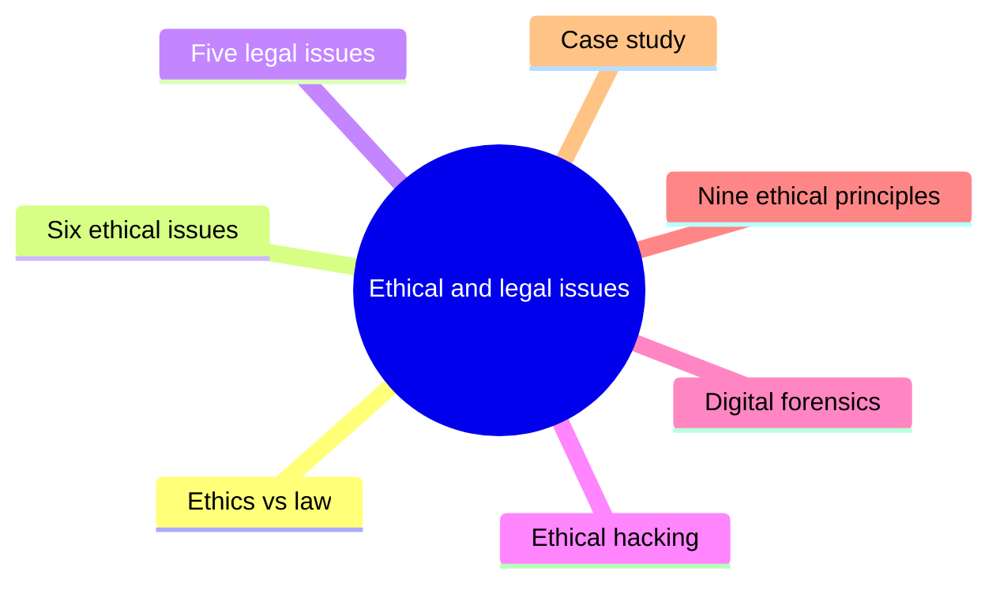
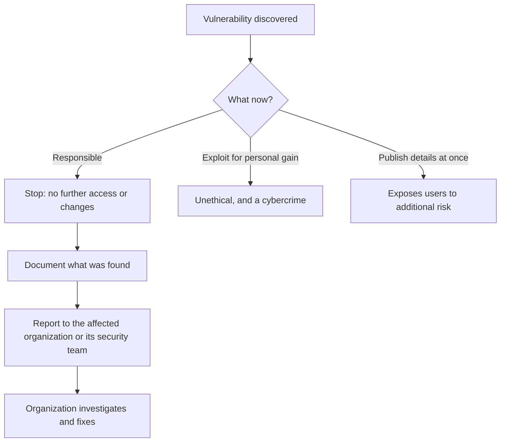
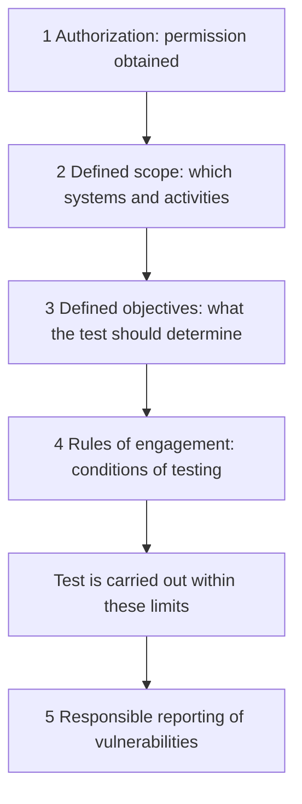
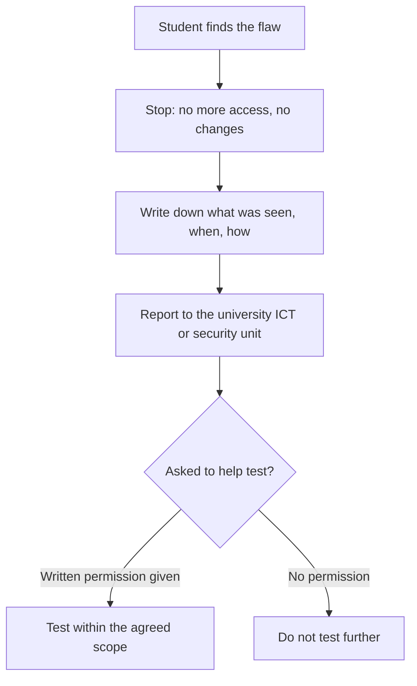

# Unit 10: Ethical and legal issues

*Courseware "Unit 10", pages 66–71.*

## At a glance

Security professionals can see and do things that ordinary users cannot. This unit is about how they should use that power. It answers six questions:

- **What is the difference between ethics and law?** Ethics is about **right or wrong conduct**; law is **rules established and enforced** by a government or authorized institution.
- **What are the ethical issues?** Six of them: **privacy**, **confidentiality**, **unauthorized access**, **intellectual property**, **responsible disclosure** and **professional responsibility**.
- **What are the legal issues?** Five of them: **unauthorized access** laws, **data protection and privacy** laws, **cybercrime**, **copyright and software licensing**, and **electronic fraud**.
- **When is hacking acceptable?** Only as **ethical hacking**: authorized testing with a defined scope, defined objectives, rules of engagement and responsible reporting.
- **How is digital evidence handled?** Through **digital forensics** (identification, collection, preservation, examination, analysis), carefully, so the evidence stays reliable and admissible.
- **What should a professional do in a real dilemma?** Follow the nine **ethical principles**, and the courseware's **case study**: don't dig further, don't modify, document, report through an authorized channel.

| Item | Count | Where |
|---|---|---|
| Examples of personal information | 7 | §10.2.1 |
| What security professionals should do for confidentiality | 4 | §10.2.2 |
| Creations covered by intellectual property / examples of IP issues | 7 / 4 | §10.2.4 |
| Professional responsibilities | 7 | §10.2.6 |
| Examples of unauthorized access (legal) | 3 | §10.3.1 |
| Things organizations may be required to do under data-protection laws | 6 | §10.3.2 |
| Examples of cybercrime | 7 | §10.3.3 |
| Kinds of software licence to understand | 5 | §10.3.4 |
| Kinds of electronic fraud | 5 | §10.3.5 |
| What an ethical hacker should have | 5 | §10.4 |
| Activities of digital forensics / examples of digital evidence | 5 / 6 | §10.5 |
| Ethical principles for security professionals | 9 | §10.6 |
| Rows of the ethical vs legal table | 4 | §10.7 |
| Case-study questions | 6 | Case Study |

Only the ethical-hacking list and the case-study questions are numbered in the courseware; the other counts are ours (the courseware sets them as bullets without counting them).

## What you should be able to do

*The courseware lists no learning outcomes; these are written for this site.*

- Define ethics and law and explain why both matter to security professionals.
- Explain each of the six ethical issues in information security and give the courseware's lists and examples for each.
- Explain each of the five legal issues, including the six duties under data-protection laws, the seven examples of cybercrime, the five kinds of software licence and the five kinds of electronic fraud.
- Define ethical hacking and explain the five things an ethical hacker should have.
- Define digital forensics, name its five activities and six examples of digital evidence, and explain why evidence must be handled carefully.
- List the nine ethical principles for security professionals and differentiate ethical issues from legal issues using the courseware's table.
- Analyse a dilemma (such as the courseware's case study) and say what a professional should do, what they should not do, and why.

## Ethics and law in information security

§10.1 · p.66

The unit opens by explaining why ethics and law belong in a security course at all.

> Ethical and legal issues are important aspects of computer and information security. Security professionals have access to systems, networks, databases, and sensitive information. They must therefore use their knowledge responsibly and comply with applicable laws.

> **Ethics** concerns what is considered right or wrong conduct, while **law** consists of rules established and enforced by a government or authorized institution.

!!! note "In plain terms"
    - **Why it matters:** the people who defend systems hold the keys to them. A database administrator can read every salary; a penetration tester knows how to break in. The same skills that protect can harm, so professionals must (1) **use their knowledge responsibly** (ethics) and (2) **comply with applicable laws** (law).
    - **Ethics vs law in one line each:** ethics asks "**is it right?**"; law asks "**is it allowed by the rules the state enforces?**". The two overlap a lot but are not the same. The unit returns to this in [Ethical vs legal issues](#ethical-vs-legal-issues) (§10.7).

| | Ethics | Law |
|---|---|---|
| **What it is** | What is considered right or wrong **conduct** | **Rules** established and enforced |
| **Who sets it** | *(site summary)* Society, professions, organizations (codes and policies) | A **government or authorized institution** |
| **What happens if broken** | *(site summary)* Loss of trust, disciplinary action, dismissal | Legal penalties (§10.7) |

!!! example "Example"
    A bank's IT officer can see every customer's balance. Looking up a famous footballer's account "just to see" may break no specific law, but it is **unethical** (he has no work reason). Selling that information to a blogger would also be **illegal**.

!!! tip "Exam angle"
    "Define ethics and law" is a likely 2–4 mark opener. Use the courseware's two key phrases: ethics is "**right or wrong conduct**"; law is "**rules established and enforced by a government or authorized institution**". Then add the reason they matter: professionals **have access** to systems, networks, databases and sensitive information.

**Check your understanding**

According to the courseware, what makes a rule a <em>law</em> rather than an ethical standard?

<ul class="quiz-options">
  <li>It is written down in a professional code of conduct</li>
  <li data-correct>It is established and enforced by a government or authorized institution</li>
  <li>Most people agree it is the right thing to do</li>
  <li>It is part of an organization's information security policy</li>
</ul>

Law "consists of rules established and enforced by a government or authorized institution". Professional codes and organizational policies *influence ethical issues* (§10.7), but they are not laws. Wide agreement makes something an ethical norm, not a law (§10.1).

Why, according to §10.1, must security professionals in particular use their knowledge responsibly?

<ul class="quiz-options">
  <li>Because they are paid more than other IT staff</li>
  <li>Because all security work is regulated by international law</li>
  <li data-correct>Because they have access to systems, networks, databases, and sensitive information</li>
  <li>Because ethics and law always require the same thing</li>
</ul>

The courseware's reason is **access**: "Security professionals have access to systems, networks, databases, and sensitive information. They must therefore use their knowledge responsibly and comply with applicable laws." Ethics and law do *not* always require the same thing; §10.7 says something can be legal but ethically questionable.

## Ethical issues: privacy and confidentiality

§10.2, §10.2.1–§10.2.2 · p.66

Section 10.2 lists six ethical issues. The first two are about personal and sensitive information: who controls it, and who may see it.

### Privacy

§10.2.1 · p.66

> **Privacy** refers to an individual's right to control how personal information about them is collected, used, stored, and disclosed.

> Examples of personal information include:
>
> • Name and address
>
> • Telephone number
>
> • Financial information
>
> • Medical records
>
> • Login credentials
>
> • Academic records
>
> • Biometric information

> **Ethical issue:** An organization may have legitimate access to personal data but should not use it for unrelated or unauthorized purposes.

!!! note "In plain terms"
    - Privacy is a **right of the individual**, and it covers four things done to their information: **collected, used, stored, and disclosed**.
    - The ethical issue is subtle: the organization **already has the data legitimately**. The wrong is using it for something **unrelated or unauthorized**. Privacy can be violated with no hacker involved.
    - Seven examples of personal information (count ours). **Memory aid (the site's, not the courseware's):** "**N**o **T**elling **F**riends **M**y **L**ogin, **A**cademic or **B**iometric details": **N**ame and address, **T**elephone, **F**inancial, **M**edical, **L**ogin credentials, **A**cademic records, **B**iometric.

!!! example "Example"
    A telecom company holds your phone number and NIN because the law requires SIM registration. Using that data to bill you is legitimate. Passing your number to a betting company so it can send you adverts is an **unrelated purpose**: an ethical (and, under data-protection law, probably legal) problem. A university that uses students' **academic records** and **biometric** attendance data to process results is fine; sharing them with a bank's marketing team is not.

!!! info "Beyond the notes"
    Unit 1 defines privacy in the CIA triad's wording: it "assures that individuals control or influence what information related to them may be collected and stored and by whom and to whom that information may be disclosed" ([Unit 1, CIA triad](unit-1-security-concepts.md#what-computer-security-means-the-cia-triad)). The two definitions agree: both are about **the individual's control**. Unit 10 adds "**used**" explicitly, which is exactly the ethical issue here.

### Confidentiality

§10.2.2 · p.66

> **Confidentiality** means protecting information from unauthorized disclosure.

> For example, a system administrator may have access to employees' records. It would be unethical to disclose those records to unauthorized people.

> Security professionals should:
>
> • Keep sensitive information confidential.
>
> • Share information only with authorized parties.
>
> • Use appropriate security controls.
>
> • Avoid discussing confidential information unnecessarily.

!!! note "In plain terms"
    - Confidentiality is about **disclosure**: who gets to **see** the information. The courseware's example is an **insider** with legitimate access (a system administrator) who must not pass records on.
    - The four duties (count ours) move from attitude to practice: **keep** it confidential, **share** only with authorized parties, **use controls** (encryption, access control), and **don't talk** about it unnecessarily (the canteen-gossip rule).

| | Privacy (§10.2.1) | Confidentiality (§10.2.2) |
|---|---|---|
| **Whose interest** | The **individual** the data is about | Whoever owns the information (person or organization) |
| **What is protected** | Control over collection, use, storage and disclosure | Information from **unauthorized disclosure** |
| **Typical breach** *(site example)* | Data used for an unrelated purpose by the organization that holds it | An administrator leaks employees' records to outsiders |
| **Applies to** | Personal information only | Any sensitive information (also trade secrets, exam papers) |

!!! example "Example"
    A hospital records officer tells her church group that a well-known politician was treated for a serious illness. She was **authorized to see** the record, but disclosing it to **unauthorized people** breaks confidentiality (and the patient's privacy). The four duties tell her what she should have done: keep it confidential, share only with authorized clinicians, keep the record behind access controls, and not discuss it.

!!! tip "Exam angle"
    Expect "Define privacy and give five examples of personal information" and "State four things security professionals should do to maintain confidentiality". In scenarios, the deciding question is: **was the information disclosed to someone unauthorized** (confidentiality) or **used for an unrelated purpose without the person's control** (privacy)? Many cases are both.

**Check your understanding**

A supermarket chain legitimately holds customers' phone numbers for its loyalty card. It starts selling the numbers to a political campaign. Which ethical issue does the courseware's wording fit best?

<ul class="quiz-options">
  <li>Unauthorized access</li>
  <li data-correct>Privacy: legitimate access to personal data used for an unrelated purpose</li>
  <li>Intellectual property</li>
  <li>Responsible disclosure</li>
</ul>

§10.2.1's ethical issue is exactly this: "An organization may have legitimate access to personal data but should not use it for unrelated or unauthorized purposes." It is not unauthorized access, because the supermarket holds the data legitimately. Confidentiality is also arguably breached, but the courseware's privacy issue is the closer fit (§10.2.1).

Which of these is NOT one of the courseware's examples of personal information?

<ul class="quiz-options">
  <li>Login credentials</li>
  <li>Academic records</li>
  <li>Biometric information</li>
  <li data-correct>Software licence keys</li>
</ul>

The seven examples are name and address, telephone number, financial information, medical records, login credentials, academic records and biometric information. A software licence key belongs to the licensing topic (§10.3.4), not personal information (§10.2.1).

Which is one of the four things the courseware says security professionals should do to maintain confidentiality?

<ul class="quiz-options">
  <li>Publish vulnerabilities so users can protect themselves</li>
  <li>Delete sensitive information as soon as possible</li>
  <li data-correct>Avoid discussing confidential information unnecessarily</li>
  <li>Share information with anyone who asks politely</li>
</ul>

The four are: keep sensitive information confidential; share information only with authorized parties; use appropriate security controls; avoid discussing confidential information unnecessarily. Deleting information is not on the list, and publishing vulnerabilities belongs (with caution) to responsible disclosure (§10.2.2).

## Ethical issues: unauthorized access and intellectual property

§10.2.3–§10.2.4 · p.67

The next two ethical issues are about using what belongs to someone else: their **systems** (unauthorized access) and their **creations** (intellectual property). Both also reappear as legal issues in §10.3.

### Unauthorized access as an ethical issue

§10.2.3 · p.67

> Accessing a computer system without permission is both an ethical and potentially legal problem.

> For example, discovering another person's password and using it to access their email account is unauthorized access.

> Security testing should therefore be conducted only with appropriate authorization.

!!! note "In plain terms"
    - The test is **permission**, not skill or intent. Finding a password is not the wrong; **using** it to get in is.
    - The courseware says "ethical and **potentially** legal": it is always ethically wrong, and in most places also a crime (§10.3.1 says "many jurisdictions" prohibit it).
    - The lesson for security people: **testing is access too**. A security test without authorization is unauthorized access, which is why ethical hacking (§10.4) starts with authorization.

!!! example "Example"
    A student sees a classmate type her portal password in the computer lab and later logs in "just to check her CGPA". Nothing is changed, but it is **unauthorized access**. A lecturer who asks the ICT unit for a student's results through the proper request is authorized; one who borrows the exam officer's login is not.

### Intellectual property

§10.2.4 · p.67

> Intellectual property includes creations such as:
>
> • Software
>
> • Books
>
> • Music
>
> • Films
>
> • Databases
>
> • Designs
>
> • Research materials

> Copying, distributing, modifying, or using protected intellectual property without appropriate permission can raise ethical and legal issues.

> Examples include:
>
> • Software piracy
>
> • Illegal copying of digital content
>
> • Unauthorized distribution of copyrighted material
>
> • Using another person's code without appropriate permission or attribution

!!! note "In plain terms"
    - Intellectual property (IP) is a **creation of the mind** that is protected: seven kinds listed (count ours), from software and databases to research materials.
    - Four **acts** raise issues when done without permission: **copying, distributing, modifying, or using**. Memory aid (the site's): "**C**an't **D**o **M**uch **U**nlicensed" = **C**opy, **D**istribute, **M**odify, **U**se.
    - Four examples (count ours). Note the last one: using someone's **code** without permission **or attribution**. Copying code from a classmate or from the internet without credit is an IP issue as well as academic dishonesty.

!!! example "Example"
    Buying a "cracked" copy of design software at a computer market is **software piracy**. Sharing a lecturer's paid e-book in a class WhatsApp group is **unauthorized distribution of copyrighted material**. Submitting a final-year project whose code was taken from GitHub without acknowledging the author is **using another person's code without permission or attribution**.

!!! tip "Exam angle"
    Expect "List five creations protected as intellectual property" and "Give four examples of IP violations". In a scenario, name the **act** (copying, distributing, modifying or using) and the **missing permission**. Unit 2's **cracker** is defined as someone who defeats **anti-piracy protections** and uses knowledge unethically ([Unit 2, Hackers, crackers and scriptkiddies](unit-2-attacks.md#hackers-crackers-and-scriptkiddies)): a direct link to this section.

**Check your understanding**

A student finds a classmate's password written on a sticky note and uses it to read her email, without changing anything. Which statement matches the courseware?

<ul class="quiz-options">
  <li>It is acceptable because nothing was modified</li>
  <li>It is only an ethical problem, never a legal one</li>
  <li data-correct>It is unauthorized access: both an ethical and potentially legal problem</li>
  <li>It is a privacy issue only, because email is personal information</li>
</ul>

The courseware's own example: "discovering another person's password and using it to access their email account is unauthorized access", which is "both an ethical and potentially legal problem". Whether anything is changed does not matter; access without permission is the wrong (§10.2.3).

Which of these is one of the courseware's four examples of intellectual-property issues?

<ul class="quiz-options">
  <li>Disclosing employees' records to unauthorized people</li>
  <li data-correct>Using another person's code without appropriate permission or attribution</li>
  <li>Breaking into another person's account</li>
  <li>Manipulation of electronic records</li>
</ul>

The four IP examples are software piracy, illegal copying of digital content, unauthorized distribution of copyrighted material, and using another person's code without permission or attribution. The other options are confidentiality (§10.2.2), unauthorized access (§10.3.1) and electronic fraud (§10.3.5).

## Ethical issues: responsible disclosure and professional responsibility

§10.2.5–§10.2.6 · pp.67–68

The last two ethical issues are about what professionals do with what they **find** (vulnerabilities) and what they owe in general (responsibilities).

### Responsible disclosure

§10.2.5 · p.67

> Security researchers may discover vulnerabilities in software or computer systems.

> **Responsible disclosure** involves reporting vulnerabilities appropriately to the affected organization or responsible security team so that they can investigate and address the problem.

> A researcher should not exploit the vulnerability for personal gain or unnecessarily expose users to additional risk.

!!! note "In plain terms"
    - A **vulnerability** is a weakness that could be exploited ([Unit 1, terminology](unit-1-security-concepts.md#computer-security-terminology)). Whoever finds one holds dangerous knowledge.
    - Responsible disclosure has a **target** (the affected organization or its security team), a **manner** ("appropriately") and a **purpose** (so they can investigate and fix it).
    - Two things the researcher **must not** do: **exploit** it for personal gain, or **unnecessarily expose users** to more risk (for example by publishing the details before a fix exists).

Responsible disclosure versus the two things a researcher should not do. Drawn for this site from §10.2.5 and the case study (p.71).

!!! info "Beyond the notes"
    In practice this is often called **coordinated vulnerability disclosure**: the finder reports privately, the vendor fixes, and details are published only after a fix (a common deadline is about 90 days). Many organizations run **bug bounty** programmes or publish a `security.txt` file saying where to send reports; reporting through such a channel is authorized by definition. "Full disclosure" (publishing everything at once) is the approach the courseware warns against.

### Professional responsibility

§10.2.6 · p.68

> Information-security professionals have a responsibility to:
>
> • Protect systems and information.
>
> • Follow organizational policies.
>
> • Maintain professional competence.
>
> • Respect privacy.
>
> • Avoid conflicts of interest.
>
> • Report serious security problems appropriately.
>
> • Use their technical skills responsibly.

!!! note "In plain terms"
    Seven responsibilities (count ours). Some need a word of explanation:

    - **Follow organizational policies:** the organization's information security policy says what is required of staff ([Unit 6, why organisations need a policy](unit-6-security-policy.md#why-organisations-need-an-information-security-policy): reason 4 is that policies support the organization's **legal and ethical responsibilities**).
    - **Maintain professional competence:** security changes fast; a professional who stops learning gives bad advice (e.g. still recommending WEP or MD5).
    - **Avoid conflicts of interest:** don't be in a position where personal gain competes with your duty, e.g. auditing a system you built, or recommending a product from a company you secretly own.
    - **Report serious security problems appropriately:** the same idea as responsible disclosure, applied inside your own organization.

    **Memory aid (the site's):** "**P**rofessionals **F**ollow **M**orals, **R**espect **A**nd **R**eport **U**pright" = **P**rotect, **F**ollow policies, **M**aintain competence, **R**espect privacy, **A**void conflicts, **R**eport, **U**se skills responsibly.

!!! example "Example"
    An IT security officer at a state ministry is asked to choose an antivirus supplier. Her brother owns one of the bidding companies. Declaring this and stepping out of the decision is **avoiding a conflict of interest**. Attending a training on cloud security every year is **maintaining professional competence**.

!!! info "Beyond the notes"
    Professional bodies turn these duties into written codes. In Nigeria, the **Computer Professionals (Registration Council of Nigeria)**, CPN, set up by an Act of 1993, registers computing professionals and issues a code of conduct. Internationally, the ISC2 code of ethics (for CISSP holders) has four canons: protect society and the infrastructure; act honorably, honestly, justly, responsibly and legally; provide diligent and competent service; advance and protect the profession. These are not in the courseware.

!!! tip "Exam angle"
    "Explain responsible disclosure" usually earns marks for three points: **report** to the affected organization or security team, so they can **investigate and address** it, and **don't exploit** or **unnecessarily expose users**. "List five professional responsibilities" is a pure recall question; don't confuse this list of seven with the **nine ethical principles** of §10.6 (they overlap; see [the comparison table](#ethical-principles-for-security-professionals)).

**Check your understanding**

A researcher finds a flaw in a popular Nigerian banking app. Which action is responsible disclosure as the courseware defines it?

<ul class="quiz-options">
  <li>Posting the full technical details on social media so customers are warned</li>
  <li>Using the flaw once to prove it works, then telling the bank</li>
  <li data-correct>Reporting it to the bank's security team so they can investigate and fix it</li>
  <li>Selling the details to the highest bidder</li>
</ul>

Responsible disclosure is "reporting vulnerabilities appropriately to the affected organization or responsible security team so that they can investigate and address the problem". Posting details publicly "unnecessarily exposes users to additional risk"; using or selling the flaw is exploiting it (§10.2.5).

Which of these is in the courseware's list of <em>professional responsibilities</em> (§10.2.6) but NOT in its list of nine <em>ethical principles</em> (§10.6)?

<ul class="quiz-options">
  <li>Respect privacy</li>
  <li data-correct>Maintain professional competence</li>
  <li>Respect intellectual property</li>
  <li>Obtain authorization before testing systems</li>
</ul>

"Maintain professional competence" (along with "follow organizational policies" and "avoid conflicts of interest") appears only in §10.2.6. "Respect privacy" is in both lists; "respect intellectual property" and "obtain authorization before testing systems" are only in §10.6.

An auditor is asked to review the security of a payroll system she designed herself. Which professional responsibility is most at stake?

<ul class="quiz-options">
  <li>Maintain professional competence</li>
  <li>Respect privacy</li>
  <li data-correct>Avoid conflicts of interest</li>
  <li>Report serious security problems appropriately</li>
</ul>

Reviewing her own work creates a conflict: she has a personal interest in finding no faults. "Avoid conflicts of interest" is one of the seven professional responsibilities. Competence is not in question here; independence is (§10.2.6).

## Legal issues in information security

§10.3, §10.3.1–§10.3.2 · p.68

Section 10.3 moves from "is it right?" to "is it allowed?". It begins with a warning that applies to every legal issue that follows.

> Computer-related laws vary between countries and jurisdictions. Therefore, organizations and security professionals must understand the laws applicable to their activities and locations.

!!! note "In plain terms"
    There is no single world law of computing. What is a crime in Nigeria may be treated differently in Ghana or the UK, and a company with customers in several countries may have to obey several sets of rules. The courseware therefore keeps its legal points general ("many jurisdictions", "where required", "depending on the jurisdiction"). A professional must find out **which laws apply to their activities and locations**.

Most of the five legal issues mirror one of the six ethical issues. This map shows the pairs.

![Two columns: six ethical issues on the left (privacy, confidentiality, unauthorized access, intellectual property, responsible disclosure, professional responsibility) and five legal issues on the right (unauthorized access, data protection and privacy laws, cybercrime, copyright and software licensing, electronic fraud), with arrows pairing privacy and confidentiality to data protection laws, unauthorized access to unauthorized access, intellectual property to copyright and licensing, and a dashed arrow from responsible disclosure to cybercrime](assets/diagrams/u10-ethical-legal-map.svg){ .diagram }

How the ethical issues (§10.2) and legal issues (§10.3) pair up. The courseware lists the two groups separately; the pairings are drawn by this site.

!!! info "Beyond the notes: the main Nigerian laws (not in the courseware)"
    Where the courseware says "applicable laws", in Nigeria the main ones are:

    - **Cybercrimes (Prohibition, Prevention, etc.) Act 2015** (amended in 2024): creates offences such as unlawful access to a computer system, unlawful interception, computer-related forgery and fraud, identity theft and impersonation, and cyberstalking. Enforced by the police and the EFCC, among others.
    - **Nigeria Data Protection Act 2023 (NDPA):** governs the processing of personal data and set up the **Nigeria Data Protection Commission (NDPC)**. It took over from the Nigeria Data Protection Regulation (NDPR) 2019, issued by NITDA.
    - **Copyright Act 2022:** protects literary works, including computer programs, and is administered by the **Nigerian Copyright Commission**.
    - **Evidence Act 2011:** section 84 sets the conditions for admitting computer-generated (electronic) evidence in court.

    Use these to make scenario answers concrete, but the marks are for the courseware's general points.

### Unauthorized access laws

§10.3.1 · p.68

> Many jurisdictions have laws prohibiting unauthorized access to computer systems.

> Examples include:
>
> • Breaking into another person's account.
>
> • Accessing a company's server without permission.
>
> • Circumventing security controls without authorization.

> Even if someone claims that they were 'testing security," authorization is important.

!!! note "In plain terms"
    - Three examples (count ours): another person's **account**, a company's **server**, and **circumventing security controls** (e.g. bypassing a login page, disabling a licence check, using a stolen admin token).
    - The last sentence closes a common excuse. "I was only **testing security**" does not turn unauthorized access into authorized access. Only **authorization** (permission from someone entitled to give it) does.

| | Unauthorized access, ethical issue (§10.2.3) | Unauthorized access, legal issue (§10.3.1) |
|---|---|---|
| **Question asked** | Is it right? | Is it prohibited by law? |
| **Courseware's position** | Accessing without permission is "both an ethical and potentially legal problem" | "Many jurisdictions have laws prohibiting" it |
| **Example** | Using another person's password to access their email | Breaking into an account; accessing a company's server; circumventing controls |
| **Lesson** | Security testing only with appropriate authorization | "Testing security" is no excuse: authorization is important |

!!! warning "Courseware note"
    The quotation marks around *testing security* do not match in the courseware ('testing security,"). They are quoted as printed. Unauthorized access also appears twice, as an ethical issue (§10.2.3) and a legal issue (§10.3.1); this is deliberate, and the table above shows the difference.

### Data protection and privacy laws

§10.3.2 · p.68

> Data-protection laws regulate how organizations collect, process, store, and share personal information.

> Organizations may be required to:
>
> • Obtain an appropriate legal basis for processing personal data.
>
> • Protect personal information.
>
> • Limit unnecessary data collection.
>
> • Provide appropriate transparency to individuals.
>
> • Respond to certain data-subject requests.
>
> • Report certain types of data breaches where required.

!!! note "In plain terms"
    Data-protection law turns the **privacy** ethic into binding duties. Six duties (count ours):

    | Duty (courseware) | What it means *(site explanation)* |
    |---|---|
    | **Legal basis** for processing | A lawful reason to process the data at all, e.g. the person's consent or a contract |
    | **Protect** personal information | Security controls: access control, encryption, backups |
    | **Limit** unnecessary collection | Collect only what the purpose needs (data minimisation) |
    | **Transparency** to individuals | Tell people what is collected, why, and who it is shared with (a privacy notice) |
    | Respond to **data-subject requests** | The *data subject* is the person the data is about; they may ask to see, correct or delete it |
    | **Report** certain breaches | Notify the regulator (and sometimes the people affected) when a serious breach happens |

    **Memory aid (the site's):** "**B**anks **P**rotect, **L**imit, **T**ell, **R**espond and **R**eport".

!!! example "Example"
    A Lagos fintech's loan app asks for access to every contact on the borrower's phone, then messages those contacts when a loan is late. Under data-protection law it would struggle to show a **legal basis** for processing the contacts' data, it collected far more than needed (**limit unnecessary collection**), and it was not **transparent** to the contacts. Ethically, it used data for an unrelated purpose (**privacy**, §10.2.1).

!!! info "Beyond the notes: Nigeria Data Protection Act 2023"
    The NDPA lists the lawful bases for processing (consent, a contract, a legal obligation, vital interests, a public-interest task, and legitimate interests), gives data subjects rights such as access, correction and erasure, and requires a data controller to notify the NDPC of a personal data breach that is likely to put people at risk within **72 hours** of becoming aware of it. The EU's GDPR, which applies to Nigerian companies serving people in the EU, has similar rules. Not from the courseware.

!!! tip "Exam angle"
    "State six things data-protection laws may require organizations to do" is a likely recall question; begin each with the courseware's verb (**obtain** a legal basis, **protect**, **limit**, **provide** transparency, **respond**, **report**). Also learn the four verbs in the definition: data-protection laws regulate how organizations **collect, process, store, and share** personal information (compare privacy's **collected, used, stored, and disclosed**).

**Check your understanding**

Caught inside a bank's server, an intruder says: "I was only testing security; I didn't take anything." How does the courseware respond?

<ul class="quiz-options">
  <li>The claim is a full defence if nothing was taken</li>
  <li>The claim is a defence only in some jurisdictions</li>
  <li data-correct>Authorization is what matters, whatever the person claims they were doing</li>
  <li>Testing security is always legal because it improves security</li>
</ul>

"Even if someone claims that they were 'testing security,' authorization is important." Accessing a company's server without permission is one of the courseware's examples of unauthorized access; intent and "nothing taken" do not change that (§10.3.1).

Which of these is NOT one of the six things the courseware says data-protection laws may require organizations to do?

<ul class="quiz-options">
  <li>Limit unnecessary data collection</li>
  <li>Respond to certain data-subject requests</li>
  <li data-correct>Publish all vulnerabilities they discover</li>
  <li>Report certain types of data breaches where required</li>
</ul>

The six are: obtain an appropriate legal basis; protect personal information; limit unnecessary collection; provide transparency; respond to data-subject requests; report certain breaches. Reporting a *breach* (to a regulator) is not the same as *publishing vulnerabilities*, which responsible disclosure warns against (§10.3.2, §10.2.5).

## Legal issues: cybercrime, copyright and fraud

§10.3.3–§10.3.5 · pp.69–70

The remaining three legal issues are crimes committed with computers, the law on using software, and fraud.

### Cybercrime

§10.3.3 · p.69

> **Cybercrime** refers to criminal activities involving computers, networks, or digital systems.

> Examples include:
>
> • Unauthorized access
>
> • Computer-related fraud
>
> • Identity theft
>
> • Malware distribution
>
> • Cyberstalking
>
> • Data theft
>
> • Denial-of-service attacks

> The exact offences and penalties depend on the applicable jurisdiction.

!!! note "In plain terms"
    - Seven examples (count ours). Several link to other units: **denial-of-service attacks** ([Unit 2, DoS and DDoS](unit-2-attacks.md#denial-of-service-dos-and-distributed-denial-of-service-ddos)), **malware distribution** ([Unit 9](unit-9-malware.md#malware-types-that-threaten-pc-and-enterprise-systems)), **unauthorized access** (§10.3.1 and [Unit 8](unit-8-access-control.md#what-access-control-is)).
    - **Identity theft** = using someone else's personal identifiers (BVN, NIN, card details) to pretend to be them. **Cyberstalking** = using electronic communication to harass, threaten or persistently follow a person. **Data theft** = copying or taking data without authorization.
    - **Memory aid (the site's):** "**U**nder **F**ire, **I** **M**ust **C**all **D**ata **D**efenders" = **U**nauthorized access, **F**raud, **I**dentity theft, **M**alware distribution, **C**yberstalking, **D**ata theft, **D**enial of service.

!!! example "Example"
    A syndicate sends fake "your BVN has been blocked" text messages, collects victims' details (**identity theft**), and empties their accounts (**computer-related fraud**). Another group rents a botnet to knock a betting site offline unless it pays (**denial-of-service attack**, used for extortion).

### Copyright and software licensing

§10.3.4 · p.69

> Software is generally protected by intellectual-property laws and may be distributed under different licenses.

> It is very important one should understand whether software is:
>
> • Proprietary
>
> • Open source
>
> • Freeware
>
> • Commercially licensed
>
> • Available under a specific public license

> Installing or distributing software in violation of its license can create legal problems.

!!! note "In plain terms"
    A **licence** is the permission the copyright owner gives you, with conditions. The five kinds (count ours), explained by this site:

    | Kind (courseware) | Meaning *(site explanation)* | Example *(site example)* |
    |---|---|---|
    | **Proprietary** | Owned by a company that keeps the source code closed; you may use it only on its terms | Microsoft Windows, Adobe Photoshop |
    | **Open source** | Source code is published and may be studied, changed and shared, under the licence's conditions | Linux, Python, LibreOffice |
    | **Freeware** | Free of charge to use, but the source is usually closed and redistribution or modification may be banned | Many free PDF readers |
    | **Commercially licensed** | You pay for a licence, often per user, device or year | Antivirus subscriptions, Microsoft 365 |
    | **Specific public license** | Released under a named public licence whose terms you must follow | GNU GPL (changes must stay open), MIT licence (attribution required) |

    The legal problem arises when software is **installed or distributed in violation of its license**: e.g. installing a single-user licence on 50 office PCs, or selling a modified open-source program without following its licence.

!!! warning "Courseware note"
    The five categories overlap: proprietary software is usually commercially licensed, freeware is usually proprietary, and open-source software is normally distributed under a specific public licence (GPL, MIT, Apache). Treat them as five things to check, not five separate boxes. The sentence "It is very important one should understand whether software is" is quoted as printed.

!!! info "Beyond the notes"
    "Free" in open source means *freedom* (to see and change the code), not *free of charge*; freeware is free of charge but not open. A **copyleft** licence such as the GPL requires modified versions you distribute to stay under the same licence; a **permissive** licence such as MIT only asks you to keep the copyright notice. Nigeria's Copyright Act 2022 treats computer programs as protected literary works.

### Electronic fraud

§10.3.5 · pp.69–70

> Computers and networks can be used to commit fraud, including:
>
> • Online banking fraud
>
> • Identity-related fraud
>
> • Fake online transactions
>
> • Phishing scams
>
> • Manipulation of electronic records

> Organizations use authentication, transaction monitoring, logging, and other controls to reduce these risks.

!!! note "In plain terms"
    - Five kinds of electronic fraud (count ours). Fraud = **deception for gain**; here computers and networks are the tool.
    - The courseware names three controls plus "other controls": **authentication** (prove who is transacting: PINs, OTPs, biometrics), **transaction monitoring** (spot unusual patterns: a sudden large transfer at 3 a.m. to a new account), **logging** (records of who did what, for investigation: [Unit 1, accountability](unit-1-security-concepts.md#beyond-the-triad-authenticity-and-accountability)).

| Fraud (courseware) | Example *(site example)* | Control that helps most *(site summary)* |
|---|---|---|
| Online banking fraud | Unauthorized transfer from a hijacked mobile-banking account | Authentication (OTP, device binding) |
| Identity-related fraud | Opening a loan account with a stolen BVN and photo | Authentication (identity verification) |
| Fake online transactions | "Payment alert" screenshots that never reached the seller's account | Transaction monitoring (confirm on the bank's own system) |
| Phishing scams | Email pretending to be the bank, asking for card details | Authentication (2FA) and user awareness |
| Manipulation of electronic records | A staff member edits loan records to hide stolen money | Logging and audit trails |

!!! tip "Exam angle"
    Learn the three lists of this section by count: **seven** cybercrimes, **five** licence types, **five** electronic frauds. "Computer-related fraud" is one cybercrime; §10.3.5 then lists five **kinds** of electronic fraud. A scenario often asks "what controls should the bank use?": quote **authentication, transaction monitoring and logging**, and tie each to a fraud in the case.

**Check your understanding**

Which of these is in the courseware's list of examples of <em>cybercrime</em> (§10.3.3) rather than its list of electronic fraud (§10.3.5)?

<ul class="quiz-options">
  <li>Phishing scams</li>
  <li>Fake online transactions</li>
  <li data-correct>Cyberstalking</li>
  <li>Manipulation of electronic records</li>
</ul>

Cyberstalking is one of the seven cybercrime examples (with unauthorized access, computer-related fraud, identity theft, malware distribution, data theft and denial-of-service attacks). The other three options are in the electronic-fraud list (§10.3.3, §10.3.5).

An office buys one single-user licence for an accounting package and installs it on 20 PCs. Which statement fits the courseware?

<ul class="quiz-options">
  <li>This is fine because the software was paid for</li>
  <li data-correct>Installing software in violation of its license can create legal problems</li>
  <li>This is only an ethical issue because no one was harmed</li>
  <li>This is a data-protection issue</li>
</ul>

"Installing or distributing software in violation of its license can create legal problems." Paying for one licence gives permission for one user; the other 19 installations are unlicensed (software piracy, §10.2.4). It is a copyright and licensing issue (§10.3.4), not data protection.

Which set lists the controls the courseware says organizations use to reduce electronic-fraud risks?

<ul class="quiz-options">
  <li>Encryption, firewalls and antivirus</li>
  <li data-correct>Authentication, transaction monitoring, logging, and other controls</li>
  <li>Responsible disclosure, ethical hacking and forensics</li>
  <li>Copyright, licensing and attribution</li>
</ul>

"Organizations use authentication, transaction monitoring, logging, and other controls to reduce these risks." Encryption and firewalls are useful, but they are not the controls the courseware names here (§10.3.5).

## Ethical hacking

§10.4 · p.70

Ethical hacking is where the ethical and legal issues meet in practice: the tester does what an attacker does, but with permission.

> **Ethical hacking** involves authorized security testing performed to identify vulnerabilities and improve security.

> An ethical hacker should have:
>
> 1. Authorization — permission to conduct the test.
>
> 2. Defined scope — systems and activities covered by the test.
>
> 3. Defined objectives — what the test is intended to determine.
>
> 4. Rules of engagement — conditions under which testing will occur.
>
> 5. Responsible reporting — vulnerabilities should be communicated appropriately.

!!! note "In plain terms"
    The definition has three parts: it is **authorized**, it is **security testing**, and its purpose is to **identify vulnerabilities and improve security**. Remove authorization and the same activity is unauthorized access (§10.3.1).

    | Requirement | The question it answers | Example *(site example)* |
    |---|---|---|
    | **1. Authorization** | Who gave permission? | A signed letter from the bank's management, who own the systems |
    | **2. Defined scope** | **Which** systems and activities? | "The mobile app and its API only; not the HR portal; no phishing of staff" |
    | **3. Defined objectives** | **What** should the test find out? | "Can a customer see another customer's account?" |
    | **4. Rules of engagement** | **Under what conditions?** | "Weekdays 10 p.m.–5 a.m.; no denial-of-service; stop and call this number if live customer data is exposed" |
    | **5. Responsible reporting** | How are findings communicated? | A confidential report to the bank's CISO, not a blog post |

    **Scope vs objectives:** scope is **where** you may test (systems and activities); objectives are **what you are trying to learn**. **Memory aid (the site's):** "**A** **S**ecurity **O**fficer **R**eads **R**ules" = **A**uthorization, **S**cope, **O**bjectives, **R**ules of engagement, **R**eporting.

The five requirements of §10.4 in the order an engagement uses them. The order of steps is the site's; the five items are the courseware's.

!!! example "Example"
    A Nigerian bank hires a security firm for a penetration test. The contract (authorization) covers the internet banking site (scope) to find out whether an outsider can move money (objective), testing only at night with no attacks that could crash the site (rules of engagement). The firm sends its findings only to the bank's security team (responsible reporting). If a tester also "tries" the bank's ATM network, which is **outside the scope**, that part is no longer authorized.

!!! info "Beyond the notes"
    Unit 2 calls a skilled person who finds security holes so they can be fixed a **hacker**, and modern writing calls such a person a **white-hat** hacker ([Unit 2](unit-2-attacks.md#hackers-crackers-and-scriptkiddies)). Ethical hacking is often called **penetration testing**; professional certifications include CEH (Certified Ethical Hacker) and OSCP.

!!! tip "Exam angle"
    "Define ethical hacking and explain the five things an ethical hacker should have" is one of the most likely questions in this unit: it is a numbered list in the courseware. Write each as "**name** — meaning" exactly as given. In scenarios, check the five against the facts: the most common failure is testing **outside the scope** or with **no authorization**.

**Check your understanding**

A tester's contract says "test the web server and the database server". This statement is an example of which requirement?

<ul class="quiz-options">
  <li>Authorization</li>
  <li data-correct>Defined scope</li>
  <li>Defined objectives</li>
  <li>Rules of engagement</li>
</ul>

Defined scope = "systems and activities covered by the test". It names **which** systems. Defined objectives would say **what the test is intended to determine** (e.g. whether data can be stolen); rules of engagement would set **conditions** (e.g. times, forbidden techniques) (§10.4).

"Testing may only take place between midnight and 4 a.m., and no denial-of-service techniques may be used." Which requirement does this express?

<ul class="quiz-options">
  <li>Defined objectives</li>
  <li>Responsible reporting</li>
  <li data-correct>Rules of engagement</li>
  <li>Defined scope</li>
</ul>

Rules of engagement are the "conditions under which testing will occur": timing and permitted techniques are conditions. Scope is tempting, but scope is about **which systems and activities** are covered; this statement is about **how and when** (§10.4).

## Digital evidence and forensics

§10.5 · p.70

When a crime or incident has happened, someone must find out what happened in a way that a court or disciplinary panel will accept.

> **Digital forensics** involves the identification, collection, preservation, examination, and analysis of digital evidence.

> Examples of digital evidence include:
>
> • Emails
>
> • Log files
>
> • Hard-drive data
>
> • Mobile-device data
>
> • Network records
>
> • Cloud records

> Investigators must handle evidence carefully because improper collection or alteration can affect its reliability and, depending on the jurisdiction, its admissibility in legal proceedings.

{ .diagram }

The five activities and six evidence examples of §10.5. The notes under each activity are this site's explanation; drawn for this site.

!!! note "In plain terms"
    - Five activities in the courseware's order: **I**dentification, **C**ollection, **P**reservation, **E**xamination, **A**nalysis. **Memory aid (the site's):** "**I** **C**an **P**rove **E**very **A**ct".
    - **Reliability** = can we trust the evidence shows what really happened? **Admissibility** = will a court accept it at all? Careless handling (switching on the suspect's PC and browsing, copying files in a way that changes their dates, deleting "irrelevant" entries) can destroy both.
    - Integrity of evidence is usually proved with **hash values**: hash the original and the copy; if the hashes match, the copy is unchanged ([Unit 4, cryptographic hash functions](unit-4-cryptography.md#cryptographic-hash-functions)). A report or log signed with a **digital signature** can also show who produced it and that it was not altered afterwards ([Unit 4, digital signatures](unit-4-cryptography.md#digital-signatures)).
    - Good evidence depends on good records being kept **before** the incident: Unit 1 says systems "must keep records of their activities to permit later forensic analysis" ([Unit 1, accountability](unit-1-security-concepts.md#beyond-the-triad-authenticity-and-accountability)).

!!! example "Example"
    A microfinance bank suspects a loan officer of creating fake loans. The investigator **identifies** the sources (the officer's PC, the loan system's log files, his work email, his official phone), **collects** forensic images of them, **preserves** them (hashes recorded, stored in a locked cabinet, every hand-over signed in a chain-of-custody form), **examines** working copies to recover deleted spreadsheets, and **analyses** the timeline: the fake loans were created from his login, at times his phone shows him in the office.

!!! info "Beyond the notes"
    - **Chain of custody:** a written record of everyone who handled the evidence, when and why. A gap in it lets the defence argue that the evidence was tampered with.
    - **Write blocker:** a device that lets an investigator read a disk without being able to write to it.
    - **Order of volatility:** collect the most short-lived evidence first (memory contents before disk contents).
    - In Nigeria, **section 84 of the Evidence Act 2011** sets the conditions for admitting computer-generated evidence, usually including a certificate about the computer that produced it. Not from the courseware.

!!! tip "Exam angle"
    "Define digital forensics" earns its marks from the **five activities**; "give four examples of digital evidence" is pure recall. A favourite (b) or (c) part: "Why must investigators handle digital evidence carefully?" Answer: improper collection or alteration can affect its **reliability** and, depending on the jurisdiction, its **admissibility in legal proceedings**. Then give a practical safeguard (work on copies, hash values, chain of custody).

**Check your understanding**

Which list gives the activities of digital forensics in the courseware's order?

<ul class="quiz-options">
  <li>Collection, identification, analysis, preservation, reporting</li>
  <li data-correct>Identification, collection, preservation, examination, analysis</li>
  <li>Identification, containment, eradication, recovery, lessons learned</li>
  <li>Authorization, scope, objectives, rules of engagement, reporting</li>
</ul>

§10.5: "identification, collection, preservation, examination, and analysis of digital evidence". The third option is an incident-response cycle, and the last is the ethical hacker's five requirements (§10.4).

An IT officer copies a suspect's files to his own USB stick by dragging and dropping, which changes the files' timestamps. According to the courseware, what is the main risk?

<ul class="quiz-options">
  <li>The suspect's privacy has been breached</li>
  <li>The software licence has been violated</li>
  <li data-correct>The evidence's reliability and, depending on the jurisdiction, its admissibility may be affected</li>
  <li>Nothing, because the content of the files is the same</li>
</ul>

"Improper collection or alteration can affect its reliability and, depending on the jurisdiction, its admissibility in legal proceedings." Changed timestamps are an alteration: the defence can argue the evidence is not what was on the machine (§10.5).

## Ethical principles for security professionals

§10.6 · pp.70–71

Section 10.6 sums up the unit as a list of principles a professional can check any decision against.

> A security professional should generally:
>
> • Respect privacy.
>
> • Obtain authorization before testing systems.
>
> • Maintain confidentiality.
>
> • Protect information entrusted to them.
>
> • Avoid unnecessary harm.
>
> • Be honest and transparent.
>
> • Respect intellectual property.
>
> • Follow applicable laws and professional standards.
>
> • Report security vulnerabilities responsibly.

!!! note "In plain terms"
    Nine principles (count ours). Most of them restate an earlier section as a rule of conduct, which makes them easy to remember:

    | Principle (§10.6) | Where it comes from *(site summary)* |
    |---|---|
    | Respect privacy | §10.2.1 Privacy; §10.3.2 data-protection laws |
    | Obtain authorization before testing systems | §10.2.3 unauthorized access; §10.4 ethical hacking (requirement 1) |
    | Maintain confidentiality | §10.2.2 Confidentiality |
    | Protect information entrusted to them | §10.2.6 "protect systems and information" |
    | Avoid unnecessary harm | §10.2.5 "unnecessarily expose users to additional risk"; the case study |
    | Be honest and transparent | New here; compare "provide appropriate transparency" (§10.3.2) |
    | Respect intellectual property | §10.2.4 IP; §10.3.4 copyright and licensing |
    | Follow applicable laws and professional standards | §10.3 legal issues; §10.2.6 "follow organizational policies" |
    | Report security vulnerabilities responsibly | §10.2.5 responsible disclosure; §10.4 responsible reporting |

**Professional responsibilities (§10.2.6) vs ethical principles (§10.6).** The two lists overlap. Examiners can ask for either, so know which items belong where:

| Only in §10.2.6 (7 responsibilities) | In both (same or similar wording) | Only in §10.6 (9 principles) |
|---|---|---|
| Follow organizational policies | Respect privacy | Obtain authorization before testing systems |
| Maintain professional competence | Protect systems and information / Protect information entrusted to them | Maintain confidentiality |
| Avoid conflicts of interest | Report serious security problems appropriately / Report security vulnerabilities responsibly | Avoid unnecessary harm |
| Use their technical skills responsibly | | Be honest and transparent |
| | | Respect intellectual property |
| | | Follow applicable laws and professional standards |

The grouping into "both" is this site's reading of similar wording.

!!! example "Example"
    A security consultant finishes an audit for a hospital and finds that a junior colleague accidentally deleted some test data. Being **honest and transparent** means telling the client, not hiding it. When she later sees the hospital's patient list during testing, she does not copy it (**respect privacy**, **protect information entrusted to them**), and she reports a serious flaw to the hospital rather than to the press (**report vulnerabilities responsibly**, **avoid unnecessary harm**).

!!! tip "Exam angle"
    "State five ethical principles a security professional should follow" is easy marks; choose the ones you can also **explain**. In dilemma questions, name the principle(s) that decide the case: "obtain authorization", "avoid unnecessary harm" and "report vulnerabilities responsibly" settle most hacking dilemmas; "respect privacy" and "maintain confidentiality" settle most data dilemmas.

**Check your understanding**

Which of these is one of the courseware's nine ethical principles (§10.6)?

<ul class="quiz-options">
  <li>Maintain professional competence</li>
  <li>Avoid conflicts of interest</li>
  <li data-correct>Avoid unnecessary harm</li>
  <li>Follow organizational policies</li>
</ul>

"Avoid unnecessary harm" is in §10.6. The other three are **professional responsibilities** (§10.2.6) that do not appear in the list of nine principles. This pair of lists is easy to mix up.

A tester finds a serious flaw and, to avoid embarrassing her client, writes a report that leaves it out. Which principle does she most directly break?

<ul class="quiz-options">
  <li>Respect intellectual property</li>
  <li data-correct>Be honest and transparent</li>
  <li>Obtain authorization before testing systems</li>
  <li>Respect privacy</li>
</ul>

Leaving a known serious flaw out of a report is dishonest and hides information the client needs. It also breaks "report security vulnerabilities responsibly", but honesty is the most direct fit. She was authorized, so the authorization principle is not at issue (§10.6).

## Ethical vs legal issues

§10.7 · p.71

The unit ends its teaching with a direct comparison of the two kinds of issue.

| Ethical Issue | Legal Issue |
|---|---|
| Concerns right and wrong conduct | Concerns compliance with applicable laws |
| May exist even when no specific law is violated | Violations can result in legal penalties |
| Often influenced by professional codes and organizational policies | Enforced through legal institutions |
| Example: unnecessarily viewing a colleague's private files | Example: unauthorized access prohibited by applicable law |

§10.7 table, as printed in the courseware.

> Something can be legal but ethically questionable, and something can also violate both ethical standards and the law.

!!! note "In plain terms"
    The table compares the two on **four criteria** (the row labels are ours: the courseware's table has none):

    | Criterion *(site label)* | Ethical issue | Legal issue |
    |---|---|---|
    | **Concerns** | Right and wrong conduct | Compliance with applicable laws |
    | **Existence / consequence** | May exist even when no law is violated | Violations can result in legal penalties |
    | **Source / enforcement** | Influenced by professional codes and organizational policies | Enforced through legal institutions (courts, police, regulators) |
    | **Example** | Unnecessarily viewing a colleague's private files | Unauthorized access prohibited by applicable law |

    The closing sentence gives two of the possible combinations. The grid below adds the other two.

{ .diagram }

Ethical and legal combinations. The courseware names "legal but ethically questionable" and "violates both"; the grid layout, the "good intentions but illegal" quadrant and the examples are added by this site.

!!! example "Example"
    A bank officer who has database access looks up her ex-husband's new salary account. She has the technical permission, and in some places no specific law covers it: **legal but ethically questionable** (she has no work reason). If she shares the details, she may also break data-protection law: **both**. A student who "tests" the university portal without permission because he wants to help: **good intentions, but still unauthorized access** (§10.3.1).

!!! tip "Exam angle"
    "Differentiate between ethical and legal issues" is very likely. Give all **four** rows, including **both examples**, and finish with the courseware's sentence: "something can be legal but ethically questionable, and something can also violate both". A strong answer adds that most security wrongs fall in "both" (e.g. unauthorized access is in §10.2.3 *and* §10.3.1).

**Check your understanding**

In the courseware's table, which statement describes an <em>ethical</em> issue rather than a legal one?

<ul class="quiz-options">
  <li>Violations can result in legal penalties</li>
  <li>Enforced through legal institutions</li>
  <li data-correct>May exist even when no specific law is violated</li>
  <li>Concerns compliance with applicable laws</li>
</ul>

An ethical issue "may exist even when no specific law is violated" and is "often influenced by professional codes and organizational policies". The other three options are the legal column (§10.7).

What is the courseware's example of an ethical issue in the §10.7 table?

<ul class="quiz-options">
  <li>Software piracy</li>
  <li data-correct>Unnecessarily viewing a colleague's private files</li>
  <li>Unauthorized access prohibited by applicable law</li>
  <li>Publishing a vulnerability immediately</li>
</ul>

The ethical example is "unnecessarily viewing a colleague's private files"; the legal example is "unauthorized access prohibited by applicable law". The word "unnecessarily" matters: the person may be able to see the files, but has no need to (§10.7).

## The case study: a vulnerability in a university website

Case Study · p.71

The courseware closes with a short case that tests the whole unit. The scenario and its six questions are answered in full in the [Self-test assessment](#self-test-assessment-from-the-courseware) below; here is the courseware's own recommended response.

> **Scenario:** A student discovers a vulnerability in a university website. The vulnerability allows access to information that should normally be restricted.

> **Appropriate Security Approach:** The student should avoid unnecessary access or modification, document the discovery carefully, and report it through an appropriate authorized channel. Further testing should only be performed with suitable permission.

!!! note "In plain terms"
    The approach has **four parts** (count ours), and each one comes from an earlier section:

    | Part of the approach | Why *(site summary)* |
    |---|---|
    | **Avoid unnecessary access or modification** | Every extra look is unauthorized access (§10.2.3, §10.3.1) and may breach others' privacy (§10.2.1); changing data harms integrity and could destroy evidence (§10.5) |
    | **Document the discovery carefully** | A clear record shows what was found, and that the student acted in good faith |
    | **Report through an appropriate authorized channel** | Responsible disclosure (§10.2.5): the people who can fix it must know |
    | **Further testing only with suitable permission** | Ethical hacking requires authorization (§10.4) |

The courseware's Appropriate Security Approach as a decision flow. Drawn for this site.

!!! tip "Exam angle"
    Expect a variant of this case in the exam (a bank app, a hospital portal, an exam-results site). Structure the answer around the four parts above, and say what the person should **not** do (dig further, change data, publish immediately) and **why**, naming the ethical and legal issues involved.

## Key terms

Ethics
:   What is considered right or wrong conduct.

Law
:   Rules established and enforced by a government or authorized institution.

Privacy (ethical issue)
:   An individual's right to control how personal information about them is collected, used, stored, and disclosed.

Personal information
:   Information about an individual, e.g. name and address, telephone number, financial information, medical records, login credentials, academic records, biometric information.

Confidentiality (ethical issue)
:   Protecting information from unauthorized disclosure.

Unauthorized access
:   Accessing a computer system without permission; both an ethical and potentially legal problem, prohibited by law in many jurisdictions.

Intellectual property
:   Protected creations such as software, books, music, films, databases, designs and research materials; copying, distributing, modifying or using them without permission raises ethical and legal issues.

Software piracy
:   Copying, installing or distributing software without the permission of its owner; an example of an intellectual-property issue.

Responsible disclosure
:   Reporting vulnerabilities appropriately to the affected organization or responsible security team so that they can investigate and address the problem, without exploiting them or unnecessarily exposing users.

Professional responsibility
:   The seven duties of information-security professionals: protect systems and information, follow organizational policies, maintain professional competence, respect privacy, avoid conflicts of interest, report serious security problems appropriately, use technical skills responsibly.

Conflict of interest
:   A situation where a professional's personal interest competes with their duty (site definition; the courseware lists avoiding it as a responsibility).

Jurisdiction
:   The country or area whose laws apply; computer-related laws vary between countries and jurisdictions.

Data-protection laws
:   Laws that regulate how organizations collect, process, store, and share personal information.

Data subject
:   The individual the personal data is about; data-protection laws may require organizations to respond to their requests (site definition).

Cybercrime
:   Criminal activities involving computers, networks, or digital systems, e.g. unauthorized access, computer-related fraud, identity theft, malware distribution, cyberstalking, data theft and denial-of-service attacks.

Identity theft
:   Using another person's identifying information to pretend to be them, usually for fraud; an example of cybercrime (site definition).

Cyberstalking
:   Using electronic communication to harass, threaten or persistently follow a person; an example of cybercrime (site definition).

Software licence
:   The permission, with conditions, under which software may be used or distributed; installing or distributing software in violation of its license can create legal problems.

Proprietary software
:   Software owned by a company that keeps its source code closed and sets the terms of use (site definition).

Open-source software
:   Software whose source code is published and may be studied, changed and shared under its licence (site definition).

Freeware
:   Software free of charge to use, usually without access to the source code (site definition).

Electronic fraud
:   Fraud committed using computers and networks, e.g. online banking fraud, identity-related fraud, fake online transactions, phishing scams, manipulation of electronic records.

Ethical hacking
:   Authorized security testing performed to identify vulnerabilities and improve security.

Defined scope
:   The systems and activities covered by a security test.

Defined objectives
:   What a security test is intended to determine.

Rules of engagement
:   The conditions under which security testing will occur.

Responsible reporting
:   Communicating the vulnerabilities found by a security test appropriately.

Digital forensics
:   The identification, collection, preservation, examination, and analysis of digital evidence.

Digital evidence
:   Information in digital form used in an investigation, e.g. emails, log files, hard-drive data, mobile-device data, network records, cloud records.

Admissibility
:   Whether evidence will be accepted in legal proceedings; improper collection or alteration can affect it, depending on the jurisdiction.

Chain of custody
:   A record of everyone who handled a piece of evidence, when and why, used to show it was not tampered with (site definition).

Ethical principles for security professionals
:   Respect privacy; obtain authorization before testing; maintain confidentiality; protect information entrusted to them; avoid unnecessary harm; be honest and transparent; respect intellectual property; follow applicable laws and professional standards; report vulnerabilities responsibly.

---

## Unit summary

- **Why (§10.1):** security professionals **have access** to systems, networks, databases and sensitive information, so they must use their knowledge **responsibly** and **comply with applicable laws**. **Ethics** = right or wrong conduct; **law** = rules established and enforced by a government or authorized institution.
- **Six ethical issues (§10.2):** **privacy** (individual's right to control how personal information is collected, used, stored, disclosed; 7 examples of personal information; don't use legitimately held data for unrelated purposes); **confidentiality** (protect from unauthorized disclosure; 4 duties: keep confidential, share only with authorized parties, use controls, don't discuss unnecessarily); **unauthorized access** (without permission = ethical and potentially legal problem; test only with authorization); **intellectual property** (7 creations; copying, distributing, modifying or using without permission; 4 examples incl. code without permission or attribution); **responsible disclosure** (report to the affected organization or security team so they can fix; don't exploit or expose users); **professional responsibility** (7 duties).
- **Five legal issues (§10.3):** laws vary by jurisdiction. **Unauthorized access** (3 examples; "testing security" is no excuse); **data protection** (collect, process, store, share; 6 duties: legal basis, protect, limit collection, transparency, data-subject requests, report breaches); **cybercrime** (7 examples; offences and penalties depend on jurisdiction); **copyright and licensing** (proprietary, open source, freeware, commercially licensed, specific public licence; violating a licence creates legal problems); **electronic fraud** (5 kinds; controls: authentication, transaction monitoring, logging, other controls).
- **Ethical hacking (§10.4):** authorized security testing to identify vulnerabilities and improve security; needs **authorization, defined scope, defined objectives, rules of engagement, responsible reporting**.
- **Digital forensics (§10.5):** **identification, collection, preservation, examination, analysis** of digital evidence (emails, log files, hard-drive, mobile-device, network and cloud records); careless handling affects **reliability** and **admissibility**.
- **Nine ethical principles (§10.6)** and **ethical vs legal (§10.7):** right/wrong conduct vs compliance; may exist without a law vs legal penalties; professional codes and policies vs legal institutions; viewing a colleague's files vs unauthorized access. Something can be legal but ethically questionable, or violate both.
- **Case study:** a student finds a flaw in a university website. Avoid unnecessary access or modification, document carefully, report through an authorized channel, test further only with permission.

## Mixed review

Which ethical issue and legal issue form the closest pair?

<ul class="quiz-options">
  <li>Responsible disclosure and copyright and software licensing</li>
  <li data-correct>Privacy and data-protection and privacy laws</li>
  <li>Intellectual property and electronic fraud</li>
  <li>Confidentiality and cybercrime</li>
</ul>

Privacy (an individual's right to control how personal information is collected, used, stored and disclosed, §10.2.1) is turned into legal duties by data-protection laws, which regulate how organizations collect, process, store and share personal information (§10.3.2). Intellectual property pairs with copyright and licensing, not fraud.

A penetration tester has written authorization, scope and objectives, but publishes the vulnerabilities she found on her blog the next day. Which requirement and principle does she break?

<ul class="quiz-options">
  <li>Authorization; obtain authorization before testing systems</li>
  <li>Defined scope; respect intellectual property</li>
  <li data-correct>Responsible reporting; report security vulnerabilities responsibly</li>
  <li>Rules of engagement; maintain professional competence</li>
</ul>

Responsible reporting (§10.4) says vulnerabilities "should be communicated appropriately", and §10.6 says to "report security vulnerabilities responsibly". Publishing at once also "unnecessarily exposes users to additional risk" (§10.2.5). Her authorization was in order.

A bank wants to investigate staff fraud involving manipulated loan records. Which combination of courseware ideas is most relevant?

<ul class="quiz-options">
  <li>Responsible disclosure and software licensing</li>
  <li data-correct>Electronic fraud (manipulation of electronic records), logging, and careful handling of digital evidence</li>
  <li>Intellectual property and ethical hacking</li>
  <li>Privacy and cyberstalking</li>
</ul>

"Manipulation of electronic records" is one of the five kinds of electronic fraud; **logging** is one of the controls (§10.3.5); and the investigation is digital forensics, where evidence must be handled carefully to stay reliable and admissible (§10.5).

In the case study, why should the student NOT access more restricted information "to see how serious the vulnerability is"?

<ul class="quiz-options">
  <li>Because the vulnerability might be fixed before the student finishes</li>
  <li data-correct>Because further access is unauthorized and further testing should only be done with suitable permission</li>
  <li>Because only lecturers are allowed to find vulnerabilities</li>
  <li>Because the information is protected by copyright</li>
</ul>

The Appropriate Security Approach: "avoid unnecessary access or modification … Further testing should only be performed with suitable permission." Extra access is unauthorized access (§10.2.3, §10.3.1) and may expose other people's restricted information (privacy, §10.2.1).

## Recall drill

Every definition, list, comparison and example in the unit, as a short question. Answer aloud or on paper, then open the answer.

### Ethics and law

**R1.** Why are ethical and legal issues important aspects of computer and information security?

??? success "Answer"
    Security professionals **have access to systems, networks, databases, and sensitive information**. They must therefore **use their knowledge responsibly** and **comply with applicable laws**.

**R2.** Define *ethics* and *law*.

??? success "Answer"
    **Ethics** concerns what is considered **right or wrong conduct**. **Law** consists of **rules established and enforced by a government or authorized institution**.

**R3.** List the six ethical issues in information security covered in §10.2.

??? success "Answer"
    **Privacy; confidentiality; unauthorized access; intellectual property; responsible disclosure; professional responsibility.**

**R4.** List the five legal issues in information security covered in §10.3.

??? success "Answer"
    **Unauthorized access; data protection and privacy laws; cybercrime; copyright and software licensing; electronic fraud.**

### Privacy and confidentiality

**R5.** Define *privacy* (§10.2.1).

??? success "Answer"
    Privacy refers to an **individual's right to control** how personal information about them is **collected, used, stored, and disclosed**.

**R6.** List the examples of personal information given in the courseware. (There are 7.)

??? success "Answer"
    **Name and address; telephone number; financial information; medical records; login credentials; academic records; biometric information.**

**R7.** State the ethical issue the courseware associates with privacy.

??? success "Answer"
    An organization may have **legitimate access** to personal data but **should not use it for unrelated or unauthorized purposes**.

**R8.** Define *confidentiality* (§10.2.2) and give the courseware's example.

??? success "Answer"
    Confidentiality means **protecting information from unauthorized disclosure**. Example: a **system administrator** may have access to employees' records; it would be **unethical to disclose those records to unauthorized people**.

**R9.** State what security professionals should do to maintain confidentiality. (There are 4.)

??? success "Answer"
    **Keep** sensitive information confidential; **share** information only with authorized parties; **use** appropriate security controls; **avoid discussing** confidential information unnecessarily.

**R10.** Differentiate privacy from confidentiality. *(site answer)*

??? success "Answer"
    **Privacy** is the **individual's right to control** how their personal information is collected, used, stored and disclosed; it can be violated by the organization that legitimately holds the data, by using it for unrelated purposes. **Confidentiality** is **protecting information** (any sensitive information, not only personal) **from unauthorized disclosure**.

### Unauthorized access and intellectual property

**R11.** What does the courseware say about accessing a computer system without permission (§10.2.3)? Give its example.

??? success "Answer"
    It is **both an ethical and potentially legal problem**. Example: **discovering another person's password and using it to access their email account** is unauthorized access.

**R12.** What follows for security testing from §10.2.3?

??? success "Answer"
    Security testing should therefore be conducted **only with appropriate authorization**.

**R13.** List the creations the courseware says intellectual property includes. (There are 7.)

??? success "Answer"
    **Software; books; music; films; databases; designs; research materials.**

**R14.** Which four acts on protected intellectual property raise ethical and legal issues when done without permission?

??? success "Answer"
    **Copying, distributing, modifying, or using** protected intellectual property **without appropriate permission**.

**R15.** Give the courseware's examples of intellectual-property issues. (There are 4.)

??? success "Answer"
    **Software piracy; illegal copying of digital content; unauthorized distribution of copyrighted material; using another person's code without appropriate permission or attribution.**

### Responsible disclosure and professional responsibility

**R16.** Define *responsible disclosure*.

??? success "Answer"
    Responsible disclosure involves **reporting vulnerabilities appropriately to the affected organization or responsible security team** so that they can **investigate and address the problem**.

**R17.** State the two things a researcher who discovers a vulnerability should not do.

??? success "Answer"
    A researcher should **not exploit the vulnerability for personal gain** or **unnecessarily expose users to additional risk**.

**R18.** List the responsibilities of information-security professionals. (There are 7.)

??? success "Answer"
    **Protect** systems and information; **follow** organizational policies; **maintain** professional competence; **respect** privacy; **avoid** conflicts of interest; **report** serious security problems appropriately; **use** their technical skills responsibly.

### Legal issues: general, unauthorized access, data protection

**R19.** Why must organizations and security professionals understand the laws applicable to their activities and locations?

??? success "Answer"
    Because **computer-related laws vary between countries and jurisdictions**.

**R20.** Give the courseware's examples of unauthorized access that laws prohibit. (There are 3.)

??? success "Answer"
    **Breaking into another person's account; accessing a company's server without permission; circumventing security controls without authorization.**

**R21.** Someone accused of unauthorized access says they were "testing security". What does the courseware say?

??? success "Answer"
    Even if someone claims that they were "testing security," **authorization is important**: the claim does not make unauthorized access acceptable.

**R22.** Differentiate unauthorized access as an ethical issue (§10.2.3) from unauthorized access as a legal issue (§10.3.1).

??? success "Answer"
    **Ethical (§10.2.3):** accessing a system without permission is wrong conduct, "both an ethical and potentially legal problem" (example: using another person's password to access their email); so security testing only with authorization. **Legal (§10.3.1):** **many jurisdictions have laws prohibiting** it (examples: breaking into an account, accessing a server without permission, circumventing controls); "testing security" is no excuse.

**R23.** What do data-protection laws regulate?

??? success "Answer"
    How organizations **collect, process, store, and share personal information**.

**R24.** State what organizations may be required to do under data-protection laws. (There are 6.)

??? success "Answer"
    **Obtain** an appropriate legal basis for processing personal data; **protect** personal information; **limit** unnecessary data collection; **provide** appropriate transparency to individuals; **respond** to certain data-subject requests; **report** certain types of data breaches where required.

**R25.** What is a *data subject*? *(site answer)*

??? success "Answer"
    The **individual the personal data is about**; data-protection laws may require organizations to respond to their requests (e.g. to see, correct or delete their data).

### Cybercrime, copyright and licensing, electronic fraud

**R26.** Define *cybercrime*.

??? success "Answer"
    Cybercrime refers to **criminal activities involving computers, networks, or digital systems**.

**R27.** List the courseware's examples of cybercrime. (There are 7.)

??? success "Answer"
    **Unauthorized access; computer-related fraud; identity theft; malware distribution; cyberstalking; data theft; denial-of-service attacks.**

**R28.** What determines the exact offences and penalties for cybercrime?

??? success "Answer"
    **The applicable jurisdiction.**

**R29.** How is software protected, according to §10.3.4?

??? success "Answer"
    Software is generally **protected by intellectual-property laws** and **may be distributed under different licenses**.

**R30.** State the kinds of software licensing one should understand. (There are 5.)

??? success "Answer"
    Whether software is **proprietary; open source; freeware; commercially licensed; available under a specific public license**.

**R31.** What can create legal problems under copyright and software licensing?

??? success "Answer"
    **Installing or distributing software in violation of its license.**

**R32.** Differentiate open-source software from freeware. *(site answer)*

??? success "Answer"
    **Open source:** the **source code is published** and may be studied, changed and shared under the licence's conditions (it may or may not be free of charge). **Freeware:** **free of charge** to use, but the source is usually **closed** and modification or redistribution may be banned.

**R33.** List the kinds of fraud that computers and networks can be used to commit. (There are 5.)

??? success "Answer"
    **Online banking fraud; identity-related fraud; fake online transactions; phishing scams; manipulation of electronic records.**

**R34.** What controls do organizations use to reduce electronic-fraud risks?

??? success "Answer"
    **Authentication, transaction monitoring, logging, and other controls.**

### Ethical hacking

**R35.** Define *ethical hacking*.

??? success "Answer"
    Ethical hacking involves **authorized security testing** performed to **identify vulnerabilities and improve security**.

**R36.** State and explain the five things an ethical hacker should have.

??? success "Answer"
    1. **Authorization** — permission to conduct the test.
    2. **Defined scope** — systems and activities covered by the test.
    3. **Defined objectives** — what the test is intended to determine.
    4. **Rules of engagement** — conditions under which testing will occur.
    5. **Responsible reporting** — vulnerabilities should be communicated appropriately.

**R37.** Differentiate *defined scope* from *defined objectives*.

??? success "Answer"
    **Defined scope** = the **systems and activities covered** by the test (*where/what may be tested*). **Defined objectives** = **what the test is intended to determine** (*what we want to learn*).

**R38.** Differentiate *ethical hacking* from *unauthorized access*.

??? success "Answer"
    Both may use the same techniques. **Ethical hacking** is **authorized** security testing (with scope, objectives, rules of engagement and responsible reporting) to identify vulnerabilities and improve security. **Unauthorized access** is accessing a system **without permission**, an ethical and potentially legal problem, even if the person claims to be "testing security". The difference is **authorization**.

### Digital evidence and forensics

**R39.** Define *digital forensics*. (Its definition names 5 activities.)

??? success "Answer"
    Digital forensics involves the **identification, collection, preservation, examination, and analysis** of digital evidence.

**R40.** Give the courseware's examples of digital evidence. (There are 6.)

??? success "Answer"
    **Emails; log files; hard-drive data; mobile-device data; network records; cloud records.**

**R41.** Why must investigators handle digital evidence carefully?

??? success "Answer"
    Because **improper collection or alteration** can affect its **reliability** and, **depending on the jurisdiction**, its **admissibility in legal proceedings**.

**R42.** Differentiate the *reliability* and the *admissibility* of evidence. *(site answer)*

??? success "Answer"
    **Reliability:** whether the evidence can be **trusted** to show what really happened. **Admissibility:** whether a court will **accept** it in legal proceedings at all (depends on the jurisdiction's rules). Improper collection or alteration can damage both.

### Ethical principles and ethical vs legal

**R43.** List the ethical principles a security professional should generally follow. (There are 9.)

??? success "Answer"
    **Respect** privacy; **obtain authorization** before testing systems; **maintain** confidentiality; **protect** information entrusted to them; **avoid** unnecessary harm; **be honest** and transparent; **respect** intellectual property; **follow** applicable laws and professional standards; **report** security vulnerabilities responsibly.

**R44.** Which professional responsibilities (§10.2.6) do not appear among the nine ethical principles (§10.6)? *(site answer from comparing the lists)*

??? success "Answer"
    **Follow organizational policies; maintain professional competence; avoid conflicts of interest; use their technical skills responsibly.** ("Respect privacy" is in both; "protect" and "report" appear in both with different wording.)

**R45.** Differentiate between ethical issues and legal issues. (The courseware's table has 4 rows.)

??? success "Answer"
    | Ethical issue | Legal issue |
    |---|---|
    | Concerns **right and wrong conduct** | Concerns **compliance with applicable laws** |
    | **May exist even when no specific law is violated** | Violations can result in **legal penalties** |
    | Often influenced by **professional codes and organizational policies** | **Enforced through legal institutions** |
    | Example: **unnecessarily viewing a colleague's private files** | Example: **unauthorized access prohibited by applicable law** |

**R46.** Give the courseware's example of an ethical issue and of a legal issue (§10.7).

??? success "Answer"
    **Ethical:** unnecessarily viewing a colleague's private files. **Legal:** unauthorized access prohibited by applicable law.

**R47.** Complete the courseware's sentence: "Something can be legal but …"

??? success "Answer"
    "Something can be **legal but ethically questionable**, and something can also **violate both ethical standards and the law**."

### The case study

**R48.** State the scenario of the courseware's case study.

??? success "Answer"
    A **student discovers a vulnerability in a university website**. The vulnerability **allows access to information that should normally be restricted**.

**R49.** List the questions the case study asks. (There are 6.)

??? success "Answer"
    1. Should the student access additional information to determine how serious the vulnerability is?
    2. Should the student modify or delete any information?
    3. Should the student publish the vulnerability immediately?
    4. Who should be informed?
    5. What evidence should the student preserve?
    6. What authorization, if any, was provided for security testing?

**R50.** State the courseware's Appropriate Security Approach for the case study.

??? success "Answer"
    The student should **avoid unnecessary access or modification**, **document the discovery carefully**, and **report it through an appropriate authorized channel**. **Further testing should only be performed with suitable permission.**

## Self-test assessment (from the courseware)

Case Study · p.71

The courseware's only questions are the case study's six. They are given verbatim, each with a model answer that builds on the courseware's Appropriate Security Approach ([explained above](#the-case-study-a-vulnerability-in-a-university-website)).

> **Scenario:** A student discovers a vulnerability in a university website. The vulnerability allows access to information that should normally be restricted.

**1.** Should the student access additional information to determine how serious the vulnerability is?

??? success "Model answer"
    **No.** The courseware says the student "should avoid unnecessary access". Every further page viewed is **unauthorized access** to restricted information: an ethical problem and potentially a legal one (§10.2.3, §10.3.1). Saying "I was checking how serious it was" is the same as "I was testing security", and the courseware's reply is that **authorization is important**. The extra information probably belongs to other people (results, fees, medical or contact details), so looking at it also breaches their **privacy** and **confidentiality** (§10.2.1–§10.2.2). Judging the seriousness is the job of the university's security team, who are authorized to investigate. "Further testing should only be performed with suitable permission."

**2.** Should the student modify or delete any information?

??? success "Model answer"
    **No, never.** The approach says to avoid unnecessary "**modification**". Changing or deleting data would harm the **integrity** of the university's records, could hurt other students (e.g. altered results), would be treated as an attack rather than a discovery (circumventing security controls without authorization, §10.3.1; possibly manipulation of electronic records, §10.3.5), and would **alter evidence** of how the flaw works and who used it (§10.5). It also breaks the principle **avoid unnecessary harm** (§10.6). Even "fixing" the flaw himself is modification without authorization.

**3.** Should the student publish the vulnerability immediately?

??? success "Model answer"
    **No.** Publishing before the university has fixed it would tell attackers how to reach restricted information and so "**unnecessarily expose users to additional risk**", which responsible disclosure forbids (§10.2.5). The approach says to "report it through an appropriate **authorized channel**", i.e. to the organization first so it can **investigate and address the problem**. The principles "avoid unnecessary harm" and "report security vulnerabilities responsibly" (§10.6) point the same way. *(Beyond the notes: in coordinated disclosure, details may be published later, once the flaw is fixed and with the university's agreement.)*

**4.** Who should be informed?

??? success "Model answer"
    **The affected organization or its responsible security team** (§10.2.5), through an **appropriate authorized channel**. For a university that means, in order of preference *(site suggestion)*: its published vulnerability-reporting address if it has one; otherwise the **ICT/ICT security unit** (e.g. the director of ICT or the webmaster), or the student's **head of department or lecturer** who can pass it on officially. The report should be private and in writing. The student should **not** inform friends, social media or the press, and should not share the details with anyone who is not authorized (confidentiality, §10.2.2).

**5.** What evidence should the student preserve?

??? success "Model answer"
    The approach says to "**document the discovery carefully**". The student should keep a **written record** of: the **date and time** of the discovery; the **URL or page** and the **steps** that led to it (what was clicked or entered); **what kind of information** became visible (described, not copied); the device and network used; and a copy of the **report** sent and any reply. A screenshot showing *that* restricted access is possible may help, but the student should **not download or keep copies of other people's data** (privacy, confidentiality). The record shows the university how to reproduce and fix the flaw and shows that the student acted in **good faith**. The student must not change logs or anything on the site: that would alter evidence (§10.5).

**6.** What authorization, if any, was provided for security testing?

??? success "Model answer"
    **None, as far as the scenario says.** The student simply "discovers" the flaw; there is no **authorization**, **defined scope**, **defined objectives** or **rules of engagement** (§10.4), so the student is **not** an ethical hacker for this system. That is exactly why the student must stop at the discovery: any further probing would be unauthorized access, whatever the intention (§10.3.1). If the university wants the student's help, it must give **suitable permission** (ideally written, with a scope and rules), and only then may the student test further and report the results responsibly.

!!! warning "Courseware note"
    The case study is unnumbered and its "Appropriate Security Approach" is a single paragraph that does not answer the six questions one by one; in particular it does not say what evidence to preserve (Q5) or what authorization existed (Q6). The model answers above apply the approach and §10.2–§10.6 to each question; the specific suggestions (whom to contact, what to record) are this site's.

## Practice exercises

**Exercise 1: Ethical, legal, or both?** For each case, say whether it is mainly an ethical issue only (legal but ethically questionable), a violation of both ethics and the law, or ethical and legal. Name the courseware section.

1. A database administrator reads a colleague's private messages stored on the company server, which he can access as part of his job, out of curiosity.
2. A student uses a classmate's password to log in to the e-learning portal and download her assignment.
3. A security firm tests a hospital's network under a signed contract with a defined scope.
4. A shop installs a single-user licence of accounting software on all its PCs.
5. A researcher finds a flaw in a bank app and reports it privately to the bank's security team.
6. An analyst recommends a firewall made by a company she secretly co-owns, without telling her employer.
7. A man sends fake "payment successful" screenshots to online sellers to collect goods.
8. A telecom company uses subscribers' location data, collected for network purposes, to sell targeted adverts without telling them.

??? success "Answer"
    1 **Ethical issue** (legal but ethically questionable): the §10.7 example, "unnecessarily viewing a colleague's private files"; also privacy (§10.2.1). 2 **Both**: unauthorized access (§10.2.3, §10.3.1), and IP misuse if he submits her work (§10.2.4). 3 **Ethical and legal**: ethical hacking with authorization and scope (§10.4). 4 **Both**: software piracy (§10.2.4) and installing software in violation of its licence (§10.3.4). 5 **Ethical and legal**: responsible disclosure (§10.2.5). 6 **Ethical issue**: conflict of interest (§10.2.6) and "be honest and transparent" (§10.6); may also breach company policy. 7 **Both**: electronic fraud, fake online transactions (§10.3.5); cybercrime, computer-related fraud (§10.3.3). 8 **Ethical** (privacy, data used for an unrelated purpose, §10.2.1) and likely **legal** (data-protection duties: legal basis, transparency, §10.3.2): both.

**Exercise 2: Which list?** Name the courseware list (and section) each item comes from.

1. Biometric information
2. Circumventing security controls without authorization
3. Cyberstalking
4. Respond to certain data-subject requests
5. Manipulation of electronic records
6. Rules of engagement
7. Cloud records
8. Maintain professional competence
9. Avoid unnecessary harm
10. Research materials

??? success "Answer"
    1 examples of personal information (§10.2.1); 2 examples of unauthorized access (§10.3.1); 3 examples of cybercrime (§10.3.3); 4 data-protection duties (§10.3.2); 5 electronic fraud (§10.3.5); 6 what an ethical hacker should have (§10.4); 7 examples of digital evidence (§10.5); 8 professional responsibilities (§10.2.6); 9 ethical principles (§10.6); 10 creations covered by intellectual property (§10.2.4).

**Exercise 3: Check the engagement.** A fictional consultancy sends a bank this note: "*We confirm we will test your systems next week and send you our findings.*" Which of the five things an ethical hacker should have are missing or weak? What should be added?

??? success "Answer"
    - **Authorization:** not shown; there must be explicit permission from someone at the bank entitled to give it (ideally signed).
    - **Defined scope:** "your systems" is too vague; list which systems and activities (e.g. internet banking site only; no social engineering).
    - **Defined objectives:** missing; state what the test should determine (e.g. whether a customer can access another customer's account).
    - **Rules of engagement:** missing; set times, forbidden techniques (no denial of service), and what to do if live data is exposed.
    - **Responsible reporting:** weak; "send you our findings" should say to whom (the security team), how (confidentially), and that findings will not be disclosed elsewhere.

**Exercise 4: Spot the forensic mistakes.** An IT officer investigating a suspected fraud (1) switches on the suspect's PC and browses through his folders, (2) copies interesting files onto his own USB stick, (3) deletes the "irrelevant" entries from the log file to make it easier to read, and (4) leaves the USB stick on his desk over the weekend. For each, say what is wrong and what should be done instead.

??? success "Answer"
    1 Browsing the original **alters** it (file access times, new temporary files): make a forensic **copy** first and examine the copy (collection, examination). 2 An ordinary copy may change timestamps and there is no record: use proper **collection** (a forensic image, with a hash value). 3 Deleting entries is **alteration** of evidence: the log is no longer reliable and may be inadmissible; keep the original untouched and **filter a copy**. 4 Poor **preservation**: store evidence securely and record every hand-over (chain of custody). Overall: improper collection or alteration affects **reliability** and **admissibility** (§10.5).

**Exercise 5: Match the licence.** Match each description to a kind of software from §10.3.4: (a) "Source code is available on GitHub; you may modify it, but if you distribute changes you must release them under the same licence." (b) "Free download; no source code; you may not sell or modify it." (c) "Licensed per user per year; the vendor owns the code." (d) "Owned by the company; the code is secret; use only as the licence agreement allows."

??? success "Answer"
    (a) **Open source**, under a **specific public license** (this is the GPL's copyleft condition). (b) **Freeware**. (c) **Commercially licensed** (and proprietary). (d) **Proprietary**. The categories overlap (see the Courseware note in §10.3.4).

## Sample exam questions

**Question 1** *(recall-heavy)*

**1a.** Define ethics and law, and explain why ethical and legal issues are important to security professionals. (4 marks)

??? success "Model answer"
    **Ethics** concerns what is considered right or wrong conduct. **Law** consists of rules established and enforced by a government or authorized institution.

    **Why important:** security professionals have access to systems, networks, databases, and sensitive information. They must therefore use their knowledge responsibly (ethics) and comply with applicable laws (law). The same skills that protect systems could be used to harm them.

    **Marking points:** ethics (1); law (1); access as the reason (1); use knowledge responsibly and comply with applicable laws (1).

**1b.** Define ethical hacking and explain the five things an ethical hacker should have. (6 marks)

??? success "Model answer"
    **Ethical hacking** involves authorized security testing performed to identify vulnerabilities and improve security.

    1. **Authorization:** permission to conduct the test, from someone entitled to give it.
    2. **Defined scope:** the systems and activities covered by the test.
    3. **Defined objectives:** what the test is intended to determine.
    4. **Rules of engagement:** the conditions under which testing will occur (e.g. times, forbidden techniques).
    5. **Responsible reporting:** vulnerabilities should be communicated appropriately, to the organization, not the public.

    **Marking points:** definition (1); each requirement named and explained (1 × 5).

**1c.** Differentiate between ethical issues and legal issues in information security, giving an example of each. (6 marks)

??? success "Model answer"
    | Criterion | Ethical issue | Legal issue |
    |---|---|---|
    | **Concerns (1)** | Right and wrong conduct | Compliance with applicable laws |
    | **When it exists / consequence (1)** | May exist even when no specific law is violated | Violations can result in legal penalties |
    | **Influence / enforcement (1)** | Often influenced by professional codes and organizational policies | Enforced through legal institutions |
    | **Example (2)** | Unnecessarily viewing a colleague's private files | Unauthorized access prohibited by applicable law |

    **Relationship (1):** something can be legal but ethically questionable, and something can also violate both ethical standards and the law.

    **Marking points:** three criteria (1 each); two examples (1 each); the closing relationship (1). Total 6.

**1d.** Define digital forensics, give four examples of digital evidence, and explain why evidence must be handled carefully. (4 marks)

??? success "Model answer"
    **Digital forensics** involves the identification, collection, preservation, examination, and analysis of digital evidence.

    **Examples:** emails; log files; hard-drive data; mobile-device data (also network records, cloud records).

    **Why careful:** improper collection or alteration can affect the evidence's **reliability** and, depending on the jurisdiction, its **admissibility in legal proceedings**.

    **Marking points:** definition with the five activities (1); four examples (0.5 × 4 = 2); reason (1).

**Question 2** *(applied: privacy and data protection)*

**2a.** Define privacy and list five examples of personal information. (4 marks)

??? success "Model answer"
    **Privacy** refers to an individual's right to control how personal information about them is collected, used, stored, and disclosed.

    **Examples (any five):** name and address; telephone number; financial information; medical records; login credentials; academic records; biometric information.

    **Marking points:** definition (1.5, including the four verbs); five examples (0.5 × 5 = 2.5).

**2b.** Explain what data-protection laws regulate, and state six things organizations may be required to do under them. (7 marks)

??? success "Model answer"
    **Data-protection laws** regulate how organizations **collect, process, store, and share** personal information.

    Organizations may be required to:

    1. **Obtain an appropriate legal basis** for processing personal data (e.g. consent or a contract).
    2. **Protect** personal information (security controls).
    3. **Limit** unnecessary data collection.
    4. **Provide appropriate transparency** to individuals (tell them what is collected and why).
    5. **Respond** to certain data-subject requests (e.g. to see or correct their data).
    6. **Report** certain types of data breaches where required.

    **Marking points:** what the laws regulate (1); six duties (1 each).

**2c.** *Scenario.* QuickNaira, a fictional Abuja loan app, has 400,000 customers. Read the description and answer the question that follows.

- To approve loans, the app requires access to the customer's full phone contact list and photo gallery.
- When a loan is late, staff send messages to the customer's contacts calling him a "debtor".
- A database administrator looked up a well-known actress's loan history "out of curiosity" and joked about it in the staff WhatsApp group.
- Last month, a misconfigured server exposed customers' BVNs online for two days. The CEO told staff: "Fix it quietly; nobody needs to know."

For each point, identify the ethical issue and the legal duty involved, and say what QuickNaira should do instead. Justify your recommendations. (9 marks)

??? success "Model answer"
    1. **Contacts and gallery: privacy (§10.2.1); data protection duty to *limit unnecessary data collection* and have a *legal basis* (§10.3.2).** A loan decision does not need a customer's photos or every contact. The contacts never agreed to anything, so there is no legal basis for processing their data. *Fix:* collect only what credit checks need, tell customers clearly what is collected and why (**transparency**).
    2. **Messages to contacts: privacy, data used for an unrelated and unauthorized purpose; confidentiality (disclosure of the customer's debt to unauthorized people).** The organization has legitimate access to the contact list (if at all) only to verify identity, not to shame borrowers. It also exposes the company to legal action. *Fix:* stop immediately; recover debts only through lawful, direct contact with the borrower.
    3. **Administrator: confidentiality (§10.2.2); the §10.7 ethical example ("unnecessarily viewing a colleague's private files") applied to a customer; professional responsibility "respect privacy".** He had access, but no work reason, and then disclosed it to people with no need to know. This may be legal in a narrow sense but is ethically wrong, and sharing it likely breaches data-protection duties. *Fix:* disciplinary action under the company's security policy; access logging and need-to-know access control; staff training on the four confidentiality duties.
    4. **Hiding the breach: data-protection duty to *report certain types of data breaches where required* (§10.3.2); ethical principle "be honest and transparent" (§10.6); professional responsibility "report serious security problems appropriately" (§10.2.6).** BVNs enable identity-related fraud, so customers are at real risk. Fixing quietly leaves them unable to protect themselves and exposes the company to penalties. *Fix:* fix the server, **report** to the regulator where required (in Nigeria, the NDPC under the NDPA 2023, *beyond the notes*), and inform affected customers so they can watch for fraud. Keeping quiet is not better: it saves embarrassment now but multiplies the legal and reputational damage when the breach is discovered.

    **Marking points:** for points 1–3: issue identified (1) and recommendation justified (1); 2 × 3 = 6. Point 4: issue and legal duty (1), honesty principle (1), recommendation with why not "fix quietly" (1). Total 9.

**Question 3** *(applied: ethical hacking and responsible disclosure)*

**3a.** Define responsible disclosure and state two things a researcher who discovers a vulnerability should not do. (4 marks)

??? success "Model answer"
    **Responsible disclosure** involves reporting vulnerabilities appropriately to the affected organization or responsible security team so that they can investigate and address the problem.

    A researcher should **not exploit the vulnerability for personal gain**, and should **not unnecessarily expose users to additional risk** (e.g. by publishing it before it is fixed).

    **Marking points:** definition (2); two prohibitions (1 each).

**3b.** "I was only testing security." Using the courseware's treatment of unauthorized access as both an ethical and a legal issue, explain why this is not an acceptable defence. (6 marks)

??? success "Model answer"
    - **Ethical (§10.2.3):** accessing a computer system without permission is both an ethical and potentially legal problem. The example (using another person's password to access their email) shows that the wrong is **access without permission**, not damage. Hence security testing should be conducted **only with appropriate authorization**.
    - **Legal (§10.3.1):** many jurisdictions have laws prohibiting unauthorized access, including breaking into accounts, accessing a company's server without permission, and **circumventing security controls without authorization**. The courseware addresses this excuse directly: "Even if someone claims that they were 'testing security,' authorization is important."
    - **Ethical hacking (§10.4):** legitimate testing is defined as **authorized** security testing, with defined scope, objectives, rules of engagement and responsible reporting. Without these, the same activity is an attack.
    - **Principles (§10.6):** "obtain authorization before testing systems" and "follow applicable laws".

    **Conclusion:** intent cannot be proved from the outside and attackers often claim it, so the law and professional ethics draw the line at **authorization**.

    **Marking points:** ethical point with example (1.5); legal point with examples (1.5); the courseware's "authorization is important" statement (1); link to ethical hacking/principles (1); conclusion (1).

**3c.** *Scenario.* Ada works for a fictional Lagos security firm, CyberShield. Read the description and answer the question that follows.

- Sahel Trust Bank (fictional) has signed a contract for CyberShield to test **its mobile banking app** between 10 p.m. and 4 a.m., with **no denial-of-service tests**.
- During the test, Ada notices that the bank's **staff HR portal**, which is not mentioned in the contract, seems to have a weak login page. Her colleague says: "Let's break in; the client will be impressed."
- Ada also finds that the flaw in the app comes from a **third-party software library** used by many Nigerian banks.
- A journalist friend offers to publish "an exclusive" about the flaw next morning.

Advise Ada on each point. Justify your advice using the courseware's requirements and principles, and explain why the alternatives are wrong. (10 marks)

??? success "Model answer"
    1. **The mobile app test: proceed, within the limits.** Ada has **authorization** (signed contract), a **defined scope** (the mobile app) and **rules of engagement** (time window, no denial of service). She should also confirm the **defined objectives** (what the test should determine). Staying within these makes her work ethical hacking (§10.4).
    2. **The HR portal: do not break in; report the observation.** It is **outside the defined scope**, so she has no authorization for it. Breaking in would be **unauthorized access** (§10.3.1: "accessing a company's server without permission", "circumventing security controls"), whatever the goal; "impressing the client" is not authorization. *Do instead:* note what she observed without testing it, and tell the bank's security contact that the HR portal may need testing; if the bank agrees in writing to **extend the scope**, it can be tested later. *Why not the colleague's idea:* it breaks "obtain authorization before testing systems" (§10.6), could disrupt HR systems (avoid unnecessary harm), and exposes CyberShield to legal action.
    3. **The third-party library: responsible disclosure to the right parties.** She should report the finding to Sahel Trust Bank in her **responsible report** (§10.4) and, with the bank's agreement, report it to the **library's developer** (the "affected organization or responsible security team", §10.2.5) so they can fix it for all banks. She must not test other banks' apps to "check" (unauthorized access) or exploit it.
    4. **The journalist: refuse.** Publishing the next morning would **unnecessarily expose users to additional risk** (§10.2.5): attackers could exploit the flaw at many banks before a fix exists. It also breaks **confidentiality** of the client's information (§10.2.2) and the contract's responsible reporting. *Why not:* a public warning may seem to help customers, but they cannot fix the library; only the bank and the developer can. Publication, if any, should come **after** the fix and with the client's agreement.

    **Marking points:** point 1 with requirements named (2); point 2: out of scope = unauthorized access, what to do instead, why not the colleague's suggestion (3); point 3: responsible disclosure to bank and vendor (2); point 4: refusal justified by exposure to risk and confidentiality, why not publish (3). Total 10.

**Question 4** *(applied: cybercrime, fraud and digital forensics)*

**4a.** Define cybercrime and list five examples. (4 marks)

??? success "Model answer"
    **Cybercrime** refers to criminal activities involving computers, networks, or digital systems. The exact offences and penalties depend on the applicable jurisdiction.

    **Examples (any five):** unauthorized access; computer-related fraud; identity theft; malware distribution; cyberstalking; data theft; denial-of-service attacks.

    **Marking points:** definition (1.5); five examples (0.5 × 5 = 2.5).

**4b.** List five kinds of electronic fraud and explain three controls organizations use to reduce these risks. (7 marks)

??? success "Model answer"
    **Kinds of electronic fraud:** online banking fraud; identity-related fraud; fake online transactions; phishing scams; manipulation of electronic records.

    **Controls:**

    - **Authentication:** verifies who is carrying out a transaction (PIN, one-time password, biometrics), defeating fraudsters who only have stolen details.
    - **Transaction monitoring:** watches for unusual patterns (a large transfer at an odd hour to a new beneficiary) and stops or flags them.
    - **Logging:** keeps records of who did what and when, deterring insiders and providing evidence for investigation (e.g. of manipulated records).

    **Marking points:** five kinds (0.5 × 5 = 2.5); three controls named and explained (1.5 × 3 = 4.5). Total 7.

**4c.** *Scenario.* At a fictional Ibadan microfinance bank, auditors find that ₦38 million in loans was paid to non-existent customers. A loan officer is suspected. Read what the bank's IT officer did, then answer the question that follows.

- He logged in to the suspect's PC on the network and browsed his folders and email "to see what was there".
- He copied the loan system's log files to his own flash drive and deleted entries he thought were irrelevant.
- He used a cracked copy of a data-analysis tool to examine the logs, because the bank had no licence.
- He told several colleagues in the canteen what he had found.

Identify what is wrong with each action, using the courseware's ethical and legal issues, and explain how the investigation should have been carried out. (9 marks)

??? success "Model answer"
    1. **Browsing the suspect's PC and email: improper collection and alteration of evidence (§10.5); possibly privacy.** Logging in and browsing changes the system (access times, new files), so the defence can argue the evidence is unreliable and, depending on the jurisdiction, inadmissible. Unless authorized by the bank to investigate, it is also unauthorized access. *Should have:* been formally authorized, then made forensic copies before any examination.
    2. **Copying to a personal drive and deleting log entries: alteration of evidence.** Deleting entries destroys **reliability**; an unrecorded copy on a personal drive breaks preservation. *Should have:* followed the five activities: **identify** sources (PC, logs, email, phone), **collect** forensic images with a hash value recorded, **preserve** the originals securely with a record of who handled them, **examine** copies only, **analyse** the timeline. A matching hash proves the copy is unchanged (Unit 4, hash functions).
    3. **Cracked software: intellectual property / software licensing (§10.2.4, §10.3.4).** Software piracy is an IP issue, and using software in violation of its licence creates legal problems. It also gives the defence a reason to question the tool's results. *Should have:* used properly licensed or open-source forensic tools.
    4. **Talking in the canteen: confidentiality (§10.2.2).** He breaks "avoid discussing confidential information unnecessarily", may harm an innocent person's reputation, and may warn accomplices. *Should have:* reported only to the authorized investigation team.

    **Overall:** the fraud itself is **manipulation of electronic records** and **computer-related fraud** (§10.3.5, §10.3.3); a careful forensic investigation is what allows the bank to prove it.

    **Marking points:** each action: issue identified (1) and correct procedure (1), 2 × 4 = 8; overall link to the fraud (1). Total 9.
