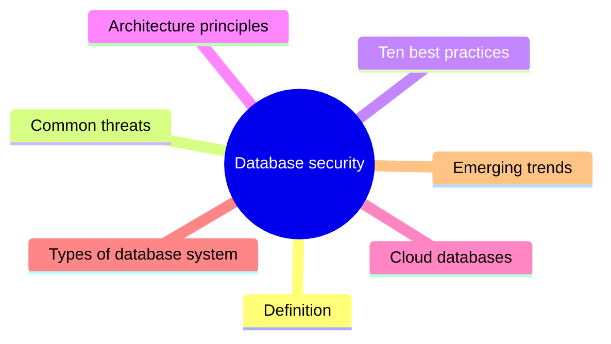
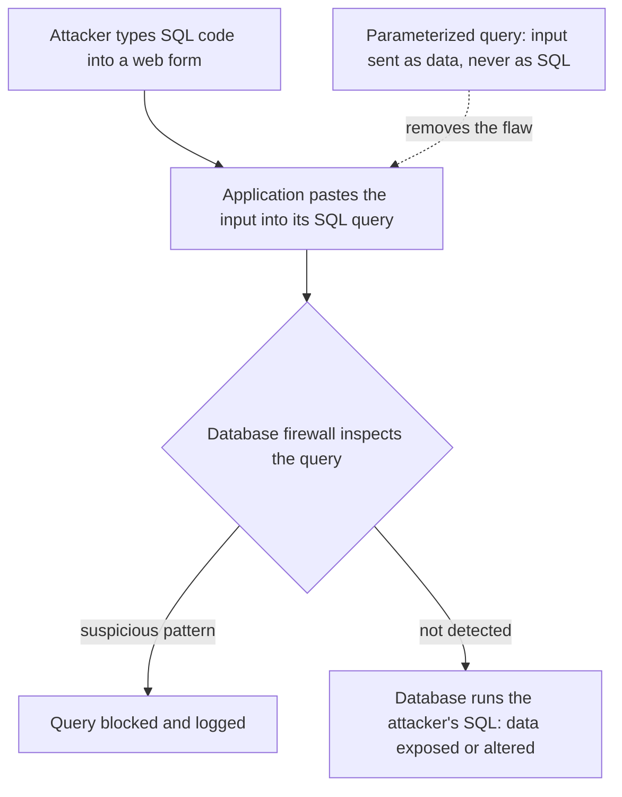

# Unit 11: Database security

*Courseware Chapter 11, pages 72–75.*

## At a glance

Almost every system in this course ends at a database: the student records, the bank ledger, the patient files. This unit asks how that store of data is protected. It answers six questions:

- **What is database security?** A collection of **tools, controls and processes** that protect databases from **unauthorized access, misuse and corruption**.
- **What threatens a database?** The **six** most frequent threats, from **SQL injection** to **unmonitored database activity**.
- **What should an organisation do?** The **ten best practices**, from access controls to penetration testing.
- **How should the database environment be designed?** The **five key principles of database security architecture**: defense in depth, RBAC, continuous data discovery, data masking and anonymization, secure configurations.
- **What changes in the cloud, and for different kinds of database?** The **shared responsibility model**, protecting cloud data, and the different needs of **relational, NoSQL and distributed** databases.
- **Where is the field going?** Three **emerging trends**: AI-driven monitoring, automated compliance and zero-trust architecture.



## What you should be able to do

*The courseware lists no learning outcomes; these are written for this site.*

- Define database security and state what it protects against, the sources of threats and the consequences of weak security.
- List the six most frequent database security threats and explain how each one harms a database.
- List and explain the ten database security best practices, and say which threat each one counters.
- Explain the five key principles of database security architecture, and draw a defense-in-depth layout of web server, application and database server.
- Explain the shared responsibility model and the measures for protecting cloud data.
- Differentiate the security needs of relational, NoSQL and distributed databases.
- Explain the three emerging trends in database security.
- Recommend and justify a set of controls for a given database scenario, and say why the alternatives are weaker.

## What database security is

<span class="src">Chapter 11 opening · p.72</span>

The chapter opens with one paragraph that defines the subject and explains why it matters.

> **Database security** refers to the collection of tools, controls, and processes designed to protect databases from unauthorized access, misuse, and corruption. It ensures sensitive data remains safe from database security threats including external hackers, malicious insiders, and human error. Modern organizations depend on database servers to store massive volumes of cloud data, customer information, and intellectual property. When security is weak, data breaches can cost millions, disrupt operations, and permanently damage trust.

!!! note "In plain terms"
    The definition is built from **threes**, which makes it easy to learn (the grouping is the site's):

    | Part of the paragraph | The three items |
    |---|---|
    | Database security is a collection of… | **tools**, **controls**, **processes** |
    | …that protect databases from… | **unauthorized access**, **misuse**, **corruption** |
    | Threats come from… | **external hackers**, **malicious insiders**, **human error** |
    | Database servers store… | **cloud data**, **customer information**, **intellectual property** |
    | Weak security means breaches can… | **cost millions**, **disrupt operations**, **permanently damage trust** |

    Note that the threat sources are not all attackers: **human error** (an administrator who deletes a table by mistake, a developer who leaves a database open to the Internet) is listed alongside hackers and insiders.

The three harms line up with the CIA triad of [Unit 1](unit-1-security-concepts.md#what-computer-security-means-the-cia-triad) (the mapping is ours): **unauthorized access** breaks confidentiality, **corruption** breaks integrity, and **misuse** can break any of the three, including availability when an operation is disrupted.

!!! example "Example"
    A Nigerian university's records database holds every student's grades, fees, and personal details. Database security here means the **tools** (a database firewall, encryption software), **controls** (who may change a grade) and **processes** (nightly backups, monthly account reviews) that stop a hacker from reading the records, a staff member from quietly changing a grade, and an administrator from accidentally wiping the fees table.

!!! tip "Exam angle"
    "Define database security" is the most predictable question in the chapter. Learn the first sentence word for word ("collection of tools, controls, and processes… unauthorized access, misuse, and corruption"), then add the three threat sources and the three consequences for full marks.

**Check your understanding**

<div class="quiz" markdown>
<p class="quiz-q">According to the courseware, database security protects databases from which three things?</p>
<ul class="quiz-options">
  <li>External hackers, malicious insiders and human error</li>
  <li data-correct>Unauthorized access, misuse and corruption</li>
  <li>Cloud data, customer information and intellectual property</li>
  <li>Confidentiality, integrity and availability</li>
</ul>
<div class="quiz-explain" markdown>
The definition says the tools, controls and processes protect databases "from **unauthorized access, misuse, and corruption**". External hackers, malicious insiders and human error are the **sources** of threats, the tempting distractor; cloud data, customer information and intellectual property are what databases **store** (Chapter 11 opening, p.72).
</div>
</div>

<div class="quiz" markdown>
<p class="quiz-q">A database administrator mistypes a command and deletes last term's exam results. Which threat source named in the definition does this illustrate?</p>
<ul class="quiz-options">
  <li>External hackers</li>
  <li>Malicious insiders</li>
  <li data-correct>Human error</li>
  <li>SQL injection</li>
</ul>
<div class="quiz-explain" markdown>
The administrator is an insider but is not **malicious**: the deletion is a mistake, so it is **human error**, which the courseware lists as a separate threat source. SQL injection is an attack technique, not one of the three sources (Chapter 11 opening, p.72).
</div>
</div>

## Common database security threats

<span class="src">Common database security threats · p.72</span>

Before looking at defences, the courseware lists what a database is defended against.

> Every database system faces both internal and external risks. The most frequent database security threats include SQL injection attacks that exploit flaws in poorly sanitized database queries, insider threats from users with excessive privileges, password sharing, misconfigured database software vulnerabilities, unpatched database security breaches, and unmonitored database activity on production databases. These threats target database management systems and the operating system they run on. Without continuous monitoring, even small oversights can expose protected data to compromise.

The paragraph names **six** threats (the courseware does not number or count them; the count is ours):

| # | Threat (courseware wording) | What it means *(site explanation)* | Internal or external? *(site classification)* |
|---|---|---|---|
| 1 | **SQL injection attacks** that exploit flaws in poorly sanitized database queries | An attacker types SQL code into a form or URL; the application pastes it into its query unchecked, and the database runs the attacker's command | Usually external |
| 2 | **Insider threats** from users with excessive privileges | Staff who hold more rights than their job needs can read, change or copy data they should never touch | Internal |
| 3 | **Password sharing** | Several people use one account, so accountability is lost and one leak exposes everyone | Internal (exploited by anyone who gets the password) |
| 4 | **Misconfigured database software** vulnerabilities | Default passwords, unused services left running, a database open to the Internet | Internal weakness, exploited externally |
| 5 | **Unpatched** database security breaches | Known flaws left unfixed because updates were not applied | Internal weakness, exploited externally |
| 6 | **Unmonitored database activity** on production databases | Nobody watches the logins and queries on the live database, so attacks go unnoticed | Internal weakness (lets both kinds succeed) |

!!! note "In plain terms"
    - **"Internal and external risks":** the same split as inside and outside attacks in [Unit 1](unit-1-security-concepts.md#security-concepts-and-relationships). Most of the six are **weaknesses inside the organisation** (too many privileges, shared passwords, bad configuration, missing patches, no monitoring) that an outside attacker can then exploit.
    - **"Target database management systems and the operating system they run on":** a database is only as safe as the server under it. The OS threats of [Unit 3](unit-3-os-security.md#threats-to-operating-systems) (privilege escalation, malware, unpatched software) all reach the data through the OS.
    - **The last sentence is the lesson:** without **continuous monitoring**, "even small oversights" (one shared password, one missed patch) can expose protected data.
    - **Memory aid (site's):** "**S**ome **I**nsiders **P**ass **M**istakes **U**nder **U**s": **S**QL injection, **I**nsider threats, **P**assword sharing, **M**isconfiguration, **U**npatched, **U**nmonitored.

!!! info "Beyond the notes"
    **How SQL injection works.** Suppose a login page builds its query by pasting in what the user types:

    ```sql
    SELECT * FROM users WHERE username = 'TYPED_NAME' AND password = 'TYPED_PASSWORD';
    ```

    If the attacker types `' OR '1'='1` as the password, the query becomes `… AND password = '' OR '1'='1'`, which is always true, so the attacker logs in without a password. Worse inputs can read whole tables or delete them. "Poorly sanitized" means the application did not check or neutralise the input. The cure is a **parameterized query**, in which the input is sent to the database as **data**, never as part of the SQL command; the courseware names it under relational databases. SQL and web forms appear as part of the software **attack surface** in [Unit 2](unit-2-attacks.md#attack-surfaces).



<p class="caption">How SQL injection reaches a database, and where two of the courseware's defences stop it: the database firewall (best practice 4) and parameterized queries (relational databases). Drawn for this site.</p>

!!! example "Example"
    A state ministry's pension portal lets every clerk log in to the database as the same `admin` account (password sharing, excessive privileges). The server has not been updated for two years (unpatched) and nobody reads the logs (unmonitored). When a pensioner's records are changed to divert payments, the ministry cannot tell **who** did it or **when**: four of the six threats combined in one incident.

!!! tip "Exam angle"
    "List the common database security threats" is a likely (a)-part: give all **six**. In scenario questions, look for the signals: a search box or login form passing input straight to the database (**SQL injection**); "everyone has admin rights" (**excessive privileges**); "staff share one login" (**password sharing**); "default password", "unused services" (**misconfiguration**); "never updated" (**unpatched**); "nobody noticed for months" (**unmonitored activity**).

!!! warning "Courseware note"
    Two items in the list are worded loosely. "**Misconfigured database software vulnerabilities**" means vulnerabilities caused by misconfigured database software. "**Unpatched database security breaches**" should read unpatched database **vulnerabilities**: a breach is the *result* of leaving a flaw unpatched, not something that is patched. Quote the courseware's phrase, but explain it as an unpatched vulnerability. Logged as U11-2.

**Check your understanding**

<div class="quiz" markdown>
<p class="quiz-q">An attacker types <code>' OR '1'='1</code> into a portal's search box and the portal returns every student record. Which threat does this illustrate?</p>
<ul class="quiz-options">
  <li>Password sharing</li>
  <li data-correct>SQL injection</li>
  <li>Insider threat from excessive privileges</li>
  <li>Unmonitored database activity</li>
</ul>
<div class="quiz-explain" markdown>
SQL injection "exploit[s] flaws in poorly sanitized database queries": the input was pasted into the query unchecked and changed its meaning. Unmonitored activity may explain why nobody noticed, but it is not the attack itself (Common database security threats, p.72).
</div>
</div>

<div class="quiz" markdown>
<p class="quiz-q">The courseware says the common threats target which two things?</p>
<ul class="quiz-options">
  <li>Web servers and application layers</li>
  <li>Customer information and intellectual property</li>
  <li data-correct>Database management systems and the operating system they run on</li>
  <li>Cloud providers and their customers</li>
</ul>
<div class="quiz-explain" markdown>
"These threats target **database management systems and the operating system they run on**." Web servers and application layers appear later (separating servers, defense in depth); customer information and intellectual property are what databases store (Common database security threats, p.72).
</div>
</div>

<div class="quiz" markdown>
<p class="quiz-q">Five lecturers all log in to the results database with one shared account. A grade is changed and nobody can say who did it. Which threat is the main cause of the lost accountability?</p>
<ul class="quiz-options">
  <li>Misconfigured database software</li>
  <li>SQL injection</li>
  <li data-correct>Password sharing</li>
  <li>Unpatched vulnerabilities</li>
</ul>
<div class="quiz-explain" markdown>
With **password sharing**, actions can no longer be traced uniquely to one person, which is the accountability requirement of Unit 1. Misconfiguration is tempting (a shared account is poor practice), but the courseware lists password sharing as its own threat (Common database security threats, p.72).
</div>
</div>

## Database security best practices

<span class="src">Database security best practices? · p.72</span>

The courseware's main list: ten practices, numbered in the source.

> Organizations can reduce security risks and safeguard sensitive data by following established security best practices. Below are key database security best practices recommended by security experts and database administrators worldwide.

| # | Best practice | Core idea in one line *(site summary)* |
|---|---|---|
| 1 | Apply proper access controls | Only authorized users reach the data relevant to their role (least privilege) |
| 2 | Separate database servers | Database on its own server, apart from web and application layers |
| 3 | Encrypt data in transit and at rest | Stolen data is unreadable without the keys |
| 4 | Use database firewalls | Block malicious traffic and SQL injection before it reaches the database |
| 5 | Strengthen authentication | Strong unique passwords, MFA, remove stale credentials, audit configuration changes |
| 6 | Monitor database activity | Real-time visibility into unusual logins, connections and privilege escalations |
| 7 | Implement backup and disaster recovery | Separate, tested backups against ransomware, outages and corruption |
| 8 | Patch and update regularly | Close known gaps; automate patch management |
| 9 | Limit physical access | Locked server rooms, biometric access, surveillance |
| 10 | Conduct regular penetration testing | Find weaknesses before attackers do |

{ .diagram }

<p class="caption">The ten best practices grouped into four questions. The grouping and colours are added by this site; the numbers are the courseware's.</p>

!!! note "In plain terms"
    **Memory aid (site's): the four Ws.** Ask four questions of any database: **WHO** gets in (1, 5)? **WHERE** does it sit (2, 4, 9)? **WHAT** protects the stored data itself (3, 7)? Who **WATCH**es, fixes and tests it (6, 8, 10)? If you can recall the four groups you can rebuild all ten practices.

    Many of the ten repeat the operating-system measures of [Unit 3](unit-3-os-security.md#security-measures-to-protect-operating-systems) (access control, strong authentication, encryption, patching, backup, physical security, monitoring) but applied to the database. Two are specific to databases: **separating database servers** and **database firewalls**.

### 1. Apply proper access controls

<span class="src">Database security best practices? · p.72</span>

> Implement access controls that define which users can access which resources. Proper access controls ensure that only authorized users can access data relevant to their role. Using role-based access management or access management software enforces least-privilege policies across database user accounts.

**Right data, right role, nothing more.** Access controls decide **which users can reach which resources**. The goal is **least privilege** ([Unit 1](unit-1-security-concepts.md#least-privilege)): a user gets only the data relevant to their role. The courseware names two ways to enforce it: **role-based access management** (rights attached to roles such as "lecturer" or "bursary officer", not to individuals) and **access management software**. This is the main answer to the threat of **insiders with excessive privileges**. Access control as a whole subject is in [Unit 8](unit-8-access-control.md).

### 2. Separate database servers

<span class="src">Database security best practices? · p.72</span>

> To minimize lateral movement during an attack, separate database servers from web servers and application layers. A physical database server should never host both the application and the data, as this separation helps reduce exposure to SQL injection and other database attacks.

**Don't keep the safe in the shop window.** The web server faces the Internet and is the most likely part to be broken into. If the database sits on the same machine, an attacker who takes the web server has the data too. **Lateral movement** is an attacker moving from the first machine they compromise to others; separating servers puts a barrier in the way. Rule to quote: a physical database server should **never host both the application and the data**. This is the **isolation** principle of [Unit 1](unit-1-security-concepts.md#isolation) applied to servers.

!!! warning "Courseware note"
    The courseware says separation "helps reduce exposure to SQL injection". Separation does not stop an injection itself (the injected query still travels from the application to the database); what it reduces is the **damage**: an attacker who breaks into the web server does not automatically get the database server too. Injection is prevented by parameterized queries and detected by database firewalls (this reading is an inference). Logged as U11-3.

### 3. Encrypt data in transit and at rest

<span class="src">Database security best practices? · p.72</span>

> Always encrypt data both at rest and during transmission using Transport Layer Security (TLS). Data encryption renders stolen information unreadable without the decryption keys, keeping sensitive data safe even if a breach occurs. MongoDB Atlas also does this.

**Assume a breach; make the stolen data useless.** Data **at rest** is stored (on disk, in backups); data **in transit** is moving (between the application and the database, or to a user). Encryption means that a thief who copies the files or taps the connection sees only ciphertext unless they also have the **decryption keys**. The key phrase: encryption keeps data safe "**even if a breach occurs**", so it is the last line of defence, not the first. The two states and the algorithms are explained in [Unit 4](unit-4-cryptography.md#what-cryptography-is-data-at-rest-and-data-in-transit); TLS in [Unit 4](unit-4-cryptography.md#transport-layer-security-tls).

!!! warning "Courseware note"
    The sentence reads as if **TLS** encrypts data both at rest and in transit. TLS protects data **in transit** only (it secures a connection). Data **at rest** is encrypted with storage or database encryption, usually a symmetric algorithm such as AES ([Unit 4](unit-4-cryptography.md#symmetric-encryption)). "MongoDB Atlas also does this" is a stray product mention: MongoDB Atlas is a commercial cloud database service that encrypts data in transit and at rest by default. Logged as U11-1.

### 4. Use database firewalls

<span class="src">Database security best practices? · p.73</span>

> Deploy database firewalls to block malicious traffic and enforce firewall rules. A database firewall can detect and prevent SQL injection attacks and other suspicious database activity before they reach the core database server.

**A guard who reads every query.** A database firewall sits in front of the database server and inspects the **database traffic** (the SQL queries), not just addresses and ports. It applies firewall rules to block malicious traffic and can **detect and prevent SQL injection** and other suspicious activity "**before they reach the core database server**". In the terms of [Unit 5](unit-5-firewalls.md#what-a-firewall-is), it is a specialised firewall that understands one application's language, much like an application-level gateway.

### 5. Strengthen authentication

<span class="src">Database security best practices? · p.73</span>

> Restrict user access with strong, unique passwords and multifactor authentication. Regularly review user accounts to remove stale credentials, limit direct access to critical systems, and audit all changes in database configurations.

**Prove who you are, every time.** The paragraph contains **four** actions (count ours): (1) strong, unique passwords **and multifactor authentication (MFA)**; (2) regularly review user accounts to **remove stale credentials** (accounts of people who have left or changed jobs); (3) **limit direct access** to critical systems; (4) **audit all changes** in database configurations. "Unique" passwords answer the **password-sharing** threat; removing stale credentials closes accounts an attacker could take over quietly. Compare strong authentication for the OS in [Unit 3](unit-3-os-security.md#strong-authentication).

### 6. Monitor database activity

<span class="src">Database security best practices? · p.73</span>

> Real-time database activity monitoring provides visibility into anomalies, helping security teams identify insider threats and external breaches. Use monitoring tools to detect unusual logins, abnormal database connections, and privilege escalations.

**Someone must be watching.** Monitoring gives **visibility into anomalies** in **real time**, so it catches both **insider threats and external breaches**. Learn the **three** things the tools detect: **unusual logins**, **abnormal database connections**, and **privilege escalations** (a user gaining rights they should not have). It is the direct answer to the threat of **unmonitored database activity**. Monitoring at scale is the job of intrusion detection systems ([Unit 12](unit-12-idps.md#what-an-idps-is-used-for)).

### 7. Implement backup and disaster recovery

<span class="src">Database security best practices? · p.73</span>

> Reliable backup and disaster recovery plans protect against data loss caused by ransomware, outages, or corruption. Secure database backup copies should be stored separately and tested frequently to ensure they can be restored without compromising database performance.

**Be able to rebuild.** Backups protect against **data loss** from **three** causes: **ransomware, outages, or corruption**. Two rules for the copies: store them **separately** (a backup on the same server is encrypted by the same ransomware) and **test them frequently** (an untested backup may not restore). Backups protect **availability and integrity**, not confidentiality: a stolen backup is a breach unless it is also encrypted. Ransomware is covered in [Unit 9](unit-9-malware.md#ransomware); the missing disaster recovery plan is a policy weakness in [Unit 6](unit-6-security-policy.md#lack-of-a-disaster-recovery-plan).

### 8. Patch and update regularly

<span class="src">Database security best practices? · p.73</span>

> Regular updates to database management software and database services close exploitable gaps. Automated patch management reduces exposure to newly discovered database software vulnerabilities.

**Close known holes quickly.** Vendors publish fixes for flaws they discover; until the fix is applied, the flaw is public knowledge and an easy target. **Automated patch management** shortens that window for **newly discovered** vulnerabilities. This answers the **unpatched** threat. Compare [Unit 3](unit-3-os-security.md#regular-updates-and-patching).

### 9. Limit physical access

<span class="src">Database security best practices? · p.73</span>

> Good physical security prevents unauthorized personnel from tampering with hardware. Install physical security measures such as locked server rooms, biometric access, and surveillance around your data center and database servers.

**Software controls fail if someone can carry the disk away.** Physical security stops unauthorized personnel from **tampering with hardware**. The **three** measures named: **locked server rooms**, **biometric access**, and **surveillance** (e.g. CCTV), around the **data center and database servers**. Compare [Unit 3](unit-3-os-security.md#physical-security).

### 10. Conduct regular penetration testing

<span class="src">Database security best practices? · p.73</span>

> Perform periodic penetration tests and security testing to uncover weaknesses before attackers do. External penetration testing validates your security controls and security measures, offering actionable insights to database administrators and security teams.

**Attack yourself before someone else does.** A penetration test is an **authorised, simulated attack** that tries to break in the way a real attacker would. It uncovers weaknesses "**before attackers do**". **External** penetration testing (by testers from outside, attacking as an outsider would) **validates** that the controls actually work and gives **actionable insights** to database administrators and security teams. It differs from monitoring: monitoring watches real activity continuously; penetration testing is a **periodic** check of the defences.

!!! example "Example"
    A Lagos fintech's customer database applies all four Ws: **who** (each staff role sees only its tables; MFA for every login; leavers' accounts removed on their last day), **where** (database on its own server behind a database firewall, in a locked, biometric-access server room), **what** (TLS between the app and the database, encrypted disks, nightly backups copied off-site and restored as a test every month) and **watch** (alerts on unusual logins, automatic patching, an external penetration test every year).

!!! tip "Exam angle"
    Expect "list and explain **N** of the database security best practices" (know all **ten** and their numbers) and scenarios asking you to **recommend** practices. In a recommendation, link each practice to the threat in the scenario ("*the portal passes form input straight to the database, so a **database firewall** (practice 4) will detect and block SQL injection before it reaches the core server*"). Details examiners like: **lateral movement** (2), **TLS** and "even if a breach occurs" (3), "**before they reach the core database server**" (4), **stale credentials** and **MFA** (5), the three things monitoring detects (6), the three causes of data loss and "**stored separately and tested frequently**" (7), **automated** patch management (8), the three physical measures (9), "**before attackers do**" (10).

**Check your understanding**

<div class="quiz" markdown>
<p class="quiz-q">An attacker breaks into a university's web server. Because the student database runs on the same physical machine, she copies it at once. Which best practice was ignored?</p>
<ul class="quiz-options">
  <li>Use database firewalls</li>
  <li data-correct>Separate database servers</li>
  <li>Conduct regular penetration testing</li>
  <li>Limit physical access</li>
</ul>
<div class="quiz-explain" markdown>
Best practice 2: "a physical database server should never host both the application and the data", to **minimize lateral movement**. A database firewall inspects queries; it would not help when the attacker already controls the machine the data sits on. Physical access is about people in the server room, not remote attackers (Best practice 2, p.72).
</div>
</div>

<div class="quiz" markdown>
<p class="quiz-q">Which of these is NOT one of the three things the courseware says database monitoring tools should detect?</p>
<ul class="quiz-options">
  <li>Unusual logins</li>
  <li>Abnormal database connections</li>
  <li>Privilege escalations</li>
  <li data-correct>Unpatched database software</li>
</ul>
<div class="quiz-explain" markdown>
Monitoring tools detect **unusual logins, abnormal database connections, and privilege escalations**. Unpatched software is closed by best practice 8 (patch and update regularly), not detected by activity monitoring (Best practice 6, p.73).
</div>
</div>

<div class="quiz" markdown>
<p class="quiz-q">Ransomware encrypts a hospital's database and also the backup copy kept on the same server. Which part of best practice 7 was broken?</p>
<ul class="quiz-options">
  <li>Backups must be encrypted with TLS</li>
  <li data-correct>Backup copies should be stored separately</li>
  <li>Backups must use automated patch management</li>
  <li>Backups must be protected by biometric access</li>
</ul>
<div class="quiz-explain" markdown>
"Secure database backup copies should be **stored separately** and tested frequently." A backup on the same server falls with it. TLS protects data in transit, not backups at rest; patching and biometrics belong to practices 8 and 9 (Best practice 7, p.73).
</div>
</div>

### Telling similar practices apart

<span class="src">Database security best practices? · pp.72–73</span>

Several of the ten practices sound alike. This table (a site summary) separates them.

| Pair | First | Second | One-line difference |
|---|---|---|---|
| Access controls (1) vs strengthen authentication (5) | Decide **what** each authorized user may reach (by role, least privilege) | Check **who** the user is (strong unique passwords, MFA) | Authentication = who are you? Access control = what may you do? |
| Separate servers (2) vs database firewall (4) | **Architecture:** database on its own physical server, away from web and application layers | **Filter:** inspects traffic and blocks SQL injection before it reaches the server | Separation limits lateral movement; the firewall stops bad queries |
| Encryption (3) vs backup (7) | Makes stolen data **unreadable** (confidentiality) | Lets lost or damaged data be **restored** (availability, integrity) | Encryption against theft; backup against loss |
| Monitoring (6) vs penetration testing (10) | **Continuous, real-time** watch of actual activity | **Periodic**, simulated attacks to find weaknesses | Monitoring catches attacks as they happen; testing finds holes before they are used |
| Patching (8) vs penetration testing (10) | Fixes **known** vulnerabilities published by vendors | **Discovers** weaknesses, including misconfigurations nobody knew about | Patching closes known gaps; testing finds unknown ones |

**Check your understanding**

<div class="quiz" markdown>
<p class="quiz-q">A bank hires an outside firm every six months to try to break into its customer database and report what they found. Which best practice is this?</p>
<ul class="quiz-options">
  <li>Monitor database activity</li>
  <li>Patch and update regularly</li>
  <li data-correct>Conduct regular penetration testing</li>
  <li>Use database firewalls</li>
</ul>
<div class="quiz-explain" markdown>
Periodic, simulated attacks by **external** testers who report "actionable insights" are **penetration testing** (practice 10). Monitoring is tempting, but it is continuous and watches real activity rather than staging attacks (Best practice 10, p.73).
</div>
</div>

<div class="quiz" markdown>
<p class="quiz-q">A user logs in correctly with her password and a one-time code, then opens the salary table, which her role should not see. Which control failed?</p>
<ul class="quiz-options">
  <li>Strengthen authentication</li>
  <li data-correct>Apply proper access controls</li>
  <li>Encrypt data in transit and at rest</li>
  <li>Separate database servers</li>
</ul>
<div class="quiz-explain" markdown>
Authentication worked: she proved who she is with MFA. What failed is **access control**, which should ensure "only authorized users can access data **relevant to their role**" (practice 1). Encryption does not stop an authorized session from reading data (Best practices 1 and 5, pp.72–73).
</div>
</div>

## Key principles of database security architecture

<span class="src">Key principles of database security architecture · p.73</span>

Best practices are actions; the architecture principles describe how the whole environment is **designed**.

> A secure database environment depends on integrating both technical and organizational defenses. The following architectural elements form the foundation of an effective database security framework.

There are **five** principles (the courseware does not number or count them; the count is ours): **defense in depth**, **role-based access control (RBAC)**, **continuous data discovery**, **data masking and anonymization**, and **secure database configurations**.

!!! note "In plain terms"
    "**Technical and organizational** defenses": technology alone is not enough. RBAC needs someone to define the roles; data discovery needs a classification scheme; configuration audits need a policy to audit against (see [Unit 6](unit-6-security-policy.md#components-of-an-information-security-policy)).

    **Memory aid (site's): "Deep Roots Discover Masked Configurations"** (Defense in depth, RBAC, Discovery, Masking, Configurations).

### Defense in depth

<span class="src">Key principles of database security architecture · pp.73–74</span>

> Combine network security, access management, and encryption to protect database systems from multiple angles. Each layer—web server, application, and database server—should enforce unique security controls.

**Many layers, each with its own lock.** Defense in depth combines **three** kinds of control (**network security, access management, encryption**) and places controls at **three** layers (**web server, application, database server**). The word "**unique**" matters: each layer has its own controls, so breaking one layer does not open the next. This is the **layering** design principle of [Unit 1](unit-1-security-concepts.md#layering), applied to a database stack.

![Users and attackers on the left; arrows lead through three boxes, Web server (network firewall, TLS, only needed ports open, patched web software), Application (MFA and strong passwords, RBAC and least privilege, parameterized queries, masked data in testing), a Database firewall that blocks SQL injection, and Database server (encryption at rest, secure configuration, activity monitoring, regular patching, backups kept separately, locked server room) with Sensitive data inside. A band underneath reads: Separate servers, no physical server hosts both the application and the data.](assets/diagrams/u11-defense-in-depth.svg){ .diagram }

<p class="caption">Defense in depth for a database: the courseware's three layers, with controls from the best practices placed on each. Drawn for this site; the placement of controls on layers is the site's.</p>

### Role-based access control (RBAC)

<span class="src">Key principles of database security architecture · p.74</span>

> RBAC ensures that authorized users access only the database queries or tables they need. Defining permissions by role streamlines access control management and prevents accidental exposure of sensitive data.

**Permissions belong to roles, people get roles.** Instead of granting rights person by person, the administrator defines roles (e.g. *registry officer*, *lecturer*, *student*), gives each role the **queries or tables it needs**, and assigns people to roles. Two benefits named: it **streamlines access control management** (one change to a role updates everyone in it) and **prevents accidental exposure** of sensitive data. It is how best practice 1 is put into the architecture. RBAC in general is taught in [Unit 8](unit-8-access-control.md#role-based-access-control-rbac).

### Continuous data discovery

<span class="src">Key principles of database security architecture · p.74</span>

> Modern environments require continuous data discovery to locate and classify sensitive data wherever it resides—from cloud data stores to legacy database systems. This helps organizations meet evolving data security and data protection standards.

**You cannot protect data you don't know you have.** Data discovery means continually **locating** sensitive data and **classifying** it (e.g. "public", "internal", "confidential") **wherever it resides**, from cloud data stores to old (legacy) systems. "Continuous" because copies appear all the time (exports, test copies, spreadsheets). It helps meet **evolving data security and data protection standards**, such as Nigeria's data protection law ([Unit 10](unit-10-ethics-legal.md#data-protection-and-privacy-laws) covers legal issues).

### Data masking and anonymization

<span class="src">Key principles of database security architecture · p.74</span>

> Use data masking to hide identifiable information during testing or analytics. It allows developers to work with just the data they need while keeping sensitive data protected.

**Realistic data, fake details.** Data masking **hides identifiable information** (names, account numbers, phone numbers) when data is used for **testing or analytics**, e.g. showing `0803*****21` instead of the full phone number. Developers get data that looks real and behaves like real data, "**just the data they need**", without seeing real customers' details.

!!! info "Beyond the notes"
    The heading names **anonymization** but the paragraph explains only masking. The usual distinction: **masking** hides or replaces values (and may be reversible, or applied only on display); **anonymization** removes or transforms identifying details **permanently**, so that the records can no longer be linked to a person at all (e.g. replacing names with random IDs and removing dates of birth before releasing data for research). Both serve least privilege for data: people see only what they need.

### Secure database configurations

<span class="src">Key principles of database security architecture · p.74</span>

> Proper database configurations reduce vulnerabilities such as default passwords or unused services. Auditing configurations across database platforms ensures consistent adherence to database security policies.

**Harden the defaults.** Databases are often installed with **default passwords** and **unused services** switched on; proper configuration removes these two named vulnerabilities. **Auditing configurations across database platforms** (checking every database, not just one) ensures **consistent adherence to database security policies**. This is the answer to the **misconfiguration** threat. Compare [Unit 3](unit-3-os-security.md#secure-configuration).

!!! example "Example"
    A teaching hospital's patient database applies all five principles: controls at the web, application and database layers (**defense in depth**); nurses, doctors and billing staff each have a role limited to their tables (**RBAC**); a monthly scan finds a forgotten spreadsheet export of patient records on a shared drive (**continuous data discovery**); the developers building the new app work on records with names and phone numbers masked (**data masking**); and the default `sa` administrator password is changed and unused services are disabled on every database server (**secure configuration**).

!!! tip "Exam angle"
    "List and explain the key principles of database security architecture" asks for all **five**. "With the aid of a diagram, explain defense in depth" means: draw the **three layers** (web server, application, database server), show **network security, access management and encryption**, and stress that each layer enforces **unique** controls. RBAC appears both as a practice (1, "role-based access management") and a principle: in an answer on principles, define it with the principle's wording ("only the database queries or tables they need").

**Check your understanding**

<div class="quiz" markdown>
<p class="quiz-q">A bank's developers need realistic customer data to test a new loan app, but must not see real customers' names and account numbers. Which architectural principle applies?</p>
<ul class="quiz-options">
  <li>Continuous data discovery</li>
  <li data-correct>Data masking and anonymization</li>
  <li>Role-based access control</li>
  <li>Secure database configurations</li>
</ul>
<div class="quiz-explain" markdown>
Data masking "hide[s] identifiable information during **testing** or analytics" and lets developers "work with just the data they need". Data discovery **locates and classifies** sensitive data; it does not hide it. RBAC could stop the developers seeing the table at all, but then they could not test (Data masking and anonymization, p.74).
</div>
</div>

<div class="quiz" markdown>
<p class="quiz-q">According to the courseware's description of defense in depth, which three layers should each enforce unique security controls?</p>
<ul class="quiz-options">
  <li>Network, operating system and user</li>
  <li data-correct>Web server, application and database server</li>
  <li>Physical, technical and administrative</li>
  <li>Cloud provider, customer and auditor</li>
</ul>
<div class="quiz-explain" markdown>
"Each layer—**web server, application, and database server**—should enforce unique security controls." The three kinds of control combined are network security, access management and encryption. The other options are layer schemes from other contexts (Defense in depth, pp.73–74).
</div>
</div>

<div class="quiz" markdown>
<p class="quiz-q">An audit finds that three of a ministry's five database servers still use the vendor's default administrator password. Which principle was not followed?</p>
<ul class="quiz-options">
  <li>Defense in depth</li>
  <li>Continuous data discovery</li>
  <li data-correct>Secure database configurations</li>
  <li>Data masking and anonymization</li>
</ul>
<div class="quiz-explain" markdown>
"Proper database configurations reduce vulnerabilities such as **default passwords** or unused services", and auditing **across database platforms** ensures consistency. Defense in depth is tempting, but the specific failure is configuration (Secure database configurations, p.74).
</div>
</div>

## Database security in the cloud

<span class="src">Database security in the cloud · p.74</span>

Many organisations now rent their databases from a cloud provider. The courseware explains who is responsible for what.

> As organizations adopt cloud databases, new security considerations arise. Cloud providers manage the infrastructure, but customers are still responsible for securing database environments and user access.

**The cloud is not someone else's problem.** The provider runs the hardware and data centres, but the **customer** still secures the **database environment** and **user access**. A common mistake is to assume that moving to the cloud moves all security to the provider.

### Shared responsibility model

<span class="src">Database security in the cloud · p.74</span>

> In cloud deployments, providers secure the physical infrastructure, while customers safeguard data, database user accounts, and access controls. Using access management software and auditing database activity helps meet shared compliance obligations.

{ .diagram }

<p class="caption">The shared responsibility model as the courseware describes it. Drawn for this site; "data centres, hardware, network" is the site's gloss on "physical infrastructure", and the extra customer duties come from "Protecting cloud data".</p>

| Who | Secures *(courseware)* |
|---|---|
| **Cloud provider** | The **physical infrastructure** |
| **Customer** | **Data**, **database user accounts**, and **access controls** |
| **Both (shared)** | **Compliance obligations**, met by using **access management software** and **auditing database activity** |

### Protecting cloud data

<span class="src">Database security in the cloud · p.74</span>

> Encrypt cloud data with customer-managed keys and enforce strict security measures at every layer. Implement backup and disaster recovery for redundancy and maintain security teams trained in cloud databases.

The paragraph gives **four** measures (count ours):

1. **Encrypt cloud data with customer-managed keys.** The customer, not the provider, creates and controls the encryption keys, so the provider's staff (or anyone who breaks into the provider) cannot read the data without the customer's keys.
2. **Enforce strict security measures at every layer:** defense in depth again, applied in the cloud.
3. **Implement backup and disaster recovery for redundancy:** best practice 7; in the cloud, backups can be kept in a different region.
4. **Maintain security teams trained in cloud databases:** cloud settings differ from on-premises ones, and misconfiguration is a common cause of cloud breaches.

!!! info "Beyond the notes"
    How much the provider secures depends on the service. With a **virtual machine** (infrastructure as a service) the customer also patches the operating system and the database software; with a **managed database service** (database as a service, e.g. MongoDB Atlas, mentioned in best practice 3) the provider patches the database software too. In every model, the **data, the user accounts and who has access** remain the customer's job, which is the courseware's point.

!!! example "Example"
    A Nigerian e-commerce start-up moves its orders database to a cloud provider. The provider's data centre has guards, biometrics and redundant power (**provider: physical infrastructure**). But the start-up's developer leaves the database reachable from the whole Internet with a weak password, and customer records leak. The fault is the **customer's**: user accounts and access controls were its responsibility under the shared responsibility model.

!!! tip "Exam angle"
    "Explain the shared responsibility model" needs the split: provider = **physical infrastructure**; customer = **data, database user accounts, access controls**; shared = **compliance**, helped by **access management software** and **auditing database activity**. For "how should cloud data be protected", give the **four** measures, and explain **customer-managed keys**.

**Check your understanding**

<div class="quiz" markdown>
<p class="quiz-q">Under the shared responsibility model described in the courseware, which of these is the cloud provider's responsibility?</p>
<ul class="quiz-options">
  <li>Database user accounts</li>
  <li>Access controls</li>
  <li data-correct>Physical infrastructure</li>
  <li>The data</li>
</ul>
<div class="quiz-explain" markdown>
"Providers secure the **physical infrastructure**, while customers safeguard data, database user accounts, and access controls." The three distractors are all the customer's job (Shared responsibility model, p.74).
</div>
</div>

<div class="quiz" markdown>
<p class="quiz-q">A fintech wants to be sure that even its cloud provider's staff cannot read its stored customer data. Which measure from "Protecting cloud data" serves this best?</p>
<ul class="quiz-options">
  <li>Implement backup and disaster recovery for redundancy</li>
  <li data-correct>Encrypt cloud data with customer-managed keys</li>
  <li>Maintain security teams trained in cloud databases</li>
  <li>Use access management software</li>
</ul>
<div class="quiz-explain" markdown>
With **customer-managed keys**, only the customer holds the keys, so the provider cannot decrypt the data. Backup gives redundancy, not secrecy; access management software controls the customer's own users (Protecting cloud data, p.74).
</div>
</div>

## Securing different types of database systems

<span class="src">Securing different types of database systems · p.74</span>

Different database designs have different weak points, so they need different defences.

> Not all database systems share the same risks. Relational, NoSQL, and distributed architectures require different security solutions to defend protected data effectively.

### Relational databases

<span class="src">Securing different types of database systems · pp.74–75</span>

> Traditional database management systems rely on structured schemas and database queries written in SQL. They are most prone to SQL injection and must use parameterized queries, database firewalls, and strong access control.

**Tables, schemas and SQL.** The courseware calls relational systems the **traditional** database management systems: data is kept in tables with a fixed structure (**schema**), and queried in **SQL**. Because everything goes through SQL, they are **most prone to SQL injection**. Three required defences: **parameterized queries** (input passed as data, never as SQL; see the SQL injection box above), **database firewalls** (best practice 4) and **strong access control** (best practice 1). *Site examples:* MySQL, PostgreSQL, Oracle, Microsoft SQL Server.

### NoSQL databases

<span class="src">Securing different types of database systems · p.75</span>

> NoSQL database management software offers flexibility but may lack built-in authentication. To secure these database servers, enforce encryption and security controls at the application level.

**Flexible, but bring your own locks.** NoSQL databases store data without a fixed table schema (documents, key-value pairs, graphs), which gives **flexibility**. The risk named is that they **may lack built-in authentication**, so security is pushed up to the **application level**: **encryption** and **security controls** enforced by the application. *Site examples:* MongoDB, Redis, Cassandra.

!!! info "Beyond the notes"
    "No SQL" does not mean "no injection". NoSQL databases have their own injection attacks (e.g. sending a query operator such as `{"$ne": null}` in place of a password), so input must still be validated. And "may lack built-in authentication" refers mainly to older default installations, which accepted connections without a password; thousands of such databases were found open on the Internet and wiped or ransomed. Modern versions support authentication, but it must be switched on (secure configuration).

### Distributed databases

<span class="src">Securing different types of database systems · p.75</span>

> Distributed database environments spread data across multiple regions for performance and availability. Ensure all database connections use encryption, and implement global data protection measures to align with regional compliance standards.

**Data in many places, many laws.** A distributed database spreads data **across multiple regions** for **performance and availability**. Two consequences: data constantly travels between sites, so **all database connections must use encryption**; and the data sits under several countries' rules, so the organisation needs **global data protection measures** that **align with regional compliance standards** (e.g. Nigerian data protection rules for Nigerian customers' data, European rules for European customers' data).

| Criterion *(site summary)* | Relational | NoSQL | Distributed |
|---|---|---|---|
| **Defining feature** *(courseware)* | Traditional; structured schemas; queries in SQL | Flexibility | Data spread across multiple regions for performance and availability |
| **Main risk** *(courseware)* | Most prone to **SQL injection** | May lack **built-in authentication** | Data in transit between regions; differing **regional compliance standards** |
| **Required controls** *(courseware)* | Parameterized queries, database firewalls, strong access control | Encryption and security controls **at the application level** | Encryption on **all database connections**; global data protection measures |
| **Examples** *(site examples)* | MySQL, PostgreSQL, Oracle | MongoDB, Redis | A bank's ledger replicated in Lagos, Abuja and a foreign cloud region |

!!! tip "Exam angle"
    "Differentiate relational, NoSQL and distributed databases in terms of their security risks and required controls" fits the table above row for row. Remember the one-word hooks: relational → **SQL injection**; NoSQL → **authentication**; distributed → **regions** (encryption + compliance).

**Check your understanding**

<div class="quiz" markdown>
<p class="quiz-q">According to the courseware, which type of database system is "most prone to SQL injection"?</p>
<ul class="quiz-options">
  <li>NoSQL databases</li>
  <li>Distributed databases</li>
  <li data-correct>Relational (traditional) databases</li>
  <li>Cloud databases</li>
</ul>
<div class="quiz-explain" markdown>
Relational systems "rely on structured schemas and database queries written in SQL. They are **most prone to SQL injection**". NoSQL's named risk is lack of built-in authentication; distributed databases' is data spread across regions (Relational databases, p.75).
</div>
</div>

<div class="quiz" markdown>
<p class="quiz-q">A company's NoSQL database has no built-in login checks. Where does the courseware say security must be enforced?</p>
<ul class="quiz-options">
  <li data-correct>At the application level, with encryption and security controls</li>
  <li>At the cloud provider's physical infrastructure</li>
  <li>Through parameterized queries only</li>
  <li>Through global data protection measures</li>
</ul>
<div class="quiz-explain" markdown>
"To secure these database servers, enforce encryption and security controls **at the application level**." Parameterized queries are the relational defence; global data protection measures are for distributed databases (NoSQL databases, p.75).
</div>
</div>

## Emerging trends in database security

<span class="src">Emerging trends in database security · p.75</span>

The chapter ends by looking ahead.

> The landscape of database security is evolving rapidly as AI, automation, and analytics redefine data management system architectures.

There are **three** trends (count ours): **AI-driven monitoring**, **automated compliance**, and **zero-trust architecture**. Each is a newer version of something earlier in the chapter.

### AI-driven monitoring

<span class="src">Emerging trends in database security · p.75</span>

> Machine learning enhances database activity monitoring by detecting abnormal behaviors faster than traditional monitoring tools.

**Monitoring that learns what normal looks like.** Machine learning builds a picture of **normal** activity (who logs in when, which queries they run) and flags **abnormal behaviours faster** than traditional tools, which rely on fixed rules. It is an upgrade of best practice 6 (monitor database activity), and the same idea as anomaly-based detection in [Unit 12](unit-12-idps.md#anomaly-based-detection).

### Automated compliance

<span class="src">Emerging trends in database security · p.75</span>

> Automated frameworks validate database security policies continuously, reducing human error and compliance drift.

**Checking the rules by machine, all the time.** Instead of an occasional manual audit, software **continuously validates** that databases still follow the security policies. It reduces **human error** and **compliance drift** (the slow slide away from the required settings as small changes pile up, e.g. one server whose default password was never changed). It automates the configuration audits of the "secure database configurations" principle.

### Zero-Trust Architecture

<span class="src">Emerging trends in database security · p.75</span>

> A zero-trust model assumes no implicit trust, enforcing verification for every user access and network access request across database servers and web servers.

**Never trust, always verify.** In older designs, anything inside the network was trusted. Zero trust gives **no implicit trust** to anyone (inside or outside) and **verifies every user access and network access request**, across both **database servers and web servers**. It is the **complete mediation** principle of [Unit 1](unit-1-security-concepts.md#complete-mediation); its network form, ZTNA, is a capability of next-generation firewalls in [Unit 5](unit-5-firewalls.md#next-generation-firewalls-ngfw).

| Trend | Traditional approach *(site summary)* | Emerging approach *(courseware)* |
|---|---|---|
| **AI-driven monitoring** | Traditional monitoring tools with fixed rules | Machine learning detects abnormal behaviours **faster** |
| **Automated compliance** | Periodic manual audits, prone to human error and drift | Automated frameworks validate policies **continuously** |
| **Zero-trust architecture** | Users inside the network are trusted | **No implicit trust**; every access request is verified |

!!! tip "Exam angle"
    "Explain three emerging trends in database security" is a straightforward (b)-part. For each, state the courseware sentence and what it improves on: monitoring tools (AI), human error and compliance drift (automation), implicit trust (zero trust).

**Check your understanding**

<div class="quiz" markdown>
<p class="quiz-q">Which emerging trend is described as "reducing human error and compliance drift"?</p>
<ul class="quiz-options">
  <li>AI-driven monitoring</li>
  <li data-correct>Automated compliance</li>
  <li>Zero-trust architecture</li>
  <li>Continuous data discovery</li>
</ul>
<div class="quiz-explain" markdown>
"Automated frameworks validate database security policies continuously, **reducing human error and compliance drift**." Continuous data discovery is tempting because it is also "continuous" and helps meet standards, but it is an architecture principle, not one of the three trends (Emerging trends, p.75).
</div>
</div>

<div class="quiz" markdown>
<p class="quiz-q">A database administrator, already logged in on the office network, must still be re-verified when she opens a connection to the payroll database. Which model is this?</p>
<ul class="quiz-options">
  <li>Shared responsibility model</li>
  <li>Defense in depth</li>
  <li data-correct>Zero-trust architecture</li>
  <li>Role-based access control</li>
</ul>
<div class="quiz-explain" markdown>
Zero trust "assumes **no implicit trust**, enforcing verification for **every** user access and network access request". Being inside the office network earns no trust. Defense in depth is about several layers of controls, not about re-verifying every request (Zero-Trust Architecture, p.75).
</div>
</div>

## Putting it together: from threat to control

<span class="src">Common database security threats · p.72; Database security best practices? · pp.72–73</span>

Scenario questions usually describe threats and ask for controls. This table (a site synthesis) maps each of the six threats to the practices and principles that answer it.

| Threat | Main best practices | Supporting principles and trends |
|---|---|---|
| **SQL injection** | 4 database firewalls; 2 separate servers (limits damage); 10 penetration testing | Parameterized queries (relational databases); defense in depth |
| **Insiders with excessive privileges** | 1 access controls (least privilege); 6 monitoring (privilege escalations) | RBAC; data masking; AI-driven monitoring; zero trust |
| **Password sharing** | 5 strengthen authentication (unique passwords, MFA) | RBAC (one account per person, rights by role) |
| **Misconfigured database software** | 5 audit all configuration changes; 10 penetration testing | Secure database configurations; automated compliance |
| **Unpatched vulnerabilities** | 8 patch and update regularly (automated patch management) | Automated compliance |
| **Unmonitored database activity** | 6 monitor database activity | AI-driven monitoring |

Two practices are not tied to a single threat but limit the damage of all of them: **3 encryption** (stolen data stays unreadable) and **7 backup and disaster recovery** (lost data can be restored). **9 physical access** covers the threat the list leaves out: someone tampering with the hardware itself.

!!! tip "Exam angle"
    For "secure this database and justify each control", use I-A-J-A: **identify** the threat in the scenario, **apply** the matching practice, **justify** it with the courseware's wording, and **act** by saying why it beats an alternative (e.g. "*a database firewall rather than only a network firewall, because a network firewall checks addresses and ports, not the SQL inside the traffic*").

!!! warning "Courseware note"
    Minor slips: the heading "Database security best practices?" ends with a stray question mark; the best practices are numbered 1–10 but no other list in the chapter is numbered or counted (the counts six threats, five principles, four cloud measures and three trends are the site's); the cloud introduction says providers manage "the infrastructure" and the next paragraph narrows it to "the **physical** infrastructure"; "Data masking and anonymization" explains only masking. Logged as U11-4.

## Key terms

Database security
:   The collection of tools, controls, and processes designed to protect databases from unauthorized access, misuse, and corruption; it keeps sensitive data safe from external hackers, malicious insiders, and human error.

SQL injection
:   An attack that exploits flaws in poorly sanitized database queries: input typed by the attacker is run by the database as SQL. Relational databases are most prone to it.

Insider threat (database)
:   A threat from users with excessive privileges who misuse their access to the database.

Password sharing
:   Several people using one account's password; listed as a common database security threat because actions can no longer be traced to one person.

Unmonitored database activity
:   Logins and queries on production databases that nobody watches, so small oversights and attacks go unnoticed.

Access controls (database)
:   Controls that define which users can access which resources, so that only authorized users can access data relevant to their role (least privilege).

Lateral movement
:   An attacker moving from a first compromised system (e.g. a web server) to others; minimized by separating database servers from web servers and application layers.

Database firewall
:   A firewall that blocks malicious database traffic and enforces firewall rules; it can detect and prevent SQL injection and other suspicious activity before they reach the core database server.

Multifactor authentication (MFA)
:   Authentication using more than one factor (e.g. a password plus a one-time code); part of the "strengthen authentication" best practice.

Stale credentials
:   Accounts and passwords that are no longer needed (e.g. of staff who have left); removed by regular reviews of user accounts.

Database activity monitoring
:   Real-time monitoring that gives visibility into anomalies and detects unusual logins, abnormal database connections, and privilege escalations.

Privilege escalation
:   A user or attacker gaining rights beyond those granted; one of the things database monitoring tools should detect.

Backup and disaster recovery
:   Plans and separately stored, frequently tested backup copies that protect against data loss caused by ransomware, outages, or corruption.

Automated patch management
:   Applying updates to database software automatically, reducing exposure to newly discovered vulnerabilities.

Penetration testing
:   Periodic, authorised simulated attacks that uncover weaknesses before attackers do; external testing validates security controls and gives actionable insights.

Defense in depth (database)
:   Combining network security, access management, and encryption, with each layer (web server, application, database server) enforcing unique security controls.

Role-based access control (RBAC) (database)
:   Defining permissions by role so that authorized users access only the database queries or tables they need; streamlines management and prevents accidental exposure.

Continuous data discovery
:   Continually locating and classifying sensitive data wherever it resides, from cloud data stores to legacy database systems.

Data masking
:   Hiding identifiable information during testing or analytics, so developers work with just the data they need.

Anonymization
:   Named but not explained in the courseware; permanently removing or transforming identifying details so records can no longer be linked to a person.

Secure database configuration
:   Configuring databases to remove vulnerabilities such as default passwords or unused services, with configuration audits across platforms.

Shared responsibility model
:   In cloud deployments, providers secure the physical infrastructure, while customers safeguard data, database user accounts, and access controls.

Customer-managed keys
:   Encryption keys created and controlled by the cloud customer rather than the provider, used to encrypt cloud data.

Relational database
:   A traditional database management system relying on structured schemas and SQL queries; most prone to SQL injection.

Parameterized query
:   A query in which user input is passed to the database as data, never as part of the SQL command; the main defence of relational databases against SQL injection.

NoSQL database
:   A database without a fixed table schema; offers flexibility but may lack built-in authentication, so encryption and security controls are enforced at the application level.

Distributed database
:   A database whose data is spread across multiple regions for performance and availability; needs encryption on all connections and global data protection measures.

AI-driven monitoring
:   Using machine learning to enhance database activity monitoring by detecting abnormal behaviours faster than traditional monitoring tools.

Automated compliance
:   Automated frameworks that validate database security policies continuously, reducing human error and compliance drift.

Compliance drift
:   The gradual slide of systems away from required security settings as small changes accumulate.

Zero-trust architecture
:   A model that assumes no implicit trust and verifies every user access and network access request across database servers and web servers.

---

## Unit summary

- **Database security** = the collection of **tools, controls, and processes** that protect databases from **unauthorized access, misuse, and corruption**; threats come from **external hackers, malicious insiders, and human error**; databases hold **cloud data, customer information, and intellectual property**; weak security means breaches that **cost millions, disrupt operations, and permanently damage trust**.
- **Six common threats** (internal and external): **SQL injection** (poorly sanitized queries); **insider threats** (excessive privileges); **password sharing**; **misconfigured** database software; **unpatched** vulnerabilities; **unmonitored** activity on production databases. They target the **DBMS and the OS** it runs on; without continuous monitoring, small oversights expose data.
- **Ten best practices:** (1) proper access controls (role-based, least privilege); (2) separate database servers (minimize lateral movement; never application and data on one physical server); (3) encrypt in transit and at rest (TLS; unreadable without keys); (4) database firewalls (stop SQL injection before the core server); (5) strengthen authentication (strong unique passwords, MFA, remove stale credentials, limit direct access, audit configuration changes); (6) monitor activity (unusual logins, abnormal connections, privilege escalations); (7) backup and disaster recovery (ransomware, outages, corruption; stored separately, tested frequently); (8) patch regularly (automated patch management); (9) limit physical access (locked rooms, biometrics, surveillance); (10) penetration testing (before attackers do; external testing validates controls).
- **Five architecture principles** (technical + organizational defenses): **defense in depth** (network security, access management, encryption; web server, application, database server each with unique controls); **RBAC** (only the queries or tables needed); **continuous data discovery** (locate and classify sensitive data everywhere); **data masking and anonymization** (hide identifiable data in testing/analytics); **secure configurations** (no default passwords or unused services; audit across platforms).
- **Cloud:** providers manage the infrastructure, customers secure the database environment and user access. **Shared responsibility:** provider = physical infrastructure; customer = data, database user accounts, access controls; compliance shared (access management software, auditing activity). **Protecting cloud data:** customer-managed keys; strict measures at every layer; backup and disaster recovery for redundancy; trained cloud security teams.
- **Database types:** **relational** (traditional; schemas and SQL; most prone to SQL injection; parameterized queries, database firewalls, strong access control); **NoSQL** (flexible; may lack built-in authentication; encryption and controls at the application level); **distributed** (multiple regions for performance and availability; encrypt all connections; global data protection measures for regional compliance).
- **Emerging trends:** **AI-driven monitoring** (machine learning detects abnormal behaviour faster); **automated compliance** (continuous policy validation; less human error and compliance drift); **zero-trust architecture** (no implicit trust; verify every user and network access request).

## Mixed review

<div class="quiz" markdown>
<p class="quiz-q">Which pair correctly matches a threat with the best practice that most directly counters it?</p>
<ul class="quiz-options">
  <li>Unpatched vulnerabilities → limit physical access</li>
  <li>Password sharing → separate database servers</li>
  <li data-correct>Unmonitored database activity → monitor database activity</li>
  <li>SQL injection → implement backup and disaster recovery</li>
</ul>
<div class="quiz-explain" markdown>
Real-time database activity monitoring (practice 6) is the direct cure for **unmonitored** activity. Unpatched flaws need practice 8 (patching); password sharing needs practice 5 (strong, unique passwords and MFA); SQL injection needs a database firewall (4) and parameterized queries. Backup only helps recover afterwards (Threats, p.72; Best practices, pp.72–73).
</div>
</div>

<div class="quiz" markdown>
<p class="quiz-q">RBAC appears in Chapter 11 both as part of a best practice and as an architecture principle. What does the principle's wording add?</p>
<ul class="quiz-options">
  <li>That RBAC replaces the need for authentication</li>
  <li data-correct>That users access only the database queries or tables they need, and that defining permissions by role streamlines management and prevents accidental exposure</li>
  <li>That RBAC must be enforced at the application level for NoSQL databases</li>
  <li>That RBAC is the cloud provider's responsibility</li>
</ul>
<div class="quiz-explain" markdown>
Best practice 1 mentions "role-based access management" to enforce least privilege; the RBAC principle adds the detail "**database queries or tables**" and the two benefits (**streamlines** access control management, **prevents accidental exposure**). Access controls are the **customer's** job in the cloud, and RBAC complements authentication rather than replacing it (pp.72, 74).
</div>
</div>

<div class="quiz" markdown>
<p class="quiz-q">A company moves its relational database to a cloud provider. Which statement is correct?</p>
<ul class="quiz-options">
  <li>SQL injection is now the provider's problem, because the provider secures the infrastructure</li>
  <li>Encryption is no longer needed, because the provider's data centre is physically secure</li>
  <li data-correct>The company must still secure its data, user accounts and access controls, and still defend against SQL injection</li>
  <li>The company no longer needs backups, because the cloud is always available</li>
</ul>
<div class="quiz-explain" markdown>
Under the **shared responsibility model**, the provider secures only the **physical infrastructure**. The database is still relational, so it is still "most prone to SQL injection"; the courseware also tells cloud customers to encrypt with customer-managed keys and keep backup and disaster recovery (pp.74–75).
</div>
</div>

<div class="quiz" markdown>
<p class="quiz-q">Which emerging trend is an upgrade of which earlier part of the chapter?</p>
<ul class="quiz-options">
  <li>Zero-trust architecture → backup and disaster recovery</li>
  <li data-correct>AI-driven monitoring → best practice 6, monitor database activity</li>
  <li>Automated compliance → data masking</li>
  <li>AI-driven monitoring → limit physical access</li>
</ul>
<div class="quiz-explain" markdown>
"Machine learning enhances **database activity monitoring**" (p.75), so AI-driven monitoring builds on practice 6. Automated compliance builds on configuration audits and security policies; zero trust builds on access controls and authentication (pp.73, 75).
</div>
</div>

## Recall drill

Every definition, list, comparison and named item in Chapter 11, as a short question. Answer aloud or on paper, then open the answer.

### What database security is

**R1.** Define *database security*.

??? success "Answer"
    Database security refers to the collection of **tools, controls, and processes** designed to protect databases from **unauthorized access, misuse, and corruption**.

**R2.** Database security ensures sensitive data remains safe from database security threats. Name the three sources of threats given in the definition.

??? success "Answer"
    **External hackers**, **malicious insiders**, and **human error**.

**R3.** State three things modern organizations depend on database servers to store.

??? success "Answer"
    Massive volumes of **cloud data**, **customer information**, and **intellectual property**.

**R4.** State three consequences of weak database security.

??? success "Answer"
    Data breaches can **cost millions**, **disrupt operations**, and **permanently damage trust**.

### Common database security threats

**R5.** Every database system faces two kinds of risk. Name them.

??? success "Answer"
    **Internal** and **external** risks.

**R6.** List the most frequent database security threats. (There are six; the count is ours.)

??? success "Answer"
    (1) **SQL injection attacks** that exploit flaws in poorly sanitized database queries; (2) **insider threats** from users with excessive privileges; (3) **password sharing**; (4) **misconfigured database software** vulnerabilities; (5) **unpatched** database security breaches; (6) **unmonitored database activity** on production databases.

**R7.** What do SQL injection attacks exploit, according to the courseware?

??? success "Answer"
    Flaws in **poorly sanitized database queries**.

**R8.** Where do insider threats to databases come from?

??? success "Answer"
    From **users with excessive privileges**.

**R9.** What do the common database threats target?

??? success "Answer"
    **Database management systems** and the **operating system** they run on.

**R10.** What does the courseware warn can happen without continuous monitoring?

??? success "Answer"
    Without continuous monitoring, **even small oversights** can expose protected data to compromise.

### Database security best practices

**R11.** List the key database security best practices. (There are 10.)

??? success "Answer"
    (1) Apply proper **access controls**; (2) **separate database servers**; (3) **encrypt** data in transit and at rest; (4) use **database firewalls**; (5) strengthen **authentication**; (6) **monitor** database activity; (7) implement **backup and disaster recovery**; (8) **patch** and update regularly; (9) limit **physical access**; (10) conduct regular **penetration testing**.

**R12.** Who recommends the best practices, and what do they help organizations do?

??? success "Answer"
    They are recommended by **security experts and database administrators worldwide**; following them helps organizations **reduce security risks and safeguard sensitive data**.

**R13.** Explain the best practice "apply proper access controls". Which two tools enforce least-privilege policies?

??? success "Answer"
    Implement access controls that define **which users can access which resources**; proper access controls ensure that only authorized users can access **data relevant to their role**. **Role-based access management** or **access management software** enforces least-privilege policies across database user accounts.

**R14.** Why should database servers be separated, and from what?

??? success "Answer"
    To **minimize lateral movement** during an attack, separate database servers from **web servers and application layers**. A physical database server should **never host both the application and the data**; the separation helps reduce exposure to SQL injection and other database attacks.

**R15.** Explain the best practice "encrypt data in transit and at rest". Which protocol does the courseware name?

??? success "Answer"
    Always encrypt data both at rest and during transmission using **Transport Layer Security (TLS)**. Encryption renders stolen information **unreadable without the decryption keys**, keeping sensitive data safe **even if a breach occurs**. (Strictly, TLS protects data in transit; data at rest is encrypted with storage encryption such as AES: site note.)

**R16.** What does a database firewall do?

??? success "Answer"
    It **blocks malicious traffic** and **enforces firewall rules**; it can **detect and prevent SQL injection attacks** and other suspicious database activity **before they reach the core database server**.

**R17.** State the four actions under "strengthen authentication". (The count is ours.)

??? success "Answer"
    (1) Restrict user access with **strong, unique passwords and multifactor authentication**; (2) regularly review user accounts to **remove stale credentials**; (3) **limit direct access** to critical systems; (4) **audit all changes** in database configurations.

**R18.** What does real-time database activity monitoring provide, and what three things should monitoring tools detect?

??? success "Answer"
    It provides **visibility into anomalies**, helping security teams identify **insider threats and external breaches**. Tools should detect **unusual logins**, **abnormal database connections**, and **privilege escalations**.

**R19.** Backup and disaster recovery plans protect against data loss from which three causes? State two requirements for the backup copies.

??? success "Answer"
    **Ransomware, outages, or corruption**. Secure backup copies should be **stored separately** and **tested frequently**, to ensure they can be restored without compromising database performance.

**R20.** Explain the best practice "patch and update regularly".

??? success "Answer"
    Regular updates to **database management software and database services** close exploitable gaps. **Automated patch management** reduces exposure to **newly discovered** database software vulnerabilities.

**R21.** What does physical security prevent? Name the three physical security measures given.

??? success "Answer"
    It prevents **unauthorized personnel from tampering with hardware**. Measures: **locked server rooms**, **biometric access**, and **surveillance** around the data center and database servers.

**R22.** Explain the purpose of regular penetration testing. What does external penetration testing do?

??? success "Answer"
    Periodic penetration tests and security testing **uncover weaknesses before attackers do**. External penetration testing **validates your security controls and security measures**, offering **actionable insights** to database administrators and security teams.

**R23.** Differentiate between *applying access controls* and *strengthening authentication*.

??? success "Answer"
    **Authentication** verifies **who** the user is (strong unique passwords, MFA). **Access control** decides **what** an authenticated user may reach: only the data relevant to their role (least privilege). A user can pass authentication and still be refused by access control.

**R24.** Differentiate between *monitoring database activity* and *penetration testing*.

??? success "Answer"
    **Monitoring** is **continuous, real-time** observation of actual activity (unusual logins, abnormal connections, privilege escalations). **Penetration testing** is **periodic**, simulated attack that uncovers weaknesses **before attackers do** and validates the controls.

**R25.** Differentiate between *separating database servers* and *using database firewalls*.

??? success "Answer"
    **Separating servers** is an architectural measure: the database is kept off the web and application servers to **minimize lateral movement**. A **database firewall** filters traffic: it **detects and prevents SQL injection** and suspicious activity before they reach the core database server.

**R26.** Differentiate between *encryption* and *backup* as protections for a database.

??? success "Answer"
    **Encryption** makes stolen data **unreadable** without the decryption keys (protects confidentiality, "even if a breach occurs"). **Backup and disaster recovery** let lost or corrupted data be **restored** after ransomware, outages or corruption (protects availability and integrity). *(Site comparison.)*

### Key principles of database security architecture

**R27.** What does a secure database environment depend on?

??? success "Answer"
    On **integrating both technical and organizational defenses**.

**R28.** List the key principles (architectural elements) of database security architecture. (There are five; the count is ours.)

??? success "Answer"
    (1) **Defense in depth**; (2) **role-based access control (RBAC)**; (3) **continuous data discovery**; (4) **data masking and anonymization**; (5) **secure database configurations**.

**R29.** Explain defense in depth for databases. Which three controls are combined, and which three layers enforce unique controls?

??? success "Answer"
    Combine **network security, access management, and encryption** to protect database systems from multiple angles. Each layer (**web server, application, and database server**) should enforce **unique** security controls.

**R30.** Explain role-based access control (RBAC) as a database architecture principle, with its two benefits.

??? success "Answer"
    RBAC ensures that authorized users access **only the database queries or tables they need**. Defining permissions by role **streamlines access control management** and **prevents accidental exposure** of sensitive data.

**R31.** Explain continuous data discovery. What does it help organizations meet?

??? success "Answer"
    Continuous data discovery **locates and classifies sensitive data wherever it resides**, from cloud data stores to legacy database systems. It helps organizations meet **evolving data security and data protection standards**.

**R32.** Explain data masking.

??? success "Answer"
    Data masking **hides identifiable information during testing or analytics**. It allows developers to work with **just the data they need** while keeping sensitive data protected.

**R33.** Differentiate *data masking* from *anonymization*.

??? success "Answer"
    *(Site answer: the courseware names anonymization but does not explain it.)* **Masking** hides or replaces identifiable values (e.g. during testing or analytics), possibly reversibly or only on display. **Anonymization** permanently removes or transforms identifying details so that records can no longer be linked to a person.

**R34.** What do proper database configurations reduce? What does auditing configurations ensure?

??? success "Answer"
    They reduce vulnerabilities such as **default passwords** or **unused services**. Auditing configurations **across database platforms** ensures **consistent adherence to database security policies**.

**R35.** Differentiate *continuous data discovery* from *data masking*.

??? success "Answer"
    **Data discovery** **finds and classifies** sensitive data wherever it resides. **Data masking** **hides** identifiable information when data is used for testing or analytics. Discovery tells you where the sensitive data is; masking protects it when it is used.

### Database security in the cloud

**R36.** In cloud databases, what do providers manage and what are customers still responsible for?

??? success "Answer"
    Cloud providers **manage the infrastructure**, but customers are still responsible for **securing database environments and user access**.

**R37.** Explain the shared responsibility model. What does each party secure?

??? success "Answer"
    In cloud deployments, **providers secure the physical infrastructure**, while **customers safeguard data, database user accounts, and access controls**.

**R38.** What helps meet shared compliance obligations in the cloud? (Two things.)

??? success "Answer"
    Using **access management software** and **auditing database activity**.

**R39.** State the four measures for protecting cloud data. (The count is ours.)

??? success "Answer"
    (1) Encrypt cloud data with **customer-managed keys**; (2) enforce **strict security measures at every layer**; (3) implement **backup and disaster recovery for redundancy**; (4) maintain **security teams trained in cloud databases**.

**R40.** What are customer-managed keys, and why use them?

??? success "Answer"
    *(Site answer.)* Encryption keys **created and controlled by the cloud customer** rather than the provider; the provider's staff, or an attacker inside the provider, cannot read the data without them.

### Securing different types of database systems

**R41.** Name the three database architectures that require different security solutions.

??? success "Answer"
    **Relational**, **NoSQL**, and **distributed** architectures.

**R42.** Describe relational databases and state their main risk and three required defences.

??? success "Answer"
    Traditional database management systems rely on **structured schemas** and database queries written in **SQL**. They are **most prone to SQL injection** and must use **parameterized queries**, **database firewalls**, and **strong access control**.

**R43.** Describe NoSQL databases and how they should be secured.

??? success "Answer"
    NoSQL database management software offers **flexibility** but **may lack built-in authentication**. To secure these database servers, **enforce encryption and security controls at the application level**.

**R44.** Describe distributed databases and state the two measures needed to secure them.

??? success "Answer"
    Distributed database environments **spread data across multiple regions** for **performance and availability**. Ensure **all database connections use encryption**, and implement **global data protection measures** to align with **regional compliance standards**.

**R45.** Which database systems does the courseware call "traditional database management systems"?

??? success "Answer"
    **Relational databases** (structured schemas, queries written in SQL).

**R46.** Differentiate relational, NoSQL and distributed databases in terms of their main risk and required controls.

??? success "Answer"
    **Relational:** risk = most prone to **SQL injection**; controls = parameterized queries, database firewalls, strong access control. **NoSQL:** risk = may lack **built-in authentication**; controls = encryption and security controls **at the application level**. **Distributed:** risk = data spread across **multiple regions** (in transit, under different regional rules); controls = **encryption on all connections**, **global data protection measures** for regional compliance.

**R47.** What is a parameterized query, and why does it prevent SQL injection?

??? success "Answer"
    *(Site answer; the courseware names it under relational databases.)* A query in which user input is passed to the database **as data**, never as part of the SQL command, so input cannot change what the query does.

### Emerging trends in database security

**R48.** What three things are redefining data management system architectures?

??? success "Answer"
    **AI, automation, and analytics**.

**R49.** List the emerging trends in database security. (There are three; the count is ours.)

??? success "Answer"
    (1) **AI-driven monitoring**; (2) **automated compliance**; (3) **zero-trust architecture**.

**R50.** Explain AI-driven monitoring.

??? success "Answer"
    **Machine learning** enhances database activity monitoring by **detecting abnormal behaviors faster than traditional monitoring tools**.

**R51.** Explain automated compliance. What two things does it reduce?

??? success "Answer"
    Automated frameworks **validate database security policies continuously**, reducing **human error** and **compliance drift**.

**R52.** Explain zero-trust architecture.

??? success "Answer"
    A zero-trust model **assumes no implicit trust**, enforcing **verification for every user access and network access request** across database servers and web servers.

**R53.** Differentiate AI-driven monitoring from traditional monitoring tools.

??? success "Answer"
    **Traditional tools** detect anomalies with fixed rules *(site wording)*. **AI-driven monitoring** uses **machine learning**, which learns normal behaviour and detects **abnormal behaviors faster** than traditional monitoring tools.

**R54.** Differentiate defense in depth from zero-trust architecture.

??? success "Answer"
    **Defense in depth** places **several layers** of controls (web server, application, database server), each with unique controls, so one failure does not expose the data. **Zero trust** says **no request is trusted implicitly**: every user access and network access request is verified, even from inside the network. Layers vs verification of every request; they work together. *(Site comparison.)*

### Putting it together

**R55.** For each of the six common threats, name the best practice that most directly counters it.

??? success "Answer"
    *(Site mapping.)* **SQL injection** → use database firewalls (4) (plus parameterized queries); **insider threats from excessive privileges** → apply proper access controls (1); **password sharing** → strengthen authentication (5); **misconfigured database software** → secure database configurations (principle) and auditing configuration changes (5); **unpatched vulnerabilities** → patch and update regularly (8); **unmonitored activity** → monitor database activity (6).

**R56.** Which two best practices limit the damage of every threat rather than preventing one particular threat?

??? success "Answer"
    *(Site answer.)* **Encrypt data in transit and at rest** (3): stolen data stays unreadable; and **implement backup and disaster recovery** (7): lost or corrupted data can be restored.

## Practice exercises

**Exercise 1: Name the threat.** For each case, name the common database security threat.

1. A clerk's account has rights to every table, though she only processes admissions.
2. The search box on a hotel booking site passes whatever is typed straight into the SQL query.
3. A database server still runs a version with a flaw the vendor fixed a year ago.
4. Four bursary staff log in with the same username and password.
5. A new database was installed with the vendor's default administrator password.
6. An attacker queried the live database every night for six months before anyone noticed.

??? success "Answer"
    1 insider threat (excessive privileges); 2 SQL injection; 3 unpatched vulnerability ("unpatched database security breaches"); 4 password sharing; 5 misconfigured database software; 6 unmonitored database activity.

**Exercise 2: Which best practice?** Give the number and name of the best practice each control belongs to.

1. CCTV and a fingerprint reader on the server room door.
2. Accounts of staff who leave are disabled on their last day.
3. Nightly backup to a separate site, restored as a test every month.
4. A filter that inspects SQL queries and blocks injection attempts.
5. An annual simulated attack by an outside security firm.
6. Alerts when a user logs in at 3 a.m. from a new country.
7. The database runs on its own server, not on the web server.
8. Updates are installed automatically within a day of release.

??? success "Answer"
    1 practice 9, limit physical access; 2 practice 5, strengthen authentication (remove stale credentials); 3 practice 7, backup and disaster recovery; 4 practice 4, database firewalls; 5 practice 10, penetration testing (external); 6 practice 6, monitor database activity (unusual logins); 7 practice 2, separate database servers; 8 practice 8, patch and update regularly (automated patch management).

**Exercise 3: Which architecture principle or trend?** Name it.

1. A tool scans every server and cloud store each week and labels files containing BVNs as "confidential".
2. Testers see customer names replaced with "Customer 0001", "Customer 0002".
3. Every request to the database is verified, even from inside the head office network.
4. Software checks all 40 database servers every hour against the security policy and reports any that have drifted.
5. The web server, the application and the database server each have their own, different controls.
6. Lecturers can update grades only for their own courses; students can only read their own results.

??? success "Answer"
    1 continuous data discovery; 2 data masking (and anonymization); 3 zero-trust architecture; 4 automated compliance (it also enforces secure database configurations); 5 defense in depth; 6 role-based access control (RBAC).

**Exercise 4: Provider or customer?** Under the shared responsibility model, who is responsible for each?

1. Guards and access control at the data centre.
2. Who in the company may read the customer table.
3. Removing a former employee's database account.
4. The encryption keys, if customer-managed keys are used.
5. The servers' power and cooling.

??? success "Answer"
    1 provider (physical infrastructure); 2 customer (access controls); 3 customer (database user accounts); 4 customer; 5 provider (physical infrastructure).

**Exercise 5: Fill in the table.** Complete the main risk and required controls for each type of database.

| Type | Main risk | Required controls |
|---|---|---|
| Relational | ? | ? |
| NoSQL | ? | ? |
| Distributed | ? | ? |

??? success "Answer"
    | Type | Main risk | Required controls |
    |---|---|---|
    | Relational | Most prone to SQL injection | Parameterized queries, database firewalls, strong access control |
    | NoSQL | May lack built-in authentication | Encryption and security controls at the application level |
    | Distributed | Data across multiple regions; regional compliance standards | Encryption on all database connections; global data protection measures |

## Sample exam questions

**Question 1** *(recall-heavy)*

**1a.** Define database security. State the three sources of database security threats and three consequences of weak database security. <span class="marks">(6 marks)</span>

??? success "Model answer"
    **Database security** refers to the collection of tools, controls, and processes designed to protect databases from unauthorized access, misuse, and corruption. It ensures sensitive data remains safe from database security threats.

    **Sources of threats:** **external hackers**, **malicious insiders**, and **human error**.

    **Consequences of weak security:** data breaches can **cost millions**, **disrupt operations**, and **permanently damage trust**.

    **Marking points:** definition with tools/controls/processes and the three harms (3); three sources (0.5 × 3 = 1.5); three consequences (0.5 × 3 = 1.5). Total 6.

**1b.** List the six most frequent database security threats and explain any four best practices that counter them. <span class="marks">(8 marks)</span>

??? success "Model answer"
    **Threats:** SQL injection attacks exploiting poorly sanitized queries; insider threats from users with excessive privileges; password sharing; misconfigured database software; unpatched vulnerabilities; unmonitored database activity on production databases.

    **Four best practices (any four, e.g.):**

    - **Use database firewalls:** block malicious traffic and enforce firewall rules; detect and prevent SQL injection and suspicious activity before they reach the core database server (counters SQL injection).
    - **Apply proper access controls:** define which users can access which resources so only authorized users reach data relevant to their role; role-based access management enforces least privilege (counters insider threats).
    - **Strengthen authentication:** strong, unique passwords and multifactor authentication; remove stale credentials; limit direct access; audit configuration changes (counters password sharing and misconfiguration).
    - **Monitor database activity:** real-time monitoring gives visibility into anomalies and detects unusual logins, abnormal connections and privilege escalations (counters unmonitored activity).

    *(Patch and update regularly, with automated patch management, would be the answer for unpatched vulnerabilities.)*

    **Marking points:** six threats (0.5 × 6 = 3); four practices, each explained and linked to a threat (1.25 × 4 = 5). Total 8.

**1c.** Differentiate between relational, NoSQL and distributed databases in terms of their characteristics, main security risk and required controls. <span class="marks">(6 marks)</span>

??? success "Model answer"
    | Criterion | Relational | NoSQL | Distributed |
    |---|---|---|---|
    | **Characteristics (2)** | Traditional DBMS; structured schemas; queries written in SQL | Offers flexibility | Data spread across multiple regions for performance and availability |
    | **Main risk (2)** | Most prone to SQL injection | May lack built-in authentication | Data travelling between regions; differing regional compliance standards |
    | **Required controls (2)** | Parameterized queries, database firewalls, strong access control | Encryption and security controls at the application level | Encryption on all database connections; global data protection measures |

    **Marking points:** each row 2 marks (2 if all three types are correct, 1 if two are): 2 × 3 = 6.

**Question 2** *(applied: securing a university records database)*

**2a.** List the five key principles of database security architecture and explain any two. <span class="marks">(4 marks)</span>

??? success "Model answer"
    The five principles: **defense in depth**, **role-based access control (RBAC)**, **continuous data discovery**, **data masking and anonymization**, and **secure database configurations**. A secure database environment depends on integrating both technical and organizational defenses.

    - **Defense in depth:** combine network security, access management, and encryption to protect database systems from multiple angles; each layer (web server, application, database server) enforces unique security controls.
    - **RBAC:** authorized users access only the database queries or tables they need; defining permissions by role streamlines access control management and prevents accidental exposure of sensitive data.

    **Marking points:** five principles (0.5 × 5 = 2.5); two explained (0.75 × 2 = 1.5). Total 4.

**2b.** With the aid of a diagram, explain how defense in depth protects a database. <span class="marks">(4 marks)</span>

??? success "Model answer"
    Defense in depth combines **network security, access management, and encryption**, and requires **each layer (web server, application, database server) to enforce unique security controls**, so that an attacker who breaks one layer meets a different control at the next.

    *Diagram:* users → **web server** (network firewall, TLS) → **application** (MFA, RBAC, parameterized queries) → **database firewall** → **database server** (encryption at rest, secure configuration, monitoring, backups), with the database on a separate physical server (as in the diagram in "Defense in depth" above).

    **Marking points:** definition with the three kinds of control (1); three layers and "unique controls" (1); labelled diagram with at least one control per layer (2). Total 4.

**2c.** *Scenario.* Ikeja University of Technology (a fictional university) has the following problems with its student records database:

- The results portal and the records database run on the same physical server.
- All 300 lecturers log in to the database with one shared "lecturer" account that can change any grade.
- Last semester someone typed SQL code into the portal's search box and changed 40 students' grades; the change was found two months later by a student.
- The database still uses the vendor's default administrator password.
- The developers test new features on a full copy of the live student records.
- The only backup is a copy on the same server.

Recommend one control for each of the six problems. For each, name the threat or weakness, state the courseware practice or principle you recommend, and justify it, including why it is better than an obvious alternative. <span class="marks">(12 marks)</span>

??? success "Model answer"
    1. **Same server for portal and database → separate database servers (best practice 2).** A physical server should never host both the application and the data; separation minimizes **lateral movement**, so an attacker who takes the portal does not automatically get the records. *Better than* only hardening the portal: one break-in would still expose everything.
    2. **Shared account with full rights → password sharing and excessive privileges; apply proper access controls with RBAC (practice 1, principle RBAC) and strengthen authentication (practice 5).** Give each lecturer their own account with strong, unique passwords and MFA, and a "lecturer" role limited to their own courses' grades. Individual accounts restore **accountability** (who changed what); RBAC means users access only the tables they need. *Better than* just changing the shared password: everyone would still share it and keep full rights.
    3. **SQL code in the search box, found two months later → SQL injection and unmonitored activity; use a database firewall (practice 4) with parameterized queries (relational databases), and monitor database activity (practice 6).** Parameterized queries remove the flaw; a database firewall detects and prevents injection "before they reach the core database server". *Better than* a network firewall alone, which checks addresses and ports, not the SQL inside the traffic. Real-time monitoring would have flagged 40 grade changes within minutes, not months.
    4. **Default administrator password → misconfiguration; secure database configurations (principle).** Proper configuration removes default passwords and unused services; auditing configurations across platforms ensures consistent adherence to policy (automated compliance can keep checking). *Better than* relying on the firewall: anyone who reaches the database could log in as administrator.
    5. **Developers test on real records → data masking (principle).** Masking hides identifiable information during testing so developers work with just the data they need. *Better than* forbidding testing, which stops development, or trusting developers, which still exposes students' data to people who do not need it.
    6. **Backup on the same server → backup and disaster recovery (practice 7).** Copies must be stored separately and tested frequently; ransomware or a disk failure would destroy a same-server backup together with the database. *Better than* simply taking more frequent copies on the same server, which all fall together. Encrypt the backups as well (practice 3).

    **Marking points:** per problem: threat or weakness named (0.5), correct control (0.5), justification with "why not the alternative" (1). 2 × 6 = 12.

**Question 3** *(applied: moving a database to the cloud)*

**3a.** Explain the shared responsibility model for cloud databases. <span class="marks">(5 marks)</span>

??? success "Model answer"
    As organizations adopt cloud databases, **cloud providers manage the infrastructure, but customers are still responsible for securing database environments and user access**. In the shared responsibility model:

    - **Provider:** secures the **physical infrastructure**.
    - **Customer:** safeguards **data**, **database user accounts**, and **access controls**.
    - **Shared compliance obligations** are met by using **access management software** and **auditing database activity**.

    **Marking points:** the principle that responsibility is split (1); provider's share (1); customer's three items (0.5 × 3 = 1.5); compliance and the two tools (1.5). Total 5.

**3b.** State and explain four measures for protecting cloud data. <span class="marks">(6 marks)</span>

??? success "Model answer"
    - **Encrypt cloud data with customer-managed keys:** the customer controls the keys, so data is unreadable to anyone without them, including the provider.
    - **Enforce strict security measures at every layer:** defense in depth in the cloud; web, application and database layers each keep their own controls.
    - **Implement backup and disaster recovery for redundancy:** copies (e.g. in another region) allow recovery from ransomware, outages or corruption.
    - **Maintain security teams trained in cloud databases:** cloud settings differ from on-premises ones; untrained staff cause misconfigurations.

    **Marking points:** four measures named (0.5 × 4 = 2); each explained (1 × 4 = 4). Total 6.

**3c.** *Scenario.* PayLink (a fictional Lagos fintech) plans to move its customer database to a cloud provider and spread it across regions in Lagos, Johannesburg and Frankfurt for performance and availability. It will use a NoSQL database for flexibility. The CEO says: "Once we move, security is the provider's job." Advise PayLink: (i) explain why the CEO is wrong, (ii) state the security implications of choosing a NoSQL database, and (iii) state the security implications of a distributed database across three regions, recommending controls in each case. <span class="marks">(9 marks)</span>

??? success "Model answer"
    **(i) The CEO is wrong (3).** Under the **shared responsibility model**, the provider secures only the **physical infrastructure**. PayLink remains responsible for its **data, database user accounts, and access controls**, and shares compliance obligations (met with access management software and auditing database activity). A weak password or an over-privileged account is PayLink's fault, not the provider's. PayLink should also encrypt with **customer-managed keys**, so the provider cannot read customer data.

    **(ii) NoSQL (3).** NoSQL offers flexibility but **may lack built-in authentication**, so PayLink must **enforce encryption and security controls at the application level**: the app must authenticate every user and check access, and authentication must be switched on in the database's configuration (secure database configurations). Choosing NoSQL does not remove injection risk, so input must still be validated (Beyond the notes).

    **(iii) Distributed across three regions (3).** Data will travel constantly between Lagos, Johannesburg and Frankfurt, so **all database connections must use encryption** (e.g. TLS). Each region has its own rules (Nigerian data protection rules for Nigerian customers, European rules for data in Frankfurt), so PayLink needs **global data protection measures to align with regional compliance standards**; **continuous data discovery** will show which sensitive data sits in which region.

    **Marking points:** (i) shared responsibility applied (3); (ii) NoSQL risk and application-level controls (3); (iii) distributed risks, encryption of connections and compliance (3). Total 9.

**Question 4** *(applied: threats, practices and trends)*

**4a.** Explain the three emerging trends in database security. <span class="marks">(6 marks)</span>

??? success "Model answer"
    The landscape is evolving as AI, automation, and analytics redefine data management system architectures.

    - **AI-driven monitoring:** machine learning enhances database activity monitoring by detecting abnormal behaviors faster than traditional monitoring tools.
    - **Automated compliance:** automated frameworks validate database security policies continuously, reducing human error and compliance drift.
    - **Zero-trust architecture:** a zero-trust model assumes no implicit trust, enforcing verification for every user access and network access request across database servers and web servers.

    **Marking points:** 2 per trend (name 0.5, explanation 1.5).

**4b.** Differentiate between (i) database activity monitoring and penetration testing, and (ii) encryption and backup, as database protections. <span class="marks">(5 marks)</span>

??? success "Model answer"
    | Pair | First | Second |
    |---|---|---|
    | **(i) Monitoring vs penetration testing (3)** | **Monitoring:** real-time, continuous visibility into anomalies; detects unusual logins, abnormal connections, privilege escalations; catches insider threats and external breaches as they happen | **Penetration testing:** periodic, simulated attacks that uncover weaknesses **before attackers do**; external testing validates controls and gives actionable insights |
    | **(ii) Encryption vs backup (3)** | **Encryption:** renders stolen data unreadable without the decryption keys, keeping it safe even if a breach occurs (confidentiality) | **Backup and disaster recovery:** separately stored, frequently tested copies that protect against data loss from ransomware, outages or corruption (availability, integrity) |

    **Marking points:** each side of each pair explained (1.25 × 4 = 5).

**4c.** *Scenario.* Unity Specialist Hospital (a fictional hospital) has three incidents:

- **Incident A:** A billing clerk, whose account can read every table, copies the HIV-status records of 2,000 patients and sells them.
- **Incident B:** Ransomware encrypts the patient database; the backups, kept on the same server, are encrypted too.
- **Incident C:** An attacker uses a database flaw that the vendor fixed eight months earlier.

For each incident, identify the threat or weakness, recommend the most suitable best practice, and say why another practice would not have been enough. <span class="marks">(9 marks)</span>

??? success "Model answer"
    **Incident A: insider threat from excessive privileges.** Recommend **apply proper access controls** (practice 1), using role-based access management so that a billing clerk reaches only billing data, plus **monitoring** (practice 6) to detect unusual mass reads. *Not enough alone:* encryption at rest, because the clerk is an authorized user and the database decrypts data for authorized sessions; authentication, because he logged in legitimately.

    **Incident B: data loss through ransomware with a badly kept backup.** Recommend **backup and disaster recovery** (practice 7) done properly: copies **stored separately** and **tested frequently**. *Not enough alone:* encryption, which protects against theft but cannot restore lost data; patching, which may reduce the chance of infection but does not help once data is encrypted.

    **Incident C: unpatched vulnerability.** Recommend **patch and update regularly** (practice 8) with **automated patch management**, which closes newly discovered gaps quickly. *Not enough alone:* penetration testing, which might have found the flaw but does not fix it; a database firewall, which blocks some malicious traffic but cannot remove a known flaw in the software.

    **Marking points:** per incident: threat identified (1), practice recommended with courseware justification (1), why another practice is insufficient (1). 3 × 3 = 9.
