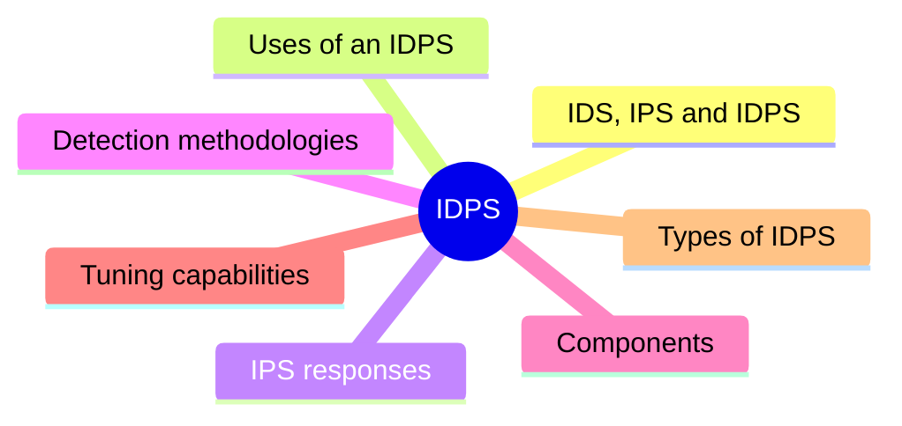
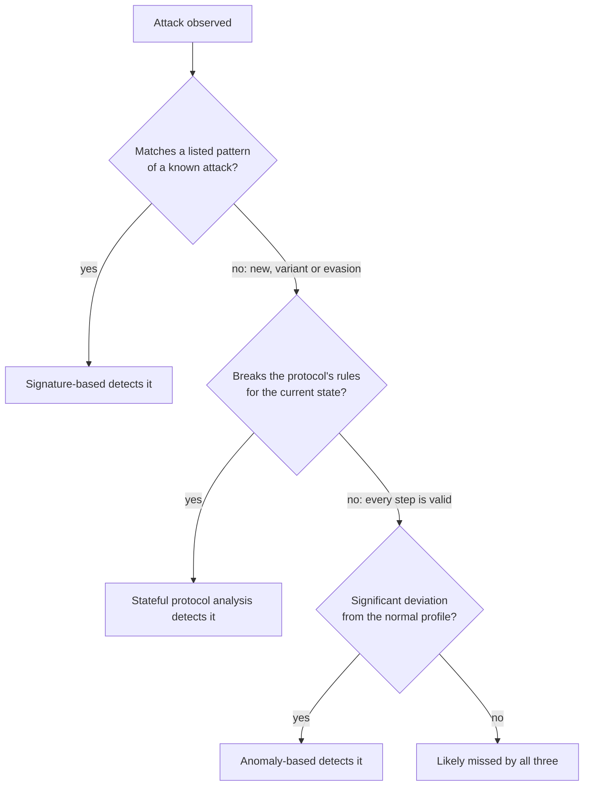

# Unit 12: Intrusion detection and prevention

*Courseware Chapter 12, pages 76–82.*

## At a glance

A firewall decides what may pass; an intrusion detection and prevention system **watches what actually happens** and raises the alarm (or acts) when something looks like an attack. This unit answers six questions:

- **What are IDS, IPS and IDPS?** Intrusion detection, the software that automates it (IDS), and the software that can also try to stop incidents (IPS).
- **What is an IDPS used for?** Identifying incidents, policy violations and reconnaissance, understanding threats, and tightening its own watch.
- **How does an IPS respond?** Three groups: stop the attack itself, change the security environment, change the attack's content.
- **How does an IDPS recognise an attack?** Three detection methodologies: **signature-based**, **anomaly-based** and **stateful protocol analysis**, each with its examples, strengths and drawbacks.
- **What is an IDPS made of, and how is it tuned?** Four components (sensor or agent, management server, database server, console) and four tuning capabilities (thresholds, blacklists and whitelists, alert settings, code viewing and editing).
- **What kinds of IDPS are there?** Four types: network-based, wireless, network behavior analysis (NBA) and host-based.

## What you should be able to do

*The courseware lists no learning outcomes; these are written for this site.*

- Define intrusion detection, an incident, an IDS and an IPS, and explain why the term IDPS covers both.
- State the uses of an IDPS and explain the three groups of IPS response techniques with the courseware's examples.
- Define signature-based detection, anomaly-based detection and stateful protocol analysis; give the courseware's examples; state the strengths and drawbacks of each.
- Decide which detection methodology would catch a described attack, and explain why the others would not.
- List and explain the four typical components of an IDPS, including correlation, and draw how they connect.
- Explain the four tuning and customization capabilities (thresholds, blacklists and whitelists, alert settings, code viewing and editing).
- Describe the four types of IDPS technologies, where each is deployed, and recommend a type for a scenario.

## Intrusion detection, IDS, IPS and IDPS

Chapter 12 opening · p.76

The chapter opens with four definitions in one paragraph. Learn them as a chain: the *process*, the *software that automates it*, the *software that also acts*, and the *umbrella term*.

> **Intrusion detection** is the process of monitoring the events occurring in a computer system or network and analyzing them for signs of possible incidents, which are violations or imminent threats of violation of computer security policies, acceptable use policies, or standard security practices.

> An **intrusion detection system (IDS)** is software that automates the intrusion detection process.

> An **intrusion prevention system (IPS)** is software that has all the capabilities of an intrusion detection system and can also attempt to stop possible incidents.

> IDS and IPS technologies offer many of the same capabilities, and administrators can usually disable prevention features in IPS products, causing them to function as IDSs. Accordingly, for brevity the term **intrusion detection and prevention systems (IDPS)** is used throughout the rest of this chapter to refer to both IDS and IPS technologies.

!!! note "In plain terms"
    - **Intrusion detection = monitor + analyze.** Two verbs: *monitoring* the events in a system or network, and *analyzing* them for signs of possible **incidents**.
    - **An incident** has a precise meaning here: a **violation, or an imminent threat of violation**, of one of three things: **computer security policies**, **acceptable use policies**, or **standard security practices**. So an IDPS does not only look for hackers; a staff member breaking the acceptable use policy is also an incident.
    - **IDS = intrusion detection, automated.** It watches and reports.
    - **IPS = IDS + "can also attempt to stop possible incidents".** Every IPS can do everything an IDS can.
    - **IDPS** is just the shared name, used because the two overlap so much and because an IPS with its prevention features **disabled** behaves as an IDS.

| | IDS | IPS |
|---|---|---|
| **Monitors and analyzes events** | Yes | Yes (all IDS capabilities) |
| **Reports possible incidents** | Yes | Yes |
| **Attempts to stop possible incidents** | No | **Yes**: the one differing characteristic |
| **Can be turned into the other** | – | Yes: disable the prevention features and it functions as an IDS |

{ .diagram }

IDS versus IPS, drawn for this site. The courseware defines the difference (detect and report vs also attempt to stop) but does not discuss placement; the "copy of traffic" versus "inline" placement is explained in the Beyond box below.

!!! example "Example"
    A Lagos bank's security team installs an IDPS on its Internet link. For the first month they run it **with prevention features disabled** (as an IDS) so that they can see what it would flag without risking blocked customer transactions. Once they trust its alerts, they switch prevention on: it is now acting as an **IPS** and can, for example, drop connections from an IP address that is guessing passwords on the internet-banking site.

!!! tip "Exam angle"
    "Define intrusion detection" is a likely 2–3-mark part: include **both verbs** (monitoring and analyzing) and the **three things** an incident violates (security policies, acceptable use policies, standard security practices). "Differentiate IDS and IPS" needs the one-characteristic answer: an IPS **can also attempt to stop possible incidents**; add that an IPS with prevention disabled functions as an IDS.

!!! info "Beyond the notes"
    - **Source.** Chapter 12 is taken, almost word for word, from the US NIST publication *SP 800-94, Guide to Intrusion Detection and Prevention Systems (IDPS)* (2007). That explains phrases such as "for the purposes of this document". It is a good second reading.
    - **Placement.** An **IDS** is usually connected **passively** ("out of band"): it receives a *copy* of the traffic from a switch's mirror (SPAN) port or a network tap, so it cannot delay or block anything, and if it fails, traffic still flows. An **IPS** is usually placed **inline**: traffic must pass *through* it, which is what lets it stop an attack, but it adds a little delay, and a fault or a false alarm can block legitimate traffic. Many inline devices can be set to *fail open* (let traffic through if they fail) or *fail closed* (block everything); compare the [fail-safe defaults](unit-1-security-concepts.md#fail-safe-defaults) principle in Unit 1.
    - **Where IDPS appears elsewhere in the course:** as security measure 7 for operating systems in [Unit 3](unit-3-os-security.md#intrusion-detection-and-prevention-systems); as the IPS capability of next-generation firewalls in [Unit 5](unit-5-firewalls.md#next-generation-firewalls-ngfw); and as the fifth layer of wireless security in [Unit 7](unit-7-wireless-mobile.md#how-wireless-security-works-layers-of-defense).

**Check your understanding**

According to the courseware, IPS technologies differ from IDS technologies by one characteristic. Which?

<ul class="quiz-options">
  <li>An IPS monitors networks, while an IDS monitors only single hosts</li>
  <li>An IPS uses anomaly-based detection, while an IDS uses signatures</li>
  <li data-correct>An IPS can respond to a detected threat by attempting to prevent it from succeeding</li>
  <li>An IPS keeps a log of incidents, while an IDS does not</li>
</ul>

An IPS "has all the capabilities of an intrusion detection system and can also attempt to stop possible incidents"; on p.77 the courseware repeats that the one differing characteristic is responding "by attempting to prevent it from succeeding". Network vs host is the difference between IDPS **types** (and between sensors and agents), not between IDS and IPS. Both can use any detection methodology, and both log (Chapter 12 opening, p.76; Fundamental Concepts, p.77).

A staff member at a ministry copies a large database file onto a USB flash drive, which the acceptable use policy forbids. No attacker is involved. Is this an "incident" in the courseware's sense?

<ul class="quiz-options">
  <li>No: incidents involve an outside attacker</li>
  <li>No: only violations of computer security policies count</li>
  <li data-correct>Yes: incidents include violations of acceptable use policies</li>
  <li>Only if the file is later leaked</li>
</ul>

Possible incidents are "violations or imminent threats of violation of computer security policies, **acceptable use policies**, or standard security practices". The courseware's own examples of what an IDPS can recognise include "transfers of large database files onto removable media". Nothing needs to have leaked: even an *imminent threat* of violation counts (Chapter 12 opening, p.76).

## What an IDPS is used for

Fundamental Concepts · p.76

The "Fundamental Concepts" section first explains what IDPSs are *for*. It is one paragraph, but it contains five distinct uses (the courseware does not number or count them; the count is ours).

> IDPSs are primarily focused on identifying possible incidents. For example, an IDPS could detect when an attacker has successfully compromised a system by exploiting a vulnerability in the system. The IDPS would log information on the activity and report the incident to security administrators so that they could initiate incident response actions to minimize damage. Many IDPSs can also be configured to recognize violations of acceptable use policies and other security policies—examples include the use of prohibited peer-to-peer file sharing applications and transfers of large database files onto removable media or mobile devices. Additionally, many IDPSs can identify reconnaissance activity, which may indicate that an attack is imminent or that a certain system or system characteristic is of particular interest to attackers. Another use of IDPSs is to gain a better understanding of the threats that they detect, particularly the frequency and characteristics of attacks, so that appropriate security measures can be identified. Some IDPSs are also able to change their security profile when a new threat is detected. For example, an IDPS might collect more detailed information for a particular session after malicious activity is detected within that session.

| # | Use *(count ours)* | Courseware example | What it achieves |
|---|---|---|---|
| 1 | **Identifying possible incidents** (the primary focus) | An attacker has compromised a system by exploiting a vulnerability | IDPS **logs** the activity and **reports** to security administrators, who **initiate incident response** to **minimize damage** |
| 2 | **Recognising violations of acceptable use and other security policies** | Prohibited **peer-to-peer file sharing** applications; **transfers of large database files onto removable media or mobile devices** | Enforces policy, not just keeps out attackers |
| 3 | **Identifying reconnaissance activity** | (none given) | Warns that an **attack is imminent**, or that a system or system characteristic is **of particular interest to attackers** |
| 4 | **Understanding the threats detected** | **Frequency and characteristics** of attacks | Lets **appropriate security measures** be identified |
| 5 | **Changing its security profile when a new threat is detected** | Collecting **more detailed information for a particular session** after malicious activity is seen in it | Watches harder where trouble has appeared |

!!! note "In plain terms"
    - **Identify, log, report; humans respond.** Notice the division of labour in use 1: the IDPS detects, logs and reports; the **security administrators** then start incident response. This is exactly the Incident Response practice from Unit 1 (preparation, **detection**, analysis, containment, recovery) and the accountability requirement ("systems must keep records of their activities"); see [Unit 1](unit-1-security-concepts.md#essential-security-practices).
    - **Reconnaissance** is the attacker's "casing the building" stage: scanning which hosts are up, which ports are open, which software versions run. It is not an attack yet, but it **may indicate that an attack is imminent**.
    - **Memory aid (the site's, not the courseware's): "I-P-R-U-C"**: **I**ncidents, **P**olicy violations, **R**econnaissance, **U**nderstanding threats, **C**hanging its profile.

!!! example "Example"
    A Nigerian university's IDPS notices: (1) a lecturer's PC making outbound connections after a malicious attachment was opened (**incident**); (2) students running a prohibited peer-to-peer file-sharing client in the hostel network (**acceptable use violation**); (3) a foreign IP address scanning every port of the results server at 2 a.m. (**reconnaissance**: the results server is "of particular interest"); (4) a monthly report showing most attacks are password-guessing against the portal (**understanding threats**, so the university adds account lockout); (5) after one suspicious session, it records that session's full packets (**changing its security profile**).

!!! tip "Exam angle"
    "State five uses of an IDPS" fits this paragraph exactly. Give each use with the courseware's example: the two policy-violation examples (**peer-to-peer file sharing**; **large database files onto removable media or mobile devices**) and the two things reconnaissance may indicate are favourite details. This also links to [Unit 6](unit-6-security-policy.md#lack-of-security-monitoring): an IDPS is a direct remedy for the policy weakness "lack of security monitoring".

**Check your understanding**

An IDPS notices an external host systematically probing which ports are open on a bank's payment server, but no attack has been launched yet. What does the courseware say such activity may indicate?

<ul class="quiz-options">
  <li>That the IDPS needs a new signature</li>
  <li data-correct>That an attack is imminent, or that the system is of particular interest to attackers</li>
  <li>That an acceptable use policy has been violated</li>
  <li>That the IDPS must change its detection methodology</li>
</ul>

This is **reconnaissance activity**, which "may indicate that an attack is imminent or that a certain system or system characteristic is of particular interest to attackers". It is not an acceptable use violation (that is an insider using prohibited applications or moving data); and nothing in the courseware says the methodology must change (Fundamental Concepts, p.76).

After detecting malicious activity in one user's session, an IDPS starts recording that session in much more detail. Which use of an IDPS is this?

<ul class="quiz-options">
  <li>Gaining a better understanding of threats</li>
  <li>Identifying reconnaissance activity</li>
  <li data-correct>Changing its security profile when a new threat is detected</li>
  <li>Changing the security environment</li>
</ul>

The courseware's example of changing the security profile is exactly this: "an IDPS might collect more detailed information for a particular session after malicious activity is detected within that session". "Changing the security environment" is tempting, but that is an **IPS response** that reconfigures *other* security controls such as firewalls (Fundamental Concepts, pp.76–77).

## How an IPS responds: three groups of response techniques

Fundamental Concepts · p.77

The same section then explains what makes an IPS different, and how it acts.

> IPS technologies differ from IDS technologies by one characteristic: IPS technologies can respond to a detected threat by attempting to prevent it from succeeding. They use several response techniques, which can be divided into the following groups:
>
> • **The IPS stops the attack itself.** Examples of how this could be done include the IPS terminating the network connection being used for the attack and the IPS blocking access to the target from the offending user account, IP address, or other attacker attribute.
>
> • **The IPS changes the security environment.** The IPS could change the configuration of other security controls to disrupt an attack. Common examples are the IPS reconfiguring a network firewall to block access from the attacker or to the target, and the IPS altering a host-based firewall on a target to block incoming attacks. Some IPSs can even cause patches to be applied to a host if the IPS detects that the host has vulnerabilities.
>
> • **The IPS changes the attack’s content.** Some IPS technologies can remove or replace malicious portions of an attack to make it benign. A simple example is an IPS removing an infected file attachment from an email and then permitting the cleaned email to reach its recipient. A more complex example is an IPS that acts as a proxy and normalizes incoming requests, which means that the proxy repackages the payloads of the requests, discarding header information. This might cause certain attacks to be discarded as part of the normalization process.

![Three columns under "IPS detects a threat and attempts to prevent it succeeding". 1 Stops the attack itself: terminates the connection, blocks access from the offending user account, IP address or other attribute; acts on the attacker. 2 Changes the security environment: reconfigures a network firewall, alters a host-based firewall on the target, causes patches to be applied; acts on other security controls. 3 Changes the attack's content: removes an infected email attachment, acts as a proxy and normalizes requests; makes the attack benign](assets/diagrams/u12-ips-responses.svg){ .diagram }

The three groups of IPS response techniques, drawn for this site from the courseware's text. The italic "acts on…" summaries are the site's.

!!! note "In plain terms"
    Ask **what the IPS changes**:

    | Group | What the IPS acts on *(site summary)* | Courseware examples |
    |---|---|---|
    | **1. Stops the attack itself** | The **attack connection / the attacker** | Terminating the network connection; blocking access to the target from the offending **user account, IP address, or other attacker attribute** |
    | **2. Changes the security environment** | **Other security controls** (the IPS does not block directly; it tells others to) | Reconfiguring a **network firewall** to block access from the attacker or to the target; altering a **host-based firewall** on the target; even causing **patches to be applied** to a vulnerable host |
    | **3. Changes the attack's content** | The **malicious traffic itself**, which is cleaned and then allowed | Removing an **infected file attachment** and delivering the cleaned email; acting as a **proxy that normalizes** incoming requests |

    **Normalization** means the proxy **repackages the payloads** of incoming requests and **discards the header information**. An attack hidden in odd or malformed headers simply disappears in the repackaging: "certain attacks [are] discarded as part of the normalization process". It is the same idea as the [application-level gateway (proxy firewall)](unit-5-firewalls.md#application-level-gateways-proxy-firewalls) in Unit 5, which also stands between client and server and rebuilds the request.

!!! example "Example"
    A Nigerian fintech's IPS sees a SQL-injection attempt against its loan-application API. It could **(1)** reset that TCP connection and block the source IP address for an hour; **(2)** push a rule to the border firewall blocking that address range, or trigger an urgent patch for the vulnerable API server; or **(3)**, for a malware-laden email arriving at the HR mailbox, strip the infected attachment and deliver the rest of the email.

!!! tip "Exam angle"
    "Explain three groups of response techniques used by an IPS, with an example of each" is a clean 6-mark question. The trap is **group 2**: the IPS **changes the configuration of *other* security controls** (network firewall, host-based firewall, patching). If your example is "the IPS blocks the IP address" that is group 1; "the IPS tells the firewall to block the IP address" is group 2.

**Check your understanding**

An IPS detects an attack from a particular IP address and automatically adds a rule to the organisation's border firewall to block that address. Which group of response techniques is this?

<ul class="quiz-options">
  <li>The IPS stops the attack itself</li>
  <li data-correct>The IPS changes the security environment</li>
  <li>The IPS changes the attack's content</li>
  <li>The IPS changes its security profile</li>
</ul>

Changing the security environment means changing "the configuration of other security controls to disrupt an attack"; the courseware's first example is "reconfiguring a network firewall to block access from the attacker". Group 1 would be the IPS itself blocking the address or terminating the connection. "Changing its security profile" is a general IDPS use (collecting more detail), not an IPS response group (Fundamental Concepts, p.77).

An IPS acting as a proxy repackages the payloads of incoming web requests and discards their header information. What is this called, and which response group does it belong to?

<ul class="quiz-options">
  <li>Correlation; changes the security environment</li>
  <li>Deep packet inspection; stops the attack itself</li>
  <li data-correct>Normalization; changes the attack's content</li>
  <li>Whitelisting; changes the attack's content</li>
</ul>

The courseware calls this **normalizing** incoming requests and gives it as "a more complex example" of the IPS **changing the attack's content**: attacks may be "discarded as part of the normalization process". Correlation is a management-server function (matching events from many sensors), not a response (Fundamental Concepts, p.77).

## IDPS detection methodologies

IDPS Detection Methodologies · p.77

How does an IDPS decide that something is an attack? The courseware names three classes of method.

> IDPS technologies use many methodologies to detect attacks. The primary classes of detection methodologies are signature-based, anomaly-based, and stateful protocol analysis, respectively. Most IDPS technologies use multiple methodologies, either separately or integrated, to provide more broad and accurate detection. These methodologies are described in more detail below;

!!! note "In plain terms"
    Each methodology **compares observed events against something different**:

    - **Signature-based:** against **patterns of known attacks** ("does this look like an attack I know?").
    - **Anomaly-based:** against **definitions of normal activity** for *this* host or network ("is this unusual for us?").
    - **Stateful protocol analysis:** against **vendor-developed universal profiles of benign protocol behaviour**, state by state ("is this how the protocol is supposed to be used at this point?").

    **Most IDPSs combine them**, "either separately or integrated", because each catches what the others miss. The result is "more **broad** and **accurate** detection".

!!! warning "Courseware note"
    "…and stateful protocol analysis, **respectively**" has nothing to pair with ("respectively" needs a second list), and the paragraph ends with a semicolon ("described in more detail below;"). Neither changes the meaning: there are **three** primary classes.

## Signature-based detection

Signature-Based Detection · pp.77–78

> A **signature** is a pattern that corresponds to a known attack or type of attack. **Signature-based detection** is the process of comparing signatures against observed events to identify possible attacks. Examples of signatures are:
>
> • A telnet attempt with a username of “root”, which is a violation of an organization’s security policy
>
> • An email with a subject of “Free pictures!” and an attachment filename of “freepics.exe”, which are characteristics of a known form of malware
>
> • An operating system log entry with a status code value of 645, which indicates that the host’s auditing has been disabled.

> Signature-based detection is very effective at detecting known attacks but largely ineffective at detecting previously unknown attacks, attacks disguised by the use of evasion techniques, and many variants of known attacks. For example, if an attacker modified the malware in the previous example to use a filename of “freepics2.exe”, a signature looking for “freepics.exe” would not match it.

> Signature-based detection is the simplest detection method because it just compares the current unit of activity, such as a packet or a log entry, to a list of signatures using string comparison operations. Detection technologies that are solely signature-based have little understanding of many network or application protocols and cannot track and understand the state of communications—for example, they cannot pair a request with the corresponding response, nor can they remember previous requests when processing the current request. This prevents signature-based methods from detecting attacks that comprise multiple events if no single event contains a clear indication of an attack.

{ .diagram }

Signature-based detection with the courseware's three example signatures and its "freepics2.exe" variant, drawn for this site.

!!! note "In plain terms"
    - **Like a "wanted" poster.** The IDPS holds a list of known bad patterns and checks each **unit of activity** (a **packet** or a **log entry**) against it with **string comparison**. If the strings match, it alerts.
    - **The three example signatures show three kinds of thing a signature can catch:** a **policy violation** (logging in by telnet as "root"), a **known form of malware** (the "Free pictures!" email), and a **sign of tampering** (log status code **645** = the host's **auditing has been disabled**, something an intruder does to hide their tracks).
    - **Strength:** **very effective at detecting known attacks**. It is also the **simplest** method.
    - **Three weaknesses** (it is "largely ineffective" at detecting): (1) **previously unknown attacks** (no signature exists yet, e.g. a zero-day); (2) **attacks disguised by evasion techniques**; (3) **many variants of known attacks**: rename "freepics.exe" to "freepics2.exe" and the signature no longer matches.
    - **No memory, no protocol understanding.** A purely signature-based tool looks at **one unit at a time**. It **cannot pair a request with its response** and **cannot remember previous requests**, so an attack spread over **many events, none of which is clearly an attack on its own**, slips through.

!!! example "Example"
    An email gateway at a Nigerian bank has a signature for a known phishing kit's attachment, "Payment_Advice.exe". It catches every copy. The criminals then send "Payment_Advice_2.exe" with the same malware inside: the string no longer matches, and the variant gets through until the vendor issues a new signature. Separately, an attacker tries one password per account across 5,000 accounts over a day: no single login attempt looks like an attack, so a signature that examines one log entry at a time cannot see the pattern.

!!! tip "Exam angle"
    Learn the **three example signatures** with **what each indicates**, the **three things signature-based detection is ineffective against**, and the **freepics2.exe** example: these are the most quotable details in the chapter. For "why is signature-based detection the simplest?" give the reason: it compares the **current unit of activity** to a **list of signatures** using **string comparison operations**.

!!! info "Beyond the notes"
    **Evasion techniques** (not explained in the courseware) are ways of disguising an attack so that its bytes no longer match the signature while it still works: splitting it across many small packets, encoding it differently (e.g. URL-encoding), or adding junk. Antivirus software works on the same signature principle and has the same weakness against new and modified malware; see [Unit 9](unit-9-malware.md#malware-protection-versus-antivirus).

**Check your understanding**

An IDPS has a signature for an email attachment called "freepics.exe". The attacker renames the same malware "freepics2.exe". What happens, and why?

<ul class="quiz-options">
  <li>It is detected, because signature-based detection recognises variants</li>
  <li data-correct>It is missed, because signature-based detection uses string comparison and the new filename does not match</li>
  <li>It is detected, because the IDPS remembers the previous email</li>
  <li>It is missed, because signature-based detection only examines log entries</li>
</ul>

This is the courseware's own example: "a signature looking for 'freepics.exe' would not match it". Signature-based detection compares each unit of activity with signatures "using string comparison operations" and is "largely ineffective at detecting … many variants of known attacks". It also cannot remember previous requests, so option 3 is wrong; and it examines packets as well as log entries (Signature-Based Detection, pp.77–78).

Why can a purely signature-based IDPS miss an attack made of several events, each of which looks harmless on its own?

<ul class="quiz-options">
  <li>Because its signatures are developed by vendors, not for the local network</li>
  <li>Because it is too resource-intensive to examine every event</li>
  <li data-correct>Because it cannot track the state of communications: it cannot pair requests with responses or remember previous requests</li>
  <li>Because its profiles become out of date</li>
</ul>

Solely signature-based technologies "cannot track and understand the state of communications", so they cannot detect "attacks that comprise multiple events if no single event contains a clear indication of an attack". Resource intensity is the drawback of **stateful protocol analysis**; out-of-date profiles are a problem of **static anomaly profiles** (Signature-Based Detection, p.78).

## Anomaly-based detection

Anomaly-Based Detection · pp.78–79

> **Anomaly-based detection** is the process of comparing definitions of what activity is considered normal against observed events to identify significant deviations. An IDPS using anomaly-based detection has profiles that represent the normal behavior of such things as users, hosts, network connections, or applications. The profiles are developed by monitoring the characteristics of typical activity over a period of time. For example, a profile for a network might show that Web activity comprises an average of 13% of network bandwidth at the Internet border during typical workday hours. The IDPS then uses statistical methods to compare the characteristics of current activity to thresholds related to the profile, such as detecting when Web activity comprises significantly more bandwidth than expected and alerting an administrator of the anomaly. Profiles can be developed for many behavioral attributes, such as the number of emails sent by a user, the number of failed login attempts for a host, and the level of processor usage for a host in a given period of time.

> The major benefit of anomaly-based detection methods is that they can be very effective at detecting previously unknown attacks. For example, suppose that a computer becomes infected with a new type of malware. The malware could consume the computer’s processing resources, send many emails, initiate large numbers of network connections, and perform other behavior that would be significantly different from the established profiles for the computer.

> An initial profile is generated over a period of time sometimes called a **training period**. Profiles can either be static or dynamic. Once generated, a **static profile** is unchanged unless the IDPS is specifically directed to generate a new profile. A **dynamic profile** is adjusted constantly as additional events are observed. Because systems and networks change over time, the corresponding measures of normal behavior also change; a static profile will eventually become

{ .diagram }

Anomaly-based detection using the courseware's 13% web-bandwidth profile. The hourly values and the threshold level are invented by this site for illustration.

!!! note "In plain terms"
    - **Learn "normal", then flag "abnormal".** The IDPS first builds **profiles** of normal behaviour for **users, hosts, network connections, or applications** by watching typical activity **over a period of time** (the **training period**). Afterwards it uses **statistical methods** to compare current activity with **thresholds related to the profile**, and alerts on **significant deviations**.
    - **The courseware's example:** web traffic is normally **13%** of bandwidth at the Internet border in working hours; if it suddenly takes much more, the administrator is alerted.
    - **Three behavioural attributes** given as examples: the **number of emails sent by a user**, the **number of failed login attempts for a host**, and the **level of processor usage for a host** in a given period.
    - **Major benefit: previously unknown attacks.** The IDPS does not need to know what the attack *is*, only that the behaviour is unusual. New malware that **consumes processing resources, sends many emails, initiates large numbers of network connections** stands out against the computer's profile even though no signature exists.
    - **Static vs dynamic profiles:**

    | | Static profile | Dynamic profile |
    |---|---|---|
    | **After training** | **Unchanged** unless the IDPS is **specifically directed to generate a new profile** | **Adjusted constantly** as additional events are observed |
    | **Problem** | Systems and networks change over time, so a static profile eventually goes out of date *(the courseware's sentence is cut off; see the note below)* | Not stated by the courseware *(see Beyond box)* |

!!! warning "Courseware note"
    The anomaly-based section **stops mid-sentence**: "a static profile will eventually become" is followed directly by the next heading, and the section never states the **drawbacks** of anomaly-based detection (it gives only the "major benefit"). From the context, and from NIST SP 800-94, which this chapter copies, the sentence ends roughly: "…**inaccurate, so it needs to be regenerated periodically**". This completion is an inference. In an exam, writing "a static profile will eventually become inaccurate/out of date and must be regenerated" is safe.

!!! info "Beyond the notes: drawbacks of anomaly-based detection"
    The missing part of the NIST text gives the standard drawbacks, worth knowing for "compare" and scenario questions:

    - **Dynamic profiles can be evaded:** an attacker who increases malicious activity **slowly** can get it absorbed into the "normal" profile.
    - **Malicious activity during training** may be learnt as normal.
    - **False positives:** benign but unusual activity (a big end-of-month backup, a sudden legitimate surge in traffic on results-release day) is flagged as an attack. Anomaly-based products often produce many false positives.
    - **Hard to explain alerts:** it can be difficult for analysts to tell *why* an alert was raised, because no specific signature matched.

    (A **false positive** is benign activity wrongly identified as malicious; a **false negative** is malicious activity the IDPS misses. The courseware uses "false positives" on pp.81–82 without defining it.)

!!! example "Example"
    A state hospital's IDPS has learnt that the pharmacy workstation normally sends about 20 emails a day and opens a few dozen network connections. One morning it sends 3,000 emails and opens connections to hundreds of addresses. No antivirus signature matches, because the malware is new, but the **anomaly-based** IDPS alerts within minutes. A week later, results-release day at a university causes portal traffic to jump tenfold: the same kind of IDPS raises an alert, but this time it is a **false positive**.

!!! tip "Exam angle"
    Expect "define anomaly-based detection and state its major benefit" and "differentiate static and dynamic profiles". Quote the **three behavioural attributes** and the **13%** example. In a scenario, choose anomaly-based detection when the attack is **new/unknown** but **changes behaviour or volume** (CPU use, emails sent, connections, failed logins, bandwidth).

**Check your understanding**

Which statement about static and dynamic profiles is correct?

<ul class="quiz-options">
  <li>A static profile is adjusted constantly as additional events are observed</li>
  <li data-correct>A static profile is unchanged unless the IDPS is specifically directed to generate a new one; a dynamic profile is adjusted constantly</li>
  <li>Dynamic profiles are developed by vendors; static profiles are developed locally</li>
  <li>Both kinds are generated without a training period</li>
</ul>

"Once generated, a static profile is unchanged unless the IDPS is specifically directed to generate a new profile. A dynamic profile is adjusted constantly as additional events are observed." Both start from an initial profile generated over a **training period**. Vendor-developed universal profiles belong to **stateful protocol analysis**, not anomaly-based detection (Anomaly-Based Detection, p.79).

What does the courseware give as the major benefit of anomaly-based detection?

<ul class="quiz-options">
  <li>It is the simplest detection method</li>
  <li>It never raises false alarms</li>
  <li data-correct>It can be very effective at detecting previously unknown attacks</li>
  <li>It understands the state of application protocols</li>
</ul>

"The major benefit of anomaly-based detection methods is that they can be very effective at detecting previously unknown attacks", e.g. a new type of malware whose behaviour differs from the computer's profile. "Simplest" describes **signature-based** detection; understanding protocol state describes **stateful protocol analysis** (Anomaly-Based Detection, p.79).

## Stateful protocol analysis

Stateful Protocol Analysis · pp.79–80

> **Stateful protocol analysis** is the process of comparing predetermined profiles of generally accepted definitions of benign protocol activity for each protocol state against observed events to identify deviations. Unlike anomaly-based detection, which uses host or network-specific profiles, stateful protocol analysis relies on vendor-developed universal profiles that specify how particular protocols should and should not be used. The “stateful” in stateful protocol analysis means that the IDPS is capable of understanding and tracking the state of network, transport, and application protocols that have a notion of state. For example, when a user starts a File Transfer Protocol (FTP) session, the session is initially in the unauthenticated state. Unauthenticated users should only perform a few commands in this state, such as viewing help information or providing usernames and passwords. An important part of understanding state is pairing requests with responses, so when an FTP authentication attempt occurs, the IDPS can determine if it was successful by checking the status code in the corresponding response. Once the user has authenticated successfully, the session is in the authenticated state, and users are expected to perform any of several dozen commands. Performing most of these commands while in the unauthenticated state would be considered suspicious, but in the authenticated state performing most of them is considered benign.

> Stateful protocol analysis can identify unexpected sequences of commands, such as issuing the same command repeatedly or issuing a command without first issuing another command upon which it is dependent. Another state tracking feature of stateful protocol analysis is that the IDPS can keep track of the authenticator used for each session, and record the authenticator used for suspicious activity. Some IDPSs can also use the authenticator information to define acceptable activity differently for multiple classes of users or specific users.

> The primary drawback to stateful protocol analysis methods is that they are very resource-intensive because of the complexity of the analysis and the overhead involved in performing state tracking for many simultaneous sessions. Another problem is that stateful protocol analysis methods cannot detect attacks that do not violate the characteristics of generally acceptable protocol behavior, such as performing many benign actions in a short period of time to cause a denial of service. Yet another problem is that the protocol model used by an IDPS might conflict with the way the protocol is implemented in particular versions of specific applications and operating systems, or how different client and server implementations of the protocol interact.

{ .diagram }

The courseware's FTP example as a state diagram, drawn for this site. The IDPS pairs the login request with its response (status code) to know which state the session is in.

!!! note "In plain terms"
    - **"Is this command allowed *in this state*?"** The IDPS knows how a protocol is meant to work, step by step. The same FTP command can be **suspicious** in the **unauthenticated** state and **benign** in the **authenticated** state.
    - **Universal, vendor-developed profiles.** Unlike anomaly-based detection (which learns **host- or network-specific** profiles from your own traffic), the definition of "benign protocol activity" comes from the **vendor**, based on how the protocol **should and should not be used** (normally from the protocol standards).
    - **"Stateful"** = it understands and tracks the **state** of **network, transport, and application protocols** that have a notion of state. The key skill is **pairing requests with responses**: the IDPS reads the **status code** in the server's reply to learn whether the FTP login succeeded. (This is exactly what signature-based detection *cannot* do.)
    - **Further features:** it spots **unexpected sequences of commands**: (i) the **same command issued repeatedly**, or (ii) a command issued **without the command it depends on** first; it **tracks the authenticator** (e.g. the username) used for each session and **records** it for suspicious activity; some IDPSs use the authenticator to **define acceptable activity differently** for classes of users or specific users.
    - **Three drawbacks:**
        1. **Very resource-intensive** (the primary drawback): complex analysis plus the overhead of tracking state for **many simultaneous sessions**.
        2. **Cannot detect attacks that do not violate acceptable protocol behaviour**, e.g. **many benign actions in a short period to cause a denial of service**.
        3. **The IDPS's protocol model might conflict** with how the protocol is actually **implemented** in particular versions of applications and operating systems, or how different client and server implementations interact.

!!! example "Example"
    On a Nigerian telecom's FTP server for billing files, the IDPS sees a connection that sends a "retrieve file" command before any username or password: in the **unauthenticated** state that is suspicious, so it alerts. It also sees a logged-in user sending the same "change directory" command 500 times a second (an **unexpected sequence**). But when a botnet sends thousands of perfectly normal, logged-in download requests to exhaust the server, every single action is valid FTP: stateful protocol analysis **cannot detect** this DoS, while an **anomaly-based** profile of download volume could.

!!! tip "Exam angle"
    The definition is long; learn its four key phrases: **predetermined profiles**, **generally accepted definitions of benign protocol activity**, **for each protocol state**, **to identify deviations**. Then learn the **FTP example**, the **two unexpected command sequences**, and the **three drawbacks** (primary = resource-intensive). "Differentiate stateful protocol analysis from anomaly-based detection" is answered by one contrast: **vendor-developed universal profiles** vs **host- or network-specific profiles**.

**Check your understanding**

What is the key difference between the profiles used in stateful protocol analysis and those used in anomaly-based detection?

<ul class="quiz-options">
  <li>Stateful protocol analysis has no profiles; it uses signatures</li>
  <li data-correct>Stateful protocol analysis relies on vendor-developed universal profiles; anomaly-based detection uses host- or network-specific profiles</li>
  <li>Stateful protocol analysis profiles are dynamic; anomaly profiles are always static</li>
  <li>Anomaly-based profiles describe how protocols should be used; stateful profiles describe users' normal behaviour</li>
</ul>

"Unlike anomaly-based detection, which uses host or network-specific profiles, stateful protocol analysis relies on vendor-developed universal profiles that specify how particular protocols should and should not be used." Option 4 has the two reversed: anomaly profiles describe the normal behaviour of users, hosts, connections and applications (Stateful Protocol Analysis, p.79).

Which attack does the courseware say stateful protocol analysis cannot detect?

<ul class="quiz-options">
  <li>A command issued before the command it depends on</li>
  <li>FTP commands issued in the unauthenticated state</li>
  <li data-correct>Many benign actions performed in a short period of time to cause a denial of service</li>
  <li>The same command issued repeatedly</li>
</ul>

Stateful protocol analysis "cannot detect attacks that do not violate the characteristics of generally acceptable protocol behavior, such as performing many benign actions in a short period of time to cause a denial of service". The other three are exactly what it **can** detect: unexpected command sequences and commands out of state (Stateful Protocol Analysis, pp.79–80).

## Choosing a detection methodology

IDPS Detection Methodologies, Signature-Based Detection, Anomaly-Based Detection, Stateful Protocol Analysis · pp.77–80

The courseware describes the three methods one by one. Scenario questions ask you to **pick the one that would catch an attack and say why the others would not**. This table brings the facts together.

| Criterion | Signature-based | Anomaly-based | Stateful protocol analysis |
|---|---|---|---|
| **Observed events compared against** | **Signatures**: patterns of **known** attacks | **Definitions of normal activity** (profiles) | **Predetermined profiles of benign protocol activity for each protocol state** |
| **Where the reference comes from** | A list of signatures *(site: usually from the vendor, updated regularly)* | **Host- or network-specific** profiles learnt over a **training period** | **Vendor-developed universal** profiles of how protocols should and should not be used |
| **How it compares** | **String comparison**, one unit of activity (packet or log entry) at a time | **Statistical methods** against **thresholds** related to the profile | **Tracks state**; **pairs requests with responses** |
| **Best at** | **Known attacks** (very effective) | **Previously unknown attacks** (very effective) | **Unexpected command sequences**; commands in the wrong state |
| **Weak at** | Unknown attacks, **evasion techniques**, **variants**; multi-event attacks | *(Not stated; site: false positives, slow evasion, out-of-date static profiles)* | Attacks that **don't violate protocol behaviour** (e.g. DoS by many benign actions); **conflicts** with real implementations |
| **Cost** | **Simplest** method | *(Not stated)* | **Very resource-intensive** (primary drawback) |

!!! note "In plain terms: three questions to ask about an attack (the site's method)"
    1. **Is it a known attack whose exact pattern is already listed?** → **Signature-based** catches it (and it is the cheapest). If the attack is *new*, *renamed* or *disguised*, signature-based fails.
    2. **Does it break the rules of the protocol at that point in the conversation** (wrong order, wrong state, repeated command)? → **Stateful protocol analysis** catches it, even if it is new. If every step is valid protocol use, it fails.
    3. **Does it make something behave very differently from normal** (volume, rate, CPU, emails, connections, failed logins, bandwidth)? → **Anomaly-based** catches it, even if it is new and every step is valid. If the attack stays within normal levels, it fails.

A site-made decision aid for scenario questions. Real IDPSs run the methods together, so more than one may detect the same attack.

!!! tip "Exam angle"
    In a scenario, **name the method, quote its definition or example, then rule out the other two with their courseware weaknesses**: e.g. "Signature-based would miss it because it is a *previously unknown attack* / a *variant*; stateful protocol analysis would miss it because *many benign actions to cause a denial of service do not violate acceptable protocol behaviour*." That is the I-A-J-A pattern (identify, apply, justify, act). Remember that **most IDPSs use multiple methodologies**, so a strong answer ends by recommending a combination.

**Check your understanding**

A completely new worm, for which no signature exists, infects a workstation and makes it open thousands of network connections per minute. Every connection uses the protocol correctly. Which methodology is most likely to detect it?

<ul class="quiz-options">
  <li>Signature-based, because worms are known attacks</li>
  <li data-correct>Anomaly-based, because the behaviour deviates significantly from the workstation's profile</li>
  <li>Stateful protocol analysis, because the connections are unusual</li>
  <li>None of them: new attacks cannot be detected</li>
</ul>

Anomaly-based detection "can be very effective at detecting previously unknown attacks"; the courseware's example is new malware that "initiate[s] large numbers of network connections". Signature-based is "largely ineffective at detecting previously unknown attacks". Stateful protocol analysis looks for violations of protocol behaviour, and here every connection is valid (Choosing a detection methodology, pp.77–80).

An attacker connects to an FTP server and immediately issues file-download commands without logging in. The exploit is brand new. Which methodology is best placed to flag it?

<ul class="quiz-options">
  <li>Signature-based detection</li>
  <li data-correct>Stateful protocol analysis</li>
  <li>Anomaly-based detection with a static profile</li>
  <li>Correlation by the management server</li>
</ul>

Stateful protocol analysis tracks that the session is in the **unauthenticated state**, where only a few commands (help, username, password) are expected; "performing most of these commands while in the unauthenticated state would be considered suspicious". A new exploit has no signature. One connection is unlikely to be a significant statistical deviation, so anomaly-based detection is less certain. Correlation is a management-server function, not a detection methodology (Stateful Protocol Analysis, p.79).

Which detection methodology does the courseware call "the simplest", and which does it call "very resource-intensive"?

<ul class="quiz-options">
  <li>Anomaly-based; signature-based</li>
  <li data-correct>Signature-based; stateful protocol analysis</li>
  <li>Stateful protocol analysis; anomaly-based</li>
  <li>Signature-based; anomaly-based</li>
</ul>

Signature-based detection "is the simplest detection method because it just compares the current unit of activity … to a list of signatures using string comparison operations". Stateful protocol analysis's primary drawback is that it is "very resource-intensive because of the complexity of the analysis and the overhead involved in performing state tracking for many simultaneous sessions" (pp.78–80).

## IDPS components

IDPS Components · p.80

> The typical components in an IDPS solution are:
>
> • **Sensor or Agent.** Sensors and agents monitor and analyze activity. The term “sensor” is typically used for IDPSs that monitor networks, and the term “agent” for IDPS technologies that monitor only a single host.
>
> • **Management Server.** A management server is a device that receives information from sensors or agents and manages them. Some management servers perform analysis on the received information and can identify incidents that the individual sensors or agents cannot. Matching event information from multiple sensors or agents, such as finding events triggered by the same IP address, is known as correlation. Some small IDPS deployments do not use any management servers. In larger IDPS deployments, there are often multiple management servers, sometimes in tiers.
>
> • **Database Server.** A database server is a repository for event information recorded by sensors, agents, and management servers. Many IDPSs support the use of database servers.
>
> • **Console.** A console is a program that provides an interface for the IDPS’s users and administrators. Console software is typically installed onto standard desktop or laptop computers. Some consoles are used for IDPS administration only, such as configuring sensors or agents and applying software updates, while other consoles are used strictly for monitoring and analysis. Some IDPS consoles provide both administration and monitoring capabilities.

{ .diagram }

The four typical components of an IDPS solution and how they connect, drawn for this site from the courseware's text.

!!! note "In plain terms"
    | Component | Role in one phrase | Key detail to remember |
    |---|---|---|
    | **Sensor or agent** | The **eyes**: monitor and analyze activity | **Sensor** = monitors **networks**; **agent** = monitors **only a single host** |
    | **Management server** | The **brain**: receives information from sensors/agents and **manages** them | Can do **correlation** (matching events from **multiple** sensors or agents, e.g. the **same IP address**) and so find incidents **no single sensor could**. Small deployments may have **none**; large ones **multiple, sometimes in tiers** |
    | **Database server** | The **memory**: **repository for event information** | Stores what sensors, agents **and** management servers record |
    | **Console** | The **face**: a **program** giving users and administrators an **interface** | Installed on standard desktops/laptops; three kinds: **administration only**, **monitoring and analysis only**, or **both** |

    **Why correlation matters:** one sensor sees a single failed login on the web server; another sees one on the mail server; an agent sees one on the database host. None is alarming alone. The management server matches them by **the same IP address** and sees a coordinated attack. (Compare the APT in [Unit 2](unit-2-attacks.md#advanced-persistent-threat-apt), which stays hidden precisely by keeping each step small.)

!!! example "Example"
    A federal ministry runs **sensors** at its Abuja headquarters' Internet link and on its wireless network, and **agents** on its payroll and records servers. All report to a **management server** in the data centre; events are stored on a **database server** for later investigation; the security team watches alerts on a **monitoring console**, while the IT engineer uses an **administration console** to update the sensors' signatures.

!!! tip "Exam angle"
    "List and explain the components of an IDPS" (often "with the aid of a diagram") is very likely. Four components; for each give the definition, then the extra detail: **sensor vs agent**, **correlation** with its **same IP address** example, **repository**, and the **three kinds of console**. "Define correlation" is a separate 2-mark favourite.

**Check your understanding**

An IDPS component matches event information from several sensors and finds that the events were all triggered by the same IP address. What is this called, and which component typically does it?

<ul class="quiz-options">
  <li>Normalization, done by the console</li>
  <li data-correct>Correlation, done by the management server</li>
  <li>Profiling, done by the database server</li>
  <li>Signature matching, done by the agent</li>
</ul>

"Matching event information from multiple sensors or agents, such as finding events triggered by the same IP address, is known as **correlation**", described under the **management server**, which "can identify incidents that the individual sensors or agents cannot". The database server only stores event information; normalization is an IPS response (IDPS Components, p.80).

An IDPS product is installed on a single critical server and monitors only that server. What does the courseware call this monitoring component?

<ul class="quiz-options">
  <li>A sensor</li>
  <li data-correct>An agent</li>
  <li>A console</li>
  <li>A management server</li>
</ul>

"The term 'sensor' is typically used for IDPSs that monitor networks, and the term '**agent**' for IDPS technologies that monitor **only a single host**." A console is the user interface program; a management server receives information from sensors or agents (IDPS Components, p.80).

## IDPS security capabilities: tuning and customization

IDPS Security Capabilities · pp.81–82

> IDPS technologies typically offer extensive, broad detection capabilities. Most products use a combination of detection techniques, which generally supports more accurate detection and more flexibility in tuning and customization. The types of events detected and the typical accuracy of detection vary greatly depending on the type of IDPS technology. Most IDPSs require at least some tuning and customization to improve their detection accuracy, usability, and effectiveness. Examples of tuning and customization capabilities are as follows:
>
> • **Thresholds:** A threshold is a value that sets the limit between normal and abnormal behavior. Thresholds usually specify a maximum acceptable level, such as 5 failed connection attempts in 60 seconds, or 100 characters for a filename length.
>
> • **Blacklists and Whitelists:** A blacklist is a list of discrete entities, such as hosts, Transmission Control Protocol (TCP) or User Datagram Protocol (UDP) port numbers, Internet Control Message Protocol (ICMP) types and codes, applications, usernames, Uniform Resource Locators (URLs), filenames, or file extensions, that have been previously determined to be associated with malicious activity. Blacklists allow IDPSs to block activity that is highly likely to be malicious. Some IDPSs generate dynamic blacklists that are used to temporarily block recently detected threats (e.g., activity from an attacker’s IP address). A whitelist is a list of discrete entities that are known to be benign. Whitelists are typically used on a granular basis, such as protocol-by-protocol, to reduce or ignore false positives involving known benign activity.
>
> • **Alert Settings:** Most IDPS technologies allow administrators to customize each alert type. Examples of actions that can be performed on an alert type include toggling it on or off and setting a default priority or severity level. Some products can suppress alerts if an attacker generates many alerts in a short period of time, and may also temporarily ignore all future traffic from the attacker. This is to prevent the IDPS from being overwhelmed by alerts.
>
> • **Code Viewing and Editing:** Some IDPS technologies permit administrators to see some or all of the detection-related code. This is usually limited to signatures, but some technologies allow administrators to see additional code, such as programs used to perform stateful protocol analysis. Viewing the code can help analysts to determine why particular alerts were generated, helping to validate alerts and identify false positives. The ability to edit detection-related code and write new code (e.g., new signatures) is necessary to fully customize certain types of detection capabilities.

!!! note "In plain terms"
    - **Why tune at all?** Out of the box an IDPS is generic. **Most IDPSs require at least some tuning and customization** to improve three things: **detection accuracy, usability, and effectiveness**. Combining detection techniques gives **more accurate detection** and **more flexibility** in tuning.
    - **The four tuning capabilities:**

    | Capability | What it is | Courseware examples / details |
    |---|---|---|
    | **Thresholds** | A **value that sets the limit between normal and abnormal behavior**; usually a **maximum acceptable level** | **5 failed connection attempts in 60 seconds**; **100 characters** for a filename length |
    | **Blacklists** | Discrete entities **previously determined to be associated with malicious activity**; let the IDPS **block** activity highly likely to be malicious | Hosts, TCP/UDP port numbers, ICMP types and codes, applications, usernames, URLs, filenames, file extensions. **Dynamic blacklists** **temporarily** block **recently detected threats** (e.g. an attacker's IP address) |
    | **Whitelists** | Discrete entities **known to be benign** | Used on a **granular basis** (e.g. **protocol-by-protocol**) to **reduce or ignore false positives** involving known benign activity |
    | **Alert settings** | Customising **each alert type** | **Toggle on/off**; set a **default priority or severity level**; **suppress alerts** when one attacker generates many in a short time, and **temporarily ignore all future traffic from the attacker**, so the IDPS is not **overwhelmed by alerts** |
    | **Code viewing and editing** | Seeing (and changing) the **detection-related code** | Usually limited to **signatures**; some show more (e.g. **stateful protocol analysis** programs). Viewing helps **determine why alerts were generated**, **validate alerts** and **identify false positives**; **editing and writing new code** (e.g. new signatures) is **necessary to fully customize** some detection |

    (Blacklists and whitelists are one capability in the courseware, so the table has five rows for **four** capabilities.)
    - **Thresholds link straight to anomaly-based detection:** the anomaly IDPS compares current activity "to **thresholds** related to the profile".
    - **False positive** (not defined in the courseware): benign activity wrongly reported as malicious. Whitelists, alert settings and code viewing all help reduce or recognise them.

!!! example "Example"
    A Lagos fintech tunes its IDPS: a **threshold** of 5 failed logins in 60 seconds per account; a **blacklist** of known command-and-control domains and the peer-to-peer ports banned by policy; a **dynamic blacklist** that blocks any IP address that triggers a high-severity alert for 30 minutes; a **whitelist** that tells the IDPS to ignore the nightly backup traffic between two known servers (which otherwise looks like data theft); **alert settings** that mark "admin login from abroad" as critical; and **edited code**: a new signature written in-house for a phishing kit targeting its customers.

!!! tip "Exam angle"
    "Explain four examples of tuning and customization capabilities of an IDPS" is a natural 8-mark part. Give the **definition of threshold** with **both numeric examples**, the **blacklist/whitelist contrast** (malicious vs benign; block vs reduce false positives), the **dynamic blacklist**, the **reason** for alert suppression (not being overwhelmed), and **why** code viewing helps (validate alerts, identify false positives).

!!! warning "Courseware note"
    The section is headed "IDPS Security Capabilities", but after the opening paragraph it covers only **tuning and customization** capabilities. The NIST guide it comes from also lists information-gathering, logging, detection and prevention capabilities under this heading; those are not in the courseware. Answer "security capabilities" questions with the opening paragraph plus the four tuning examples.

**Check your understanding**

An IDPS keeps raising alerts about the nightly backup transfer between two known internal servers. Which tuning capability is designed for this situation?

<ul class="quiz-options">
  <li>A blacklist</li>
  <li>A dynamic blacklist</li>
  <li data-correct>A whitelist</li>
  <li>A threshold</li>
</ul>

"A whitelist is a list of discrete entities that are known to be benign… used … to reduce or ignore false positives involving known benign activity." A blacklist does the opposite: it lists entities associated with malicious activity so they can be blocked. Raising a threshold might also silence the alert, but it would weaken detection for everything else (IDPS Security Capabilities, p.81).

Why do some IDPS products suppress alerts when one attacker generates many alerts in a short period?

<ul class="quiz-options">
  <li>To hide the attack from the attacker</li>
  <li>To give the attacker a false sense of success</li>
  <li data-correct>To prevent the IDPS from being overwhelmed by alerts</li>
  <li>To save space on the database server</li>
</ul>

Under **alert settings**: "Some products can suppress alerts if an attacker generates many alerts in a short period of time, and may also temporarily ignore all future traffic from the attacker. This is to prevent the IDPS from being overwhelmed by alerts." (IDPS Security Capabilities, p.81)

## Types of IDPS technologies

Types of IDPS Technologies · p.82

> There are many types of IDPS technologies. For the purposes of this document, they are divided into the following four groups based on the type of events that they monitor and the ways in which they are deployed:
>
> • **Network-Based**, which monitors network traffic for particular network segments or devices and analyzes the network and application protocol activity to identify suspicious activity. It can identify many different types of events of interest. It is most commonly deployed at a boundary between networks, such as in proximity to border firewalls or routers, remote access servers, and wireless networks.
>
> • **Wireless**, which monitors wireless network traffic and analyzes its wireless networking protocols to identify suspicious activity involving the protocols themselves. It cannot identify suspicious activity in the application or higher-layer network protocols (e.g., TCP, UDP) that the wireless network traffic is transferring. It is most commonly deployed within range of an organization’s wireless network to monitor it, but can also be deployed to locations where unauthorized wireless networking could be occurring.
>
> • **Network Behavior Analysis (NBA)**, which examines network traffic to identify threats that generate unusual traffic flows, such as distributed denial of service (DDoS) attacks, certain forms of malware (e.g., worms, backdoors), and policy violations (e.g., a client system providing unauthorized network services to other systems). NBA systems are most often deployed to monitor flows on an organization’s internal networks, and are also sometimes deployed where they can monitor flows between an organization’s networks and external networks (e.g., the Internet, business partners’ networks).
>
> • **Host-Based**, which monitors the characteristics of a single host and the events occurring within that host for suspicious activity. Examples of the types of characteristics a host-based IDPS might monitor are network traffic (only for that host), system logs, running processes, application activity, file access and modification, and system and application configuration changes. Host-based IDPSs are most commonly deployed on critical hosts such as publicly accessible servers and servers containing sensitive information.

| Type | What it monitors | What it is good at / cannot do | Most commonly deployed |
|---|---|---|---|
| **Network-based** | **Network traffic** for particular **network segments or devices**; analyzes **network and application protocol** activity | Can identify **many different types of events of interest** | At a **boundary between networks**: near **border firewalls or routers**, **remote access servers**, and **wireless networks** |
| **Wireless** | **Wireless network traffic**; analyzes the **wireless networking protocols** | Finds suspicious activity in **the wireless protocols themselves**; **cannot** see suspicious activity in the **application or higher-layer network protocols (e.g. TCP, UDP)** carried over the wireless traffic | **Within range** of the organization's wireless network; also where **unauthorized wireless networking** could be occurring |
| **Network Behavior Analysis (NBA)** | **Network traffic flows** | Threats that generate **unusual traffic flows**: **DDoS** attacks, certain **malware (worms, backdoors)**, **policy violations** (e.g. a client **providing unauthorized network services** to other systems) | **Internal networks** (most often); sometimes between the organization's networks and **external networks** (Internet, **business partners' networks**) |
| **Host-based** | The **characteristics of a single host** and events within it | Monitors six kinds of characteristic: **network traffic (only for that host)**, **system logs**, **running processes**, **application activity**, **file access and modification**, **system and application configuration changes** | **Critical hosts**: **publicly accessible servers** and **servers containing sensitive information** |

{ .diagram }

Where each type of IDPS is most commonly deployed, drawn for this site from the courseware's deployment statements.

!!! note "In plain terms"
    - The four groups are based on **two things**: the **type of events they monitor** and **the ways in which they are deployed**.
    - **Network-based vs host-based** is the classic pair: a network-based IDPS watches **traffic on a segment** at a **boundary**; a host-based IDPS lives **on one host** and sees things a network sensor never could, such as **running processes, file changes, configuration changes and system logs** (and traffic is "only for that host"). The **sensor/agent** terms from the components section map onto this: network IDPS → **sensors**; host IDPS → **agents**.
    - **Network-based vs NBA:** both watch network traffic, but a network-based IDPS **analyzes protocol activity** (contents), while an NBA system looks at **traffic flows** (who talks to whom, how much, how often) to spot **unusual flows** such as DDoS, worm spread, backdoors and unauthorized services. NBA is mostly **internal**; network-based is mostly at the **boundary**.
    - **Wireless** only understands **wireless protocols**. It finds problems *in Wi-Fi itself* (e.g. rogue access points, attacks on the wireless protocols) but **cannot** see attacks in TCP, UDP or applications carried over the Wi-Fi; those need a network-based or host-based IDPS.
    - **Memory aid (the site's): "N-W-N-H"**: **N**etwork at the border, **W**ireless in radio range, **N**BA inside watching flows, **H**ost on the crown-jewel servers.

!!! example "Example"
    A Nigerian university deploys: a **network-based** IDPS beside its border firewall and its VPN (remote access) server; a **wireless** IDPS covering the campus Wi-Fi, plus sensors in the hostels where students set up **unauthorized access points**; an **NBA** system on the internal network, which spots a lab PC suddenly sending traffic to every other host (a **worm**) and a staff PC running an unauthorized file server (**policy violation**); and **host-based** IDPSs on the public website server and the results database server (**publicly accessible** and **sensitive**).

!!! tip "Exam angle"
    "List and explain the four types of IDPS technologies" and "differentiate network-based and host-based IDPS" are likely. For each type give **what it monitors**, its **special ability or limit**, and **where it is most commonly deployed**. In scenarios, match the clue: *boundary / remote access* → network-based; *Wi-Fi, rogue access point* → wireless; *DDoS, worm spread, backdoor, unauthorized service, unusual flows* → NBA; *file changes, processes, logs on a critical server* → host-based. This links back to the wireless layers of defense in [Unit 7](unit-7-wireless-mobile.md#how-wireless-security-works-layers-of-defense), whose fifth layer is the IDPS, and to the rogue access point ("virtual garage door") in [Unit 6](unit-6-security-policy.md#no-policy-for-software-and-hardware-additions-or-changes).

!!! info "Beyond the notes"
    Well-known products (not in the courseware): **Snort** and **Suricata** (open-source network-based IDPS, signature-based with protocol analysis), **Zeek** (network monitoring with flow and protocol analysis), **OSSEC/Wazuh** (host-based). Many organisations feed IDPS alerts into a **SIEM** (security information and event management) system, which correlates them with other logs; compare logging and monitoring in [Unit 3](unit-3-os-security.md#logging-and-monitoring). The **deep packet inspection** and **IPS** capabilities of a next-generation firewall ([Unit 5](unit-5-firewalls.md#next-generation-firewalls-ngfw)) are a network-based IPS built into the firewall.

**Check your understanding**

Which type of IDPS is designed to identify threats that generate unusual traffic flows, such as DDoS attacks, worms, backdoors and a client providing unauthorized network services?

<ul class="quiz-options">
  <li>Network-based</li>
  <li>Wireless</li>
  <li data-correct>Network Behavior Analysis (NBA)</li>
  <li>Host-based</li>
</ul>

NBA "examines network traffic to identify threats that generate unusual traffic flows", with exactly these examples. Network-based is tempting because it also watches network traffic, but it analyzes protocol activity and is mostly deployed at boundaries; NBA focuses on **flows** and is mostly deployed on **internal** networks (Types of IDPS Technologies, p.82).

A wireless IDPS covers a company's Wi-Fi. An attacker who has joined the Wi-Fi launches a SQL-injection attack against a web application over it. Will the wireless IDPS detect the SQL injection?

<ul class="quiz-options">
  <li>Yes: it monitors all wireless network traffic</li>
  <li data-correct>No: it cannot identify suspicious activity in the application or higher-layer protocols carried over the wireless traffic</li>
  <li>Yes, if it is deployed within range of the network</li>
  <li>No: wireless IDPSs only monitor unauthorized wireless networks</li>
</ul>

A wireless IDPS analyzes "its wireless networking protocols to identify suspicious activity involving the protocols themselves. It **cannot** identify suspicious activity in the application or higher-layer network protocols (e.g., TCP, UDP)". A SQL injection is application-layer, so a network-based or host-based IDPS is needed. Option 4 is wrong: wireless IDPSs mostly monitor the organization's own wireless network (Types of IDPS Technologies, p.82).

Where does the courseware say host-based IDPSs are most commonly deployed?

<ul class="quiz-options">
  <li>At the boundary between networks, near border firewalls</li>
  <li>On every staff laptop</li>
  <li data-correct>On critical hosts, such as publicly accessible servers and servers containing sensitive information</li>
  <li>On internal networks, monitoring flows</li>
</ul>

"Host-based IDPSs are most commonly deployed on critical hosts such as publicly accessible servers and servers containing sensitive information." The boundary is where **network-based** IDPSs go; internal flow monitoring is **NBA** (Types of IDPS Technologies, p.82).

## Key terms

Intrusion detection
:   The process of monitoring the events occurring in a computer system or network and analyzing them for signs of possible incidents.

Incident (possible incident)
:   A violation or imminent threat of violation of computer security policies, acceptable use policies, or standard security practices.

Intrusion detection system (IDS)
:   Software that automates the intrusion detection process.

Intrusion prevention system (IPS)
:   Software that has all the capabilities of an intrusion detection system and can also attempt to stop possible incidents.

Intrusion detection and prevention systems (IDPS)
:   The term used to refer to both IDS and IPS technologies, which offer many of the same capabilities (an IPS with prevention features disabled functions as an IDS).

Reconnaissance activity
:   Activity (such as probing systems) that an IDPS can identify and that may indicate that an attack is imminent or that a system or system characteristic is of particular interest to attackers.

Normalization (of requests)
:   An IPS response in which an IPS acting as a proxy repackages the payloads of incoming requests, discarding header information, so that certain attacks are discarded.

Signature
:   A pattern that corresponds to a known attack or type of attack.

Signature-based detection
:   The process of comparing signatures against observed events to identify possible attacks; the simplest method, very effective against known attacks but largely ineffective against unknown attacks, evasion and variants.

Anomaly-based detection
:   The process of comparing definitions of what activity is considered normal against observed events to identify significant deviations; very effective at detecting previously unknown attacks.

Profile (anomaly-based)
:   A representation of the normal behavior of users, hosts, network connections, or applications, developed by monitoring typical activity over a period of time.

Training period
:   The period of time over which an IDPS generates an initial profile of normal behavior.

Static profile
:   A profile that, once generated, is unchanged unless the IDPS is specifically directed to generate a new profile.

Dynamic profile
:   A profile that is adjusted constantly as additional events are observed.

Stateful protocol analysis
:   The process of comparing predetermined profiles of generally accepted definitions of benign protocol activity for each protocol state against observed events to identify deviations, using vendor-developed universal profiles.

Stateful (in stateful protocol analysis)
:   The IDPS is capable of understanding and tracking the state of network, transport, and application protocols that have a notion of state, including pairing requests with responses.

Sensor
:   An IDPS component that monitors and analyzes activity on networks.

Agent
:   An IDPS component that monitors and analyzes activity on only a single host.

Management server
:   A device that receives information from sensors or agents and manages them; some analyze the information and identify incidents individual sensors or agents cannot.

Correlation
:   Matching event information from multiple sensors or agents, such as finding events triggered by the same IP address.

Database server (IDPS)
:   A repository for event information recorded by sensors, agents, and management servers.

Console
:   A program that provides an interface for the IDPS's users and administrators, used for administration, for monitoring and analysis, or for both.

Threshold
:   A value that sets the limit between normal and abnormal behavior, usually a maximum acceptable level (e.g. 5 failed connection attempts in 60 seconds).

Blacklist
:   A list of discrete entities (hosts, ports, ICMP types and codes, applications, usernames, URLs, filenames, file extensions) previously determined to be associated with malicious activity.

Dynamic blacklist
:   A blacklist generated by the IDPS to temporarily block recently detected threats, e.g. activity from an attacker's IP address.

Whitelist
:   A list of discrete entities known to be benign, typically used protocol-by-protocol to reduce or ignore false positives.

Alert settings
:   The ability to customize each alert type: toggling it on or off, setting its default priority or severity, and suppressing alerts so the IDPS is not overwhelmed.

Code viewing and editing
:   The ability to see and edit detection-related code (usually signatures), to validate alerts, identify false positives and fully customize detection.

False positive
:   Benign activity that an IDPS wrongly identifies as malicious (used but not defined in the courseware).

Network-based IDPS
:   Monitors network traffic for particular network segments or devices and analyzes network and application protocol activity; most commonly deployed at a boundary between networks.

Wireless IDPS
:   Monitors wireless network traffic and analyzes wireless networking protocols; cannot see suspicious activity in application or higher-layer protocols carried over the wireless traffic.

Network Behavior Analysis (NBA)
:   Examines network traffic to identify threats that generate unusual traffic flows, such as DDoS attacks, worms, backdoors and policy violations; mostly deployed on internal networks.

Host-based IDPS
:   Monitors the characteristics of a single host and the events occurring within it; most commonly deployed on critical hosts such as publicly accessible servers and servers containing sensitive information.

---

## Unit summary

- **Intrusion detection** = **monitoring** the events in a computer system or network and **analyzing** them for signs of possible **incidents** (violations or imminent threats of violation of **computer security policies, acceptable use policies, or standard security practices**). **IDS** = software that automates it. **IPS** = all IDS capabilities **+ can attempt to stop possible incidents** (the one differing characteristic). **IDPS** = both; an IPS with prevention disabled functions as an IDS.
- **Uses (5, count ours):** identify possible incidents (log, report to administrators → incident response to minimize damage); recognise **acceptable use and policy violations** (peer-to-peer file sharing; large database files onto removable media or mobile devices); identify **reconnaissance** (attack imminent; system of particular interest); **understand threats** (frequency and characteristics → appropriate measures); **change security profile** (collect more detail for a suspicious session).
- **IPS response groups (3):** **stops the attack itself** (terminate the connection; block the offending user account, IP address or attribute); **changes the security environment** (reconfigure a network firewall; alter a host-based firewall; apply patches); **changes the attack's content** (remove an infected attachment; proxy **normalizes** requests by repackaging payloads and discarding headers).
- **Detection methodologies (3), most IDPSs combine them:** **Signature-based**: compares **signatures** (patterns of known attacks) with events; examples telnet as "root", "Free pictures!"/"freepics.exe", log status code **645** (auditing disabled); very effective for known attacks, largely ineffective for unknown attacks, evasion and variants ("freepics2.exe"); **simplest** (string comparison of one unit of activity); cannot track state, pair requests with responses or remember previous requests. **Anomaly-based**: compares **definitions of normal** (profiles of users, hosts, connections, applications) with events using **statistical methods** and **thresholds** (web = **13%** of bandwidth; emails sent, failed logins, processor usage); **major benefit: previously unknown attacks**; initial profile over a **training period**; **static** (unchanged unless directed) vs **dynamic** (adjusted constantly); static profiles eventually go out of date (sentence cut off in the courseware). **Stateful protocol analysis**: compares **vendor-developed universal profiles** of benign protocol activity **for each protocol state** with events; tracks state of network, transport and application protocols (FTP unauthenticated → authenticated; pairs requests with responses via status codes); finds unexpected command sequences; tracks authenticators; drawbacks: **very resource-intensive** (primary), **cannot detect attacks that don't violate protocol behaviour** (DoS by many benign actions), **protocol model may conflict** with real implementations.
- **Components (4):** **sensor or agent** (monitor and analyze; sensor = networks, agent = single host); **management server** (receives information, manages; **correlation** = matching events from multiple sensors/agents, e.g. same IP address; none in small deployments, several in tiers in large ones); **database server** (repository for event information); **console** (interface program on desktops/laptops; administration, monitoring and analysis, or both).
- **Security capabilities:** broad detection; combining techniques gives accuracy and flexibility; most IDPSs need **tuning and customization** for **accuracy, usability and effectiveness**. Four examples: **thresholds** (limit between normal and abnormal; 5 failed connection attempts in 60 seconds; 100-character filename); **blacklists** (entities associated with malicious activity; block; **dynamic blacklists** temporarily block recent threats) and **whitelists** (known benign; granular, protocol-by-protocol; reduce false positives); **alert settings** (toggle, priority/severity, suppress alerts and ignore an attacker's traffic to avoid being overwhelmed); **code viewing and editing** (usually signatures; validate alerts, identify false positives; write new signatures).
- **Types (4), by events monitored and deployment:** **network-based** (segment traffic, network and application protocols; boundary near border firewalls/routers, remote access servers, wireless networks); **wireless** (wireless protocols only, not TCP/UDP/applications; within range of the WLAN and where unauthorized wireless may occur); **NBA** (unusual traffic flows: DDoS, worms, backdoors, unauthorized services; internal networks, sometimes external links); **host-based** (single host: its traffic, system logs, running processes, application activity, file access and modification, configuration changes; critical hosts such as public servers and servers with sensitive information).

## Mixed review

A host-based IDPS on a public web server raises an alert because the server's system configuration file was changed at 3 a.m. Which pair best describes the component doing the monitoring and the kind of characteristic monitored?

<ul class="quiz-options">
  <li>A sensor; network traffic for a segment</li>
  <li data-correct>An agent; system and application configuration changes</li>
  <li>A management server; correlation</li>
  <li>A sensor; unusual traffic flows</li>
</ul>

A host-based IDPS monitors a single host, and the courseware calls the component that monitors only a single host an **agent**. "System and application configuration changes" is one of the six characteristics a host-based IDPS might monitor. Sensors monitor networks; unusual flows are NBA's job (IDPS Components, p.80; Types, p.82).

Which pairing of detection methodology and weakness is correct?

<ul class="quiz-options">
  <li>Anomaly-based: cannot pair a request with its response</li>
  <li>Signature-based: very resource-intensive</li>
  <li data-correct>Stateful protocol analysis: its protocol model may conflict with how particular applications implement the protocol</li>
  <li>Stateful protocol analysis: largely ineffective against variants of known attacks</li>
</ul>

The third problem of stateful protocol analysis is that "the protocol model used by an IDPS might conflict with the way the protocol is implemented in particular versions of specific applications and operating systems". Not pairing requests with responses and weakness against variants belong to **signature-based** detection; resource intensity belongs to **stateful protocol analysis** (pp.78–80).

An IPS detects that a server is vulnerable to an exploit currently being attempted against it, and triggers installation of the missing patch. Which statement is correct?

<ul class="quiz-options">
  <li>This is an IDS function, since no traffic is blocked</li>
  <li>This is the IPS changing the attack's content</li>
  <li data-correct>This is the IPS changing the security environment</li>
  <li>This is correlation by the management server</li>
</ul>

Under "changes the security environment" the courseware says: "Some IPSs can even cause patches to be applied to a host if the IPS detects that the host has vulnerabilities." It is a prevention response, so it is not an IDS function; and the attack traffic itself is not modified, so it is not "changes the attack's content" (Fundamental Concepts, p.77).

Which tuning capability is most directly connected to the way anomaly-based detection decides that activity is abnormal?

<ul class="quiz-options">
  <li>Whitelists</li>
  <li data-correct>Thresholds</li>
  <li>Code viewing and editing</li>
  <li>Alert settings</li>
</ul>

Anomaly-based detection uses "statistical methods to compare the characteristics of current activity to **thresholds** related to the profile", and a threshold is "a value that sets the limit between normal and abnormal behavior". Code viewing is usually limited to **signatures**; whitelists reduce false positives (pp.78, 81).

## Recall drill

Every definition, list, example, comparison and figure-worthy item in Chapter 12, as a short question. Answer aloud or on paper, then open the answer. (The chapter has no figures of its own: the six "images" on p.77 are bullet symbols.)

### IDS, IPS and IDPS

**R1.** Define *intrusion detection*.

??? success "Answer"
    The process of **monitoring the events** occurring in a computer system or network and **analyzing them for signs of possible incidents**, which are violations or imminent threats of violation of computer security policies, acceptable use policies, or standard security practices.

**R2.** What are "possible incidents", according to the definition of intrusion detection? Name the three things that may be violated.

??? success "Answer"
    **Violations or imminent threats of violation** of (1) **computer security policies**, (2) **acceptable use policies**, or (3) **standard security practices**.

**R3.** Define an *intrusion detection system (IDS)*.

??? success "Answer"
    Software that **automates the intrusion detection process**.

**R4.** Define an *intrusion prevention system (IPS)*.

??? success "Answer"
    Software that has **all the capabilities of an intrusion detection system** and **can also attempt to stop possible incidents**.

**R5.** What does *IDPS* stand for, and why does the courseware use the single term?

??? success "Answer"
    **Intrusion detection and prevention systems.** IDS and IPS technologies **offer many of the same capabilities**, and administrators can usually **disable prevention features in IPS products, causing them to function as IDSs**; so for brevity IDPS refers to both IDS and IPS technologies.

**R6.** Differentiate between an IDS and an IPS.

??? success "Answer"
    They differ by **one characteristic**: IPS technologies **can respond to a detected threat by attempting to prevent it from succeeding**; an IDS only automates detection (monitors, analyzes, logs and reports). An IPS has all the capabilities of an IDS, and with its prevention features disabled it functions as an IDS.

### Uses of an IDPS

**R7.** What are IDPSs primarily focused on? Give the courseware's example and what happens next.

??? success "Answer"
    **Identifying possible incidents.** Example: an IDPS could detect when an **attacker has successfully compromised a system by exploiting a vulnerability**. The IDPS would **log information** on the activity and **report the incident to security administrators** so that they could **initiate incident response actions to minimize damage**.

**R8.** State five uses of an IDPS. (Five; the count is ours.)

??? success "Answer"
    (1) **Identifying possible incidents**; (2) recognising **violations of acceptable use policies and other security policies**; (3) identifying **reconnaissance activity**; (4) gaining a **better understanding of the threats** they detect (frequency and characteristics of attacks) so that appropriate security measures can be identified; (5) **changing their security profile** when a new threat is detected.

**R9.** Give the courseware's two examples of policy violations an IDPS can be configured to recognise.

??? success "Answer"
    The use of **prohibited peer-to-peer file sharing applications**, and **transfers of large database files onto removable media or mobile devices**.

**R10.** What may reconnaissance activity indicate?

??? success "Answer"
    That **an attack is imminent**, or that **a certain system or system characteristic is of particular interest to attackers**.

**R11.** How does an IDPS help an organisation understand threats?

??? success "Answer"
    It gives a better understanding of the threats it detects, **particularly the frequency and characteristics of attacks**, so that **appropriate security measures can be identified**.

**R12.** What does it mean for an IDPS to "change its security profile"? Give the courseware's example.

??? success "Answer"
    Some IDPSs can change their security profile **when a new threat is detected**. Example: an IDPS might **collect more detailed information for a particular session after malicious activity is detected within that session**.

### IPS response techniques

**R13.** State the three groups into which IPS response techniques can be divided.

??? success "Answer"
    (1) **The IPS stops the attack itself**; (2) **the IPS changes the security environment**; (3) **the IPS changes the attack's content**.

**R14.** Explain "the IPS stops the attack itself", with the courseware's two examples.

??? success "Answer"
    The IPS acts against the attack directly: e.g. the IPS **terminating the network connection being used for the attack**, and the IPS **blocking access to the target from the offending user account, IP address, or other attacker attribute**.

**R15.** Explain "the IPS changes the security environment", with the courseware's three examples.

??? success "Answer"
    The IPS could **change the configuration of other security controls to disrupt an attack**: (1) **reconfiguring a network firewall** to block access from the attacker or to the target; (2) **altering a host-based firewall on a target** to block incoming attacks; (3) some IPSs can even **cause patches to be applied to a host** if the IPS detects that the host has vulnerabilities.

**R16.** Explain "the IPS changes the attack's content", with the courseware's two examples.

??? success "Answer"
    Some IPS technologies can **remove or replace malicious portions of an attack to make it benign**. Simple example: **removing an infected file attachment from an email** and then permitting the cleaned email to reach its recipient. More complex example: an IPS that **acts as a proxy and normalizes incoming requests**.

**R17.** What does it mean for an IPS proxy to *normalize* incoming requests, and why does it help?

??? success "Answer"
    The proxy **repackages the payloads of the requests, discarding header information**. This **might cause certain attacks to be discarded as part of the normalization process**.

### Detection methodologies

**R18.** State the three primary classes of IDPS detection methodologies.

??? success "Answer"
    **Signature-based**, **anomaly-based**, and **stateful protocol analysis**.

**R19.** Why do most IDPS technologies use multiple detection methodologies?

??? success "Answer"
    They use multiple methodologies, **either separately or integrated**, **to provide more broad and accurate detection**.

### Signature-based detection

**R20.** Define a *signature*.

??? success "Answer"
    A **pattern that corresponds to a known attack or type of attack**.

**R21.** Define *signature-based detection*.

??? success "Answer"
    The process of **comparing signatures against observed events to identify possible attacks**.

**R22.** Give the courseware's three examples of signatures and what each indicates.

??? success "Answer"
    (1) **A telnet attempt with a username of "root"**: a **violation of an organization's security policy**. (2) **An email with a subject of "Free pictures!" and an attachment filename of "freepics.exe"**: characteristics of a **known form of malware**. (3) **An operating system log entry with a status code value of 645**: indicates that **the host's auditing has been disabled**.

**R23.** What is signature-based detection effective at, and what three things is it largely ineffective at detecting?

??? success "Answer"
    **Very effective at detecting known attacks**, but largely ineffective at detecting (1) **previously unknown attacks**, (2) **attacks disguised by the use of evasion techniques**, and (3) **many variants of known attacks**.

**R24.** Using the courseware's example, show how a variant can defeat signature-based detection.

??? success "Answer"
    If an attacker modified the malware to use a filename of **"freepics2.exe"**, a signature looking for **"freepics.exe"** would **not match it**.

**R25.** Why is signature-based detection the simplest detection method?

??? success "Answer"
    Because it **just compares the current unit of activity, such as a packet or a log entry, to a list of signatures using string comparison operations**.

**R26.** State the limitations of detection technologies that are solely signature-based regarding protocols and state, and their consequence.

??? success "Answer"
    They have **little understanding of many network or application protocols** and **cannot track and understand the state of communications**: they **cannot pair a request with the corresponding response**, nor **remember previous requests when processing the current request**. This prevents them from **detecting attacks that comprise multiple events if no single event contains a clear indication of an attack**.

### Anomaly-based detection

**R27.** Define *anomaly-based detection*.

??? success "Answer"
    The process of **comparing definitions of what activity is considered normal against observed events to identify significant deviations**.

**R28.** What do the profiles of an anomaly-based IDPS represent, and how are they developed?

??? success "Answer"
    They represent **the normal behavior of such things as users, hosts, network connections, or applications**. They are developed **by monitoring the characteristics of typical activity over a period of time**.

**R29.** Describe the courseware's example of a network profile, and how the IDPS uses it.

??? success "Answer"
    A profile for a network might show that **Web activity comprises an average of 13% of network bandwidth at the Internet border during typical workday hours**. The IDPS then uses **statistical methods** to compare the characteristics of current activity to **thresholds related to the profile**, e.g. detecting when Web activity comprises **significantly more bandwidth than expected** and **alerting an administrator** of the anomaly.

**R30.** Name three behavioural attributes for which anomaly profiles can be developed.

??? success "Answer"
    The **number of emails sent by a user**, the **number of failed login attempts for a host**, and the **level of processor usage for a host** in a given period of time.

**R31.** State the major benefit of anomaly-based detection and give the courseware's example.

??? success "Answer"
    It can be **very effective at detecting previously unknown attacks**. Example: a computer becomes infected with **a new type of malware**, which could **consume the computer's processing resources, send many emails, initiate large numbers of network connections**, and perform other behaviour **significantly different from the established profiles** for the computer.

**R32.** What is a *training period*?

??? success "Answer"
    The period of time over which **an initial profile is generated**.

**R33.** Differentiate between a static profile and a dynamic profile.

??? success "Answer"
    **Static profile:** once generated, it is **unchanged unless the IDPS is specifically directed to generate a new profile**. **Dynamic profile:** it is **adjusted constantly as additional events are observed**.

**R34.** Why does a static profile eventually become a problem?

??? success "Answer"
    Because **systems and networks change over time**, the corresponding **measures of normal behavior also change**; a static profile will eventually become **out of date (inaccurate)** and need to be regenerated. *(The courseware's sentence is cut off after "become"; the ending is the site's inference.)*

### Stateful protocol analysis

**R35.** Define *stateful protocol analysis*.

??? success "Answer"
    The process of **comparing predetermined profiles of generally accepted definitions of benign protocol activity for each protocol state against observed events to identify deviations**.

**R36.** Differentiate between the profiles used by stateful protocol analysis and by anomaly-based detection.

??? success "Answer"
    Anomaly-based detection uses **host or network-specific profiles** (learnt from the local environment). Stateful protocol analysis relies on **vendor-developed universal profiles that specify how particular protocols should and should not be used**.

**R37.** What does "stateful" mean in stateful protocol analysis?

??? success "Answer"
    That the IDPS is **capable of understanding and tracking the state of network, transport, and application protocols that have a notion of state**.

**R38.** Explain the courseware's FTP example of stateful protocol analysis.

??? success "Answer"
    When a user starts an FTP session, the session is initially in the **unauthenticated state**; unauthenticated users should only perform **a few commands** (viewing help information, providing usernames and passwords). **Pairing requests with responses** lets the IDPS determine whether an FTP authentication attempt **was successful by checking the status code in the corresponding response**. Once authenticated, the session is in the **authenticated state**, and users are expected to perform **any of several dozen commands**. Most of these commands would be **suspicious in the unauthenticated state** but **benign in the authenticated state**.

**R39.** What two unexpected sequences of commands can stateful protocol analysis identify?

??? success "Answer"
    **Issuing the same command repeatedly**, and **issuing a command without first issuing another command upon which it is dependent**.

**R40.** Explain how stateful protocol analysis uses the *authenticator*.

??? success "Answer"
    The IDPS can **keep track of the authenticator used for each session** and **record the authenticator used for suspicious activity**. Some IDPSs can also use the authenticator information to **define acceptable activity differently for multiple classes of users or specific users**.

**R41.** State the three drawbacks (problems) of stateful protocol analysis. Which is the primary one?

??? success "Answer"
    (1) **Primary drawback: very resource-intensive**, because of the **complexity of the analysis** and the **overhead of state tracking for many simultaneous sessions**. (2) It **cannot detect attacks that do not violate the characteristics of generally acceptable protocol behavior**, such as **performing many benign actions in a short period of time to cause a denial of service**. (3) The **protocol model** used by the IDPS **might conflict with the way the protocol is implemented** in particular versions of specific applications and operating systems, or how different client and server implementations interact.

### Comparing the methodologies

**R42.** Differentiate between signature-based and anomaly-based detection.

??? success "Answer"
    **Signature-based** compares **signatures (patterns of known attacks)** against observed events using **string comparison**; it is **very effective at known attacks** but largely ineffective at **unknown attacks, evasion and variants**. **Anomaly-based** compares **definitions of normal activity (profiles)** against observed events using **statistical methods and thresholds**; its major benefit is being **very effective at previously unknown attacks**.

**R43.** Which methodology is (a) the simplest, (b) very resource-intensive, (c) most effective against previously unknown attacks, (d) able to pair requests with responses?

??? success "Answer"
    (a) **Signature-based**; (b) **stateful protocol analysis**; (c) **anomaly-based**; (d) **stateful protocol analysis** (signature-based cannot).

**R44.** Differentiate the three detection methodologies by what observed events are compared against.

??? success "Answer"
    **Signature-based:** **signatures**, patterns corresponding to known attacks. **Anomaly-based:** **definitions of what activity is considered normal** (profiles). **Stateful protocol analysis:** **predetermined profiles of generally accepted definitions of benign protocol activity for each protocol state**.

### IDPS components

**R45.** List the four typical components of an IDPS solution.

??? success "Answer"
    (1) **Sensor or agent**; (2) **management server**; (3) **database server**; (4) **console**.

**R46.** What do sensors and agents do, and how do the two terms differ?

??? success "Answer"
    Sensors and agents **monitor and analyze activity**. The term **"sensor"** is typically used for IDPSs that **monitor networks**, and the term **"agent"** for IDPS technologies that **monitor only a single host**.

**R47.** Define a *management server*. What extra ability do some management servers have?

??? success "Answer"
    A **device that receives information from sensors or agents and manages them**. Some management servers **perform analysis on the received information** and **can identify incidents that the individual sensors or agents cannot**.

**R48.** Define *correlation* and give the courseware's example.

??? success "Answer"
    **Matching event information from multiple sensors or agents**, such as **finding events triggered by the same IP address**.

**R49.** How does the number of management servers vary between IDPS deployments?

??? success "Answer"
    **Some small IDPS deployments do not use any management servers.** In **larger** deployments there are often **multiple management servers, sometimes in tiers**.

**R50.** Define a *database server* in an IDPS.

??? success "Answer"
    A **repository for event information recorded by sensors, agents, and management servers**. Many IDPSs support the use of database servers.

**R51.** Define a *console*, and state the three ways consoles may be used.

??? success "Answer"
    A **program that provides an interface for the IDPS's users and administrators**, typically installed onto **standard desktop or laptop computers**. Some consoles are for **administration only** (configuring sensors or agents, applying software updates); others are **strictly for monitoring and analysis**; some provide **both administration and monitoring capabilities**.

### Security capabilities and tuning

**R52.** What does the courseware say about IDPS detection capabilities, and why do most IDPSs need tuning and customization?

??? success "Answer"
    IDPS technologies typically offer **extensive, broad detection capabilities**. Most products use a **combination of detection techniques**, which supports **more accurate detection and more flexibility in tuning and customization**. The types of events detected and the accuracy of detection **vary greatly depending on the type of IDPS technology**. Most IDPSs require at least some tuning and customization **to improve their detection accuracy, usability, and effectiveness**.

**R53.** List the four examples of tuning and customization capabilities.

??? success "Answer"
    (1) **Thresholds**; (2) **blacklists and whitelists**; (3) **alert settings**; (4) **code viewing and editing**.

**R54.** Define a *threshold* and give the courseware's two examples.

??? success "Answer"
    A **value that sets the limit between normal and abnormal behavior**; thresholds usually specify a **maximum acceptable level**, such as **5 failed connection attempts in 60 seconds**, or **100 characters for a filename length**.

**R55.** Define a *blacklist* and list the kinds of entities it can contain. What do blacklists allow?

??? success "Answer"
    A **list of discrete entities that have been previously determined to be associated with malicious activity**: **hosts, TCP or UDP port numbers, ICMP types and codes, applications, usernames, URLs, filenames, or file extensions**. Blacklists allow IDPSs to **block activity that is highly likely to be malicious**.

**R56.** What is a *dynamic blacklist*?

??? success "Answer"
    A blacklist that some IDPSs **generate** and use to **temporarily block recently detected threats** (e.g. **activity from an attacker's IP address**).

**R57.** Define a *whitelist*. How and why are whitelists used?

??? success "Answer"
    A **list of discrete entities that are known to be benign**. Whitelists are typically used **on a granular basis, such as protocol-by-protocol**, to **reduce or ignore false positives involving known benign activity**.

**R58.** Differentiate between a blacklist and a whitelist.

??? success "Answer"
    A **blacklist** lists entities **previously determined to be associated with malicious activity**, so the IDPS can **block** them. A **whitelist** lists entities **known to be benign**, so the IDPS can **reduce or ignore false positives** about them.

**R59.** Explain the *alert settings* tuning capability.

??? success "Answer"
    Most IDPS technologies allow administrators to **customize each alert type**, e.g. **toggling it on or off** and **setting a default priority or severity level**. Some products can **suppress alerts if an attacker generates many alerts in a short period of time**, and may also **temporarily ignore all future traffic from the attacker**, **to prevent the IDPS from being overwhelmed by alerts**.

**R60.** Explain the *code viewing and editing* tuning capability, and why it is useful.

??? success "Answer"
    Some IDPS technologies permit administrators to **see some or all of the detection-related code**, **usually limited to signatures**, but some also show additional code such as **programs used to perform stateful protocol analysis**. Viewing helps analysts **determine why particular alerts were generated**, helping to **validate alerts and identify false positives**. The ability to **edit detection-related code and write new code (e.g. new signatures)** is **necessary to fully customize** certain types of detection capabilities.

**R61.** Expand these abbreviations from Chapter 12: IDS, IPS, IDPS, FTP, TCP, UDP, ICMP, URL, NBA, DDoS.

??? success "Answer"
    **IDS** intrusion detection system; **IPS** intrusion prevention system; **IDPS** intrusion detection and prevention systems; **FTP** File Transfer Protocol; **TCP** Transmission Control Protocol; **UDP** User Datagram Protocol; **ICMP** Internet Control Message Protocol; **URL** Uniform Resource Locator; **NBA** Network Behavior Analysis; **DDoS** distributed denial of service.

### Types of IDPS technologies

**R62.** List the four types of IDPS technologies, and state the basis on which they are grouped.

??? success "Answer"
    **Network-based**, **wireless**, **Network Behavior Analysis (NBA)**, and **host-based**, grouped **based on the type of events that they monitor and the ways in which they are deployed**.

**R63.** Describe a *network-based* IDPS and where it is most commonly deployed.

??? success "Answer"
    It **monitors network traffic for particular network segments or devices** and **analyzes the network and application protocol activity** to identify suspicious activity; it can identify **many different types of events of interest**. It is most commonly deployed **at a boundary between networks**, such as **in proximity to border firewalls or routers, remote access servers, and wireless networks**.

**R64.** Describe a *wireless* IDPS: what it monitors, what it cannot identify, and where it is deployed.

??? success "Answer"
    It **monitors wireless network traffic and analyzes its wireless networking protocols** to identify suspicious activity **involving the protocols themselves**. It **cannot identify suspicious activity in the application or higher-layer network protocols (e.g. TCP, UDP)** that the wireless traffic is transferring. It is most commonly deployed **within range of an organization's wireless network**, but can also be deployed to **locations where unauthorized wireless networking could be occurring**.

**R65.** Describe *Network Behavior Analysis (NBA)*: what it identifies (with the three kinds of example) and where it is deployed.

??? success "Answer"
    NBA **examines network traffic to identify threats that generate unusual traffic flows**, such as (1) **distributed denial of service (DDoS) attacks**, (2) **certain forms of malware (e.g. worms, backdoors)**, and (3) **policy violations (e.g. a client system providing unauthorized network services to other systems)**. NBA systems are most often deployed to **monitor flows on an organization's internal networks**, and sometimes where they can monitor **flows between the organization's networks and external networks** (e.g. the Internet, business partners' networks).

**R66.** Describe a *host-based* IDPS, list six characteristics it might monitor, and state where it is deployed.

??? success "Answer"
    It **monitors the characteristics of a single host and the events occurring within that host** for suspicious activity. Characteristics: (1) **network traffic (only for that host)**, (2) **system logs**, (3) **running processes**, (4) **application activity**, (5) **file access and modification**, (6) **system and application configuration changes**. Most commonly deployed on **critical hosts such as publicly accessible servers and servers containing sensitive information**.

**R67.** Differentiate between a network-based and a host-based IDPS.

??? success "Answer"
    **Network-based:** monitors **network traffic for network segments or devices**, analyzing network and application protocol activity; deployed **at boundaries between networks**; uses **sensors**. **Host-based:** monitors **a single host's characteristics and events** (its own traffic, logs, processes, application activity, file access/modification, configuration changes); deployed on **critical hosts**; uses **agents**.

**R68.** Differentiate between a network-based IDPS and NBA.

??? success "Answer"
    Both examine network traffic. A **network-based** IDPS **analyzes the network and application protocol activity** of segments and is mostly deployed **at network boundaries**. **NBA** looks for threats that generate **unusual traffic flows** (DDoS, worms, backdoors, unauthorized services) and is mostly deployed on **internal networks**.

**R69.** Differentiate between a network-based IDPS and a wireless IDPS.

??? success "Answer"
    A **network-based** IDPS analyzes **network and application protocol activity** and can identify **many types of events**. A **wireless** IDPS analyzes only **wireless networking protocols** and **cannot** identify suspicious activity in **application or higher-layer protocols (TCP, UDP)** carried over the wireless traffic.

## Practice exercises

**Exercise 1: Which detection methodology?** For each event, name the methodology most likely to detect it first and give a one-line reason.

1. An email arrives with the subject "Free pictures!" and the attachment "freepics.exe".
2. A brand-new piece of malware makes a cashier's PC send 2,000 emails in an hour.
3. An FTP client issues a file-deletion command before sending any username.
4. A user's PC sends the same protocol command thousands of times in a row.
5. A log entry shows status code 645 on a server.
6. Thousands of perfectly normal, logged-in requests are sent to a web server in a short time to exhaust it.

??? success "Answer"
    1 **Signature-based**: an exact match of the courseware's example signature for known malware. 2 **Anomaly-based**: unknown attack, but a huge deviation from the "number of emails sent by a user" profile. 3 **Stateful protocol analysis**: a command that is suspicious in the **unauthenticated state**. 4 **Stateful protocol analysis**: an **unexpected sequence** ("issuing the same command repeatedly"). 5 **Signature-based**: the courseware's example signature (host auditing disabled). 6 **Anomaly-based**: each action is benign, so signature-based and stateful protocol analysis cannot detect it (the courseware says stateful protocol analysis "cannot detect … many benign actions in a short period of time to cause a denial of service"); the volume deviates from the profile.

**Exercise 2: Which IPS response group?** Classify each action as (A) stops the attack itself, (B) changes the security environment, or (C) changes the attack's content.

1. The IPS resets the TCP connection carrying an exploit.
2. The IPS adds a block rule for the attacker's network to the border firewall.
3. The IPS strips a macro-infected attachment and delivers the rest of the email.
4. The IPS disables the user account from which an attack is being launched.
5. The IPS causes a missing patch to be installed on the targeted host.
6. The IPS, acting as a proxy, repackages requests and drops their headers.

??? success "Answer"
    1 **A** (terminating the network connection); 2 **B** (reconfiguring a network firewall); 3 **C** (removing an infected file attachment); 4 **A** (blocking access from the offending user account); 5 **B** (causing patches to be applied); 6 **C** (normalization).

**Exercise 3: Name the component or capability.** Identify the IDPS component or tuning capability described.

1. Stores event information from all sensors and agents.
2. A rule: "more than 5 failed connection attempts in 60 seconds is abnormal".
3. The program the analyst uses to view alerts.
4. Matching events from three sensors that all involve one IP address.
5. Monitors activity on one critical server only.
6. A list of the company's own backup servers, so their traffic does not raise false alarms.
7. Temporarily blocking an IP address that just triggered an alert.

??? success "Answer"
    1 **Database server**; 2 **threshold**; 3 **console** (monitoring and analysis); 4 **correlation** (by the **management server**); 5 **agent**; 6 **whitelist**; 7 **dynamic blacklist**.

**Exercise 4: Which type of IDPS?** Recommend the type of IDPS technology for each need.

1. Detect a rogue access point set up in a hostel.
2. Watch for changes to files and running processes on the payroll server.
3. Inspect all traffic entering through the border router and the VPN remote access server.
4. Notice a staff PC that has started offering an unauthorized file-sharing service to other PCs on the internal network.
5. Spot a worm spreading between internal hosts.

??? success "Answer"
    1 **Wireless** (deployed where unauthorized wireless networking could be occurring). 2 **Host-based** (file access and modification, running processes; a critical host with sensitive information). 3 **Network-based** (boundary between networks, near border routers and remote access servers). 4 **NBA** (policy violation: a client system providing unauthorized network services). 5 **NBA** (certain forms of malware, e.g. worms, generate unusual traffic flows on internal networks).

**Exercise 5: Fill the table and draw.** Without looking, (a) fill in a table comparing the three detection methodologies on *compared against*, *source of profiles/patterns*, *major strength* and *primary drawback*; (b) draw the four IDPS components and how they connect.

??? success "Answer"
    (a) Check against [Choosing a detection methodology](#choosing-a-detection-methodology): signature-based: signatures of known attacks / signature list / very effective at known attacks / ineffective against unknown attacks, evasion and variants (and cannot track state); anomaly-based: definitions of normal / host- or network-specific profiles learnt in a training period / very effective at previously unknown attacks / *(not stated; static profiles go out of date)*; stateful protocol analysis: benign protocol activity for each state / vendor-developed universal profiles / tracks state, pairs requests with responses, finds unexpected command sequences / very resource-intensive. (b) Check against the [components diagram](#idps-components): sensors and agents → management server (correlation) ↔ database server; consoles (administration; monitoring) ↔ management server.

## Sample exam questions

**Question 1** *(recall-heavy)*

**1a.** Define intrusion detection, intrusion detection system (IDS) and intrusion prevention system (IPS). Explain why the term IDPS is used for both. (5 marks)

??? success "Model answer"
    **Intrusion detection** is the process of monitoring the events occurring in a computer system or network and analyzing them for signs of possible incidents, which are violations or imminent threats of violation of computer security policies, acceptable use policies, or standard security practices.

    An **IDS** is software that automates the intrusion detection process. An **IPS** is software that has all the capabilities of an IDS and can also attempt to stop possible incidents.

    **Why IDPS:** IDS and IPS technologies offer many of the same capabilities, and administrators can usually disable prevention features in IPS products, causing them to function as IDSs; so "intrusion detection and prevention systems (IDPS)" is used for both.

    **Marking points:** intrusion detection with "possible incidents" explained (2); IDS (1); IPS (1); reason for IDPS (1).

**1b.** List and explain the four typical components of an IDPS solution. (8 marks)

??? success "Model answer"
    - **Sensor or agent:** monitors and analyzes activity. "Sensor" is used for IDPSs that monitor **networks**; "agent" for IDPS technologies that monitor **only a single host**.
    - **Management server:** a device that receives information from sensors or agents and manages them. Some analyze the information and can identify incidents individual sensors or agents cannot, through **correlation**: matching event information from multiple sensors or agents, e.g. events triggered by the same IP address. Small deployments may have none; large ones often have several, sometimes in tiers.
    - **Database server:** a repository for event information recorded by sensors, agents and management servers.
    - **Console:** a program that provides an interface for the IDPS's users and administrators, typically on standard desktop or laptop computers; used for administration only (configuring sensors/agents, applying updates), for monitoring and analysis only, or for both.

    **Marking points:** 2 per component (1 definition + 1 detail: sensor/agent difference; correlation; repository contents; console types).

**1c.** Differentiate between signature-based detection, anomaly-based detection and stateful protocol analysis in terms of (i) what observed events are compared against, (ii) the major strength, and (iii) a drawback. (7 marks)

??? success "Model answer"
    | Criterion | Signature-based | Anomaly-based | Stateful protocol analysis |
    |---|---|---|---|
    | **(i) Compared against (3)** | **Signatures**: patterns corresponding to known attacks | **Definitions of normal activity**: host- or network-specific profiles of users, hosts, connections or applications | **Vendor-developed universal profiles** of generally accepted benign protocol activity **for each protocol state** |
    | **(ii) Major strength (2)** | Very effective at **known attacks**; the **simplest** method (string comparison) | Very effective at **previously unknown attacks** | Understands and **tracks protocol state** (pairs requests with responses), detects **unexpected command sequences** |
    | **(iii) Drawback (2)** | Largely ineffective at **unknown attacks, evasion techniques and variants** (freepics2.exe); cannot track state | A **static profile eventually becomes out of date** as systems change *(also: false positives)* | **Very resource-intensive**; cannot detect attacks that don't violate protocol behaviour (DoS by many benign actions) |

    **Marking points:** (i) 1 per method (3); (ii) strengths, any two correct with the third consistent (2); (iii) drawbacks, any two correct with the third consistent (2).

**Question 2** *(applied: detection methodologies)*

**2a.** Define a signature and give three examples of signatures, stating what each indicates. (4 marks)

??? success "Model answer"
    A **signature** is a pattern that corresponds to a known attack or type of attack.

    1. A **telnet attempt with a username of "root"**: a violation of an organization's security policy.
    2. An **email with the subject "Free pictures!" and an attachment filename of "freepics.exe"**: characteristics of a known form of malware.
    3. An **operating system log entry with a status code value of 645**: the host's auditing has been disabled.

    **Marking points:** definition (1); each example with its meaning (1 × 3).

**2b.** Explain how an anomaly-based IDPS builds and uses profiles. Your answer should cover the training period, static and dynamic profiles, and the courseware's bandwidth example. (6 marks)

??? success "Model answer"
    - **Profiles:** an anomaly-based IDPS has profiles representing the **normal behavior** of users, hosts, network connections or applications, developed by monitoring typical activity over a period of time (e.g. number of emails sent by a user, failed login attempts for a host, processor usage).
    - **Training period:** the initial profile is generated over a period of time sometimes called a training period.
    - **Static vs dynamic:** a static profile is **unchanged unless the IDPS is directed to generate a new one**; a dynamic profile is **adjusted constantly** as events are observed. Because systems and networks change, a static profile eventually becomes out of date.
    - **Use (example):** a profile might show that Web activity is on average **13%** of bandwidth at the Internet border during workday hours. The IDPS uses **statistical methods** to compare current activity with **thresholds** related to the profile, and alerts an administrator when Web activity takes significantly more bandwidth than expected.

    **Marking points:** profiles and what they represent (1.5); training period (1); static vs dynamic (2); bandwidth example with statistical comparison to thresholds (1.5).

**2c.** *Scenario.* The security team at Kano Commerce Bank (a fictional bank) reviews five incidents from last quarter. Read them and answer the question that follows.

- **Incident A:** Customers received emails with the subject "Account Update" and an attachment "update.exe", a malware sample already widely known and catalogued.
- **Incident B:** A week later, the same malware arrived renamed "update_v2.exe", and it got past the bank's defences.
- **Incident C:** A teller's PC, infected with ransomware never seen before, suddenly used 100% of its processor and opened hundreds of network connections.
- **Incident D:** A connection to the bank's FTP file-exchange server sent file-retrieval commands without ever logging in.
- **Incident E:** A botnet sent thousands of valid, correctly formed requests to the bank's internet-banking login page in a few minutes, making it unavailable.

For each incident, state which detection methodology would most likely detect it, and justify your choice by explaining why at least one other methodology would not. (10 marks)

??? success "Model answer"
    **A: Signature-based detection.** The malware is a **known attack**, and a signature (subject + attachment filename) matches it exactly; signature-based detection is "very effective at detecting known attacks" and is the simplest and cheapest. Anomaly-based detection might not notice a single email, since it does not deviate significantly from normal traffic.

    **B: Anomaly-based detection (signature-based fails).** This is a **variant of a known attack**: like the courseware's "freepics2.exe" example, a signature looking for "update.exe" would not match "update_v2.exe". Once the malware runs, its behaviour (processor use, emails, connections) deviates from the PC's profile, so anomaly-based detection can catch it.

    **C: Anomaly-based detection.** The ransomware is a **previously unknown attack**, so no signature exists. Its behaviour (processor usage, large numbers of network connections) is a **significant deviation** from the computer's established profile, which is the courseware's exact example of anomaly-based detection's major benefit.

    **D: Stateful protocol analysis.** The FTP session is in the **unauthenticated state**, where only a few commands (help, username, password) are expected; file retrieval there "would be considered suspicious". Signature-based detection cannot track state or pair requests with responses, so it cannot know that no successful login occurred.

    **E: Anomaly-based detection.** Each request is valid, so **stateful protocol analysis cannot detect it** ("many benign actions in a short period of time to cause a denial of service"), and no single request contains a clear sign of an attack, so **signature-based** cannot either. The volume of requests far exceeds the profile's thresholds, so anomaly-based detection alerts. (NBA, which watches for unusual traffic flows such as DDoS, would also fit.)

    **Recommendation:** combine all three methodologies, as "most IDPS technologies use multiple methodologies… to provide more broad and accurate detection".

    **Marking points:** for each incident, correct methodology (1) + justification including why another method would fail (1); 2 × 5 = 10.

**Question 3** *(applied: IDS vs IPS and IPS responses)*

**3a.** State five uses of an IDPS. (5 marks)

??? success "Model answer"
    1. **Identifying possible incidents**, e.g. an attacker who has compromised a system by exploiting a vulnerability; the IDPS logs the activity and reports it to security administrators, who initiate incident response to minimize damage.
    2. **Recognising violations of acceptable use and other security policies**, e.g. prohibited peer-to-peer file sharing, or transfers of large database files onto removable media or mobile devices.
    3. **Identifying reconnaissance activity**, which may indicate that an attack is imminent or that a system is of particular interest to attackers.
    4. **Understanding threats**: the frequency and characteristics of attacks, so that appropriate security measures can be identified.
    5. **Changing its security profile** when a new threat is detected, e.g. collecting more detailed information for a session after malicious activity is detected in it.

    **Marking points:** 1 per use with its example or purpose.

**3b.** Explain the three groups of response techniques used by an IPS, giving an example of each. (6 marks)

??? success "Model answer"
    - **The IPS stops the attack itself:** e.g. terminating the network connection being used for the attack, or blocking access to the target from the offending user account, IP address or other attacker attribute.
    - **The IPS changes the security environment:** it changes the configuration of other security controls to disrupt an attack, e.g. reconfiguring a network firewall to block access from the attacker or to the target, altering a host-based firewall on the target, or causing patches to be applied to a vulnerable host.
    - **The IPS changes the attack's content:** it removes or replaces malicious portions of an attack to make it benign, e.g. removing an infected file attachment from an email and delivering the cleaned email, or acting as a proxy that normalizes requests (repackaging payloads and discarding header information).

    **Marking points:** 2 per group (1 explanation + 1 example).

**3c.** *Scenario.* Ikeja General Hospital (a fictional hospital) is buying an IDPS. Read the requirements and answer the question that follows.

- The clinical network carries live patient-monitoring data; the head of IT says "nothing must ever block traffic to the monitors by mistake".
- Staff mailboxes regularly receive emails with infected attachments, but staff still need the rest of each email.
- Last month an attacker repeatedly attacked the patient-records web server from one IP address over several hours.

For each requirement, recommend whether the IDPS should operate as an IDS or as an IPS, and, where it is an IPS, which group of response techniques it should use. Justify each choice, including why the alternative is less suitable. (9 marks)

??? success "Model answer"
    1. **Clinical network: run the product as an IDS (prevention features disabled) (3).** The courseware notes administrators "can usually disable prevention features in IPS products, causing them to function as IDSs". In IDS mode the IDPS still **monitors, logs and reports** possible incidents so administrators can start incident response, but it never attempts to stop traffic, so a wrongly identified packet (a false positive) cannot cut off a patient monitor. An IPS is less suitable here because its responses (terminating connections, blocking addresses) could block legitimate life-critical traffic.
    2. **Email: IPS that changes the attack's content (3).** The IPS can **remove the infected file attachment and permit the cleaned email to reach its recipient**, which is the courseware's own example. Stopping the attack itself (blocking the whole email or sender) is less suitable because staff need the rest of the email; an IDS alone would only report the infected attachment after it had been delivered.
    3. **Patient-records server: IPS that stops the attack itself and changes the security environment (3).** It should **block access to the target from the offending IP address** (stops the attack itself), and **reconfigure the network firewall** to block that address, or **cause patches** to be applied to the server if it is vulnerable (changes the security environment). An IDS alone is less suitable: the attack lasted hours, and a detect-and-report tool would leave it running until a person responded. A *dynamic blacklist* could block the attacker's IP address temporarily.

    **Marking points:** for each requirement: correct mode/response group (1), justification from the courseware (1), why the alternative is less suitable (1); 3 × 3 = 9.

**Question 4** *(applied: types of IDPS and tuning)*

**4a.** Define a threshold, a blacklist and a whitelist, and state what a dynamic blacklist is used for. (5 marks)

??? success "Model answer"
    - **Threshold:** a value that sets the limit between normal and abnormal behavior, usually a maximum acceptable level, e.g. 5 failed connection attempts in 60 seconds, or 100 characters for a filename length.
    - **Blacklist:** a list of discrete entities (hosts, TCP or UDP port numbers, ICMP types and codes, applications, usernames, URLs, filenames, file extensions) previously determined to be associated with malicious activity; it lets the IDPS block activity highly likely to be malicious.
    - **Whitelist:** a list of discrete entities known to be benign, used on a granular basis (e.g. protocol-by-protocol) to reduce or ignore false positives.
    - **Dynamic blacklist:** generated by some IDPSs to **temporarily block recently detected threats**, e.g. activity from an attacker's IP address.

    **Marking points:** threshold with example (1.5); blacklist (1.5); whitelist (1); dynamic blacklist (1).

**4b.** Explain how the alert settings and code viewing and editing capabilities help administrators manage an IDPS. (5 marks)

??? success "Model answer"
    - **Alert settings:** administrators can customize each alert type, toggling it on or off and setting a default priority or severity level. Some products suppress alerts if an attacker generates many alerts in a short time, and may temporarily ignore all future traffic from the attacker, to **prevent the IDPS from being overwhelmed by alerts**.
    - **Code viewing and editing:** administrators can see detection-related code (usually signatures; sometimes stateful protocol analysis programs). This helps analysts **determine why particular alerts were generated**, **validate alerts and identify false positives**. Editing code and writing new code (e.g. new signatures) is **necessary to fully customize** certain detection capabilities.

    **Marking points:** alert settings: customization (1), suppression and its reason (1.5); code viewing: what can be seen (1), why it helps (1), editing for full customization (0.5).

**4c.** *Scenario.* PayQuick (a fictional Lagos fintech) has four security concerns. Read them and answer the question that follows.

- **Concern 1:** Its public payment API servers must be watched for unauthorized file changes, new running processes and configuration changes.
- **Concern 2:** All traffic arriving from the Internet through the border router and the staff VPN (remote access) server must be inspected.
- **Concern 3:** Staff have been setting up their own Wi-Fi hotspots in the office, and the company's Wi-Fi itself must be monitored.
- **Concern 4:** It suspects that a backdoor on an internal PC is quietly sending data to an outside server, and wants to spot unusual traffic flows inside the network.

For each concern, recommend the type of IDPS technology, state where it should be deployed, and justify your choice, including why another type would not meet the need. (10 marks)

??? success "Model answer"
    1. **Host-based IDPS on the payment API servers (2.5).** A host-based IDPS monitors a single host's characteristics, including **running processes, file access and modification, and system and application configuration changes**, and is deployed on **critical hosts such as publicly accessible servers**. A network-based IDPS sees only network traffic, not file or process changes inside the server.
    2. **Network-based IDPS at the boundary (2.5).** It monitors network traffic for segments and analyzes network and application protocol activity, and is most commonly deployed **at a boundary between networks, near border routers and remote access servers**, exactly where the Internet and VPN traffic enter. A host-based IDPS would only see traffic for the one host it is installed on.
    3. **Wireless IDPS within range of the office Wi-Fi and where rogue hotspots may appear (2.5).** It monitors wireless traffic and wireless networking protocols, and can be deployed **"to locations where unauthorized wireless networking could be occurring"**. A network-based IDPS at the border would never see a hotspot that is not connected through the border. (Its limit: it cannot see attacks in TCP/UDP or applications over the Wi-Fi.)
    4. **Network Behavior Analysis (NBA) on the internal network (2.5).** NBA examines traffic to find threats that generate **unusual traffic flows**, including **certain forms of malware (e.g. worms, backdoors)**, and is most often deployed to monitor **internal networks** and sometimes **flows to external networks**. A wireless IDPS cannot see this wired, higher-layer traffic, and a signature-based network IDPS may miss a quiet, unknown backdoor that only shows up as an odd flow.

    **Marking points:** for each concern: type (1), deployment location (0.5), justification with why another type would not fit (1); 2.5 × 4 = 10.
