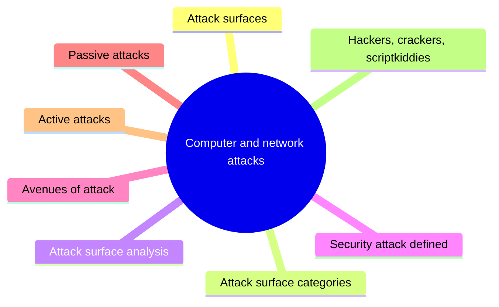
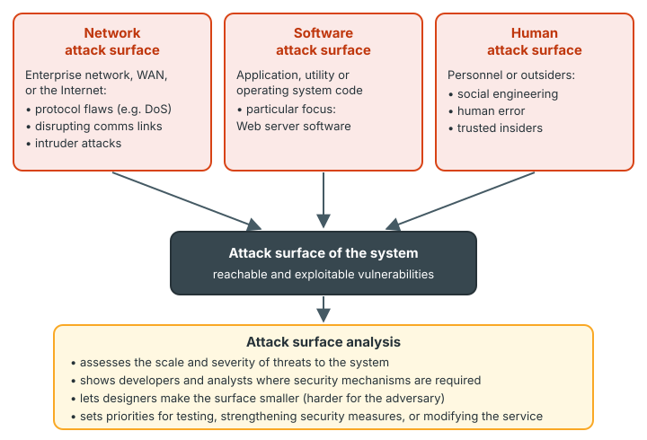
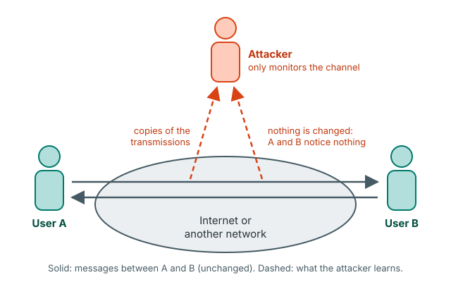
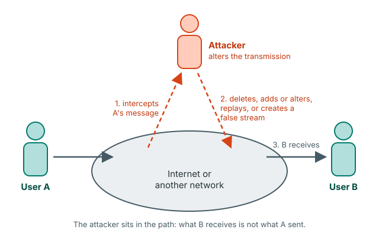
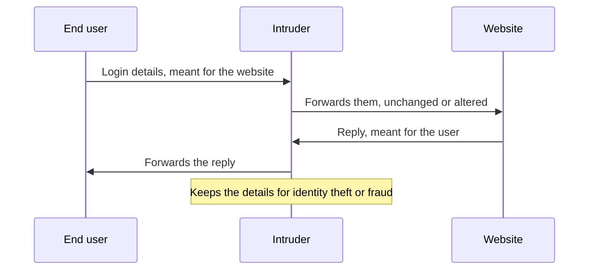
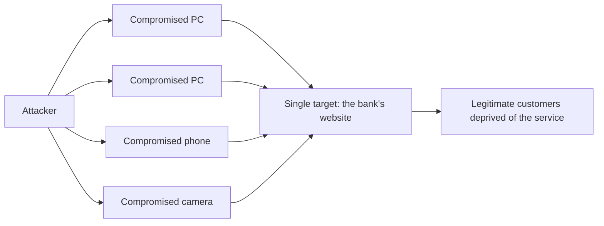

# Unit 2: Computer and network attacks

*Courseware Chapter 2, pages 15–19.*

## At a glance

Unit 1 defined *attack*, *threat* and *vulnerability* in general. This short chapter looks at attacks themselves. It answers five questions:

- **Where can a system be attacked?** Its **attack surface**: the reachable and exploitable vulnerabilities, in three categories (network, software, human), and how an **attack surface analysis** helps.
- **What is a security attack?** A systematic threat generated by an entity in an artificial, deliberate and intelligent way.
- **Along which avenues are networks attacked?** Seven avenues: social engineering, war dialing, denial of service, protocol-based attacks, host attacks, password guessing and eavesdropping.
- **What are the two main categories of attack?** **Passive** (monitor only; Fig. 2.1) and **active** (alter the transmission; Fig. 2.2), with **six categories** of active attack.
- **Who attacks?** **Hackers**, **crackers** and **scriptkiddies**.

## What you should be able to do

*The courseware lists no learning outcomes; these are written for this site.*

- Define an attack surface, give the five courseware examples, and explain the three categories of attack surface.
- Explain what an attack surface analysis is for, and apply it to a given organisation.
- Define a security attack and list and explain the seven avenues of attack on computer networks.
- Distinguish passive from active attacks, and draw and explain Fig. 2.1 and Fig. 2.2.
- List and explain the six categories of active attack, and classify a described incident into the right one.
- Define hacker, cracker and scriptkiddies, and tell them apart.

## Attack surfaces

Attack Surfaces · p.15

The chapter starts not with attacks but with the places where attacks can land.

> An **attack surface** consists of the reachable and exploitable vulnerabilities in a system Examples of attack surfaces are the following:
>
> • Open ports on outward facing Web and other servers, and code listening on those ports
>
> • Services available on the inside of a firewall
>
> • Code that processes incoming data, e-mail, XML, office documents, and industry- specific custom data exchange formats
>
> • Interfaces, SQL, and web forms
>
> • An employee with access to sensitive information vulnerable to a social engineering attack.

!!! note "In plain terms"
    A **vulnerability** (Unit 1) is a weakness. The **attack surface** is the set of weaknesses an attacker can actually **reach** and **exploit**. Two words matter:

    - **Reachable:** a flaw in a program that is switched off and unreachable from outside is not on the surface; the same flaw in a service listening on an open port is.
    - **Exploitable:** the attacker can actually use it to do harm.

    The five examples run from technology to people: open ports and the code behind them; services inside the firewall (reachable once someone is inside); code that reads incoming data (e-mail, XML, office documents, custom formats); interfaces, SQL and web forms; and **an employee** who can be tricked. So the attack surface is not only software: **people are part of it**.

!!! example "Example"
    A Nigerian university's student portal has: port 443 open on its web server (example 1); a staff file-sharing service reachable from any office PC inside the firewall (example 2); an admission-form upload that accepts PDF and Word files (example 3); a login form that passes the matric number straight into an SQL query (example 4); and a bursary officer who will read out a student's payment details to anyone who phones claiming to be the student's parent (example 5). Each is part of the portal's attack surface.

!!! tip "Exam angle"
    "Define attack surface and give **five** examples" is a ready-made 5–6 mark question. Learn the definition word for word ("**reachable and exploitable vulnerabilities** in a system") and the five examples in order, from ports to people.

!!! warning "Courseware note"
    The courseware is missing a full stop in the definition ("in a system Examples of…") and prints "industry- specific" with a stray space. They are quoted as given; read them as "…in a system. Examples of…" and "industry-specific".

**Check your understanding**

Which phrase completes the courseware's definition: "An attack surface consists of the ______ vulnerabilities in a system"?

<ul class="quiz-options">
  <li>known and documented</li>
  <li data-correct>reachable and exploitable</li>
  <li>unpatched and critical</li>
  <li>internal and external</li>
</ul>

The attack surface is the **reachable and exploitable** vulnerabilities. A vulnerability that is "known and documented" may still be unreachable (for example, in a service that is switched off), so it would not be on the surface (Attack Surfaces, p.15).

Which of these is NOT one of the courseware's five examples of attack surfaces?

<ul class="quiz-options">
  <li>Services available on the inside of a firewall</li>
  <li>Interfaces, SQL, and web forms</li>
  <li data-correct>Encryption keys stored in a hardware security module</li>
  <li>An employee with access to sensitive information vulnerable to social engineering</li>
</ul>

The five examples are open ports and the code listening on them; services inside a firewall; code that processes incoming data (e-mail, XML, office documents, custom formats); interfaces, SQL and web forms; and an employee open to social engineering. Keys locked in a hardware module are not listed, and they are a countermeasure, not an exposed weakness (p.15).

## Categories of attack surface

Attack Surfaces · p.15

The courseware then sorts attack surfaces into three categories.

> Attack surfaces can be categorized in the following way:
>
> • **Network attack surface:** This category refers to vulnerabilities over an enterprise network, wide-area network, or the Internet. Included in this category are network protocol vulnerabilities, such as those used for a denial-of-service attack, disruption of communications links, and various forms of intruder attacks.
>
> • **Software attack surface:** This refers to vulnerabilities in application, utility, or operating system code. A particular focus in this category is Web server software.
>
> • **Human attack surface:** This category refers to vulnerabilities created by personnel or outsiders, such as social engineering, human error, and trusted insiders.

{ .diagram }

The three categories of attack surface and what an attack surface analysis gives you (drawn for this site from the text on p.15; the courseware has no figure here).

| Category | Where the vulnerabilities are | Courseware's examples | Typical example *(site example)* |
|---|---|---|---|
| **Network** | Over an enterprise network, wide-area network, or the Internet | Network protocol vulnerabilities used for denial of service; disruption of communications links; intruder attacks | A bank's internet-banking server knocked offline by a flood of traffic |
| **Software** | In application, utility, or operating system code | Particular focus: **Web server software** | An unpatched web server that lets attackers run their own commands |
| **Human** | Created by **personnel or outsiders** | Social engineering; human error; trusted insiders | A call-centre agent resets a customer's password for a caller who only knows the account name |

!!! note "In plain terms"
    Ask "**what** is weak?": the **network** (the links and protocols that carry traffic), the **software** (the code running on machines), or the **people** (staff, contractors, even outsiders who interact with the organisation).

    Memory aid (the site's, not the courseware's): **N-S-H**, "**N**etwork, **S**oftware, **H**uman", from the wire to the code to the person.

    The courseware's five examples fit these categories (the mapping is ours): open ports and services inside the firewall lean to **network**; code processing incoming data and interfaces/SQL/web forms are **software**; the employee open to social engineering is **human**.

!!! tip "Exam angle"
    "State and explain the **three** categories of attack surface" is the most likely question from p.15. For each, give *where* (enterprise network/WAN/Internet; application, utility or OS code; personnel or outsiders) and the courseware's examples (DoS, link disruption, intruders; **Web server software**; social engineering, human error, trusted insiders).

### Attack surface analysis

Attack Surfaces · p.15

> An attack surface analysis is a useful technique for assessing the scale and severity of threats to a system. A systematic analysis of points of vulnerability makes developers and security analysts aware of where security mechanisms are required. Once an attack surface is defined, designers may be able to find ways to make the surface smaller, thus making the task of the adversary more difficult. The attack surface also provides guidance on setting priorities for testing, strengthening security measures, or modifying the service or application.

The paragraph gives **four** benefits (the courseware does not number or count them; the count is ours):

1. **Assess the threat:** it assesses the **scale and severity** of threats to a system.
2. **Show where protection is needed:** a systematic analysis of points of vulnerability makes **developers and security analysts** aware of **where security mechanisms are required**.
3. **Shrink the surface:** once defined, designers may find ways to **make the surface smaller**, making the **adversary's task more difficult**.
4. **Set priorities:** it guides priorities for **testing**, **strengthening security measures**, or **modifying the service or application** (three things).

!!! example "Example"
    A Lagos fintech lists everything reachable on its payment app: 14 open ports, an old admin web page nobody uses, a file-upload feature, and 30 customer-support staff who can reset passwords. The analysis shows the admin page and 9 of the ports are not needed: closing them **makes the surface smaller**. The upload feature and the support staff remain, so they get **priority** for penetration **testing** and for **strengthening** (file scanning; a call-back rule before any password reset).

!!! tip "Exam angle"
    A scenario question can give you a list of exposures and ask you to "carry out an attack surface analysis": classify each into **network/software/human**, say which can be **removed** (smaller surface) and which must be **prioritised** for testing or strengthening. Reducing the surface links to the Unit 1 design principle of [economy of mechanism](unit-1-security-concepts.md#economy-of-mechanism): less to attack, less to check.

!!! warning "Courseware note"
    In the courseware the attack surface analysis paragraph runs straight on from the **Human attack surface** bullet, as if it were part of it. It is about attack surfaces in general (all three categories), so this site separates it.

**Check your understanding**

According to the courseware, which category of attack surface has "Web server software" as a particular focus?

<ul class="quiz-options">
  <li>Network attack surface</li>
  <li data-correct>Software attack surface</li>
  <li>Human attack surface</li>
  <li>Physical attack surface</li>
</ul>

The software attack surface refers to vulnerabilities in application, utility, or operating system code, and "a particular focus in this category is Web server software". The network category is tempting because web servers face the Internet, but the network category is about protocols and links, not the server's code. There is no "physical" category in the courseware (p.15).

A hospital's trusted records clerk accidentally emails a patient list to the wrong address. Which attack surface category does this weakness belong to?

<ul class="quiz-options">
  <li>Network attack surface</li>
  <li>Software attack surface</li>
  <li data-correct>Human attack surface</li>
  <li>It is not part of the attack surface because it was an accident</li>
</ul>

The human attack surface covers vulnerabilities created by personnel or outsiders, including **human error** and **trusted insiders**. The email system worked correctly, so it is not software; the error is the person's. Accidents count: "human error" is named explicitly (p.15).

Which is NOT a benefit of attack surface analysis stated in the courseware?

<ul class="quiz-options">
  <li>Assessing the scale and severity of threats to a system</li>
  <li>Finding ways to make the surface smaller</li>
  <li>Setting priorities for testing and strengthening security measures</li>
  <li data-correct>Identifying and prosecuting the attackers</li>
</ul>

Attack surface analysis looks at the system's own weak points: it assesses threats, shows where mechanisms are needed, helps shrink the surface, and sets priorities for testing, strengthening, or modifying the service. Tracing attackers is about accountability (Unit 1), not attack surface analysis (p.15).

## What a security attack is

Chapter 2, security attacks (unheaded) · p.16

With the surface defined, the courseware turns to the attacks themselves.

> Security attacks can be characterized as the different sorts of systematic activities aimed at decreasing or corrupting the security. From this perspective, an attack can be defined as a systematic threat generated by an entity in an artificial, deliberate and intelligent way.

!!! note "In plain terms"
    An attack is **not an accident**. The definition stresses that it is:

    - **systematic:** a planned activity, not a random event;
    - generated by **an entity** (a person, group or program acting for them);
    - **artificial** (made by people, not a natural event like a flood), **deliberate** (on purpose) and **intelligent** (thought through, adapting to the target).

    Its aim is "decreasing or corrupting the security". This fits Unit 1's definition: an attack is a **threat that is carried out** (a threat action). See [Security concepts and relationships](unit-1-security-concepts.md#security-concepts-and-relationships).

!!! tip "Exam angle"
    Learn the three adjectives as a set: **artificial, deliberate and intelligent**. A question may ask "why is a power failure not an attack?": it is not artificial, deliberate or intelligent, although it can still be a threat to availability.

**Check your understanding**

The courseware defines an attack as a systematic threat generated by an entity in an ______ way.

<ul class="quiz-options">
  <li>accidental, natural and random</li>
  <li data-correct>artificial, deliberate and intelligent</li>
  <li>active, passive and distributed</li>
  <li>internal, external and persistent</li>
</ul>

"An attack can be defined as a systematic threat generated by an entity in an **artificial, deliberate and intelligent** way." Accidental or natural events can be threats, but not attacks. "Active and passive" are the two categories of attack, not part of the definition (p.16).

## Avenues of attack on computer networks

Chapter 2, avenues of attack (unheaded) · p.16

> Computer networks may be vulnerable to many threats along many avenues of attack, including:

The courseware gives **seven** avenues (the courseware does not number or count them; the count is ours).

> • **Social engineering**, wherein someone tries to gain access through social means (pretending to be a legitimate system user or administrator, tricking people into revealing secrets, etc.)

> • **War dialing**, wherein someone uses computer software and a modem to search for desktop computers equipped with modems that answer, providing a potential path into a corporate network.

> • **Denial-of-service attacks**, including all types of attacks intended to overwhelm a computer or a network in such a way that legitimate users of the computer or network cannot use it.

> • **Protocol-based attacks**, which take advantage of known (or unknown) weaknesses in network services.

> • **Host attacks**, which attack vulnerabilities in certain computer operating systems or in how the system is set up and administered.

> • **Password guessing**; passwords are sequences of symbols, usually associated with a user name, which provide a mechanism for identification and authentication of a particular user. On almost all machines, the users themselves choose the passwords. This places the burden of security on end users who either do not know, or, sometimes do not care about sound security practices. As a general rule, passwords that are simple to remember, are, likewise, easy to guess. Attackers have several venues of guessing passwords and overcoming this obstacle.

> • **Eavesdropping** of all sorts, including stealing e-mail messages, files, passwords, and other information over a network connection by listening in on the connection.

| Avenue | What it exploits | Key words to remember | Example *(site example)* |
|---|---|---|---|
| **Social engineering** | People | Social means; **pretending** to be a legitimate user or administrator; **tricking** people into revealing secrets | A caller claims to be from the bank's IT unit and asks a teller for her password |
| **War dialing** | Modems that answer | Software + **modem** search for desktop computers whose modems answer; a path into a corporate network | Software dials every number in a company's phone range to find a forgotten dial-up modem on an old PC |
| **Denial of service** | Capacity of a computer or network | **Overwhelm** it so **legitimate users cannot use it** | Flooding JAMB's registration site on the deadline day |
| **Protocol-based attacks** | Network services | **Known (or unknown) weaknesses** in network services | Abusing a flaw in an e-mail server's protocol handling |
| **Host attacks** | Operating systems and administration | Vulnerabilities in certain **OSs** or in **how the system is set up and administered** | A server left with its default administrator password |
| **Password guessing** | Users' choice of passwords | Users choose them; **simple to remember = easy to guess** | Trying "password123" and the user's date of birth |
| **Eavesdropping** | Network connections | **Listening in** to steal e-mail, files, passwords | Capturing logins on an open café Wi-Fi |

!!! note "In plain terms"
    - **Social engineering** attacks the **person**, not the machine: no technical flaw is needed.
    - **War dialing** is the old dial-up version of scanning for open doors: a modem left answering on a desktop PC bypasses the company's network defences.
    - **Denial of service** does not steal anything; it stops **legitimate users** from using the system (an attack on **availability**).
    - **Protocol-based vs host attacks:** protocol-based attacks target weaknesses in **network services** (the way machines talk); host attacks target a **particular computer**: its operating system, or the way it is **set up and administered** (a configuration mistake counts).
    - **Password guessing** works because **users choose** their passwords and the easy-to-remember ones are easy to guess. The courseware's point is that this puts "the burden of security on end users". Note the courseware's definition of a password: a **sequence of symbols**, usually associated with a **user name**, providing **identification and authentication** of a particular user.
    - **Eavesdropping** is **listening in** on a connection: a passive attack (next section).

    Memory aid (the site's, not the courseware's): "**S**ome **W**icked **D**udes **P**robe **H**osts, **P**asswords and **E**mails" = **S**ocial engineering, **W**ar dialing, **D**enial of service, **P**rotocol-based, **H**ost, **P**assword guessing, **E**avesdropping.

!!! tip "Exam angle"
    "List and explain **five** (or seven) avenues of attack on computer networks" is very likely. One sentence each is enough, but use the courseware's key words: *social means*, *modem*, *overwhelm… legitimate users*, *weaknesses in network services*, *how the system is set up and administered*, *users choose the passwords*, *listening in*. The password-guessing paragraph is long enough to be its own 4-mark part: define *password* and explain why passwords are easy to guess.

!!! warning "Courseware note"
    - The **Eavesdropping** bullet is printed in the middle of the password-guessing paragraph ("…overcoming this obstacle. • Eavesdropping of all sorts…"). It is a separate avenue, the seventh.
    - "Attackers have several **venues** of guessing passwords" should read **avenues** (ways). Quoted as given.

!!! info "Beyond the notes"
    The courseware names the avenues without describing how they are carried out. In brief: **war dialing** is mostly historical (dial-up modems are rare), but the same idea survives as *port scanning* and searching for forgotten Internet-facing devices. **Password guessing** is done by *dictionary attacks* (trying common words), *brute force* (trying every combination), and *credential stuffing* (reusing passwords leaked from other sites). The usual countermeasures are long passphrases, account lockout after a few failures, and multi-factor authentication. Passwords and authentication are covered further in [Unit 8](unit-8-access-control.md#components-of-an-effective-access-control-system); denial of service and eavesdropping return as active and passive attacks below.

**Check your understanding**

An attacker uses software and a modem to dial a company's phone numbers one after another, looking for a desktop computer whose modem answers. Which avenue of attack is this?

<ul class="quiz-options">
  <li>Protocol-based attack</li>
  <li>Host attack</li>
  <li data-correct>War dialing</li>
  <li>Eavesdropping</li>
</ul>

War dialing is using computer software and a modem to search for desktop computers equipped with modems that answer, providing a potential path into a corporate network. A host attack would exploit the computer's operating system or setup *after* reaching it; war dialing is the search for the way in (p.16).

A server is compromised because the administrator never changed its default password and left unneeded services enabled. Which avenue of attack fits best?

<ul class="quiz-options">
  <li>Protocol-based attack</li>
  <li data-correct>Host attack</li>
  <li>Social engineering</li>
  <li>Denial-of-service attack</li>
</ul>

Host attacks exploit vulnerabilities in certain operating systems **or in how the system is set up and administered**: poor configuration is exactly that. Protocol-based attacks exploit weaknesses in network services themselves, not one machine's administration (p.16).

According to the courseware, why does password guessing succeed?

<ul class="quiz-options">
  <li>Because passwords are always sent unencrypted</li>
  <li data-correct>Because users choose their own passwords, and passwords that are simple to remember are easy to guess</li>
  <li>Because operating systems store passwords in plain text</li>
  <li>Because passwords are not associated with user names</li>
</ul>

On almost all machines the users themselves choose the passwords, placing the burden of security on end users who may not know or care about sound practices; "passwords that are simple to remember are, likewise, easy to guess". Unencrypted transmission is the eavesdropping avenue, not guessing (p.16).

## Passive attacks

Chapter 2, categories of security attacks (unheaded) · p.16

> Security attacks may be divided into these two main categories:
>
> ✓ Passive attacks.
>
> ✓ Active attacks.

Unit 1 met this pair as the classification of attacks "by effect" (see [Security concepts and relationships](unit-1-security-concepts.md#security-concepts-and-relationships)); Chapter 2 gives each a fuller description and a figure. Passive attacks come first.

Passive attacks · p.17; Fig. 2.1 · p.17

> **Passive attacks** – These attacks attempt to learn or make use of information from the system but do not affect system resources. A passive attack is one where the attacker only monitors the communication channel. A passive attacker only threatens the confidentiality of data. Passive attacks are in the nature of eavesdropping on, or monitoring of, transmissions. The goal of the opponent is to obtain information that is being transmitted.

{ .diagram }

Fig. 2.1: Passive attacks (redrawn). Text labels on the arrows and the colours are added by this site.

!!! note "In plain terms"
    Five points are packed into the definition:

    1. It tries to **learn or make use of information**.
    2. It does **not affect system resources**: nothing is changed, deleted or slowed down.
    3. The attacker **only monitors** the communication channel.
    4. It threatens **only confidentiality**.
    5. It is in the nature of **eavesdropping on, or monitoring of, transmissions**; the opponent's goal is to **obtain information being transmitted**.

    **Reading Fig. 2.1:** User A and User B talk through the Internet (both arrows are solid and reach their destination unchanged). The dashed arrows go **up** to the attacker: copies of the traffic leave the network, but **nothing comes back down**. That one-way flow is what makes it passive.

!!! example "Example"
    A student connects a laptop to a hostel's open Wi-Fi and runs a packet-capture tool. Other students' unencrypted logins and chats appear on the screen. Nobody's messages are blocked or changed: a passive attack on confidentiality.

!!! tip "Exam angle"
    "With the aid of a diagram, explain a passive attack": draw Fig. 2.1 (A and B, the network cloud, two solid arrows between them, the attacker above with dashed arrows going **up only**), then give the definition and the phrase "**only threatens the confidentiality** of data".

!!! warning "Courseware note"
    The courseware prints the passive-attack description **twice**, once as list item "i.)" and again as a plain paragraph straight after it, word for word the same. It is taught once here.

!!! info "Beyond the notes"
    The source textbook (Stallings and Brown) splits passive attacks into two kinds: **release of message contents** (reading what is said) and **traffic analysis** (learning who talks to whom, how often and how much, even when the content is encrypted). Passive attacks are **very hard to detect** because nothing is altered, so the defence is **prevention**, usually by **encryption** ([Unit 4](unit-4-cryptography.md#what-cryptography-is-data-at-rest-and-data-in-transit)). The courseware does not mention these points; they help when explaining why passive attacks are dangerous.

**Check your understanding**

According to the courseware, which security objective(s) does a passive attacker threaten?

<ul class="quiz-options">
  <li data-correct>Only the confidentiality of data</li>
  <li>Data integrity and authentication</li>
  <li>Data integrity, authentication and confidentiality</li>
  <li>Only availability</li>
</ul>

"A passive attacker only threatens the confidentiality of data." The tempting third option is the courseware's description of the **active** attacker, who threatens data integrity and authentication **as well as** confidentiality (p.17).

An intruder taps a company's network link and records every message for weeks, without blocking or changing anything. Why is this hard for the company to notice?

<ul class="quiz-options">
  <li>Because it is an active attack that hides its changes</li>
  <li data-correct>Because a passive attack does not affect system resources: the attacker only monitors the channel</li>
  <li>Because it uses a botnet</li>
  <li>Because it only threatens integrity, which is not monitored</li>
</ul>

A passive attack attempts to learn or make use of information but **does not affect system resources**; the attacker **only monitors** the communication channel, so A and B see nothing unusual. It threatens confidentiality, not integrity (Passive attacks, p.17; the "hard to detect" point is from the Beyond box).

## Active attacks

Active Attacks · p.17; Fig. 2.2 · p.18

> **Active attacks** attempt to alter system resources or affect their operation. This type of attack is one where the adversary attempts to delete, add, or in some other way alter the transmission on the channel. An active attacker threatens data integrity and authentication as well as confidentiality.

> Active attacks involve some modification of the data stream or the creation of a false stream and can be divided into six categories:

{ .diagram }

Fig. 2.2: Active attack (redrawn). The numbered step labels and the colours are added by this site.

!!! note "In plain terms"
    An active attacker does not just listen: they **delete, add, or alter** what travels on the channel, or **create a false stream**. So they threaten **more** of the security objectives: **data integrity** and **authentication** (whether the message really comes from who it claims), **as well as confidentiality**.

    **Reading Fig. 2.2:** compare it with Fig. 2.1. A's message no longer flows straight to B. It goes **up** to the attacker and comes **back down** before reaching B. The attacker is **in the path**, so what B receives may not be what A sent.

| Criterion | Passive attack | Active attack |
|---|---|---|
| **Aim** | Learn or make use of information | Alter system resources or affect their operation |
| **Effect on system resources** | Does not affect them | Alters them or their operation |
| **What the attacker does to the channel** | Only monitors it | Deletes, adds, or in some other way alters the transmission |
| **Data stream** | Left unchanged | Modified, or a false stream created |
| **Objectives threatened** | **Only confidentiality** | **Data integrity and authentication as well as confidentiality** |
| **Nature** | Eavesdropping on, or monitoring of, transmissions | Six categories (masquerade, replay, modification of messages, MitM, DoS/DDoS, APT) |
| **Figure** | Fig. 2.1: arrows go up to the attacker only | Fig. 2.2: the message passes through the attacker |
| **Detection and defence** *(site summary, from Beyond box)* | Hard to detect; prevent (encryption) | Easier to detect; detect and recover |

!!! tip "Exam angle"
    "Differentiate between passive and active attacks" is among the most predictable questions in the course (it is in Unit 1 too). Name your criteria, as in the table: **effect on resources**, **what is done to the channel**, **objectives threatened**, and draw the two figures side by side if the question says "with the aid of a diagram".

The six categories follow, each in the courseware's own words.

### Masquerade

Active Attacks · p.18

> **Masquerade.** It is a type of attack where the attacker pretends to be an authorized user of a system in order to gain access to it or to gain greater privileges than they are authorized for.

**Pretending to be someone else.** Two possible goals: to **gain access** at all, or to **gain greater privileges** than the attacker is authorised for. *Example:* someone logs into the university's results system with a lecturer's stolen password and uploads grades.

### Replay

Active Attacks · p.18

> **Replay** - In this kind of attack, a valid data transmission is maliciously or fraudulently repeated or delayed. This is carried out either by the originator or by an adversary who intercepts the data and retransmits them, possibly as part of a masquerade attack.

**Sending a genuine message again (or late).** The message itself is **valid**: nothing inside it is changed. The harm comes from **repeating** or **delaying** it. Two possible culprits: the **originator** (the person who sent it) or an **adversary** who intercepts and retransmits it. It may be part of a **masquerade**: replaying someone's captured login message to get in as them. *Example:* a captured "pay ₦50,000 to account X" instruction is sent to the bank three more times.

### Modification of messages

Active Attacks · p.18

> **Modification of messages.** The attacker removes a message from the network traffic, alters it, and reinserts it.

**Three steps: remove, alter, reinsert.** Unlike replay, the **content changes**. *Example:* a salary payment file is intercepted and the account number changed before it reaches the bank.

### Man in the Middle (MitM)

Active Attacks · p.18

> **Man in the Middle - (MitM).** In this kind of attacks, an intruder intercepts communications between two parties, usually an end user and a website. The attacker can use the information accessed to commit identity theft or other types of fraud.

**Sitting between the two parties.** The intruder intercepts communications between two parties, **usually an end user and a website**, and uses what they get for **identity theft or other fraud**. *Example:* a fake "Free Airport Wi-Fi" hotspot relays travellers' traffic to their banking sites and captures their logins on the way.

A man-in-the-middle attack: both parties think they are talking directly to each other (drawn for this site).

### Denial of Service (DoS) and Distributed Denial of Service (DDoS)

Active Attacks · p.18

> **Denial of Service (DoS) and Distributed Denial of Service (DDoS).** A denial of service (DoS) attack is an incident in which a user or organization is deprived of the services of a resource they would normally expect to have. In a distributed denial-of-service, large numbers of compromised systems (sometimes called a botnet ) attack a single target.

**Taking away a service people expect.** In a **DoS**, a user or organisation is **deprived of the services of a resource** they would normally expect to have. A **DDoS** is the same aim, but the attack comes from **large numbers of compromised systems** (a **botnet**) against **a single target**.

DDoS: many compromised systems (a botnet) attack a single target (drawn for this site; the devices named are examples).

| Criterion | DoS | DDoS |
|---|---|---|
| **Effect** | User or organisation deprived of a resource's services | Same |
| **Source** | Not stated (in practice usually one source; site note) | **Large numbers of compromised systems** |
| **Name for the attacking systems** | (none) | **Botnet** |
| **Target** | A resource | **A single target** |

### Advanced Persistent Threat (APT)

Active Attacks · p.18

> **Advanced Persistent Threat (APT).** It is a network attack in which an unauthorized person gains access to a network and stays there undetected for a long period of time. The intention of an APT attack is to steal data rather than cause damage to the network or organization. APT attacks target organizations in sectors with high-value information, such as national defense, manufacturing and the financial industry.

**Getting in and staying hidden.** Three things to learn: (i) the intruder **gains access** and **stays undetected for a long period**; (ii) the **intention is to steal data**, **not to cause damage**; (iii) the targets are sectors with **high-value information**: **national defense, manufacturing and the financial industry** (three examples). *Example:* attackers sit unnoticed in a defence ministry's network for eight months, quietly copying procurement documents.

### Telling the active attacks apart

| Attack | The attacker… | Is the content changed? | Main objective hit *(site summary)* | Key words |
|---|---|---|---|---|
| **Masquerade** | pretends to be an authorized user | Not necessarily | Authentication (and then any) | pretends; gain access or greater privileges |
| **Replay** | repeats or delays a valid transmission | **No** (valid data, wrong time or number of times) | Integrity, authentication | valid; repeated or delayed; originator or adversary |
| **Modification of messages** | removes, alters, reinserts a message | **Yes** | Data integrity | removes, alters, reinserts |
| **MitM** | intercepts communications between two parties | May be | Confidentiality, then fraud | usually end user and website; identity theft |
| **DoS / DDoS** | deprives users of a resource's services | Not the point | Availability | deprived; botnet; single target |
| **APT** | gains access and stays undetected a long time | Not the aim | Confidentiality (data theft) | undetected; steal data, not damage; high-value sectors |

!!! note "In plain terms"
    Memory aid (the site's, not the courseware's): "**M**y **R**ival **M**ay **M**ake **D**amaging **A**ttacks" = **M**asquerade, **R**eplay, **M**odification, **M**itM, **D**oS/DDoS, **A**PT, in the courseware's order.

    Three pairs are easy to confuse:

    - **Replay vs modification:** replay sends a **valid, unchanged** message again or late; modification **changes** the message.
    - **MitM vs passive eavesdropping:** both intercept, but the MitM **sits in the path** and relays (and can alter) the traffic; an eavesdropper only listens.
    - **APT vs DoS:** an APT is **quiet** and wants to **steal data** over a long time; a DoS is **noisy** and wants to **deny service**. The courseware says an APT's intention is to steal data "**rather than cause damage**".

!!! tip "Exam angle"
    Expect "List and explain the **six** categories of active attack" (one sentence each, in courseware words) and scenario parts that describe an incident and ask you to name the category. Look for the give-away word: *pretends* → masquerade; *repeated* or *delayed* → replay; *alters and reinserts* → modification; *between the user and the website* → MitM; *deprived of service*, *botnet* → DoS/DDoS; *undetected for months*, *steal data* → APT.

!!! warning "Courseware note"
    - The source textbook's classic list has **four** active attacks (masquerade, replay, modification of messages, denial of service). The courseware adds **MitM** and **APT** to make **six**, and joins DoS and DDoS into one category. Use the courseware's six in the exam.
    - "An active attacker threatens data integrity and **authentication**": *authentication* here means the **authenticity** requirement from Unit 1 (whether a message or user is genuine).
    - The DDoS sentence has a stray space ("botnet )"); the APT is called a "threat" in its name but defined as "a network attack". Quoted as given.

!!! info "Beyond the notes"
    The courseware does not say how these attacks are countered. Briefly: **timestamps, sequence numbers and one-time codes** defeat replay; **message authentication codes and digital signatures** detect modification and masquerade ([Unit 4](unit-4-cryptography.md#digital-signatures)); **HTTPS with certificate checks** defeats most MitM; **traffic filtering and extra capacity** blunt DoS/DDoS ([Unit 5](unit-5-firewalls.md#what-a-firewall-does-inbound-and-outbound-protection)); and **monitoring and intrusion detection** are needed to find an APT that is hiding ([Unit 12](unit-12-idps.md#what-an-idps-is-used-for)). Botnets are built from machines infected with malware ([Unit 9](unit-9-malware.md#botnets)).

**Check your understanding**

Which of these is NOT one of the courseware's six categories of active attack?

<ul class="quiz-options">
  <li>Masquerade</li>
  <li>Advanced Persistent Threat</li>
  <li data-correct>Eavesdropping</li>
  <li>Man in the Middle</li>
</ul>

The six are masquerade, replay, modification of messages, MitM, DoS/DDoS and APT. Eavesdropping is an avenue of attack (p.16) and the nature of a **passive** attack: it only listens and alters nothing (Active Attacks, pp.17–18).

An attacker captures a genuine, correctly signed "transfer ₦200,000" instruction and sends it to the bank again an hour later, without changing it. Which active attack is this?

<ul class="quiz-options">
  <li>Modification of messages</li>
  <li data-correct>Replay</li>
  <li>Man in the Middle</li>
  <li>Masquerade</li>
</ul>

In a replay, a **valid** data transmission is maliciously or fraudulently **repeated or delayed**. The message is not changed, so it is not modification of messages (which removes, **alters** and reinserts a message) (Active Attacks, p.18).

Intruders get into a manufacturing company's network and remain unnoticed for ten months, quietly copying product designs without disrupting anything. Which category fits best?

<ul class="quiz-options">
  <li>Distributed Denial of Service</li>
  <li>Modification of messages</li>
  <li data-correct>Advanced Persistent Threat</li>
  <li>Replay</li>
</ul>

An APT is a network attack in which an unauthorized person gains access and **stays undetected for a long period**, with the intention to **steal data rather than cause damage**; manufacturing is one of the courseware's named high-value sectors. A DDoS would disrupt service, the opposite of staying hidden (p.18).

## Hackers, crackers and scriptkiddies

Chapter 2, groups of attackers (unheaded) · p.19

The chapter ends with the people behind attacks. It describes three groups.

> A **Hacker** is a person with good or excellent IT skills who is often involved in important software projects and whose knowledge and know-how are useful in finding any vulnerabilities and security holes of the designed systems. The hacker's activity is helpful and useful. There are even codexes on hackers which describe their behaviour.

> A **Cracker** is someone who has the ability to defeat anti-piracy protections of computer programs and who uses their knowledge in an unethical way. However, there are more definitions of this group of attackers that emphasize the different scope of their activities.

> There exist also other groups of attackers, the largest one being called scriptkiddies.
>
> **Scriptkiddies** - This group of attackers consists of users with low IT skills. The attacks performed by these attackers exploit the scripts containing the codes aimed at misusing the vulnerabilities of the IS. The attackers apply these scripts to the IS without carrying out a deep analysis, but the harmful effects of this activity usually have serious consequences. These are the most frequent and dangerous attacks.

| Criterion | Hacker | Cracker | Scriptkiddies |
|---|---|---|---|
| **Skill level** | Good or excellent IT skills | Able to defeat anti-piracy protections (skilled) | **Low** IT skills |
| **What they do** | Find vulnerabilities and security holes of designed systems; often in important software projects | Defeat **anti-piracy protections** of computer programs | Run **scripts** (written by others) that misuse vulnerabilities of the IS |
| **Ethics** | Activity is **helpful and useful**; codexes describe their behaviour | Uses knowledge in an **unethical** way | Apply scripts **without deep analysis** |
| **Size / impact** | Not stated | "More definitions… emphasize the different scope of their activities" | **Largest** group; **most frequent and dangerous** attacks; serious consequences |

!!! note "In plain terms"
    - In the courseware, a **hacker** is a **good** guy: a skilled professional whose knowledge **finds** security holes so they can be fixed. "**Codexes**" means **codes of conduct** (written rules of hacker ethics).
    - A **cracker** **breaks** protections, in particular **anti-piracy protections** (cracking software so it can be used without paying), and is **unethical**.
    - **Scriptkiddies** are **unskilled**: they download ready-made attack scripts and fire them at systems without understanding them. They are dangerous because there are **so many** of them and the tools do real damage anyway.

!!! example "Example"
    A cybersecurity graduate is paid by a Nigerian bank to test its app and reports three holes (a **hacker** in the courseware's sense). Someone removes the licence check from accounting software and sells cracked copies at a computer village (a **cracker**). A secondary-school student downloads a "website takedown" tool from a forum and points it at his school's portal (a **scriptkiddie**).

!!! tip "Exam angle"
    "Differentiate between a hacker and a cracker" and "who are scriptkiddies?" are likely short questions. The key contrasts: **helpful and useful vs unethical**; **finding** holes vs **defeating anti-piracy protections**; and for scriptkiddies, **low skills, scripts, no deep analysis, largest group, most frequent and dangerous**.

!!! warning "Courseware note"
    - "Scriptkiddies" is usually written as two words, **script kiddies**; the courseware's one-word form is kept here.
    - "Codexes" is an unusual word: it means codes (of conduct or ethics) for hackers.
    - The courseware's positive view of hackers reflects the original meaning of the word. In everyday use and the media, "hacker" often means any attacker; if an exam question uses it that way, say so, then give the courseware's distinction.

!!! info "Beyond the notes"
    Modern writing often sorts attackers by intent with "hats": **white hat** (ethical hackers who test systems with permission, matching the courseware's "hacker"), **black hat** (malicious attackers, close to the courseware's "cracker") and **grey hat** (break in without permission but without malicious intent, often reporting the flaw). Unit 1's list of outside attackers ([amateur pranksters to hostile governments](unit-1-security-concepts.md#security-concepts-and-relationships)) is a second way of classifying the people behind attacks. Ethical and legal questions about hacking are covered in [Unit 10](unit-10-ethics-legal.md#ethical-hacking).

**Check your understanding**

According to the courseware, which group of attackers is the largest and carries out the most frequent and dangerous attacks?

<ul class="quiz-options">
  <li>Hackers</li>
  <li>Crackers</li>
  <li data-correct>Scriptkiddies</li>
  <li>Advanced persistent threat groups</li>
</ul>

The courseware calls scriptkiddies "the largest" group and says "these are the most frequent and dangerous attacks", even though their skills are low. Hackers are described as helpful; crackers as unethical but not the largest group. APT is an attack category, not a group of attackers in this chapter (p.19).

What, specifically, does the courseware say a cracker can defeat?

<ul class="quiz-options">
  <li>Firewalls and intrusion detection systems</li>
  <li data-correct>Anti-piracy protections of computer programs</li>
  <li>Encryption algorithms</li>
  <li>Biometric authentication</li>
</ul>

"A Cracker is someone who has the ability to defeat anti-piracy protections of computer programs and who uses their knowledge in an unethical way." The other options sound plausible but are not in the definition (p.19).

## Key terms

Attack surface
:   The reachable and exploitable vulnerabilities in a system (e.g. open ports, services inside a firewall, code processing incoming data, interfaces/SQL/web forms, employees open to social engineering).

Network attack surface
:   Vulnerabilities over an enterprise network, wide-area network, or the Internet, including network protocol vulnerabilities used for denial of service, disruption of communications links, and intruder attacks.

Software attack surface
:   Vulnerabilities in application, utility, or operating system code; a particular focus is Web server software.

Human attack surface
:   Vulnerabilities created by personnel or outsiders, such as social engineering, human error, and trusted insiders.

Attack surface analysis
:   A technique for assessing the scale and severity of threats to a system; shows where security mechanisms are required, helps make the surface smaller, and sets priorities for testing, strengthening, or modifying the service.

Security attack
:   A systematic threat generated by an entity in an artificial, deliberate and intelligent way, aimed at decreasing or corrupting the security.

Social engineering
:   Trying to gain access through social means, such as pretending to be a legitimate system user or administrator, or tricking people into revealing secrets.

War dialing
:   Using computer software and a modem to search for desktop computers equipped with modems that answer, providing a potential path into a corporate network.

Protocol-based attacks
:   Attacks that take advantage of known (or unknown) weaknesses in network services.

Host attacks
:   Attacks on vulnerabilities in certain computer operating systems or in how the system is set up and administered.

Password
:   A sequence of symbols, usually associated with a user name, that provides a mechanism for identification and authentication of a particular user.

Password guessing
:   Guessing users' passwords; it succeeds because users choose their own passwords and those simple to remember are easy to guess.

Eavesdropping
:   Stealing e-mail messages, files, passwords and other information over a network connection by listening in on the connection.

Passive attack (Chapter 2)
:   An attack that learns or makes use of information without affecting system resources; the attacker only monitors the channel and threatens only confidentiality.

Active attack (Chapter 2)
:   An attack that alters system resources or their operation by deleting, adding or altering the transmission; threatens data integrity and authentication as well as confidentiality.

Masquerade
:   An attack where the attacker pretends to be an authorized user to gain access or greater privileges than authorized.

Replay
:   An attack in which a valid data transmission is maliciously or fraudulently repeated or delayed, by the originator or an adversary who intercepts and retransmits it.

Modification of messages
:   An attack in which the attacker removes a message from the network traffic, alters it, and reinserts it.

Man in the Middle (MitM)
:   An attack in which an intruder intercepts communications between two parties, usually an end user and a website, to commit identity theft or other fraud.

Denial of Service (DoS)
:   An incident in which a user or organization is deprived of the services of a resource they would normally expect to have.

Distributed Denial of Service (DDoS)
:   A denial-of-service attack in which large numbers of compromised systems (a botnet) attack a single target.

Botnet
:   The large numbers of compromised systems used together in a distributed denial-of-service attack.

Advanced Persistent Threat (APT)
:   A network attack in which an unauthorized person gains access and stays undetected for a long time, intending to steal data rather than cause damage; targets high-value sectors.

Hacker
:   A person with good or excellent IT skills whose know-how is useful in finding vulnerabilities and security holes; the courseware calls the activity helpful and useful.

Cracker
:   Someone able to defeat anti-piracy protections of computer programs who uses their knowledge in an unethical way.

Scriptkiddies
:   The largest group of attackers: users with low IT skills who apply ready-made scripts exploiting IS vulnerabilities without deep analysis; the most frequent and dangerous attacks.

---

## Unit summary

- **Attack surface** = the **reachable and exploitable vulnerabilities** in a system. **Five examples:** open ports on outward-facing servers and the code listening on them; services inside a firewall; code that processes incoming data (e-mail, XML, office documents, custom formats); interfaces, SQL and web forms; an employee open to social engineering.
- **Three categories:** **network** (enterprise network, WAN, Internet: protocol flaws for DoS, link disruption, intruders); **software** (application, utility, OS code; focus on Web server software); **human** (personnel or outsiders: social engineering, human error, trusted insiders).
- **Attack surface analysis:** assesses scale and severity of threats; shows where security mechanisms are required; lets designers make the surface **smaller**; sets priorities for **testing, strengthening security measures, or modifying** the service.
- **Security attack:** systematic activities aimed at decreasing or corrupting security; a **systematic threat generated by an entity in an artificial, deliberate and intelligent way**.
- **Seven avenues of attack:** social engineering; war dialing (software + modem); denial of service (overwhelm, legitimate users cannot use it); protocol-based (weaknesses in network services); host attacks (OS vulnerabilities or set-up/administration); password guessing (users choose; simple to remember = easy to guess); eavesdropping (listening in).
- **Passive attacks** (Fig. 2.1): learn or use information, **do not affect resources**, attacker **only monitors**, threaten **only confidentiality**; eavesdropping/monitoring of transmissions.
- **Active attacks** (Fig. 2.2): alter resources or their operation; delete, add or alter the transmission; modify the stream or create a false one; threaten **integrity and authentication as well as confidentiality**. **Six categories:** masquerade (pretends to be authorized), replay (valid transmission repeated or delayed), modification of messages (remove, alter, reinsert), MitM (intercept between user and website; identity theft/fraud), DoS/DDoS (deprived of services; botnet attacks a single target), APT (undetected a long time; steal data not damage; defense, manufacturing, finance).
- **Attackers:** **hacker** (good/excellent skills, finds holes, helpful and useful, codexes), **cracker** (defeats anti-piracy protections, unethical), **scriptkiddies** (low skills, run scripts without deep analysis; largest group; most frequent and dangerous attacks).

## Mixed review

"Denial of service" appears twice in Chapter 2. In which two places?

<ul class="quiz-options">
  <li>As an attack surface category and as a type of attacker</li>
  <li data-correct>As an avenue of attack on computer networks and as a category of active attack (with DDoS)</li>
  <li>As a passive attack and as an active attack</li>
  <li>As an example of the human attack surface and as an avenue of attack</li>
</ul>

Denial-of-service attacks are one of the avenues of attack (p.16: "intended to overwhelm a computer or a network…") and DoS/DDoS is the fifth active-attack category (p.18). They are also mentioned under the **network** (not human) attack surface. DoS can never be passive, because it affects the operation of resources.

A fraudster phones a bank's call centre pretending to be the IT manager and persuades an agent to read out a customer's PIN. Which combination is correct?

<ul class="quiz-options">
  <li>Software attack surface; war dialing</li>
  <li>Network attack surface; protocol-based attack</li>
  <li data-correct>Human attack surface; social engineering</li>
  <li>Human attack surface; host attack</li>
</ul>

The weakness is a person (human attack surface: social engineering), and the avenue is social engineering: gaining access through social means by pretending to be a legitimate administrator. A host attack exploits an operating system or its administration, not a person (pp.15–16).

Which statement correctly contrasts a man-in-the-middle attack with eavesdropping?

<ul class="quiz-options">
  <li>Both are passive attacks</li>
  <li>MitM only threatens confidentiality; eavesdropping threatens integrity</li>
  <li data-correct>Eavesdropping only listens in; MitM intercepts communications between two parties as an active attack and can be used for fraud</li>
  <li>Eavesdropping requires a botnet; MitM does not</li>
</ul>

Eavesdropping is listening in on a connection: passive, threatening only confidentiality. The courseware lists MitM among the **active** attacks: the intruder intercepts communications between two parties and uses them for identity theft or fraud. Botnets belong to DDoS (pp.16–18).

A scriptkiddie downloads a tool and floods a small online shop with traffic from thousands of infected computers until customers cannot reach it. Which description is most complete?

<ul class="quiz-options">
  <li>A hacker carrying out a passive attack</li>
  <li>A cracker carrying out an APT</li>
  <li data-correct>A low-skilled attacker carrying out a DDoS (an active attack) using a botnet</li>
  <li>A scriptkiddie carrying out a replay attack</li>
</ul>

Scriptkiddies apply ready-made scripts without deep analysis. Large numbers of compromised systems (a botnet) attacking a single target is a DDoS, which is active because it affects the operation of the resource. An APT stays hidden to steal data; a replay repeats a valid transmission (pp.18–19).

## Recall drill

Every definition, list, comparison and figure in Chapter 2, as a short question. Answer aloud or on paper, then open the answer.

### Attack surfaces

**R1.** Define *attack surface*.

??? success "Answer"
    An attack surface consists of the **reachable and exploitable vulnerabilities** in a system.

**R2.** List the courseware's examples of attack surfaces. (There are 5.)

??? success "Answer"
    1. **Open ports** on outward facing Web and other servers, and code listening on those ports.
    2. **Services available on the inside of a firewall.**
    3. **Code that processes incoming data**, e-mail, XML, office documents, and industry-specific custom data exchange formats.
    4. **Interfaces, SQL, and web forms.**
    5. **An employee** with access to sensitive information vulnerable to a **social engineering** attack.

**R3.** State the three categories of attack surface.

??? success "Answer"
    **Network** attack surface, **software** attack surface, and **human** attack surface.

**R4.** Explain the *network attack surface*. What is included in it?

??? success "Answer"
    Vulnerabilities **over an enterprise network, wide-area network, or the Internet**. Included are **network protocol vulnerabilities**, such as those used for a **denial-of-service attack**, **disruption of communications links**, and various forms of **intruder attacks**.

**R5.** Explain the *software attack surface*. What is its particular focus?

??? success "Answer"
    Vulnerabilities in **application, utility, or operating system code**. A particular focus is **Web server software**.

**R6.** Explain the *human attack surface* and give its three examples.

??? success "Answer"
    Vulnerabilities **created by personnel or outsiders**, such as **social engineering**, **human error**, and **trusted insiders**.

**R7.** What is an *attack surface analysis*?

??? success "Answer"
    A **useful technique for assessing the scale and severity of threats to a system**. A systematic analysis of points of vulnerability.

**R8.** State the benefits of an attack surface analysis. (There are 4.)

??? success "Answer"
    1. It assesses the **scale and severity of threats** to a system.
    2. It makes **developers and security analysts aware of where security mechanisms are required**.
    3. Once the surface is defined, designers may find ways to **make the surface smaller**, making the adversary's task more difficult.
    4. It provides **guidance on setting priorities** for testing, strengthening security measures, or modifying the service or application.

**R9.** The attack surface provides guidance on setting priorities for which three things?

??? success "Answer"
    **Testing**, **strengthening security measures**, or **modifying the service or application**.

**R10.** Why do designers try to make the attack surface smaller?

??? success "Answer"
    A smaller surface means fewer reachable and exploitable vulnerabilities, **"thus making the task of the adversary more difficult"**.

**R11.** Differentiate the network attack surface from the software attack surface.

??? success "Answer"
    The **network** attack surface is vulnerabilities **over** an enterprise network, WAN or the Internet (protocols and links: DoS, disrupted links, intruders). The **software** attack surface is vulnerabilities **in the code** of applications, utilities or operating systems (especially Web server software).

### Security attacks and avenues of attack

**R12.** How does the courseware characterize security attacks, and how does it define an attack?

??? success "Answer"
    Security attacks can be characterized as the **different sorts of systematic activities aimed at decreasing or corrupting the security**. An attack is **a systematic threat generated by an entity in an artificial, deliberate and intelligent way**.

**R13.** State the three adjectives describing the way an attack is generated.

??? success "Answer"
    **Artificial, deliberate and intelligent.**

**R14.** List the avenues of attack along which computer networks may be vulnerable. (There are 7.)

??? success "Answer"
    Social engineering; war dialing; denial-of-service attacks; protocol-based attacks; host attacks; password guessing; eavesdropping.

**R15.** Explain *social engineering* as an avenue of attack, with the courseware's two examples.

??? success "Answer"
    Someone tries to **gain access through social means**: **pretending to be a legitimate system user or administrator**, **tricking people into revealing secrets**, etc.

**R16.** Explain *war dialing*.

??? success "Answer"
    Someone uses **computer software and a modem** to search for **desktop computers equipped with modems that answer**, providing a **potential path into a corporate network**.

**R17.** Explain *denial-of-service attacks* as an avenue of attack.

??? success "Answer"
    All types of attacks intended to **overwhelm a computer or a network** in such a way that **legitimate users** of the computer or network **cannot use it**.

**R18.** Explain *protocol-based attacks*.

??? success "Answer"
    Attacks which take advantage of **known (or unknown) weaknesses in network services**.

**R19.** Explain *host attacks*. What two kinds of vulnerability do they attack?

??? success "Answer"
    Attacks on vulnerabilities **in certain computer operating systems** or **in how the system is set up and administered**.

**R20.** Define a *password* (courseware wording).

??? success "Answer"
    Passwords are **sequences of symbols**, usually associated with a **user name**, which provide a mechanism for **identification and authentication** of a particular user.

**R21.** Why is password guessing a serious avenue of attack?

??? success "Answer"
    On almost all machines **the users themselves choose the passwords**. This **places the burden of security on end users** who either do not know, or sometimes do not care about, sound security practices. As a general rule, **passwords that are simple to remember are, likewise, easy to guess**. Attackers have several (a)venues of guessing passwords.

**R22.** Explain *eavesdropping* as an avenue of attack.

??? success "Answer"
    Eavesdropping of all sorts, including **stealing e-mail messages, files, passwords, and other information** over a network connection by **listening in on the connection**.

**R23.** Differentiate protocol-based attacks from host attacks.

??? success "Answer"
    **Protocol-based attacks** exploit known or unknown weaknesses in **network services**. **Host attacks** exploit vulnerabilities in **certain computer operating systems** or in **how a system is set up and administered**: the target is a particular machine and its configuration.

### Passive and active attacks

**R24.** State the two main categories of security attacks.

??? success "Answer"
    **Passive attacks** and **active attacks**.

**R25.** Define *passive attacks* (full courseware description).

??? success "Answer"
    Passive attacks attempt to **learn or make use of information** from the system but **do not affect system resources**. A passive attack is one where the attacker **only monitors the communication channel**. A passive attacker **only threatens the confidentiality** of data. Passive attacks are in the nature of **eavesdropping on, or monitoring of, transmissions**. The goal of the opponent is to **obtain information that is being transmitted**.

**R26.** Which security objective does a passive attacker threaten, and what is the opponent's goal?

??? success "Answer"
    **Only the confidentiality of data.** The goal is to **obtain information that is being transmitted**.

**R27.** With the aid of a diagram, describe Fig. 2.1 (Passive Attacks).

??? success "Answer"
    **User A** and **User B** exchange messages in both directions through the **"Internet or another network"** cloud. An **attacker** above the network receives copies of the traffic (dashed arrows going **up** to the attacker only). Nothing is sent back into the network, so A and B's messages are unchanged: the attacker only monitors.

**R28.** Define *active attacks*.

??? success "Answer"
    Active attacks attempt to **alter system resources or affect their operation**. The adversary attempts to **delete, add, or in some other way alter the transmission** on the channel. An active attacker threatens **data integrity and authentication as well as confidentiality**.

**R29.** What do active attacks involve? Into how many categories are they divided?

??? success "Answer"
    **Some modification of the data stream or the creation of a false stream.** They can be divided into **six** categories.

**R30.** List the six categories of active attack.

??? success "Answer"
    1. **Masquerade.**
    2. **Replay.**
    3. **Modification of messages.**
    4. **Man in the Middle (MitM).**
    5. **Denial of Service (DoS) and Distributed Denial of Service (DDoS).**
    6. **Advanced Persistent Threat (APT).**

**R31.** Which security objectives does an active attacker threaten?

??? success "Answer"
    **Data integrity and authentication as well as confidentiality.**

**R32.** With the aid of a diagram, describe Fig. 2.2 (Active attack).

??? success "Answer"
    **User A** sends a message into the **"Internet or another network"** cloud. It goes **up to the attacker** (dashed arrow), who can delete, add or alter it, and comes **back down** into the network (second dashed arrow) before continuing to **User B**. The attacker is in the path, so what B receives may differ from what A sent.

**R33.** Differentiate between passive and active attacks.

??? success "Answer"
    | | Passive | Active |
    |---|---|---|
    | **Aim** | Learn or make use of information | Alter system resources or affect their operation |
    | **Resources** | Not affected | Altered |
    | **Channel** | Only monitored | Transmission deleted, added to or altered; false stream created |
    | **Threatens** | Only confidentiality | Data integrity and authentication as well as confidentiality |
    | **Figure** | Fig. 2.1 | Fig. 2.2 |

### The six active attacks

**R34.** Explain *masquerade*. What two things may the attacker want?

??? success "Answer"
    The attacker **pretends to be an authorized user** of a system **in order to gain access to it** or **to gain greater privileges than they are authorized for**.

**R35.** Explain *replay*. Who can carry it out?

??? success "Answer"
    A **valid data transmission is maliciously or fraudulently repeated or delayed**. It is carried out either by **the originator** or by **an adversary who intercepts the data and retransmits them**, possibly as part of a **masquerade** attack.

**R36.** Explain *modification of messages*. State its three steps.

??? success "Answer"
    The attacker **removes** a message from the network traffic, **alters** it, and **reinserts** it.

**R37.** Explain *Man in the Middle (MitM)*. Between whom does it usually take place, and what is the information used for?

??? success "Answer"
    An **intruder intercepts communications between two parties**, usually **an end user and a website**. The attacker can use the information accessed to commit **identity theft or other types of fraud**.

**R38.** Define a *denial of service (DoS)* attack.

??? success "Answer"
    An **incident in which a user or organization is deprived of the services of a resource they would normally expect to have**.

**R39.** Explain a *distributed denial-of-service (DDoS)* attack. What is a *botnet*?

??? success "Answer"
    In a DDoS, **large numbers of compromised systems** attack **a single target**. Those compromised systems are sometimes called a **botnet**.

**R40.** Define an *Advanced Persistent Threat (APT)*.

??? success "Answer"
    A **network attack** in which an **unauthorized person gains access to a network and stays there undetected for a long period of time**.

**R41.** What is the intention of an APT attack, and which sectors do APTs target? (Three sectors are named.)

??? success "Answer"
    The intention is **to steal data rather than cause damage** to the network or organization. APTs target organizations in **sectors with high-value information**, such as **national defense**, **manufacturing** and the **financial industry**.

**R42.** Differentiate between DoS and DDoS.

??? success "Answer"
    Both deprive a user or organization of the services of a resource. A **DoS** is the incident itself; in a **DDoS**, **large numbers of compromised systems (a botnet)** attack **a single target**.

**R43.** Differentiate between replay and modification of messages.

??? success "Answer"
    **Replay:** a **valid** transmission is **repeated or delayed** (content unchanged). **Modification:** the message is **removed, altered and reinserted** (content changed).

**R44.** Differentiate between masquerade and replay. How can they be linked?

??? success "Answer"
    **Masquerade:** the attacker **pretends to be an authorized user** to gain access or privileges. **Replay:** a valid transmission is **repeated or delayed**. Link: a replay may be carried out **"as part of a masquerade attack"** (e.g. replaying captured login data to pose as the user).

**R45.** Differentiate between a man-in-the-middle attack and eavesdropping.

??? success "Answer"
    **Eavesdropping** (passive) only **listens in** on a connection to steal information; it threatens only confidentiality. **MitM** (active) **intercepts communications between two parties** (usually an end user and a website) and sits in the path, using the information for identity theft or fraud.

**R46.** Differentiate between an APT and a DoS attack.

??? success "Answer"
    An **APT** gains access and **stays undetected for a long period**, intending **to steal data rather than cause damage**. A **DoS** **deprives** users of the services of a resource: it is about denying service, not stealing data, and it is noticed by the users who lose the service.

**R47.** Denial of service appears twice in the chapter. Give the two descriptions.

??? success "Answer"
    **As an avenue of attack (p.16):** all types of attacks intended to **overwhelm a computer or a network** so that **legitimate users cannot use it**. **As an active attack (p.18):** an incident in which a user or organization is **deprived of the services of a resource** they would normally expect to have (with DDoS: large numbers of compromised systems attack a single target).

### Hackers, crackers and scriptkiddies

**R48.** Define a *hacker* (courseware).

??? success "Answer"
    A person with **good or excellent IT skills** who is often involved in **important software projects** and whose knowledge and know-how are useful in **finding any vulnerabilities and security holes** of the designed systems. The hacker's activity is **helpful and useful**. There are even **codexes** on hackers which describe their behaviour.

**R49.** Define a *cracker*.

??? success "Answer"
    Someone who has the ability to **defeat anti-piracy protections of computer programs** and who uses their knowledge **in an unethical way**. (There are more definitions of this group emphasizing the different scope of their activities.)

**R50.** Who are *scriptkiddies*? Why are their attacks significant?

??? success "Answer"
    A group of attackers consisting of **users with low IT skills**. Their attacks **exploit scripts containing codes aimed at misusing the vulnerabilities of the IS**, applied **without carrying out a deep analysis**, but the harmful effects usually have **serious consequences**. They are the **largest** group, and theirs are **the most frequent and dangerous attacks**.

**R51.** Name the three groups of attackers described in the chapter. Which is the largest?

??? success "Answer"
    **Hackers**, **crackers** and **scriptkiddies**. The **largest** is the scriptkiddies.

**R52.** Differentiate between a hacker and a cracker.

??? success "Answer"
    A **hacker** has good or excellent IT skills used to **find vulnerabilities and security holes**; the activity is **helpful and useful** (codexes describe their behaviour). A **cracker** **defeats anti-piracy protections** of computer programs and uses the knowledge **in an unethical way**.

**R53.** Differentiate between a hacker and a scriptkiddie.

??? success "Answer"
    A **hacker** has **good or excellent** IT skills and finds holes so they can be fixed (helpful). A **scriptkiddie** has **low** IT skills and **applies other people's scripts** to misuse vulnerabilities **without deep analysis**, causing serious harm.

**R54.** What are "codexes" on hackers?

??? success "Answer"
    Written codes (of conduct or ethics) **which describe hackers' behaviour**. (The word is the courseware's; "codes" is the usual English.)

## Practice exercises

**Exercise 1: Which attack surface?** Classify each weakness as part of the *network*, *software* or *human* attack surface.

1. A web server running an old version with a known flaw.
2. A receptionist who lets anyone in a uniform into the server room.
3. The company's Internet link can be flooded so that branch offices lose contact with head office.
4. A cashier who keeps entering wrong amounts because of poor training.
5. A spreadsheet macro that runs automatically when an e-mailed office document is opened.
6. A long-serving systems administrator who could copy the whole database without anyone noticing.

??? success "Answer"
    1 **software** (Web server software is the particular focus); 2 **human** (social engineering); 3 **network** (DoS, disruption of communications links); 4 **human** (human error); 5 **software** (code that processes incoming data: e-mail and office documents); 6 **human** (trusted insider).

**Exercise 2: Name the avenue.** Which of the seven avenues of attack is each?

1. Software dials 10,000 phone numbers looking for modems that answer.
2. An attacker tries "123456", "password" and the user's surname on a staff login.
3. A flaw in the way a mail server handles a network command is used to crash it and take control.
4. A caller claims to be the new ICT director and asks a clerk to reset his "forgotten" password.
5. Someone on the same network captures colleagues' unencrypted e-mails.
6. A server compromised because nobody installed operating-system updates for three years.
7. A website receives so many requests that real customers get "server busy" errors.

??? success "Answer"
    1 war dialing; 2 password guessing; 3 protocol-based attack (weakness in a network service); 4 social engineering; 5 eavesdropping; 6 host attack (OS vulnerability and poor administration); 7 denial-of-service attack.

**Exercise 3: Passive or active, and which category?** For each incident say *passive* or *active*; for active ones, name the category.

1. An attacker records all traffic to a ministry's server for a month to see who contacts it.
2. A login message is captured and sent again later to get into the account.
3. An employee's bank-transfer request is intercepted and the amount changed from ₦50,000 to ₦500,000.
4. A fake Wi-Fi hotspot relays users' traffic to their bank's website and collects their details.
5. Thousands of infected home routers flood an exam board's result-checking site on release day.
6. Intruders hide in an oil company's network for a year, copying seismic survey data.
7. An attacker logs in with a manager's stolen credentials to approve his own loan.

??? success "Answer"
    1 **passive** (monitoring of transmissions; nothing altered); 2 **active, replay** (valid transmission repeated, as part of a masquerade); 3 **active, modification of messages** (removed, altered, reinserted); 4 **active, MitM** (intercepts between end user and website; fraud); 5 **active, DDoS** (botnet of compromised systems against a single target); 6 **active, APT** (undetected a long time; steal data, high-value sector); 7 **active, masquerade** (pretends to be an authorized user to gain greater privileges).

**Exercise 4: Who is the attacker?** Hacker, cracker or scriptkiddie (courseware meanings)?

1. Removes the licence check from a popular video-editing program and shares it online.
2. A skilled developer, working on a national ID project, finds and reports a hole in the enrolment software.
3. A teenager runs a downloaded "Wi-Fi password cracker" script without knowing how it works.

??? success "Answer"
    1 **cracker** (defeats anti-piracy protections; unethical); 2 **hacker** (good IT skills, important software project, finds vulnerabilities, helpful); 3 **scriptkiddie** (low skills; applies scripts without deep analysis).

**Exercise 5: Draw and label.** Without looking, draw Fig. 2.1 and Fig. 2.2 side by side and write one sentence under each explaining the difference.

??? success "Answer"
    Check against the redrawn [Fig. 2.1](#passive-attacks) and [Fig. 2.2](#active-attacks). **Fig. 2.1:** User A ⇄ User B through the "Internet or another network" cloud; dashed arrows go **up** from the traffic to the attacker only: the attacker only monitors, so only confidentiality is threatened. **Fig. 2.2:** User A → network → **up to the attacker → back down** → User B: the attacker alters the transmission, threatening integrity and authentication as well as confidentiality.

## Sample exam questions

**Question 1** *(recall-heavy)*

**1a.** Define an attack surface and list five examples of attack surfaces. (6 marks)

??? success "Model answer"
    An **attack surface** consists of the **reachable and exploitable vulnerabilities** in a system. Examples:

    1. Open ports on outward facing Web and other servers, and code listening on those ports.
    2. Services available on the inside of a firewall.
    3. Code that processes incoming data, e-mail, XML, office documents, and industry-specific custom data exchange formats.
    4. Interfaces, SQL, and web forms.
    5. An employee with access to sensitive information vulnerable to a social engineering attack.

    **Marking points:** definition (1); five examples (1 each = 5).

**1b.** Explain the three categories of attack surface, and state two benefits of an attack surface analysis. (7 marks)

??? success "Model answer"
    - **Network attack surface:** vulnerabilities over an enterprise network, wide-area network, or the Internet, including network protocol vulnerabilities such as those used for a denial-of-service attack, disruption of communications links, and various forms of intruder attacks.
    - **Software attack surface:** vulnerabilities in application, utility, or operating system code; a particular focus is Web server software.
    - **Human attack surface:** vulnerabilities created by personnel or outsiders, such as social engineering, human error, and trusted insiders.

    **Benefits of attack surface analysis** (any two): it assesses the **scale and severity of threats**; it makes developers and security analysts **aware of where security mechanisms are required**; designers can **make the surface smaller**, making the adversary's task harder; it guides **priorities for testing, strengthening security measures, or modifying** the service or application.

    **Marking points:** three categories with examples (5: network 2, software 1.5, human 1.5); two benefits (1 each = 2).

**1c.** Differentiate between passive and active attacks in terms of their aim, effect on the communication channel, and the security objectives threatened. (7 marks)

??? success "Model answer"
    | Criterion | Passive attack | Active attack |
    |---|---|---|
    | **Aim (2)** | To learn or make use of information from the system; the opponent's goal is to obtain information being transmitted | To alter system resources or affect their operation |
    | **Effect on the channel (3)** | The attacker only monitors the channel (eavesdropping on, or monitoring of, transmissions); system resources are not affected | The adversary deletes, adds or otherwise alters the transmission: modification of the data stream or creation of a false stream |
    | **Objectives threatened (2)** | Only the confidentiality of data | Data integrity and authentication as well as confidentiality |

    *Example:* recording traffic on an open Wi-Fi network is passive; changing the amount on an intercepted transfer is active.

    **Marking points:** aim (1 each = 2); effect on channel (1.5 each = 3); objectives (1 each = 2).

**Question 2** *(applied: avenues of attack)*

**2a.** Define a security attack, and explain why a lightning strike that destroys a server is not an attack in the courseware's sense. (4 marks)

??? success "Model answer"
    Security attacks are the different sorts of **systematic activities aimed at decreasing or corrupting the security**; an attack is **a systematic threat generated by an entity in an artificial, deliberate and intelligent way**.

    A lightning strike is **not generated by an entity**, is **natural, not artificial**, is **not deliberate** and **not intelligent**. It is a threat to availability, but not an attack.

    **Marking points:** definition (2); applying the three adjectives (2).

**2b.** Explain *password guessing* as an avenue of attack, including the courseware's definition of a password, and explain *eavesdropping*. (6 marks)

??? success "Model answer"
    **Password:** a sequence of symbols, usually associated with a user name, which provides a mechanism for identification and authentication of a particular user.

    **Why guessing works:** on almost all machines **users choose their own passwords**, which **places the burden of security on end users** who either do not know or sometimes do not care about sound security practices. As a general rule, **passwords that are simple to remember are, likewise, easy to guess**, and attackers have several ways of guessing them.

    **Eavesdropping:** eavesdropping of all sorts, including **stealing e-mail messages, files, passwords and other information** over a network connection **by listening in on the connection**.

    **Marking points:** password definition (1.5); why guessing works: users choose (1), burden on users (1), simple = easy to guess (1); eavesdropping (1.5).

**2c.** *Scenario.* Over one term, the ICT unit of Kwara Polytechnic (a fictional institution) records the incidents below.

- A man in a "technician" shirt tells a lab assistant he was sent to "fix the server" and is given the admin password.
- The polytechnic's e-library server is so flooded with requests during exams that students cannot log in.
- An old desktop in the bursary still has a dial-up modem connected to a phone line; an outsider finds it by dialling the polytechnic's number range and uses it to get into the network.
- A file server is broken into because its operating system has not been updated in four years and the guest account is enabled.
- Several staff accounts are taken over; their passwords were "polytechnic", "123456" and the staff members' first names.

For each incident, identify the avenue of attack, quote the courseware feature that identifies it, and recommend one countermeasure. Explain, for the third incident, why it is not a host attack. (10 marks)

??? success "Model answer"
    1. **Social engineering:** gaining access "through social means", by **pretending to be a legitimate system… administrator** and **tricking people into revealing secrets**. *Countermeasure:* awareness training; verify all visitors and never disclose passwords. *(1.5)*
    2. **Denial-of-service attack:** an attack "intended to **overwhelm** a computer or a network" so that **legitimate users cannot use it**. *Countermeasure:* traffic filtering and extra capacity, with an upstream provider able to absorb floods. *(1.5)*
    3. **War dialing:** using **software and a modem** to search for **desktop computers equipped with modems that answer**, giving a **path into a corporate network**. *Countermeasure:* remove unauthorised modems; audit phone lines. *(1.5)* **Why not a host attack:** a host attack exploits vulnerabilities in the **operating system or how it is set up and administered**; here the attacker's way in is the **answering modem**, found by dialling, which bypasses the network's defences. Once inside, further host attacks may follow. *(1.5)*
    4. **Host attack:** vulnerabilities in **certain computer operating systems** (unpatched OS) **or in how the system is set up and administered** (guest account enabled). *Countermeasure:* patch management and secure configuration (disable unused accounts). *(1.5)*
    5. **Password guessing:** **users choose** their passwords and those **simple to remember are easy to guess**. *Countermeasure:* a password policy (length, no dictionary words), account lockout and two-factor authentication. *(1.5)*

    **Marking points:** five incidents: avenue identified with the courseware feature and a countermeasure (1.5 each = 7.5); the war dialing vs host attack explanation (1.5); quality of justification throughout (1). Total 10.

**Question 3** *(applied: active attacks)*

**3a.** List the six categories of active attack. (3 marks)

??? success "Model answer"
    Masquerade; replay; modification of messages; man in the middle (MitM); denial of service (DoS) and distributed denial of service (DDoS); advanced persistent threat (APT).

    **Marking points:** 0.5 per category.

**3b.** Differentiate between (i) DoS and DDoS, and (ii) replay and modification of messages. (6 marks)

??? success "Model answer"
    **(i) DoS vs DDoS.** A **DoS** attack is an incident in which a user or organization is **deprived of the services of a resource** they would normally expect to have. In a **DDoS**, **large numbers of compromised systems**, sometimes called a **botnet**, attack **a single target**. So the effect is the same; the difference is the **number and nature of the attacking systems**. *(3)*

    **(ii) Replay vs modification.** In a **replay**, a **valid** data transmission is maliciously or fraudulently **repeated or delayed**, by the originator or an adversary who intercepts and retransmits it, possibly as part of a masquerade. In **modification of messages**, the attacker **removes** a message from the traffic, **alters** it and **reinserts** it. The key difference: replay leaves the **content unchanged** (the harm is in timing or repetition); modification **changes the content**. *(3)*

    **Marking points:** each definition (1 × 4); the key difference stated for each pair (1 × 2).

**3c.** *Scenario.* QuickPay (a fictional Abuja fintech) reports the following in its annual security review.

- An attacker captured a customer's genuine "pay ₦30,000 to merchant" request and submitted it nine more times.
- A fake "QuickPay Free Wi-Fi" hotspot at a shopping mall passed customers' traffic to the real QuickPay site while recording their PINs, which were then used to empty accounts.
- Investigators found that intruders had been inside the company's network for 14 months, quietly copying the customer database; no systems were damaged.
- On Black Friday, traffic from about 60,000 infected phones and cameras made the app unusable for six hours.
- A staff member's salary payment file was intercepted on the internal network and three account numbers were changed before it reached the bank.
- Someone logged into the admin dashboard with a support agent's stolen credentials and gave himself "super admin" rights.

Classify each incident into one of the six categories of active attack, justify each classification from the courseware's definitions, and for the third and fourth incidents explain why they could not be the other's category. (11 marks)

??? success "Model answer"
    1. **Replay:** a **valid** transmission was **repeated** (nine times) without being changed; not modification, because the content was not altered. *(1.5)*
    2. **Man in the Middle:** an intruder **intercepted communications between two parties, an end user and a website**, and used the information for **fraud** (and identity theft). *(1.5)*
    3. **Advanced Persistent Threat:** an unauthorized person **gained access and stayed undetected for a long period** (14 months); the intention was **to steal data rather than cause damage**; finance is a named **high-value sector**. *(1.5)*
    4. **DDoS:** **large numbers of compromised systems** (a **botnet** of phones and cameras) attacked **a single target**, and customers were **deprived of the services** of a resource they would normally expect. *(1.5)*
    5. **Modification of messages:** the attacker **removed** the file from the traffic, **altered** it and **reinserted** it. *(1.5)*
    6. **Masquerade:** the attacker **pretended to be an authorized user** (the support agent) **to gain access** and **greater privileges** than authorized. *(1.5)*

    **Why 3 and 4 differ:** the APT was **quiet and long-term** and aimed to **steal data without damage**; a DDoS is **noisy**, immediately noticed by users, and aims to **deprive** them of service, with no data stolen. Neither fits the other's definition. *(2)*

    **Marking points:** six classifications with justification (1.5 each = 9); APT vs DDoS contrast (2). Total 11.

**Question 4** *(applied: attack surfaces and attackers)*

**4a.** Define *hacker*, *cracker* and *scriptkiddies*, and state which group the courseware says is the largest. (6 marks)

??? success "Model answer"
    - **Hacker:** a person with **good or excellent IT skills**, often involved in important software projects, whose knowledge and know-how are useful in **finding any vulnerabilities and security holes** of the designed systems; the activity is **helpful and useful**, and there are codexes describing hackers' behaviour.
    - **Cracker:** someone who has the ability to **defeat anti-piracy protections** of computer programs and uses their knowledge **in an unethical way**.
    - **Scriptkiddies:** attackers with **low IT skills** who exploit **scripts containing codes aimed at misusing the vulnerabilities of the IS**, applying them **without deep analysis**; the harmful effects usually have serious consequences. These are **the most frequent and dangerous attacks**.

    The **largest** group is the **scriptkiddies**.

    **Marking points:** hacker (2), cracker (1.5), scriptkiddies (2), largest group (0.5).

**4b.** With the aid of diagrams, explain the difference between a passive attack and an active attack. (6 marks)

??? success "Model answer"
    *Diagrams:* Fig. 2.1 and Fig. 2.2 as [redrawn above](#passive-attacks).

    **Passive attack (Fig. 2.1):** User A and User B exchange messages through the Internet or another network; the attacker receives copies (arrows go up to the attacker only). The attacker **only monitors** the channel and **does not affect system resources**; the attack is eavesdropping on, or monitoring of, transmissions, and **only confidentiality** is threatened.

    **Active attack (Fig. 2.2):** A's message goes **through the attacker** before reaching B. The adversary **deletes, adds or otherwise alters** the transmission, modifying the data stream or creating a false stream, threatening **data integrity and authentication as well as confidentiality**.

    **Marking points:** two correctly labelled diagrams (1.5 each = 3); passive explanation (1.5); active explanation (1.5).

**4c.** *Scenario.* St. Luke's Specialist Hospital (a fictional private hospital in Enugu) asks you to carry out an attack surface analysis. You find:

- The patient-records web portal runs a web-server version that has not been updated in three years.
- Fifteen ports are open on the hospital's Internet-facing server; only two are used.
- Nurses share one login and often tell callers patient details over the phone "to be helpful".
- The hospital's single Internet link has no backup, and a flood of traffic would cut off the laboratory's link to the head office.
- A billing web form passes whatever is typed straight into the database (SQL).

Classify each finding into the network, software or human attack surface; recommend which findings should be removed to make the surface smaller and which should get priority for testing or strengthening; and justify your recommendations using the purposes of attack surface analysis. (8 marks)

??? success "Model answer"
    **Classification** *(2.5)*:

    1. Outdated web server: **software** attack surface (Web server software is the particular focus).
    2. Thirteen unused open ports: **network** attack surface (open ports on an outward-facing server).
    3. Shared login and phone disclosure: **human** attack surface (human error; social engineering).
    4. Single Internet link open to flooding: **network** attack surface (DoS; disruption of communications links).
    5. Billing form passing input to SQL: **software** attack surface (interfaces, SQL and web forms; code processing incoming data).

    **Make the surface smaller** *(2)*: **close the 13 unused ports** (they serve no purpose, so removing them costs nothing); **replace the shared nurse login with individual accounts**. Each removal leaves the adversary fewer reachable and exploitable vulnerabilities, "making the task of the adversary more difficult".

    **Priorities for testing and strengthening** *(2)*: first the **billing form** and the **web portal**, because they hold or reach patient data and are reachable from the Internet (high severity): fix input handling, update the web server, then test them. Next, **strengthen** the network link (a backup link, traffic filtering) and train nurses not to give details by phone (verify callers).

    **Justification** *(1.5)*: attack surface analysis is used to **assess the scale and severity of threats**, to show **where security mechanisms are required**, to **make the surface smaller**, and to **set priorities for testing, strengthening, or modifying the service**. Removing unneeded exposure is cheaper and more certain than defending it, which is why removal comes before strengthening.

    **Marking points:** classification (0.5 × 5 = 2.5); reductions (2); priorities with reasons (2); justification from the four purposes (1.5). Total 8.
