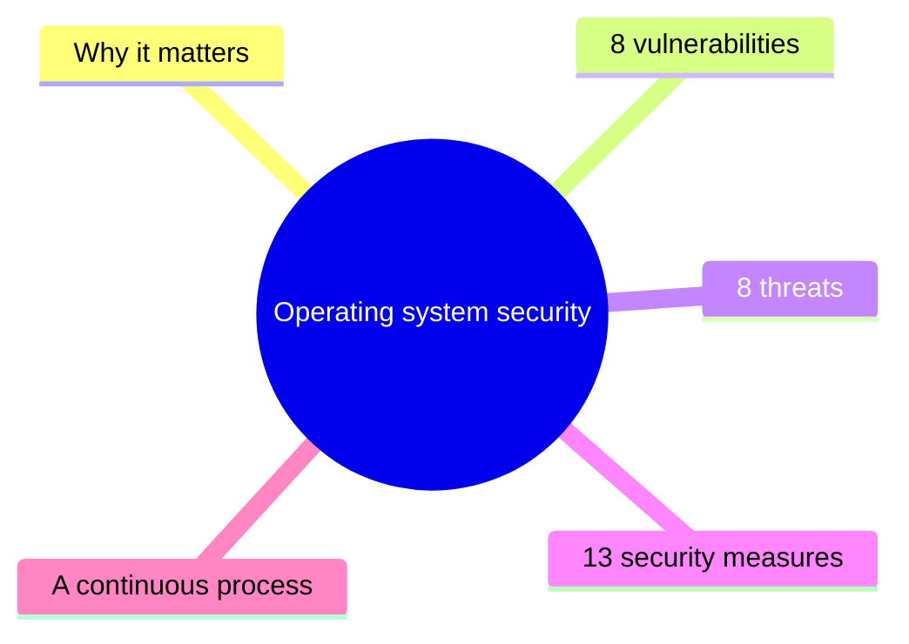

# Unit 3: Operating system security

*Courseware Chapter 3, pages 20–22.*

## At a glance

Chapter 3 is short, but it is almost entirely lists, which makes it easy to examine. It answers four questions:

- **Why does the operating system need protecting?** It is the **backbone** of the device; if it falls, everything above it falls too.
- **What weaknesses do attackers look for?** The eight common **vulnerabilities** (unpatched software, misconfigured settings, default passwords, buffer overflows, …).
- **What dangers exploit those weaknesses?** The eight common **threats** (malware, phishing, DoS, MitM, insiders, zero-days, rootkits, brute force).
- **What can we do about it?** The thirteen **security measures**, each with two points, from regular patching to physical security, applied as a **continuous process**.

The whole chapter follows one chain, which is worth keeping in your head: a **vulnerability** (weakness) is exploited by a **threat** (danger), and a **security measure** closes the weakness or blocks the threat.

## What you should be able to do

*The courseware lists no learning outcomes; these are written for this site.*

- Explain why operating system security is critical, naming the three consequences of a compromise.
- Define OS vulnerabilities and threats, and distinguish between them.
- List and explain the eight common OS vulnerabilities and the eight common OS threats.
- List the thirteen security measures and state both points of each.
- Match a given vulnerability or threat to the measure(s) that mitigate it, and justify the choice.
- Relate the OS measures to the design principles and essential security practices of [Unit 1](unit-1-security-concepts.md).
- Explain why OS security is "a continuous process".

## Why operating system security matters

§3.1 · p.20

The chapter opens by saying what an operating system is and why its security matters more than most.

> **3.1 Operating System Security:** Operating systems (OS) are the backbone of any computing device, managing hardware and software resources. Ensuring their security is critical because any compromise can lead to unauthorized access, data breaches, or system failures. This module covers vulnerabilities, threats, and security measures to protect operating systems.

{ .diagram }

Why the OS is the "backbone" (drawn for this site). The three consequences on the right are the courseware's; the layer examples are ours.

!!! note "In plain terms"
    The operating system (Windows, Linux, Android, macOS…) sits **between the hardware and everything else**. Every application asks the OS for memory, files, network access and processor time, and the OS decides who gets what. So:

    - If an attacker controls the OS, they control **every application and every file** on the device. Encrypting one database or hardening one web app is useless if the OS beneath it is compromised.
    - The courseware names **three consequences** of a compromise: **unauthorized access**, **data breaches**, and **system failures**. Read against the CIA triad: unauthorized access and data breaches hit **confidentiality** (and often integrity); system failures hit **availability**.
    - The chapter covers **three things**: vulnerabilities, threats, and security measures. That is also the order of this page.

!!! example "Example"
    A bank branch's teller PCs all run the same Windows build. One unpatched flaw in that OS lets ransomware spread from PC to PC: every teller application stops at once (system failure), and the attackers copy customer files before encrypting them (data breach). No amount of security in the teller application itself would have helped.

!!! tip "Exam angle"
    "Why is operating system security critical?" is a natural 3–4 mark opener: give the **backbone** idea (manages hardware and software resources) and the **three consequences** (unauthorized access, data breaches, system failures). Link it to the CIA triad from [Unit 1](unit-1-security-concepts.md#what-computer-security-means-the-cia-triad) for a stronger answer.

!!! warning "Courseware note"
    The chapter calls itself "this module", a leftover from whichever source it was adapted from. It means "this chapter".

**Check your understanding**

According to the courseware, which of these is NOT one of the consequences that an operating system compromise can lead to?

<ul class="quiz-options">
  <li>Unauthorized access</li>
  <li>Data breaches</li>
  <li>System failures</li>
  <li data-correct>Increased hardware costs</li>
</ul>

The courseware names exactly three consequences: **unauthorized access, data breaches, or system failures**. Hardware costs may rise after an incident, but the courseware does not list them (§3.1, p.20).

Why does the courseware call the operating system the "backbone" of a computing device?

<ul class="quiz-options">
  <li>Because it is the first program installed by the manufacturer</li>
  <li data-correct>Because it manages the device's hardware and software resources</li>
  <li>Because it contains the device's antivirus software</li>
  <li>Because it connects the device to the Internet</li>
</ul>

The OS is the backbone because it is "managing hardware and software resources": everything else runs on top of it. Antivirus and networking are things the OS supports, not the reason it is the backbone (§3.1, p.20).

## Vulnerabilities of operating systems

§3.2, §3.2.1 · p.20

Section 3.2 ("Vulnerabilities and Threats to Operating Systems") has two halves. The first is the weaknesses.

> **Vulnerabilities:** Vulnerabilities are weaknesses in the operating system that attackers can exploit. Common vulnerabilities include:
>
> 1. **Unpatched Software:** Failure to apply security patches exposes systems to known exploits.
> 2. **Misconfigured Settings:** Incorrectly configured permissions, services, or user accounts can create security gaps.
> 3. **Default Passwords:** Using default or weak passwords makes systems easy targets.
> 4. **Buffer Overflows:** A programming flaw where excess data overwrites adjacent memory, allowing malicious code execution.
> 5. **Privilege Escalation:** Flaws that allow users to gain higher access levels than intended.
> 6. **Open Network Ports:** Unnecessary open ports can be exploited for unauthorized access.
> 7. **Insecure APIs:** Application Programming Interfaces (APIs) with poor security can be exploited.
> 8. **Malware Injection:** Vulnerabilities that allow malware to be installed or executed.

| # | Vulnerability | The weakness in one line *(site summary)* | Example on an OS *(site example)* |
|---|---|---|---|
| 1 | **Unpatched Software** | A fix exists but has not been applied, so a **known** exploit still works | A school's lab PCs still run a Windows build missing two years of updates |
| 2 | **Misconfigured Settings** | Wrong **permissions, services or user accounts** (three things) | The payroll folder is set to "Everyone: Full control" |
| 3 | **Default Passwords** | **Default or weak** passwords are easy to guess | A new server's admin account is left as `admin` / `admin` |
| 4 | **Buffer Overflows** | Excess data **overwrites adjacent memory** → malicious code runs | A long, crafted file name crashes a service and runs the attacker's code |
| 5 | **Privilege Escalation** | A flaw lets a user gain **higher access than intended** | A student account exploits a bug to become administrator |
| 6 | **Open Network Ports** | **Unnecessary** open ports are doors into the system | A remote-desktop port left open to the whole Internet |
| 7 | **Insecure APIs** | Programming interfaces with **poor security** | An OS service API that accepts requests without checking who sent them |
| 8 | **Malware Injection** | Weaknesses that let malware be **installed or executed** | A USB drive's file runs automatically when plugged in |

!!! note "In plain terms: the trickier items"
    - **Unpatched software** is about **known** exploits: the vendor has already published the fix. The weakness is the failure to apply it. (Contrast the zero-day threat below, where no fix exists yet.)
    - **Misconfigured settings** covers **three** things: permissions, services, and user accounts. The software may be perfect; it is set up wrongly.
    - **Default passwords**: the courseware's wording is "default **or weak**", so a weak password chosen by the user counts too.
    - **Buffer overflow** is the only item described as a **programming flaw**: the programmer let more data into a fixed-size memory area (a *buffer*) than it can hold, and the excess overwrites the memory next to it. If that neighbouring memory controls what the program does next, the attacker can make it run their own code.
    - **Privilege escalation** is about **levels of access**: a normal user ends up with administrator (or higher) rights.
    - **API** = **Application Programming Interface**: the set of functions one program (or the OS) offers to others. A poorly secured API is a door that programs, rather than people, walk through.

{ .diagram }

How a buffer overflow works (drawn for this site; the courseware describes it in one sentence and has no figure).

Memory aid for the eight vulnerabilities, in order (the site's, not the courseware's): **"U**nder **M**y **D**esk, **B**ad **P**eople **O**pen **I**nsecure **M**achines": **U**npatched, **M**isconfigured, **D**efault passwords, **B**uffer overflows, **P**rivilege escalation, **O**pen ports, **I**nsecure APIs, **M**alware injection.

!!! example "Example"
    A Lagos fintech starts a new Linux server for its payments API. In one afternoon of carelessness it can collect four of the eight vulnerabilities: the `root` password is left as the cloud provider's default (**default passwords**), the database port is open to the Internet (**open network ports**), the log folder is world-writable (**misconfigured settings**), and the monthly security updates are switched off "to avoid downtime" (**unpatched software**).

!!! tip "Exam angle"
    Expect "List and explain **eight** common vulnerabilities of operating systems" (8 marks: name + courseware explanation for each). Learn the numbers in brackets: **misconfigured settings = permissions, services, user accounts**; **buffer overflow = excess data overwrites adjacent memory, allowing malicious code execution**. In a scenario, name the vulnerability *and* quote the fact that shows it.

!!! warning "Courseware note"
    Two items in the list are not weaknesses in the usual sense. **Privilege escalation** is normally described as an *attack* or the attacker's *goal*; the weakness is the flaw that makes it possible (which is how the courseware words it: "Flaws that allow…"). **Malware injection** is defined circularly ("Vulnerabilities that allow malware to be installed or executed"), and "malware" reappears as the first *threat*. Learn both as listed; in an answer, make clear that the vulnerability is the **flaw** that permits the escalation or the installation.

!!! info "Beyond the notes"
    Privilege escalation is often split into **vertical** escalation (a normal user gains administrator rights) and **horizontal** escalation (one user gains access to another user's account at the same level). Buffer overflows are among the oldest OS flaws; modern operating systems add defences such as non-executable memory and address-space randomisation, but these reduce rather than remove the risk, so patching is still needed.

**Check your understanding**

A Windows server's "Finance" share gives every domain user full control, although only the accounts unit should be able to open it. Which vulnerability is this?

<ul class="quiz-options">
  <li>Privilege escalation</li>
  <li data-correct>Misconfigured settings</li>
  <li>Insecure APIs</li>
  <li>Unpatched software</li>
</ul>

Misconfigured settings are "incorrectly configured **permissions**, services, or user accounts". Nobody exploited a flaw to *gain* higher access (privilege escalation); the permissions were simply set wrongly (§3.2.1, p.20).

Which vulnerability does the courseware describe as "a programming flaw where excess data overwrites adjacent memory"?

<ul class="quiz-options">
  <li>Malware injection</li>
  <li>Insecure APIs</li>
  <li data-correct>Buffer overflows</li>
  <li>Privilege escalation</li>
</ul>

That is the courseware's definition of a buffer overflow, which ends "…allowing malicious code execution". Malware injection is tempting because code gets run, but the courseware defines it as vulnerabilities that allow malware to be installed or executed, without mentioning memory (§3.2.1, p.20).

A security patch for a widely known flaw was released six months ago, but a hospital never installed it. Attackers use a published exploit for that flaw. The hospital's weakness is best described as:

<ul class="quiz-options">
  <li>A zero-day exploit</li>
  <li data-correct>Unpatched software</li>
  <li>An open network port</li>
  <li>A default password</li>
</ul>

Unpatched software: "failure to apply security patches exposes systems to **known** exploits". A zero-day is the tempting answer, but a zero-day targets a flaw that is unknown or has no fix yet; here the fix had existed for six months (§3.2.1, §3.2.2).

## Threats to operating systems

§3.2.2 · pp.20–21

The second half of §3.2 lists the dangers that make use of those weaknesses.

> **Threats:** Threats are potential dangers that exploit vulnerabilities. Common threats to operating systems include:
>
> 1. **Malware:** Viruses, worms, trojans, ransomware, and spyware that compromise system integrity.
> 2. **Phishing Attacks:** Social engineering attacks that trick users into revealing sensitive information.
> 3. **Denial of Service (DoS):** Overwhelming the system to make it unavailable to legitimate users.
> 4. **Man-in-the-Middle (MitM):** Intercepting and altering communication between the OS and other systems.
> 5. **Insider Threats:** Malicious or negligent actions by employees or authorized users.
> 6. **Zero-Day Exploits:** Attacks that target unknown or unpatched vulnerabilities.
> 7. **Rootkits:** Malicious software that grants attackers administrative control while hiding their presence.
> 8. **Brute Force Attacks:** Repeated attempts to guess passwords or encryption keys.

| # | Threat | Key words to quote | Main CIA objective hit *(site analysis)* | Example *(site example)* |
|---|---|---|---|---|
| 1 | **Malware** | viruses, worms, trojans, ransomware, spyware (**five** kinds); compromise system integrity | Integrity (spyware also confidentiality; ransomware also availability) | Ransomware encrypts a ministry's file server |
| 2 | **Phishing Attacks** | social engineering; **trick users** into revealing sensitive information | Confidentiality | A fake "bank verification" e-mail asks for a staff member's login |
| 3 | **Denial of Service (DoS)** | **overwhelming** the system; unavailable to **legitimate users** | Availability | The registration portal is flooded in registration week |
| 4 | **Man-in-the-Middle (MitM)** | **intercepting and altering** communication between the OS and other systems | Confidentiality and integrity | A rogue café Wi-Fi hotspot reads and changes a laptop's traffic |
| 5 | **Insider Threats** | **malicious or negligent** actions by **employees or authorized users** | Any | A clerk copies customer records to sell them (malicious) or leaves a PC unlocked (negligent) |
| 6 | **Zero-Day Exploits** | target **unknown or unpatched** vulnerabilities | Any | An attack using a flaw the vendor has not yet discovered |
| 7 | **Rootkits** | **administrative control** while **hiding their presence** | Integrity (then all three) | Hidden software gives an attacker admin rights on a server for months |
| 8 | **Brute Force Attacks** | **repeated attempts** to guess **passwords or encryption keys** | Confidentiality | A script tries thousands of passwords on a remote-login service |

!!! note "In plain terms"
    - **A threat is the danger, a vulnerability is the weakness.** The courseware's link: threats are dangers "that **exploit** vulnerabilities". A threat with no vulnerability to exploit can do little; a vulnerability with no threat is a latent problem.
    - **Two threats are about people, not code.** **Phishing** tricks a user from outside; an **insider threat** comes from someone already authorised. Note the insider can be **negligent** (careless), not only malicious.
    - **Two threats are about passwords.** **Phishing** *tricks* the user into handing the password over; **brute force** *guesses* it by repeated attempts (and brute force also targets **encryption keys**).
    - **Rootkits are the stealthy threat**: they give **administrative control** *and* **hide** the attacker's presence. That is what separates them from other malware.
    - **Zero-day** = the defenders have had "zero days" to prepare: the flaw is unknown, so there may be no patch yet.

Memory aid for the eight threats, in order (the site's): **"M**any **P**eople **D**on't **M**ind **I**nsiders **Z**ipping **R**ound **B**ranches": **M**alware, **P**hishing, **D**oS, **M**itM, **I**nsider, **Z**ero-day, **R**ootkits, **B**rute force.

Several of these threats are covered in more depth later: DoS and MitM as active attacks in [Unit 2](unit-2-attacks.md#active-attacks), and viruses, worms, trojans, ransomware, spyware and rootkits in [Unit 9](unit-9-malware.md#malware-types-that-threaten-pc-and-enterprise-systems). The **insider threat** matches Unit 1's "inside attack" (an authorised insider using access in an unapproved way): see [Security concepts and relationships](unit-1-security-concepts.md#security-concepts-and-relationships).

!!! example "Example"
    In a Nigerian university, a lecturer clicks a link in an e-mail claiming to be from the bursary (**phishing**) and types his password into a fake page. The attacker logs in, uses an unpatched flaw to become administrator (exploiting **privilege escalation**), and installs a **rootkit** so that the results server can be altered for months without anyone noticing.

!!! tip "Exam angle"
    "List and explain eight threats to operating systems" mirrors the vulnerabilities question. Two pairs are easy (b)-parts: **vulnerability vs threat** (weakness vs danger that exploits it) and **unpatched software vs zero-day exploit** (known flaw with a fix not applied vs unknown or unpatched flaw). Learn the five kinds of malware by name.

!!! warning "Courseware note"
    Three definitions are narrower or looser than usual:

    - **Malware** is said to "compromise system integrity". It does, but spyware mainly breaches **confidentiality** and ransomware **availability** too.
    - **MitM** is "intercepting **and** altering". An attacker in the middle may also only intercept (a passive attack, see [Unit 2](unit-2-attacks.md#passive-attacks)).
    - **Zero-day exploits** "target unknown **or unpatched** vulnerabilities". Strictly, a zero-day targets a flaw that is **unknown** to the vendor or has **no patch yet**. A known flaw whose patch was simply never installed is the **unpatched software** vulnerability, not a zero-day.

    Quote the courseware definitions in a recall answer; use the distinctions when a scenario needs them.

!!! info "Beyond the notes"
    The chapter's definition of a threat ("potential dangers that exploit vulnerabilities") is a short working definition. [Unit 1](unit-1-security-concepts.md#computer-security-terminology) gives the formal one: "any circumstance or event with the potential to adversely impact organizational operations…, organizational assets, individuals, other organizations, or the Nation through an information system…". If an exam asks you to define a threat in general, use Unit 1's; for an OS question, either is acceptable, and quoting both is strongest.

**Check your understanding**

Which threat does the courseware define as malicious software that grants attackers administrative control while hiding their presence?

<ul class="quiz-options">
  <li>Trojan</li>
  <li data-correct>Rootkit</li>
  <li>Privilege escalation</li>
  <li>Spyware</li>
</ul>

That is the courseware's definition of a **rootkit** (threat 7). Privilege escalation also ends in higher access, but it is listed as a *vulnerability* ("flaws that allow users to gain higher access levels"), and it says nothing about hiding (§3.2.2, p.21).

A records officer at a state hospital forgets to log out of a PC in a public corridor, and a visitor views patient files. Under the courseware's list, this is best classed as:

<ul class="quiz-options">
  <li>A phishing attack</li>
  <li>A man-in-the-middle attack</li>
  <li data-correct>An insider threat</li>
  <li>A brute force attack</li>
</ul>

Insider threats are "malicious **or negligent** actions by employees or authorized users". The officer did not intend harm, but negligence is enough. No one was tricked (phishing), no communication was intercepted (MitM), and no password was guessed (brute force) (§3.2.2, p.21).

Which of these does the courseware list as one of the five kinds of malware?

<ul class="quiz-options">
  <li>Rootkits</li>
  <li>Phishing</li>
  <li data-correct>Worms</li>
  <li>Brute force</li>
</ul>

The five listed under Malware are **viruses, worms, trojans, ransomware, and spyware**. Rootkits *are* malicious software, but the courseware lists them as a separate threat (7), which is a common trap (§3.2.2).

## Vulnerability, threat, measure: how the lists connect

§3.2–§3.3 · pp.20–22

The courseware gives three separate lists, but they are meant to be read together: §3.3 opens with "To mitigate vulnerabilities and threats…". This diagram pairs some of them.

{ .diagram }

Vulnerability → threat → measure chains. Drawn for this site: the items are the courseware's, the pairings are ours.

This is the reasoning you need for every scenario question: **name the weakness, name the danger that exploits it, then name the measure that closes the weakness or blocks the danger.** The full matching table is at the end of the next section.

## Security measures to protect operating systems

§3.3 · pp.21–22

> **3.3 Security Measures to Protect Operating Systems:** To mitigate vulnerabilities and threats, the following security measures can be implemented:

The courseware numbers **13** measures, and each has **two** bullet points (26 points in all). Learn the names first, then the two points of each.

| # | Measure | Point 1 | Point 2 |
|---|---|---|---|
| 1 | Regular Updates and Patching | Keep OS and all software up to date with latest patches | Enable automatic updates |
| 2 | Strong Authentication | Multi-factor authentication (MFA) | Strong password policies (complexity, regular changes) |
| 3 | Access Control | Principle of least privilege (PoLP) | Role-based access control (RBAC) |
| 4 | Firewalls and Network Security | Firewalls block unauthorized access, monitor traffic | Disable unnecessary network services, close unused ports |
| 5 | Encryption | Encrypt sensitive data at rest and in transit | Secure protocols like TLS/SSL |
| 6 | Antivirus and Anti-Malware | Install and regularly update antivirus | Regular system scans |
| 7 | Intrusion Detection and Prevention Systems (IDPS) | Monitor and respond in real-time | Anomaly detection |
| 8 | Secure Configuration | Harden the OS (disable unnecessary features and services) | Follow benchmarks (CIS, ISO 27001 etc.) |
| 9 | Backup and Recovery | Regularly back up data and configurations | Test recovery procedures |
| 10 | User Training and Awareness | Educate users (phishing, suspicious downloads) | Regular security awareness programs |
| 11 | Logging and Monitoring | Enable logging | SIEM tools for centralized monitoring |
| 12 | Virtualization and Sandboxing | Virtualization isolates critical applications | Sandboxing tests and runs untrusted applications |
| 13 | Physical Security | Protect physical access (tampering, theft) | Biometric locks, security cameras in data centers |

Memory aid for the thirteen, in order (the site's): **"P**lease **A**lways **A**dd **F**irewalls; **E**ncrypt **A**nd **I**nspect; **S**ecure **B**ackups **U**nder **L**ogged **V**irtual **P**remises": **P**atching, **A**uthentication, **A**ccess control, **F**irewalls, **E**ncryption, **A**ntivirus, **I**DPS, **S**ecure configuration, **B**ackup, **U**ser training, **L**ogging, **V**irtualization, **P**hysical security.

### Regular updates and patching

§3.3 · p.21

> **1. Regular Updates and Patching**
>
> • Keep the operating system and all software up to date with the latest security patches.
>
> • Enable automatic updates to ensure timely protection against known vulnerabilities.

**Close the known holes, quickly.** This is the direct cure for the **unpatched software** vulnerability. Note "the operating system **and all software**": an up-to-date OS running an outdated browser or PDF reader is still exposed. Automatic updates remove the human delay. It helps less against a true **zero-day**, where no patch exists yet; that is where detection measures (6, 7, 11) matter. In Unit 1's terms it is the first point of the [essential security practice](unit-1-security-concepts.md#essential-security-practices) System and Information Integrity: "identify, report, and correct information and information system flaws in a timely manner".

### Strong authentication

§3.3 · p.21

> **2. Strong Authentication**
>
> • Use multi-factor authentication (MFA) to add an extra layer of security.
>
> • Enforce strong password policies, including complexity requirements and regular password changes.

**Make it hard to log in as someone else.** MFA means proving identity with more than one kind of factor, e.g. a password *and* a one-time code on a phone, so a stolen or guessed password alone is not enough. It counters **default passwords**, **brute force attacks** and much **phishing**. MFA applies Unit 1's [separation of privilege](unit-1-security-concepts.md#separation-of-privilege) ("more than one key to open the door").

!!! info "Beyond the notes"
    Current guidance (e.g. NIST SP 800-63B) no longer recommends forcing **regular password changes** without reason, because users respond with predictable variations ("Password1", "Password2"). It recommends long passwords, checks against lists of breached passwords, and changes only when compromise is suspected. In the exam, give the courseware's two points; mention this only as an evaluation if asked to discuss.

### Access control

§3.3 · p.21

> **3. Access Control**
>
> • Implement the principle of least privilege (PoLP), granting users only the access they need.
>
> • Use role-based access control (RBAC) to manage permissions effectively.

**Give each user only what they need.** PoLP limits the damage of a compromised or careless account and makes **privilege escalation** less rewarding; RBAC makes PoLP manageable by giving permissions to roles (bursar, lecturer, student) rather than person by person. Both come straight from Unit 1's [least privilege](unit-1-security-concepts.md#least-privilege) principle, whose own example is RBAC. Access control is the subject of [Unit 8](unit-8-access-control.md).

### Firewalls and network security

§3.3 · p.21

> **4. Firewalls and Network Security**
>
> • Configure firewalls to block unauthorized access and monitor incoming/outgoing traffic.
>
> • Disable unnecessary network services and close unused ports.

**Guard the network doors, and shut the ones you don't use.** This is the cure for **open network ports**, and it reduces exposure to **DoS** and remote exploits. "Block by default, allow what is needed" is Unit 1's [fail-safe defaults](unit-1-security-concepts.md#fail-safe-defaults). Firewalls are covered fully in [Unit 5](unit-5-firewalls.md).

### Encryption

§3.3 · p.21

> **5. Encryption**
>
> • Encrypt sensitive data at rest and in transit to protect it from unauthorized access.
>
> • Use secure protocols like TLS/SSL for communication.

**Make stolen data useless.** *At rest* = stored (on disk, on a backup tape, on a stolen laptop); *in transit* = moving over a network. Encryption in transit with TLS defeats most **MitM** interception; encryption at rest protects against **data breaches** after theft or physical access. Cryptography is [Unit 4](unit-4-cryptography.md).

!!! info "Beyond the notes"
    **TLS** (Transport Layer Security) replaced **SSL** (Secure Sockets Layer); every SSL version is now considered insecure and disabled in modern systems. "TLS/SSL" is a common way of naming the family, but in practice only TLS (1.2 or 1.3) should be used.

### Antivirus and anti-malware

§3.3 · p.21

> **6. Antivirus and Anti-Malware**
>
> • Install and regularly update antivirus software to detect and remove malicious programs.
>
> • Perform regular system scans to identify potential threats.

**Find and remove malicious programs.** Two key words: **regularly update** (an antivirus with old signatures misses new malware) and **regular scans** (malware already on the system must be found). It is the main measure against the **malware** threat and **malware injection**. Unit 1's System and Information Integrity practice (ii): "provide protection from malicious code". Malware protection is [Unit 9](unit-9-malware.md).

### Intrusion detection and prevention systems

§3.3 · p.21

> **7. Intrusion Detection and Prevention Systems (IDPS)**
>
> • Deploy IDPS to monitor and respond to suspicious activities in real-time.
>
> • Use anomaly detection to identify unusual behavior.

**Watch for attacks as they happen, and react.** An IDPS **monitors and responds** in **real-time**. **Anomaly detection** compares behaviour with what is normal, so it can flag attacks that no signature describes, which makes it useful against **zero-day exploits** and **insider threats**. IDPS is [Unit 12](unit-12-idps.md#anomaly-based-detection).

### Secure configuration

§3.3 · p.22

> **8. Secure Configuration**
>
> • Harden the operating system by disabling unnecessary features and services.
>
> • Follow security benchmarks like those provided by the Center for Internet Security (CIS), ISO 27001 etc.

**Set the system up safely from the start.** *Hardening* = reducing what can be attacked: every feature or service that is switched off is one fewer thing to exploit. Benchmarks give a tested checklist instead of guesswork. This is the cure for **misconfigured settings** and, with a password change at installation, **default passwords**. Unit 1 links: the Configuration Management practice ("establish and enforce security configuration settings") and [economy of mechanism](unit-1-security-concepts.md#economy-of-mechanism) (less to go wrong).

!!! tip "Exam angle"
    **Two** measures mention disabling unnecessary services: measure 4 disables unnecessary **network** services and closes unused **ports**; measure 8 disables unnecessary **features and services** of the OS as a whole (hardening). A favourite trap is to ask which measure "hardens" the OS: it is **Secure Configuration**.

!!! warning "Courseware note"
    The courseware names **ISO 27001** as a "security benchmark" alongside CIS. The CIS Benchmarks are detailed hardening checklists for specific operating systems; ISO/IEC 27001 is an international standard for an organisation's **information security management system**, not an OS configuration checklist. Quote it as given; if you need to explain, say CIS gives the OS settings while ISO 27001 sets the management framework they fit into.

### Backup and recovery

§3.3 · p.22

> **9. Backup and Recovery**
>
> • Regularly back up critical data and system configurations.
>
> • Test recovery procedures to ensure quick restoration in case of an attack or failure.

**Be able to get back up.** Back up both **data** and **system configurations** (so a rebuilt server can be set up again quickly), and **test** recovery: an untested backup may fail on the day it is needed. This is the main answer to **ransomware** and to **system failures**. Unit 1's Contingency Planning practice ("backup operations, and post disaster recovery").

!!! example "Example"
    A microfinance bank in Ibadan backs up its loan database every night to an offline drive and rehearses a restore every quarter. When ransomware encrypts its main server, it rebuilds the server from saved configurations and restores the previous night's data in six hours, without paying the ransom.

### User training and awareness

§3.3 · p.22

> **10. User Training and Awareness**
>
> • Educate users about security best practices, such as recognizing phishing attempts and avoiding suspicious downloads.
>
> • Conduct regular security awareness programs.

**Fix the human layer.** No technical measure stops a user who types their password into a fake page. The courseware's two examples, **phishing** and **suspicious downloads**, map to the phishing threat and the malware injection vulnerability; training also reduces **negligent insider** actions. Unit 1's Awareness and Training practice.

### Logging and monitoring

§3.3 · p.22

> **11. Logging and Monitoring**
>
> • Enable logging to track system activities and detect potential security incidents.
>
> • Use Security Information and Event Management (SIEM) tools for centralized monitoring and analysis.

**Keep a record, and have someone read it.** Logs track activities and help detect incidents; a **SIEM** collects logs from many systems in one place (**centralized**) and analyses them together, so a pattern spread across many machines becomes visible. This is how **accountability** is delivered in practice (Unit 1's Audit and Accountability practice), and it helps detect **rootkits** and **insider** misuse after the fact.

### Virtualization and sandboxing

§3.3 · p.22

> **12. Virtualization and Sandboxing**
>
> • Use virtualization to isolate critical applications and reduce the risk of compromise.
>
> • Employ sandboxing to test and run untrusted applications in a secure environment.

**Keep dangerous things in a box.** Both isolate, but for different things: **virtualization** isolates **critical** applications (each in its own virtual machine, so a compromise of one does not reach the others); **sandboxing** isolates **untrusted** applications (run or test them where they can do no harm). This is Unit 1's [isolation](unit-1-security-concepts.md#isolation) principle.

| | Virtualization | Sandboxing |
|---|---|---|
| **What it protects** *(courseware)* | Isolates **critical** applications | Tests and runs **untrusted** applications |
| **Purpose** *(courseware)* | Reduce the risk of compromise | A secure environment |
| **Typical use** *(site example)* | The payroll database runs in its own virtual machine, apart from the web server | A suspicious e-mail attachment is opened in a sandbox first |

### Physical security

§3.3 · p.22

> **13. Physical Security**
>
> • Protect physical access to systems to prevent tampering or theft.
>
> • Use biometric locks or security cameras in data centers.

**Software security is useless if someone can walk off with the server.** Physical access allows **tampering** (booting from a USB stick, resetting passwords) and **theft** (taking the disk and reading it elsewhere, unless it is encrypted at rest). Unit 1's Physical and Environmental Protection practice.

### Grouping the thirteen measures

§3.3 · pp.21–22

The courseware lists the measures in no particular order. Grouping them by *when* they act makes them easier to recall and to recommend.

![Six groups. Prevent, fix and harden the system: 1 Regular updates and patching, 8 Secure configuration. Prevent, control who and what gets in: 2 Strong authentication, 3 Access control, 4 Firewalls and network security, 5 Encryption, 13 Physical security. Prevent, the human layer: 10 User training and awareness. Detect, spot attacks and malicious code: 6 Antivirus and anti-malware, 7 IDPS, 11 Logging and monitoring. Contain, limit the damage: 12 Virtualization and sandboxing. Recover, restore after an attack or failure: 9 Backup and recovery](assets/diagrams/u3-measures-groups.svg){ .diagram }

The thirteen measures grouped by role (drawn for this site; the grouping is ours, the numbers are the courseware's).

Using several groups at once is Unit 1's [layering](unit-1-security-concepts.md#layering) (defense in depth): if prevention fails, detection catches the attack; if detection fails, isolation limits it; if everything fails, backups restore the system.

Which measures answer which vulnerabilities and threats *(site analysis: the courseware gives no mapping)*:

| Vulnerability or threat | Main measure(s) |
|---|---|
| Unpatched software | 1 Regular updates and patching |
| Misconfigured settings | 8 Secure configuration; 3 Access control |
| Default passwords | 2 Strong authentication; 8 Secure configuration |
| Buffer overflows | 1 Patching (fixes the flaw); 12 Sandboxing (limits the damage) |
| Privilege escalation | 3 Access control (PoLP); 1 Patching; 11 Logging |
| Open network ports | 4 Firewalls and network security; 8 Secure configuration |
| Insecure APIs | 1 Patching; 3 Access control; 5 Encryption |
| Malware injection, Malware | 6 Antivirus and anti-malware; 10 User training; 12 Sandboxing; 9 Backup (ransomware) |
| Phishing attacks | 10 User training and awareness; 2 MFA |
| Denial of Service | 4 Firewalls; 7 IDPS; 9 Backup and recovery |
| Man-in-the-Middle | 5 Encryption (TLS) |
| Insider threats | 3 Access control; 11 Logging and monitoring; 7 IDPS (anomaly detection); 10 Training (negligence) |
| Zero-day exploits | 7 IDPS (anomaly detection); 12 Virtualization and sandboxing; 9 Backup; 1 Patching as soon as a fix appears |
| Rootkits | 6 Antivirus; 11 Logging; 3 Access control (fewer admin accounts); 9 Backup (rebuild) |
| Brute force attacks | 2 Strong authentication; 7 IDPS; 5 Encryption (strong keys) |
| Theft or tampering | 13 Physical security; 5 Encryption at rest |

!!! tip "Exam angle"
    The predictable recall question is "**State** (or list and explain) **ten** security measures for protecting operating systems" (the courseware has 13, so any ten earn the marks if each is explained with one of its two points). The predictable applied question gives a scenario and asks you to **recommend measures and justify them**: name the vulnerability or threat in the case, give the measure from the table above, quote its point, and say why a different measure would not be enough (e.g. "antivirus alone would not stop the brute force attack, because no malicious program is involved").

**Check your understanding**

Which measure does the courseware describe as including "Use anomaly detection to identify unusual behavior"?

<ul class="quiz-options">
  <li>Antivirus and Anti-Malware</li>
  <li>Logging and Monitoring</li>
  <li data-correct>Intrusion Detection and Prevention Systems (IDPS)</li>
  <li>Firewalls and Network Security</li>
</ul>

Measure 7, IDPS: "Deploy IDPS to monitor and respond to suspicious activities in real-time" and "Use anomaly detection to identify unusual behavior". Logging and Monitoring is tempting because it also detects incidents, but its two points are enabling logging and SIEM tools (§3.3, p.21).

A university wants to open e-mail attachments from unknown senders in an environment where, if they are malicious, they can do no harm to the main system. Which measure fits best?

<ul class="quiz-options">
  <li>Virtualization, to isolate critical applications</li>
  <li data-correct>Sandboxing, to test and run untrusted applications in a secure environment</li>
  <li>Secure configuration, to harden the operating system</li>
  <li>Backup and recovery</li>
</ul>

Sandboxing is for **untrusted** applications; virtualization (the other half of measure 12) isolates **critical** ones. Hardening reduces what can be attacked but does not contain a malicious file once opened; backup only helps afterwards (§3.3, p.22).

Which of these is listed under the courseware's Secure Configuration measure?

<ul class="quiz-options">
  <li>Close unused ports</li>
  <li>Enable automatic updates</li>
  <li data-correct>Follow security benchmarks such as those of the Center for Internet Security (CIS)</li>
  <li>Use role-based access control</li>
</ul>

Secure Configuration (measure 8) = harden the OS by disabling unnecessary features and services, and follow benchmarks like CIS and ISO 27001. "Close unused ports" is the trap: it belongs to Firewalls and Network Security (measure 4). Automatic updates belong to measure 1, RBAC to measure 3 (§3.3).

## Operating system security as a continuous process

§3.3 (conclusion) · p.22

> In conclusion, Operating system security is a continuous process that requires proactive measures to address vulnerabilities and mitigate threats. By implementing robust security practices, organizations can protect their systems from attacks and ensure the confidentiality, integrity, and availability of their data and resources.

!!! note "In plain terms"
    - **Continuous:** security is never "done". New flaws are found every month, so patches, antivirus signatures, training and log reviews must be repeated. Count how many measures contain the word **regular** or **regularly**: 1 (updates), 2 (password changes), 6 (update and scans), 9 (back up), 10 (awareness programs).
    - **Proactive:** act *before* the attack (patch, harden, train), not only after it.
    - **The goal is the CIA triad:** the chapter ends where Unit 1 began, with the **confidentiality, integrity, and availability** of data and resources.

!!! tip "Exam angle"
    "Explain why operating system security is described as a continuous process" is a short (3–4 mark) question. Use the courseware sentence, then give two or three examples of measures that must be repeated (patching, antivirus updates, awareness programs, testing recovery).

**Check your understanding**

According to the courseware's conclusion, operating system security ultimately ensures which properties of an organisation's data and resources?

<ul class="quiz-options">
  <li>Authenticity and accountability</li>
  <li data-correct>Confidentiality, integrity, and availability</li>
  <li>Speed, reliability and cost</li>
  <li>Privacy and nonrepudiation</li>
</ul>

The conclusion says robust practices "ensure the confidentiality, integrity, and availability of their data and resources": the CIA triad. Authenticity and accountability are Unit 1's two extra requirements, but the conclusion does not name them (§3.3, p.22).

The courseware describes operating system security as "a continuous process that requires…" what?

<ul class="quiz-options">
  <li>Reactive measures to recover from attacks</li>
  <li data-correct>Proactive measures to address vulnerabilities and mitigate threats</li>
  <li>A single, well-designed firewall</li>
  <li>Annual security audits</li>
</ul>

"…requires **proactive** measures to address vulnerabilities and mitigate threats". Reactive recovery (backup) is one of the measures, but the conclusion stresses acting in advance (§3.3, p.22).

## Key terms

Operating system (OS)
:   The backbone of any computing device, managing hardware and software resources; a compromise can lead to unauthorized access, data breaches, or system failures.

OS vulnerabilities
:   Weaknesses in the operating system that attackers can exploit (eight common ones: unpatched software, misconfigured settings, default passwords, buffer overflows, privilege escalation, open network ports, insecure APIs, malware injection).

OS threats
:   Potential dangers that exploit vulnerabilities (eight common ones: malware, phishing, DoS, MitM, insider threats, zero-day exploits, rootkits, brute force attacks).

Unpatched software
:   Failure to apply security patches, which exposes systems to known exploits.

Misconfigured settings
:   Incorrectly configured permissions, services, or user accounts that create security gaps.

Default passwords
:   Default or weak passwords, which make systems easy targets.

Buffer overflow
:   A programming flaw where excess data overwrites adjacent memory, allowing malicious code execution.

Privilege escalation
:   Flaws that allow users to gain higher access levels than intended.

Open network ports
:   Unnecessary open ports that can be exploited for unauthorized access.

Insecure APIs
:   Application Programming Interfaces with poor security that can be exploited.

Malware injection
:   Vulnerabilities that allow malware to be installed or executed.

Malware
:   Viruses, worms, trojans, ransomware, and spyware that compromise system integrity.

Phishing attack
:   A social engineering attack that tricks users into revealing sensitive information.

Denial of Service (DoS)
:   Overwhelming a system to make it unavailable to legitimate users.

Man-in-the-Middle (MitM)
:   Intercepting and altering communication between the OS and other systems.

Insider threat
:   Malicious or negligent actions by employees or authorized users.

Zero-day exploit
:   An attack that targets unknown or unpatched vulnerabilities.

Rootkit
:   Malicious software that grants attackers administrative control while hiding their presence.

Brute force attack
:   Repeated attempts to guess passwords or encryption keys.

Multi-factor authentication (MFA)
:   Requiring more than one kind of proof of identity; in the courseware, it adds an extra layer of security as part of strong authentication.

Principle of least privilege (PoLP)
:   Granting users only the access they need.

Role-based access control (RBAC)
:   Managing permissions by assigning them to roles rather than to individual users.

Encryption at rest and in transit
:   Encrypting sensitive data while stored and while moving over a network, to protect it from unauthorized access.

TLS/SSL
:   Secure protocols for communication (Transport Layer Security / Secure Sockets Layer); SSL is obsolete and TLS is used today.

Intrusion Detection and Prevention System (IDPS)
:   A system that monitors and responds to suspicious activities in real-time, using anomaly detection to identify unusual behavior.

Anomaly detection
:   Identifying unusual behavior by comparing activity with what is normal.

Hardening
:   Securing the operating system by disabling unnecessary features and services.

Center for Internet Security (CIS)
:   A body that publishes security benchmarks (configuration checklists) followed in secure configuration.

Security Information and Event Management (SIEM)
:   Tools for centralized monitoring and analysis of logs and security events.

Virtualization
:   Running critical applications in isolated virtual environments to reduce the risk of compromise.

Sandboxing
:   Testing and running untrusted applications in a secure, isolated environment.

---

## Unit summary

- **Why (§3.1):** the OS is the **backbone** of any computing device, **managing hardware and software resources**; a compromise can lead to **unauthorized access, data breaches, or system failures**. The chapter covers vulnerabilities, threats and security measures.
- **Vulnerabilities (§3.2.1)** = weaknesses in the OS that attackers can exploit. **Eight:** unpatched software (known exploits); misconfigured settings (permissions, services, user accounts); default passwords (default or weak); buffer overflows (excess data overwrites adjacent memory → malicious code execution); privilege escalation (higher access than intended); open network ports (unnecessary ports); insecure APIs; malware injection.
- **Threats (§3.2.2)** = potential dangers that exploit vulnerabilities. **Eight:** malware (viruses, worms, trojans, ransomware, spyware; compromise system integrity); phishing (social engineering, trick users); DoS (overwhelm, unavailable to legitimate users); MitM (intercept and alter OS communication); insider threats (malicious or negligent employees/authorized users); zero-day exploits (unknown or unpatched vulnerabilities); rootkits (administrative control + hiding presence); brute force (repeated guesses of passwords or encryption keys).
- **Security measures (§3.3): thirteen, two points each:** (1) updates and patching (up to date; automatic updates); (2) strong authentication (MFA; strong password policies); (3) access control (PoLP; RBAC); (4) firewalls and network security (block and monitor; disable unnecessary services, close unused ports); (5) encryption (at rest and in transit; TLS/SSL); (6) antivirus and anti-malware (install and update; regular scans); (7) IDPS (real-time monitor and respond; anomaly detection); (8) secure configuration (harden; CIS, ISO 27001 benchmarks); (9) backup and recovery (back up data and configurations; test recovery); (10) user training and awareness (phishing, suspicious downloads; regular programs); (11) logging and monitoring (logging; SIEM); (12) virtualization and sandboxing (isolate critical apps; run untrusted apps); (13) physical security (prevent tampering or theft; biometric locks, cameras).
- **Conclusion:** OS security is a **continuous process** requiring **proactive** measures; it protects systems from attacks and ensures the **confidentiality, integrity, and availability** of data and resources.
- **Links to Unit 1:** PoLP/RBAC = least privilege; MFA = separation of privilege; firewalls = fail-safe defaults; virtualization/sandboxing = isolation; many measures together = layering (defense in depth).

## Mixed review

Which pair is correctly matched as (vulnerability, threat that exploits it)?

<ul class="quiz-options">
  <li>(Brute force attacks, Default passwords)</li>
  <li data-correct>(Default passwords, Brute force attacks)</li>
  <li>(Rootkits, Privilege escalation)</li>
  <li>(Phishing attacks, Malware injection)</li>
</ul>

Default (or weak) passwords are a **vulnerability** (§3.2.1); brute force attacks, repeated attempts to guess passwords, are a **threat** (§3.2.2) that exploits it. The other options put a threat in the vulnerability slot: rootkits and phishing are threats, privilege escalation and malware injection are vulnerabilities.

An attacker in a hotel's Wi-Fi network intercepts a manager's connection to the company server and changes the figures in a report as it is uploaded. Which threat is this, and which measure most directly counters it?

<ul class="quiz-options">
  <li>Denial of Service; firewalls and network security</li>
  <li>Phishing; user training and awareness</li>
  <li data-correct>Man-in-the-Middle; encryption with secure protocols like TLS/SSL</li>
  <li>Brute force; strong authentication</li>
</ul>

**Intercepting and altering** communication is the courseware's MitM. Encrypting data **in transit** with TLS means the attacker can neither read nor undetectably alter it. Nothing was overwhelmed (DoS), nobody was tricked (phishing), and no password was guessed (brute force) (§3.2.2, §3.3).

Which OS security measure is the clearest application of Unit 1's "isolation" design principle?

<ul class="quiz-options">
  <li>Regular updates and patching</li>
  <li data-correct>Virtualization and sandboxing</li>
  <li>User training and awareness</li>
  <li>Logging and monitoring</li>
</ul>

Virtualization isolates critical applications and sandboxing isolates untrusted ones: exactly the isolation principle (processes kept apart so one cannot harm another). Logging supports accountability, training addresses people, patching fixes flaws.

A company's antivirus finds nothing, yet an administrator account is being used at 3 a.m. by someone who hides their files from normal directory listings. Which threat is most likely, and which measure is most likely to expose it?

<ul class="quiz-options">
  <li>Phishing; user training and awareness</li>
  <li>Denial of Service; backup and recovery</li>
  <li data-correct>Rootkit; logging and monitoring with SIEM (and IDPS anomaly detection)</li>
  <li>Brute force; strong password policies</li>
</ul>

Administrative control **plus hiding presence** is a rootkit. Because it hides from the antivirus, the unusual pattern (admin logins at 3 a.m.) is best caught by **logs analysed centrally (SIEM)** or **anomaly detection**. The other pairs do not fit the facts (§3.2.2, §3.3).

## Recall drill

Every definition, list, comparison and item in Chapter 3, as a short question. Answer aloud or on paper, then open the answer.

### Why operating system security matters

**R1.** What does the courseware say an operating system is, and why is its security critical?

??? success "Answer"
    Operating systems are the **backbone of any computing device**, **managing hardware and software resources**. Ensuring their security is critical because **any compromise can lead to unauthorized access, data breaches, or system failures**.

**R2.** State the three consequences that an operating system compromise can lead to. (There are 3.)

??? success "Answer"
    **Unauthorized access**, **data breaches**, and **system failures**.

**R3.** What three things does the chapter (the "module") cover?

??? success "Answer"
    **Vulnerabilities**, **threats**, and **security measures** to protect operating systems.

### Vulnerabilities

**R4.** Define *vulnerabilities* (as used in operating system security).

??? success "Answer"
    Vulnerabilities are **weaknesses in the operating system that attackers can exploit**.

**R5.** List the common vulnerabilities of operating systems. (There are 8.)

??? success "Answer"
    (1) Unpatched software; (2) misconfigured settings; (3) default passwords; (4) buffer overflows; (5) privilege escalation; (6) open network ports; (7) insecure APIs; (8) malware injection.

**R6.** Explain *unpatched software* as a vulnerability.

??? success "Answer"
    **Failure to apply security patches** exposes systems to **known exploits**.

**R7.** Explain *misconfigured settings*. Name the three things that can be incorrectly configured.

??? success "Answer"
    **Incorrectly configured permissions, services, or user accounts** can create **security gaps**. The three: **permissions**, **services**, **user accounts**.

**R8.** Explain *default passwords* as a vulnerability.

??? success "Answer"
    Using **default or weak passwords** makes systems **easy targets**.

**R9.** Define a *buffer overflow*.

??? success "Answer"
    A **programming flaw** where **excess data overwrites adjacent memory**, allowing **malicious code execution**.

**R10.** Define *privilege escalation*.

??? success "Answer"
    **Flaws** that allow users to **gain higher access levels than intended**.

**R11.** Explain *open network ports* as a vulnerability.

??? success "Answer"
    **Unnecessary open ports** can be exploited for **unauthorized access**.

**R12.** What does API stand for, and why are insecure APIs a vulnerability?

??? success "Answer"
    **Application Programming Interface.** APIs **with poor security can be exploited**.

**R13.** Define *malware injection* as a vulnerability.

??? success "Answer"
    **Vulnerabilities that allow malware to be installed or executed.**

### Threats

**R14.** Define *threats* (as used in operating system security).

??? success "Answer"
    Threats are **potential dangers that exploit vulnerabilities**.

**R15.** List the common threats to operating systems. (There are 8.)

??? success "Answer"
    (1) Malware; (2) phishing attacks; (3) Denial of Service (DoS); (4) Man-in-the-Middle (MitM); (5) insider threats; (6) zero-day exploits; (7) rootkits; (8) brute force attacks.

**R16.** Define *malware* as an OS threat and name the five kinds listed. (There are 5.)

??? success "Answer"
    **Viruses, worms, trojans, ransomware, and spyware** that **compromise system integrity**.

**R17.** Define *phishing attacks*.

??? success "Answer"
    **Social engineering attacks** that **trick users into revealing sensitive information**.

**R18.** Define *Denial of Service (DoS)*.

??? success "Answer"
    **Overwhelming the system** to make it **unavailable to legitimate users**.

**R19.** Define *Man-in-the-Middle (MitM)*.

??? success "Answer"
    **Intercepting and altering communication** between the **OS and other systems**.

**R20.** Define *insider threats*. What two kinds of action do they include?

??? success "Answer"
    **Malicious or negligent actions** by **employees or authorized users**. Two kinds: **malicious** and **negligent**.

**R21.** Define *zero-day exploits*.

??? success "Answer"
    **Attacks that target unknown or unpatched vulnerabilities.**

**R22.** Define *rootkits*.

??? success "Answer"
    **Malicious software** that grants attackers **administrative control** while **hiding their presence**.

**R23.** Define *brute force attacks*. What two things do they try to guess?

??? success "Answer"
    **Repeated attempts to guess passwords or encryption keys.** Two targets: **passwords** and **encryption keys**.

**R24.** Differentiate between a vulnerability and a threat (Chapter 3).

??? success "Answer"
    A **vulnerability** is a **weakness** in the operating system that attackers can exploit (e.g. default passwords). A **threat** is a **potential danger that exploits** vulnerabilities (e.g. a brute force attack). The threat *uses* the vulnerability; the vulnerability is what makes the threat possible.

**R25.** Differentiate between the *unpatched software* vulnerability and a *zero-day exploit*.

??? success "Answer"
    **Unpatched software:** a patch exists but has not been applied, exposing the system to **known exploits** (a vulnerability). **Zero-day exploit:** an **attack** targeting **unknown or unpatched** vulnerabilities (a threat); in the strict sense the flaw is unknown to the vendor or has no patch yet, so applying patches cannot stop it.

**R26.** Differentiate between *privilege escalation* and a *rootkit*.

??? success "Answer"
    **Privilege escalation** is a **vulnerability**: flaws that allow users to **gain higher access levels than intended**. A **rootkit** is a **threat**: malicious software that **grants attackers administrative control while hiding their presence**. Privilege escalation is how access is gained; a rootkit keeps (and hides) it.

**R27.** Differentiate between *phishing attacks* and *brute force attacks*.

??? success "Answer"
    Both aim at secrets such as passwords. **Phishing** is **social engineering** that **tricks users into revealing** sensitive information (the user hands it over). **Brute force** is **repeated attempts to guess** passwords or encryption keys (no user involvement).

**R28.** Differentiate between *malware injection* and *malware*.

??? success "Answer"
    **Malware injection** is a **vulnerability**: weaknesses that **allow malware to be installed or executed**. **Malware** is a **threat**: **viruses, worms, trojans, ransomware, and spyware** that **compromise system integrity**.

**R29.** Differentiate between an *insider threat* and a *phishing attack*.

??? success "Answer"
    An **insider threat** comes from **employees or authorized users** acting **maliciously or negligently**. A **phishing attack** is **social engineering** by (usually) an outsider who **tricks users into revealing sensitive information**.

### Security measures

**R30.** List the security measures to protect operating systems. (There are 13.)

??? success "Answer"
    (1) Regular updates and patching; (2) strong authentication; (3) access control; (4) firewalls and network security; (5) encryption; (6) antivirus and anti-malware; (7) intrusion detection and prevention systems (IDPS); (8) secure configuration; (9) backup and recovery; (10) user training and awareness; (11) logging and monitoring; (12) virtualization and sandboxing; (13) physical security.

**R31.** State the two points of *regular updates and patching*.

??? success "Answer"
    • **Keep the operating system and all software up to date** with the latest security patches. • **Enable automatic updates** to ensure timely protection against known vulnerabilities.

**R32.** State the two points of *strong authentication*.

??? success "Answer"
    • Use **multi-factor authentication (MFA)** to add an extra layer of security. • Enforce **strong password policies**, including **complexity requirements** and **regular password changes**.

**R33.** State the two points of *access control*.

??? success "Answer"
    • Implement the **principle of least privilege (PoLP)**, granting users only the access they need. • Use **role-based access control (RBAC)** to manage permissions effectively.

**R34.** State the two points of *firewalls and network security*.

??? success "Answer"
    • Configure firewalls to **block unauthorized access** and **monitor incoming/outgoing traffic**. • **Disable unnecessary network services** and **close unused ports**.

**R35.** State the two points of *encryption*.

??? success "Answer"
    • Encrypt sensitive data **at rest and in transit** to protect it from unauthorized access. • Use **secure protocols like TLS/SSL** for communication.

**R36.** State the two points of *antivirus and anti-malware*.

??? success "Answer"
    • **Install and regularly update** antivirus software to **detect and remove** malicious programs. • Perform **regular system scans** to identify potential threats.

**R37.** State the two points of *intrusion detection and prevention systems (IDPS)*.

??? success "Answer"
    • Deploy IDPS to **monitor and respond to suspicious activities in real-time**. • Use **anomaly detection** to identify unusual behavior.

**R38.** State the two points of *secure configuration*.

??? success "Answer"
    • **Harden** the operating system by **disabling unnecessary features and services**. • Follow **security benchmarks** like those provided by the **Center for Internet Security (CIS), ISO 27001** etc.

**R39.** State the two points of *backup and recovery*.

??? success "Answer"
    • **Regularly back up critical data and system configurations.** • **Test recovery procedures** to ensure quick restoration in case of an attack or failure.

**R40.** State the two points of *user training and awareness*.

??? success "Answer"
    • **Educate users** about security best practices, such as **recognizing phishing attempts** and **avoiding suspicious downloads**. • Conduct **regular security awareness programs**.

**R41.** State the two points of *logging and monitoring*.

??? success "Answer"
    • **Enable logging** to track system activities and detect potential security incidents. • Use **Security Information and Event Management (SIEM)** tools for **centralized monitoring and analysis**.

**R42.** State the two points of *virtualization and sandboxing*.

??? success "Answer"
    • Use **virtualization to isolate critical applications** and reduce the risk of compromise. • Employ **sandboxing to test and run untrusted applications** in a secure environment.

**R43.** State the two points of *physical security*.

??? success "Answer"
    • **Protect physical access** to systems to **prevent tampering or theft**. • Use **biometric locks or security cameras** in data centers.

**R44.** Expand these abbreviations from Chapter 3: OS, API, DoS, MitM, MFA, PoLP, RBAC, TLS/SSL, IDPS, CIS, SIEM.

??? success "Answer"
    **OS** Operating System; **API** Application Programming Interface; **DoS** Denial of Service; **MitM** Man-in-the-Middle; **MFA** Multi-Factor Authentication; **PoLP** Principle of Least Privilege; **RBAC** Role-Based Access Control; **TLS/SSL** Transport Layer Security / Secure Sockets Layer (the courseware writes only "TLS/SSL"; the expansion is standard); **IDPS** Intrusion Detection and Prevention Systems; **CIS** Center for Internet Security; **SIEM** Security Information and Event Management.

**R45.** Name the two sources of security benchmarks the courseware gives under secure configuration.

??? success "Answer"
    The **Center for Internet Security (CIS)** and **ISO 27001** ("etc.").

**R46.** Differentiate between virtualization and sandboxing.

??? success "Answer"
    **Virtualization** is used to **isolate critical applications** and **reduce the risk of compromise**. **Sandboxing** is used to **test and run untrusted applications** in a **secure environment**. Both isolate; virtualization protects what is valuable, sandboxing contains what is suspicious.

**R47.** Differentiate between firewalls and an IDPS, as described in Chapter 3.

??? success "Answer"
    **Firewalls** are configured to **block unauthorized access** and **monitor incoming/outgoing traffic** (with unnecessary services disabled and unused ports closed): they control what may pass. An **IDPS** **monitors and responds to suspicious activities in real-time** and uses **anomaly detection** to identify unusual behavior: it watches for attacks among what has been allowed.

**R48.** Differentiate between encrypting data *at rest* and *in transit*, and state the courseware's example protocol.

??? success "Answer"
    **At rest:** data while **stored** (disks, backups). **In transit:** data while **moving** over a network. Both protect sensitive data from unauthorized access; for communication the courseware names **secure protocols like TLS/SSL**.

**R49.** Which two measures both mention disabling unnecessary services? How do they differ?

??? success "Answer"
    **Firewalls and network security** ("disable unnecessary **network services** and close unused **ports**") and **secure configuration** ("**harden** the operating system by disabling unnecessary **features and services**"). Measure 4 is about the network exposure; measure 8 about the OS as a whole.

**R50.** Differentiate between the *antivirus and anti-malware* measure and the *logging and monitoring* measure.

??? success "Answer"
    **Antivirus and anti-malware:** install and regularly update antivirus software to **detect and remove malicious programs**; perform regular **system scans**. **Logging and monitoring:** **enable logging to track system activities** and detect potential security incidents; use **SIEM** tools for **centralized** monitoring and analysis. One looks for malicious *programs*; the other records and analyses *activities*.

### Conclusion

**R51.** State the courseware's conclusion about operating system security.

??? success "Answer"
    Operating system security is a **continuous process** that requires **proactive measures** to **address vulnerabilities and mitigate threats**. By implementing **robust security practices**, organizations can protect their systems from attacks and ensure the **confidentiality, integrity, and availability** of their data and resources.

**R52.** What two words does the conclusion use to describe OS security and the measures it needs?

??? success "Answer"
    A **continuous** process requiring **proactive** measures.

**R53.** According to the conclusion, what three properties of data and resources does OS security ensure? (There are 3.)

??? success "Answer"
    **Confidentiality, integrity, and availability** (the CIA triad).

## Practice exercises

**Exercise 1: Vulnerability or threat?** Classify each item as a *vulnerability* or a *threat* under the courseware's lists.

1. Buffer overflows
2. Rootkits
3. Insecure APIs
4. Zero-day exploits
5. Privilege escalation
6. Insider threats
7. Open network ports
8. Brute force attacks

??? success "Answer"
    Vulnerabilities: 1, 3, 5, 7. Threats: 2, 4, 6, 8. Traps: privilege escalation is listed as a **vulnerability** (although it sounds like an attack), and rootkits are a **threat** of their own, separate from "malware".

**Exercise 2: Name the measure.** Which of the 13 measures does each action belong to?

1. Turning on Windows Update's automatic install.
2. Putting the database server in a locked room with a fingerprint reader.
3. Closing port 3389 (remote desktop) on an Internet-facing server.
4. Running a suspicious invoice attachment in an isolated test environment.
5. Sending all servers' logs to one central console for analysis.
6. Requiring a code from a phone app in addition to a password.
7. Applying the CIS checklist for Ubuntu servers.
8. Rehearsing restoration of last night's backup.

??? success "Answer"
    1 Regular updates and patching; 2 Physical security; 3 Firewalls and network security; 4 Virtualization and sandboxing (sandboxing); 5 Logging and monitoring (SIEM); 6 Strong authentication (MFA); 7 Secure configuration; 8 Backup and recovery.

**Exercise 3: Complete the chain.** For each vulnerability, give one threat that could exploit it and one measure that mitigates it.

1. Default passwords
2. Open network ports
3. Unpatched software
4. Misconfigured settings (user accounts)

??? success "Answer"
    Model pairings (others are acceptable if justified): 1 brute force attacks → strong authentication (MFA, strong password policies); 2 Denial of Service (or unauthorized remote access) → firewalls and network security (close unused ports); 3 malware such as ransomware → regular updates and patching; 4 insider threats (an ex-employee's account still active) → access control (PoLP, RBAC) and secure configuration.

**Exercise 4: Spot the threat.** Name the threat in each case.

1. Staff of a state ministry receive an e-mail "from the Head of Service" asking them to confirm their login on a linked page.
2. A bank's Internet banking site becomes unreachable after it is flooded with traffic.
3. A cashier deliberately copies customers' card details to a flash drive.
4. Antivirus scans are clean, but a server's admin account is used at night by a process that does not appear in the task list.
5. A script tries 50,000 password combinations against a remote login.

??? success "Answer"
    1 phishing attack; 2 Denial of Service; 3 insider threat (malicious); 4 rootkit; 5 brute force attack.

**Exercise 5: Explain in your own words.** In two sentences each, explain to a non-technical manager (a) why the OS is the "backbone", and (b) why OS security is "a continuous process".

??? success "Answer"
    (a) Every program and every file on a computer depends on the operating system, which controls the hardware and decides which software gets what resources. If an attacker takes over the OS, they can reach everything above it, which can mean unauthorized access, data breaches or the system failing altogether. (b) New weaknesses are discovered all the time, so patches, antivirus updates and staff training have to be repeated, not done once. Security has to be proactive, acting before attackers do, to keep data confidential, correct and available.

## Sample exam questions

**Question 1** *(recall-heavy)*

**1a.** Explain why operating system security is critical, and state the three consequences of an operating system compromise. (4 marks)

??? success "Model answer"
    Operating systems are the **backbone of any computing device**, **managing hardware and software resources**. Every application and every piece of data depends on the OS, so its security is critical: an attacker who compromises the OS can reach everything that runs on it.

    The courseware names three consequences of a compromise:

    - **Unauthorized access** to the system and its resources;
    - **Data breaches**, the disclosure or theft of data;
    - **System failures**, the system ceasing to work.

    **Marking points:** backbone + managing hardware and software resources (1); why this makes it critical (1); three consequences (2: 1 for any two, 2 for all three).

**1b.** Define a vulnerability, and list and explain **eight** common vulnerabilities of operating systems. (9 marks)

??? success "Model answer"
    **Vulnerabilities** are weaknesses in the operating system that attackers can exploit.

    1. **Unpatched software:** failure to apply security patches exposes systems to known exploits.
    2. **Misconfigured settings:** incorrectly configured permissions, services, or user accounts create security gaps.
    3. **Default passwords:** using default or weak passwords makes systems easy targets.
    4. **Buffer overflows:** a programming flaw where excess data overwrites adjacent memory, allowing malicious code execution.
    5. **Privilege escalation:** flaws that allow users to gain higher access levels than intended.
    6. **Open network ports:** unnecessary open ports can be exploited for unauthorized access.
    7. **Insecure APIs:** Application Programming Interfaces with poor security can be exploited.
    8. **Malware injection:** vulnerabilities that allow malware to be installed or executed.

    **Marking points:** definition (1); 8 vulnerabilities × 1 (name 0.5, explanation 0.5).

**1c.** Differentiate between: (i) a vulnerability and a threat; (ii) unpatched software and a zero-day exploit; (iii) virtualization and sandboxing. (7 marks)

??? success "Model answer"
    | Pair | First | Second |
    |---|---|---|
    | **(i) Vulnerability vs threat (2)** | **Vulnerability:** a weakness in the OS that attackers can exploit, e.g. default passwords | **Threat:** a potential danger that exploits vulnerabilities, e.g. a brute force attack guessing the default password |
    | **(ii) Unpatched software vs zero-day (3)** | **Unpatched software** (a vulnerability): failure to apply security patches exposes systems to **known** exploits; the fix exists | **Zero-day exploit** (a threat): an attack that targets **unknown** or unpatched vulnerabilities; in the strict sense no fix exists yet, so patching cannot prevent it and detection (IDPS anomaly detection) and containment are needed |
    | **(iii) Virtualization vs sandboxing (2)** | **Virtualization:** isolates **critical** applications to reduce the risk of compromise | **Sandboxing:** tests and runs **untrusted** applications in a secure environment |

    **Marking points:** (i) both definitions and the link (2); (ii) both definitions (2) + known/unknown distinction and its consequence for patching (1); (iii) both (2).

**Question 2** *(applied: vulnerabilities and threats)*

**2a.** Define a threat, and list the eight common threats to operating systems. (5 marks)

??? success "Model answer"
    **Threats** are potential dangers that exploit vulnerabilities.

    The eight: **malware**; **phishing attacks**; **Denial of Service (DoS)**; **Man-in-the-Middle (MitM)**; **insider threats**; **zero-day exploits**; **rootkits**; **brute force attacks**.

    **Marking points:** definition (1); eight threats × 0.5 (4).

**2b.** Explain the following threats, and for each state the security measure that most directly counters it: (i) rootkits; (ii) phishing attacks; (iii) man-in-the-middle; (iv) brute force attacks. (8 marks)

??? success "Model answer"
    - **(i) Rootkits:** malicious software that grants attackers **administrative control while hiding their presence**. Counter: **logging and monitoring** (SIEM shows unusual admin activity the rootkit cannot hide from a separate log server), backed by **access control** (few admin accounts) and **antivirus** scans.
    - **(ii) Phishing attacks:** social engineering attacks that **trick users into revealing sensitive information**. Counter: **user training and awareness** (recognising phishing attempts), with **MFA** so that a stolen password alone is not enough.
    - **(iii) Man-in-the-Middle:** **intercepting and altering communication** between the OS and other systems. Counter: **encryption** of data in transit using secure protocols like **TLS/SSL**.
    - **(iv) Brute force attacks:** **repeated attempts to guess passwords or encryption keys**. Counter: **strong authentication** (strong password policies with complexity requirements; MFA), with IDPS to spot the repeated attempts.

    **Marking points:** each threat explained (1 × 4); a correct, justified measure for each (1 × 4).

**2c.** *Scenario.* Read the case and answer the question that follows.

- PayQuick (a fictional Abuja fintech) runs its payments server on Linux. The administrator account still uses the password set by the hosting company.
- The server's remote-login and database ports are open to the whole Internet.
- Security updates were switched off a year ago "to avoid downtime".
- Last week, logs show 40,000 failed login attempts from abroad in one night, followed by a successful login and the installation of an unknown program that does not appear in the process list.

Identify **three** vulnerabilities and **two** threats in this case, quoting the facts that show each. Then recommend the **three** most important measures and justify each, saying why antivirus alone would not have been enough. (7 marks)

??? success "Model answer"
    **Vulnerabilities (3):**

    - **Default passwords:** the admin password "set by the hosting company" is a default, so the system is an easy target.
    - **Open network ports:** remote-login and database ports "open to the whole Internet" are unnecessary open ports exploitable for unauthorized access.
    - **Unpatched software:** "updates switched off a year ago" exposes the server to known exploits.

    **Threats (2):**

    - **Brute force attack:** "40,000 failed login attempts… followed by a successful login" = repeated attempts to guess the password.
    - **Rootkit:** the unknown program that "does not appear in the process list" suggests malicious software giving the attacker administrative control while hiding its presence.

    **Recommended measures (3):**

    1. **Strong authentication:** replace the default password with a strong one under a strong password policy and add **MFA**; even a guessed password then does not grant access. This defeats the brute force attack at its root.
    2. **Firewalls and network security:** close the database port to the Internet and restrict remote login to the company's own addresses, so the brute force attempts could not have reached the server at all.
    3. **Regular updates and patching** with automatic updates: closes the known holes the attacker could use to escalate privileges and plant the rootkit.

    **Why not antivirus alone:** the break-in used a **guessed password**, which no antivirus detects because no malicious program is involved; and a rootkit is designed to **hide from** the system's own tools. Antivirus is a useful extra layer, not a replacement. Because a rootkit may already be present, the server should also be **rebuilt from a clean backup** (backup and recovery) rather than cleaned.

    **Marking points:** three vulnerabilities with quoted facts (0.5 × 3 = 1.5); two threats with facts (0.5 × 2 = 1); three measures with justification (1 × 3 = 3); why antivirus alone fails (1); rebuild/backup point (0.5). Total 7.

**Question 3** *(applied: security measures)*

**3a.** List **ten** of the security measures for protecting operating systems given in the courseware. (5 marks)

??? success "Model answer"
    Any ten of the thirteen: regular updates and patching; strong authentication; access control; firewalls and network security; encryption; antivirus and anti-malware; intrusion detection and prevention systems (IDPS); secure configuration; backup and recovery; user training and awareness; logging and monitoring; virtualization and sandboxing; physical security.

    **Marking points:** 0.5 each for ten correct measures.

**3b.** Explain the following measures, giving both of the courseware's points for each: (i) access control; (ii) secure configuration; (iii) backup and recovery; (iv) logging and monitoring. (8 marks)

??? success "Model answer"
    - **(i) Access control:** implement the **principle of least privilege (PoLP)**, granting users only the access they need; use **role-based access control (RBAC)** to manage permissions effectively.
    - **(ii) Secure configuration:** **harden** the operating system by disabling unnecessary features and services; follow **security benchmarks** like those of the Center for Internet Security (CIS) and ISO 27001.
    - **(iii) Backup and recovery:** **regularly back up** critical data and system configurations; **test recovery procedures** to ensure quick restoration in case of an attack or failure.
    - **(iv) Logging and monitoring:** **enable logging** to track system activities and detect potential security incidents; use **SIEM** (Security Information and Event Management) tools for centralized monitoring and analysis.

    **Marking points:** 2 per measure (1 per point).

**3c.** *Scenario.* Read the case and answer the question that follows.

- The exams office of a federal university (unnamed) keeps all students' results on one Windows server.
- Every member of the office's 15 staff logs in with the same shared administrator account.
- Last semester a staff member opened a "result upload template" e-mail attachment, and ransomware encrypted the server. Results were lost because the only copy was on the server.
- The registrar can fund only **three** new measures this year.

Recommend the three measures you would fund, justify each from the facts, and explain why you chose them over (i) virtualization and (ii) physical security. (7 marks)

??? success "Model answer"
    1. **Backup and recovery:** the results were lost because "the only copy was on the server". Regular backups of data and system configurations, kept off the server, with **tested** recovery, would let the office restore results after the next ransomware attack instead of losing them. This addresses the most serious harm (loss of availability and integrity of results).
    2. **Access control (PoLP and RBAC):** a **shared administrator account** for 15 people gives everyone far more access than they need and makes actions untraceable. Individual accounts with roles (data entry, approval, administrator) apply least privilege: ransomware launched from a normal user's account can then reach far less.
    3. **User training and awareness:** the infection began when a staff member opened a malicious attachment, a phishing attempt and a suspicious download. Training staff to recognise these, through regular awareness programs, tackles the cause.

    **Why not (i) virtualization:** it isolates critical applications, which helps, but with one server and a shared admin account the ransomware would still reach the virtual machine; the gaps here are backups, privileges and user behaviour. **Why not (ii) physical security:** nothing in the case involves physical tampering or theft; the attack came through e-mail.

    **Marking points:** three measures, each justified from the facts (1.5 × 3 = 4.5); reason against virtualization (1.5); against physical security (1). Total 7.

**Question 4** *(applied: measures and design principles)*

**4a.** Explain what the courseware means when it describes operating system security as "a continuous process", and give two examples of measures that must be repeated. (4 marks)

??? success "Model answer"
    The courseware concludes that OS security is a **continuous process** that requires **proactive measures** to address vulnerabilities and mitigate threats; robust practices protect systems from attacks and ensure the **confidentiality, integrity, and availability** of data and resources. It is continuous because new vulnerabilities and threats keep appearing: a system that was secure last month is not secure today if it has not been updated.

    Examples (any two): **regular updates and patching** (new patches every month); **antivirus** must be regularly updated and scans repeated; **regular security awareness programs**; **regular backups** and testing of recovery; regular password changes.

    **Marking points:** continuous + proactive (1); goal = CIA (1); two repeated measures (1 × 2).

**4b.** With examples, explain how **four** of the operating system security measures apply design principles from Unit 1. (8 marks)

??? success "Model answer"
    - **Access control → least privilege:** PoLP grants users only the access they need, and RBAC (Unit 1's own example of least privilege) assigns each role only the permissions it needs. Example: a lecturer's account can enter marks only for their courses.
    - **Strong authentication (MFA) → separation of privilege:** access requires more than one privilege attribute (a password *and* a phone code), so one stolen factor is not enough.
    - **Virtualization and sandboxing → isolation:** critical applications are isolated in their own virtual machines and untrusted applications run in a sandbox, so a compromise in one cannot reach the others.
    - **Firewalls and network security → fail-safe defaults:** a firewall configured to block everything not explicitly allowed fails safe; if a rule is wrong, legitimate traffic is refused (quickly noticed) rather than attack traffic admitted.
    - *(Also acceptable)* **Secure configuration → economy of mechanism:** disabling unnecessary features and services keeps the system simple, with less to go wrong; **all 13 together → layering** (defense in depth).

    **Marking points:** four measure–principle pairs, each with a correct explanation (1.5) and example (0.5) = 2 × 4.

**4c.** *Scenario.* Read the case and answer the question that follows.

- A state hospital's patient-records server runs an operating system whose vendor announced a serious flaw on Monday. No patch exists yet.
- By Wednesday, attackers are exploiting the flaw worldwide.
- The hospital's IT officer says: "Our antivirus is up to date, so we are safe."

Name the threat the hospital faces, explain why the IT officer's reasoning is weak, and recommend **three** measures from the courseware that would protect the hospital until a patch is released. Justify each. (8 marks)

??? success "Model answer"
    **Threat: zero-day exploit**, an attack targeting a vulnerability that is unknown or unpatched; here, no patch exists yet.

    **Why the reasoning is weak:** antivirus detects and removes **known** malicious programs, using regularly updated definitions. A new exploit of a new flaw may have no signature yet, and the attack may not need a malicious file at all. Relying on one measure ignores layering (defense in depth).

    **Recommended measures (any three, justified):**

    1. **Firewalls and network security:** close unused ports and disable unnecessary network services, especially any service affected by the flaw, so the attackers cannot reach it from outside.
    2. **IDPS with anomaly detection:** monitors and responds in real time and identifies **unusual behaviour**, so it can catch an attack that no signature describes.
    3. **Backup and recovery:** regularly back up records and configurations and test recovery, so that if the attack succeeds, the hospital can restore patient records quickly; for a hospital, availability is life-critical.
    4. *(Also acceptable)* **Secure configuration** (disable the vulnerable feature), **virtualization** (isolate the records application), **logging and monitoring** (spot the intrusion early).

    And as soon as the vendor releases the fix: **regular updates and patching**, with automatic updates enabled.

    **Marking points:** threat named and defined (1); why antivirus is not enough (2); three measures with justification (1.5 × 3 = 4.5); patch when available (0.5). Total 8.
