# Unit 4: Cryptography

*Courseware Chapter 4, pages 23–39.*

## At a glance

This is the longest unit in the course and the most technical. It answers six questions:

- **What is cryptography and why does it matter?** Securing data **at rest** and **in transit**; five applications (secure communication, data integrity, authentication, digital signatures, e-commerce).
- **What kinds of cryptography are there?** Three categories: **symmetric** (one shared key: AES, DES, 3DES, Blowfish, RC4–RC6), **asymmetric** (a public/private key pair: RSA, ECC, Diffie-Hellman, DSA) and **hash functions** (one-way fingerprints: MD5, SHA-1, SHA-2, SHA-3, BLAKE2/3).
- **How do hash functions work, and what makes them secure?** Six working steps, six properties, three applications.
- **How is the internet secured in practice?** The protocols **TLS**, **SSL** and **SSH**.
- **How do we prove who sent something?** **Digital signatures**: hash, encrypt the hash with the private key, append (Fig. 4.1); verify with the public key (Fig. 4.2).
- **How do we trust a public key?** **Digital certificates** issued by certificate authorities: TLS/SSL (domain, organization, extended validation), code signing and client certificates; their five benefits; and how a certificate differs from a signature.

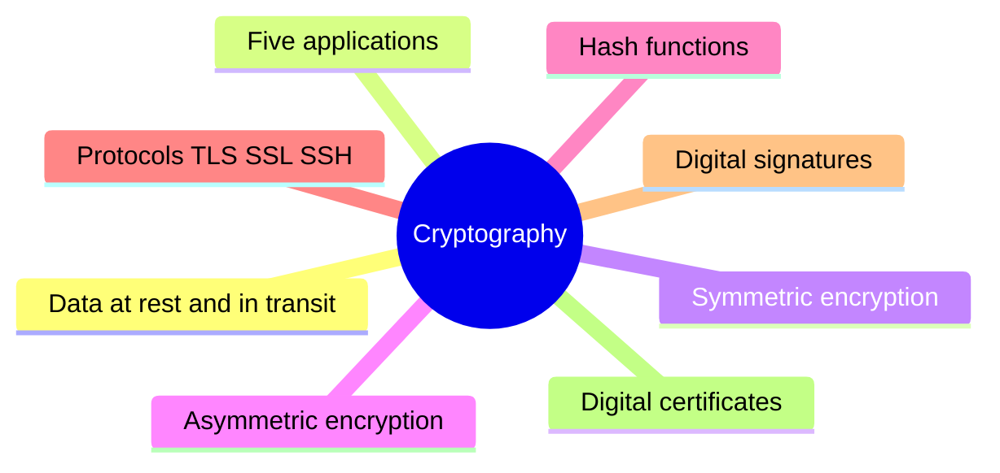

## What you should be able to do

*The courseware lists no learning outcomes; these are written for this site.*

- Define cryptography, explain encryption of data at rest and in transit, and state its five applications.
- Explain symmetric and asymmetric encryption, name their algorithms, draw the asymmetric encryption diagram, and differentiate the two (and both from hashing).
- Explain how a cryptographic hash function works, state its six properties and three applications, and compare the popular hash algorithms.
- Explain TLS (handshake and record protocols), SSL (features and handshake steps) and SSH (features and four authentication methods).
- Explain digital signatures: the required properties and requirements, and, with the aid of Figs 4.1 and 4.2, how a document is signed and verified.
- Define a digital certificate, describe the three types (and the three forms of TLS/SSL certificate), state five benefits, and differentiate a certificate from a signature.
- Recommend and justify the right cryptographic tool (symmetric, asymmetric, hash, signature, certificate, protocol) for a given scenario.

## What cryptography is: data at rest and data in transit

§4.1 · p.23

The chapter opens with a definition and the two situations in which data needs protecting.

> **Cryptography** is the science of securing communication and data by converting it into a form that can only be understood by the intended recipient. It involves techniques for encrypting and decrypting information to ensure its confidentiality, integrity, and authenticity.

> Encryption has long been used by militaries and governments to facilitate secret communication. It is now commonly used in protecting information within many kinds of civilian systems. For example, the Computer Security Institute reported that in 2007, 71% of companies surveyed utilized encryption for some of their data in transit, and 53% utilized encryption for some of their data in storage. Encryption can be used to protect data "at rest", such as files on computers and storage devices (e.g. USB flash drives). In recent years there have been numerous reports of confidential data such as customers' personal records being exposed through loss or theft of laptops or backup drives. Encrypting such files at rest helps protect them should physical security measures fail. Digital rights management systems, which prevent unauthorized use or reproduction of copyrighted material and protect software against reverse engineering (see also copy protection), is another somewhat different example of using encryption on data at rest.

> Encryption is also used to protect data in transit, for example data being transferred via networks (e.g. the Internet, e-commerce), mobile telephones, wireless microphones, wireless intercom systems, Bluetooth devices and bank automatic teller machines. There have been numerous reports of data in transit being intercepted in recent years. Encrypting data in transit also helps to secure it as it is often difficult to physically secure all access to networks.

!!! note "In plain terms"
    - **Cryptography** turns readable data (**plaintext**) into scrambled data (**ciphertext**) that only the intended recipient can turn back. **Encryption** scrambles; **decryption** unscrambles.
    - The definition names **three goals**: confidentiality, integrity and authenticity. These are the same requirements you met in [Unit 1's CIA triad](unit-1-security-concepts.md#what-computer-security-means-the-cia-triad) and [authenticity](unit-1-security-concepts.md#beyond-the-triad-authenticity-and-accountability). Note that availability is **not** one of them: cryptography does not keep a server running.
    - **Data at rest** = stored data (files on laptops, USB drives, backup drives). Encryption here is the **last line of defence when physical security fails**: if the laptop is stolen, the thief gets only ciphertext. **Digital rights management (DRM)** is a "somewhat different" at-rest use: it stops copying of copyrighted material and reverse engineering of software.
    - **Data in transit** = data moving across networks, phones, wireless microphones and intercoms, Bluetooth and ATMs. Encryption is needed because **you cannot physically guard every part of a network**.

| | Data at rest | Data in transit |
|---|---|---|
| **Meaning** | Data stored on a device | Data being transferred |
| **Courseware examples** | Files on computers; USB flash drives; laptops; backup drives; DRM-protected material and software | The Internet, e-commerce, mobile telephones, wireless microphones, wireless intercom systems, Bluetooth devices, bank ATMs |
| **Why encrypt** | Protects the files "should physical security measures fail" (loss or theft) | "It is often difficult to physically secure all access to networks"; interception is common |
| **CSI 2007 survey** | 53% of companies encrypted some data in storage | 71% of companies encrypted some data in transit |
| **Nigerian example** *(site example)* | A bank officer's laptop with customers' BVN records is stolen from a car in Lagos traffic; full-disk encryption keeps the records unreadable | A customer's card PIN travelling from a POS terminal to the bank's switch |

!!! tip "Exam angle"
    "Define cryptography" is a near-certain (a) part: learn the definition word for word, including the **three** goals. "Differentiate data at rest from data in transit, with examples" is a natural follow-up. The statistics (CSI, 2007, 71% in transit, 53% in storage) are easy marks in a "state…" question; note that **more** companies encrypted data in transit than in storage.

!!! warning "Courseware note"
    The chapter heading is printed "CHRYPTOGRAPHY". This is a typo for **Cryptography**; the site uses the correct spelling. The DRM sentence also has a grammar slip ("Digital rights management systems … **is** another … example"); the meaning is clear.

**Check your understanding**

A university encrypts the hard drives of all its staff laptops. Which situation does this protect, according to the courseware?

<ul class="quiz-options">
  <li>Data in transit, because laptops connect to Wi-Fi</li>
  <li data-correct>Data at rest, should physical security measures fail (e.g. a laptop is stolen)</li>
  <li>Availability of the laptops</li>
  <li>Digital rights management</li>
</ul>

Files stored on a laptop are data **at rest**; the courseware says encrypting them "helps protect them should physical security measures fail", e.g. loss or theft. Wi-Fi traffic is data in transit, but disk encryption does not protect it. DRM is a different at-rest use (preventing copying of copyrighted material) (§4.1, p.23).

According to the courseware's definition, cryptography ensures which three properties?

<ul class="quiz-options">
  <li>Confidentiality, integrity and availability</li>
  <li data-correct>Confidentiality, integrity and authenticity</li>
  <li>Integrity, availability and accountability</li>
  <li>Confidentiality, authenticity and availability</li>
</ul>

The definition says encryption and decryption techniques ensure "confidentiality, integrity, and **authenticity**". The CIA triad (with availability) is the tempting wrong answer: cryptography cannot keep a system available (§4.1, p.23).

## Why cryptography matters: five applications

§4.2 · pp.23–24

> In today's digital age, cryptography plays a crucial role in various applications, including:
>
> • **Secure Communication:** Cryptography ensures that sensitive information transmitted over networks, such as financial transactions and personal messages, remains private and cannot be intercepted by unauthorized parties.
>
> • **Data Integrity:** Cryptographic hash functions are used to verify the integrity of data by generating a unique fixed-size hash value for a given input. Any change in the data will result in a different hash value, allowing detection of tampering.
>
> • **Authentication:** Cryptography provides mechanisms for verifying the identity of parties involved in communication, preventing impersonation and unauthorized access to systems.
>
> • **Digital Signatures:** Digital signatures enable the authentication and non-repudiation of digital documents. They use cryptographic algorithms to bind a unique digital fingerprint to a message, providing proof of its origin and integrity.
>
> • **E-commerce:** Cryptography underpins secure online transactions, ensuring that sensitive information such as credit card numbers and personal details is encrypted during transmission, protecting it from eavesdroppers and hackers.

| Application | Security goal it serves | Main tool (taught later in this unit) | Example *(site example)* |
|---|---|---|---|
| **Secure communication** | Confidentiality | Encryption (symmetric, with keys set up by asymmetric) inside TLS/SSL/SSH | WhatsApp messages; a bank transfer instruction |
| **Data integrity** | Integrity | Hash functions | Checking that a downloaded JAMB brochure PDF matches the published hash |
| **Authentication** | Authenticity | Certificates, public-key authentication, passwords protected by hashing | Your browser confirming it is really talking to your bank's website |
| **Digital signatures** | Authenticity + integrity + **non-repudiation** | Hash + private key | A signed e-transcript sent from one university to another |
| **E-commerce** | Confidentiality of payment details | TLS (HTTPS) | Card details typed on an online store's checkout page |

!!! note "In plain terms"
    A memory aid *(the site's, not the courseware's)*: **"S-I-A-D-E"**, read as "**S**ecure **I**s **A**ll **D**igital **E**-business": **S**ecure communication, **I**ntegrity, **A**uthentication, **D**igital signatures, **E**-commerce. Note that **only digital signatures** are said to give **non-repudiation**: the signer cannot later deny signing.

!!! tip "Exam angle"
    "State and explain five applications of cryptography" is a classic (b) part (5 × 1–2 marks). For each, give the courseware's key phrase: *private, cannot be intercepted* (secure communication); *unique fixed-size hash value… detection of tampering* (integrity); *verifying the identity… preventing impersonation* (authentication); *authentication and non-repudiation… proof of origin and integrity* (digital signatures); *credit card numbers… encrypted during transmission* (e-commerce).

## The three categories of encryption techniques

§4.2 · p.24

> Although hybrid systems do exist (such as the SSL internet protocols), most encryption techniques fall into one of three main categories: symmetric cryptography algorithms, asymmetric cryptography algorithms, or hash functions.
>
> • Symmetric encryption protocols: AES, DES, Blowfish etc.
>
> • Asymmetric encryption protocols: RSA, Diffie-Hellman key exchange, ECC.
>
> • Hashing encryption protocols: SHA-1 and SHA-2. SHA-256, SHA 512.

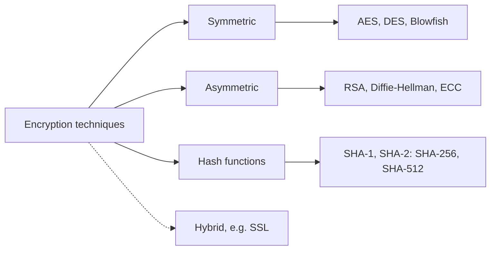

The three categories and their examples as listed on p.24 (drawn for this site). Each section below adds more algorithms.

!!! note "In plain terms"
    - **Symmetric:** one key, shared. **Asymmetric:** two keys, a public and a private. **Hash:** no key at all; a one-way fingerprint.
    - A **hybrid** system uses more than one category together. SSL (and its successor TLS) is the courseware's example: asymmetric cryptography to authenticate and exchange a key, then symmetric encryption for the data, and hashing/MACs for integrity (see [the protocols section](#cryptographic-protocols-tls-ssl-and-ssh)).

!!! warning "Courseware note"
    The courseware calls the third group "Hashing **encryption** protocols". Strictly, hashing is **not encryption**: encryption can be reversed with a key, but a hash is one-way and cannot be "decrypted" (the courseware itself says so in §4.5.1, "One-Way Computation"). Use the phrase "hash functions" in your own answers. The list's punctuation ("SHA-1 and SHA-2. SHA-256, SHA 512") means SHA-256 and SHA-512 are members of the SHA-2 family.

**Check your understanding**

Which application of cryptography does the courseware say provides <em>non-repudiation</em>?

<ul class="quiz-options">
  <li>Secure communication</li>
  <li>Data integrity</li>
  <li data-correct>Digital signatures</li>
  <li>E-commerce</li>
</ul>

"Digital signatures enable the authentication and **non-repudiation** of digital documents", binding a unique fingerprint to a message as proof of origin and integrity. Data integrity (hash functions) detects tampering but does not prove who sent the data, so the sender could still deny it (§4.2, p.24).

The courseware gives SSL as an example of what?

<ul class="quiz-options">
  <li>A symmetric algorithm</li>
  <li>A hash function</li>
  <li data-correct>A hybrid system that combines categories of cryptography</li>
  <li>A type of digital certificate only</li>
</ul>

"Although hybrid systems do exist (such as the SSL internet protocols), most encryption techniques fall into one of three main categories." SSL uses asymmetric encryption for key exchange and authentication, symmetric encryption for bulk data, and hashes/MACs for integrity (§4.2, p.24; §4.6.2, p.32). There is also an "SSL certificate", but that is a certificate type, not what the sentence describes.

## Symmetric encryption

§4.3 · pp.24–25

> **Symmetric encryption** is a method of scrambling data using a single shared secret key. Whoever holds that key can both encode (encrypt) and decode (decrypt) the information. The classic analogy is a locked mailbox that you and your trusted friend both have the key to. You can send a secret letter, the friend unlocks it, and no eavesdropper can read the note unless they steal the key.

> This is different from asymmetric encryption, where you use two keys (one public, one private) to handle encrypting and decrypting duties. Symmetric encryption is sometimes called "secret key cryptography," "private key cryptography," or simply "symmetric key encryption." If both parties have the same key, you're using symmetric encryption. If they each use a different key, that's asymmetric.

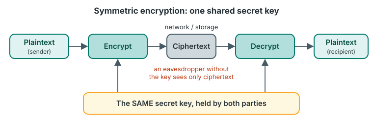{ .diagram }

Symmetric encryption with a single shared key (drawn for this site from the §4.3 description; the courseware has no figure for symmetric encryption).

> The most widely used symmetric encryption algorithms include:
>
> • **AES (Advanced Encryption Standard):** The gold standard today (AES-128, AES-192, AES-256). Used for sensitive government data.
>
> • **DES (Data Encryption Standard):** An older algorithm, now largely obsolete due to vulnerabilities.
>
> • **Triple DES (3DES):** An improvement over DES, but also being phased out.
>
> • **Blowfish:** Fast, flexible, and used in some security software.
>
> • **RC4, RC5, RC6:** A series of algorithms, with RC4 still seeing legacy use.
>
> These can be further splited into:
>
> • **Block ciphers:** Process fixed-size data blocks (e.g., AES, DES, Blowfish)
>
> • **Stream ciphers:** Encrypt data one bit at a time (e.g., RC4)

| Algorithm | Courseware status | Block or stream |
|---|---|---|
| **AES** (AES-128, AES-192, AES-256) | Gold standard today; sensitive government data | Block |
| **DES** | Older; largely obsolete due to vulnerabilities | Block |
| **Triple DES (3DES)** | Improvement over DES; being phased out | Block *(not stated by the courseware; 3DES applies DES three times, so it is a block cipher too)* |
| **Blowfish** | Fast, flexible; used in some security software | Block |
| **RC4, RC5, RC6** | A series; RC4 still in legacy use | RC4 = stream *(RC5 and RC6 are block ciphers: not stated by the courseware)* |

!!! note "In plain terms"
    - **The mailbox analogy:** you and a trusted friend both hold a key to the same mailbox. Anyone with the key can lock **and** unlock. The weakness is built into the analogy: if an eavesdropper **steals the key**, everything is readable. So the hard problem in symmetric cryptography is **getting the key to the other person safely** (key distribution). Asymmetric cryptography solves exactly that problem (next section).
    - **Three other names:** secret key cryptography, private key cryptography, symmetric key encryption. Careful: "private key cryptography" here means symmetric, even though asymmetric encryption also has a "private key".
    - **The one-line test:** same key on both sides = symmetric; different keys = asymmetric.
    - **Block vs stream:** a block cipher chops the data into fixed-size blocks and encrypts each block (AES uses 128-bit blocks); a stream cipher encrypts the data **one bit at a time** as it flows.
    - The numbers in **AES-128/192/256** are the key lengths in bits: the longer the key, the more keys an attacker would have to try.

!!! example "Example"
    A Nigerian bank encrypts its customer database (account numbers, BVNs, balances) with **AES-256**. The data is large and accessed constantly, and only the bank's own servers need to decrypt it, so one secret key held in a protected key store is the natural choice. Using **DES** for new systems would be wrong: the courseware calls it "largely obsolete due to vulnerabilities".

!!! tip "Exam angle"
    Expect: "Define symmetric encryption and list **five** symmetric algorithms" (AES, DES, 3DES, Blowfish, RC4/RC5/RC6), "state three other names for symmetric encryption", and "differentiate block ciphers from stream ciphers with examples". The three AES variants (128, 192, 256) are a good "state" question.

!!! warning "Courseware note"
    "These can be further **splited** into" should read "split into". The courseware gives no example of a block cipher for 3DES, RC5 or RC6; the table marks the site's additions.

**Check your understanding**

Which of these is NOT another name for symmetric encryption given in the courseware?

<ul class="quiz-options">
  <li>Secret key cryptography</li>
  <li>Private key cryptography</li>
  <li>Symmetric key encryption</li>
  <li data-correct>Public-key cryptography</li>
</ul>

Public-key cryptography is the other name for **asymmetric** encryption (§4.4). "Private key cryptography" is the trap: it sounds asymmetric, but the courseware lists it as a name for symmetric encryption (§4.3, p.24).

According to the courseware, which algorithm is a stream cipher?

<ul class="quiz-options">
  <li>AES</li>
  <li>DES</li>
  <li>Blowfish</li>
  <li data-correct>RC4</li>
</ul>

Stream ciphers "encrypt data one bit at a time (e.g., RC4)". AES, DES and Blowfish are the courseware's examples of block ciphers, which "process fixed-size data blocks" (§4.3, p.25).

## Asymmetric encryption

§4.4 · pp.25–26

> **Asymmetric encryption**, also known as public-key cryptography, is a type of encryption that uses a pair of keys to encrypt and decrypt data. The pair of keys includes a public key, which can be shared with anyone, and a private key, which is kept secret by the owner.

> In asymmetric encryption, the sender uses the recipient's public key to encrypt the data. The recipient then uses their private key to decrypt the data. This approach allows for secure communication between two parties without the need for both parties to have the same secret key.

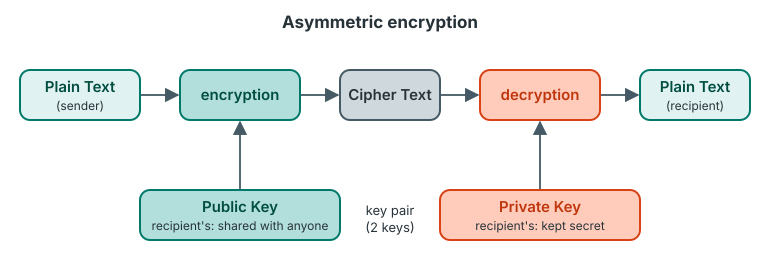{ .diagram }

Asymmetric encryption (redrawn; the figure is unnumbered in the courseware, p.26). The labels "sender", "recipient's" and "(2 keys)" are added by this site from the §4.4 text.

### Main features of asymmetric encryption

§4.4 · pp.25–26

> The Main Features of Asymmetric Encryption (also known as public-key cryptography) are:
>
> • **Dual keys:** Asymmetric encryption uses a pair of keys, including a public key and a private key. The public key can be freely shared with anyone, while the private key is kept secret and known only to the key owner.
>
> • **Encryption and decryption:** Asymmetric encryption uses the public key to encrypt data and the private key to decrypt data. This allows secure communication between two parties without the need to exchange secret keys.
>
> • **Digital signatures:** Asymmetric encryption enables the creation of digital signatures, which can be used to verify the authenticity of data. A digital signature is created by encrypting a hash of the data with the sender's private key.
>
> • **Secure key exchange:** Asymmetric encryption allows for secure key exchange, which is a critical feature in secure communication. For example, the Diffie-Hellman key exchange algorithm uses asymmetric encryption to establish a shared secret key between two parties without exchanging the key itself.

!!! note "In plain terms"
    - **Analogy:** the public key is an **open padlock** you hand out to everyone; the private key is the **only key that opens it**. Anyone can snap a padlock shut on a box addressed to you, but only you can open it.
    - **Whose key?** For **encryption**, the sender uses the **recipient's public** key and the recipient decrypts with **their own private** key. For a **digital signature** it is the other way round: the sender uses **their own private** key, and anyone checks it with the **sender's public** key. Mixing these up is the most common error in this unit.
    - The big win over symmetric encryption: **no shared secret has to be sent in advance**, which solves the key-distribution problem.
    - Memory aid for the four features *(the site's)*: **"D-E-D-S"**: **D**ual keys, **E**ncryption and decryption, **D**igital signatures, **S**ecure key exchange.

### Asymmetric algorithms

§4.4 · p.26

> Examples of Asymmetric Algorithms are:
>
> • **RSA (Rivest-Shamir-Adleman):** The most common algorithm for encrypting small data, digital signatures, and secure key exchanges. It relies on the extreme difficulty of factoring the product of two massive prime numbers.
>
> • **ECC (Elliptic Curve Cryptography):** A modern approach using algebraic curves. It provides high security with much smaller key sizes than RSA, making it ideal for mobile phones and internet-connected devices.
>
> • **Diffie-Hellman (DH):** A protocol used strictly for safely exchanging a secret key over an open network rather than encrypting files directly. Variants include Elliptic Curve Diffie-Hellman (ECDH).
>
> • **DSA (Digital Signature Algorithm):** A standard used only to verify the authenticity and identity of a digital message or sender, not for hiding data. Variants include ECDSA.

| Algorithm | Used for | Not used for | Basis / key point | Variant |
|---|---|---|---|---|
| **RSA** | Encrypting small data, digital signatures, key exchange (all three) | (bulk data: *site's note*) | Difficulty of factoring the product of two massive primes | — |
| **ECC** | High security with small keys | — | Algebraic (elliptic) curves; ideal for mobile phones and IoT devices | ECDH, ECDSA *(site's note: the elliptic-curve forms of DH and DSA)* |
| **Diffie-Hellman (DH)** | **Only** exchanging a secret key over an open network | Encrypting files directly | Two parties establish a shared key without sending it | ECDH |
| **DSA** | **Only** verifying authenticity and identity (signatures) | Hiding data (confidentiality) | A signature standard | ECDSA |

!!! example "Example"
    A Nigerian fintech's mobile app needs to send a customer's card details to its server. The app has the server's **public key** (from the server's certificate), so it can encrypt with it; only the server's **private key** can decrypt. Because phones are small devices, the courseware's advice points to **ECC**: "high security with much smaller key sizes than RSA, making it ideal for mobile phones".

!!! tip "Exam angle"
    Typical questions: "State **four** main features of asymmetric encryption"; "List **four** asymmetric algorithms and state what each is used for"; "Differentiate Diffie-Hellman from DSA" (DH only **exchanges keys**; DSA only **verifies authenticity**, neither hides data); "With the aid of a diagram, explain asymmetric encryption" (draw the p.26 figure and say **whose** keys are used).

!!! info "Beyond the notes"
    - Asymmetric encryption is **much slower** than symmetric encryption, which is why real systems encrypt the bulk data symmetrically and use asymmetric cryptography only to exchange or protect the symmetric key. The courseware states the same division for SSL ("symmetric encryption for bulk data transfer and asymmetric encryption for key exchange and authentication", §4.6.2) and SSH.
    - Strictly, Diffie-Hellman is a **key agreement** method: neither party encrypts a key and sends it; both compute the same secret from exchanged public values. The courseware's phrase "uses asymmetric encryption" is a simplification. Likewise, DSA signs by a mathematical procedure rather than by literally "encrypting" a hash; the "encrypt the hash with the private key" description fits RSA. In the exam, use the courseware's wording.

**Check your understanding**

Ngozi wants to send Tunde a confidential file using asymmetric encryption. Which key does she encrypt it with?

<ul class="quiz-options">
  <li>Ngozi's private key</li>
  <li>Ngozi's public key</li>
  <li data-correct>Tunde's public key</li>
  <li>Tunde's private key</li>
</ul>

"The sender uses the **recipient's public key** to encrypt the data. The recipient then uses their private key to decrypt." Ngozi's private key is the tempting distractor: that is what she would use to **sign** (§4.4 features, "Digital signatures"), which proves origin but does not hide the file, because anyone with her public key could undo it (§4.4, p.25).

Which asymmetric algorithm is described as "used strictly for safely exchanging a secret key over an open network rather than encrypting files directly"?

<ul class="quiz-options">
  <li>RSA</li>
  <li>DSA</li>
  <li data-correct>Diffie-Hellman</li>
  <li>ECC</li>
</ul>

Diffie-Hellman (and its variant ECDH) only exchanges keys. DSA is the other "only" algorithm, but it is only for verifying authenticity (signatures). RSA does all three: small-data encryption, signatures and key exchange (§4.4, p.26).

Why does the courseware call ECC "ideal for mobile phones and internet-connected devices"?

<ul class="quiz-options">
  <li>It needs no private key</li>
  <li data-correct>It provides high security with much smaller key sizes than RSA</li>
  <li>It is a stream cipher</li>
  <li>It relies on factoring large primes</li>
</ul>

Smaller keys mean less computation, memory and bandwidth, which suits small devices. Factoring the product of two massive primes is the basis of **RSA**, not ECC, which uses algebraic curves (§4.4, p.26).

## Choosing between symmetric, asymmetric and hashing

§4.3, §4.4, §4.5 · pp.24–29 (site synthesis)

Scenario questions often ask you to pick a technique and **justify** it. This comparison pulls together what the courseware says in §4.3–§4.5; the rows marked *(site)* are added explanation.

| Criterion | Symmetric | Asymmetric | Hash function |
|---|---|---|---|
| **Keys** | One shared secret key | A pair: public (shared with anyone) + private (kept secret) | None |
| **Reversible?** | Yes, with the same key | Yes, with the other key of the pair | **No**: one-way |
| **Main goal** | Confidentiality | Confidentiality without a shared secret; digital signatures; key exchange | Integrity (tamper detection); safe password storage |
| **Other names** | Secret key / private key cryptography; symmetric key encryption | Public-key cryptography | Message digest (the output) |
| **Examples** | AES, DES, 3DES, Blowfish, RC4–RC6 | RSA, ECC, Diffie-Hellman, DSA | MD5, SHA-1, SHA-2, SHA-3, BLAKE2/3 |
| **Speed** *(site)* | Fast: suits bulk data | Slow: suits small data and keys | Fast ("intended to be fast") |
| **Weak point** | Distributing the key safely; a stolen key exposes everything | Must be sure the public key really belongs to the owner (solved by **certificates**, §4.8) | Alone, proves nothing about **who** produced the data (attacker can replace file and hash) |

!!! tip "Exam angle: a decision rule"
    Ask three questions about the scenario:

    1. **Must anyone read the data back?** If **no** (passwords, integrity check) → **hash**. Never encrypt passwords "so we can decrypt them later".
    2. **Do the two sides already share a secret, or is it the same system?** If **yes** (encrypting your own database or disk) → **symmetric** (AES).
    3. **Strangers, or must you prove who sent it?** → **asymmetric**: the recipient's public key to send secretly (or to exchange a symmetric key), the sender's private key to **sign**; and a **certificate** so the public key can be trusted.

    Most real systems are **hybrid** (like SSL/TLS): asymmetric to exchange a key and authenticate, symmetric for the bulk data, hashes/MACs for integrity. A model answer always says **why not** the other two options.

!!! example "Example: one Nigerian bank, four jobs"
    | Job | Best choice | Why not the alternatives |
    |---|---|---|
    | Store customers' internet-banking passwords | **Hash** (SHA-2 family, salted; *site:* a slow password hash) | Encryption is reversible: whoever steals the key gets every password |
    | Encrypt 40 million transaction records in the data centre | **Symmetric** (AES-256) | Asymmetric is far too slow for bulk data; hashing can't be reversed, but the bank must read the records |
    | Send a settlement file to another bank over the internet | **Hybrid**: TLS, or encrypt with AES and send the AES key encrypted with the other bank's **public** key | Symmetric alone needs a pre-shared key; asymmetric alone is slow on large files |
    | Prove that a payment instruction really came from the bank and was not changed | **Digital signature** (hash + bank's **private** key) | A plain hash proves no origin; symmetric MACs can't give non-repudiation, since both sides hold the key |

## Cryptographic hash functions

§4.5 · p.27

> **Cryptographic hash functions** are mathematical algorithms that transform input data into a fixed-length sequence of characters, referred to as a hash value. Cryptographic hash functions are intended to be fast, deterministic, and one-way, meaning that even a minor change in input yields a very different hash. These functions are important for securing information digitally by allowing data verification and authentication.
>
> • Cryptographic hash functions protect data integrity by creating identifying hash values, which enable systems to identify any unauthorized changes to messages or files in real time.
>
> • Within cybersecurity, they are the foundation for digital signatures and certificate validation, giving a secure means to verify the authenticity of software and communications.
>
> • They provide safe password storage through hashing passwords prior to saving, stopping direct exposure of sensitive credentials even if there happens to be a breach of data.
>
> • Hash functions facilitate blockchain and other distributed ledgers by connecting blocks based on hash values to allow transparency and tamper-proof record-keeping.

!!! note "In plain terms"
    A hash function is a **fingerprint machine**: feed it anything (one word or a 4 GB video) and it outputs a short fixed-length fingerprint. The same input always gives the same fingerprint; a tiny change gives a completely different one; and you **cannot** rebuild the input from the fingerprint.

    The four uses in the bullets: **integrity** (spot unauthorised changes), **digital signatures and certificate validation**, **safe password storage**, and **blockchain / distributed ledgers** (each block contains the hash of the previous one, so changing an old block breaks the chain).

    Real SHA-256 values *(computed for this site)* show how sensitive the output is:

    | Input | SHA-256 hash (64 hex characters = 256 bits) |
    |---|---|
    | `Pay Ada N5000` | `809700f4990e680332c9b80cc7f91dd8fd0308f172f852f271e7090a08557a01` |
    | `Pay Ada N6000` | `13d14b6c1683acb735be2eb8667b9d008e35d7d3b0766546776accfa841f8f56` |
    | `pay Ada N5000` | `99a6d2a753e1a7f0b5fb42c2b4193dfe47df2c7767a99fa396e18e1ad783d4fa` |

    Changing one digit, or one capital letter, changes the whole hash: the **avalanche effect**.

!!! example "Example"
    When you create a password on a university portal, a well-built portal stores only the **hash** of your password. At login it hashes what you type and compares the two hashes. If hackers steal the database, they get hashes, not passwords: the courseware's "stopping direct exposure of sensitive credentials even if there happens to be a breach of data".

### How a cryptographic hash function works

§4.5.1 · pp.27–28

> • **Input Processing:** Cryptographic hash functions process an input of any length—whether text, file, or data stream—and subject it to a sequence of mathematical operations. The input can range from several bytes to gigabytes of information.
>
> • **Fixed-Size Output Generation:** No matter what the length of the input, the function generates a fixed-size hash value, normally in the form of a hexadecimal string. This uniform output size provides equality regardless of the inputs.
>
> • **Deterministic Operation:** The hash function consistently computes the same hash for the same input. Such a property enables uncompromising data authentication, as any alteration in the input leads to a totally unique hash.
>
> • **Avalanche Effect:** A minor alteration in the input, even the flipping of one bit, significantly alters the resultant hash. The sensitivity ensures that collisions among hashes (two inputs having the same hash) are highly unlikely.
>
> • **One-Way Computation:** The algorithm is made irreversible in the sense that it is computationally impossible to recover the original input from its hash value. This one-way feature protects sensitive information such as passwords and digital signatures.
>
> • **Collision Resistance:** Hash functions used in cryptography are designed to minimize the probability of two distinct inputs generating the same hash value, upholding the integrity and trustworthiness of verification processes.

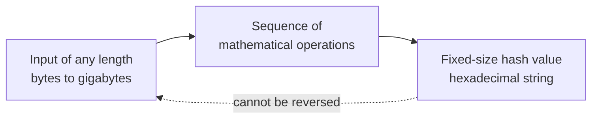

The working of a hash function in one picture (drawn for this site from §4.5.1).

!!! note "In plain terms"
    The six working steps *(the courseware does not number them; the count is ours)*: **I**nput processing, **F**ixed-size output, **D**eterministic, **A**valanche, **O**ne-way, **C**ollision resistance. Memory aid *(the site's)*: "**I F**ind **D**ogs **A**lways **O**bey **C**ommands".

### Properties of cryptographic hash functions

§4.5.2 · pp.28–29

> • **Deterministic:** The same input always generates the exact same hash output, ensuring consistent and reliable verification of data.
>
> • **Fast Computation:** Cryptographic hash functions are designed to process inputs quickly and efficiently, making them practical for handling large datasets and real-time applications.
>
> • **Pre-image Resistance:** It is computationally infeasible to reverse-engineer or retrieve the original input data from its hash value, protecting sensitive information from exposure.
>
> • **Second Pre-image Resistance:** Given an input and its hash, it is extremely difficult to find a different input that produces the same hash, preventing impersonation or forgery.
>
> • **Collision Resistance:** The function minimizes the chance that two distinct inputs will produce identical hash values, ensuring unique data fingerprints for security and integrity.
>
> • **Avalanche Effect:** Even a tiny change in the input, such as flipping a single bit, causes a significant and unpredictable change in the hash output, enhancing the function's sensitivity to data modifications.

The three "resistance" properties are the most confusable. They differ in **what the attacker is given** and **what they must find**:

| Property | Attacker is given | Attacker must find | Protects against *(site example)* |
|---|---|---|---|
| **Pre-image resistance** | Only a hash value | **Any input** that produces it (the original) | Recovering passwords from a stolen hash file |
| **Second pre-image resistance** | A specific input **and** its hash | A **different** input with the same hash | Forging a fake contract that matches the hash of a real signed one |
| **Collision resistance** | Nothing fixed | **Any two** different inputs with the same hash | Preparing two documents (honest + fraudulent) with one hash, getting the honest one signed |

The courseware lists the same ideas twice, as "working" (§4.5.1) and as "properties" (§4.5.2):

| Working (§4.5.1) | Properties (§4.5.2) |
|---|---|
| Input processing | — |
| Fixed-size output generation | — |
| Deterministic operation | Deterministic |
| — | Fast computation |
| One-way computation | Pre-image resistance |
| — | Second pre-image resistance |
| Collision resistance | Collision resistance |
| Avalanche effect | Avalanche effect |

!!! tip "Exam angle"
    "State and explain **six** properties of a cryptographic hash function" is very likely: deterministic, fast computation, pre-image resistance, second pre-image resistance, collision resistance, avalanche effect. If the question says "**working**" instead, give the §4.5.1 list (input processing, fixed-size output, deterministic, avalanche, one-way, collision resistance). "Differentiate pre-image, second pre-image and collision resistance" is a good (c) part: use the given/find table.

!!! warning "Courseware note"
    A few phrases overstate things. A hash cannot guarantee a "totally unique hash" or "unique data fingerprints": there are infinitely many inputs and only a fixed number of outputs, so collisions must **exist**; the security lies in their being **computationally infeasible to find**. "Computationally impossible" (one-way computation) likewise means "infeasible", the word used under pre-image resistance. "Provides equality regardless of the inputs" means every hash has the **same length**. Quote the courseware in definitions, but use "infeasible" in explanations.

### Applications of cryptographic hash functions

§4.5.3 · pp.29–30

> Below are some applications of cryptography hash functions
>
> **1. Message Authentication**
>
> • Message authentication is a system or service that verifies the integrity of a communication.
>
> • It ensures data is received precisely as transmitted, with no modifications, insertions, or deletions, a hash function is used for message authentication, and the value is sometimes referred to as a message digest.
>
> • Message authentication often involves employing a message authentication code (MAC).
>
> • MACs are widely used between two parties that share a secret key for authentication purposes. A MAC function uses a secret key and data block to generate a hash value, that identifies the protected communication.
>
> **2. Data Integrity Check**
>
> • Hash functions are most commonly used to create checksums for data files.
>
> • This program offers the user with assurance that the data is correct.
>
> • The integrity check allows the user to detect any modifications to the original file.
>
> • It does not assure uniqueness. Instead of altering file data, the attacker can update the entire file, compute a new hash, and deliver it to the recipient.
>
> **3. Digital Signatures**
>
> • The digital signature application is comparable to message authentication.
>
> • Digital signatures operate similarly to MACs.
>
> • Digital signatures encrypt message hash values using a user's private key.
>
> • The digital signature may be verified by anybody who knows the user's public key.

| | Data integrity check (checksum) | Message authentication (MAC) | Digital signature |
|---|---|---|---|
| **Key used** | None | One **secret key shared** by both parties | Sender's **private** key to sign; **public** key to verify |
| **Who can verify** | Anyone | Only holders of the shared secret key | **Anybody** who knows the public key |
| **Detects modification** | Yes | Yes | Yes |
| **Stops an attacker replacing file + hash** | **No** (the courseware's warning) | Yes: the attacker lacks the key | Yes: the attacker lacks the private key |
| **Non-repudiation** *(site)* | No | No: both parties hold the key, so either could have made the MAC | Yes |

!!! note "In plain terms"
    - **Message digest** is just another name for the hash value of a message.
    - The **checksum's weakness**: if an attacker can change the file, they can also recompute and replace the published hash. A plain hash proves **integrity only if the hash itself arrives safely** (e.g. from a trusted site over HTTPS). The courseware's phrase "it does not assure uniqueness" refers to this: the check does not prove the file is the *original* one from the genuine source.
    - A **MAC** fixes that by mixing in a **secret key**; a **digital signature** fixes it with a **private key**, and adds proof of *who* signed.

!!! example "Example"
    - **Checksum:** a Linux download page lists the SHA-256 hash of the installer; you hash your download and compare.
    - **MAC:** a payment gateway and a Nigerian merchant share a secret key; each transaction notification carries a MAC so the merchant knows it came from the gateway and was not altered.
    - **Digital signature:** if an exam body such as WAEC issues digitally signed result certificates, any university can verify one with the exam body's public key, and the exam body cannot later deny issuing it.

### Popular cryptographic hash algorithms

§4.5.4 · pp.30–31

> **i. MD5 (Message Digest Algorithm 5)**
>
> Once widely used for data integrity and digital signatures, MD5 is now considered insecure due to vulnerabilities that allow attackers to generate hash collisions easily. Its speed and simplicity made it popular historically, but it is no longer recommended for security-critical applications.

> **ii. SHA-1 (Secure Hash Algorithm 1)**
>
> SHA-1 improved upon MD5 with a longer hash length and better resistance to collisions. However, advances in computational power and cryptanalysis exposed weaknesses, leading to practical collision attacks. Consequently, SHA-1 is deprecated for most security uses, including SSL/TLS certificates and digital signatures.

> **iii. SHA-2 Family (SHA-256, SHA-512)**
>
> The SHA-2 family is currently the industry standard for cryptographic hashing, offering robust security with longer hash outputs of 256 and 512 bits. These algorithms provide strong collision and pre-image resistance, making them the preferred choice for secure communication protocols, blockchain technologies, and password hashing.

> **iv. SHA-3 (Keccak)**
>
> Adopted as the latest NIST standard, SHA-3 uses a unique sponge construction different from SHA-2, enhancing security and flexibility. It offers comparable hash lengths with improved resistance to certain types of attacks, making it suitable for applications demanding long-term security.

> **v. BLAKE2 & BLAKE3**
>
> Designed as high-speed, secure alternatives to SHA-2 and SHA-3, BLAKE2 and BLAKE3 deliver faster hashing without compromising security. BLAKE3, in particular, supports parallel processing and incremental updates, making it ideal for modern systems requiring both speed and strong cryptographic guarantees.

| Algorithm | Status (courseware) | Key fact | Output size *(site, where not stated)* |
|---|---|---|---|
| **MD5** | **Insecure**; not recommended for security-critical uses | Collisions can be generated easily; was popular for speed and simplicity | 128 bits |
| **SHA-1** | **Deprecated** for most uses, incl. SSL/TLS certificates and digital signatures | Longer hash and better collision resistance than MD5, but practical collision attacks now exist | 160 bits |
| **SHA-2** (SHA-256, SHA-512) | **Industry standard** today | Strong collision and pre-image resistance; used in secure protocols, blockchain, password hashing | 256 and 512 bits (stated) |
| **SHA-3** (Keccak) | **Latest NIST standard** | **Sponge construction**, different from SHA-2; long-term security | Comparable to SHA-2 (stated) |
| **BLAKE2, BLAKE3** | High-speed, secure alternatives to SHA-2/SHA-3 | BLAKE3: **parallel processing** and **incremental updates** | — |

!!! tip "Exam angle"
    "List **five** popular hash algorithms and comment on the security of each" is easy marks if you remember the order of history: **MD5 (broken) → SHA-1 (deprecated) → SHA-2 (standard) → SHA-3 (newest NIST standard, sponge) → BLAKE2/3 (fastest)**. In a scenario, never recommend MD5 or SHA-1 for security; choose SHA-256 or SHA-3. The link to [Unit 1's open design principle](unit-1-security-concepts.md#open-design) is worth a sentence: SHA-2 and SHA-3 are **public** NIST standards, studied by experts, not secret designs.

!!! info "Beyond the notes"
    For **password storage**, real systems add a random **salt** to each password before hashing (so two users with the same password get different hashes) and use deliberately **slow** password-hashing functions such as bcrypt or Argon2, because a fast hash like SHA-256 lets an attacker try billions of guesses per second. The courseware's "SHA-2 … password hashing" is acceptable in the exam; mentioning salting earns credit in a scenario answer.

**Check your understanding**

An attacker has a hash value from a stolen password file and tries to find the password that produced it. Which property is meant to stop this?

<ul class="quiz-options">
  <li data-correct>Pre-image resistance</li>
  <li>Second pre-image resistance</li>
  <li>Collision resistance</li>
  <li>Deterministic</li>
</ul>

Pre-image resistance: "computationally infeasible to reverse-engineer or retrieve the original input data from its hash value". Second pre-image resistance is the tempting answer, but it applies when the attacker is given an **input and its hash** and must find a **different** input (§4.5.2, p.28).

The courseware warns that a plain data integrity check "does not assure uniqueness". What attack does it describe?

<ul class="quiz-options">
  <li>The attacker reverses the hash to read the file</li>
  <li data-correct>The attacker replaces the entire file, computes a new hash, and delivers both to the recipient</li>
  <li>The attacker finds two files with the same MD5 hash</li>
  <li>The attacker steals the shared MAC key</li>
</ul>

"Instead of altering file data, the attacker can update the entire file, compute a new hash, and deliver it to the recipient." A plain hash uses no key, so anyone can compute one. MACs (secret key) and digital signatures (private key) close this gap (§4.5.3, p.29).

Which hash algorithm does the courseware describe as using a "sponge construction"?

<ul class="quiz-options">
  <li>SHA-1</li>
  <li>SHA-2</li>
  <li data-correct>SHA-3 (Keccak)</li>
  <li>BLAKE3</li>
</ul>

SHA-3 (Keccak), "adopted as the latest NIST standard", uses "a unique sponge construction different from SHA-2". BLAKE3's distinguishing features are parallel processing and incremental updates (§4.5.4, pp.30–31).

## Cryptographic protocols: TLS, SSL and SSH

§4.6 · p.31

The algorithms above are building blocks. A **cryptographic protocol** is the agreed sequence of messages that puts them together to secure a real connection. The courseware covers three: TLS, its predecessor SSL, and SSH. All three are **hybrid**: asymmetric cryptography to authenticate and set up keys, then symmetric encryption for the data.

### Transport Layer Security (TLS)

§4.6.1 · p.31

> **TLS (Transport Layer Security)** is a cryptographic protocol designed to provide secure communication over a network, typically the internet. It ensures that data transmitted between two parties is encrypted and remains confidential, and that the parties involved can verify each other's identities. Here's an overview of TLS:

> **The Handshake Protocol** - The TLS handshake establishes a secure connection between the client and the web server. Using public key cryptography, the server is authenticated (and sometimes the client) using a digital certificate. The client and server then agree on a cipher suite (a set of encryption algorithms) and perform a key exchange to securely establish shared session keys (secret keys for encryption and hashing).
>
> Once the session keys are established, the secure session is considered set up. From this point on, public key encryption is no longer used, and all subsequent data transmitted is encrypted and authenticated using secret key cryptography.

> **The Record Protocol** :- The record protocol is responsible for securing data transmitted during the TLS connection. To do so, it uses the cipher suite and keys negotiated during the handshake as a kind of recipe for how to protect data.
>
> The cipher suite defines which algorithms should be used for key exchange, encryption and message authentication. The symmetric (secret) keys are used to encrypt outgoing data and decrypt incoming data. The keys are also used to create message authentication codes, which verify the integrity of the data.

> TLS is widely used to secure various internet protocols, including HTTPS (secure web browsing), SMTP (email transmission), FTPS (secure file transfer), and more. TLS plays a critical role in ensuring the privacy and security of online communication and transactions, protecting sensitive information from eavesdropping, tampering, and impersonation attacks.

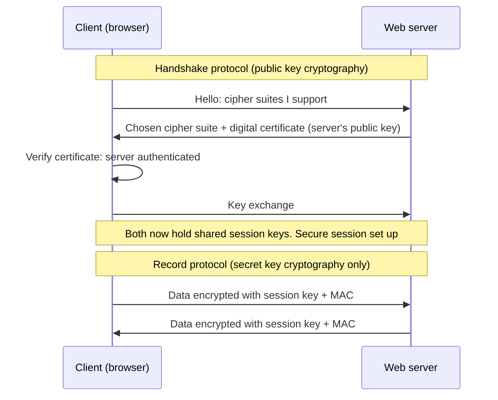

The TLS handshake and record protocols (drawn for this site from §4.6.1; the hello messages are named in the SSL handshake, §4.6.2). Client authentication by certificate ("and sometimes the client") is optional and not shown.

!!! note "In plain terms"
    TLS has **two sub-protocols**:

    - **Handshake protocol (the set-up):** (1) the **server is authenticated** with its digital certificate (the client sometimes too); (2) both sides **agree on a cipher suite**; (3) they do a **key exchange** to create shared **session keys**. This part uses **public key** cryptography.
    - **Record protocol (the protection):** every piece of data afterwards is **encrypted** with the symmetric session keys and given a **MAC** for integrity. Public key encryption is **no longer used**.

    A **cipher suite** is the "recipe": it names the algorithms for **key exchange, encryption and message authentication**.

    TLS protects against **three** attacks: **eavesdropping** (confidentiality), **tampering** (integrity) and **impersonation** (authentication). It secures **HTTPS, SMTP, FTPS** and more.

!!! example "Example"
    When you open your bank's website and the address starts with `https://` and shows a padlock, TLS has just run its handshake: your browser checked the bank's certificate and agreed session keys. Your login and transfers then travel through the record protocol, encrypted with AES and protected by MACs.

### Secure Sockets Layer (SSL)

§4.6.2 · pp.32–33

> **SSL (Secure Sockets Layer)** is a predecessor to TLS (Transport Layer Security) and is a cryptographic protocol designed to provide secure communication over a network, typically the internet. Developed by Netscape in the 1990s, SSL aimed to ensure that data transmitted between a client and a server remains confidential and cannot be tampered with by unauthorized parties. Here's an overview of SSL:
>
> 1\. **Encryption:** SSL encrypts data transmitted between a client and a server, preventing eavesdropping and ensuring confidentiality. It uses symmetric encryption for bulk data transfer and asymmetric encryption for key exchange and authentication.
>
> 2\. **Authentication:** SSL provides mechanisms for both parties to authenticate each other's identities.
>
> o **Server Authentication:** The server presents a digital certificate containing its public key, which is verified by the client. This ensures that the client is communicating with the intended server.
>
> o Optionally, the client may also authenticate itself to the server using a digital certificate.
>
> 3\. **Key Exchange:** SSL uses various key exchange algorithms to securely establish a shared secret key between the client and server, which is used for symmetric encryption and decryption.
>
> o RSA, Diffie-Hellman (DH), and Elliptic Curve Diffie-Hellman (ECDH) are common key exchange methods used in SSL.
>
> 4\. **Integrity:** SSL ensures the integrity of transmitted data through the use of cryptographic hash functions and message authentication codes (MACs). These mechanisms detect any tampering or modification of data during transmission.
>
> 5\. **SSL Handshake:** The SSL handshake is the process by which the client and server establish a secure connection. It involves similar steps to the TLS handshake:
>
> o **Client Hello:** The client sends a message to the server indicating supported SSL versions, cipher suites, and other parameters.
>
> o **Server Hello:** The server responds with its chosen SSL version, cipher suite, and a digital certificate (if required).
>
> o **Key Exchange:** The client and server exchange cryptographic parameters to establish a shared secret key.
>
> o **Authentication:** The client verifies the server's digital certificate (and optionally vice versa).
>
> o **Session Key Generation:** Both parties generate session keys based on the exchanged parameters.
>
> o **Secure Communication:** The client and server use the session keys to encrypt and decrypt data transmitted during the session.
>
> **Applications:** SSL is used to secure various internet protocols, including HTTPS (secure web browsing), SMTP (email transmission), FTPS (secure file transfer), and more.
>
> While SSL laid the groundwork for secure communication on the internet, it has largely been superseded by TLS due to security vulnerabilities and protocol weaknesses found in earlier versions of SSL

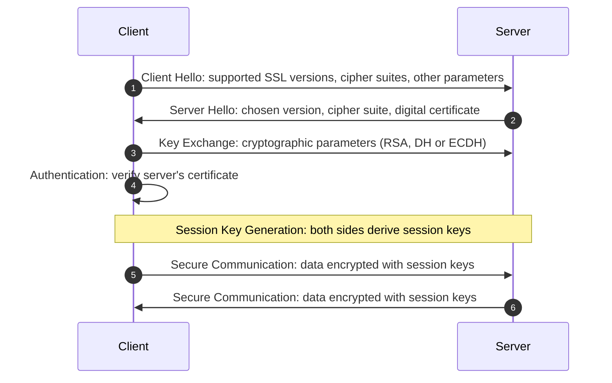

The six steps of the SSL handshake (drawn for this site from §4.6.2). The courseware lists Key Exchange before Authentication; both happen during the handshake.

!!! note "In plain terms"
    - SSL is **the older version of TLS** (Netscape, 1990s). Same job, same overall design; TLS replaced it because of **security vulnerabilities and protocol weaknesses** in SSL. That is why people still say "SSL certificate" for what is now a TLS certificate.
    - SSL's **five** features *(numbered 1–5 in the courseware)*: **E**ncryption, **A**uthentication, **K**ey exchange, **I**ntegrity, **S**SL handshake. Memory aid *(the site's)*: "**E**very **A**gent **K**eeps **I**ts **S**ecrets".
    - Six handshake steps, in the courseware's order: **Client Hello → Server Hello → Key Exchange → Authentication → Session Key Generation → Secure Communication**.
    - Three key-exchange methods: **RSA, DH, ECDH**.

!!! info "Beyond the notes"
    SSL 2.0 and 3.0 are now formally prohibited (the 2014 "POODLE" attack broke SSL 3.0), and TLS 1.0 and 1.1 are deprecated too. Servers today should allow only **TLS 1.2 and TLS 1.3**. TLS 1.3 also removed RSA key exchange in favour of (EC)DH, so that recorded traffic cannot be decrypted later even if the server's private key leaks ("forward secrecy").

### Secure Shell (SSH)

§4.6.3 · pp.33–34

> **SSH (Secure Shell)** is a cryptographic network protocol for secure data communication, command-line login, remote command execution, and other secure network services between two networked computers. Here's an overview of SSH:
>
> 1\. **Encryption:** SSH encrypts all data transmitted between the client and the server, including passwords, commands, and output. This encryption prevents eavesdropping and protects the confidentiality of the communication. SSH typically uses symmetric encryption for data encryption and asymmetric encryption for key exchange and authentication.
>
> 2\. **Authentication:** SSH provides various methods for authenticating the identity of the client and the server.
>
> o **Password Authentication:** Clients can authenticate using a username and password combination.
>
> o **Public Key Authentication:** Clients can authenticate using a public-private key pair. The public key is stored on the server, and the client uses the corresponding private key for authentication.
>
> o **Host-based Authentication:** Servers can authenticate clients based on the client's hostname or IP address.
>
> o **Keyboard-Interactive Authentication:** A customizable authentication method that allows servers to interactively prompt clients for additional authentication information.
>
> 3\. **Key Exchange:** SSH uses asymmetric cryptography for key exchange during the initial connection setup. This process ensures that both the client and server can establish a secure communication channel and negotiate encryption algorithms and other parameters.
>
> 4\. **Session Management:** Once the SSH connection is established, it operates in a secure session. During this session, clients can execute remote commands, transfer files, and perform other network operations securely.
>
> 5\. **Port Forwarding:** SSH supports port forwarding, allowing clients to securely tunnel network connections through the SSH connection. This feature is commonly used to access services on remote networks securely.
>
> 6\. **SSH Protocol Versions:** There are multiple versions of the SSH protocol, including SSH-1 and SSH-2. SSH-2 is the most commonly used version and offers improved security and additional features compared to SSH-1.
>
> 7\. **Applications:** SSH is widely used for secure remote administration, file transfer, and tunneling. It is commonly used by system administrators to manage remote servers, by developers to access version control systems, and by users to securely transfer files between systems.
>
> Overall, SSH provides a secure and reliable means of accessing and managing remote systems over untrusted networks, making it an essential tool for secure network administration and communication.

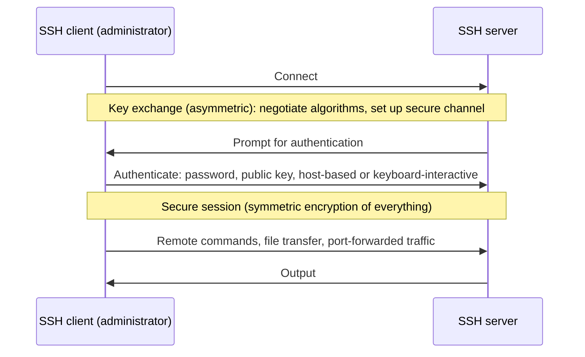

An SSH connection (drawn for this site from §4.6.3).

| SSH client authentication method | How the client proves its identity | Comment *(site)* |
|---|---|---|
| **Password** | Username and password combination | Simplest; vulnerable to password guessing |
| **Public key** | Private key held by the client; matching public key stored on the server | Strongest common method; nothing secret crosses the network |
| **Host-based** | The client's hostname or IP address | Trusts the machine, not the person; weak if addresses can be spoofed |
| **Keyboard-interactive** | Server prompts interactively for extra information | Customisable; used for one-time codes (two-factor) |

!!! note "In plain terms"
    - SSH is the **secure replacement for remote login tools** (like Telnet, which sends passwords in clear text). It encrypts **everything**: passwords, commands and output.
    - Seven points in the courseware *(numbered 1–7)*: encryption, authentication (4 methods), key exchange, session management, port forwarding, protocol versions (SSH-1, **SSH-2** preferred), applications.
    - **Port forwarding (tunnelling):** carrying another connection inside the encrypted SSH connection, e.g. reaching a database on a remote office network securely.
    - Applications name **three uses** (secure remote administration, file transfer, tunnelling) and **three user groups** (system administrators managing remote servers, developers accessing version control, users transferring files).

!!! warning "Courseware note"
    The heading reads "SECURE SOCKET SHELL OR SECURE SHELL (SSH)". The protocol's real name is **Secure Shell**; "Secure Socket Shell" is an informal expansion seen on some websites. Also, although §4.6.3 says SSH authenticates "the client and the server", all four listed methods authenticate the **client**. *(Beyond the notes: the server proves itself with its **host key**, which the client remembers on first connection.)*

### Comparing TLS, SSL and SSH

§4.6.1–§4.6.3 · pp.31–34 (site summary)

| Criterion | TLS | SSL | SSH |
|---|---|---|---|
| **What it is** | Cryptographic protocol for secure communication over a network | **Predecessor** of TLS (Netscape, 1990s) | Cryptographic network protocol for secure communication between two networked computers |
| **Status** | Current standard | Largely **superseded by TLS** (vulnerabilities) | SSH-2 most used; SSH-1 older |
| **Typical use** | HTTPS, SMTP, FTPS | HTTPS, SMTP, FTPS (historically) | Command-line login, remote command execution, remote administration, file transfer, tunnelling |
| **Authentication** | Server by certificate (sometimes client) | Server by certificate; client optional | Client by password, public key, host-based or keyboard-interactive |
| **Key set-up** | Handshake: cipher suite + key exchange | Handshake: 6 steps; RSA, DH, ECDH | Asymmetric key exchange at connection set-up |
| **Data protection** | Record protocol: symmetric encryption + MACs | Symmetric bulk encryption + hashes/MACs | Symmetric encryption of all data |

!!! tip "Exam angle"
    Likely questions: "Explain the **two** components of TLS" (handshake and record protocols); "List the **six** steps of the SSL handshake"; "State **four** SSH authentication methods"; "Differentiate SSL from TLS" (predecessor vs successor; SSL superseded due to vulnerabilities; same purpose and applications) and "TLS from SSH" (securing application traffic such as web and email vs secure remote login and administration). In a scenario, recommend **TLS (HTTPS)** for websites and apps, **SSH with public key authentication** for administering servers, and **never** recommend SSL or SSH-1.

**Check your understanding**

After the TLS handshake has established the session keys, how is application data protected?

<ul class="quiz-options">
  <li>Each message is encrypted with the server's public key</li>
  <li data-correct>With secret (symmetric) key cryptography: encrypted with session keys and authenticated with MACs</li>
  <li>Each message is digitally signed with the client's private key</li>
  <li>It is hashed only, not encrypted</li>
</ul>

"From this point on, public key encryption is no longer used, and all subsequent data transmitted is encrypted and authenticated using secret key cryptography." The record protocol uses the symmetric keys to encrypt and to create MACs. Public-key encryption is used only during the handshake (§4.6.1, p.31).

Which is the correct order of the SSL handshake steps given in the courseware?

<ul class="quiz-options">
  <li>Server Hello, Client Hello, Authentication, Key Exchange, Secure Communication, Session Key Generation</li>
  <li data-correct>Client Hello, Server Hello, Key Exchange, Authentication, Session Key Generation, Secure Communication</li>
  <li>Client Hello, Authentication, Server Hello, Session Key Generation, Key Exchange, Secure Communication</li>
  <li>Key Exchange, Client Hello, Server Hello, Authentication, Secure Communication, Session Key Generation</li>
</ul>

The client always speaks first (Client Hello: supported versions and cipher suites), then the server chooses and sends its certificate (Server Hello). Keys are exchanged, the certificate verified, session keys generated, and only then does secure communication start (§4.6.2, pp.32–33).

An SSH server lets a client log in because the connection comes from the IP address of a trusted office machine. Which SSH authentication method is this?

<ul class="quiz-options">
  <li>Public key authentication</li>
  <li>Keyboard-interactive authentication</li>
  <li data-correct>Host-based authentication</li>
  <li>Password authentication</li>
</ul>

"Host-based Authentication: Servers can authenticate clients based on the client's hostname or IP address." Public key authentication is about the client holding a private key matching a public key stored on the server, not where it connects from (§4.6.3, p.33).

## Digital signatures

§4.7 · p.34

> **Digital signatures** are the most important development from the work on public key cryptography, and provide a set of security capabilities that would be difficult to implement in any other way. A digital signature is an electronic signature that can be used to authenticate the identity of the sender of a message or the signer of a document, and possibly to ensure the integrity of the message.

> Digital signatures are easily transportable and cannot be imitated by someone else. The ability to ensure that the original signed message arrived means that the sender cannot easily repudiate it later. Digital signatures are based on handwritten signatures, which are used for ownership rights or message content confirmation.

!!! note "In plain terms"
    A digital signature does for an electronic document what a handwritten signature does for paper, but better. It gives:

    - **Authentication** of the sender or signer (who signed);
    - **Integrity** of the message ("possibly", says the courseware: it depends on the scheme; the hash-based scheme below does give integrity);
    - **Non-repudiation**: "the sender cannot easily repudiate it later" (cannot deny sending it).

    It does **not** give confidentiality: a signed document can still be read by anyone. To keep it secret as well, you must also **encrypt** it.

### Properties a signature should have

§4.7 · pp.34–35

> Handwritten signatures should have the following properties:
>
> • **The signature is secure** – the signature should not be imitated and any potential attempt at signature forgery should be detected easily.
>
> • **The signature facilitates authentication** – the signature identifies uniquely the signature keeper, who signed the document without restraint and wittingly.
>
> • **The signature is not transferable** – the signature is part of the document and an unauthorized subject is unable to transfer the signature to another document.
>
> • **The signed document is unchangeable** – the document cannot be changed and modified after the signature.
>
> • **The signature is undeniable** – the keeper of the signature cannot deny the subscription of the signed document.
>
> In practice, none of these features is consistently fulfilled in handwritten signatures and can be discredited or corrupted. All these features should have digital signatures too.

| Property | Meaning in one line | Handwritten signatures in practice *(site example)* | How the hash-based digital signature delivers it *(site)* |
|---|---|---|---|
| **Secure** | Cannot be imitated; forgery detected easily | Signatures on cheques are forged | Forging needs the private key: computationally infeasible |
| **Facilitates authentication** | Uniquely identifies the signer, who signed willingly and knowingly | A scrawl rarely identifies anyone uniquely | Only the holder of the private key could produce it |
| **Not transferable** | Cannot be moved to another document | A signature can be cut and pasted onto a photocopy | The signature depends on the hash of **this** document |
| **Unchangeable** | Document cannot be modified after signing | Pages of a signed contract can be swapped | Any change alters the hash, so verification fails |
| **Undeniable** | The signer cannot deny signing | "That's not my signature" | Non-repudiation: only the signer's private key matches the public key |

### Additional requirements for a digital signature

§4.7 · p.35

> However, there are some problems associated with the practical realization of digital signatures. Digital files can be easily copied and part of a document can be transmitted to another document and the signed document can be easily modified.
>
> Therefore, additional requirements must be formulated for a digital signature:
>
> • The signature must be a bit pattern that depends on the message being signed.
>
> • The signature must use some information unique to the sender, to prevent both forgery and denial.
>
> • The realization and implementation of the digital signature must be relatively easy. The forgery of the digital signature must be computationally infeasible, either by constructing a new message for an existing digital signature or by constructing a fraudulent digital signature for a given message.
>
> • It must be practical to retain a copy of the digital signature in storage. A digital signature can be used with any kind of message, whether encrypted or not, simply so that the receiver can be sure of the sender's identity and that the message arrived intact.

!!! note "In plain terms"
    The **three problems** with digital files: they can be **copied** easily; **part of a document can be moved** to another; the signed document can be **modified** easily. Each requirement answers them:

    1. **Depends on the message** → a signature copied onto another message won't fit (answers "transferable" and "modified").
    2. **Uses information unique to the sender** (the private key) → prevents **forgery and denial**.
    3. **Easy to produce, infeasible to forge**, in both ways: a new message for an existing signature, or a fake signature for a given message.
    4. **Practical to store** a copy; works with any message, **encrypted or not**.

### Signing a document: the hash-based model

§4.7 · p.35; Fig. 4.1 · p.36

> There are several possible schemes for digital signatures. Among others, one of the most accepted schemes is based on hash functions. In this case, if a user wants to digitally sign a document, the steps that he/she has to follow are:
>
> • Evaluate the hash of the document to be signed.
>
> • Using asymmetric encryption, encrypt the hash with the sender's private key to obtain the digital signature.
>
> • Append the digital signature to the document.

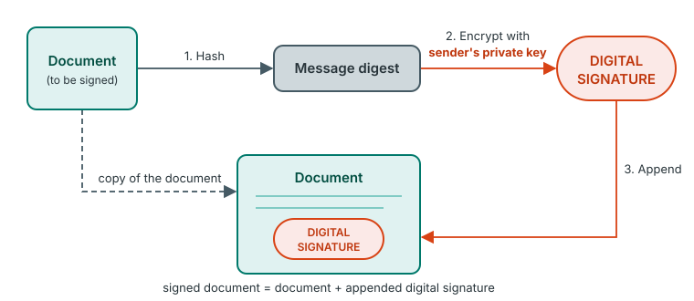{ .diagram }

Fig. 4.1: Hash based digital signature model (redrawn). The step numbers and the "copy of the document" arrow are added by this site.

### Verifying a digital signature

§4.7 · p.36; Fig. 4.2 · p.36

> The receiver can verify the authenticity of this digital signature following the steps below:
>
> • Evaluate the hash of the document (excluding the digital signature).
>
> • Using asymmetric encryption, decrypt the digital signature with the sender's public key to obtain a message digest.
>
> • Compare the results obtained in the two previous steps

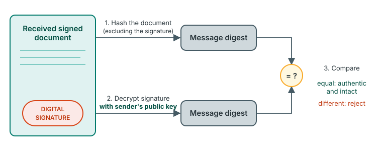{ .diagram }

Fig. 4.2: Verification process of a hash based digital signature (redrawn). The step numbers and the "equal / different" outcomes are added by this site.

| | Signing (sender, Fig. 4.1) | Verifying (receiver, Fig. 4.2) |
|---|---|---|
| **Step 1** | Hash the document | Hash the received document (excluding the signature) |
| **Step 2** | Encrypt the hash with the **sender's private key** → digital signature | Decrypt the signature with the **sender's public key** → message digest |
| **Step 3** | Append the signature to the document | Compare the two digests: equal = authentic and intact |

!!! note "In plain terms"
    - **Why hash first?** The hash is short and fixed-length, so encrypting it with the (slow) private key is quick, whatever the size of the document; and the hash ties the signature to **this exact** document.
    - **Why it works:** only the sender has the private key, so only the sender could have produced a signature that the sender's **public** key "unlocks" (authentication, non-repudiation). If even one bit of the document changed, the receiver's fresh hash would differ from the decrypted one (integrity: the avalanche effect).
    - **If the digests differ**, either the document was altered or it was not signed with that sender's private key. Either way, reject it.
    - Signing uses the **private** key; verifying uses the **public** key. This is the reverse of encryption for confidentiality.

!!! example "Example"
    The registrar of a Nigerian university emails a student's transcript as a signed PDF to a university in Ghana. The PDF software hashes the transcript and encrypts the hash with the registrar's **private** key. In Ghana, the admissions office's software hashes the received transcript, decrypts the signature with the registrar's **public** key (taken from the registrar's certificate), and compares. If a student had changed a C to an A, the hashes would not match.

!!! tip "Exam angle"
    "With the aid of a diagram, explain how a document is digitally signed and how the signature is verified" is one of the most likely questions in the unit, worth 6–10 marks. Draw **both** figures, number the steps, and name the keys precisely: "**sender's private key**" to sign and "**sender's public key**" to verify. Also learn the **five properties** (secure, authentication, not transferable, unchangeable, undeniable) and the **four additional requirements**: two separate "list" questions.

**Check your understanding**

In the hash-based digital signature model, what does the receiver do with the sender's public key?

<ul class="quiz-options">
  <li>Encrypt the document before replying</li>
  <li>Hash the document</li>
  <li data-correct>Decrypt the digital signature to obtain a message digest</li>
  <li>Generate a new signature to compare with the received one</li>
</ul>

Verification: (1) hash the document (excluding the signature); (2) "decrypt the digital signature with the sender's public key to obtain a message digest"; (3) compare. Hashing is step 1 and needs no key. The receiver cannot generate the signature because that needs the sender's private key (§4.7, Fig. 4.2, p.36).

Someone copies a valid digital signature from one signed contract and attaches it to a different contract. Which property and requirement make this fail?

<ul class="quiz-options">
  <li>Undeniable; practical to retain a copy in storage</li>
  <li data-correct>Not transferable; the signature must be a bit pattern that depends on the message being signed</li>
  <li>Secure; realization must be relatively easy</li>
  <li>Facilitates authentication; uses information unique to the sender</li>
</ul>

"The signature is not transferable – … an unauthorized subject is unable to transfer the signature to another document." Because the signature depends on the message (its hash), it won't verify against the second contract. "Uses information unique to the sender" prevents forgery and denial, not transfer (§4.7, pp.34–35).

Which security property does a digital signature on its own NOT provide?

<ul class="quiz-options">
  <li>Authentication of the signer</li>
  <li>Integrity of the message</li>
  <li>Non-repudiation</li>
  <li data-correct>Confidentiality of the message</li>
</ul>

The signature is appended to the document, which stays readable; anyone with the public key can verify it. The courseware notes a signature "can be used with any kind of message, whether encrypted or not": confidentiality needs separate encryption (§4.7, pp.34–35).

## Digital certificates

§4.8 · p.37

A digital signature is only as trustworthy as the public key used to check it. How do you know that public key really belongs to the registrar, the bank or the website? That is the job of a digital certificate.

> A **digital certificate** is a file or electronic password that proves the authenticity of a device, server, or user through the use of cryptography and the public key infrastructure (PKI). A digital certificate contains identifiable information, such as a user's name, company, or department and a device's Internet Protocol (IP) address or serial number. Digital certificates contain a copy of a public key from the certificate holder, which needs to be matched to a corresponding private key to verify it is real. A public key certificate is issued by certificate authorities (CAs), which sign certificates to verify the identity of the requesting device or user.

> Digital certificates can be requested by individuals, organizations, and websites. To do so, they provide the information to be validated and a public key through a certificate signing request. The information is validated by a publicly trusted CA, which signs it with a key that provides a chain of trust to the certificate. This enables the certificate to be used to prove the authenticity of a document, for client authentication, or to provide proof of a website's credential.

> Digital certificates are issued by CAs, which sign a certificate to prove the authenticity of the individual or organization that issued the request. A CA is responsible for managing domain control verification and verifying that the public key attached to the certificate belongs to the user or organization that requested it. They play an important part in the PKI process and keeping internet traffic secure.

> There are three different types of public key certificates: a transport layer security (TLS)/SSL certificate, a code signing certificate, and a client certificate.

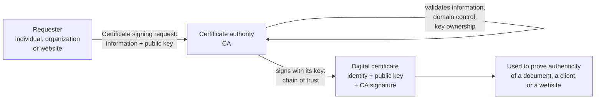

How a digital certificate is requested and issued (drawn for this site from §4.8).

!!! note "In plain terms"
    - A certificate is like an **international passport for a public key**: it binds an identity (name, company, department, IP address or serial number) to a public key, and is **signed by a trusted authority (the CA)**, just as a passport is issued by the immigration service. Anyone who trusts the CA can trust the binding.
    - **What it contains:** identifying information + a **copy of the holder's public key** (+ the CA's signature). The **private key** is never in the certificate; the holder keeps it, and proving you have it is how you show the certificate is yours.
    - **The request:** the requester sends a **certificate signing request (CSR)** containing the information to be validated and the public key.
    - **The CA's two responsibilities** *(the courseware's)*: managing **domain control verification**, and verifying that **the public key belongs to** the requester.
    - **Chain of trust:** the CA signs with a key that is itself trusted (browsers and operating systems come with a list of trusted CAs), so trust flows down from the CA to your certificate.
    - **PKI (public key infrastructure)** is the whole system of CAs, certificates and keys.

!!! info "Beyond the notes"
    The most common certificate format is **X.509**. A certificate also carries an **expiry date**, and CAs can **revoke** a certificate before it expires (e.g. if the private key is stolen). Browsers warn "Not secure" when a site has no valid certificate, or when its certificate has expired, been revoked, or was issued for a different domain name.

### TLS/SSL certificates

§4.8.1 · pp.37–38

> A **TLS/SSL certificate** sits on a server— such as an application, mail, or web server—to ensure communication with its clients is private and encrypted. The certificate provides authentication for the server to send and receive encrypted messages to clients. The existence of a TLS/SSL certificate is signified by the Hypertext Transfer Protocol Secure (HTTPS) designation at the start of a Uniform Resource Locator (URL) or web address. It comes in three forms:
>
> **Domain validated**
>
> A domain validated certificate is a quick validation method that is acceptable for any website. It is cheap to obtain and can be issued in a matter of minutes.
>
> **Organization validated**
>
> This provides light business authentication and is ideal for organizations selling products online through e-commerce.
>
> **Extended validation**
>
> This offers full business authentication, which is required by larger organizations or any business dealing with highly sensitive information. It is typically used by businesses in the financial industry and offers the highest level of authentication, security, and trust.

| Form | Level of authentication | Cost and speed | Ideal for |
|---|---|---|---|
| **Domain validated (DV)** | Quick validation (*site:* only proves control of the domain name) | Cheap; issued in minutes | Any website (a blog, a student project, a small school site) |
| **Organization validated (OV)** | **Light** business authentication | *(not stated)* | Organizations **selling products online** (e-commerce) |
| **Extended validation (EV)** | **Full** business authentication; **highest** authentication, security and trust | *(not stated; site: the most expensive and slowest)* | Larger organizations, businesses handling **highly sensitive information**, the **financial industry** |

### Code signing certificates

§4.8.2 · p.38

> A **code signing certificate** is used to confirm the authenticity of software or files downloaded through the internet. The developer or publisher signs the software to confirm that it is genuine to users that download it. This is useful for software providers that make their programs available on third-party sites to prove that files have not been tampered with.

### Client certificates

§4.8.3 · p.38

> A **client certificate** is a digital ID that identifies an individual user to another user or machine, or one machine to another. A common example of this is email, where a sender signs a communication digitally and its signature is verified by the recipient. Client certificates can also be used to help users access protected databases.

| Type | Sits on / identifies | Proves | Courseware examples |
|---|---|---|---|
| **TLS/SSL** | A **server** (application, mail or web server) | The server's identity; enables private, encrypted communication | HTTPS at the start of a URL |
| **Code signing** | **Software** from a developer or publisher | Software is genuine and not tampered with | Programs distributed on third-party sites |
| **Client** | An **individual user** (to a user or machine) or **one machine** to another | The user's or machine's identity | Digitally signed email; access to protected databases |

!!! example "Example"
    - A Nigerian bank's internet-banking site should use an **EV** TLS certificate: the courseware says EV is "typically used by businesses in the financial industry". A Jumia-style online shop needs at least **OV**; a lecturer's course blog is fine with **DV**.
    - A software company in Yaba that distributes its accounting software through download sites signs it with a **code signing** certificate, so customers' computers can confirm it is genuine and untampered.
    - A hospital issues **client certificates** to doctors' laptops so that only those machines can open the patient-records database.

!!! tip "Exam angle"
    "State the **three** types of digital certificate" and "Explain the **three** forms of TLS/SSL certificate" are two separate questions; don't mix up the two lists. For DV, OV and EV, a scenario will describe an organization and ask which form it needs: match **any website → DV**, **e-commerce → OV**, **financial / highly sensitive / large → EV**, and justify by the level of authentication.

**Check your understanding**

What does a CA do when it receives a certificate signing request?

<ul class="quiz-options">
  <li>Generates the requester's private key and keeps a copy</li>
  <li data-correct>Validates the requester's information (including domain control and key ownership) and signs the certificate</li>
  <li>Encrypts the requester's website traffic</li>
  <li>Hashes the requester's password</li>
</ul>

The requester sends the information to be validated and a **public** key in the CSR; the CA validates it, manages domain control verification, verifies that the public key belongs to the requester, and signs it, giving a chain of trust. The private key stays with the requester (§4.8, p.37).

A Nigerian microfinance bank is launching internet banking. Which form of TLS/SSL certificate fits the courseware's description best?

<ul class="quiz-options">
  <li>Domain validated</li>
  <li>Organization validated</li>
  <li data-correct>Extended validation</li>
  <li>Code signing</li>
</ul>

Extended validation "offers full business authentication, which is required by … any business dealing with highly sensitive information. It is typically used by businesses in the financial industry". OV is for e-commerce; DV is the cheap, quick option for any website. Code signing is a certificate **type**, not a TLS/SSL form (§4.8.1, pp.37–38).

## Benefits of digital certificates

§4.9 · pp.38–39

> Key benefits of digital certificates include:
>
> **i. Security**
>
> Digital certificates encrypt internal and external communications to prevent attackers from intercepting and stealing sensitive data. For example, a TLS/SSL certificate encrypts data between a web server and a web browser, ensuring an attacker cannot intercept website visitors' data.
>
> **ii. Scalability**
>
> Digital certificates provide businesses of all shapes and sizes with the same encryption quality. They are highly scalable, which means they can easily be issued, revoked, and renewed in seconds, used to secure user devices, and managed through a centralized platform.
>
> **iii. Authenticity**
>
> Digital certificates are crucial to ensuring the authenticity of online communication in the age of widespread cyberattacks. They make sure that users' messages will always reach their intended recipient—and only reach their intended recipient. TLS/SSL certificates encrypt websites, Secure/Multipurpose Internet Mail Extensions (S/MIME) encrypt email communication, and document-signing certificates can be used for digital document sharing.
>
> **iv. Reliability**
>
> Only publicly trusted CAs can issue recognized digital certificates. Obtaining one requires rigorous vetting, which ensures hackers or fake organizations cannot trick victims that use a digital certificate.
>
> **iv. Public trust**
>
> Using a digital certificate provides confirmation that a website is genuine and that documents and emails are authentic. This projects public trust, assuring clients that they are dealing with a genuine company that values their security and privacy.

!!! note "In plain terms"
    Five benefits *(numbered i–iv, iv in the courseware; there are five)*: **Security, Scalability, Authenticity, Reliability, Public trust**. Memory aid *(the site's)*: "**S**ome **S**tudents **A**lways **R**ead **P**roperly" (**S**ecurity, **S**calability, **A**uthenticity, **R**eliability, **P**ublic trust).

    | Benefit | Key phrase to quote |
    |---|---|
    | Security | Encrypt communications; prevent intercepting and stealing data |
    | Scalability | Same encryption quality for all sizes; issued, revoked, renewed in seconds; centralized platform |
    | Authenticity | Messages reach the intended recipient, and only them; TLS/SSL, S/MIME, document-signing certificates |
    | Reliability | Only publicly trusted CAs; rigorous vetting stops hackers and fake organizations |
    | Public trust | Confirms the website is genuine; assures clients |

!!! warning "Courseware note"
    The benefits are numbered i, ii, iii, iv, **iv**: "Public trust" should be **v**. There are **five** benefits, not four. The courseware also says certificates "encrypt" communications and that "S/MIME encrypt[s] email"; strictly, a certificate enables encryption by supplying a trusted public key, and S/MIME is a standard that uses certificates. The meaning is clear.

## Digital certificate vs digital signature

§4.10 · p.39

> A digital certificate is a file that verifies the identity of a device or user and enables encrypted connections. A digital signature is a hashing approach that uses a numeric string to provide authenticity and validate identity. A digital signature is typically fixed to a document or email using a cryptographic key. The signature is hashed, and when the recipient receives it, it performs that same hash function to confirm that the information from the signer and has not been altered.

| Criterion | Digital certificate | Digital signature |
|---|---|---|
| **What it is** | A **file** that verifies the identity of a device or user | A **hashing approach** that uses a numeric string |
| **Purpose** | Verifies identity **and enables encrypted connections** | Provides **authenticity** and validates identity (plus integrity: confirms the information has not been altered) |
| **Attached to** | A server, software, user or machine (§4.8) | A **document or email** |
| **Issued / created by** | A certificate authority (CA), after validating a CSR | The signer, using their private key (§4.7) |
| **Contains** *(site, from §4.7–§4.8)* | Identity information + the holder's public key + the CA's signature | The encrypted hash of the document |
| **How they work together** *(site)* | Supplies the trusted **public key** … | … which the receiver needs to **verify** the signature |

!!! note "In plain terms"
    A **signature** says "*this* document came from me and is unchanged". A **certificate** says "*this* public key really belongs to me, and a trusted authority vouches for it". Without a certificate, a forger could publish their own public key under your name and sign documents as you. So a certificate is itself protected by a digital signature (the CA's), and a signature is trusted because of a certificate.

!!! warning "Courseware note"
    The last sentence of §4.10 is garbled: "to confirm that the information from the signer and has not been altered" should read "to confirm that the information **came** from the signer and has not been altered". It also says "the signature is hashed"; in the scheme of §4.7, it is the **document** that is hashed, and the signature is the encrypted hash. Answer from §4.7 when describing how signing works.

!!! tip "Exam angle"
    "Differentiate between a digital certificate and a digital signature" is almost guaranteed somewhere in the paper, because §4.10 exists only to answer it. Give **four** criteria (what it is, purpose, attached to, issued by) and end with the sentence on how they work together.

**Check your understanding**

How many benefits of digital certificates does the courseware list?

<ul class="quiz-options">
  <li>Three</li>
  <li>Four</li>
  <li data-correct>Five</li>
  <li>Six</li>
</ul>

Security, scalability, authenticity, reliability and public trust: five. The numbering i–iv, iv makes it look like four; "Public trust" is the fifth (§4.9, pp.38–39).

Which statement correctly distinguishes a digital certificate from a digital signature?

<ul class="quiz-options">
  <li>A certificate is attached to an email; a signature is installed on a web server</li>
  <li data-correct>A certificate is a file verifying the identity of a device or user and enabling encrypted connections; a signature is a hashing approach fixed to a document or email to provide authenticity</li>
  <li>A certificate is created by the signer's private key; a signature is issued by a CA</li>
  <li>They are two names for the same thing</li>
</ul>

This is §4.10's wording. The first and third options swap the two: CAs issue certificates, and signers create signatures with their private keys (§4.10, p.39; §4.7–§4.8).

## Key terms

Cryptography
:   The science of securing communication and data by converting it into a form that can only be understood by the intended recipient; ensures confidentiality, integrity and authenticity.

Data at rest
:   Stored data, such as files on computers and storage devices (e.g. USB flash drives); encrypting it protects it should physical security measures fail.

Data in transit
:   Data being transferred via networks, mobile telephones, wireless devices, Bluetooth or ATMs; encrypted because it is difficult to physically secure all access to networks.

Digital rights management (DRM)
:   Systems that prevent unauthorized use or reproduction of copyrighted material and protect software against reverse engineering; an example of encryption of data at rest.

Hybrid cryptosystem
:   A system that combines categories of cryptography, such as SSL: asymmetric for key exchange and authentication, symmetric for bulk data, hashes for integrity.

Symmetric encryption
:   A method of scrambling data using a single shared secret key that both encrypts and decrypts; also called secret key cryptography, private key cryptography or symmetric key encryption.

Block cipher
:   A symmetric cipher that processes fixed-size data blocks (e.g. AES, DES, Blowfish).

Stream cipher
:   A symmetric cipher that encrypts data one bit at a time (e.g. RC4).

AES (Advanced Encryption Standard)
:   The gold-standard symmetric block cipher today (AES-128, AES-192, AES-256), used for sensitive government data.

DES (Data Encryption Standard)
:   An older symmetric algorithm, now largely obsolete due to vulnerabilities; improved on by Triple DES (3DES), which is also being phased out.

Asymmetric encryption
:   Public-key cryptography: encryption using a pair of keys, a public key shared with anyone and a private key kept secret by the owner; the sender encrypts with the recipient's public key and the recipient decrypts with their private key.

RSA (Rivest-Shamir-Adleman)
:   The most common asymmetric algorithm, for encrypting small data, digital signatures and key exchange; relies on the difficulty of factoring the product of two massive primes.

ECC (Elliptic Curve Cryptography)
:   An asymmetric approach using algebraic curves that gives high security with much smaller keys than RSA; ideal for mobile and internet-connected devices.

Diffie-Hellman (DH)
:   An asymmetric protocol used strictly for safely exchanging a secret key over an open network, not for encrypting files; variant ECDH.

DSA (Digital Signature Algorithm)
:   A standard used only to verify the authenticity and identity of a digital message or sender, not for hiding data; variant ECDSA.

Cryptographic hash function
:   A mathematical algorithm that transforms input data of any length into a fixed-length hash value; intended to be fast, deterministic and one-way.

Message digest
:   The hash value of a message, as used in message authentication and digital signatures.

Avalanche effect
:   The property that a tiny change in the input, even one bit, causes a significant and unpredictable change in the hash output.

Pre-image resistance
:   It is computationally infeasible to retrieve the original input from its hash value.

Second pre-image resistance
:   Given an input and its hash, it is extremely difficult to find a different input that produces the same hash.

Collision resistance
:   The hash function minimizes the chance that two distinct inputs produce identical hash values.

Message authentication code (MAC)
:   A hash value generated from a secret key shared by two parties and a data block; verifies the integrity and origin of a communication.

Checksum
:   A hash of a data file used for a data integrity check; detects modification but does not stop an attacker replacing both file and hash.

MD5
:   Message Digest Algorithm 5: once widely used, now insecure because collisions can be generated easily.

SHA-1
:   Secure Hash Algorithm 1: improved on MD5 but deprecated after practical collision attacks, including for SSL/TLS certificates and digital signatures.

SHA-2
:   The industry-standard hash family (SHA-256, SHA-512) with 256- and 512-bit outputs; used in secure protocols, blockchain and password hashing.

SHA-3 (Keccak)
:   The latest NIST hash standard, using a sponge construction different from SHA-2; suited to long-term security.

BLAKE2 and BLAKE3
:   High-speed, secure alternatives to SHA-2 and SHA-3; BLAKE3 supports parallel processing and incremental updates.

TLS (Transport Layer Security)
:   A cryptographic protocol providing secure, encrypted communication over a network with identity verification; made of the handshake and record protocols; secures HTTPS, SMTP and FTPS.

TLS handshake protocol
:   The part of TLS that authenticates the server (sometimes the client) by digital certificate, agrees a cipher suite and exchanges keys to establish shared session keys.

TLS record protocol
:   The part of TLS that secures data during the connection, using the negotiated cipher suite and symmetric keys to encrypt data and create MACs.

Cipher suite
:   A set of algorithms agreed in the handshake, defining which are used for key exchange, encryption and message authentication.

Session key
:   A shared secret (symmetric) key established during a TLS/SSL handshake and used to encrypt and authenticate the session's data.

SSL (Secure Sockets Layer)
:   The predecessor of TLS, developed by Netscape in the 1990s; largely superseded by TLS due to security vulnerabilities.

SSH (Secure Shell)
:   A cryptographic network protocol for secure data communication, command-line login, remote command execution and other secure network services between two networked computers.

Port forwarding
:   An SSH feature that lets clients securely tunnel network connections through the SSH connection to reach services on remote networks.

Digital signature
:   An electronic signature that authenticates the identity of the sender or signer and possibly ensures message integrity; in the hash-based scheme, the document's hash encrypted with the sender's private key.

Non-repudiation
:   The assurance that the sender or signer cannot later deny having sent or signed a message; provided by digital signatures.

Digital certificate
:   A file or electronic password that proves the authenticity of a device, server or user through cryptography and PKI; contains identifying information and a copy of the holder's public key, signed by a CA.

Public key infrastructure (PKI)
:   The system of certificate authorities, certificates and key pairs through which digital certificates prove authenticity.

Certificate authority (CA)
:   A publicly trusted body that validates a requester's information, manages domain control verification, verifies key ownership and signs digital certificates.

Certificate signing request (CSR)
:   The request through which an individual, organization or website submits the information to be validated and its public key to a CA.

TLS/SSL certificate
:   A certificate on a server that authenticates it and enables private, encrypted communication, signified by HTTPS; comes as domain validated, organization validated or extended validation.

Extended validation (EV) certificate
:   The TLS/SSL certificate form offering full business authentication and the highest level of trust; used by large organizations and the financial industry.

Code signing certificate
:   A certificate used by a developer or publisher to sign software, confirming it is genuine and has not been tampered with.

Client certificate
:   A digital ID identifying an individual user to another user or machine, or one machine to another (e.g. signed email, access to protected databases).

---

## Unit summary

- **Cryptography** = the science of securing communication and data so only the intended recipient can understand it; ensures **confidentiality, integrity and authenticity**. Protects data **at rest** (laptops, USB drives, backups, DRM; useful when physical security fails) and **in transit** (networks, phones, wireless microphones and intercoms, Bluetooth, ATMs; networks can't be physically secured). CSI 2007: 71% encrypted some data in transit, 53% in storage.
- **Five applications:** secure communication, data integrity, authentication, digital signatures (authentication + non-repudiation), e-commerce.
- **Three categories** (plus hybrids such as SSL): **symmetric** (one shared secret key; AES-128/192/256, DES, 3DES, Blowfish, RC4/5/6; block vs stream ciphers), **asymmetric** (public/private key pair; encrypt with the recipient's public key, decrypt with the private key; four features: dual keys, encryption/decryption, digital signatures, secure key exchange; RSA, ECC, Diffie-Hellman, DSA), **hash functions** (one-way, fixed length).
- **Hash functions:** fast, deterministic, one-way; used for integrity, signatures and certificate validation, password storage, blockchain. **Working (6):** input processing, fixed-size output, deterministic, avalanche, one-way, collision resistance. **Properties (6):** deterministic, fast, pre-image, second pre-image and collision resistance, avalanche. **Applications (3):** message authentication (MAC, shared secret key), data integrity check (checksum; attacker can replace file and hash), digital signatures. **Algorithms (5):** MD5 (insecure), SHA-1 (deprecated), SHA-2 (standard: 256/512 bits), SHA-3 (Keccak, sponge, latest NIST), BLAKE2/3 (fast; BLAKE3 parallel and incremental).
- **TLS:** handshake protocol (certificate authentication of the server, cipher suite, key exchange → session keys) + record protocol (symmetric encryption + MACs); secures HTTPS, SMTP, FTPS against eavesdropping, tampering and impersonation. **SSL:** Netscape, 1990s; predecessor of TLS, superseded due to vulnerabilities; five features (encryption, authentication, key exchange via RSA/DH/ECDH, integrity, handshake); handshake = Client Hello, Server Hello, Key Exchange, Authentication, Session Key Generation, Secure Communication. **SSH:** secure remote login and commands; seven points (encryption, authentication by password/public key/host-based/keyboard-interactive, key exchange, session management, port forwarding, versions SSH-1/SSH-2, applications).
- **Digital signatures:** authenticate the signer, possibly ensure integrity, give non-repudiation. **Five properties:** secure, facilitates authentication, not transferable, unchangeable, undeniable. **Four requirements:** depends on the message; uses information unique to the sender; easy to make, infeasible to forge; practical to store. **Sign (Fig. 4.1):** hash → encrypt hash with sender's private key → append. **Verify (Fig. 4.2):** hash the document → decrypt the signature with sender's public key → compare.
- **Digital certificates:** prove authenticity of a device, server or user through cryptography and PKI; contain identity + the holder's public key; requested by CSR; validated and signed by a **CA** (chain of trust). **Three types:** TLS/SSL (server; HTTPS; DV, OV, EV), code signing (software), client (users or machines; email, databases). **Five benefits:** security, scalability, authenticity, reliability, public trust.
- **Certificate vs signature:** a certificate is a file verifying identity and enabling encrypted connections; a signature is a hashing approach fixed to a document or email to provide authenticity and integrity.

## Mixed review

A Lagos fintech must store customers' login passwords so that even its own database administrators cannot read them. Which technique fits best?

<ul class="quiz-options">
  <li>AES-256 encryption with the key stored on the same server</li>
  <li>RSA encryption with the company's public key</li>
  <li data-correct>A cryptographic hash function (SHA-2 family), ideally with a salt</li>
  <li>A TLS certificate</li>
</ul>

Hash functions "provide safe password storage through hashing passwords prior to saving"; because they are one-way, nobody, including administrators, can recover the password. Any encryption (AES or RSA) is reversible by whoever holds the key, which is exactly what must be prevented. TLS protects passwords in transit, not in storage (§4.5, p.27; §4.5.4, p.30).

Which pairing of key and purpose is correct?

<ul class="quiz-options">
  <li>Sign with the recipient's public key; verify with the recipient's private key</li>
  <li data-correct>Encrypt with the recipient's public key; sign with the sender's private key</li>
  <li>Encrypt with the sender's private key for confidentiality</li>
  <li>Verify a signature with the sender's private key</li>
</ul>

For confidentiality, "the sender uses the recipient's public key to encrypt" (§4.4). For a signature, the hash is encrypted "with the sender's private key" and verified with the sender's public key (§4.7). Encrypting with your own private key gives no confidentiality, since anyone with your public key can decrypt it.

Which statement about hybrid use of cryptography in TLS/SSL is correct?

<ul class="quiz-options">
  <li>All data is encrypted with the server's public key for the whole session</li>
  <li data-correct>Asymmetric cryptography is used for key exchange and authentication, symmetric encryption for bulk data, and hashes/MACs for integrity</li>
  <li>Only hash functions are used, because they are fastest</li>
  <li>Symmetric keys are used only to verify the certificate</li>
</ul>

SSL "uses symmetric encryption for bulk data transfer and asymmetric encryption for key exchange and authentication" and ensures integrity with "cryptographic hash functions and message authentication codes"; in TLS, public key encryption is no longer used once the session keys are set (§4.6.1–§4.6.2). This combination is why the courseware calls SSL a hybrid system (§4.2).

A software firm distributes its app on third-party download sites and wants users to be able to confirm the files have not been tampered with. What should it use?

<ul class="quiz-options">
  <li>A domain validated TLS certificate on its website</li>
  <li data-correct>A code signing certificate</li>
  <li>A client certificate</li>
  <li>MD5 checksums posted on the third-party sites</li>
</ul>

A code signing certificate is "useful for software providers that make their programs available on third-party sites to prove that files have not been tampered with". MD5 is insecure, and a checksum posted on the same untrusted site can simply be replaced by an attacker along with the file (§4.8.2, p.38; §4.5.3–§4.5.4).

Which of these is NOT one of the six properties of cryptographic hash functions in §4.5.2?

<ul class="quiz-options">
  <li>Fast computation</li>
  <li>Second pre-image resistance</li>
  <li data-correct>Reversibility with a secret key</li>
  <li>Avalanche effect</li>
</ul>

The six are deterministic, fast computation, pre-image resistance, second pre-image resistance, collision resistance and avalanche effect. Hashes are one-way: being reversible with a key is what encryption does, not hashing (§4.5.2, pp.28–29).

## Recall drill

Every definition, list, comparison, algorithm, protocol and figure in Chapter 4, as a short question. Answer aloud or on paper, then open the answer.

### Introduction: data at rest and in transit

**R1.** Define *cryptography*.

??? success "Answer"
    The **science of securing communication and data** by converting it into a form that can **only be understood by the intended recipient**. It involves techniques for **encrypting and decrypting** information to ensure its **confidentiality, integrity, and authenticity**.

**R2.** State the three properties cryptography ensures, according to the courseware's definition.

??? success "Answer"
    **Confidentiality, integrity and authenticity.**

**R3.** Who traditionally used encryption, and where is it used now?

??? success "Answer"
    It has long been used by **militaries and governments** to facilitate secret communication; it is now commonly used in protecting information within many kinds of **civilian systems**.

**R4.** State the findings of the Computer Security Institute survey quoted in the courseware.

??? success "Answer"
    In **2007**, **71%** of companies surveyed utilized encryption for some of their data **in transit**, and **53%** utilized encryption for some of their data **in storage**.

**R5.** What is meant by encrypting data "at rest"? Give examples and say why it is done.

??? success "Answer"
    Protecting stored data, **such as files on computers and storage devices (e.g. USB flash drives)**. Confidential data such as customers' personal records has been exposed **through loss or theft of laptops or backup drives**; encrypting such files at rest **helps protect them should physical security measures fail**.

**R6.** What is digital rights management, and how does it relate to encryption?

??? success "Answer"
    Digital rights management systems **prevent unauthorized use or reproduction of copyrighted material and protect software against reverse engineering** (see also copy protection). They are "another somewhat different example of using encryption on **data at rest**".

**R7.** List the examples of data in transit given in the courseware. (There are seven, with networks counted once.)

??? success "Answer"
    Data transferred via **networks (e.g. the Internet, e-commerce), mobile telephones, wireless microphones, wireless intercom systems, Bluetooth devices and bank automatic teller machines**.

**R8.** Why does encrypting data in transit help secure it?

??? success "Answer"
    There have been numerous reports of data in transit being **intercepted**, and **it is often difficult to physically secure all access to networks**.

**R9.** Differentiate data at rest from data in transit.

??? success "Answer"
    **At rest:** stored data (files on computers, USB drives, laptops, backup drives); encryption protects it if physical security fails. **In transit:** data being transferred (networks, phones, wireless devices, Bluetooth, ATMs); encryption protects it because networks cannot be physically secured and interception is common.

### Importance, applications and categories

**R10.** State the five applications of cryptography listed in the courseware.

??? success "Answer"
    **Secure communication, data integrity, authentication, digital signatures, e-commerce.**

**R11.** Explain how cryptography provides (a) secure communication and (b) data integrity.

??? success "Answer"
    (a) It ensures that **sensitive information transmitted over networks**, such as financial transactions and personal messages, **remains private and cannot be intercepted** by unauthorized parties. (b) **Cryptographic hash functions** verify integrity by **generating a unique fixed-size hash value** for a given input; **any change in the data will result in a different hash value**, allowing detection of tampering.

**R12.** Explain how cryptography supports (a) authentication, (b) digital signatures and (c) e-commerce.

??? success "Answer"
    (a) It provides mechanisms for **verifying the identity of parties** involved in communication, **preventing impersonation and unauthorized access**. (b) Digital signatures enable **authentication and non-repudiation** of digital documents, **binding a unique digital fingerprint to a message**, providing **proof of its origin and integrity**. (c) It underpins secure online transactions, ensuring sensitive information such as **credit card numbers and personal details is encrypted during transmission**, protecting it from eavesdroppers and hackers.

**R13.** State the three main categories of encryption techniques and give the courseware's example of a hybrid system.

??? success "Answer"
    **Symmetric cryptography algorithms, asymmetric cryptography algorithms, and hash functions.** Hybrid systems exist, **such as the SSL internet protocols**.

**R14.** Give the examples listed for each of the three categories on p.24.

??? success "Answer"
    **Symmetric:** AES, DES, Blowfish etc. **Asymmetric:** RSA, Diffie-Hellman key exchange, ECC. **Hashing:** SHA-1 and SHA-2 (SHA-256, SHA-512).

### Symmetric encryption

**R15.** Define *symmetric encryption*.

??? success "Answer"
    A method of **scrambling data using a single shared secret key**. Whoever holds that key can **both encode (encrypt) and decode (decrypt)** the information.

**R16.** Describe the classic analogy for symmetric encryption.

??? success "Answer"
    A **locked mailbox that you and your trusted friend both have the key to**. You can send a secret letter, the friend unlocks it, and **no eavesdropper can read the note unless they steal the key**.

**R17.** State three other names for symmetric encryption.

??? success "Answer"
    **Secret key cryptography, private key cryptography, symmetric key encryption.**

**R18.** How can you tell whether symmetric or asymmetric encryption is being used?

??? success "Answer"
    **If both parties have the same key**, it is symmetric. **If they each use a different key**, it is asymmetric (two keys: one public, one private).

**R19.** List the most widely used symmetric encryption algorithms. (There are five entries.)

??? success "Answer"
    **AES** (Advanced Encryption Standard); **DES** (Data Encryption Standard); **Triple DES (3DES)**; **Blowfish**; **RC4, RC5, RC6**.

**R20.** Comment on each symmetric algorithm's status, according to the courseware.

??? success "Answer"
    **AES:** the gold standard today (AES-128, AES-192, AES-256), used for sensitive government data. **DES:** older, now largely obsolete due to vulnerabilities. **3DES:** an improvement over DES, but also being phased out. **Blowfish:** fast, flexible, used in some security software. **RC4, RC5, RC6:** a series of algorithms, with RC4 still seeing legacy use.

**R21.** State the three variants of AES.

??? success "Answer"
    **AES-128, AES-192 and AES-256.**

**R22.** Differentiate block ciphers from stream ciphers, with examples.

??? success "Answer"
    **Block ciphers** process **fixed-size data blocks** (e.g. **AES, DES, Blowfish**). **Stream ciphers** encrypt data **one bit at a time** (e.g. **RC4**).

### Asymmetric encryption

**R23.** Define *asymmetric encryption*. What is its other name?

??? success "Answer"
    A type of encryption that **uses a pair of keys to encrypt and decrypt data**: a **public key, which can be shared with anyone**, and a **private key, which is kept secret by the owner**. Also known as **public-key cryptography**.

**R24.** Explain how two parties communicate securely using asymmetric encryption.

??? success "Answer"
    The **sender uses the recipient's public key to encrypt** the data. The **recipient then uses their private key to decrypt** it. This allows secure communication **without the need for both parties to have the same secret key**.

**R25.** State the four main features of asymmetric encryption.

??? success "Answer"
    **Dual keys; encryption and decryption; digital signatures; secure key exchange.**

**R26.** Explain the "dual keys" and "encryption and decryption" features.

??? success "Answer"
    **Dual keys:** a pair of keys, a public key and a private key; the public key can be **freely shared with anyone**, while the private key is **kept secret and known only to the key owner**. **Encryption and decryption:** the **public key encrypts** data and the **private key decrypts** it, allowing secure communication **without the need to exchange secret keys**.

**R27.** Explain the "digital signatures" and "secure key exchange" features.

??? success "Answer"
    **Digital signatures:** asymmetric encryption enables digital signatures, which verify the authenticity of data; a digital signature is created by **encrypting a hash of the data with the sender's private key**. **Secure key exchange:** a critical feature in secure communication; e.g. the **Diffie-Hellman** key exchange algorithm establishes a **shared secret key between two parties without exchanging the key itself**.

**R28.** List four asymmetric algorithms.

??? success "Answer"
    **RSA** (Rivest-Shamir-Adleman), **ECC** (Elliptic Curve Cryptography), **Diffie-Hellman (DH)**, **DSA** (Digital Signature Algorithm).

**R29.** What is RSA used for, and what does its security rely on?

??? success "Answer"
    The most common algorithm for **encrypting small data, digital signatures, and secure key exchanges**. It relies on the **extreme difficulty of factoring the product of two massive prime numbers**.

**R30.** Describe ECC and state why it suits mobile devices.

??? success "Answer"
    A modern approach using **algebraic curves**. It provides **high security with much smaller key sizes than RSA**, making it ideal for **mobile phones and internet-connected devices**.

**R31.** Differentiate Diffie-Hellman from DSA, naming each one's variant.

??? success "Answer"
    **Diffie-Hellman:** a protocol used **strictly for safely exchanging a secret key over an open network** rather than encrypting files directly; variant **ECDH**. **DSA:** a standard used **only to verify the authenticity and identity** of a digital message or sender, **not for hiding data**; variant **ECDSA**.

**R32.** Draw and label the asymmetric encryption diagram (p.26).

??? success "Answer"
    Plain Text → **encryption** (using the **Public Key**) → **Cipher Text** → **decryption** (using the **Private Key**) → Plain Text. Both keys are the **recipient's**. See the [redrawn figure](#asymmetric-encryption).

**R33.** Differentiate symmetric from asymmetric encryption.

??? success "Answer"
    **Symmetric:** a **single shared secret key** both encrypts and decrypts; also called secret/private key cryptography; e.g. AES, DES, 3DES, Blowfish, RC4. **Asymmetric:** a **pair of keys**, public (shared) and private (secret); the recipient's public key encrypts and their private key decrypts; also called public-key cryptography; enables digital signatures and secure key exchange **without exchanging secret keys**; e.g. RSA, ECC, DH, DSA.

### Cryptographic hash functions

**R34.** Define *cryptographic hash functions*. What three things are they intended to be?

??? success "Answer"
    **Mathematical algorithms that transform input data into a fixed-length sequence of characters, referred to as a hash value.** They are intended to be **fast, deterministic, and one-way**, meaning that even a minor change in input yields a very different hash.

**R35.** State four roles of cryptographic hash functions given in §4.5.

??? success "Answer"
    (1) **Protect data integrity** by creating identifying hash values that reveal unauthorized changes in real time. (2) The **foundation for digital signatures and certificate validation**, verifying the authenticity of software and communications. (3) **Safe password storage** by hashing passwords before saving. (4) **Blockchain and distributed ledgers**: connecting blocks by hash values for transparency and tamper-proof record-keeping.

**R36.** List the six points in the working of a cryptographic hash function.

??? success "Answer"
    **Input processing; fixed-size output generation; deterministic operation; avalanche effect; one-way computation; collision resistance.**

**R37.** Explain *input processing* and *fixed-size output generation*.

??? success "Answer"
    **Input processing:** the function processes an **input of any length** (text, file or data stream), from several bytes to gigabytes, through a **sequence of mathematical operations**. **Fixed-size output generation:** **no matter what the length of the input**, it generates a **fixed-size hash value**, normally a **hexadecimal string**.

**R38.** Explain *deterministic operation* and *one-way computation*.

??? success "Answer"
    **Deterministic:** the function **consistently computes the same hash for the same input**, enabling data authentication, as any alteration leads to a different hash. **One-way:** the algorithm is **irreversible**: it is computationally impossible to **recover the original input from its hash value**, protecting passwords and digital signatures.

**R39.** State the six properties of cryptographic hash functions.

??? success "Answer"
    **Deterministic; fast computation; pre-image resistance; second pre-image resistance; collision resistance; avalanche effect.**

**R40.** Define the *avalanche effect*.

??? success "Answer"
    **Even a tiny change in the input, such as flipping a single bit, causes a significant and unpredictable change in the hash output**, enhancing the function's sensitivity to data modifications (and making collisions highly unlikely).

**R41.** Explain *fast computation* as a hash property.

??? success "Answer"
    Hash functions are designed to **process inputs quickly and efficiently**, making them practical for **large datasets and real-time applications**.

**R42.** Differentiate pre-image resistance, second pre-image resistance and collision resistance.

??? success "Answer"
    **Pre-image resistance:** computationally infeasible to **retrieve the original input from its hash value**. **Second pre-image resistance:** **given an input and its hash**, extremely difficult to find **a different input that produces the same hash** (prevents impersonation or forgery). **Collision resistance:** minimizes the chance that **two distinct inputs** produce **identical hash values** (any two, chosen freely).

**R43.** State the three applications of cryptographic hash functions.

??? success "Answer"
    **Message authentication; data integrity check; digital signatures.**

**R44.** What is message authentication, and what is the hash value called in this context?

??? success "Answer"
    A **system or service that verifies the integrity of a communication**, ensuring data is **received precisely as transmitted, with no modifications, insertions, or deletions**. The hash value is sometimes called a **message digest**.

**R45.** What is a MAC and how is it generated?

??? success "Answer"
    A **message authentication code**, widely used **between two parties that share a secret key** for authentication. A MAC function uses **a secret key and a data block** to generate a hash value that identifies the protected communication.

**R46.** Explain the data integrity check application and its limitation.

??? success "Answer"
    Hash functions are most commonly used to **create checksums for data files**, giving assurance that the data is correct and allowing **detection of any modifications** to the original file. **Limitation:** it **does not assure uniqueness**: instead of altering file data, **the attacker can update the entire file, compute a new hash, and deliver it** to the recipient.

**R47.** How are hash functions used in digital signatures (as an application)?

??? success "Answer"
    The application is **comparable to message authentication** and operates **similarly to MACs**. Digital signatures **encrypt message hash values using a user's private key**, and the signature **may be verified by anybody who knows the user's public key**.

**R48.** Differentiate a MAC from a digital signature.

??? success "Answer"
    A **MAC** uses a **secret key shared** between two parties, so only they can verify it. A **digital signature** encrypts the hash with the user's **private key** and can be verified by **anybody who knows the public key** (and, as only the signer holds the private key, gives non-repudiation).

**R49.** List five popular cryptographic hash algorithms.

??? success "Answer"
    **MD5; SHA-1; SHA-2 family (SHA-256, SHA-512); SHA-3 (Keccak); BLAKE2 and BLAKE3.**

**R50.** Why is MD5 no longer recommended, and why was it popular?

??? success "Answer"
    It is **insecure due to vulnerabilities that allow attackers to generate hash collisions easily**. It was popular for its **speed and simplicity**. Once widely used for data integrity and digital signatures.

**R51.** Describe SHA-1 and its status.

??? success "Answer"
    It **improved upon MD5 with a longer hash length and better collision resistance**, but advances in computational power and cryptanalysis led to **practical collision attacks**. It is **deprecated** for most security uses, **including SSL/TLS certificates and digital signatures**.

**R52.** Describe the SHA-2 family.

??? success "Answer"
    **Currently the industry standard** for cryptographic hashing, with **longer hash outputs of 256 and 512 bits** (SHA-256, SHA-512). Strong **collision and pre-image resistance**; preferred for **secure communication protocols, blockchain technologies, and password hashing**.

**R53.** Describe SHA-3.

??? success "Answer"
    Also called **Keccak**; **adopted as the latest NIST standard**; uses a **unique sponge construction different from SHA-2**, enhancing security and flexibility; comparable hash lengths with improved resistance to certain attacks; suitable for **long-term security**.

**R54.** Describe BLAKE2 and BLAKE3.

??? success "Answer"
    **High-speed, secure alternatives to SHA-2 and SHA-3**, giving faster hashing without compromising security. **BLAKE3** in particular supports **parallel processing and incremental updates**, ideal for modern systems needing speed and strong guarantees.

**R55.** Differentiate hashing from encryption.

??? success "Answer"
    **Encryption** is reversible: data encrypted with a key can be **decrypted** with the same key (symmetric) or the paired key (asymmetric), for **confidentiality**. **Hashing** uses no key and is **one-way**: the original input cannot be recovered from the fixed-length hash; it is used for **integrity**, password storage and signatures.

### Cryptographic protocols

**R56.** Define *TLS*.

??? success "Answer"
    **Transport Layer Security**: a cryptographic protocol designed to **provide secure communication over a network**, typically the internet. It ensures that data transmitted between two parties is **encrypted and remains confidential**, and that **the parties can verify each other's identities**.

**R57.** Name the two protocols that make up TLS.

??? success "Answer"
    The **handshake protocol** and the **record protocol**.

**R58.** Explain the TLS handshake protocol.

??? success "Answer"
    It **establishes a secure connection** between client and web server. Using **public key cryptography**, the **server is authenticated (and sometimes the client) using a digital certificate**. Client and server then **agree on a cipher suite** (a set of encryption algorithms) and **perform a key exchange** to establish **shared session keys** (secret keys for encryption and hashing). Once the session keys are established, the secure session is set up, and **public key encryption is no longer used**: all later data is encrypted and authenticated with **secret key cryptography**.

**R59.** Explain the TLS record protocol.

??? success "Answer"
    It is **responsible for securing data transmitted during the TLS connection**, using the **cipher suite and keys negotiated during the handshake** as a recipe. The **symmetric (secret) keys encrypt outgoing data and decrypt incoming data**, and are also used to **create message authentication codes**, which verify the **integrity** of the data.

**R60.** What is a cipher suite?

??? success "Answer"
    **A set of encryption algorithms** agreed during the handshake; it **defines which algorithms should be used for key exchange, encryption and message authentication**.

**R61.** Name three internet protocols secured by TLS (or SSL), and three attacks TLS protects against.

??? success "Answer"
    **HTTPS** (secure web browsing), **SMTP** (email transmission), **FTPS** (secure file transfer), and more. It protects against **eavesdropping, tampering, and impersonation** attacks.

**R62.** Define *SSL*. Who developed it, and when?

??? success "Answer"
    **Secure Sockets Layer**: a **predecessor to TLS** and a cryptographic protocol designed to provide secure communication over a network, ensuring data between client and server **remains confidential and cannot be tampered with**. **Developed by Netscape in the 1990s.**

**R63.** State the five features of SSL listed in the courseware.

??? success "Answer"
    **Encryption; authentication; key exchange; integrity; SSL handshake.**

**R64.** Explain SSL encryption, authentication and integrity.

??? success "Answer"
    **Encryption:** encrypts client–server data, preventing eavesdropping; **symmetric encryption for bulk data transfer and asymmetric encryption for key exchange and authentication**. **Authentication:** the **server presents a digital certificate containing its public key**, verified by the client; **optionally the client** may authenticate with a certificate too. **Integrity:** uses **cryptographic hash functions and MACs** to detect tampering or modification during transmission.

**R65.** Name three key exchange methods used in SSL.

??? success "Answer"
    **RSA, Diffie-Hellman (DH), and Elliptic Curve Diffie-Hellman (ECDH).**

**R66.** List and explain the six steps of the SSL handshake.

??? success "Answer"
    (1) **Client Hello:** the client sends supported SSL versions, cipher suites and other parameters. (2) **Server Hello:** the server responds with its chosen SSL version, cipher suite and a digital certificate (if required). (3) **Key Exchange:** the two exchange cryptographic parameters to establish a shared secret key. (4) **Authentication:** the client verifies the server's digital certificate (and optionally vice versa). (5) **Session Key Generation:** both generate session keys from the exchanged parameters. (6) **Secure Communication:** both use the session keys to encrypt and decrypt data.

**R67.** Why has SSL been superseded by TLS?

??? success "Answer"
    **Due to security vulnerabilities and protocol weaknesses found in earlier versions of SSL.**

**R68.** Define *SSH*.

??? success "Answer"
    **Secure Shell** (the courseware also writes "Secure Socket Shell"): a cryptographic network protocol for **secure data communication, command-line login, remote command execution, and other secure network services between two networked computers**.

**R69.** State the seven points in the courseware's overview of SSH.

??? success "Answer"
    **Encryption; authentication; key exchange; session management; port forwarding; SSH protocol versions; applications.**

**R70.** State and explain the four SSH authentication methods.

??? success "Answer"
    **Password:** username and password combination. **Public key:** a public-private key pair; the **public key is stored on the server** and the **client uses the private key**. **Host-based:** servers authenticate clients by the **client's hostname or IP address**. **Keyboard-interactive:** a **customizable** method where servers **interactively prompt** clients for additional information.

**R71.** What does SSH encrypt, and which kinds of encryption does it use?

??? success "Answer"
    **All data** between client and server, **including passwords, commands, and output**. It typically uses **symmetric encryption for data** and **asymmetric encryption for key exchange and authentication**.

**R72.** Explain SSH key exchange and session management.

??? success "Answer"
    **Key exchange:** SSH uses **asymmetric cryptography during the initial connection setup**, so that client and server establish a secure channel and **negotiate encryption algorithms** and other parameters. **Session management:** once connected, it operates in a secure session in which clients can **execute remote commands, transfer files and perform other network operations** securely.

**R73.** What is SSH port forwarding?

??? success "Answer"
    It allows clients to **securely tunnel network connections through the SSH connection**; commonly used to **access services on remote networks securely**.

**R74.** Name the SSH protocol versions. Which is preferred and why?

??? success "Answer"
    **SSH-1 and SSH-2.** **SSH-2** is the most commonly used and offers **improved security and additional features** compared to SSH-1.

**R75.** State the applications of SSH and who uses it.

??? success "Answer"
    **Secure remote administration, file transfer, and tunneling.** Used by **system administrators** to manage remote servers, **developers** to access version control systems, and **users** to securely transfer files between systems.

**R76.** Differentiate SSL from TLS.

??? success "Answer"
    **SSL** (Netscape, 1990s) is the **predecessor**; **TLS** is its **successor**, which **superseded SSL due to SSL's security vulnerabilities and protocol weaknesses**. Both provide secure client–server communication with a similar handshake (hello messages, certificate authentication, key exchange, session keys) and secure the same protocols (HTTPS, SMTP, FTPS).

**R77.** Differentiate TLS from SSH.

??? success "Answer"
    **TLS** secures communication for **internet protocols such as HTTPS, SMTP, FTPS**; the **server** is authenticated by a **digital certificate**. **SSH** secures **command-line login, remote command execution, file transfer and tunnelling** between two computers; the **client** is authenticated by password, public key, host-based or keyboard-interactive methods. Both use asymmetric key exchange and symmetric data encryption.

### Digital signatures

**R78.** Define a *digital signature*. Why is it called the most important development from public key cryptography?

??? success "Answer"
    **An electronic signature that can be used to authenticate the identity of the sender of a message or the signer of a document, and possibly to ensure the integrity of the message.** It is the most important development from public key cryptography because it **provides a set of security capabilities that would be difficult to implement in any other way**.

**R79.** Why can't the sender easily repudiate a digitally signed message?

??? success "Answer"
    Digital signatures are **easily transportable and cannot be imitated by someone else**; **the ability to ensure that the original signed message arrived means that the sender cannot easily repudiate it later**.

**R80.** State and explain the five properties a (handwritten) signature should have.

??? success "Answer"
    (1) **Secure:** should not be imitated; any forgery attempt should be detected easily. (2) **Facilitates authentication:** identifies uniquely the signature keeper, who signed **without restraint and wittingly**. (3) **Not transferable:** part of the document; an unauthorized subject cannot transfer it to another document. (4) **Signed document is unchangeable:** cannot be changed or modified after signing. (5) **Undeniable:** the keeper cannot deny the subscription of the signed document.

**R81.** State the problems associated with the practical realization of digital signatures.

??? success "Answer"
    **Digital files can be easily copied**, **part of a document can be transmitted to another document**, and **the signed document can be easily modified**.

**R82.** State the four additional requirements for a digital signature.

??? success "Answer"
    (1) It must be a **bit pattern that depends on the message being signed**. (2) It must use **some information unique to the sender**, to prevent **both forgery and denial**. (3) Its realization must be **relatively easy**, and **forgery must be computationally infeasible**, either by constructing a new message for an existing signature or a fraudulent signature for a given message. (4) It must be **practical to retain a copy in storage**; it can be used with any message, encrypted or not.

**R83.** List the three steps to digitally sign a document in the hash-based scheme.

??? success "Answer"
    (1) **Evaluate the hash** of the document to be signed. (2) Using asymmetric encryption, **encrypt the hash with the sender's private key** to obtain the digital signature. (3) **Append the digital signature** to the document.

**R84.** List the three steps to verify a hash-based digital signature.

??? success "Answer"
    (1) **Evaluate the hash of the document** (excluding the digital signature). (2) Using asymmetric encryption, **decrypt the digital signature with the sender's public key** to obtain a message digest. (3) **Compare the results** of the two previous steps.

**R85.** Draw and label Fig. 4.1 (hash based digital signature model).

??? success "Answer"
    Document → **Hash** → **Message digest** → **Encrypt with private key** → **Digital signature** → **Append** to the document (the signed document carries the signature). See [the redrawn figure](#signing-a-document-the-hash-based-model).

**R86.** Draw and label Fig. 4.2 (verification process of a hash based digital signature).

??? success "Answer"
    From the signed document: the document → **Hash** → **Message digest**; the digital signature → **Decrypt with public key** → **Message digest**; the two digests → **"= ?"** comparison. See [the redrawn figure](#verifying-a-digital-signature).

### Digital certificates

**R87.** Define a *digital certificate*.

??? success "Answer"
    **A file or electronic password that proves the authenticity of a device, server, or user through the use of cryptography and the public key infrastructure (PKI).**

**R88.** What information does a digital certificate contain?

??? success "Answer"
    **Identifiable information**, such as a **user's name, company, or department** and a **device's IP address or serial number**, and **a copy of a public key from the certificate holder**, which must be matched to a corresponding private key to verify it is real.

**R89.** Who issues digital certificates, and how are they requested?

??? success "Answer"
    **Certificate authorities (CAs)** issue them, signing certificates to verify the identity of the requester. Individuals, organizations and websites request them by providing **the information to be validated and a public key through a certificate signing request**. A **publicly trusted CA** validates the information and **signs it with a key that provides a chain of trust** to the certificate.

**R90.** State the responsibilities of a certificate authority.

??? success "Answer"
    A CA is responsible for **managing domain control verification** and **verifying that the public key attached to the certificate belongs to the user or organization that requested it**. CAs play an important part in the **PKI process** and keeping internet traffic secure.

**R91.** State three uses of a digital certificate mentioned in §4.8.

??? success "Answer"
    To **prove the authenticity of a document**, for **client authentication**, or to **provide proof of a website's credential**.

**R92.** State the three types of public key certificates.

??? success "Answer"
    **TLS/SSL certificate; code signing certificate; client certificate.**

**R93.** Explain a TLS/SSL certificate. How can you tell a website has one?

??? success "Answer"
    It **sits on a server** (application, mail or web server) to ensure communication with its clients is **private and encrypted**, providing **authentication for the server**. Its existence is signified by the **HTTPS designation at the start of a URL**.

**R94.** State and explain the three forms of TLS/SSL certificate.

??? success "Answer"
    **Domain validated:** a **quick** validation method acceptable for **any website**; **cheap**, issued **in minutes**. **Organization validated:** **light business authentication**; ideal for organizations **selling products online through e-commerce**. **Extended validation:** **full business authentication**, required by **larger organizations or any business dealing with highly sensitive information**; typically used in the **financial industry**; **highest level of authentication, security, and trust**.

**R95.** Explain a code signing certificate.

??? success "Answer"
    It is used to **confirm the authenticity of software or files downloaded through the internet**. The **developer or publisher signs the software** to confirm it is genuine; useful for providers whose programs are on **third-party sites**, to **prove that files have not been tampered with**.

**R96.** Explain a client certificate and give two examples of its use.

??? success "Answer"
    A **digital ID that identifies an individual user to another user or machine, or one machine to another**. Examples: **email**, where a sender signs digitally and the recipient verifies the signature; helping users **access protected databases**.

**R97.** State the five benefits of digital certificates.

??? success "Answer"
    **Security, scalability, authenticity, reliability, public trust.**

**R98.** Explain the security and scalability benefits.

??? success "Answer"
    **Security:** certificates **encrypt internal and external communications** to prevent attackers **intercepting and stealing sensitive data** (e.g. a TLS/SSL certificate encrypts data between web server and browser). **Scalability:** they give **businesses of all shapes and sizes the same encryption quality**, and can be **issued, revoked, and renewed in seconds**, used to secure user devices, and **managed through a centralized platform**.

**R99.** Explain the authenticity, reliability and public trust benefits.

??? success "Answer"
    **Authenticity:** ensure messages **reach their intended recipient, and only their intended recipient**; TLS/SSL certificates encrypt websites, **S/MIME** encrypts email, and **document-signing certificates** support digital document sharing. **Reliability:** **only publicly trusted CAs** can issue recognized certificates, after **rigorous vetting**, so hackers or fake organizations cannot trick victims. **Public trust:** confirms that **a website is genuine and that documents and emails are authentic**, assuring clients they are dealing with a genuine company.

**R100.** Differentiate a digital certificate from a digital signature.

??? success "Answer"
    A **digital certificate** is a **file that verifies the identity of a device or user and enables encrypted connections** (issued by a CA). A **digital signature** is a **hashing approach that uses a numeric string to provide authenticity and validate identity**, **fixed to a document or email** using a cryptographic key; the recipient performs the same hash function to confirm the information came from the signer and **has not been altered**.

## Practice exercises

**Exercise 1: Classify the algorithm.** Label each as *symmetric (block)*, *symmetric (stream)*, *asymmetric* or *hash*, and add one fact the courseware gives about it.

1. AES-256
2. RSA
3. SHA-256
4. RC4
5. ECC
6. MD5
7. DES
8. DSA
9. Blowfish
10. Diffie-Hellman
11. SHA-3
12. BLAKE3

??? success "Answer"
    1 symmetric (block): gold standard, sensitive government data. 2 asymmetric: small data, signatures, key exchange; factoring two massive primes. 3 hash (SHA-2 family): industry standard, 256-bit output. 4 symmetric (stream): legacy use. 5 asymmetric: algebraic curves, small keys, ideal for mobiles and IoT. 6 hash: insecure, collisions easy. 7 symmetric (block): largely obsolete. 8 asymmetric: only verifies authenticity, not for hiding data (variant ECDSA). 9 symmetric (block): fast, flexible. 10 asymmetric: strictly key exchange (variant ECDH). 11 hash: latest NIST standard, sponge construction (Keccak). 12 hash: high speed; parallel processing and incremental updates.

**Exercise 2: Whose key?** Amina sends a document to Bayo. For each goal, name the exact key (whose, public or private) used for each step.

1. Amina wants only Bayo to be able to read the document: which key encrypts it, and which decrypts it?
2. Amina wants to sign the document: which key creates the signature?
3. Bayo verifies Amina's signature: which key does he use?
4. Amina wants both secrecy and a signature.

??? success "Answer"
    1 Encrypt with **Bayo's public** key; Bayo decrypts with **Bayo's private** key. 2 **Amina's private** key (encrypting the hash). 3 **Amina's public** key (decrypting the signature to get the digest). 4 Sign with **Amina's private** key, then encrypt (in practice a symmetric key that protects the document) with **Bayo's public** key; Bayo decrypts with his private key and verifies with Amina's public key.

**Exercise 3: Name the hash property.** Which property (from §4.5.2) is described or violated?

1. Researchers produce two different PDF files with the same MD5 hash.
2. A hacker with a stolen password-hash file cannot work out any password from its hash.
3. Changing "N5,000" to "N6,000" in a payment message produces a completely different SHA-256 value.
4. A bank's server hashes the same contract on Monday and on Friday and gets identical values.
5. Given a signed contract and its hash, a fraudster cannot write a different contract with the same hash.
6. A server hashes millions of log entries per minute without slowing down.

??? success "Answer"
    1 **collision resistance** (violated); 2 **pre-image resistance**; 3 **avalanche effect**; 4 **deterministic**; 5 **second pre-image resistance**; 6 **fast computation**.

**Exercise 4: Which certificate?** Name the type of certificate (and, for TLS/SSL, the form) each organisation needs.

1. A commercial bank's internet-banking website.
2. A student's personal portfolio website.
3. A Kano-based online fabric shop that takes card payments.
4. A software company whose installer is downloaded from third-party sites.
5. A government agency that wants each staff laptop to prove its identity to an internal database server.
6. A lawyer who wants clients to be able to verify her signed emails.

??? success "Answer"
    1 TLS/SSL, **extended validation** (financial industry, highly sensitive information). 2 TLS/SSL, **domain validated** (any website; cheap, minutes). 3 TLS/SSL, **organization validated** (selling products online through e-commerce). 4 **Code signing** certificate. 5 **Client** certificates (one machine to another; protected databases). 6 **Client** certificate (email: the sender signs, the recipient verifies). *(S/MIME, named under benefits, is the email standard that uses such certificates.)*

**Exercise 5: Put the steps in order and draw.** (a) Reorder the SSL handshake steps: *Session Key Generation; Server Hello; Secure Communication; Client Hello; Authentication; Key Exchange.* (b) From memory, draw Fig. 4.1 and Fig. 4.2 with every label.

??? success "Answer"
    (a) **Client Hello → Server Hello → Key Exchange → Authentication → Session Key Generation → Secure Communication.** (b) Check against the redrawn [Fig. 4.1](#signing-a-document-the-hash-based-model) (hash → message digest → encrypt with private key → digital signature → append) and [Fig. 4.2](#verifying-a-digital-signature) (hash → digest; decrypt signature with public key → digest; compare "= ?").

## Sample exam questions

**Question 1** *(recall-heavy)*

**1a.** Define cryptography and state and explain five applications of cryptography. (7 marks)

??? success "Model answer"
    **Cryptography** is the science of securing communication and data by converting it into a form that can only be understood by the intended recipient. It involves techniques for encrypting and decrypting information to ensure its confidentiality, integrity, and authenticity.

    - **Secure communication:** ensures sensitive information transmitted over networks, such as financial transactions and personal messages, remains private and cannot be intercepted by unauthorized parties.
    - **Data integrity:** cryptographic hash functions generate a unique fixed-size hash value for an input; any change in the data gives a different hash, so tampering is detected.
    - **Authentication:** mechanisms for verifying the identity of the parties in a communication, preventing impersonation and unauthorized access.
    - **Digital signatures:** enable authentication and non-repudiation of digital documents by binding a unique digital fingerprint to a message, proving its origin and integrity.
    - **E-commerce:** sensitive information such as credit card numbers and personal details is encrypted during transmission, protecting it from eavesdroppers and hackers.

    **Marking points:** definition with the three goals (2); five applications explained (1 × 5).

**1b.** State and explain six properties of cryptographic hash functions. (6 marks)

??? success "Model answer"
    - **Deterministic:** the same input always generates the exact same hash, so verification is consistent and reliable.
    - **Fast computation:** inputs are processed quickly and efficiently, practical for large datasets and real-time use.
    - **Pre-image resistance:** it is computationally infeasible to retrieve the original input from its hash value.
    - **Second pre-image resistance:** given an input and its hash, it is extremely difficult to find a different input with the same hash, preventing impersonation or forgery.
    - **Collision resistance:** the chance that two distinct inputs produce identical hashes is minimized.
    - **Avalanche effect:** even a one-bit change in the input causes a significant, unpredictable change in the hash.

    **Marking points:** 1 per property, named and explained.

**1c.** Differentiate between symmetric and asymmetric encryption in terms of the number of keys, how the keys are used, their other names, examples of algorithms, and typical uses. (7 marks)

??? success "Model answer"
    | Criterion | Symmetric encryption | Asymmetric encryption |
    |---|---|---|
    | **Number of keys (1)** | A single shared secret key | A pair: a public key and a private key |
    | **How keys are used (2)** | Whoever holds the key both encrypts and decrypts; both parties need the same key | The sender encrypts with the recipient's public key (shared with anyone); the recipient decrypts with their private key (kept secret); no secret key needs to be exchanged |
    | **Other names (1)** | Secret key cryptography, private key cryptography, symmetric key encryption | Public-key cryptography |
    | **Examples (2)** | AES (128/192/256), DES, 3DES, Blowfish, RC4/RC5/RC6 | RSA, ECC, Diffie-Hellman, DSA |
    | **Typical uses (1)** | Bulk data encryption (e.g. SSL/SSH data, stored files) | Key exchange, authentication and digital signatures |

    **Marking points:** as shown in brackets; total 7.

**Question 2** *(applied: digital signatures)*

**2a.** State and explain the five properties that a signature should have. (5 marks)

??? success "Model answer"
    - **Secure:** the signature should not be imitated, and any attempt at forgery should be detected easily.
    - **Facilitates authentication:** it uniquely identifies the signature keeper, who signed without restraint and wittingly.
    - **Not transferable:** it is part of the document; an unauthorized subject cannot transfer it to another document.
    - **Signed document is unchangeable:** the document cannot be changed or modified after signing.
    - **Undeniable:** the keeper cannot deny the subscription of the signed document.

    The courseware notes that handwritten signatures never consistently fulfil these, and digital signatures should have all of them.

    **Marking points:** 1 per property.

**2b.** With the aid of diagrams, explain how a document is digitally signed and how the receiver verifies the signature, using the hash-based scheme. (8 marks)

??? success "Model answer"
    *Diagrams:* [Fig. 4.1](#signing-a-document-the-hash-based-model) and [Fig. 4.2](#verifying-a-digital-signature).

    **Signing (sender):**

    1. **Evaluate the hash** of the document to be signed (the message digest).
    2. Using asymmetric encryption, **encrypt the hash with the sender's private key**; the result is the digital signature.
    3. **Append the digital signature** to the document.

    **Verifying (receiver):**

    1. **Evaluate the hash of the document**, excluding the digital signature.
    2. **Decrypt the digital signature with the sender's public key** to obtain the original message digest.
    3. **Compare** the two digests. If they are equal, the document came from the holder of the private key (authenticity, non-repudiation) and was not changed (integrity); if not, it is rejected.

    **Marking points:** two labelled diagrams (1 each = 2); signing steps (1 each = 3); verification steps (1 each = 3).

**2c.** *Scenario.* Niger Delta Federal University (a fictional university) has started sending students' transcripts to other universities as PDF files by email. Two incidents occur. Read them and answer the question that follows.

- **Incident A:** A graduate intercepts his own transcript before forwarding it to a university abroad and changes two grades from C to A.
- **Incident B:** A fraudster creates a fake transcript, signs it with a key pair he generated himself, and emails it from an address that looks like the registrar's, saying "here is our new public key".

The registrar proposes three options: (i) attach a SHA-256 hash of each transcript to the email; (ii) encrypt each transcript with AES and send the key in a second email; (iii) digitally sign each transcript, using a key pair whose public key is in a certificate issued by a trusted CA. Recommend one option, explain how it defeats each incident, and justify why the other two options are inadequate. (7 marks)

??? success "Model answer"
    **Recommendation: option (iii), a digital signature backed by a digital certificate.**

    **Incident A (tampering) (2):** the registrar hashes the transcript and encrypts the hash with the university's **private key**. When the graduate changes a grade, the receiving university's fresh hash of the altered document no longer matches the digest obtained by decrypting the signature with the university's **public key** (avalanche effect), so the change is detected. The graduate cannot re-sign it, because he does not have the private key ("forgery … computationally infeasible").

    **Incident B (impersonation) (2):** the fraudster's signature verifies only against **his own** public key. The receiving university should use only the public key in the university's **certificate**, signed by a publicly trusted **CA** that verified the key belongs to the university. His key has no such certificate, so the fake is rejected. This is the certificate's **authenticity** and **reliability** benefit.

    **Why not (i), a plain hash (1.5):** a hash uses no key. As the courseware warns, an attacker "can update the entire file, compute a new hash, and deliver it to the recipient", so both the graduate and the fraudster can attach a matching hash. It gives integrity only if the hash arrives safely, and gives no proof of origin.

    **Why not (ii), AES encryption (1.5):** encryption gives confidentiality, which is not the problem here: the graduate is the intended reader. Sending the key by email lets anyone who intercepts both emails decrypt and re-encrypt a changed transcript, and a symmetric key shared with the student cannot prove who created the file (no non-repudiation).

    **Marking points:** recommendation and Incident A (2); Incident B with the certificate's role (2); why not (i) (1.5); why not (ii) (1.5).

**Question 3** *(applied: cryptographic protocols)*

**3a.** Explain the two protocols that make up Transport Layer Security (TLS). (6 marks)

??? success "Model answer"
    TLS is a cryptographic protocol that provides secure communication over a network, ensuring data is encrypted and confidential and that the parties can verify each other's identities.

    - **Handshake protocol:** establishes the secure connection between client and web server. (i) Using public key cryptography, the **server is authenticated (sometimes the client) with a digital certificate**. (ii) Client and server **agree on a cipher suite**, the set of algorithms for key exchange, encryption and message authentication. (iii) They **perform a key exchange** to establish **shared session keys**. After this, public key encryption is no longer used.
    - **Record protocol:** secures the data sent during the connection, using the negotiated cipher suite and keys as a recipe. (i) The **symmetric session keys encrypt outgoing data and decrypt incoming data**. (ii) The keys also create **message authentication codes**, which verify the **integrity** of the data. (iii) So all application data (HTTPS, SMTP, FTPS) is protected against eavesdropping, tampering and impersonation.

    **Marking points:** handshake (3: certificate authentication, cipher suite, key exchange/session keys); record (3: uses negotiated suite and keys, symmetric encryption, MACs for integrity).

**3b.** State and explain the four SSH authentication methods, and state two other features of SSH. (6 marks)

??? success "Model answer"
    - **Password authentication:** the client uses a username and password combination.
    - **Public key authentication:** the client uses a public-private key pair; the public key is stored on the server, and the client uses the private key to authenticate.
    - **Host-based authentication:** the server authenticates clients by the client's hostname or IP address.
    - **Keyboard-interactive authentication:** a customizable method in which the server interactively prompts the client for additional information.

    **Two other features** (any two): **encryption** of all data including passwords, commands and output; **key exchange** using asymmetric cryptography at connection set-up; **session management** (remote commands, file transfer); **port forwarding** (tunnelling connections); **protocol versions** (SSH-2 preferred over SSH-1).

    **Marking points:** four methods (1 each = 4); two features (1 each = 2).

**3c.** *Scenario.* Crestline Microfinance Bank (a fictional bank) in Abuja asks you to review its IT set-up. Read the findings and answer the question that follows.

- Administrators manage the bank's Linux servers remotely using Telnet, which sends everything in clear text.
- The customer self-service portal, including its login page, runs on plain HTTP.
- An old payment server still accepts only SSL 3.0 connections from partner banks.
- The portal's planned certificate is a free domain validated certificate.

For each finding, identify the risk, recommend the appropriate protocol or certificate, and justify your recommendation, including why the alternative is not good enough. (8 marks)

??? success "Model answer"
    1. **Telnet → SSH (SSH-2 with public key authentication) (2).** Risk: administrators' passwords and commands can be read by anyone eavesdropping. SSH encrypts all data, including passwords, commands and output, uses asymmetric key exchange and symmetric encryption, and is designed for secure remote administration. Public key authentication avoids sending a password at all; SSH-2 rather than SSH-1, because SSH-2 offers improved security.
    2. **Plain HTTP → HTTPS (TLS) (2).** Risk: customers' logins and account data can be intercepted or altered, and a fake site can impersonate the bank. TLS authenticates the server by certificate, agrees a cipher suite and session keys, then encrypts all data and adds MACs: protection against eavesdropping, tampering and impersonation.
    3. **SSL 3.0 → TLS (2).** Risk: SSL "has largely been superseded by TLS due to security vulnerabilities and protocol weaknesses". Keeping SSL for payment traffic between banks leaves the most sensitive data on a weak protocol; the server should be upgraded or replaced to support current TLS only.
    4. **DV → extended validation certificate (2).** A DV certificate is "quick", "cheap" and "acceptable for any website", but gives no business authentication. A bank deals with highly sensitive information, and EV, which "offers full business authentication" and is "typically used by businesses in the financial industry", gives customers the highest level of authentication and trust. OV (light business authentication, e-commerce) is better than DV but still below what the courseware recommends for finance.

    **Marking points:** for each finding: risk identified (0.5), correct recommendation (0.5), justification including why not the alternative (1); 4 × 2 = 8.

**Question 4** *(applied: choosing cryptographic tools)*

**4a.** Define a digital certificate, state the role of a certificate authority, and list the three types of public key certificate and the three forms of TLS/SSL certificate. (6 marks)

??? success "Model answer"
    A **digital certificate** is a file or electronic password that proves the authenticity of a device, server, or user through cryptography and the public key infrastructure (PKI). It contains identifying information (name, company, department, IP address or serial number) and a copy of the holder's public key.

    **Certificate authority:** a publicly trusted body that validates the information in a certificate signing request, manages domain control verification, verifies that the public key belongs to the requester, and signs the certificate, providing a chain of trust.

    **Three types:** TLS/SSL certificate; code signing certificate; client certificate.

    **Three forms of TLS/SSL certificate:** domain validated; organization validated; extended validation.

    **Marking points:** definition with contents (2); CA role (1); three types (1.5); three forms (1.5).

**4b.** Differentiate between a digital certificate and a digital signature, and explain how the two work together. (6 marks)

??? success "Model answer"
    | Criterion | Digital certificate | Digital signature |
    |---|---|---|
    | **What it is (1)** | A file that verifies the identity of a device or user | A hashing approach that uses a numeric string |
    | **Purpose (1)** | Verifies identity and enables encrypted connections | Provides authenticity and validates identity; confirms the information has not been altered |
    | **Attached to (1)** | A server, software, a user or a machine | A document or email |
    | **Produced by (1)** | Issued and signed by a certificate authority | Created by the signer with their private key |

    **Working together (2):** to verify a signature, the receiver needs the signer's **public key**, and must be sure it really belongs to the signer. The certificate supplies that public key, bound to the signer's identity and vouched for by a trusted CA's own signature. Without the certificate, a forger could present his own public key in the signer's name.

    **Marking points:** four criteria (1 each = 4); how they work together (2).

**4c.** *Scenario.* KoboSafe (a fictional Lagos fintech) runs a mobile wallet linked to customers' bank accounts. Read its five requirements and answer the question that follows.

- **(i)** Store customers' login PINs so that no staff member can ever see them.
- **(ii)** Store customers' BVN and NIN records in its database so that they are unreadable if a backup drive is stolen, but readable by the app when needed.
- **(iii)** Send a large daily settlement file to its partner bank over the internet, unreadable to anyone else.
- **(iv)** Let the partner bank prove that each settlement file came from KoboSafe and was not altered, so that KoboSafe cannot later deny sending it.
- **(v)** Let customers who download the Android app from third-party stores confirm it is genuine.

For each requirement, recommend symmetric encryption, asymmetric encryption, hashing, a digital signature or a type of certificate (or a combination), name a suitable algorithm where relevant, and justify your choice, including why not the obvious alternative. (8 marks)

??? success "Model answer"
    - **(i) Hashing (SHA-2 family, salted) (1.5).** Hashes are one-way, so even administrators cannot recover a PIN; at login, the app hashes the entered PIN and compares. Not encryption: anything encrypted can be decrypted by whoever holds the key. Not MD5 or SHA-1, which the courseware calls insecure or deprecated.
    - **(ii) Symmetric encryption, AES-256 (1.5).** This is data at rest that the app must read back, so it must be reversible (not a hash). AES is the "gold standard" and fast for large databases; asymmetric encryption is designed for small data and would be far too slow. The key must be kept apart from the backups.
    - **(iii) Hybrid: TLS, or AES for the file plus the bank's public key (RSA/ECC) to exchange the AES key (2).** Symmetric encryption suits the large file, but the two firms don't share a key in advance; asymmetric key exchange solves that without sending the key itself. This is how SSL/TLS work ("symmetric encryption for bulk data transfer and asymmetric encryption for key exchange and authentication"). Asymmetric alone would be slow; symmetric alone needs a pre-shared key.
    - **(iv) Digital signature (hash + KoboSafe's private key; e.g. RSA or ECDSA with SHA-256) backed by a client/document-signing certificate (1.5).** The bank verifies with KoboSafe's public key: integrity and authenticity, and **non-repudiation**, since only KoboSafe holds the private key. Not a MAC: both parties share the MAC key, so KoboSafe could claim the bank made it.
    - **(v) Code signing certificate (1.5).** The courseware says it is "useful for software providers that make their programs available on third-party sites to prove that files have not been tampered with". Not a checksum on the download page: an attacker on a third-party store can replace both the file and its hash.

    **Marking points:** (i) 1.5; (ii) 1.5; (iii) 2; (iv) 1.5; (v) 1.5; each with choice (0.5) and justification including "why not" (rest). Total 8.
