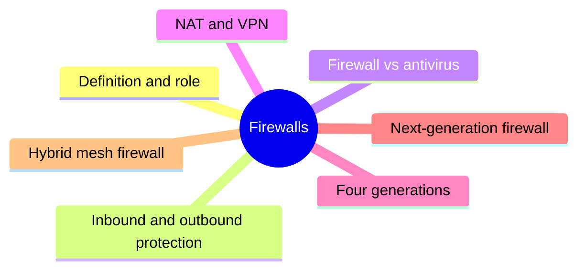
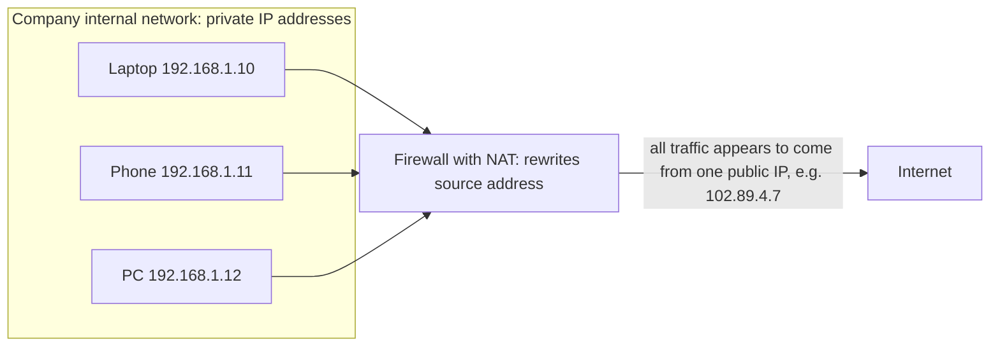
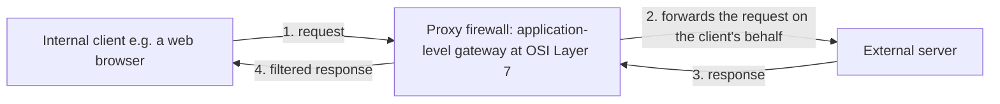
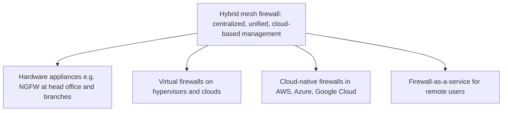

# Unit 5: Firewalls

*Courseware Chapter 6, pages 40–48.*

## At a glance

This unit is about the device that guards the border between a trusted network and the internet. It answers six questions:

- **What is a firewall, and why does it matter?** A device that monitors, filters and controls traffic using **predetermined security rules**; the "bedrock" of network security.
- **What does it protect against?** **External threats** (inbound) and **insider threats** (outbound). And how is it different from **antivirus**?
- **What else can a firewall do?** Two functions: **NAT** (hiding many private addresses behind one public address) and **VPN** (an encrypted tunnel into the private network).
- **How have firewalls evolved?** Four generations: **packet filters** (1989) → **stateful** (early 2000s) → **application-level gateways / proxy** (later 2000s) → **next-generation firewalls** (2010+).
- **What does each type do well and badly?** Stateless, stateful, application-level gateway, NGFW (with DPI, IPS, DLP and six management capabilities).
- **What comes next?** The **hybrid mesh firewall**, which manages virtual, cloud-native and firewall-as-a-service firewalls from one place.

## What you should be able to do

*The courseware lists no learning outcomes; these are written for this site.*

- Define a firewall, state its primary purpose and the criteria its rules use, and explain why it is the "bedrock" of network security but not enough on its own.
- Explain how a firewall protects against external and insider threats, and differentiate a firewall from antivirus software.
- Explain NAT and VPN as firewall functions, with an example of each, and tell them apart.
- State the four generations of firewall evolution with their dates, and draw and explain Fig. 6.1 and Fig. 6.2.
- Explain stateless, stateful, application-level gateway and next-generation firewalls, with the strengths and weaknesses of each, and compare them on named criteria.
- Explain the NGFW's advanced capabilities (DPI, IPS, DLP) and its six management capabilities.
- Define a hybrid mesh firewall, explain why it is needed, and describe its three form factors.
- Recommend a firewall type for a given organisation and justify why the alternatives are less suitable.

## What a firewall is

§6.1 · p.40

The chapter opens with the definition you will be asked for most often.

> **Firewall:** A firewall is a network security device designed to monitor, filter, and control incoming and outgoing network traffic based on predetermined security rules. The primary purpose of a firewall is to establish a barrier between a trusted internal network and untrusted external networks.

> Firewalls come in both hardware and software forms, and they work by inspecting data packets and determining whether to allow or block them based on a set of rules. Organizations can configure these rules to permit or deny traffic based on various criteria, such as source and destination IP addresses, port numbers, and protocol type.

!!! note "In plain terms"
    - **Three verbs:** a firewall **monitors** (watches), **filters** (sorts) and **controls** (allows or blocks) traffic, in **both directions** (incoming and outgoing).
    - **Rules decide, not the firewall's "judgement":** the rules are **predetermined**, written in advance by the organisation.
    - **Purpose = a barrier** between a **trusted internal** network and **untrusted external** networks (usually the internet).
    - **Two forms:** hardware (a dedicated box at the network edge) and software (a program, e.g. the firewall built into Windows).
    - **It works on packets:** data crossing a network is cut into small **data packets**; the firewall inspects each and allows or blocks it.
    - **Three rule criteria** named by the courseware: **source and destination IP addresses**, **port numbers**, and **protocol type** ("such as": the list is not complete).

{ .diagram }

Where a firewall sits and what it checks (drawn for this site from §6.1–§6.3; not a courseware figure).

| Rule criterion | What it identifies | Example rule *(site example)* |
|---|---|---|
| **Source / destination IP address** | Which computer the packet comes from / is going to | Block all traffic from a known malicious address |
| **Port number** | Which service on that computer (web = 80/443, email = 25) | Allow inbound traffic only to port 443 on the web server |
| **Protocol type** | Which communication protocol (TCP, UDP, ICMP…) | Block inbound ICMP "ping" requests from the internet |

!!! example "Example"
    A Nigerian university connects its campus network to the internet. Its firewall is configured to **permit** incoming traffic only to the student portal's web server (port 443) and to **deny** everything else that tries to come in from outside, while allowing staff and students to browse out. The campus network is the **trusted internal** network; the internet is **untrusted**.

!!! tip "Exam angle"
    "Define a firewall and state its primary purpose" is the most predictable question in this unit. Learn the definition word for word: **network security device** + **monitor, filter, and control** + **incoming and outgoing** + **predetermined security rules**, then the purpose: **a barrier between a trusted internal network and untrusted external networks**. A follow-up "state three criteria a firewall rule can use" wants IP addresses, port numbers and protocol type.

**Check your understanding**

According to the courseware, what is the primary purpose of a firewall?

<ul class="quiz-options">
  <li>To scan devices for malware and remove it</li>
  <li data-correct>To establish a barrier between a trusted internal network and untrusted external networks</li>
  <li>To encrypt all traffic leaving the network</li>
  <li>To give every device on the network its own public IP address</li>
</ul>

§6.1 states the primary purpose as **a barrier between a trusted internal network and untrusted external networks**. Scanning devices for malware is what **antivirus** does (§6.3); encryption describes a **VPN** (§6.4.2); and NAT does the opposite of the last option: many devices *share* one public address (§6.4.1).

Which of these is NOT one of the rule criteria the courseware names in §6.1?

<ul class="quiz-options">
  <li>Source and destination IP addresses</li>
  <li>Port numbers</li>
  <li>Protocol type</li>
  <li data-correct>The user's password</li>
</ul>

The courseware's examples of rule criteria are **source and destination IP addresses, port numbers, and protocol type**, all found in the packet header. A password is checked by authentication, not by the firewall rules described in §6.1.

## Firewalls and network security

§6.2 · p.40

Why do firewalls matter so much, and why are they not enough on their own?

> Firewalls are the bedrock of network security, shielding the network from unauthorized access. They prevent bad actors — hackers, bots, and other threats — from overloading or infiltrating a private network to steal sensitive data. Traditionally, firewalls regulate traffic by forming a secure perimeter around a network or computer. This prevents anyone from accessing network resources if they aren't authorized to do so. Without this protection, virtually anybody could enter and do as they please.

> Today's cybersecurity landscape demands a layered approach. While firewalls remain a cornerstone of network defense, advanced threats require additional security measures. The rise of cloud computing and hybrid work environments further highlights the need for comprehensive security solutions. Fortunately, cutting-edge firewall technologies with AI-powered services are bringing network security up to speed. Combining the strengths of traditional tools with the innovative capabilities of new solutions, modern firewall vendors help organizations defend against even the most complex attack strategies.

!!! note "In plain terms"
    - **"Bedrock" / "cornerstone":** the firewall is the foundation of network defence. Without it, "virtually anybody could enter and do as they please".
    - **What it stops:** **bad actors** (hackers, bots, other threats) **overloading** a network (e.g. flooding it) or **infiltrating** it (getting in) to steal sensitive data.
    - **Traditional model = a secure perimeter:** like the wall and gate around a compound. Anyone not authorised stays outside.
    - **Why that is no longer enough:** (1) **advanced threats** need additional measures; (2) **cloud computing** and **hybrid work** mean data and users are no longer all inside one wall. Hence the call for a **layered approach**.
    - **The response:** modern firewalls with **AI-powered services**, which combine traditional tools with new capabilities (developed later in the NGFW and hybrid mesh sections).

!!! example "Example"
    A Lagos company's staff used to work only in its Ikoyi office, behind one firewall. Now half of them work from home and the company's email and files are on a cloud service. The old perimeter no longer surrounds everything that needs protecting, which is exactly the problem §6.2 describes and §6.6 (hybrid mesh firewalls) tries to solve.

!!! tip "Exam angle"
    A short question may ask "why are firewalls described as the bedrock of network security?" (they shield the network from unauthorised access; they stop bad actors overloading or infiltrating it) or "why is a firewall alone not sufficient today?" (advanced threats; cloud computing and hybrid work; the need for a **layered approach**). The layered approach is the **layering (defense in depth)** design principle from [Unit 1](unit-1-security-concepts.md#layering).

**Check your understanding**

According to §6.2, which two developments "further highlight the need for comprehensive security solutions"?

<ul class="quiz-options">
  <li>Faster processors and cheaper storage</li>
  <li data-correct>The rise of cloud computing and hybrid work environments</li>
  <li>The invention of packet filtering and NAT</li>
  <li>Stricter data protection laws and higher fines</li>
</ul>

The courseware names **cloud computing and hybrid work environments**: users and data are no longer all inside one perimeter. Packet filtering and NAT are older firewall techniques, not new pressures; laws and hardware costs are not mentioned in §6.2.

How does the courseware say firewalls <em>traditionally</em> regulate traffic?

<ul class="quiz-options">
  <li>By scanning every file on each computer</li>
  <li>By encrypting traffic between branches</li>
  <li data-correct>By forming a secure perimeter around a network or computer</li>
  <li>By using artificial intelligence to predict attacks</li>
</ul>

"Traditionally, firewalls regulate traffic by **forming a secure perimeter** around a network or computer" (§6.2). AI-powered services are the *modern* addition, not the traditional method; file scanning is antivirus; encryption between sites is a VPN.

## What a firewall does: inbound and outbound protection

§6.3 · pp.40–41

The courseware now explains where a firewall sits and how it decides.

> Firewalls protect against malicious traffic. They're strategically positioned at the network edge or in a data center, allowing them to closely monitor anything attempting to cross this boundary. This visibility also allows a network firewall to granularly inspect and authenticate data packets in real time. This involves checking the data packet against predefined criteria to determine whether it poses a threat. If it fails to meet the criteria, the firewall blocks it from entering or leaving the network.

> Firewalls regulate both inbound and outbound traffic, protecting the network from:
>
> • **External threats** such as viruses, backdoors, phishing emails, and denial-of-service (DoS) attacks. Firewalls filter incoming traffic flows, preventing unauthorized access to sensitive data and thwarting potential malware infections.
>
> • **Insider threats** like known bad actors or risky applications. A firewall can enforce rules and policies to restrict certain types of outgoing traffic, which helps identify suspicious activity and mitigate data exfiltration. These capabilities highlight the core benefits of firewall in reducing attack surface and strengthening overall network security.

!!! note "In plain terms"
    - **Where:** at the **network edge** (the boundary with the internet) or **in a data center**. Being on the boundary gives the firewall **visibility** of everything that tries to cross it.
    - **How:** each packet is checked **in real time** against **predefined criteria**. Fail the criteria → **blocked**, whether it is entering *or* leaving.
    - **Two directions, two kinds of threat:**

    | Direction | Threat type | Courseware examples | What the firewall achieves |
    |---|---|---|---|
    | **Inbound** (incoming) | **External threats** | Viruses, backdoors, phishing emails, denial-of-service (DoS) attacks | Prevents unauthorized access to sensitive data; thwarts malware infections |
    | **Outbound** (outgoing) | **Insider threats** | Known bad actors, risky applications | Restricts certain outgoing traffic; helps identify suspicious activity; mitigates **data exfiltration** |

    - **Data exfiltration** = data being carried *out* of the organisation without permission (e.g. a staff member uploading the customer list to a personal server).
    - **Attack surface** = all the points where an attacker could try to get in. Blocking unneeded traffic **reduces the attack surface**: the courseware calls this the core benefit.

!!! example "Example"
    - **Inbound:** a Nigerian bank's firewall drops a flood of junk requests aimed at its internet-banking site (a **DoS** attack) and blocks connections to a backdoor port that malware tries to open.
    - **Outbound:** the same firewall blocks staff PCs from sending large uploads to unknown file-sharing sites, so a dishonest insider cannot easily **exfiltrate** account data, and the blocked attempt is logged as **suspicious activity**.

!!! tip "Exam angle"
    "Explain how a firewall protects a network from external and insider threats" wants **both directions**: inbound filtering against external threats (name the **four** examples: viruses, backdoors, phishing emails, DoS) and outbound rules against insider threats (known bad actors, risky applications; **data exfiltration**). Many students mention only inbound traffic and lose half the marks.

**Check your understanding**

A firewall rule blocks staff computers from uploading files to unapproved cloud storage sites. Which threat is this mainly aimed at, according to §6.3?

<ul class="quiz-options">
  <li>An external threat, by filtering incoming traffic</li>
  <li data-correct>An insider threat, by restricting outgoing traffic to mitigate data exfiltration</li>
  <li>A denial-of-service attack</li>
  <li>A virus infection on the staff computers</li>
</ul>

Restricting **outgoing** traffic is how a firewall handles **insider threats** and **mitigates data exfiltration** (§6.3). External threats (viruses, backdoors, phishing, DoS) are handled by filtering **incoming** traffic, the tempting wrong answer.

Where does §6.3 say firewalls are strategically positioned?

<ul class="quiz-options">
  <li>On every end-user device only</li>
  <li data-correct>At the network edge or in a data center</li>
  <li>Inside the database management system</li>
  <li>Only in the cloud provider's network</li>
</ul>

Firewalls sit "at the **network edge** or in a **data center**", which lets them monitor anything trying to cross the boundary (§6.3). Installing on an individual device is described as an *extra* option ("hosted firewalls directly on an endpoint") in the firewall-vs-antivirus comparison, not the main position.

## Firewall versus antivirus

Firewall vs antivirus explained (§6.3) · p.41

Students often mix these two up. The courseware compares them directly.

> What's the difference between firewall and antivirus software? Firewalls focus on controlling network traffic and preventing unauthorized access. They're designed to protect networks from unauthorized access and malicious traffic.
>
> By contrast, antivirus programs target and eliminate threats at the device level. More specifically, their key differences include:
>
> • **Scope:** Antivirus software is primarily an endpoint solution, meaning it's installed on an individual device. Firewalls mainly deploy at the network level, but some organizations install hosted firewalls directly on an endpoint for extra protection.
>
> • **Functionality:** Firewalls monitor traffic, blocking malicious data before it enters the network (or endpoint). Antivirus tools scan the local environment for signs of malware, ransomware, and other infectious attacks.
>
> Enterprises normally deploy both firewalls and antivirus programs. As complementary solutions, they each provide essential protective layers for safeguarding business assets.

| Criterion | Firewall | Antivirus |
|---|---|---|
| **Focus** | Controlling network traffic; preventing unauthorized access | Targeting and eliminating threats at the device level |
| **Scope** | Mainly the **network level** (some organisations also install **hosted firewalls** on endpoints) | Primarily an **endpoint** solution, installed on an individual device |
| **Functionality** | **Monitors traffic**, blocking malicious data **before it enters** the network (or endpoint) | **Scans the local environment** for signs of malware, ransomware and other infectious attacks |
| **Analogy** *(site example)* | The security guard at the estate gate | The doctor who checks each resident for infection |

!!! note "In plain terms"
    A firewall works **before** the threat arrives, at the **gate**; antivirus works **after** something is already **on the device**, looking for infection. They do not replace each other: malware can still arrive through allowed traffic (e.g. an email attachment or a USB stick, which never crosses the firewall), and antivirus cannot stop a network flood. That is why enterprises **deploy both**, as **complementary** layers.

!!! example "Example"
    A staff member at a Kano business centre plugs in a USB drive carrying ransomware. The firewall never sees it, because nothing crossed the network boundary. The **antivirus** on the PC detects and removes it. The next day, attackers on the internet scan the centre's network for an open remote-desktop port; the **firewall** blocks them. Each tool caught what the other could not.

!!! tip "Exam angle"
    "Differentiate between a firewall and antivirus software" should be answered on the **two named criteria, scope and functionality**, then end with the courseware's conclusion: enterprises deploy **both** as **complementary** protective layers. Malware and antivirus are covered fully in [Unit 9](unit-9-malware.md#malware-protection-versus-antivirus).

**Check your understanding**

Which statement correctly contrasts firewalls and antivirus on <em>scope</em>?

<ul class="quiz-options">
  <li>Firewalls are only endpoint solutions; antivirus is only network-level</li>
  <li data-correct>Antivirus is primarily an endpoint solution; firewalls mainly deploy at the network level, though hosted firewalls can be installed on endpoints</li>
  <li>Both are network-level solutions that differ only in price</li>
  <li>Firewalls scan the local environment; antivirus monitors traffic</li>
</ul>

On scope, antivirus is "primarily an **endpoint** solution" and firewalls "mainly deploy at the **network level**", with hosted firewalls on endpoints as an extra. The last option swaps the two tools' **functionality** (firewalls monitor traffic; antivirus scans the local environment).

Why do enterprises normally deploy both firewalls and antivirus programs?

<ul class="quiz-options">
  <li>Because antivirus cannot run without a firewall</li>
  <li>Because firewalls are cheaper when bought with antivirus</li>
  <li data-correct>Because they are complementary, each providing an essential protective layer</li>
  <li>Because regulations require exactly two security products</li>
</ul>

The courseware says they are "complementary solutions" that "each provide essential protective layers for safeguarding business assets" (Firewall vs antivirus, p.41). The other reasons are not given and are not true.

## Firewall functions: NAT and VPN

§6.4 · pp.41–42

Besides filtering, firewalls commonly provide two further functions.

> Network Address Translation (NAT) and Virtual Private Network (VPN) are two distinct technologies, each with its own set of functions related to network security and connectivity. While NAT is primarily associated with address translation for routing purposes, VPNs are used to create secure, encrypted connections over the internet.

### NAT

§6.4.1 · p.42

> **NAT:** NAT changes the destination or source addresses of data packets as they pass through a firewall. This allows multiple devices to connect to the internet using the same IP address, which helps protect the private network from direct exposure to external threats.

> In an office environment, each employee uses their own computer or mobile device to access the internet for browsing, emailing, and accessing cloud services. Despite each device having its own private IP address within the company's internal network, all outbound traffic appears to external networks as originating from the same public IP address assigned to the company. As a result, it's harder for potential attackers to identify and target individual devices.

NAT in the courseware's office example (drawn for this site; the addresses are invented for illustration).

!!! note "In plain terms"
    - Inside the office every device has a **private** IP address; outside, the company has **one public** IP address.
    - As packets **leave**, NAT replaces the **source** address with the public one; as replies **come back**, it changes the **destination** address back to the right private device. (That is why the definition says "destination **or** source addresses".)
    - **Two benefits:** (1) **many devices share one IP address** to reach the internet; (2) **security:** outsiders see only one address, so it is **harder to identify and target individual devices**, and the private network is not **directly exposed** to external threats.

### VPN

§6.4.2 · p.42

> **VPN:** A VPN is a type of proxy server. Therefore, it serves as a barrier between a computer or network and the internet, receiving all web requests before forwarding them to the network.

> VPNs are common and extend the private network across a public one, such as the internet. This allows users to securely transmit data as if their devices were directly connected to the private network. The connection establishes an encrypted tunnel between remote devices and the corporate network, enabling secure access.

> This function is especially useful in a hybrid environment. Remote employees can leverage VPNs to access corporate networks and critical applications regardless of where or how they're working.

A VPN extends the private network across the internet (drawn for this site from §6.4.2).

!!! note "In plain terms"
    - A VPN **extends** the private network across a **public** one (the internet), so a remote user can work **as if directly connected** to the office network.
    - The key words are **encrypted tunnel**: data travelling between the remote device and the corporate network is encrypted, so anyone intercepting it on the internet sees nothing useful.
    - It suits a **hybrid environment**: staff reach corporate networks and critical applications "regardless of where or how they're working". The encryption behind VPNs is covered in [Unit 4](unit-4-cryptography.md).

| Criterion | NAT | VPN |
|---|---|---|
| **Primarily associated with** | Address translation for routing purposes | Secure, encrypted connections over the internet |
| **What it does** | Changes the destination or source addresses of packets passing through the firewall | Establishes an encrypted tunnel between remote devices and the corporate network |
| **Main benefit** | Many devices share one IP address; individual devices are hidden from attackers | Remote users transmit data securely, as if directly connected to the private network |
| **Typical use** | Office devices browsing, emailing, using cloud services | Remote and hybrid workers reaching corporate applications |

!!! example "Example"
    A fictional Abuja insurance firm has 60 staff PCs. **NAT** on its firewall lets all of them browse the internet through the single public address its ISP provided, and scanners on the internet cannot see which PC is which. When the claims manager travels to Port Harcourt, she connects through the firm's **VPN**: her laptop builds an encrypted tunnel to the office firewall, and she opens the claims system as if she were at her desk.

!!! warning "Courseware note"
    The courseware says "A VPN is a **type of proxy server**… receiving all web requests before forwarding them to the network". This is a loose description: a proxy server relays requests on a user's behalf, while a VPN creates an **encrypted tunnel** that carries *all* of a device's traffic into the private network (which is what the courseware's next paragraph says). Quote the courseware's sentence if asked to "define a VPN", but always add the encrypted tunnel, which is the defining feature.

!!! tip "Exam angle"
    "Explain NAT and VPN as firewall functions" or "differentiate NAT and VPN" is a likely 6–8 mark part. Use the courseware's one-line contrast: NAT = **address translation for routing**; VPN = **secure, encrypted connections over the internet**. Then give the **office example** for NAT (many private addresses → one public address) and the **remote employee** example for VPN.

**Check your understanding**

An attacker scanning a company from the internet sees only one IP address, even though the company has 200 computers. Which firewall function explains this?

<ul class="quiz-options">
  <li>VPN</li>
  <li data-correct>NAT</li>
  <li>Deep packet inspection</li>
  <li>Data loss prevention</li>
</ul>

With **NAT**, all outbound traffic appears to come from the same public IP address, so it is harder for attackers to identify and target individual devices (§6.4.1). A VPN encrypts traffic between remote devices and the corporate network; it does not by itself hide 200 office PCs behind one address.

What does a VPN establish between remote devices and the corporate network?

<ul class="quiz-options">
  <li>A shared public IP address</li>
  <li data-correct>An encrypted tunnel</li>
  <li>A packet-filtering rule set</li>
  <li>A sandbox for suspicious files</li>
</ul>

"The connection establishes an **encrypted tunnel** between remote devices and the corporate network, enabling secure access" (§6.4.2). A shared public IP address is NAT; a sandbox is an NGFW capability.

NAT "changes the destination or source addresses of data packets". Which is changed on a packet <em>leaving</em> the office for the internet?

<ul class="quiz-options">
  <li data-correct>The source address (private → the company's public address)</li>
  <li>The destination address (the website's address → the company's address)</li>
  <li>The port number only</li>
  <li>Nothing; NAT only works on incoming packets</li>
</ul>

On the way **out**, the packet's **source** (a private address) is replaced by the company's public address, so "all outbound traffic appears… as originating from the same public IP address" (§6.4.1). On the way **back**, the reply's **destination** is changed back to the private device. Changing the website's address would send the packet to the wrong place.

## Firewall evolution: the four generations

§6.5 · Fig. 6.1 · p.43

Firewalls did not appear in their modern form. The courseware traces four generations.

![Fig. 6.1 redrawn: four chevrons in a row. First Generation, Packet Filters (or port-based firewalls), 1989: allows/blocks packets, determines application protocol, no visibility into the payload, not able to determine malicious code. Second Generation, Stateful Firewall: observes network connections and acts on suspicious behavior, cannot distinguish between websites and applications, cannot block malicious packets if using acceptable protocols. Third Generation, labelled Stateful Firewall in the source: looks past ports and protocols to the application, helps determine origination and destination of traffic, not able to look inside the data payload. Both early 2000s. Fourth Generation, Next Generation Firewall, 2010+: includes all the data security controls from past generations, adds Deep Packet Inspection (DPI), incorporates sandbox technology, eliminates single point of entry into a network through segmentation](assets/diagrams/u5-firewall-evolution.svg){ .diagram }

Fig. 6.1: Firewall Evolution (redrawn). Shading added by this site; the third chevron's label is reproduced as printed (see the Courseware note below).

> Firewalls have evolved through four distinct phases:
>
> 1. **First-generation firewalls** began in 1989 with the packet filtering approach. These firewalls examine individual data packets, making decisions to allow or block them based on predefined rules. However, these were unable to identify if those packets contained malicious code (i.e., malware).
>
> 2. **Second-generation firewalls** began in the early 2000s. Otherwise known as stateful firewalls, these track the state of active connections. By observing network traffic, they use context to identify and act on suspicious behavior. Unfortunately, this generation also has its limitations.
>
> 3. **Third-generation firewalls** emerged in the latter half of the early 2000s. Often called proxy firewalls or application-level gateways, these act as intermediaries between a client and server, forwarding requests and filtering responses.
>
> 4. **Fourth-generation firewall**, also known as next-generation firewall (NGFW), started in 2010. NGFWs combine traditional capabilities with new, advanced features such as intrusion prevention (IPS), application-layer filtering, and advanced threat detection.
>
> Although each generation improved upon the last, many earlier iterations are still in use today. Let's review the benefits of each firewall in more detail.

| Gen. | Name(s) | When | Key idea | Main limitation (from text and Fig. 6.1) | Detailed in |
|---|---|---|---|---|---|
| **1st** | Packet filters (port-based firewalls); **stateless** firewalls | **1989** | Examine individual packets against predefined rules | Cannot identify malicious code; no visibility into the payload | [§6.5.1](#stateless-firewalls-packet-filtering) |
| **2nd** | **Stateful** firewalls | **Early 2000s** | Track the state of active connections; use context | Cannot distinguish websites from applications; cannot block malicious packets using acceptable protocols | [§6.5.2](#stateful-firewalls) |
| **3rd** | **Proxy** firewalls / **application-level gateways** | **Latter half of the early 2000s** | Intermediary between client and server; forwards requests, filters responses; looks past ports and protocols to the application | Fig. 6.1: not able to look inside the data payload | [§6.5.3](#application-level-gateways-proxy-firewalls) |
| **4th** | **Next-generation firewall (NGFW)** | **2010** (2010+) | Traditional capabilities + IPS, application-layer filtering, advanced threat detection; DPI, sandboxing, segmentation | (none stated) | [§6.5.4](#next-generation-firewalls-ngfw) |

!!! note "In plain terms"
    - Each generation **adds** what the previous one could not see: (1) single packets → (2) whole **connections** → (3) the **application** → (4) everything, plus **deep packet inspection**, **intrusion prevention** and **sandboxing**.
    - The four generation names line up with the four detailed sections that follow: *first generation = stateless (packet filtering)*, *second = stateful*, *third = application-level gateway (proxy)*, *fourth = NGFW*. The courseware uses both sets of names, so learn both.
    - **"Many earlier iterations are still in use today"**: a new generation did not wipe out the old ones (cheap home routers still do simple packet filtering).
    - **Memory aid (the site's, not the courseware's):** "**P**lease **S**top **A**ll **N**asties" = **P**acket filter, **S**tateful, **A**pplication-level gateway, **N**GFW, in date order 1989 → early 2000s → later 2000s → 2010.

!!! tip "Exam angle"
    "Trace the evolution of firewalls" or "state the four generations of firewalls with their dates" is a near-certain recall question: give **name + date + one-line key idea + limitation** for each. "With the aid of a diagram, explain the evolution of firewalls" means drawing **Fig. 6.1**: four chevrons, three or four bullet points each, and the timeline **1989 / early 2000s / 2010+**.

!!! warning "Courseware note"
    - In Fig. 6.1 the **third** chevron is labelled "Stateful Firewall", the same as the second. The text calls the third generation **proxy firewalls or application-level gateways**, and §6.5.3 describes them as such; the label is a slip. In an exam, label the third generation "Application-level gateway (proxy firewall)".
    - Fig. 6.1 also says the third generation is "**not able to look inside the data payload**", while §6.5.3 says application-level gateways offer "**application-level inspection**". Reconcile them as: proxies understand the *application* (which website, which app) but do not do the full **deep packet inspection** that the fourth generation "adds" (Fig. 6.1).
    - The intro promises to "review the **benefits** of each firewall", but the four subsections also give their **limitations**; learn both.

**Check your understanding**

Which generation of firewall began in 1989, and with what approach?

<ul class="quiz-options">
  <li>Second generation, stateful inspection</li>
  <li data-correct>First generation, packet filtering</li>
  <li>Third generation, application-level gateways</li>
  <li>Fourth generation, deep packet inspection</li>
</ul>

"First-generation firewalls began in **1989** with the **packet filtering** approach" (§6.5). Stateful firewalls came in the early 2000s, application-level gateways in the latter half of the early 2000s, and NGFWs (which added DPI) in 2010.

Third-generation firewalls are often called…

<ul class="quiz-options">
  <li>Stateless firewalls</li>
  <li>Port-based firewalls</li>
  <li data-correct>Proxy firewalls or application-level gateways</li>
  <li>Hybrid mesh firewalls</li>
</ul>

§6.5 says third-generation firewalls are "often called **proxy firewalls or application-level gateways**", acting as intermediaries between a client and server. Fig. 6.1 mislabels this chevron "Stateful Firewall", which is a trap; port-based firewalls are the *first* generation; hybrid mesh firewalls (§6.6) are not one of the four generations.

## Stateless firewalls (packet filtering)

§6.5.1 · Fig. 6.2 · p.44

The first generation in detail. The courseware places Fig. 6.2 here, showing a first-generation firewall at work.

{ .diagram }

Fig. 6.2: How Firewall works (redrawn). The "Attacker" label names the figure's hacker icon and the bottom line explains the bug icons; both added by this site.

> **Stateless firewall:** A stateless firewall protects the network by analyzing traffic in the transport layer protocol — the place where devices communicate with one another. Rather than store information about the state of the network connection, it inspects traffic on a packet-by-packet basis. Then, it decides to block or allow the traffic based on the data located in the "packet header." This may include source and destination IP addresses, port numbers, protocols, and other information. Altogether, this process is called packet filtering.

> Despite being fast and inexpensive, stateless firewalls can be exposed to common network vulnerabilities. Critically, they have zero visibility into packet sequencing. That means they can't detect illegitimate packets, which may contain attack vectors or not have a corresponding request. Likewise, they only have insight into the packet header — not its actual contents. This makes it impossible for a stateless firewall to detect malware hidden within a packet's payload.

!!! note "In plain terms"
    - **"Stateless"** = it has **no memory**. It does not remember earlier packets or which connections are open; it judges **each packet on its own** ("packet-by-packet").
    - It reads only the **packet header** (the "envelope": source and destination IP addresses, port numbers, protocol), never the **payload** (the "letter inside").
    - **Packet filtering** = this whole process of allow/block decisions based on header data.
    - **Strengths (2):** **fast** and **inexpensive**.
    - **Weaknesses (2):** (1) **zero visibility into packet sequencing**, so it cannot spot **illegitimate packets** (packets carrying attack vectors, or "replies" that **have no corresponding request**); (2) **header-only**, so it **cannot detect malware hidden in the payload**.

| Packet part | Contains | Seen by a stateless firewall? |
|---|---|---|
| **Header** ("envelope") | Source and destination IP addresses, port numbers, protocol, other information | **Yes**: the only thing it reads |
| **Payload** ("contents") | The actual data: the web page, the email, a file, possibly malware | **No**: so hidden malware passes |

**Reading Fig. 6.2.** The figure shows a single **packet filter/stateless firewall** between the internet (and an attacker) and four internal computers. Its side panel lists **three drawbacks**: it **needs additional configuration**, it can **fail to manage protocols**, and it is **"one-size-fits-all"**. The dotted document says it needs an **additional firewall policy for return traffic**. The **bug icons** on all four computers suggest the outcome: malware reaches the internal machines, because the filter cannot see inside packets.

!!! info "Beyond the notes"
    The courseware does not explain Fig. 6.2's labels. The standard explanation:

    - **Additional policy for return traffic / needs additional configuration:** because a stateless firewall has no memory, it does not know that an incoming packet is the *reply* to a request a user made. The administrator must write extra rules to let replies back in, and those rules can also let in packets that were never requested. This is the "no corresponding request" weakness in the text.
    - **Fail to manage protocols (the "FTP" label):** some protocols, such as FTP (File Transfer Protocol), open extra connections on changing port numbers. A header-only, memory-less filter cannot track these, so it either blocks FTP or must leave many ports open.
    - **"One-size-fits-all":** the same fixed rule is applied to every packet, with no context about the connection or application.
    - **Which layer?** In the standard OSI model, packet filters read the **network layer** (Layer 3: IP addresses) and **transport layer** (Layer 4: ports, TCP/UDP) headers. The courseware simply says "the transport layer protocol".

!!! example "Example"
    A small Ibadan business centre's internet router has a built-in packet filter: "allow outgoing web traffic on port 443, block incoming connections to port 3389 (remote desktop)". It is **cheap and fast**, ideal for a tight budget. But when a customer downloads a "free movie" file that hides a trojan, the packets use the allowed web port and look normal in their headers, so the filter lets the **malware in the payload** through.

!!! tip "Exam angle"
    "Explain how a stateless (packet-filtering) firewall works and state its advantages and limitations" is a likely 6-mark part. Key words: **packet-by-packet**, **packet header** (IP addresses, port numbers, protocols), **packet filtering**; advantages **fast and inexpensive**; limitations **zero visibility into packet sequencing** (illegitimate packets, no corresponding request) and **header only** (cannot detect malware in the payload). For "draw Fig. 6.2", include the three drawbacks and the return-traffic policy.

!!! warning "Courseware note"
    The courseware says a stateless firewall analyses traffic "in the **transport layer** protocol — the place where devices communicate with one another". Packet filters actually work with **network-layer** (IP address) and **transport-layer** (port) header fields, as the same paragraph's list shows. Quote the courseware's wording; the Beyond box above gives the fuller picture.

**Check your understanding**

Why can a stateless firewall NOT detect malware hidden in a packet?

<ul class="quiz-options">
  <li>Because it is too slow to inspect every packet</li>
  <li data-correct>Because it only has insight into the packet header, not its actual contents</li>
  <li>Because it stores too much information about connection state</li>
  <li>Because it works only on outgoing traffic</li>
</ul>

Stateless firewalls "only have insight into the **packet header** — not its actual contents", so detecting malware in the **payload** is impossible (§6.5.1). They are described as **fast**, not slow, and they store **no** state information, which is what "stateless" means.

An incoming packet claims to be a reply, but no internal user ever sent the matching request. Why might a stateless firewall let it through?

<ul class="quiz-options">
  <li>Because it uses deep packet inspection</li>
  <li data-correct>Because it has zero visibility into packet sequencing, so it cannot detect packets without a corresponding request</li>
  <li>Because NAT hides the request</li>
  <li>Because it is an application-level gateway</li>
</ul>

With **zero visibility into packet sequencing**, a stateless firewall "can't detect illegitimate packets, which may contain attack vectors or **not have a corresponding request**" (§6.5.1). Tracking which connections are really open is exactly what the next generation, the **stateful** firewall, adds.

## Stateful firewalls

§6.5.2 · pp.44–45

The second generation adds memory: it keeps track of connections.

> **Stateful firewalls:** Stateful firewalls track the most recent or immediate status of active connections. Monitoring the state and context of network communications can help identify threats based on more insightful information. For example, state-aware firewalls block or allow traffic by analyzing where it's coming from, where it's going, and the contents of its data packets. Moreover, they evaluate the behavior of data packets and network connections, cataloging patterns and using this information to improve future threat detection.

> This approach offers more protection compared to packet filtering but takes a greater toll on network performance because it conducts a more in-depth analysis. Worse yet, attackers can trick stateful inspection firewalls into letting harmful connections sneak through. They exploit network rules and send malicious packets using protocols the firewall believes to be safe.

!!! note "In plain terms"
    - **"State"** = the current status of each **active connection** (who is talking to whom, and whether a conversation was really started from inside). The firewall **remembers** this, so it can tell a genuine reply from a forged one.
    - **Three things it analyses:** **where traffic is coming from**, **where it is going**, and **the contents of its data packets**.
    - **It learns:** it evaluates the **behaviour** of packets and connections, **catalogues patterns**, and uses them to **improve future threat detection**.
    - **Benefit:** **more protection** than packet filtering.
    - **Drawbacks (2):** (1) a **greater toll on network performance** (more in-depth analysis); (2) attackers can **trick** it by sending malicious packets over **protocols the firewall believes to be safe** (Fig. 6.1: "cannot block malicious packets if using acceptable protocols").

| Criterion | Stateless (§6.5.1) | Stateful (§6.5.2) |
|---|---|---|
| **Memory of connections** | None: "rather than store information about the state of the network connection" | Tracks "the most recent or immediate status of active connections" |
| **Unit of inspection** | Each packet on its own (packet-by-packet) | Packets in the **context** of their connection |
| **What is analysed** | Packet header only (IP addresses, ports, protocols) | Where it comes from, where it is going, the contents of its packets; behaviour and patterns |
| **Performance and cost** | Fast and inexpensive | Greater toll on network performance |
| **Protection** | Exposed to common network vulnerabilities | More protection than packet filtering |
| **Key weakness** | Zero visibility into packet sequencing; cannot see payload | Can be tricked by malicious packets over protocols believed safe |

!!! example "Example"
    A fictional Enugu state ministry upgrades from a packet filter to a stateful firewall. Now, when a forged "reply" arrives that matches no conversation any ministry PC started, the firewall drops it. However, an attacker later hides a command channel inside ordinary-looking web traffic on port 443. The stateful firewall sees an allowed protocol on a properly opened connection and lets it through: the "**protocols the firewall believes to be safe**" weakness.

!!! tip "Exam angle"
    "Differentiate between stateless and stateful firewalls" is one of the most likely comparison questions in the unit. Use named criteria: **connection state**, **what is inspected**, **performance**, **weakness**. The one-line version: a stateless firewall judges each packet's header in isolation; a stateful firewall remembers active connections and uses context, at a cost in performance.

!!! warning "Courseware note"
    The heading is printed "6.5.2 **Statefull** firewalls"; the correct spelling is "stateful".

**Check your understanding**

What is the main performance trade-off of a stateful firewall compared with packet filtering?

<ul class="quiz-options">
  <li>It is faster but less secure</li>
  <li data-correct>It offers more protection but takes a greater toll on network performance</li>
  <li>It is cheaper but cannot track connections</li>
  <li>It has no trade-off; it is better in every way</li>
</ul>

Stateful inspection "offers more protection compared to packet filtering but takes a **greater toll on network performance** because it conducts a more in-depth analysis" (§6.5.2). "Fast and inexpensive" describes the **stateless** firewall.

How can attackers trick a stateful inspection firewall, according to the courseware?

<ul class="quiz-options">
  <li>By sending packets without headers</li>
  <li>By switching off the firewall's NAT</li>
  <li data-correct>By exploiting network rules and sending malicious packets using protocols the firewall believes to be safe</li>
  <li>By connecting through a VPN</li>
</ul>

Attackers "exploit network rules and send malicious packets using **protocols the firewall believes to be safe**" (§6.5.2), matching Fig. 6.1's "cannot block malicious packets if using acceptable protocols". Every packet has a header, so the first option is impossible.

## Application-level gateways (proxy firewalls)

§6.5.3 · p.45

The third generation stands *between* the two parties instead of watching traffic pass.

> **Application-level gateways:** Application-level gateways, or proxy firewalls, act as an intermediary between internal and external systems. Notably, they operate at Layer 7 of the Open Systems Interconnection (OSI) model — the application layer. As the closest layer to the end-user, Layer 7 applications include web browsers, email clients, and instant messaging tools.

> Proxy firewalls intercept and analyze all incoming and outgoing traffic, applying granular security policies to control access and protect the network. They offer packet filtering, application-level inspection, URL filtering, and more.

An application-level gateway acts as an intermediary: the client and server never talk directly (drawn for this site from §6.5 and §6.5.3).

!!! note "In plain terms"
    - **Intermediary (proxy):** the internal computer never connects straight to the outside server. It talks to the **proxy**, which **forwards requests** and **filters responses** (§6.5). Like a receptionist who takes every visitor's message and passes on only what is acceptable.
    - **Layer 7 = the application layer**, the OSI layer **closest to the end-user**. The courseware's **three** examples of Layer 7 applications: **web browsers, email clients, instant messaging tools**.
    - Because it works at the application layer it can apply **granular** (very detailed) policies, e.g. "allow this website but not that one".
    - **What it offers (courseware names three "and more"):** **packet filtering**, **application-level inspection**, **URL filtering**.

!!! info "Beyond the notes"
    **The OSI model** divides network communication into seven layers: 1 Physical, 2 Data link, 3 Network (IP addresses), 4 Transport (ports, TCP/UDP), 5 Session, 6 Presentation, 7 Application. Roughly, packet filters work at Layers 3–4, stateful firewalls add connection tracking at Layer 4, and application-level gateways work at Layer 7. A common drawback of proxy firewalls, not stated by the courseware, is **speed**: relaying and inspecting every request at the application layer is slower than filtering headers.

!!! example "Example"
    A Nigerian secondary school routes all student web traffic through a proxy firewall. It applies **URL filtering** to block gambling and adult websites, allows the school's e-learning site, and inspects email traffic for dangerous attachments. Students' browsers never contact outside sites directly; the proxy does it for them.

!!! tip "Exam angle"
    Key facts for "explain application-level gateways": **two names** (application-level gateway / proxy firewall), **intermediary** between internal and external systems, **OSI Layer 7 (application layer)**, the **three example applications**, and the **three services** (packet filtering, application-level inspection, URL filtering). Do not confuse it with the second generation because Fig. 6.1 mislabels it.

**Check your understanding**

At which OSI layer do application-level gateways operate?

<ul class="quiz-options">
  <li>Layer 3, the network layer</li>
  <li>Layer 4, the transport layer</li>
  <li data-correct>Layer 7, the application layer</li>
  <li>Layer 1, the physical layer</li>
</ul>

Application-level gateways "operate at **Layer 7** of the Open Systems Interconnection (OSI) model — the **application layer**" (§6.5.3). The **transport layer** is where the courseware places stateless firewalls (§6.5.1).

A school wants to block specific websites by their address while allowing others. Which service of a proxy firewall does this?

<ul class="quiz-options">
  <li>NAT</li>
  <li data-correct>URL filtering</li>
  <li>Data loss prevention</li>
  <li>SD-WAN</li>
</ul>

Proxy firewalls "offer packet filtering, application-level inspection, **URL filtering**, and more" (§6.5.3); URL filtering allows or blocks web addresses. NAT translates IP addresses; DLP stops data disclosures; SD-WAN is an NGFW network-management capability.

## Next-generation firewalls (NGFW)

§6.5.4 · Fig. 6.3 · pp.45–46

The fourth generation combines everything before it with new capabilities. The courseware opens with a figure.

{ .diagram }

Fig. 6.3: NGFW (redrawn). Shading added by this site.

| NGFW characteristic (Fig. 6.3) | What it delivers (Fig. 6.3) |
|---|---|
| **Controls applications by classification or users** | Helps protect web-browsing clients from attacks and threats |
| **Adopts various segmentation approaches** | Segregates users, devices, and applications that are aligned to business needs; eliminates a single point of entry |
| **Has moved from reactive to proactive** | Uses artificial intelligence to enforce security policies |

> NGFWs protect businesses against emerging cyber threats. They blend all the best parts of past firewall technologies with the advanced capabilities required to mitigate modern cyberattacks. For example, these include:
>
> • **Deep packet inspection (DPI)**, a method of examining the contents of data packets as they pass through network checkpoints. DPI analyzes a larger range of information, allowing it to find otherwise hidden threats.
>
> • **Intrusion prevention (IPS)**, a system that monitors traffic in real time to proactively identify threats and automate response.
>
> • **Data loss prevention (DLP)**, a cybersecurity solution that blocks intentional and accidental data disclosures.

!!! note "In plain terms"
    - **NGFW = all the best of generations 1–3 + new advanced capabilities.** Fig. 6.1 says the same: "includes all the data security controls from past generations".
    - **The three advanced capabilities** the courseware names:

    | Capability | What it does | Problem it fixes from earlier generations *(site summary)* |
    |---|---|---|
    | **Deep packet inspection (DPI)** | Examines the **contents** of data packets as they pass network checkpoints; analyses a larger range of information to find hidden threats | Stateless filters see only headers and miss malware in the payload |
    | **Intrusion prevention (IPS)** | Monitors traffic **in real time** to **proactively identify threats** and **automate response** | Older firewalls only allow/block by rule; they do not recognise and respond to attacks |
    | **Data loss prevention (DLP)** | **Blocks intentional and accidental data disclosures** | Sensitive data leaving in allowed traffic (data exfiltration) |

    - **Reactive → proactive (Fig. 6.3):** older firewalls wait for traffic to match a rule; NGFWs use **AI** and IPS to spot and act on threats early.
    - **Segmentation (Fig. 6.3):** dividing the network into zones, so an attacker who gets in at one point cannot reach everything: "**eliminates a single point of entry**".

> NGFWs combine the protection of previous generations with the advanced security capabilities mentioned above. They can be deployed as software or hardware and can scale to any location: remote office, branch, campus, data center, and cloud. This includes mission-critical OT environments where deploying a rugged firewall ensures reliable protection against extreme environmental challenges. NGFWs can simplify, unify, and automate enterprise-grade protection with centralized management that extends across distributed environments. These capabilities include:
>
> • **Internet of Things (IoT) security** to discover BYOD, rogue, or shadow IT devices.
>
> • **Network sandboxing** to monitor and analyze suspicious objects in an isolated environment
>
> • **Zero-trust network access (ZTNA)** to manage network access to users and applications based on identity and context, supported by firewall-based Zero Trust controls that enforce identity-driven traffic inspection and secure segmentation across distributed environments.
>
> • **Operational technology (OT) security** to protect OT environments with cyber threat intelligence platform, IPS, and SCADA applications and threat inspection
>
> • **Domain name system (DNS) security** to monitor, detect and prevent capabilities against DNS layer attacks
>
> • **Software-defined wide-area network (SD-WAN) architecture** to deliver dynamic path selection, based on business or application policy, centralized policy and management of appliances, virtual private network (VPN), and zero-touch configuration.

| Capability | Purpose (courseware) | Plain meaning *(site summary)* |
|---|---|---|
| **IoT security** | Discover BYOD, rogue, or shadow IT devices | Find every device on the network, including staff's own phones (**BYOD**: bring your own device), unauthorised (**rogue**) devices and devices IT does not know about (**shadow IT**) |
| **Network sandboxing** | Monitor and analyze suspicious objects in an isolated environment | Open a suspicious file in a sealed "test room" and watch what it does before letting it in |
| **ZTNA** | Manage network access to users and applications based on identity and context | "Never trust, always verify": access depends on **who** you are and the **context**, not on being inside the network |
| **OT security** | Protect OT environments with a cyber threat intelligence platform, IPS, and SCADA applications and threat inspection | Protect industrial control systems (power plants, pipelines, factories); **SCADA** systems control such equipment |
| **DNS security** | Monitor, detect and prevent DNS layer attacks | Stop attacks that abuse the internet's "phone book" (e.g. redirecting users to fake sites) |
| **SD-WAN** | Dynamic path selection based on business or application policy; centralized policy and management of appliances; VPN; zero-touch configuration | Smart wide-area networking for many branches: picks the best link per application, managed centrally, with new branch devices set up automatically |

!!! note "In plain terms"
    - **Deployment:** software **or** hardware, scaling to **any location**: **remote office, branch, campus, data center, cloud** (five), including **mission-critical OT environments**, where a **rugged firewall** survives extreme conditions (heat, dust, vibration).
    - **Management:** NGFWs "simplify, unify, and automate" protection with **centralized management** across distributed environments, through the **six capabilities** in the table. Memory aid (the site's): "**I** **S**aw **Z**ainab **O**pen **D**NS **S**ettings" = **I**oT, **S**andboxing, **Z**TNA, **O**T, **D**NS, **S**D-WAN.

!!! example "Example"
    A fictional Nigerian commercial bank with a Lagos head office, 150 branches and an Azure-hosted mobile app deploys NGFWs. **DPI** finds a trojan hidden inside an email attachment that a packet filter would have passed; the **sandbox** detonates a suspicious invoice file in isolation; **DLP** stops a staff member emailing a spreadsheet of BVNs to a Gmail address; **IPS** automatically blocks a brute-force login attack; **SD-WAN** routes branch transaction traffic over the best available link, all managed from one central console.

!!! tip "Exam angle"
    Expect "explain three advanced capabilities of an NGFW" (**DPI, IPS, DLP**, with their courseware definitions) and "list and explain the capabilities of NGFW centralized management" (the **six**: IoT security, network sandboxing, ZTNA, OT security, DNS security, SD-WAN). For "with the aid of a diagram, explain NGFW", draw **Fig. 6.3**'s three rows. Intrusion prevention systems are treated in depth in [Unit 12](unit-12-idps.md#intrusion-detection-ids-ips-and-idps).

!!! info "Beyond the notes"
    - The courseware writes "intrusion prevention (**IPS**)"; IPS stands for **intrusion prevention system**, which the courseware's own definition ("a system that…") confirms.
    - **DPI vs packet filtering:** packet filtering reads only the header; DPI reads the payload as well, which is why it can find malware a stateless firewall misses.
    - **ZTNA and Zero Trust:** the idea that no user or device is trusted just because it is "inside" the network; every access is checked against identity and context. This is the **complete mediation** principle from [Unit 1](unit-1-security-concepts.md#complete-mediation) applied to networks.

**Check your understanding**

Which NGFW capability is "a method of examining the contents of data packets as they pass through network checkpoints"?

<ul class="quiz-options">
  <li>Packet filtering</li>
  <li data-correct>Deep packet inspection (DPI)</li>
  <li>Data loss prevention (DLP)</li>
  <li>Network address translation (NAT)</li>
</ul>

That is the courseware's definition of **DPI** (§6.5.4). Packet filtering is the tempting answer, but it examines only the **header**, not the contents (§6.5.1). DLP blocks data disclosures; NAT changes addresses.

An NGFW detects a staff member's personal smartphone and an unknown wireless access point on the office network. Which capability is at work?

<ul class="quiz-options">
  <li>DNS security</li>
  <li>SD-WAN</li>
  <li data-correct>IoT security</li>
  <li>Network sandboxing</li>
</ul>

**IoT security** is used "to discover **BYOD, rogue, or shadow IT devices**" (§6.5.4): the personal phone is BYOD, the unknown access point is rogue. Sandboxing analyses suspicious *objects* (files), not devices.

According to Fig. 6.3, what does "adopts various segmentation approaches" achieve?

<ul class="quiz-options">
  <li>Uses artificial intelligence to enforce security policies</li>
  <li data-correct>Segregates users, devices and applications aligned to business needs, and eliminates a single point of entry</li>
  <li>Helps protect web-browsing clients from attacks and threats</li>
  <li>Translates private IP addresses to one public address</li>
</ul>

In Fig. 6.3, segmentation "segregates users, devices, and applications that are aligned to business needs" and "eliminates a single point of entry". AI enforcement belongs to "has moved from reactive to proactive"; protecting web-browsing clients belongs to "controls applications by classification or users".

## Comparing the four firewall types

§6.5–§6.5.4 · pp.43–46

This table pulls the four detailed sections together for comparison and scenario questions.

| Criterion | Stateless (packet filter) | Stateful | Application-level gateway (proxy) | NGFW |
|---|---|---|---|---|
| **Generation / date** | 1st, 1989 | 2nd, early 2000s | 3rd, latter half of the early 2000s | 4th, 2010 |
| **What it examines** | Packet header only (IP addresses, ports, protocols) | Connection state and context: where from, where to, packet contents, behaviour | All incoming and outgoing traffic at the application layer | Everything earlier + packet contents via DPI |
| **OSI layer stated** | "Transport layer protocol" | Not stated | Layer 7 (application) | Not stated (includes application-layer filtering) |
| **Strengths** | Fast, inexpensive | More protection than packet filtering; learns patterns | Intermediary; granular policies; URL filtering, application-level inspection | DPI, IPS, DLP; sandboxing; segmentation; AI; centralized management; scales to any location |
| **Weaknesses** | No visibility into sequencing; cannot see payload malware | Greater toll on performance; tricked via "safe" protocols | Fig. 6.1: cannot look inside the data payload | Not stated by the courseware (cost and complexity, *site note*) |
| **Suits** *(site example)* | Home or very small office router on a tight budget | Small to medium office needing connection tracking | Organisation that must control web use (schools, regulated offices) | Banks, hospitals, telecoms, multi-site enterprises with sensitive data |

Rows marked "site example" or "site note" are this site's guidance, not courseware statements.

!!! tip "Exam angle"
    In a "recommend a firewall for this organisation" scenario, use I-A-J-A: **identify** the organisation's needs (budget, sensitivity of data, need to see content, number of sites, cloud use); **apply** the type whose strengths match; **justify** from the courseware's strengths; then **say why not the alternatives** using their courseware **weaknesses** (e.g. "not a stateless firewall, because it has no visibility into the payload and cannot detect malware hidden in packets").

## Hybrid mesh firewalls

§6.6 · pp.46–48

The final section looks at the newest approach: managing many kinds of firewall as one system.

> **Hybrid mesh firewall:** Hybrid mesh firewalls are emerging as the next frontier of network security. In brief, a hybrid mesh firewall is a security platform that provides centralized and unified management by combining the benefits of multiple firewall architectures. It simplifies cybersecurity operations and coordinates policies across firewalls of all form factors to create a comprehensive security posture.

### Why hybrid mesh firewalls are needed

§6.6 · unnumbered figure · p.47

The courseware gives an unnumbered figure showing four shifts in how organisations work.

{ .diagram }

The four shifts behind hybrid mesh firewalls (redrawn; the figure is unnumbered in the courseware, p.47). Shading added by this site: grey = old situation, teal = new.

> With the rise of work-from-anywhere, employees are more distributed than ever before. And, to accommodate remote work setups, organizations have greatly accelerated their digital transformations. They've adopted hybrid cloud environments, stretching the network edge far past its former perimeter. Between cloud services, data centers, branch offices, and remote deployments, managing network traffic is exponentially more difficult.

> Adding to the mix is the fact that enterprise attack surfaces are quickly expanding. Whether it be remote employees accessing corporate resources on unmanaged devices or a disjointed array of point solutions and cloud applications, every new connection is another potential entry point bad actors can exploit. And, at a time when organizations are facing a significant cybersecurity skills gap, hackers only grow more sophisticated.

| Shift (figure) | From → to | Link to the text |
|---|---|---|
| **1. Shift to the Cloud** | Campus location → hybrid cloud | Organisations "adopted hybrid cloud environments, stretching the network edge far past its former perimeter" |
| **2. Work from Anywhere** | In office → anywhere | "With the rise of work-from-anywhere, employees are more distributed than ever before" |
| **3. Distributed Networks** | VPN → connected things | Traffic spread across "cloud services, data centers, branch offices, and remote deployments"; every new connection is a potential entry point |
| **4. Platform Approach** | Point products → consolidation | "A disjointed array of point solutions" is replaced by one unified platform |

!!! note "In plain terms"
    The courseware gives **four pressures** that make firewalls hard to manage (the grouping is ours):

    1. **Work-from-anywhere:** employees are more distributed than ever.
    2. **Hybrid cloud:** the network edge now stretches **far past its former perimeter**; traffic flows between cloud services, data centers, branch offices and remote deployments.
    3. **Expanding attack surfaces:** remote staff on **unmanaged devices**, and a **disjointed array of point solutions** and cloud applications; every new connection is a potential entry point.
    4. **Skills gap:** organisations face a significant **cybersecurity skills gap** while hackers grow more sophisticated.

    A **point solution / point product** is a single-purpose security tool bought separately; many of them, each with its own console, are hard to run with too few skilled staff. Hence the move to **consolidation** on one platform.

### What a hybrid mesh firewall offers

§6.6 · pp.47–48

> Hybrid mesh firewalls offer mature, cloud-based, unified management with automation and orchestration capabilities. Features such as application connectivity mapping, visibility into cloud-native network security policies, policy fine-tuning, and recommendations facilitate the administration of all firewall complaints across hybrid environments. Integration with overlapping technologies such as micro-segmentation and SASE provide mature visibility and risk management capabilities.

> A hybrid mesh architecture spans distributed network environments unifying operations, security, and management of multi-deployment firewalls including hardware and virtual appliances, cloud-based, and as-a-service form factors. One of the most critical capabilities of an NGFW is to simplify the management of these dispersed network firewalls with consistent security across complex, hybrid environments.

!!! note "In plain terms"
    - **Management:** **mature, cloud-based, unified**, with **automation and orchestration** (tasks run automatically and are coordinated across many firewalls).
    - **Four features** named: **application connectivity mapping**, **visibility into cloud-native network security policies**, **policy fine-tuning**, and **recommendations**.
    - **Integrates with** two overlapping technologies: **micro-segmentation** and **SASE**, giving mature visibility and risk management.
    - **What it unifies (three things):** **operations, security, and management** of firewalls deployed in many forms: **hardware and virtual appliances, cloud-based, and as-a-service**.
    - The goal is **consistent security** across complex hybrid environments: one set of policies, enforced everywhere.

!!! info "Beyond the notes"
    The courseware names these two technologies without explaining them:

    - **Micro-segmentation:** dividing a network (especially a data centre or cloud) into very small zones, down to individual workloads, each with its own firewall rules, so an attacker who compromises one server cannot move freely to others.
    - **SASE (Secure Access Service Edge):** a cloud-delivered model that combines networking (such as SD-WAN) with security services (such as firewall-as-a-service and zero-trust network access), so users get the same protection wherever they connect from.

!!! warning "Courseware note"
    - "facilitate the administration of all firewall **complaints**" is almost certainly a typo, most likely for "firewall **components**" (or "compliance"); the sentence is about administering all the firewalls. This is an inference.
    - "One of the most critical capabilities of an **NGFW** is to simplify the management of these dispersed network firewalls…" appears in the hybrid mesh paragraph. Read in context, it describes the **hybrid mesh firewall** (or NGFWs managed as part of one), since unified management of dispersed firewalls is the hybrid mesh's defining job. This too is an inference; quote it as given if asked.

### Form factors of a hybrid mesh firewall

§6.6 · p.48

> Hybrid mesh firewalls include multiple form factors, such as:
>
> • **Virtual firewalls:** Software-based firewalls that run on virtualized infrastructure, such as hypervisors or cloud platforms. Protect virtualized environments and can be moved between clouds. Critically, they're flexible by nature, allowing organizations to deploy them to various public or private clouds.
>
> • **Cloud-native firewalls:** Firewalls specifically created to operate in particular cloud environments. They're often tightly integrated with cloud service providers like Amazon Web Services, Azure, and Google Cloud. This reduces the workload for network security teams, as it eliminates the need to configure and maintain the software infrastructure.
>
> • **Firewall-as-a-service (FWaaS):** A deployment model where vendors deliver the firewall solution as a cloud-based service. This makes it easy to scale across a growing network infrastructure and is easily configured to match an enterprise's unique security needs.

> As network risk management becomes more complex, hybrid mesh firewalls stand to level the playing field for enterprises by unifying operations, security, and management across distributed network environments.

| Form factor | What it is | Key advantage | Think of it as *(site example)* |
|---|---|---|---|
| **Virtual firewall** | Software-based firewall running on virtualized infrastructure (hypervisors or cloud platforms) | **Flexible / portable**: can be moved between clouds; deploy to various public or private clouds | A firewall "app" you can install in any cloud |
| **Cloud-native firewall** | Created to operate in a **particular** cloud environment; tightly integrated with providers such as AWS, Azure, Google Cloud | **Less workload**: no need to configure and maintain the software infrastructure | The cloud provider's own built-in firewall |
| **Firewall-as-a-service (FWaaS)** | A **deployment model**: vendors deliver the firewall as a **cloud-based service** | **Easy to scale** across a growing network; easily configured to the enterprise's needs | Renting firewall protection like a subscription |

One management platform coordinating policies across firewalls of all form factors (drawn for this site from §6.6).

!!! example "Example"
    A fictional Lagos fintech runs its core ledger in a Lekki data centre, its mobile-app backend on AWS, its analytics in a private cloud, and has 300 staff working from home across Nigeria. It uses a hardware NGFW in the data centre, a **cloud-native firewall** in AWS, a **virtual firewall** in the private cloud, and **FWaaS** for remote staff. Before, four teams managed four consoles with conflicting rules. A **hybrid mesh firewall** platform puts all four under **one** management console, so a single policy ("block traffic to known malicious domains") is applied everywhere at once.

!!! tip "Exam angle"
    Expect "define a hybrid mesh firewall" (**security platform** + **centralized and unified management** + **combining the benefits of multiple firewall architectures**), "explain why hybrid mesh firewalls are needed" (work-from-anywhere, hybrid cloud, expanding attack surface, skills gap), and "explain the **three** form factors". A good differentiating question: **virtual vs cloud-native** (portable across clouds vs built for one cloud).

**Check your understanding**

Which hybrid mesh form factor is "specifically created to operate in particular cloud environments" and tightly integrated with providers like AWS?

<ul class="quiz-options">
  <li>Virtual firewall</li>
  <li data-correct>Cloud-native firewall</li>
  <li>Firewall-as-a-service</li>
  <li>Application-level gateway</li>
</ul>

That is the **cloud-native firewall** (§6.6). The **virtual firewall** is the tempting wrong answer: it runs on virtualized infrastructure and can be **moved between clouds**, the opposite of being tied to one. FWaaS is a delivery model (a cloud-based service from a vendor).

What is the defining feature of a hybrid mesh firewall?

<ul class="quiz-options">
  <li>It inspects only packet headers, which makes it fast</li>
  <li>It replaces all hardware firewalls with antivirus software</li>
  <li data-correct>It provides centralized and unified management by combining the benefits of multiple firewall architectures</li>
  <li>It works only inside one office building</li>
</ul>

A hybrid mesh firewall is "a security platform that provides **centralized and unified management** by combining the benefits of multiple firewall architectures" and coordinates policies across firewalls of all form factors (§6.6). Header-only inspection describes stateless firewalls; being limited to one building is the opposite of its purpose.

## Key terms

Firewall
:   A network security device designed to monitor, filter, and control incoming and outgoing network traffic based on predetermined security rules; its primary purpose is to establish a barrier between a trusted internal network and untrusted external networks.

Data packet
:   A unit of data crossing a network; a firewall inspects each packet and decides whether to allow or block it.

Packet header
:   The part of a packet carrying source and destination IP addresses, port numbers, protocols and other information; the only part a stateless firewall reads.

Payload
:   The actual contents of a packet; malware hidden here cannot be detected by a stateless firewall.

Packet filtering
:   Deciding to block or allow traffic packet by packet, based on the data in the packet header; the approach of first-generation firewalls.

Data exfiltration
:   Data being carried out of the organisation without authorisation; firewalls help mitigate it by restricting certain outgoing traffic.

Attack surface
:   All the points where an attacker could try to enter; firewalls reduce it by blocking unneeded traffic.

Antivirus software
:   Primarily an endpoint solution installed on an individual device; scans the local environment for signs of malware, ransomware and other infectious attacks.

Hosted firewall
:   A firewall installed directly on an endpoint (an individual device) for extra protection.

Network Address Translation (NAT)
:   A firewall function that changes the destination or source addresses of data packets as they pass through a firewall, so multiple devices can connect to the internet using the same IP address.

Virtual Private Network (VPN)
:   Described by the courseware as a type of proxy server; extends the private network across a public one by establishing an encrypted tunnel between remote devices and the corporate network.

Stateless firewall
:   A first-generation firewall that inspects traffic packet by packet using only the packet header, without storing information about the state of the connection; fast and inexpensive.

Stateful firewall
:   A second-generation firewall that tracks the most recent or immediate status of active connections and uses state and context to identify threats.

Application-level gateway (proxy firewall)
:   A third-generation firewall acting as an intermediary between internal and external systems at OSI Layer 7 (the application layer); offers packet filtering, application-level inspection and URL filtering.

OSI Layer 7 (application layer)
:   The layer of the Open Systems Interconnection model closest to the end-user, where web browsers, email clients and instant messaging tools operate.

URL filtering
:   Allowing or blocking traffic according to the web address requested; offered by proxy firewalls.

Next-generation firewall (NGFW)
:   A fourth-generation firewall (from 2010) that blends the best parts of past firewall technologies with advanced capabilities such as DPI, intrusion prevention and data loss prevention.

Deep packet inspection (DPI)
:   A method of examining the contents of data packets as they pass through network checkpoints, analysing a larger range of information to find otherwise hidden threats.

Intrusion prevention (IPS)
:   A system that monitors traffic in real time to proactively identify threats and automate response.

Data loss prevention (DLP)
:   A cybersecurity solution that blocks intentional and accidental data disclosures.

Segmentation
:   Dividing a network so users, devices and applications are segregated in line with business needs; eliminates a single point of entry (Fig. 6.3).

IoT security
:   An NGFW capability to discover BYOD, rogue, or shadow IT devices.

Network sandboxing
:   An NGFW capability to monitor and analyze suspicious objects in an isolated environment.

Zero-trust network access (ZTNA)
:   An NGFW capability that manages network access to users and applications based on identity and context.

Operational technology (OT) security
:   An NGFW capability that protects OT environments with a cyber threat intelligence platform, IPS, and SCADA applications and threat inspection.

DNS security
:   An NGFW capability to monitor, detect and prevent DNS layer attacks.

Software-defined wide-area network (SD-WAN)
:   An architecture delivering dynamic path selection based on business or application policy, centralized policy and management of appliances, VPN, and zero-touch configuration.

Hybrid mesh firewall
:   A security platform that provides centralized and unified management by combining the benefits of multiple firewall architectures, coordinating policies across firewalls of all form factors.

Virtual firewall
:   A software-based firewall running on virtualized infrastructure such as hypervisors or cloud platforms; flexible and can be moved between clouds.

Cloud-native firewall
:   A firewall specifically created to operate in a particular cloud environment, tightly integrated with providers such as AWS, Azure and Google Cloud.

Firewall-as-a-service (FWaaS)
:   A deployment model where vendors deliver the firewall solution as a cloud-based service; easy to scale and configure.

Micro-segmentation
:   Named in the courseware as a technology integrated with hybrid mesh firewalls (not explained there); dividing a network into very small zones, each with its own rules.

SASE
:   Secure Access Service Edge; named in the courseware as a technology integrated with hybrid mesh firewalls (not explained there); cloud-delivered networking combined with security services.

---

## Unit summary

- **Firewall (§6.1):** a network security device that monitors, filters and controls incoming and outgoing traffic based on **predetermined security rules**; purpose = **barrier between a trusted internal network and untrusted external networks**. Hardware or software; inspects **data packets**; rules use **source/destination IP addresses, port numbers, protocol type**.
- **Network security role (§6.2):** the **bedrock** of network security; stops hackers, bots and other threats overloading or infiltrating a network; traditionally a **secure perimeter**. Today: **layered approach** needed because of advanced threats, **cloud computing** and **hybrid work**; modern firewalls add **AI-powered services**.
- **What it does (§6.3):** positioned at the **network edge or in a data center**; inspects and authenticates packets **in real time** against predefined criteria. **Inbound** → **external threats** (viruses, backdoors, phishing emails, DoS); **outbound** → **insider threats** (known bad actors, risky applications), **data exfiltration**. Core benefit: **reducing the attack surface**.
- **Firewall vs antivirus:** **scope** (network level vs endpoint) and **functionality** (monitors traffic and blocks before entry vs scans the local environment for malware). Enterprises deploy **both** as complementary layers.
- **NAT (§6.4.1):** changes destination or source addresses; many devices share one public IP; harder for attackers to target individual devices. **VPN (§6.4.2):** "a type of proxy server"; extends the private network over the internet through an **encrypted tunnel**; ideal for **hybrid/remote** work. NAT = address translation for routing; VPN = secure encrypted connections.
- **Evolution (§6.5, Fig. 6.1):** **1st, 1989**, packet filtering; **2nd, early 2000s**, stateful; **3rd, latter half of the early 2000s**, proxy / application-level gateway; **4th, 2010**, NGFW (IPS, application-layer filtering, advanced threat detection). Earlier generations are still in use. Fig. 6.1 mislabels the third generation "Stateful Firewall".
- **Stateless (§6.5.1, Fig. 6.2):** packet-by-packet, header only, no state = **packet filtering**; **fast and inexpensive**; **zero visibility into packet sequencing**; cannot detect payload malware. Fig. 6.2: needs additional configuration, fails to manage protocols, "one-size-fits-all", additional policy for return traffic.
- **Stateful (§6.5.2):** tracks the status of active connections; analyses where traffic comes from, where it goes and its contents; catalogues patterns. More protection, but a **greater toll on performance**; can be tricked with malicious packets over **protocols believed safe**.
- **Application-level gateway (§6.5.3):** proxy/intermediary at **OSI Layer 7**; applications = web browsers, email clients, instant messaging; offers **packet filtering, application-level inspection, URL filtering**.
- **NGFW (§6.5.4, Fig. 6.3):** best of all past generations + **DPI, IPS, DLP**; Fig. 6.3: controls applications by classification or users; segmentation (eliminates a single point of entry); reactive → proactive (AI). Software or hardware; any location (remote office, branch, campus, data center, cloud; rugged for OT). Six centralized-management capabilities: **IoT security, network sandboxing, ZTNA, OT security, DNS security, SD-WAN**.
- **Hybrid mesh firewall (§6.6):** a platform with **centralized and unified management** combining multiple firewall architectures and coordinating policies across all form factors. Needed because of work-from-anywhere, hybrid cloud, expanding attack surfaces, the skills gap (figure: shift to the cloud, work from anywhere, distributed networks, platform approach). Offers cloud-based unified management with automation and orchestration; application connectivity mapping, visibility into cloud-native policies, policy fine-tuning, recommendations; integrates micro-segmentation and SASE. **Form factors (3):** virtual, cloud-native, FWaaS.

## Mixed review

A firewall lets a packet through because its header shows an allowed port, but the packet carries a trojan. Which firewall capability would most directly have caught it?

<ul class="quiz-options">
  <li>NAT</li>
  <li>Stateless packet filtering with stricter port rules</li>
  <li data-correct>Deep packet inspection</li>
  <li>SD-WAN</li>
</ul>

The malware is in the **payload**, which header-only packet filtering cannot see (§6.5.1). **DPI** examines the **contents** of packets to find otherwise hidden threats (§6.5.4). NAT only translates addresses; SD-WAN manages wide-area paths.

Which pairing of firewall generation and weakness is correct?

<ul class="quiz-options">
  <li>Stateless: takes a greater toll on network performance</li>
  <li data-correct>Stateful: can be tricked by malicious packets sent over protocols the firewall believes to be safe</li>
  <li>NGFW: zero visibility into packet sequencing</li>
  <li>Application-level gateway: cannot track packets at all</li>
</ul>

§6.5.2 gives the stateful firewall's weakness exactly as in the correct option. The performance toll is **also** stateful's, not stateless's (stateless is **fast**); zero visibility into packet sequencing is the **stateless** weakness.

A company's remote staff need secure access to internal applications, and its office PCs must not be individually visible on the internet. Which pair of firewall functions meets both needs?

<ul class="quiz-options">
  <li>DLP for remote access; DPI for hiding PCs</li>
  <li data-correct>VPN for remote access; NAT for hiding PCs</li>
  <li>NAT for remote access; VPN for hiding PCs</li>
  <li>Sandboxing for both</li>
</ul>

A **VPN** gives remote employees an **encrypted tunnel** into the corporate network (§6.4.2); **NAT** makes all outbound traffic appear to come from one public IP, so attackers cannot easily target individual devices (§6.4.1). The third option swaps them.

Which statement best distinguishes an NGFW from a hybrid mesh firewall?

<ul class="quiz-options">
  <li>An NGFW is older than a stateless firewall; a hybrid mesh firewall is a packet filter</li>
  <li>They are the same thing under two names</li>
  <li data-correct>An NGFW is a firewall generation with advanced capabilities such as DPI, IPS and DLP; a hybrid mesh firewall is a platform that centrally manages firewalls of many form factors</li>
  <li>An NGFW runs only in the cloud; a hybrid mesh firewall runs only as hardware</li>
</ul>

§6.5.4 presents the NGFW as the **fourth generation** with advanced capabilities; §6.6 presents the hybrid mesh firewall as a **security platform** giving **centralized and unified management** across hardware, virtual, cloud-based and as-a-service firewalls. NGFWs can be software **or** hardware, in any location, so the last option is wrong.

## Recall drill

Every definable or listable item in Chapter 6. Answer aloud or on paper, then reveal.

### What a firewall is and its role

**R1.** Define a *firewall*.

??? success "Answer"
    A firewall is a **network security device** designed to **monitor, filter, and control incoming and outgoing network traffic** based on **predetermined security rules**.

**R2.** State the primary purpose of a firewall.

??? success "Answer"
    To **establish a barrier between a trusted internal network and untrusted external networks**.

**R3.** In what two forms do firewalls come, and how do they work?

??? success "Answer"
    **Hardware and software** forms. They work by **inspecting data packets** and determining whether to **allow or block** them based on a **set of rules**.

**R4.** State three criteria on which organisations can configure firewall rules to permit or deny traffic.

??? success "Answer"
    **Source and destination IP addresses**, **port numbers**, and **protocol type**.

**R5.** Why are firewalls called the "bedrock of network security"?

??? success "Answer"
    They **shield the network from unauthorized access**: they prevent bad actors (**hackers, bots, and other threats**) from **overloading or infiltrating** a private network to steal sensitive data. Without this protection, virtually anybody could enter and do as they please.

**R6.** How do firewalls traditionally regulate traffic?

??? success "Answer"
    By **forming a secure perimeter around a network or computer**, which prevents anyone from accessing network resources if they aren't authorized to do so.

**R7.** Why does today's cybersecurity landscape demand a layered approach? Name the two developments the courseware gives.

??? success "Answer"
    While firewalls remain a cornerstone of network defense, **advanced threats require additional security measures**. The rise of **cloud computing** and **hybrid work environments** further highlights the need for comprehensive security solutions. Cutting-edge firewall technologies with **AI-powered services** are bringing network security up to speed.

### What a firewall does

**R8.** Where are firewalls strategically positioned, and why there?

??? success "Answer"
    **At the network edge or in a data center**, allowing them to closely monitor anything attempting to cross this boundary. This visibility allows a network firewall to **granularly inspect and authenticate data packets in real time**.

**R9.** Explain how a firewall decides whether a packet poses a threat.

??? success "Answer"
    It **checks the data packet against predefined criteria** to determine whether it poses a threat. **If it fails to meet the criteria, the firewall blocks it from entering or leaving the network.**

**R10.** State the two categories of threat that firewalls protect the network from, and the traffic direction each relates to.

??? success "Answer"
    **External threats** (filtered in **incoming/inbound** traffic) and **insider threats** (controlled by restricting **outgoing/outbound** traffic).

**R11.** List the four examples of external threats given by the courseware, and state what inbound filtering achieves.

??? success "Answer"
    **Viruses, backdoors, phishing emails, and denial-of-service (DoS) attacks.** Firewalls filter incoming traffic flows, **preventing unauthorized access to sensitive data** and **thwarting potential malware infections**.

**R12.** Explain how a firewall protects against insider threats.

??? success "Answer"
    Insider threats are **known bad actors or risky applications**. A firewall can **enforce rules and policies to restrict certain types of outgoing traffic**, which helps **identify suspicious activity** and **mitigate data exfiltration**.

**R13.** What does the courseware call the core benefit of these capabilities?

??? success "Answer"
    **Reducing attack surface** and **strengthening overall network security**.

### Firewall versus antivirus

**R14.** Differentiate between a firewall and antivirus software in terms of focus, scope and functionality.

??? success "Answer"
    **Focus:** firewalls focus on **controlling network traffic and preventing unauthorized access**; antivirus programs **target and eliminate threats at the device level**. **Scope:** antivirus is **primarily an endpoint solution**, installed on an individual device; firewalls **mainly deploy at the network level**, though some organizations install **hosted firewalls** on an endpoint for extra protection. **Functionality:** firewalls **monitor traffic, blocking malicious data before it enters** the network (or endpoint); antivirus tools **scan the local environment** for signs of **malware, ransomware, and other infectious attacks**.

**R15.** Why do enterprises normally deploy both firewalls and antivirus programs?

??? success "Answer"
    As **complementary solutions**, they **each provide essential protective layers** for safeguarding business assets.

### NAT and VPN

**R16.** Differentiate between NAT and VPN in terms of what each is primarily associated with.

??? success "Answer"
    **NAT** is primarily associated with **address translation for routing purposes**; **VPNs** are used to **create secure, encrypted connections over the internet**. They are two distinct technologies, each with functions related to network security and connectivity.

**R17.** What does NAT stand for? Explain what NAT does and how it protects the network.

??? success "Answer"
    **Network Address Translation.** NAT **changes the destination or source addresses of data packets** as they pass through a firewall. This **allows multiple devices to connect to the internet using the same IP address**, which **helps protect the private network from direct exposure to external threats**.

**R18.** Using the courseware's office example, explain how NAT makes it harder for attackers to target devices.

??? success "Answer"
    Each employee's computer or mobile device has its **own private IP address** within the internal network, but **all outbound traffic appears to external networks as originating from the same public IP address** assigned to the company. As a result, it's **harder for potential attackers to identify and target individual devices**.

**R19.** What does VPN stand for? Give the courseware's definition of a VPN.

??? success "Answer"
    **Virtual Private Network.** A VPN is **a type of proxy server**. Therefore, it serves as **a barrier between a computer or network and the internet**, receiving all web requests before forwarding them to the network.

**R20.** Explain how a VPN enables secure remote access.

??? success "Answer"
    VPNs **extend the private network across a public one**, such as the internet, allowing users to securely transmit data **as if their devices were directly connected to the private network**. The connection establishes an **encrypted tunnel between remote devices and the corporate network**, enabling secure access.

**R21.** Why is the VPN function especially useful in a hybrid environment?

??? success "Answer"
    **Remote employees** can leverage VPNs to **access corporate networks and critical applications regardless of where or how they're working**.

### Firewall evolution and Fig. 6.1

**R22.** State the four generations (phases) of firewall evolution, with the year or period each began.

??? success "Answer"
    1. **First generation: packet filtering, 1989.**
    2. **Second generation: stateful firewalls, early 2000s.**
    3. **Third generation: proxy firewalls / application-level gateways, latter half of the early 2000s.**
    4. **Fourth generation: next-generation firewall (NGFW), 2010.**

**R23.** Describe first-generation firewalls and their limitation.

??? success "Answer"
    Began in **1989** with the **packet filtering approach**. They **examine individual data packets**, making decisions to allow or block them based on **predefined rules**. However, they were **unable to identify if those packets contained malicious code (i.e., malware)**.

**R24.** Describe second-generation firewalls.

??? success "Answer"
    Began in the **early 2000s**; otherwise known as **stateful firewalls**, they **track the state of active connections**. By observing network traffic, they **use context to identify and act on suspicious behavior**. This generation also has its limitations.

**R25.** Describe third-generation firewalls.

??? success "Answer"
    Emerged in the **latter half of the early 2000s**. Often called **proxy firewalls or application-level gateways**, they **act as intermediaries between a client and server, forwarding requests and filtering responses**.

**R26.** Describe fourth-generation firewalls and name the three advanced features given in §6.5.

??? success "Answer"
    Also known as **next-generation firewall (NGFW)**, started in **2010**. NGFWs **combine traditional capabilities with new, advanced features** such as **intrusion prevention (IPS)**, **application-layer filtering**, and **advanced threat detection**.

**R27.** Are earlier firewall generations still used?

??? success "Answer"
    Yes: **although each generation improved upon the last, many earlier iterations are still in use today**.

**R28.** According to Fig. 6.1, state the four characteristics of first-generation packet filters (port-based firewalls).

??? success "Answer"
    **Allows/blocks packets; determines application protocol; no visibility into the payload; not able to determine malicious code.** (Timeline: **1989**.)

**R29.** According to Fig. 6.1, state the three characteristics of second-generation stateful firewalls.

??? success "Answer"
    **Observes network connections, acts on suspicious behavior; cannot distinguish between websites and applications; cannot block malicious packets if using acceptable protocols.** (Timeline: **early 2000s**.)

**R30.** According to Fig. 6.1, state the three characteristics of third-generation firewalls.

??? success "Answer"
    **Looks past ports and protocols to the application; helps determine origination and destination of traffic; not able to look inside the data payload.** (Timeline: **early 2000s**. The figure labels this chevron "Stateful Firewall"; the text calls it the proxy firewall / application-level gateway.)

**R31.** According to Fig. 6.1, state the four characteristics of fourth-generation next-generation firewalls.

??? success "Answer"
    **Includes all the data security controls from past generations; adds Deep Packet Inspection (DPI); incorporates sandbox technology; eliminates single point of entry into a network through segmentation.** (Timeline: **2010+**.)

### Stateless firewalls and Fig. 6.2

**R32.** Explain how a stateless firewall works.

??? success "Answer"
    It protects the network by **analyzing traffic in the transport layer protocol** (the place where devices communicate with one another). Rather than store information about the state of the network connection, it **inspects traffic on a packet-by-packet basis**. It then decides to block or allow the traffic **based on the data located in the "packet header"**.

**R33.** List the information a packet header may include, as used by a stateless firewall.

??? success "Answer"
    **Source and destination IP addresses, port numbers, protocols, and other information.**

**R34.** What is *packet filtering*?

??? success "Answer"
    The whole process by which a stateless firewall inspects traffic **packet by packet** and **decides to block or allow it based on the data in the packet header**: "Altogether, this process is called packet filtering."

**R35.** State the two advantages and the two main limitations of stateless firewalls.

??? success "Answer"
    **Advantages:** **fast** and **inexpensive**. **Limitations:** (1) they have **zero visibility into packet sequencing**, so they **can't detect illegitimate packets**, which may contain attack vectors or **not have a corresponding request**; (2) they **only have insight into the packet header, not its actual contents**, so it is **impossible to detect malware hidden within a packet's payload**. (Overall, they "can be exposed to common network vulnerabilities".)

**R36.** Describe Fig. 6.2 (How Firewall works): what does it show, and what three drawbacks does it list?

??? success "Answer"
    A **first-generation (packet filter/stateless) firewall** between the internet (with an attacker) and four internal computers that carry malware "bug" icons. A linked note says it needs an **additional firewall policy for return traffic**; the box shows **FTP**. Drawbacks: **needs additional configuration; fail to manage protocols; "one-size-fits-all"**.

### Stateful firewalls

**R37.** Define a *stateful firewall*.

??? success "Answer"
    Stateful firewalls **track the most recent or immediate status of active connections**. **Monitoring the state and context** of network communications can help identify threats based on more insightful information.

**R38.** State the three things state-aware firewalls analyse when blocking or allowing traffic, and how they improve future detection.

??? success "Answer"
    **Where it's coming from, where it's going, and the contents of its data packets.** They also **evaluate the behavior of data packets and network connections, cataloging patterns** and using this information to **improve future threat detection**.

**R39.** State the benefit and two drawbacks of stateful firewalls.

??? success "Answer"
    **Benefit:** **more protection compared to packet filtering**. **Drawbacks:** (1) it **takes a greater toll on network performance** because it conducts a more in-depth analysis; (2) **attackers can trick stateful inspection firewalls** into letting harmful connections sneak through: they **exploit network rules and send malicious packets using protocols the firewall believes to be safe**.

**R40.** Differentiate between stateless and stateful firewalls in terms of connection state, what is analysed, performance and weakness.

??? success "Answer"
    **Connection state:** stateless **does not store** information about the state of the connection; stateful **tracks the most recent status of active connections**. **What is analysed:** stateless reads **only the packet header**, packet by packet; stateful analyses **where traffic comes from, where it's going and the contents of its packets**, plus behaviour and patterns. **Performance:** stateless is **fast and inexpensive**; stateful takes a **greater toll on network performance**. **Weakness:** stateless has **zero visibility into packet sequencing** and cannot see payload malware; stateful can be **tricked by malicious packets over protocols believed safe**.

### Application-level gateways

**R41.** Define *application-level gateways* and state the OSI layer at which they operate.

??? success "Answer"
    Application-level gateways, or **proxy firewalls**, **act as an intermediary between internal and external systems**. They **operate at Layer 7 of the Open Systems Interconnection (OSI) model: the application layer**.

**R42.** Why is Layer 7 described as closest to the end-user? Give the courseware's three examples of Layer 7 applications.

??? success "Answer"
    It is the application layer, the one users interact with: **web browsers, email clients, and instant messaging tools**.

**R43.** What do proxy firewalls do with traffic, and what three services do they offer?

??? success "Answer"
    They **intercept and analyze all incoming and outgoing traffic**, applying **granular security policies** to control access and protect the network. They offer **packet filtering, application-level inspection, URL filtering**, and more.

**R44.** Differentiate between a stateful firewall and an application-level gateway.

??? success "Answer"
    A **stateful firewall** watches traffic pass and **tracks the state of active connections**, using context (source, destination, contents, behaviour). An **application-level gateway** **acts as an intermediary** (proxy) between internal and external systems, **forwarding requests and filtering responses**, and works at **Layer 7 (application layer)**, offering application-level inspection and URL filtering. Fig. 6.1: stateful firewalls **cannot distinguish between websites and applications**, while the third generation **looks past ports and protocols to the application**.

### Next-generation firewalls and Fig. 6.3

**R45.** Describe NGFWs in general terms.

??? success "Answer"
    NGFWs **protect businesses against emerging cyber threats**. They **blend all the best parts of past firewall technologies with the advanced capabilities required to mitigate modern cyberattacks**.

**R46.** State the three NGFW characteristics shown in Fig. 6.3 and what each delivers.

??? success "Answer"
    1. **Controls applications by classification or users:** helps protect web-browsing clients from attacks and threats.
    2. **Adopts various segmentation approaches:** segregates users, devices, and applications that are aligned to business needs; eliminates a single point of entry.
    3. **Has moved from reactive to proactive:** uses artificial intelligence to enforce security policies.

**R47.** List the three advanced capabilities of NGFWs named in §6.5.4.

??? success "Answer"
    **Deep packet inspection (DPI); intrusion prevention (IPS); data loss prevention (DLP).**

**R48.** Define *deep packet inspection (DPI)*.

??? success "Answer"
    A method of **examining the contents of data packets as they pass through network checkpoints**. DPI **analyzes a larger range of information**, allowing it to **find otherwise hidden threats**.

**R49.** Define *intrusion prevention (IPS)*.

??? success "Answer"
    A system that **monitors traffic in real time** to **proactively identify threats and automate response**.

**R50.** Define *data loss prevention (DLP)*.

??? success "Answer"
    A cybersecurity solution that **blocks intentional and accidental data disclosures**.

**R51.** Differentiate between packet filtering and deep packet inspection.

??? success "Answer"
    **Packet filtering** decides to block or allow traffic **based only on the packet header** (IP addresses, ports, protocols), so it cannot see malware in the payload. **DPI** **examines the contents of data packets**, analysing a larger range of information to **find otherwise hidden threats**.

**R52.** How can NGFWs be deployed, and to which locations can they scale?

??? success "Answer"
    **As software or hardware**; they can scale to **any location: remote office, branch, campus, data center, and cloud**, including **mission-critical OT environments**, where deploying a **rugged firewall** ensures reliable protection against extreme environmental challenges.

**R53.** List the six capabilities through which NGFWs simplify, unify and automate protection with centralized management. (There are 6.)

??? success "Answer"
    **IoT security; network sandboxing; zero-trust network access (ZTNA); operational technology (OT) security; domain name system (DNS) security; software-defined wide-area network (SD-WAN) architecture.**

**R54.** Explain *IoT security* and *network sandboxing* as NGFW capabilities.

??? success "Answer"
    **IoT security:** to **discover BYOD, rogue, or shadow IT devices**. **Network sandboxing:** to **monitor and analyze suspicious objects in an isolated environment**.

**R55.** Explain *zero-trust network access (ZTNA)*.

??? success "Answer"
    ZTNA **manages network access to users and applications based on identity and context**, supported by **firewall-based Zero Trust controls** that enforce **identity-driven traffic inspection and secure segmentation** across distributed environments.

**R56.** Explain *OT security* and *DNS security* as NGFW capabilities.

??? success "Answer"
    **OT security:** to **protect OT environments** with a **cyber threat intelligence platform, IPS, and SCADA applications and threat inspection**. **DNS security:** to **monitor, detect and prevent** capabilities against **DNS layer attacks**.

**R57.** Explain *SD-WAN* architecture and state what it delivers.

??? success "Answer"
    **Software-defined wide-area network** architecture delivers **dynamic path selection, based on business or application policy**; **centralized policy and management of appliances**; **virtual private network (VPN)**; and **zero-touch configuration**.

### Hybrid mesh firewalls

**R58.** Define a *hybrid mesh firewall*.

??? success "Answer"
    A hybrid mesh firewall is **a security platform that provides centralized and unified management by combining the benefits of multiple firewall architectures**. It **simplifies cybersecurity operations** and **coordinates policies across firewalls of all form factors** to create a comprehensive security posture. (They are "emerging as the next frontier of network security".)

**R59.** Explain the factors that make managing network traffic more difficult and create the need for hybrid mesh firewalls.

??? success "Answer"
    **Work-from-anywhere:** employees are more distributed than ever; organizations accelerated digital transformations. **Hybrid cloud:** stretching the **network edge far past its former perimeter**; between cloud services, data centers, branch offices and remote deployments, managing traffic is **exponentially more difficult**. **Expanding attack surfaces:** remote employees on **unmanaged devices**, a **disjointed array of point solutions** and cloud applications; **every new connection is another potential entry point**. **Skills gap:** a significant **cybersecurity skills gap** while hackers grow more sophisticated.

**R60.** State the four shifts shown in the unnumbered figure on p.47.

??? success "Answer"
    1. **Campus location → hybrid cloud** (shift to the cloud).
    2. **In office → anywhere** (work from anywhere).
    3. **VPN → connected things** (distributed networks).
    4. **Point products → consolidation** (platform approach).

**R61.** What kind of management do hybrid mesh firewalls offer, and which four features facilitate the administration of firewalls?

??? success "Answer"
    **Mature, cloud-based, unified management with automation and orchestration capabilities.** Features: **application connectivity mapping**, **visibility into cloud-native network security policies**, **policy fine-tuning**, and **recommendations**.

**R62.** Name the two overlapping technologies hybrid mesh firewalls integrate with, and what the integration provides.

??? success "Answer"
    **Micro-segmentation** and **SASE**; they **provide mature visibility and risk management capabilities**.

**R63.** What does a hybrid mesh architecture unify, and across which firewall form factors?

??? success "Answer"
    It spans distributed network environments **unifying operations, security, and management** of multi-deployment firewalls, including **hardware and virtual appliances, cloud-based, and as-a-service** form factors.

**R64.** List and explain the three form factors of hybrid mesh firewalls. (There are 3.)

??? success "Answer"
    **Virtual firewalls:** **software-based** firewalls that run on **virtualized infrastructure**, such as hypervisors or cloud platforms; protect virtualized environments and **can be moved between clouds**; **flexible**, deployable to various public or private clouds. **Cloud-native firewalls:** **specifically created to operate in particular cloud environments**; tightly integrated with providers like **Amazon Web Services, Azure, and Google Cloud**; **reduce the workload** for network security teams by eliminating the need to configure and maintain the software infrastructure. **Firewall-as-a-service (FWaaS):** a **deployment model where vendors deliver the firewall solution as a cloud-based service**; **easy to scale** across a growing network infrastructure and **easily configured** to match an enterprise's unique security needs.

**R65.** Differentiate between virtual firewalls and cloud-native firewalls.

??? success "Answer"
    **Virtual firewalls** are software-based firewalls on virtualized infrastructure that are **flexible and can be moved between clouds** (various public or private clouds). **Cloud-native firewalls** are **specifically created for a particular cloud environment**, tightly integrated with that provider (AWS, Azure, Google Cloud), which **eliminates the need to configure and maintain the software infrastructure**.

**R66.** Differentiate between an NGFW and a hybrid mesh firewall.

??? success "Answer"
    An **NGFW** is the **fourth generation of firewall** (from 2010): it blends the best of past firewall technologies with **advanced capabilities (DPI, IPS, DLP)** and can be deployed as software or hardware in any location. A **hybrid mesh firewall** is a **security platform** that provides **centralized and unified management** across **firewalls of all form factors** (hardware and virtual appliances, cloud-based, as-a-service), coordinating policies to create a comprehensive security posture.

**R67.** According to the courseware, what do hybrid mesh firewalls stand to do for enterprises?

??? success "Answer"
    **Level the playing field** for enterprises by **unifying operations, security, and management across distributed network environments**, as network risk management becomes more complex.

## Practice exercises

**Exercise 1: Which firewall type?** Name the firewall type (stateless, stateful, application-level gateway, NGFW, or hybrid mesh) described by each statement.

1. Fast and inexpensive, but blind to what is inside a packet.
2. Forwards requests to the server on the client's behalf and filters the responses.
3. Remembers active connections, but takes a greater toll on network performance.
4. Adds DPI, IPS and DLP to everything earlier generations did.
5. One cloud-based console coordinates policies for hardware, virtual, cloud-native and FWaaS firewalls.
6. Operates at OSI Layer 7 and offers URL filtering.
7. Has zero visibility into packet sequencing.
8. Can be tricked by malicious packets over protocols it believes to be safe.

??? success "Answer"
    1 stateless; 2 application-level gateway (proxy); 3 stateful; 4 NGFW; 5 hybrid mesh firewall; 6 application-level gateway; 7 stateless; 8 stateful.

**Exercise 2: Firewall, antivirus, NAT or VPN?** Name the tool or function that best handles each situation.

1. Ransomware arrives on a USB stick and starts encrypting files on one laptop.
2. 80 office PCs must reach the internet through one public IP address.
3. A sales officer in Kaduna must open the company's Lagos stock system securely.
4. Unknown computers on the internet keep trying to connect to the office's database port.

??? success "Answer"
    1 **antivirus** (scans the local environment; the USB never crosses the firewall); 2 **NAT**; 3 **VPN** (encrypted tunnel); 4 **firewall** (filters inbound traffic by port and address).

**Exercise 3: Match the NGFW capability.** Name the NGFW capability (IoT security, network sandboxing, ZTNA, OT security, DNS security, SD-WAN, DPI, IPS, DLP) for each need.

1. Opening a suspicious email attachment in an isolated environment to see what it does.
2. Stopping a staff member from emailing the customer database to a personal account.
3. Finding staff phones and unauthorised Wi-Fi access points on the network.
4. Protecting the SCADA systems at a power-distribution substation.
5. Giving 40 branches centrally managed links that choose the best path per application, with new branch devices configured automatically.
6. Granting access to the payroll app based on the user's identity and context, not on being "inside".
7. Detecting an attack in real time and automatically blocking it.
8. Blocking users from being redirected to a fake banking website through poisoned DNS answers.

??? success "Answer"
    1 network sandboxing; 2 DLP; 3 IoT security (BYOD, rogue, shadow IT); 4 OT security; 5 SD-WAN (dynamic path selection, centralized management, zero-touch configuration); 6 ZTNA; 7 IPS; 8 DNS security.

**Exercise 4: Fill the comparison table.** Without looking, fill in a table with the rows *generation and date*, *what is examined*, *strength*, *weakness* for the four firewall types.

??? success "Answer"
    Check against [Comparing the four firewall types](#comparing-the-four-firewall-types). Minimum: stateless (1st, 1989; header only; fast and inexpensive; no sequencing visibility, cannot see payload); stateful (2nd, early 2000s; connection state, source, destination, contents; more protection; performance toll, tricked by "safe" protocols); application-level gateway (3rd, latter half of early 2000s; all traffic at Layer 7 as intermediary; packet filtering, application-level inspection, URL filtering; Fig. 6.1: cannot look inside the data payload); NGFW (4th, 2010; everything plus contents via DPI; DPI, IPS, DLP and centralized management; none stated).

**Exercise 5: Draw and label.** Draw Fig. 6.1 from memory: four chevrons with their names, the bullet points under each, and the timeline. Then draw Fig. 6.3's three rows.

??? success "Answer"
    Check against the [redrawn Fig. 6.1](#firewall-evolution-the-four-generations): packet filters (or port-based firewalls) 1989 → stateful firewall → (application-level gateway; printed as "stateful firewall") early 2000s → next generation firewall 2010+, with the bullets in R28–R31. Fig. 6.3: see R46.

## Sample exam questions

**Question 1** *(recall-heavy)*

**1a.** Define a firewall, state its primary purpose, and state three criteria on which firewall rules can permit or deny traffic. (5 marks)

??? success "Model answer"
    A **firewall** is a network security device designed to monitor, filter, and control incoming and outgoing network traffic based on predetermined security rules. It comes in hardware and software forms and works by inspecting data packets and deciding whether to allow or block them.

    **Primary purpose:** to establish a barrier between a trusted internal network and untrusted external networks.

    **Rule criteria:** (1) source and destination IP addresses; (2) port numbers; (3) protocol type.

    **Marking points:** definition (2); purpose (1.5); three criteria (0.5 each = 1.5).

**1b.** Trace the evolution of firewalls through their four generations, stating when each began and one limitation or advance of each. (8 marks)

??? success "Model answer"
    1. **First generation: packet filtering (1989).** Examines individual data packets and allows or blocks them based on predefined rules. *Limitation:* unable to identify whether packets contain malicious code (malware); no visibility into the payload.
    2. **Second generation: stateful firewalls (early 2000s).** Track the state of active connections and use context to identify and act on suspicious behaviour. *Limitation:* cannot block malicious packets that use acceptable protocols; cannot distinguish between websites and applications.
    3. **Third generation: proxy firewalls / application-level gateways (latter half of the early 2000s).** Act as intermediaries between a client and server, forwarding requests and filtering responses; look past ports and protocols to the application.
    4. **Fourth generation: next-generation firewall, NGFW (2010).** Combines traditional capabilities with advanced features such as intrusion prevention (IPS), application-layer filtering and advanced threat detection; adds deep packet inspection and sandboxing.

    Many earlier generations are still in use today.

    **Marking points:** for each generation: name (0.5), date (0.5), description with limitation/advance (1); 4 × 2 = 8.

**1c.** Differentiate between stateless and stateful firewalls in terms of connection state, what each analyses, performance, and weaknesses. (7 marks)

??? success "Model answer"
    | Criterion | Stateless firewall | Stateful firewall |
    |---|---|---|
    | **Connection state (2)** | Does not store information about the state of the network connection; inspects traffic packet by packet | Tracks the most recent or immediate status of active connections; uses state and context |
    | **What is analysed (2)** | Only the packet header: source and destination IP addresses, port numbers, protocols (packet filtering) | Where traffic is coming from, where it is going, and the contents of its data packets; catalogues behaviour patterns to improve future detection |
    | **Performance (1)** | Fast and inexpensive | Greater toll on network performance because of the more in-depth analysis |
    | **Weaknesses (2)** | Zero visibility into packet sequencing (cannot detect illegitimate packets or those without a corresponding request); cannot detect malware in the payload | Attackers can trick it by sending malicious packets using protocols the firewall believes to be safe |

    **Marking points:** connection state (2); analysis (2); performance (1); weaknesses (2).

**Question 2** *(applied: firewall functions, NAT and VPN)*

**2a.** Explain how a firewall protects a network from external threats and from insider threats. (5 marks)

??? success "Model answer"
    Firewalls sit at the network edge or in a data center, inspecting and authenticating packets in real time against predefined criteria; packets that fail are blocked from entering or leaving. They regulate both directions:

    - **External threats** (viruses, backdoors, phishing emails, denial-of-service attacks): the firewall **filters incoming traffic**, preventing unauthorized access to sensitive data and thwarting potential malware infections.
    - **Insider threats** (known bad actors, risky applications): the firewall **enforces rules restricting certain outgoing traffic**, which helps identify suspicious activity and mitigate **data exfiltration**.

    Together these reduce the attack surface and strengthen overall network security.

    **Marking points:** positioning and real-time checking (1); external threats with examples and inbound filtering (2); insider threats with outbound restriction and exfiltration (2).

**2b.** Differentiate between NAT and VPN, explaining what each does and its security benefit. (6 marks)

??? success "Model answer"
    **NAT (Network Address Translation)** is primarily associated with **address translation for routing purposes**. It changes the destination or source addresses of data packets as they pass through a firewall, so multiple devices can connect to the internet using the same IP address. *Benefit:* the private network is not directly exposed; in an office, every device has its own private address but all outbound traffic appears to come from the company's one public IP, so attackers find it harder to identify and target individual devices.

    **VPN (Virtual Private Network)** is used to **create secure, encrypted connections over the internet**. The courseware describes it as a type of proxy server acting as a barrier between a computer or network and the internet. It extends the private network across a public one by establishing an **encrypted tunnel** between remote devices and the corporate network. *Benefit:* users transmit data securely, as if directly connected; remote employees reach corporate networks and critical applications wherever they work.

    **Marking points:** NAT what it does (1.5) and benefit (1.5); VPN what it does (1.5) and benefit (1.5).

**2c.** *Scenario.* Read the case and answer the question that follows.

- Kogi Microfinance Bank (a fictional bank) has a head office in Lokoja with 70 staff PCs, each currently given its own public IP address.
- Its 25 loan officers work in the field and email customer files to themselves from cyber cafés so they can work on them.
- The IT officer argues that, since every PC has up-to-date antivirus, the bank does not need a firewall.

Advise the bank. Identify the firewall functions that solve each problem, explain how they would work here, and respond to the IT officer's argument, justifying why antivirus alone is not enough. (9 marks)

??? success "Model answer"
    **Problem 1, PCs directly exposed: use NAT.** Each PC having its own public address means attackers on the internet can find and target every machine individually. With NAT on the firewall, each PC gets a **private IP address** inside the network and **all outbound traffic appears to come from one public IP**; the firewall changes the source address on the way out and the destination address on the way back. Attackers can no longer easily **identify and target individual devices**, and the private network is protected from direct exposure. *(3)*

    **Problem 2, field officers' insecure access: use a VPN.** Emailing customer files through cyber cafés exposes confidential data in transit and on public computers. A VPN **extends the bank's private network across the internet** through an **encrypted tunnel** between each officer's laptop and the head-office firewall, so officers open files on the bank's systems **as if directly connected**. This is the hybrid-environment use the courseware describes: remote employees access corporate networks and critical applications regardless of where they work. *(3)*

    **Response to the IT officer:** antivirus and firewalls differ in **scope** and **functionality**. Antivirus is an **endpoint** solution that **scans the local environment** for malware already on a device; a firewall works at the **network level**, **monitoring traffic and blocking malicious data before it enters**. Antivirus cannot stop a denial-of-service flood, block intruders scanning for open ports, or restrict outgoing traffic to stop **data exfiltration** of customer records. The courseware's conclusion is that enterprises deploy **both** as **complementary** layers; the bank should keep its antivirus **and** install a firewall. *(3)*

    **Marking points:** NAT identified, explained and applied (3); VPN identified, explained and applied (3); firewall vs antivirus argument with scope, functionality and the "both" conclusion (3).

**Question 3** *(applied: choosing a firewall type)*

**3a.** Explain application-level gateways, stating the OSI layer at which they operate and the services they offer. (5 marks)

??? success "Model answer"
    **Application-level gateways**, or **proxy firewalls**, act as an **intermediary between internal and external systems**: they forward requests on the client's behalf and filter the responses, so the client and server never communicate directly.

    They operate at **Layer 7 of the OSI model, the application layer**, the layer closest to the end-user, where applications such as **web browsers, email clients and instant messaging tools** work.

    They **intercept and analyze all incoming and outgoing traffic**, applying **granular security policies** to control access. Services offered: **packet filtering, application-level inspection, URL filtering**, and more.

    **Marking points:** definition as intermediary/proxy (1.5); Layer 7 with examples (1.5); intercepting all traffic with granular policies (1); three services (1).

**3b.** Explain the three advanced capabilities that next-generation firewalls add, and state where NGFWs can be deployed. (6 marks)

??? success "Model answer"
    NGFWs blend all the best parts of past firewall technologies with advanced capabilities required to mitigate modern cyberattacks:

    - **Deep packet inspection (DPI):** a method of examining the **contents** of data packets as they pass through network checkpoints; it analyses a larger range of information, allowing it to find otherwise hidden threats.
    - **Intrusion prevention (IPS):** a system that monitors traffic **in real time** to **proactively identify threats and automate response**.
    - **Data loss prevention (DLP):** a cybersecurity solution that **blocks intentional and accidental data disclosures**.

    **Deployment:** as software or hardware, scaling to any location: remote office, branch, campus, data center and cloud, including mission-critical OT environments using rugged firewalls.

    **Marking points:** each capability (1.5 × 3 = 4.5); deployment (1.5).

**3c.** *Scenario.* Three organisations ask you which type of firewall to buy.

- **Org A:** a two-PC business centre in Ilorin offering typing and printing. It has a very small budget; no sensitive data is stored.
- **Org B:** a federal secondary school with 300 student computers. Management wants to block gambling and adult websites and control which applications students use online.
- **Org C:** a commercial bank with a head office, 120 branches and a cloud-hosted mobile app. It has suffered malware hidden in email attachments, and staff have leaked customer data.

For each organisation, recommend a firewall type (stateless, stateful, application-level gateway or NGFW), justify the choice from the courseware's description of that type, and explain why the main alternatives are less suitable. (9 marks)

??? success "Model answer"
    **Org A: stateless (packet-filtering) firewall** (e.g. the filter built into its router). *Justify:* stateless firewalls are **fast and inexpensive**, and simple header rules (IP address, port, protocol) are enough to block unsolicited inbound connections to two PCs holding nothing sensitive. *Why not the others:* a stateful firewall takes a **greater toll on performance** and costs more for little gain here; an application-level gateway or NGFW is far more than the risk and budget justify. *Caveat:* it cannot see malware in payloads, so the PCs still need antivirus. *(3)*

    **Org B: application-level gateway (proxy firewall).** *Justify:* it acts as an **intermediary** at **Layer 7 (application layer)**, where web browsers and messaging tools work, and offers **URL filtering** and **application-level inspection** with **granular security policies**: exactly what blocking websites and controlling applications requires. *Why not the others:* a stateless firewall sees only the packet header and cannot tell one website from another; Fig. 6.1 says a stateful firewall **cannot distinguish between websites and applications**. An NGFW would also work but its extra capabilities (DPI, DLP, SD-WAN) exceed a school's need and budget. *(3)*

    **Org C: next-generation firewall (NGFW)**, managed centrally. *Justify:* **DPI** examines packet **contents**, so malware hidden in attachments can be found; **network sandboxing** analyses suspicious attachments in isolation; **DLP** blocks intentional and accidental data disclosures (the staff leaks); **IPS** detects and responds to threats in real time; NGFWs scale to **branches, data center and cloud** with **centralized management** (and SD-WAN for 120 branches). *Why not the others:* stateless firewalls cannot detect malware in the payload; stateful firewalls can be tricked by malicious packets over protocols believed safe (an email attachment travels over an allowed protocol); a proxy (Fig. 6.1) cannot look inside the data payload and offers no DLP. *(3)*

    **Marking points:** for each organisation: correct type (1), justification from the courseware (1), why not the alternatives (1); 3 × 3 = 9. Accept NGFW for Org B if the student justifies it and acknowledges cost.

**Question 4** *(applied: hybrid mesh firewalls)*

**4a.** Define a hybrid mesh firewall and explain four factors that have made such firewalls necessary. (6 marks)

??? success "Model answer"
    A **hybrid mesh firewall** is a security platform that provides **centralized and unified management** by **combining the benefits of multiple firewall architectures**. It simplifies cybersecurity operations and coordinates policies across firewalls of all form factors to create a comprehensive security posture.

    1. **Work-from-anywhere:** employees are more distributed than ever, and organisations have accelerated their digital transformations.
    2. **Hybrid cloud:** organisations have adopted hybrid cloud environments, stretching the network edge far past its former perimeter; between cloud services, data centers, branch offices and remote deployments, managing traffic is exponentially more difficult.
    3. **Expanding attack surfaces:** remote employees on unmanaged devices and a disjointed array of point solutions and cloud applications; every new connection is another potential entry point.
    4. **Skills gap:** organisations face a significant cybersecurity skills gap while hackers grow more sophisticated.

    **Marking points:** definition (2); four factors (1 each = 4).

**4b.** Explain the three form factors of hybrid mesh firewalls, and differentiate between the first two. (6 marks)

??? success "Model answer"
    - **Virtual firewalls:** software-based firewalls running on virtualized infrastructure such as hypervisors or cloud platforms; they protect virtualized environments, can be moved between clouds, and are flexible enough to deploy to various public or private clouds.
    - **Cloud-native firewalls:** firewalls specifically created to operate in particular cloud environments, tightly integrated with providers such as Amazon Web Services, Azure and Google Cloud; they reduce the security team's workload by eliminating the need to configure and maintain the software infrastructure.
    - **Firewall-as-a-service (FWaaS):** a deployment model in which vendors deliver the firewall as a cloud-based service; easy to scale across a growing network and easily configured to the enterprise's needs.

    **Difference:** a virtual firewall is **portable** across clouds and run by the organisation on virtual infrastructure; a cloud-native firewall is **built for one specific cloud** and integrated with that provider, trading portability for less maintenance work.

    **Marking points:** three form factors (1.5 each = 4.5); differentiation (1.5).

**4c.** *Scenario.* Read the case and answer the question that follows.

- NaijaPay (a fictional Lagos fintech) runs its core ledger in its own data centre behind a hardware NGFW.
- Its mobile-app backend runs on AWS, with the cloud provider's firewall, configured by a separate cloud team.
- Its analytics run on virtual machines in a private cloud, protected by a virtual firewall managed by a third team.
- 400 staff work from home, connecting through a VPN.
- A recent audit found that the three firewalls had conflicting rules: a malicious domain blocked in the data centre was still reachable from AWS. The company has only two experienced security engineers.

Recommend a firewall strategy for NaijaPay. Justify it from the courseware, and explain why simply adding more separate firewalls, or replacing everything with one large hardware NGFW at head office, would be less suitable. (8 marks)

??? success "Model answer"
    **Identify:** NaijaPay's problem is not a lack of firewalls but **inconsistent, fragmented management** across form factors (hardware NGFW, cloud-native firewall on AWS, virtual firewall in the private cloud) and a distributed workforce, with a **skills gap** (two engineers). This is exactly the situation §6.6 describes. *(2)*

    **Recommend: a hybrid mesh firewall platform.** It provides **centralized and unified management** of hardware and virtual appliances, cloud-based and as-a-service firewalls, and **coordinates policies across firewalls of all form factors**, so a domain blocked once is blocked everywhere. Its **cloud-based management with automation and orchestration**, **application connectivity mapping**, **visibility into cloud-native network security policies**, **policy fine-tuning** and **recommendations** let two engineers run what three teams now run. Remote staff can be protected by **FWaaS**, which scales easily as the workforce grows, and integration with **micro-segmentation and SASE** improves visibility and risk management. *(3)*

    **Why not more separate firewalls:** each new point solution adds another console and another set of rules; the courseware warns that a **disjointed array of point solutions** expands the attack surface, and with a skills gap the inconsistencies would grow. *(1.5)*

    **Why not one big head-office NGFW:** the network edge now stretches **far past its former perimeter** (AWS, private cloud, homes). Forcing all cloud and remote traffic back through one box ignores where the workloads are, adds a single point of failure, and loses the cloud-native and virtual firewalls' integration and flexibility. The courseware's answer to hybrid environments is unified management across form factors, not a single perimeter. *(1.5)*

    **Marking points:** identification of the problem (2); recommendation justified from §6.6 features (3); why not more point solutions (1.5); why not a single central NGFW (1.5).
