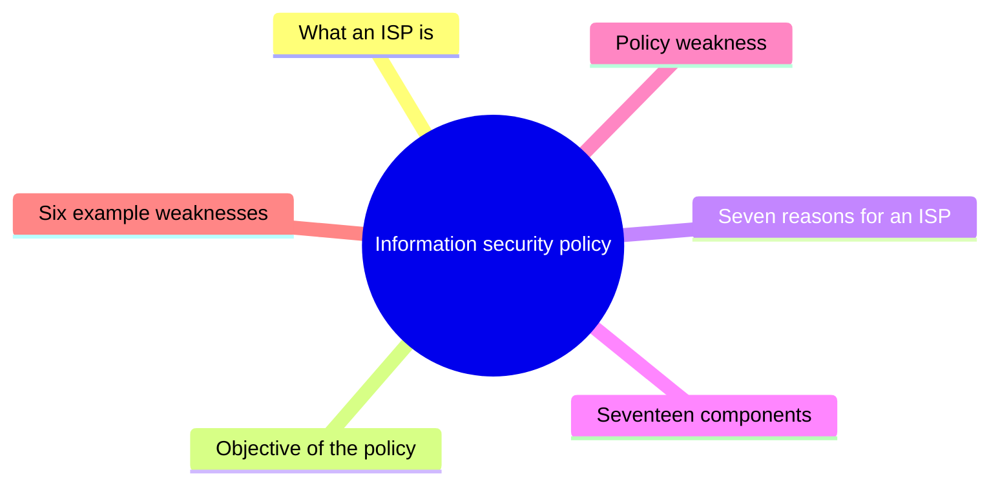
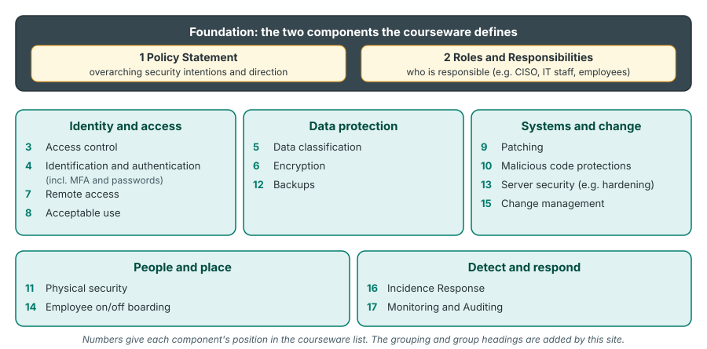
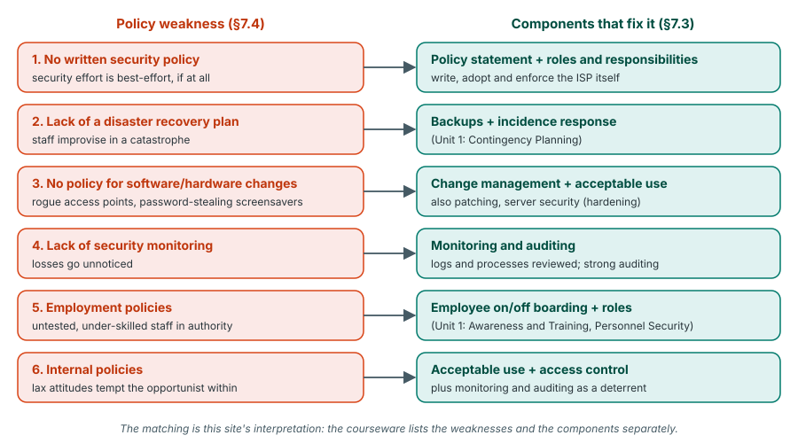

# Unit 6: Information security policy

*Courseware Chapter 7, pages 49–51.*

## At a glance

This is a short chapter (three pages), but it is easy to examine because almost all of it is lists. It answers four questions:

- **What is an information security policy (ISP)?** Rules and processes that guide employees' behaviour around the organisation's IT, supporting the **CIA triad** and defining the **who, what and why** of security.
- **Why does an organisation need one?** **Seven** core reasons, from defining what employees must do to classifying information.
- **What goes into one?** **Seventeen** components, from the policy statement to monitoring and auditing.
- **What goes wrong without good policy?** **Six** examples of **policy weakness**, from having no written policy at all to lax internal practices.

| Item | Count | Where |
|---|---|---|
| Definitions of an ISP | 2 (plus the objective) | §7.1 |
| Core reasons an organisation needs an ISP | 7 (numbered by the courseware) | §7.2 |
| Components of an ISP | 17 (the courseware does not number or count them; the count is ours) | §7.3 |
| Examples of policy weakness | 6 (the courseware does not number or count them; the count is ours) | §7.4 |

## What you should be able to do

*The courseware lists no learning outcomes; these are written for this site.*

- Define an information security policy in both of the courseware's forms and state the objective of the policy.
- Explain how an ISP supports the CIA triad and defines the who, what and why of desired behaviour.
- List and explain the seven core reasons why organisations need an information security policy.
- List the seventeen components of an ISP, define the policy statement and roles and responsibilities, and explain what each other component covers.
- Define policy weakness and explain its six examples.
- Given a description of an organisation, spot its policy weaknesses and recommend the components that would fix them, with justification.

## What an information security policy is

§7.1 · p.49

In [Unit 1](unit-1-security-concepts.md#computer-security-terminology) a *security policy* was one of the eight terms: "a set of criteria for the provision of security services". Chapter 7 looks at the policy as an organisation actually writes it. The courseware gives two descriptions and then states the policy's objective.

> **Information security policy (ISP):** Simply put , Information security policy (ISP) are sets forth rules and processes for workforce members, with a standard around the acceptable use of the organization's information technology, including networks and applications to protect data confidentiality, integrity, and availability.

> Information security policy is a statement, or a collection of statements, designed to guide employees' behavior with regard to the security of company information and IT systems. These security policies support the CIA triad and define the who, what, and why regarding the desired behavior, and they play an important role in an organization's overall security posture.

> **Objective:** The objective of this Policy is to ensure Information security which is concerned with the identification of an organization's electronic information assets and the development and implementation of tools, techniques, policies, standards, procedures, and guidelines to ensure the confidentiality, integrity, and availability of Information System assets.

!!! note "In plain terms"
    - **Definition 1 (the "rules" view):** an ISP **sets forth rules and processes** for **workforce members** (staff), with a **standard for acceptable use** of the organisation's IT (**networks and applications**), in order to protect **confidentiality, integrity and availability**.
    - **Definition 2 (the "behaviour" view):** an ISP is **a statement, or a collection of statements**, that **guides employees' behaviour** about the security of company information and IT systems. It does three things: it **supports the CIA triad**; it **defines the who, what and why** of desired behaviour; and it **plays an important role in the organisation's overall security posture**.
    - **Objective:** information security is about two activities: (1) **identifying** the organisation's **electronic information assets**, and (2) **developing and implementing six things**: **tools, techniques, policies, standards, procedures and guidelines**, all to ensure the C, I and A of information system assets.

    Notice that both definitions are about **people's behaviour**, not machines. A firewall enforces rules on traffic; a policy sets rules for staff. That is why the policy is the foundation the technical controls are built on.

{ .diagram }

What an ISP is and what it is for. Drawn for this site from the wording of §7.1; the courseware has no figure.

| "Who, what and why" | Question the policy answers | Example *(site example)* |
|---|---|---|
| **Who** | Who must do it, and who is responsible? | "All staff with access to the student records system…" |
| **What** | What behaviour is required or forbidden? | "…must use multi-factor authentication and must not share passwords…" |
| **Why** | Why does the rule exist? | "…because results data is confidential, and its disclosure or alteration harms students and the university." |

!!! example "Example"
    A Nigerian commercial bank's ISP says that only staff in the card operations unit (**who**) may view full card numbers, that they must do so only on bank-issued laptops inside the office network (**what**), and that this is required to protect customers' financial data and meet regulatory obligations (**why**). New staff sign the policy during onboarding. That one document guides behaviour, supports confidentiality, and improves the bank's security posture.

!!! tip "Exam angle"
    "Define information security policy" is the most predictable question from this chapter. A full answer combines both descriptions: **rules and processes for workforce members** + **standard of acceptable use of IT (networks and applications)** + **protect C, I, A** + **guide employees' behaviour** + **who, what and why** + **security posture**. Also learn the **six things** in the objective (tools, techniques, policies, standards, procedures, guidelines): "state the objective of an ISP" is an easy 3–4 marks.

!!! warning "Courseware note"
    The first definition is ungrammatical ("Information security policy (ISP) **are sets forth** rules and processes…"). The intended sense is "an information security policy **sets forth** rules and processes for workforce members". The objective also says "the objective of **this** Policy", wording apparently copied from a particular organisation's policy document (an inference). Quote the words as given, but write your own answer in correct grammar.

!!! info "Beyond the notes"
    The objective names **policies, standards, procedures and guidelines** without explaining them. In standard practice they form a hierarchy:

    - **Policy:** a high-level statement of intent and rules ("all sensitive data must be encrypted"). Mandatory.
    - **Standard:** a specific, mandatory requirement that makes the policy measurable ("use AES-256 for data at rest").
    - **Procedure:** step-by-step instructions for doing a task ("how to enable disk encryption on a staff laptop").
    - **Guideline:** recommended, non-mandatory advice ("prefer passphrases of four or more words").

    **Security posture** means the organisation's overall security strength: how well its people, policies and technology protect it and how ready it is to respond to attacks.

**Check your understanding**

According to §7.1, an information security policy defines which three things regarding the desired behaviour?

<ul class="quiz-options">
  <li>The when, where and how</li>
  <li data-correct>The who, what and why</li>
  <li>The threats, vulnerabilities and countermeasures</li>
  <li>The confidentiality, integrity and availability</li>
</ul>

Security policies "support the CIA triad and define the **who, what, and why** regarding the desired behavior". The CIA triad is what the policy *supports*, not the three things it defines, which makes the last option the tempting distractor (§7.1).

Which of these is NOT among the things the objective of the policy says must be developed and implemented to ensure C, I and A?

<ul class="quiz-options">
  <li>Standards</li>
  <li>Procedures</li>
  <li data-correct>Contracts</li>
  <li>Guidelines</li>
</ul>

The six are **tools, techniques, policies, standards, procedures, and guidelines**. Contracts are not mentioned. The objective also starts with *identifying* the organisation's electronic information assets (§7.1).

## Why organisations need an information security policy

§7.2 · pp.49–50

Having said what an ISP is, the courseware argues why every organisation should have one. It starts with the goal of writing one, then gives seven core reasons.

> Perhaps more than any other aspect of system security, protecting information requires specific some specific sets of rules to monitor procedural and behavioral activities. The goal when writing an organizational information security policy is to provide relevant direction and value to the individuals within an organization with regard to security. While entire books have been published regarding how to write effective security policies, there are a few core reasons why organization should have information security policies:
>
> 1. Information security policies define what is required of an organization's employees from a security perspective.
>
> 2. Information security policies reflect the risk appetite of an organization's management and should reflect the managerial mindset when it comes to security
>
> 3. Information security policies provide direction upon which a control framework can be built to secure the organization against external and internal threats
>
> 4. Information security policies are a mechanism to support an organization's legal and ethical responsibilities
>
> 5. Information security policies are a mechanism to hold individuals accountable for compliance with expected behaviors with regard to information security.
>
> 6. Information security policies is needed to protect against business risk and other threats to some organization assets. For the purpose of information security and this lecture, we discuss serious security issues including terms like threats, vulnerabilities, penetrations, and countermeasure.
>
> 7. It is the instrument that defines which information is confidential, restricted, general etc.

!!! note "In plain terms"
    **The goal** of writing an ISP: to give **relevant direction and value** to the individuals in the organisation regarding security. Protecting information needs specific **rules to monitor procedural and behavioural activities**: what people do and how they do it.

    | # | Reason (key words) | What it means |
    |---|---|---|
    | 1 | **Defines what is required** of employees | Staff know exactly what security expects of them; no one can say "nobody told me". |
    | 2 | **Reflects management's risk appetite** | It records how much risk management is willing to accept, and their mindset on security. |
    | 3 | **Direction for a control framework** | The technical and procedural controls are built on it, against **external and internal** threats. |
    | 4 | **Supports legal and ethical responsibilities** | It helps the organisation meet its duties under law (e.g. data protection) and ethics. |
    | 5 | **Holds individuals accountable** | Breaking a written rule can be sanctioned; without a rule, there is nothing to enforce. |
    | 6 | **Protects against business risk** and threats to assets | It addresses threats, vulnerabilities, penetrations and countermeasures. |
    | 7 | **Defines information classes** | It says which information is **confidential, restricted, general**, etc. |

    **Memory aid (the site's, not the courseware's):** *"**R**eally **R**isky **D**ecisions **L**ead **A**ll **B**anks to **C**ourt"*: **R**equired behaviour, **R**isk appetite, **D**irection for controls, **L**egal and ethical, **A**ccountability, **B**usiness risk, **C**lassification.

**Risk appetite** is the amount and type of risk management is willing to accept in pursuit of its goals (the courseware uses the term without defining it). A microfinance bank might accept that staff use personal phones for email; a defence agency would not. The ISP should **reflect** that choice, so a policy copied from another organisation may not fit.

**Control framework** is the organised set of security controls (technical, administrative and physical) that protect the organisation. The ISP gives the **direction**; the controls carry it out. Reason 3 names both **external** threats (hackers, criminals) and **internal** threats (staff misuse), which links to [Unit 1's inside and outside attacks](unit-1-security-concepts.md#security-concepts-and-relationships).

!!! example "Example"
    A Lagos fintech's staff member emails a spreadsheet of customer BVNs to a personal Gmail account "to work from home". Because the ISP **defines what is required** (reason 1: customer data stays on company systems), **classifies** customer data as confidential (reason 7) and allows sanctions (reason 5: **accountability**), the company can discipline him and show the regulator it had taken reasonable steps (reason 4: **legal responsibilities**). Without a policy, he could argue that no rule existed.

!!! tip "Exam angle"
    "Give five reasons why an organisation needs an information security policy" is very likely. Write each reason as one full sentence starting with the key word in bold. Reasons 4 and 5 are both "**a mechanism**" (to support legal and ethical responsibilities; to hold individuals accountable); reason 7 calls the policy "**the instrument**" that classifies information. These phrases are worth using.

!!! warning "Courseware note"
    The lead-in is garbled ("requires **specific some specific** sets of rules"; "Why Do **Organization** Need"). Reason 6 also contains a sentence that is not a reason but lecture housekeeping ("For the purpose of information security and this lecture, we discuss serious security issues including terms like threats, vulnerabilities, penetrations, and countermeasure"). Threats, vulnerabilities and countermeasures were defined in [Unit 1](unit-1-security-concepts.md#computer-security-terminology); **penetration** is never defined in this chapter: it means a successful attack that gains unauthorised access to a system (penetration testing is the authorised simulation of one).

**Check your understanding**

A board decides that the company will not allow any customer data to be stored on cloud services, even though this slows down some projects. Which reason for an ISP does writing this into the policy most directly reflect?

<ul class="quiz-options">
  <li>It is the instrument that defines which information is confidential, restricted, general</li>
  <li data-correct>It reflects the risk appetite of management and the managerial mindset on security</li>
  <li>It is a mechanism to hold individuals accountable</li>
  <li>It provides direction for a control framework</li>
</ul>

The board is deciding **how much risk it will accept**: that is risk appetite and the managerial mindset (reason 2). Classification (reason 7) is tempting because customer data is involved, but the board is not grading the data into confidential/restricted/general; it is choosing a risk level (§7.2).

Against which threats does §7.2 say the control framework built on an ISP secures the organisation?

<ul class="quiz-options">
  <li>External threats only</li>
  <li>Internal threats only</li>
  <li data-correct>External and internal threats</li>
  <li>Natural disasters only</li>
</ul>

Reason 3: a control framework can be built "to secure the organization against **external and internal** threats". Internal threats matter because staff already have access; §7.4's "internal policies" weakness is about exactly that "opportunist within" (§7.2).

Which three information classes does §7.2 name as examples of what an ISP defines?

<ul class="quiz-options">
  <li>Top secret, secret, unclassified</li>
  <li data-correct>Confidential, restricted, general</li>
  <li>Public, private, personal</li>
  <li>Low, moderate, high</li>
</ul>

Reason 7: the ISP is "the instrument that defines which information is **confidential, restricted, general** etc." Low, moderate and high are the impact levels from Unit 1, a different scale (the severity of a breach, not the sensitivity of information). Top secret/secret is a government scheme not used in the courseware (§7.2).

## Components of an information security policy

§7.3 · p.50

Knowing *why* a policy is needed, the next question is what to put in it. The courseware lists seventeen components (the courseware does not number or count them; the count is ours). Only the first two are explained; the rest are names only.

> **Components of an Information Security Policy**
>
> ➢ **Policy Statement:** The overarching security intentions and direction.
>
> ➢ **Roles and Responsibilities:** Defines who is responsible for security tasks (e.g., CISO, IT staff, employees).
>
> ➢ Access control
>
> ➢ Identification and Authentication (including multi-factor authentication and passwords)
>
> ➢ Data classification
>
> ➢ Encryption
>
> ➢ Remote access
>
> ➢ Acceptable use
>
> ➢ Patching
>
> ➢ Malicious code protections
>
> ➢ Physical security
>
> ➢ Backups
>
> ➢ Server security (e.g. hardening)
>
> ➢ Employee on/off boarding
>
> ➢ Change management
>
> ➢ Incidence Response
>
> ➢ Monitoring and Auditing

{ .diagram }

The 17 components of §7.3. Numbers follow the courseware's order; the five groups are added by this site as a memory aid.

Because the courseware only names components 3–17, the "What it covers" column below is the site's explanation (standard meaning of each term), not courseware wording.

| # | Component (courseware) | What it covers *(site explanation)* | Example policy rule *(site example)* |
|---|---|---|---|
| 1 | **Policy Statement** | *Courseware:* the overarching security intentions and direction. Management's top-level commitment. | "The university is committed to protecting the confidentiality, integrity and availability of its information." |
| 2 | **Roles and Responsibilities** | *Courseware:* defines who is responsible for security tasks (e.g. CISO, IT staff, employees). | "The CISO owns this policy; IT staff apply patches; every employee reports suspected incidents." |
| 3 | **Access control** | Who may access which systems and data, and what they may do; granting, reviewing and removing access. | "Access is granted on a need-to-know basis and reviewed every quarter." |
| 4 | **Identification and Authentication** (including MFA and passwords) | How users prove who they are: password rules and when multi-factor authentication is required. | "Passwords of 12+ characters; MFA for email and remote access." |
| 5 | **Data classification** | Sorting information into classes (e.g. confidential, restricted, general) with handling rules for each. | "Exam papers are *confidential*: encrypted, never emailed." |
| 6 | **Encryption** | When and how data must be encrypted (stored and in transit) and how keys are managed. | "All laptops use full-disk encryption." |
| 7 | **Remote access** | Rules for connecting from outside the office (VPN, approved devices). | "Remote access only through the company VPN with MFA." |
| 8 | **Acceptable use** | What staff may and may not do with the organisation's IT (internet, email, personal use, installing software). | "No personal software may be installed on office PCs." |
| 9 | **Patching** | Applying software updates and security fixes on time. | "Critical patches applied within 7 days." |
| 10 | **Malicious code protections** | Anti-malware software, scanning, and rules that reduce malware risk. | "Anti-virus on all endpoints; USB drives scanned before use." |
| 11 | **Physical security** | Protecting buildings, server rooms and equipment from unauthorised physical access and damage. | "Server room locked; access by card and logged." |
| 12 | **Backups** | What is backed up, how often, where copies are kept, and testing restores. | "Daily backups, one copy off-site, restore tested monthly." |
| 13 | **Server security** (e.g. hardening) | Securing servers by **hardening**: removing unneeded services and accounts, changing defaults, secure configuration. | "Default accounts disabled before any server goes live." |
| 14 | **Employee on/off boarding** | Security steps when staff join (accounts, training, signing the policy) and leave (removing access, recovering devices). | "All access revoked on the employee's last working day." |
| 15 | **Change management** | Controlling additions and changes to software and hardware: request, approval, testing, record. | "No new hardware joins the network without IT approval." |
| 16 | **Incidence Response** | What to do when a security incident occurs: report, contain, recover, learn. | "Suspected breaches reported to the IT helpdesk within 1 hour." |
| 17 | **Monitoring and Auditing** | Watching logs and activity, and checking compliance with the policy. | "Security logs reviewed weekly; annual audit of access rights." |

!!! note "In plain terms"
    Think of the ISP as a building (this picture is the site's): the **policy statement** is the foundation (intentions and direction) and **roles and responsibilities** say who looks after each part. The other fifteen are the rooms, each covering one area of security. A memory aid for the five groups in the diagram: **I**dentity and access, **D**ata, **S**ystems and change, **P**eople and place, **D**etect and respond: *"**I** **D**on't **S**hare **P**asswords, **D**ude."*

!!! example "Example"
    A state university writing its first ISP might map its real problems to components: students' results altered by a staff member's shared password (**identification and authentication**, **access control**); exam questions leaked by email (**data classification**, **encryption**, **acceptable use**); a lecturer's stolen laptop (**encryption**, **physical security**); a departed bursary officer still logging in (**employee on/off boarding**); nobody noticing for months (**monitoring and auditing**).

!!! tip "Exam angle"
    "List ten components of an information security policy" is a likely (b)-part. Use the courseware's names exactly, and add one line of explanation each when the question says "explain". For **policy statement** and **roles and responsibilities**, quote the courseware definitions, including the examples **CISO, IT staff, employees**. Note the two bracketed details the courseware gives: identification and authentication includes **multi-factor authentication and passwords**; server security includes **hardening**.

!!! warning "Courseware note"
    "**Incidence** Response" should be **Incident Response** (an incident is a security event; "incidence" means frequency). Use "Incident Response" in your answers; the examiner will recognise it. Components 3–17 have no explanation in the courseware, so the explanations above are the site's.

!!! info "Beyond the notes"
    **CISO** is the *Chief Information Security Officer*, the senior manager accountable for information security. **Multi-factor authentication (MFA)** requires two or more different kinds of evidence of identity (something you know, such as a password; something you have, such as a phone; something you are, such as a fingerprint). **Hardening** means reducing a system's attack surface: removing unnecessary software, services, ports and accounts and applying secure settings.

    Many components match Chapter 1's [essential security practices](unit-1-security-concepts.md#essential-security-practices). The pairing below is the site's, not the courseware's:

    | ISP component (§7.3) | Closest essential practice (Unit 1) |
    |---|---|
    | Access control; remote access | Access Control |
    | Identification and Authentication | Identification and Authentication |
    | Physical security | Physical and Environmental Protection |
    | Backups | Contingency Planning (backup operations) |
    | Patching; malicious code protections | System and Information Integrity (i) and (ii) |
    | Server security; change management | Configuration Management |
    | Employee on/off boarding | Personnel Security (ii); Awareness and Training |
    | Incidence Response | Incident Response |
    | Monitoring and Auditing | Audit and Accountability |
    | Encryption | System and Communications Protection |
    | Roles and Responsibilities; policy statement | Planning (security plans and rules of behaviour) |

    Several components are taught in depth later: [encryption](unit-4-cryptography.md), [access control](unit-8-access-control.md), [malicious code](unit-9-malware.md), and [monitoring and intrusion detection](unit-12-idps.md).

**Check your understanding**

Which ISP component does the courseware define as "the overarching security intentions and direction"?

<ul class="quiz-options">
  <li>Roles and Responsibilities</li>
  <li data-correct>Policy Statement</li>
  <li>Acceptable use</li>
  <li>Change management</li>
</ul>

The **Policy Statement** is the overarching security intentions and direction. Roles and Responsibilities is the other defined component, but it defines **who** is responsible for security tasks (e.g. CISO, IT staff, employees), not the overall direction (§7.3).

According to §7.3, the Identification and Authentication component includes which two things?

<ul class="quiz-options">
  <li>Encryption and backups</li>
  <li>Hardening and patching</li>
  <li data-correct>Multi-factor authentication and passwords</li>
  <li>Logs and audits</li>
</ul>

The courseware writes "Identification and Authentication (including **multi-factor authentication and passwords**)". Hardening is the example given for a different component, **server security** (§7.3).

A company keeps having problems after staff install free tools and plug in their own Wi-Fi routers without telling IT. Which pair of components most directly addresses this?

<ul class="quiz-options">
  <li>Backups and encryption</li>
  <li data-correct>Change management and acceptable use</li>
  <li>Physical security and patching</li>
  <li>Data classification and remote access</li>
</ul>

**Change management** controls additions and changes to software and hardware; **acceptable use** says what staff may do with company IT (e.g. no unapproved installs or devices). Together they fix §7.4's "no policy for software and hardware additions or changes". Patching keeps *approved* software updated; it does not stop unapproved additions (§7.3, §7.4).

## Policy weakness

§7.4 · p.50

The last section turns the question round: what happens when the policy is weak or missing?

> **Policy weakness:** Policy weakness is a catchall phrase for company policies, or a lack of policies, that inadvertently lead to security threats to the network system. The following examples are some of the policy issues that can negatively impact a business's computer system:

!!! note "In plain terms"
    A **policy weakness** is not a software bug: it is a **gap in the rules**. Two forms are covered by the "catchall phrase": **bad policies** and **missing policies**. The key word is **inadvertently**: nobody intends to create a threat, but the weak rule (or no rule) opens the door. In Unit 1's terms, a policy weakness is a **vulnerability** in "system security procedures [or] internal controls".

The courseware gives six examples (the courseware does not number or count them; the count is ours). Each is treated below.

### No written security policy

§7.4 · p.51

> • No written security policy. The lack of a documented and adopted plan means the security efforts evolve and are enforced, if at all, in a best-effort manner.

**No rulebook.** Without a **documented and adopted** plan, security grows haphazardly and is enforced **"if at all, in a best-effort manner"**: each person does what they think best. Note both words: the policy must be **documented** (written) *and* **adopted** (approved and in use). A draft sitting in a drawer still counts as this weakness. *Fix:* write and adopt an ISP, starting with the **policy statement** and **roles and responsibilities**.

### Lack of a disaster recovery plan

§7.4 · p.51

> • Lack of a disaster recover plan. Without a plan, the efforts to fight a network attack – or even a physical emergency such as a fire, flood, or earthquake – are left to the judgment and knowledge of the staff on hand. Even the best-trained and most experienced staff can make foolish decisions when faced with an unexpected catastrophic event.

**No plan for the worst day.** The courseware names two kinds of disaster: a **network attack** and a **physical emergency** (**fire, flood, or earthquake**). Without a plan, the response depends on **"the judgment and knowledge of the staff on hand"**, and even the **best-trained and most experienced** staff can make **foolish decisions** under pressure. The point: a plan replaces improvisation with decisions made calmly in advance. *Fix:* **backups** and **incident response** in the ISP, plus a disaster recovery plan (Unit 1's **Contingency Planning** practice).

### No policy for software and hardware additions or changes

§7.4 · p.51

> • No policy for software and hardware additions or changes. Whether motivated by increasing productivity or recreation, any addition or upgrade to software or hardware can introduce unexpected security vulnerabilities. Adding an unauthorized wireless access point to a network can throw open a virtual garage door to the network and the company resources. Similarly, an unauthorized screensaver might also be harvesting passwords, user IDs, and other information for someone else.

**Uncontrolled changes.** Staff add or upgrade things for two motives: **productivity or recreation**. Either way, **any** addition or upgrade can bring **unexpected vulnerabilities**. The courseware's two examples:

- an **unauthorized wireless access point** "can throw open a **virtual garage door**" to the network and company resources (it bypasses the protected entrance; see [Unit 7](unit-7-wireless-mobile.md#why-wireless-networks-are-exposed-and-the-six-security-measures) on wireless security);
- an **unauthorized screensaver** might be **harvesting passwords, user IDs, and other information** for someone else (a Trojan horse; see [Unit 9](unit-9-malware.md#trojan-horse)).

*Fix:* **change management** and **acceptable use**, backed by **server security** and **patching**.

### Lack of security monitoring

§7.4 · p.51

> • Lack of security monitoring. Even if a secure network is developed, failure to monitor logs and processes or weak auditing allow new vulnerabilities and unauthorized use to evolve and proliferate. The worst case would be not recognizing that a serious loss had occurred or was continuing.

**Nobody is watching.** Even a **secure network** decays if no one checks it. Three failures are named: not monitoring **logs**, not monitoring **processes**, and **weak auditing**. These let **new vulnerabilities and unauthorized use** **evolve and proliferate** (grow and spread). The **worst case**: **not recognizing that a serious loss had occurred or was continuing**. *Fix:* the **monitoring and auditing** component; see [Unit 12](unit-12-idps.md#what-an-idps-is-used-for) for intrusion detection.

### Employment policies

§7.4 · p.51

> • Employment policies. Frequent staff turnover, lower than typical compensation, and lack of training opportunities can all impact network security by bringing new untested and under skilled employees into positions of authority and responsibility.

**Human resources policies that weaken security.** Three factors: **frequent staff turnover**, **lower than typical compensation**, and **lack of training opportunities**. The effect: **new, untested and under-skilled employees** end up in **positions of authority and responsibility**. This is a policy weakness even though it is set by HR, not IT. *Fix:* **employee on/off boarding** (training on joining, access removed on leaving) and clear **roles and responsibilities**; also Unit 1's **Awareness and Training** and **Personnel Security** practices.

### Internal policies

§7.4 · p.51

> • Internal policies. Lax business attitudes and practices often create temptations and a relatively safe environment for the opportunist within to ply their craft.

**A culture that tempts insiders.** **Lax business attitudes and practices** do two things: they create **temptations** and a **relatively safe environment** for **"the opportunist within"** (a dishonest insider) **to ply their craft** (to commit fraud or misuse). This is the policy side of Unit 1's **inside attack**. *Fix:* **acceptable use** and **access control** (least privilege), with **monitoring and auditing** so that misuse is likely to be noticed.

!!! example "Example"
    A fictional Abuja microfinance bank has no written ISP; its only IT officer left last month and was replaced by an intern on a low salary; a loan officer installed a "free" screensaver; nobody reads the server logs; and cashiers often share one login "to save time". In one paragraph, that bank shows **five** of the six weaknesses: no written policy, employment policies, no policy for software additions, lack of monitoring, and internal policies (lax practice). Only the disaster recovery plan is not mentioned, so it cannot be identified from the facts.

!!! tip "Exam angle"
    Learn the six by their **exact names** and **one key phrase** each: no written policy → "**best-effort manner**"; disaster recovery → "**fire, flood, or earthquake**" and "**foolish decisions**"; software/hardware changes → "**virtual garage door**" and "**screensaver… harvesting passwords**"; monitoring → "**worst case… not recognizing… serious loss**"; employment → "**turnover, compensation, training**"; internal → "**opportunist within**". Scenario questions describe an organisation and ask you to **spot** the weaknesses and **recommend** fixes: the next subsection is your toolkit.

!!! warning "Courseware note"
    The courseware writes "disaster **recover** plan" (= recovery) and "under skilled" (= under-skilled). The heading is "Policy Weakness" (singular) although six examples follow.

### Matching weaknesses to components

§7.3, §7.4 · pp.50–51

The courseware lists the weaknesses (§7.4) and the components (§7.3) separately, but they fit together: each weakness is a missing or weak component. This matching is the site's interpretation and is the core of any scenario answer.

{ .diagram }

Each policy weakness and the components that fix it. Drawn for this site; the matching is the site's interpretation, not the courseware's.

!!! tip "Exam angle: answering a 'spot the weakness' scenario"
    1. **Identify** each weakness by its courseware name.
    2. **Apply** it: quote the fact from the scenario that shows it.
    3. **Justify** with the courseware's consequence (e.g. "efforts are enforced, if at all, in a best-effort manner").
    4. **Act:** recommend the matching component(s) and say why that beats the alternative (e.g. "buying a better firewall would not help, because the problem is staff behaviour, which only a written policy can direct").

**Check your understanding**

The courseware describes an unauthorised wireless access point as throwing open "a virtual garage door". Under which policy weakness does this example appear?

<ul class="quiz-options">
  <li>Lack of security monitoring</li>
  <li>Internal policies</li>
  <li data-correct>No policy for software and hardware additions or changes</li>
  <li>No written security policy</li>
</ul>

The wireless access point and the password-harvesting screensaver are both examples of **additions** made without a policy for software and hardware changes. Monitoring might *detect* the access point, but the weakness that let it in is the missing change policy (§7.4, p.51).

According to the courseware, what is the "worst case" of a lack of security monitoring?

<ul class="quiz-options">
  <li>The network becomes unavailable</li>
  <li>Staff make foolish decisions during a disaster</li>
  <li data-correct>Not recognizing that a serious loss had occurred or was continuing</li>
  <li>Untested employees are placed in positions of authority</li>
</ul>

"The worst case would be **not recognizing that a serious loss had occurred or was continuing**." Foolish decisions belong to the disaster recovery plan weakness; untested employees to employment policies (§7.4, p.51).

Which three factors does the "employment policies" weakness name?

<ul class="quiz-options">
  <li>Lax attitudes, temptation, opportunists</li>
  <li data-correct>Frequent staff turnover, lower than typical compensation, lack of training opportunities</li>
  <li>No written policy, no disaster plan, no monitoring</li>
  <li>Productivity, recreation, upgrades</li>
</ul>

Employment policies: **frequent staff turnover, lower than typical compensation, and lack of training opportunities**, which bring new untested and under-skilled employees into positions of authority. "Lax attitudes" and "the opportunist within" are the **internal policies** weakness, a common mix-up (§7.4, p.51).

## Key terms

Information security policy (ISP)
:   Rules and processes for workforce members, with a standard around the acceptable use of the organization's IT (networks and applications), to protect confidentiality, integrity and availability; a statement or collection of statements that guides employees' behaviour and defines the who, what and why of desired behaviour.

Objective of an ISP
:   To ensure information security: identifying the organization's electronic information assets and developing and implementing tools, techniques, policies, standards, procedures and guidelines to ensure the C, I and A of information system assets.

Security posture
:   The organisation's overall security strength and readiness; the ISP plays an important role in it (term used but not defined in the courseware).

Risk appetite
:   The amount of risk an organisation's management is willing to accept; an ISP should reflect it (term used but not defined in the courseware).

Control framework
:   The set of security controls built on the direction given by an ISP to secure the organization against external and internal threats.

Policy statement
:   ISP component: the overarching security intentions and direction.

Roles and responsibilities
:   ISP component that defines who is responsible for security tasks (e.g. CISO, IT staff, employees).

Data classification
:   ISP component that defines which information is confidential, restricted, general, etc., with handling rules for each class.

Acceptable use
:   ISP component stating what staff may and may not do with the organisation's IT (named but not defined in the courseware).

Server hardening
:   Securing a server by removing unneeded services, software and accounts and applying secure settings; the courseware's example of server security.

Change management
:   ISP component that controls additions and changes to software and hardware (named but not defined in the courseware).

Employee on/off boarding
:   ISP component covering security steps when staff join (accounts, training) and leave (removing access) (named but not defined in the courseware).

CISO
:   Chief Information Security Officer: the senior manager responsible for information security; named in the courseware as an example under roles and responsibilities.

Policy weakness
:   A catchall phrase for company policies, or a lack of policies, that inadvertently lead to security threats to the network system.

Disaster recovery plan
:   A plan for fighting a network attack or a physical emergency (fire, flood, earthquake); without one, the response is left to the judgment of the staff on hand.

---

## Unit summary

- **ISP (§7.1):** rules and processes for **workforce members**, with a **standard for acceptable use** of the organisation's IT (**networks and applications**), to protect **C, I, A**. Also: a **statement or collection of statements** guiding **employees' behaviour**; supports the **CIA triad**; defines the **who, what and why** of desired behaviour; important for the **overall security posture**.
- **Objective (§7.1):** **identify** electronic information assets; **develop and implement** **tools, techniques, policies, standards, procedures and guidelines** (6) to ensure C, I, A of information system assets.
- **Why (§7.2):** protecting information needs specific rules to monitor **procedural and behavioural** activities; the goal of writing an ISP is to give **relevant direction and value** to individuals. **Seven reasons:** (1) defines what is **required** of employees; (2) reflects management's **risk appetite** and mindset; (3) **direction for a control framework** against **external and internal** threats; (4) mechanism to support **legal and ethical** responsibilities; (5) mechanism to hold individuals **accountable**; (6) protects against **business risk** and threats to assets (threats, vulnerabilities, penetrations, countermeasure); (7) the **instrument that classifies** information (confidential, restricted, general).
- **Components (§7.3, 17):** **policy statement** (overarching intentions and direction); **roles and responsibilities** (who is responsible: CISO, IT staff, employees); access control; identification and authentication (MFA, passwords); data classification; encryption; remote access; acceptable use; patching; malicious code protections; physical security; backups; server security (hardening); employee on/off boarding; change management; incidence [incident] response; monitoring and auditing.
- **Policy weakness (§7.4):** catchall phrase for **policies, or a lack of policies**, that **inadvertently** lead to security threats. **Six examples:** no written security policy (best-effort enforcement); lack of a disaster recovery plan (network attack, fire, flood, earthquake; foolish decisions); no policy for software/hardware additions or changes (productivity or recreation; rogue wireless access point = virtual garage door; password-harvesting screensaver); lack of security monitoring (logs, processes, weak auditing; worst case = loss not recognised); employment policies (turnover, low compensation, no training → untested, under-skilled staff in authority); internal policies (lax attitudes → opportunist within).

## Mixed review

An organisation's ISP has a full list of technical rules, but nobody is named as responsible for applying them, so each department assumes another will do it. Which component is missing?

<ul class="quiz-options">
  <li>Policy Statement</li>
  <li data-correct>Roles and Responsibilities</li>
  <li>Monitoring and Auditing</li>
  <li>Change management</li>
</ul>

Roles and Responsibilities "defines **who** is responsible for security tasks". The policy statement gives intentions and direction, which this organisation may well have; the gap is ownership. Without it, the policy also cannot hold individuals accountable (§7.2 reason 5; §7.3).

A cashier at a supermarket chain steals small amounts for months because refunds need no second approval and nobody reviews the refund logs. Which pair of policy weaknesses best describes this?

<ul class="quiz-options">
  <li>No written security policy and lack of a disaster recovery plan</li>
  <li data-correct>Internal policies and lack of security monitoring</li>
  <li>Employment policies and no policy for hardware changes</li>
  <li>Lack of a disaster recovery plan and internal policies</li>
</ul>

**Lax business practices** (no second approval) give "the opportunist within" a relatively safe environment: **internal policies**. Nobody reviewing logs is **lack of security monitoring**, which let the unauthorised use "evolve and proliferate". Employment policies would be tempting only if the facts mentioned turnover, pay or training (§7.4).

Which statement correctly links §7.2 to §7.3?

<ul class="quiz-options">
  <li>Reason 7 (classification) is delivered by the Encryption component</li>
  <li data-correct>Reason 7 (classification) is delivered by the Data classification component</li>
  <li>Reason 2 (risk appetite) is delivered by the Patching component</li>
  <li>Reason 5 (accountability) is delivered by the Backups component</li>
</ul>

The ISP is "the instrument that defines which information is confidential, restricted, general": that is the **data classification** component. Encryption protects classified data but does not decide its class. Accountability is supported by roles and responsibilities and by monitoring and auditing, not backups.

How does the ISP of Chapter 7 relate to the "security policy" term defined in Chapter 1?

<ul class="quiz-options">
  <li>They are unrelated: one is about networks, the other about people</li>
  <li data-correct>Both set criteria or rules for security; Chapter 7 describes the organisational document that guides employees' behaviour and lists its components</li>
  <li>The Chapter 1 security policy is a component of the ISP</li>
  <li>The ISP replaces the CIA triad</li>
</ul>

Chapter 1 defines a security policy as "a set of criteria for the provision of security services" that constrains a facility's activities. Chapter 7 takes the same idea to the organisation: rules and processes for workforce members that **support** the CIA triad (it does not replace it).

## Recall drill

Every definition, list, comparison and example in Chapter 7, as a short question. Answer aloud or on paper, then open the answer.

### What an ISP is

**R1.** Define *information security policy* (the "simply put" definition).

??? success "Answer"
    Information security policy (ISP) sets forth **rules and processes for workforce members**, with a **standard around the acceptable use** of the organization's information technology, including **networks and applications**, to protect data **confidentiality, integrity, and availability**.

**R2.** Give the courseware's second description of an information security policy.

??? success "Answer"
    A **statement, or a collection of statements**, designed to **guide employees' behavior** with regard to the security of company information and IT systems. These policies **support the CIA triad** and **define the who, what, and why** regarding the desired behavior, and they play an important role in an organization's **overall security posture**.

**R3.** An ISP sets a standard around the acceptable use of the organisation's IT. Which two parts of IT does the courseware name?

??? success "Answer"
    **Networks and applications.**

**R4.** Whose behaviour does an ISP guide?

??? success "Answer"
    **Employees'** (workforce members') behaviour, with regard to the security of company information and IT systems.

**R5.** State three things security policies do, according to the second description.

??? success "Answer"
    They **support the CIA triad**; they **define the who, what, and why** regarding the desired behavior; they **play an important role in the organization's overall security posture**.

**R6.** State the objective of an information security policy.

??? success "Answer"
    To ensure information security, which is concerned with the **identification of an organization's electronic information assets** and the **development and implementation of tools, techniques, policies, standards, procedures, and guidelines** to ensure the **confidentiality, integrity, and availability** of information system assets.

**R7.** Name the six things developed and implemented to ensure C, I and A, according to the objective. (There are 6.)

??? success "Answer"
    **Tools, techniques, policies, standards, procedures, and guidelines.**

**R8.** Information security is concerned with the identification of what?

??? success "Answer"
    The organization's **electronic information assets**.

**R9.** Differentiate between the "rules" description and the "behaviour" description of an ISP.

??? success "Answer"
    The first stresses **rules and processes** for workforce members and a **standard of acceptable use** of IT (networks and applications) to protect C, I and A. The second stresses the policy as **statements that guide employees' behaviour**, defining the **who, what and why** of desired behaviour and contributing to the **security posture**. Both aim at the CIA triad.

### Why organisations need an ISP

**R10.** According to §7.2, what does protecting information require, perhaps more than any other aspect of system security?

??? success "Answer"
    Specific sets of **rules to monitor procedural and behavioral activities**.

**R11.** What is the goal when writing an organisational information security policy?

??? success "Answer"
    To provide **relevant direction and value** to the individuals within an organization with regard to security.

**R12.** List the core reasons why organisations should have information security policies. (There are 7.)

??? success "Answer"
    1. They **define what is required** of an organization's employees from a security perspective.
    2. They **reflect the risk appetite** of management and the managerial mindset on security.
    3. They **provide direction upon which a control framework can be built** to secure the organization against external and internal threats.
    4. They are a **mechanism to support legal and ethical responsibilities**.
    5. They are a **mechanism to hold individuals accountable** for compliance with expected behaviors.
    6. They are needed to **protect against business risk** and other threats to organization assets.
    7. It is **the instrument that defines which information is confidential, restricted, general** etc.

**R13.** What should an ISP reflect about an organisation's management?

??? success "Answer"
    Its **risk appetite**, and the **managerial mindset** when it comes to security.

**R14.** What can be built on the direction an ISP provides, and against what?

??? success "Answer"
    A **control framework**, to secure the organization against **external and internal threats**.

**R15.** An ISP is described as "a mechanism" for which two things?

??? success "Answer"
    (i) To **support an organization's legal and ethical responsibilities**; (ii) to **hold individuals accountable** for compliance with expected behaviors with regard to information security.

**R16.** Which four security terms does the courseware mention under the business-risk reason?

??? success "Answer"
    **Threats, vulnerabilities, penetrations, and countermeasure.**

**R17.** Which document is "the instrument" that defines information classes, and which three classes are named?

??? success "Answer"
    The **information security policy**; **confidential, restricted, general** (etc.).

### Components of an ISP

**R18.** List the components of an information security policy. (There are 17.)

??? success "Answer"
    Policy Statement; Roles and Responsibilities; Access control; Identification and Authentication (including multi-factor authentication and passwords); Data classification; Encryption; Remote access; Acceptable use; Patching; Malicious code protections; Physical security; Backups; Server security (e.g. hardening); Employee on/off boarding; Change management; Incidence [Incident] Response; Monitoring and Auditing.

**R19.** Define the *policy statement* component.

??? success "Answer"
    **The overarching security intentions and direction.**

**R20.** Define the *roles and responsibilities* component, with the courseware's examples.

??? success "Answer"
    It **defines who is responsible for security tasks** (e.g. **CISO, IT staff, employees**).

**R21.** Differentiate between the policy statement and roles and responsibilities.

??? success "Answer"
    The **policy statement** gives the **overarching intentions and direction** (what the organisation intends for security). **Roles and responsibilities** says **who** is responsible for carrying out security tasks (e.g. CISO, IT staff, employees).

**R22.** What two things does the identification and authentication component include, according to the courseware?

??? success "Answer"
    **Multi-factor authentication and passwords.**

**R23.** What example does the courseware give for server security?

??? success "Answer"
    **Hardening.** *(Site explanation: removing unnecessary services, software and accounts and applying secure settings.)*

**R24.** Explain the *access control* component. *(Named only in the courseware; answer is the site's.)*

??? success "Answer"
    Rules on **who may access which systems and data and what they may do**, including how access is granted, reviewed and removed (e.g. need-to-know).

**R25.** Explain the *data classification* component, linking it to §7.2.

??? success "Answer"
    It sorts information into classes with handling rules for each. It delivers §7.2's reason 7: the ISP is **the instrument that defines which information is confidential, restricted, general** etc.

**R26.** Explain the *encryption* and *remote access* components. *(Site answer.)*

??? success "Answer"
    **Encryption:** when and how data must be encrypted, at rest and in transit, and how keys are managed. **Remote access:** rules for connecting to the organisation's systems from outside (e.g. only through a VPN with MFA, from approved devices).

**R27.** Explain the *acceptable use* component. *(Site answer.)*

??? success "Answer"
    What staff **may and may not do** with the organisation's IT: internet and email use, personal use, installing software or connecting devices. It links to the first definition's "standard around the acceptable use of the organization's information technology".

**R28.** Explain the *patching* and *malicious code protections* components. *(Site answer.)*

??? success "Answer"
    **Patching:** applying software updates and security fixes promptly. **Malicious code protections:** anti-malware software, scanning and rules that reduce the risk of viruses, worms, Trojans and similar code.

**R29.** Explain the *physical security* and *backups* components. *(Site answer.)*

??? success "Answer"
    **Physical security:** protecting buildings, server rooms and equipment from unauthorised physical access and damage. **Backups:** what data is copied, how often, where copies are stored (e.g. off-site) and how restores are tested.

**R30.** Explain the *employee on/off boarding* and *change management* components. *(Site answer.)*

??? success "Answer"
    **On/off boarding:** security steps when staff join (accounts, training, signing the policy) and leave (removing all access, recovering devices). **Change management:** controlling additions and changes to software and hardware through request, approval, testing and recording.

**R31.** Explain the *incident response* and *monitoring and auditing* components. *(Site answer.)*

??? success "Answer"
    **Incident (courseware: "Incidence") response:** what to do when a security incident occurs: report, contain, recover, learn. **Monitoring and auditing:** watching logs and activity, and checking compliance with the policy.

**R32.** Differentiate between *patching* and *change management*.

??? success "Answer"
    **Patching** applies vendor updates and fixes to existing, approved software. **Change management** controls **any** addition or change to software or hardware (including patches) so that it is approved, tested and recorded before it happens.

**R33.** Differentiate between *access control* and *identification and authentication*.

??? success "Answer"
    **Identification and authentication** establishes **who the user is** (passwords, MFA). **Access control** decides **what that identified user may access and do**. Authentication comes first; access control uses its result.

**R34.** Differentiate between *incident response* and *monitoring and auditing*.

??? success "Answer"
    **Monitoring and auditing** watches logs and activity and checks compliance, so that problems are **detected**. **Incident response** is what the organisation **does once an incident is found**: contain, recover, report.

**R35.** Which components most directly concern people rather than technology? Name four.

??? success "Answer"
    **Roles and responsibilities; acceptable use; employee on/off boarding; physical security** (also the policy statement as management's commitment). *(The grouping is the site's.)*

### Policy weakness

**R36.** Define *policy weakness*.

??? success "Answer"
    A **catchall phrase** for **company policies, or a lack of policies**, that **inadvertently lead to security threats** to the network system.

**R37.** List the examples of policy issues that can negatively impact a business's computer system. (There are 6.)

??? success "Answer"
    No written security policy; lack of a disaster recovery plan; no policy for software and hardware additions or changes; lack of security monitoring; employment policies; internal policies.

**R38.** Explain *no written security policy* as a policy weakness.

??? success "Answer"
    The lack of a **documented and adopted plan** means the security efforts **evolve and are enforced, if at all, in a best-effort manner**.

**R39.** Explain *lack of a disaster recovery plan* as a policy weakness.

??? success "Answer"
    Without a plan, efforts to fight a **network attack**, or a **physical emergency such as a fire, flood, or earthquake**, are **left to the judgment and knowledge of the staff on hand**. Even the **best-trained and most experienced staff can make foolish decisions** when faced with an unexpected catastrophic event.

**R40.** Name the three physical emergencies given under the disaster recovery weakness.

??? success "Answer"
    **Fire, flood, earthquake.**

**R41.** Explain *no policy for software and hardware additions or changes*.

??? success "Answer"
    Whether motivated by **increasing productivity or recreation**, any **addition or upgrade** to software or hardware **can introduce unexpected security vulnerabilities**. An **unauthorized wireless access point** can throw open a **virtual garage door** to the network and company resources; an **unauthorized screensaver** might be **harvesting passwords, user IDs, and other information** for someone else.

**R42.** State the two motives for software and hardware additions named by the courseware, and its two examples.

??? success "Answer"
    Motives: **increasing productivity** or **recreation**. Examples: an **unauthorized wireless access point** ("virtual garage door"); an **unauthorized screensaver** harvesting passwords and user IDs.

**R43.** Explain *lack of security monitoring* as a policy weakness. What is the worst case?

??? success "Answer"
    Even if a secure network is developed, **failure to monitor logs and processes or weak auditing** allow **new vulnerabilities and unauthorized use to evolve and proliferate**. **Worst case:** **not recognizing that a serious loss had occurred or was continuing.**

**R44.** Explain *employment policies* as a policy weakness, naming its three factors.

??? success "Answer"
    **Frequent staff turnover, lower than typical compensation, and lack of training opportunities** can all impact network security by bringing **new untested and under-skilled employees into positions of authority and responsibility**.

**R45.** Explain *internal policies* as a policy weakness.

??? success "Answer"
    **Lax business attitudes and practices** often create **temptations** and a **relatively safe environment** for **the opportunist within** to ply their craft.

**R46.** Differentiate between the *employment policies* and *internal policies* weaknesses.

??? success "Answer"
    **Employment policies** are about **who** is in post: turnover, low pay and lack of training put **untested, under-skilled** people in positions of authority (a competence problem). **Internal policies** are about **business attitudes and practices**: lax practice creates **temptation** for a dishonest insider, "the opportunist within" (an honesty and opportunity problem).

**R47.** Differentiate between *no written security policy* and *lack of a disaster recovery plan*.

??? success "Answer"
    **No written security policy:** no documented and adopted plan for security **in general**, so day-to-day security is enforced, if at all, in a best-effort manner. **Lack of a disaster recovery plan:** no plan **for a catastrophic event** (network attack, fire, flood, earthquake), so the response depends on the staff on hand. An organisation can have a written ISP and still lack a disaster recovery plan.

**R48.** For each of the six policy weaknesses, name an ISP component that addresses it. *(The matching is the site's.)*

??? success "Answer"
    No written policy → **policy statement, roles and responsibilities** (adopt the ISP); no disaster recovery plan → **backups, incident response**; no policy for additions or changes → **change management, acceptable use**; lack of monitoring → **monitoring and auditing**; employment policies → **employee on/off boarding, roles and responsibilities**; internal policies → **acceptable use, access control**, with monitoring and auditing.

**R49.** Differentiate between the *information security policy* (Chapter 7) and the *security policy* term (Chapter 1).

??? success "Answer"
    **Security policy (Ch.1):** a set of criteria for the provision of security services; it defines and constrains the activities of a data processing facility to maintain security for systems and data. **ISP (Ch.7):** the organisation's rules and processes for **workforce members**, guiding employees' behaviour and defining the who, what and why, with 17 listed components. Chapter 1's term is the general idea; Chapter 7 is the organisational document.

## Practice exercises

**Exercise 1: Which reason?** Name the §7.2 reason (by number and key words) that each statement illustrates.

1. "The policy states that exam scripts are *confidential* and staff timetables are *general*."
2. "After the breach, the regulator asked to see our data protection policy."
3. "Because it was written in the policy, HR could issue a query to the officer who shared his password."
4. "Our CEO accepts no risk on customer funds but some risk on the marketing website."
5. "We built our firewall rules, access reviews and log checks around what the policy says."

??? success "Answer"
    1 reason 7 (instrument that classifies information); 2 reason 4 (legal and ethical responsibilities); 3 reason 5 (hold individuals accountable), also reason 1 (defines what is required); 4 reason 2 (risk appetite and managerial mindset); 5 reason 3 (direction for a control framework).

**Exercise 2: Name the component.** Which §7.3 component should contain each rule?

1. "All laptops must use full-disk encryption."
2. "Accounts of departing staff are disabled on their last day."
3. "No new server goes live until default accounts are removed and unused services disabled."
4. "Staff may not use office computers for online betting."
5. "The Head of IT is responsible for reviewing firewall rules every quarter."
6. "MFA is required for all email accounts."
7. "A copy of the database is kept at the Ibadan branch and restored as a test every month."

??? success "Answer"
    1 encryption; 2 employee on/off boarding; 3 server security (hardening); 4 acceptable use; 5 roles and responsibilities; 6 identification and authentication; 7 backups.

**Exercise 3: Spot the weakness.** Name the §7.4 weakness in each case.

1. A records clerk plugs a home Wi-Fi router into the office network so she can use her phone.
2. The data centre floods; staff argue for hours about whether to shut down the servers.
3. Security tasks are done "when someone has time"; there is no document saying what anyone should do.
4. Three IT officers resigned this year; the new ones are fresh graduates on low pay and get no training.
5. A fraud ran for eight months; the logs showed it from day one, but no one reads them.
6. Store staff routinely take stock "to be paid back later", and managers turn a blind eye.

??? success "Answer"
    1 no policy for software and hardware additions or changes (unauthorised wireless access point); 2 lack of a disaster recovery plan; 3 no written security policy (best-effort manner); 4 employment policies; 5 lack of security monitoring (worst case: loss continuing unrecognised); 6 internal policies (lax attitudes, opportunist within).

**Exercise 4: Complete from memory.** Fill in the blanks.

1. ISPs support the ______ triad and define the ______, ______ and ______ regarding the desired behaviour.
2. The objective of the policy names six things: tools, ______, policies, ______, procedures and ______.
3. Policy weakness is a ______ phrase for company policies, or a lack of policies, that ______ lead to security threats.
4. An unauthorised wireless access point can throw open a virtual ______ ______.

??? success "Answer"
    1 CIA; who, what, why. 2 techniques; standards; guidelines. 3 catchall; inadvertently. 4 garage door.

## Sample exam questions

**Question 1** *(recall-heavy)*

**1a.** Define an information security policy and state its objective. (6 marks)

??? success "Model answer"
    An **information security policy (ISP)** sets forth **rules and processes for workforce members**, with a **standard around the acceptable use** of the organization's information technology, including **networks and applications**, to protect data **confidentiality, integrity and availability**. It is a **statement, or collection of statements**, designed to **guide employees' behaviour** with regard to the security of company information and IT systems; it **supports the CIA triad**, **defines the who, what and why** of desired behaviour, and plays an important role in the organization's **overall security posture**.

    **Objective:** to ensure information security, which is concerned with the **identification of the organization's electronic information assets** and the **development and implementation of tools, techniques, policies, standards, procedures and guidelines** to ensure the confidentiality, integrity and availability of information system assets.

    **Marking points:** rules and processes for workforce / acceptable use of IT (1.5); protect C, I, A (0.5); guides behaviour, who/what/why, security posture (1); objective: identify electronic information assets (1); the six things developed and implemented (1.5); to ensure C, I, A (0.5). Total 6.

**1b.** Explain **six** reasons why organisations need an information security policy. (6 marks)

??? success "Model answer"
    *(Any six of the seven, e.g.:)*

    - **Defines requirements:** ISPs define what is required of an organization's employees from a security perspective.
    - **Risk appetite:** they reflect the risk appetite of management and the managerial mindset on security.
    - **Control framework:** they provide direction upon which a control framework can be built to secure the organization against external and internal threats.
    - **Legal and ethical:** they are a mechanism to support the organization's legal and ethical responsibilities.
    - **Accountability:** they are a mechanism to hold individuals accountable for compliance with expected behaviours.
    - **Business risk:** they protect against business risk and other threats to organization assets.
    - **Classification:** the ISP is the instrument that defines which information is confidential, restricted, general, etc.

    **Marking points:** 1 per reason with its explanation (6 × 1).

**1c.** Define policy weakness, and differentiate between the *employment policies* and *internal policies* weaknesses in terms of their causes, the people involved, and their effect on security. (8 marks)

??? success "Model answer"
    **Policy weakness** is a catchall phrase for company policies, or a lack of policies, that inadvertently lead to security threats to the network system.

    | Criterion | Employment policies | Internal policies |
    |---|---|---|
    | **Causes (2)** | Frequent staff turnover, lower than typical compensation, lack of training opportunities | Lax business attitudes and practices |
    | **People involved (2)** | New, untested and under-skilled employees placed in positions of authority and responsibility | "The opportunist within": a dishonest insider |
    | **Effect on security (2)** | Mistakes and weak decisions by people who lack skill and experience | Temptations and a relatively safe environment in which the insider can "ply their craft" (fraud, misuse) |

    In short: employment policies create a **competence** problem; internal policies create an **opportunity** problem.

    **Marking points:** definition (2); each criterion compared for both (2 × 3 = 6).

**Question 2** *(applied: policy weakness)*

**2a.** List the six examples of policy weakness given in the courseware. (3 marks)

??? success "Model answer"
    No written security policy; lack of a disaster recovery plan; no policy for software and hardware additions or changes; lack of security monitoring; employment policies; internal policies.

    **Marking points:** 0.5 per weakness.

**2b.** Explain the *lack of a disaster recovery plan* and *no policy for software and hardware additions or changes* weaknesses, using the courseware's examples. (7 marks)

??? success "Model answer"
    **Lack of a disaster recovery plan.** Without a plan, the efforts to fight a **network attack**, or a **physical emergency such as a fire, flood, or earthquake**, are left to the **judgment and knowledge of the staff on hand**. Even the best-trained and most experienced staff can make **foolish decisions** when faced with an unexpected catastrophic event. A plan replaces improvisation with decisions made in advance.

    **No policy for software and hardware additions or changes.** Whether motivated by **increasing productivity or recreation**, any addition or upgrade can introduce **unexpected security vulnerabilities**. Examples: an **unauthorized wireless access point** can throw open "a **virtual garage door**" to the network and company resources, bypassing the protected entrance; an **unauthorized screensaver** might be **harvesting passwords, user IDs and other information** for someone else.

    **Marking points:** DRP: what it covers (network attack + physical emergencies) (1.5), consequence (staff judgement, foolish decisions) (1.5); additions: motives (1), unexpected vulnerabilities (1), both examples explained (2). Total 7.

**2c.** *Scenario.* Read the description of GreenLeaf Pharmacy Ltd (a fictional retail pharmacy chain with 12 branches in Lagos and Ogun States) and answer the question that follows.

- The company has no security document; the owner says "everyone knows what to do".
- Branch pharmacists often install free games and "PC booster" tools on dispensing computers.
- The one IT officer resigned in March; his replacement, a youth corps member, has had no training.
- The server room is also the store for cartons of drugs; there is no plan for what to do if it catches fire.
- Last year a branch manager inflated stock-loss figures for nine months before an external auditor noticed. Nobody checks the system logs.

Identify **five** policy weaknesses in the description, quoting the evidence for each, and recommend the ISP component(s) that should address each. Justify why a purely technical purchase (for example, a new firewall) would not solve these problems. (10 marks)

??? success "Model answer"
    1. **No written security policy:** "no security document"; "everyone knows what to do". Security is enforced, if at all, in a **best-effort manner**. *Recommend:* write and adopt an ISP, starting with a **policy statement** and **roles and responsibilities**.
    2. **No policy for software and hardware additions or changes:** pharmacists install free games and "PC booster" tools, motivated by **recreation and productivity**. Such tools may, like the courseware's screensaver, harvest passwords. *Recommend:* **acceptable use** (no unapproved software), **change management**, and **malicious code protections**.
    3. **Employment policies:** the IT officer left (**turnover**), and an **untrained** youth corps member now holds the post (**untested, under-skilled employee in a position of responsibility**). *Recommend:* **employee on/off boarding** (training, handover, removal of the old officer's access) and **roles and responsibilities**.
    4. **Lack of a disaster recovery plan:** no plan for a server-room fire; the response would depend on **the judgment of the staff on hand**. *Recommend:* **backups** (off-site copies), **physical security** (separate server room) and **incident response** with a disaster recovery plan.
    5. **Lack of security monitoring** (with **internal policies**): nobody checks the logs, so the manager's fraud **evolved and proliferated** for nine months; the worst case, **not recognizing that a serious loss was continuing**, happened. Lax practice gave "the opportunist within" a safe environment. *Recommend:* **monitoring and auditing** (regular log review, internal audit) and **access control**.

    **Why not just a firewall:** a firewall filters network traffic from outside. Every problem here is **behavioural or procedural** (staff installing software, untrained staff, an insider's fraud, no plan) and comes from inside. An ISP is what **defines what is required of employees**, **holds individuals accountable** and gives direction to a **control framework against internal as well as external threats** (§7.2). Technology bought without that direction would be configured and used in the same best-effort way.

    **Marking points:** five weaknesses identified with quoted evidence (1 each = 5); appropriate components recommended (0.5 each = 2.5); justification of why technical purchases alone fail, citing §7.2 reasons (2.5). Total 10.

**Question 3** *(applied: components)*

**3a.** List **ten** components of an information security policy. (5 marks)

??? success "Model answer"
    *(Any ten of the 17:)* policy statement; roles and responsibilities; access control; identification and authentication (including MFA and passwords); data classification; encryption; remote access; acceptable use; patching; malicious code protections; physical security; backups; server security (e.g. hardening); employee on/off boarding; change management; incident response; monitoring and auditing.

    **Marking points:** 0.5 per component.

**3b.** Explain the *policy statement* and *roles and responsibilities* components, and explain how *data classification* relates to the reasons for having an ISP. (6 marks)

??? success "Model answer"
    - **Policy statement:** the **overarching security intentions and direction** of the organisation; management's top-level commitment, from which every other rule follows. *(2)*
    - **Roles and responsibilities:** defines **who is responsible for security tasks**, e.g. the **CISO**, **IT staff** and **employees**. Without it, nobody owns a task, and individuals cannot be **held accountable** (§7.2 reason 5). *(2)*
    - **Data classification:** delivers §7.2's reason 7: the ISP is **the instrument that defines which information is confidential, restricted, general**, etc. Once information is classified, other components (encryption, access control) can apply the right protection to each class. *(2)*

    **Marking points:** 2 per component as shown.

**3c.** *Scenario.* A fictional federal university is moving staff to remote work for two days a week. Staff will use their own laptops at home to reach the student records system and email. The registrar fears exam results and student data could be leaked or altered. Recommend **four** components that the university's ISP must strengthen for this change, give an example rule for each, and justify each choice, including why one component alone would not be enough. (9 marks)

??? success "Model answer"
    1. **Remote access:** "Staff may reach the records system only through the university VPN, from devices that pass a security check." *Justification:* home networks are outside the university's control; remote access rules decide how outsiders' connections are let in.
    2. **Identification and authentication (MFA and passwords):** "MFA is mandatory for VPN, email and the records system; passwords of at least 12 characters." *Justification:* a stolen password alone must not be enough to alter results (protects integrity and confidentiality).
    3. **Encryption:** "Personal laptops used for work must have full-disk encryption; results files may not be stored unencrypted." *Justification:* home laptops are more easily lost or stolen; encryption keeps data confidential even then.
    4. **Data classification** with **acceptable use:** "Exam results are *confidential*: they may be viewed only inside the records system and never downloaded or emailed; family members may not use work sessions." *Justification:* staff need to know **which** data needs the strongest care (§7.2 reason 7), and what they may and may not do with it.

    *(Also creditable: malicious code protections for personal laptops; monitoring and auditing of remote logins; access control so staff see only their own departments' records.)*

    **Why one component is not enough:** each covers a different path to the same data. A VPN (remote access) without MFA lets in anyone with a stolen password; MFA without encryption still loses data on a stolen laptop; and none of these tells staff what they must not do with confidential results. This is layering, as in [Unit 1's design principles](unit-1-security-concepts.md#layering).

    **Marking points:** four components correctly chosen (1 each = 4); sensible example rule for each (0.5 each = 2); justification linked to C/I/A and the scenario (2); why one component is not enough (1). Total 9.

**Question 4** *(applied: reasons and weaknesses)*

**4a.** Explain what the courseware means when it says an ISP should "reflect the risk appetite of an organization's management". (3 marks)

??? success "Model answer"
    **Risk appetite** is the amount of risk management is willing to accept in pursuit of its goals. The courseware says ISPs **reflect the risk appetite** of management and **should reflect the managerial mindset when it comes to security**. So the policy is not a generic template: a bank with low appetite for risk to customer funds will have strict rules (e.g. MFA for every transfer), while a small marketing agency may accept more risk to keep work simple. The policy records management's decision so staff apply it consistently.

    **Marking points:** meaning of risk appetite (1); courseware statement incl. managerial mindset (1); consequence that policies differ between organisations, with an example (1).

**4b.** Explain the *no written security policy* and *lack of security monitoring* weaknesses, and show how each defeats one of the seven reasons for having an ISP. (8 marks)

??? success "Model answer"
    **No written security policy.** The lack of a **documented and adopted** plan means security efforts **evolve and are enforced, if at all, in a best-effort manner**. *Defeats:* reason 1 (defining **what is required** of employees) and reason 5 (**accountability**): if nothing is written, nobody can be held to it.

    **Lack of security monitoring.** Even a secure network, if **logs and processes** are not monitored or **auditing is weak**, allows **new vulnerabilities and unauthorized use to evolve and proliferate**. The **worst case** is **not recognizing that a serious loss had occurred or was continuing**. *Defeats:* reason 5 (**accountability**: violations that are never seen are never punished) and reason 6 (**protection against business risk**: losses keep running).

    **Marking points:** each weakness explained with the courseware's key phrases (2.5 × 2 = 5); link to an appropriate reason with explanation (1.5 × 2 = 3).

**4c.** *Scenario.* A Nigerian state ministry's revenue-collection office has the following practices:

- Cashiers share two logins between twelve staff.
- Staff are paid months late, and three senior officers have left this year.
- A contractor installed a wireless router "to help visitors" without telling the IT unit.

For each practice, name the policy weakness, explain the security risk, and recommend one ISP component with a reason why it is the best fix. (9 marks)

??? success "Model answer"
    1. **Shared logins: internal policies** (lax practice). With shared accounts, actions cannot be traced to one person, so the **opportunist within** has a relatively safe environment to divert revenue. *Fix:* **identification and authentication** (individual accounts with passwords and MFA), backed by **access control**. Better than monitoring alone, because logs are useless if twelve people use the same two names.
    2. **Late pay and departures: employment policies.** **Lower than typical compensation** and **frequent turnover** bring **untested, under-skilled** people into positions of authority, and unpaid staff may be tempted. *Fix:* **employee on/off boarding**: train new officers, hand over duties, and remove leavers' access at once. Pay itself is an HR matter, but the ISP can control the security consequences.
    3. **Unapproved router: no policy for software and hardware additions or changes.** An **unauthorized wireless access point** can throw open "a **virtual garage door**" to the network and revenue systems. *Fix:* **change management** (no device joins the network without IT approval), with **acceptable use** binding contractors too. Better than simply removing this router, because the policy prevents the next one.

    **Marking points:** for each practice: weakness named (1), risk explained (1), component with reason why it is the best fix (1); 3 × 3 = 9.
