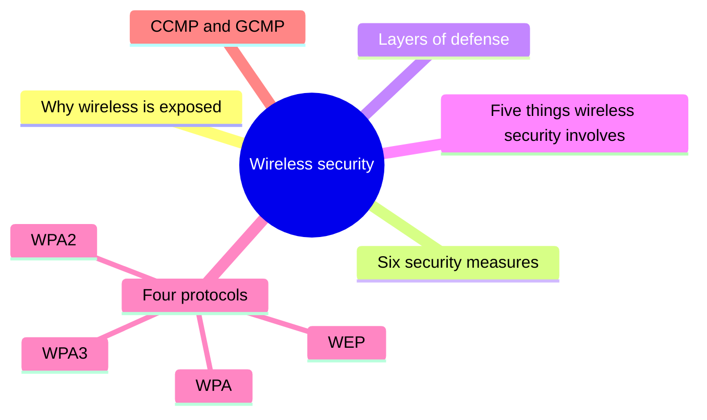
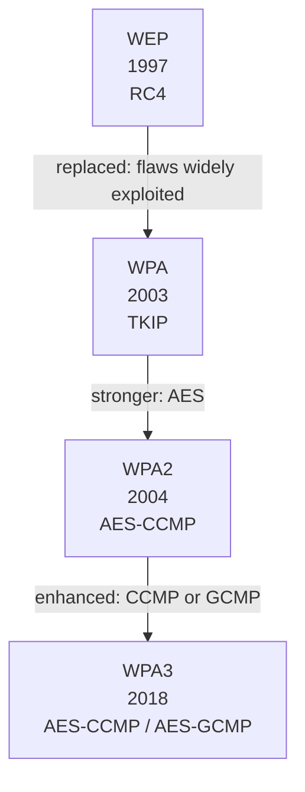

# Unit 7: Wireless and mobile security

*Courseware Chapter 8 (the first of two chapters numbered 8), pages 52–54.*

## At a glance

This is a short unit, but nearly every line can be examined. It answers four questions:

- **Why is wireless risky?** Communication travels through **radio signals**, so anyone in range can try to listen or connect. The courseware lists **six security measures** against this.
- **How does wireless security work?** By building **layers of defense**: encryption, authentication, access control, device security and intrusion detection (the **five things wireless security involves**).
- **Which protocols protect Wi-Fi?** The **four** wireless network security protocols, **WEP, WPA, WPA2 and WPA3**, each more secure than the last, compared in one table (release year, encryption, session key, authentication, level of security, weakness).
- **What encryption sits inside modern Wi-Fi?** **CCMP** and **GCMP**, the authenticated encryption protocols used by WPA2/WPA3.

!!! warning "Courseware note"
    The courseware has **two chapters numbered 8**: this one, "Wireless and Mobile Security" (pp.52–54), and "Access Control" (pp.55–58), which this site teaches as [Unit 8](unit-8-access-control.md). There is also no Chapter 5. The site numbers its units 1–12 in page order; source tags keep the courseware's own headings. If an exam paper says "Chapter 8", check which topic it means.

## What you should be able to do

*The courseware lists no learning outcomes; these are written for this site.*

- Explain why wireless networks are exposed to attacks, and list the six security measures for wireless networks.
- Describe, with the aid of a diagram, how wireless security creates layers of defense, in the order the courseware gives.
- State and explain the five things wireless security involves, and tell authentication apart from access control.
- Name the four wireless network security protocols in order of increasing security, and give each one's release year, encryption, session key, authentication, level of security and weakness.
- Explain the strengths and drawbacks of WEP, WPA, WPA2 and WPA3, including TKIP, KRACK, the two WPA modes and the three WPA3 types.
- Expand and explain CCMP and GCMP, and say how they relate.
- Recommend and justify a wireless protocol and set of measures for a given organisation.

## Why wireless networks are exposed, and the six security measures

Chapter 8 opening · p.52

The chapter opens with the root problem, then lists what to do about it.

> Wireless networks can be exposed to attacks because communication occurs through radio signals.

> **Security measures include:**
>
> • Strong Wi-Fi encryption.
>
> • Secure router configuration.
>
> • Strong administrative passwords.
>
> • Firmware updates.
>
> • Disabling unnecessary services.
>
> • Avoiding insecure public networks for sensitive activities.

> Modern Wi-Fi security commonly uses WPA2 or WPA3, depending on device and network support.

!!! note "In plain terms"
    A wired network has a physical boundary: to tap it, an attacker must reach a cable or a socket. **Radio signals have no such boundary.** They pass through walls and spill into the car park, the next building and the street, so anyone in range can capture the traffic or try to join the network. Every measure below tries to make that "free access to the signal" useless to an attacker.

    The six measures fall into three groups (the grouping is this site's, not the courseware's):

    - **Protect the traffic:** strong Wi-Fi encryption.
    - **Harden the access point (router):** secure router configuration, strong administrative passwords, firmware updates, disabling unnecessary services.
    - **Protect the user's behaviour:** avoiding insecure public networks for sensitive activities.

| Measure (courseware) | What it means in practice *(site example)* |
|---|---|
| **Strong Wi-Fi encryption** | Use WPA2 or WPA3, never WEP or an open network |
| **Secure router configuration** | Change default settings, turn off remote administration, use a strong Wi-Fi passphrase |
| **Strong administrative passwords** | Replace the router's factory login (often "admin/admin") with a long unique password |
| **Firmware updates** | Install the router maker's updates, which fix known flaws |
| **Disabling unnecessary services** | Turn off features you don't use (e.g. remote management, WPS push-button setup) so there is less to attack |
| **Avoiding insecure public networks for sensitive activities** | Don't do mobile banking or log in to the school portal on free airport or café Wi-Fi |

!!! example "Example"
    A small business centre in Ibadan installs a Wi-Fi router and leaves it as it came from the box: open network, admin password "admin", firmware from three years ago. A customer in the waiting area can reach the router's admin page, log in with the default password and change the settings. Applying the six measures closes each gap: WPA2/WPA3 encryption, a changed configuration and admin password, updated firmware, remote management disabled, and a notice telling customers not to do banking on the guest network.

!!! tip "Exam angle"
    "Why are wireless networks exposed to attacks?" has a one-line courseware answer: **because communication occurs through radio signals.** "List six security measures for wireless networks" is a likely (a)-part: learn all six word for word. Also remember the sentence that names the **two protocols in common use today: WPA2 or WPA3**.

**Check your understanding**

According to the courseware, why can wireless networks be exposed to attacks?

<ul class="quiz-options">
  <li>Because they use weaker passwords than wired networks</li>
  <li data-correct>Because communication occurs through radio signals</li>
  <li>Because routers cannot be updated</li>
  <li>Because WPA3 is not yet widely adopted</li>
</ul>

The courseware gives one reason: communication occurs **through radio signals**, which anyone in range can pick up. Weak passwords and slow WPA3 adoption are real problems, but they are weaknesses that make things worse, not the reason wireless is exposed in the first place (Chapter 8 opening, p.52).

Which of these is NOT one of the six security measures the courseware lists for wireless networks?

<ul class="quiz-options">
  <li>Firmware updates</li>
  <li>Disabling unnecessary services</li>
  <li data-correct>Hiding the network name (SSID)</li>
  <li>Avoiding insecure public networks for sensitive activities</li>
</ul>

The six measures are strong Wi-Fi encryption, secure router configuration, strong administrative passwords, firmware updates, disabling unnecessary services, and avoiding insecure public networks for sensitive activities. Hiding the SSID is a common tip, but it is not on the courseware's list (and it gives little protection, because the name still appears in radio traffic) (Chapter 8 opening, p.52).

## How wireless security works: layers of defense

Chapter 8 opening · p.52

The courseware then describes wireless security as a process in which each step adds a layer.

> Wireless security creates layers of defense by combining encryption, authentication, access control, device security, and intrusion detection to defend against illegal access and ensure network security. The process begins with the wireless network’s encryption methods, like WPA2 or WPA3, being activated to scramble data transfers. With this step, the data is unreadable to unauthorized parties, even if intercepted.
>
> Users or devices wanting to connect to the network would be prompted to verify their identities to confirm the legitimacy of the connection request, usually via a password. Access control rules then specify the users or devices permitted to access the network and the level of access based on user roles, device kinds, and explicit access rights.
>
> The process continues by securing network devices via maintaining antivirus software, updating operating systems, and restricting the usage of administrator credentials to prevent unwanted access. The integrated intrusion detection and prevention systems (IDPS) and other tools monitor the network for any unusual activity or security breaches. These systems detect and respond to unauthorized access attempts, malware infections, and other threats in real time.

{ .diagram }

The wireless security process as layers of defense, drawn for this site from the courseware's text (the courseware has no figure for it).

!!! note "In plain terms"
    The process has **five layers in a fixed order**, and each answers a different question:

    1. **Encryption:** "If someone captures the radio signal, can they read it?" No: WPA2/WPA3 scrambles it.
    2. **Authentication:** "Are you who you claim to be?" Prove it, usually with a password.
    3. **Access control:** "Now that we know who you are, what may you reach?" Decided by **user roles, device kinds and explicit access rights**.
    4. **Device security:** "Is the device itself safe?" Antivirus, updated operating systems, limited use of admin credentials.
    5. **IDPS and other tools:** "Is anything strange happening right now?" Monitor, **detect and respond in real time**.

    The two overall aims named in the first sentence are to **defend against illegal access** and **ensure network security**. Layering means one failure does not open the network: a stolen Wi-Fi password (layer 2 fails) still meets access rules, hardened devices and IDPS monitoring. This is the [layering (defense in depth) principle](unit-1-security-concepts.md#layering) from Unit 1, applied to Wi-Fi.

!!! example "Example"
    A Lagos fintech's office Wi-Fi uses WPA3 (layer 1). Staff join with their own company credentials (layer 2). Access rules put staff laptops on the internal network but visitors' phones only on the internet (layer 3). Company laptops run antivirus, get OS updates and staff don't use admin accounts for daily work (layer 4). A wireless IDPS alerts the security team when an unknown device repeatedly fails to log in at 2 a.m. (layer 5; see [Unit 12](unit-12-idps.md#types-of-idps-technologies)).

!!! tip "Exam angle"
    "With the aid of a diagram, explain how wireless security creates layers of defense" fits this section exactly. Draw the five layers **in the courseware's order** (encryption first), and for each give the courseware detail: *scramble data, unreadable even if intercepted*; *verify identities, usually via a password*; *user roles, device kinds, explicit access rights*; *antivirus, updating OS, restricting administrator credentials*; *detect and respond in real time*.

**Check your understanding**

According to the courseware, with which step does the wireless security process begin?

<ul class="quiz-options">
  <li>Users verifying their identities with a password</li>
  <li data-correct>Activating encryption methods such as WPA2 or WPA3 to scramble data transfers</li>
  <li>Installing antivirus software on network devices</li>
  <li>IDPS monitoring the network for unusual activity</li>
</ul>

"The process begins with the wireless network’s encryption methods, like WPA2 or WPA3, being activated to scramble data transfers." Authentication is the tempting answer because it is what a user notices first, but in the courseware's order it is the second step (Chapter 8 opening, p.52).

In the courseware, access control rules decide who may access the network and the level of access based on which three things?

<ul class="quiz-options">
  <li>Passwords, encryption keys and firmware versions</li>
  <li data-correct>User roles, device kinds and explicit access rights</li>
  <li>Signal strength, location and time of day</li>
  <li>Antivirus status, OS version and admin credentials</li>
</ul>

Access control rules specify the users or devices permitted and the level of access "based on user roles, device kinds, and explicit access rights". Antivirus, OS updates and admin credentials belong to the **device security** step, a different layer (Chapter 8 opening, p.52).

## The five things wireless security involves

Specifically, wireless security involves the following · pp.52–53

The same layers are then restated as a list of five activities.

> Specifically, wireless security involves the following:
>
> • **Implement encryption:** Converts data into a code that can be read only by authorized users with the appropriate key.
>
> • **Authenticate users and devices:** Processes validated identities of individuals and devices that attempt to connect to the network.
>
> • **Apply access control rules:** Define which users or devices can connect to the network and what degree or level of access they have.
>
> • **Secure devices:** Includes identifying trusted devices connecting to any network and sets any policies in other integrated security tools.
>
> • **Integrate with IDPS and other tools:** Catch and block suspicious activities and security breaches in the network.

> Wireless security addresses the vulnerabilities brought by wireless network data being transferred by radio waves, guarantees that data isn’t intercepted, and protects the network’s security and availability. To gain a deeper understanding of how wireless security works, explore the different encryption protocols used in wireless networks.

| Activity (courseware) | Key words to remember | Question it answers *(site summary)* | Example *(site example)* |
|---|---|---|---|
| **Implement encryption** | code readable only by authorized users **with the appropriate key** | Can an eavesdropper read it? | WPA3 on the office router |
| **Authenticate users and devices** | **validate identities** of individuals and devices that attempt to connect | Who are you? | Staff log in with their own username and password |
| **Apply access control rules** | **which** users/devices can connect and **what degree or level** of access | What may you do? | Guests get internet only; staff get the file server |
| **Secure devices** | identify **trusted devices**; set policies in other integrated security tools | Is this device trusted and safe? | Only registered company laptops join the staff network |
| **Integrate with IDPS and other tools** | **catch and block** suspicious activities and security breaches | Is something wrong right now? | Alert on a fake access point copying the company's network name |

!!! note "In plain terms"
    The list is the layered process in short form: **E**ncrypt, **A**uthenticate, **A**pply access control, **S**ecure devices, **I**ntegrate with IDPS (memory aid, this site's: "**E**very **A**gent **A**sks **S**ecurity **I**nformation").

    The closing paragraph gives **three things wireless security achieves**: it (1) **addresses the vulnerabilities** brought by data being transferred by radio waves, (2) **guarantees that data isn't intercepted**, and (3) **protects the network's security and availability**.

    The most commonly confused pair is **authentication vs access control**. Authentication checks **identity** ("is this really Ada's laptop?"). Access control decides **permission** after identity is known ("Ada's laptop may use the printer but not the payroll server"). Access control is the subject of [Unit 8](unit-8-access-control.md).

!!! example "Example"
    At a university, students and staff share one campus Wi-Fi. Each person logs in with their matriculation or staff number and password (**authentication**). Students get internet and the e-learning portal; staff also reach the results database (**access control rules**). Only university-issued laptops can reach the exams office network (**secure devices**). An IDPS blocks a laptop that starts scanning every machine on the network (**integrate with IDPS**). All traffic is WPA2-encrypted (**implement encryption**).

!!! tip "Exam angle"
    "State and explain the five things wireless security involves" is a natural 5- or 10-mark recall part. Give the courseware's explanation for each, not only the name. A follow-up (b) part often asks you to **differentiate authentication from access control**: identity vs permission, before vs after.

!!! warning "Courseware note"
    Two items are worded awkwardly. "Processes validated identities" most likely means "**processes that validate** the identities of individuals and devices" (inference). "Secure devices: Includes identifying trusted devices … and sets any policies in other integrated security tools" means securing devices involves recognising which devices are trusted and applying security policies to them through the other tools. Quote the courseware wording in an exam, but explain it in the clearer form.

**Check your understanding**

Which of the five wireless security activities "defines which users or devices can connect to the network and what degree or level of access they have"?

<ul class="quiz-options">
  <li>Authenticate users and devices</li>
  <li data-correct>Apply access control rules</li>
  <li>Secure devices</li>
  <li>Integrate with IDPS and other tools</li>
</ul>

That is the courseware's description of **applying access control rules**. Authentication is the tempting answer, but it only **validates identities**; deciding what an identified user may do is access control (Specifically, wireless security involves the following, p.52).

According to the courseware's closing paragraph, which of these is NOT something wireless security does?

<ul class="quiz-options">
  <li>Addresses the vulnerabilities brought by data being transferred by radio waves</li>
  <li>Guarantees that data isn’t intercepted</li>
  <li>Protects the network’s security and availability</li>
  <li data-correct>Guarantees that no unauthorized device can ever be within radio range</li>
</ul>

The courseware names three things: addressing radio-wave vulnerabilities, guaranteeing data isn't intercepted, and protecting the network's security and availability. No security measure can stop attackers from being **in range** of a radio signal; that is exactly why encryption and authentication are needed (p.53).

## The four wireless network security protocols

4 Types of Wireless Network security protocols · p.53

The rest of the chapter is about the protocols that put encryption and authentication into practice.

> WEP, WPA, WPA2, and WPA3 are the four types of wireless network security protocols, each with increasing levels of security.
>
> WPA2, which uses AES encryption, is commonly used. However, WPA3 offers additional security features, including stronger encryption and enhanced attack defense. These protocols determine the users’ and devices’ access level. Regardless of the protocol used, you need strong security to protect wireless networks and sensitive data.

The courseware then compares the four in a table, redrawn here.

WEP vs WPA vs WPA2 vs WPA3 figure · p.53

![A comparison table of WEP, WPA, WPA2 and WPA3. Release year: 1997, 2003, 2004, 2018. Encryption: RC4; TKIP / RC4; AES-CCMP; AES-CCMP / AES-GCMP. Session key: 64/128 bit; 128 bit; 128 bit; 128/256 bit. Authentication: open system, shared key; pre-shared key; pre-shared key; AES-CCMP / AES-GCMP as printed. Level of security: very low, low, moderate, high. Weakness: insecure encryption easily exploited by hackers; weak encryption, compatibility issues; vulnerable to key reinstallation attack (KRACK); complex deployment](assets/diagrams/u7-protocol-comparison.svg){ .diagram }

"WEP vs WPA vs WPA2 vs WPA3" (unnumbered figure in the courseware, p.53; redrawn). The level-of-security colours are added by this site.

The protocols in order, with the one thing each changed:

Evolution of the four protocols, drawn for this site from the courseware's text and table.

!!! note "In plain terms"
    - **Order and years:** WEP **1997** → WPA **2003** → WPA2 **2004** → WPA3 **2018**. Each has **increasing levels of security**: very low → low → moderate → high.
    - **Encryption:** WEP uses **RC4**; WPA uses **TKIP** (built on RC4); WPA2 uses **AES** (as **AES-CCMP**); WPA3 uses **AES-CCMP or AES-GCMP**.
    - **Session key:** 64/128 bit → 128 bit → 128 bit → **128/256 bit** (WPA3 is the only one offering 256-bit).
    - **Weakness:** WEP, insecure encryption easily exploited; WPA, weak encryption and compatibility issues; WPA2, **KRACK**; WPA3, **complex deployment**.
    - **"Commonly used" vs "strongest":** WPA2 is the one in common use; WPA3 is the strongest.

    Memory aid (this site's): the years go "**97, 03, 04, 18**", and the encryption goes "**RC4 → TKIP → AES → AES with GCMP**".

!!! tip "Exam angle"
    Expect "name the four wireless network security protocols" and "compare WEP, WPA, WPA2 and WPA3 in terms of release year, encryption and weakness". Draw the table as a grid: it earns marks quickly and is easy to reproduce from memory if you learn it row by row. Note the trap: the courseware says WPA2 is **commonly used**, but its table rates WPA2's security only as **moderate**; WPA3 is **high**.

!!! warning "Courseware note"
    In the table, WPA3's **Authentication** cell says "AES-CCMP / AES-GCMP", which repeats the Encryption cell above it; CCMP and GCMP are encryption protocols, not authentication methods. In practice WPA3-Personal authenticates with **SAE** (Simultaneous Authentication of Equals, which replaces the pre-shared key handshake) and WPA3-Enterprise with 802.1X. Reproduce the table as printed if asked, but know the correct entry. Two smaller differences between the table and the text: the text gives WEP "shared key authentication" while the table gives "open system, shared key"; and the text calls WPA2 "robust" while the table rates it "moderate".

**Check your understanding**

Which ordering of the wireless security protocols is correct, from least to most secure?

<ul class="quiz-options">
  <li>WPA, WEP, WPA2, WPA3</li>
  <li data-correct>WEP, WPA, WPA2, WPA3</li>
  <li>WEP, WPA2, WPA, WPA3</li>
  <li>WPA3, WPA2, WPA, WEP</li>
</ul>

The courseware lists "WEP, WPA, WPA2, and WPA3 … each with increasing levels of security"; the table rates them very low, low, moderate and high. Putting WPA before WEP is the usual slip: WEP (1997) is the oldest and weakest (4 Types of Wireless Network security protocols, p.53).

According to the comparison table, which protocol offers a 256-bit session key option?

<ul class="quiz-options">
  <li>WEP</li>
  <li>WPA</li>
  <li>WPA2</li>
  <li data-correct>WPA3</li>
</ul>

Session keys: WEP 64/128 bit; WPA 128 bit; WPA2 128 bit; **WPA3 128/256 bit**. WEP is tempting because it also has two values, but its larger option is only 128 bits (figure, p.53).

## Each protocol in detail

i.–iv. · pp.53–54

Each protocol has two paragraphs in the courseware: what it introduced, then its weaknesses.

### Wired Equivalent Privacy (WEP)

i. Wired Equivalent Privacy (WEP) · pp.53–54

> WEP, developed in 1997, was designed to secure wireless networks using encryption and access restriction. However, its reliance on the insecure RC4 encryption and shared key authentication made networks vulnerable to attack. While WEP initially provided encryption similar to wired networks, its flaws were widely exploited by hackers, making it obsolete.
>
> The protocol’s discontinuation created more robust alternatives, such as WPA (Wi-Fi Protected Access). Despite its flaws, WEP’s simplicity and widespread adoption initially drew attention, but its inherent vulnerabilities eventually overshadowed its benefits, emphasizing the significance of constantly updating wireless security standards.

**The first attempt.** The name says the goal: *wired equivalent* privacy, i.e. make Wi-Fi as private as a cable. It used **encryption and access restriction**, but two weaknesses broke it: the **insecure RC4 encryption** and **shared key authentication**. Its flaws were **widely exploited by hackers**, so it is **obsolete**. Its good points were **simplicity and widespread adoption**. The lesson the courseware draws: **constantly update wireless security standards**.

!!! info "Beyond the notes"
    WEP's real failure was how it *used* RC4: a short 24-bit initialisation vector meant keys repeated quickly, and freely available tools can recover a WEP key from captured traffic in minutes. That is why "very low" security is fair, and why any device that only supports WEP should be replaced, not configured.

### Wi-Fi Protected Access (WPA)

ii. Wi-Fi Protected Access (WPA) · p.54

> WPA, launched in 2003, emerged as an effective successor to WEP, addressing its flaws. WPA uses the temporal key integrity protocol (TKIP) encryption to improve key management and integrity checks. It has two modes: WPA-Personal for home networks and WPA-Enterprise for enterprises that use RADIUS servers.
>
> WPA’s 128-bit encryption provides enhanced protection over WEP’s weaker encryption standards. However, it’s still comparably weaker than WPA2, resulting in potential flaws and compatibility difficulties. Adopting WPA also may necessitate hardware modifications, which presents a problem for users with older equipment.

**The quick fix.** WPA replaced WEP's weak key handling with **TKIP (temporal key integrity protocol)**, which improves **key management and integrity checks** ("temporal" because keys change over time instead of one fixed key). It uses **128-bit** encryption. It has **two modes**:

| Mode | Used for | How users authenticate *(site summary)* |
|---|---|---|
| **WPA-Personal** | Home networks | Everyone shares one pre-shared key (the Wi-Fi password) |
| **WPA-Enterprise** | Enterprises that use **RADIUS servers** | Each user logs in with their own credentials, checked by a central RADIUS (authentication) server |

Its **three drawbacks**: still **weaker than WPA2** (potential flaws), **compatibility difficulties**, and it **may need hardware modifications**, a problem for users with older equipment.

!!! info "Beyond the notes"
    RADIUS (Remote Authentication Dial-In User Service) is a central server that checks each user's credentials and tells the access point whether to let them in. Because each user has their own login, an organisation can remove one person's access without changing everyone's password, which is why the Enterprise modes suit organisations.

### Wi-Fi Protected Access II (WPA2)

iii. Wi-Fi Protected Access II (WPA2) · p.54

> WPA2, released in 2004, is another wireless security standard, leveraging the AES encryption technique to provide robust security. Its advantages over WPA include better administration and lower vulnerability to assaults. WPA2 is widely adopted as the industry standard, ensuring device interoperability.
>
> However, vulnerabilities such as the key reinstallation attack (KRACK) constitute a security risk. While appropriate for most home networks, difficulties arise in enterprise settings where sophisticated attacks are more widespread. Furthermore, older gear without WPA2 compatibility may require upgrades.
>
> Despite these issues, WPA2 remains in use, but with ongoing attempts to address growing threats and weaknesses.

**The industry standard.** WPA2 moved to **AES encryption** (AES-CCMP in the table). Its **advantages over WPA**: **better administration**, **lower vulnerability to assaults**, and it is **widely adopted as the industry standard, ensuring device interoperability**. Its **drawbacks**: the **key reinstallation attack (KRACK)**; **difficulties in enterprise settings** where sophisticated attacks are more widespread (it suits most home networks); and **older gear without WPA2 compatibility may need upgrades**. It **remains in use**, with ongoing attempts to fix its weaknesses.

!!! info "Beyond the notes"
    **KRACK** (published 2017) tricks a device into **reinstalling a key that is already in use** during the WPA2 connection handshake. This resets counters the encryption relies on, letting an attacker in radio range decrypt or replay some traffic. It is a flaw in the handshake, not in AES itself, and was fixed by software patches to devices, which is why the courseware speaks of "ongoing attempts to address" weaknesses. AES is covered in [Unit 4](unit-4-cryptography.md#symmetric-encryption).

### Wi-Fi Protected Access III (WPA3)

iv. Wi-Fi Protected Access III (WPA3) · p.54

> WPA3, launched in 2018, offers enhanced encryption, improved protection against dictionary brute force attacks, and simplified device configuration via Wi-Fi Easy Connect. Despite these improvements, widespread acceptance is sluggish. WPA3 comes in three types: WPA3-Personal for home use, WPA3-Enterprise for organizational settings, and Wi-Fi Enhanced Open for non-password-protected networks.
>
> While it enhances overall network security, drawbacks include deployment complexity, low user adoption, and compatibility issues with older devices and equipment. Despite its benefits, full-scale deployment of WPA3 has yet to occur, signaling a slow shift from older security protocols to this more modern standard.

**The current best.** WPA3 brings **three improvements**: **enhanced encryption**, **improved protection against dictionary brute force attacks**, and **simplified device configuration via Wi-Fi Easy Connect**. It comes in **three types**:

| WPA3 type | Used for |
|---|---|
| **WPA3-Personal** | Home use |
| **WPA3-Enterprise** | Organizational settings |
| **Wi-Fi Enhanced Open** | Non-password-protected (open) networks |

Its **three drawbacks**: **deployment complexity**, **low user adoption**, and **compatibility issues with older devices and equipment**. Acceptance is **sluggish**: full-scale deployment has yet to occur.

!!! info "Beyond the notes"
    - A **dictionary brute force attack** captures a WPA2-Personal handshake and then tries millions of likely passwords offline. WPA3-Personal's SAE handshake prevents offline guessing: each guess needs a fresh live exchange with the access point.
    - **Wi-Fi Easy Connect** lets you add devices without a screen (smart bulbs, printers) by scanning a QR code.
    - **Wi-Fi Enhanced Open** encrypts each user's traffic on open hotspots (airports, cafés) even though there is no password, so other users on the hotspot cannot simply read it.

**Check your understanding**

Which protocol uses the temporal key integrity protocol (TKIP) and has a WPA-Enterprise mode for enterprises that use RADIUS servers?

<ul class="quiz-options">
  <li>WEP</li>
  <li data-correct>WPA</li>
  <li>WPA2</li>
  <li>WPA3</li>
</ul>

WPA (2003) uses TKIP to improve key management and integrity checks, and has two modes: WPA-Personal and WPA-Enterprise (RADIUS). WPA3 is tempting because it also has Personal and Enterprise types, but WPA3 has **three** types and uses CCMP or GCMP, not TKIP (ii. WPA, p.54).

The key reinstallation attack (KRACK) is named in the courseware as a weakness of which protocol?

<ul class="quiz-options">
  <li>WEP</li>
  <li>WPA</li>
  <li data-correct>WPA2</li>
  <li>WPA3</li>
</ul>

"However, vulnerabilities such as the key reinstallation attack (KRACK) constitute a security risk" is in the WPA2 section, and the table lists KRACK as WPA2's weakness. WEP's weakness is insecure RC4 encryption; WPA3's is complex deployment (iii. WPA2, p.54).

A hotel wants its free guest Wi-Fi to need no password but still protect guests' traffic. Which WPA3 type fits?

<ul class="quiz-options">
  <li>WPA3-Personal</li>
  <li>WPA3-Enterprise</li>
  <li data-correct>Wi-Fi Enhanced Open</li>
  <li>WPA-Personal</li>
</ul>

The courseware describes Wi-Fi Enhanced Open as the WPA3 type "for non-password-protected networks". WPA3-Personal is tempting, but it needs a password; WPA-Personal is the older WPA mode, not a WPA3 type (iv. WPA3, p.54).

## CCMP and GCMP: the encryption inside WPA3

iv. Wi-Fi Protected Access III (WPA3) · p.54

The WPA3 section ends by naming the two encryption protocols it uses.

> WPA3 uses CCMP (Counter Mode Cipher Block Chaining Message Authentication Code Protocol) or GCMP as the authenticated encryption protocol designed for Wireless LAN products that implement the IEEE 802.11i amendment to the original IEEE 802.11 standard. Galois Counter Mode Protocol (GCMP) is a robust encryption and authentication protocol designed to provide enhanced security and efficiency in wireless communication. It is an improvement over the Counter CBC-MAC Protocol (CCMP) and is widely used in modern wireless security standards, such as WPA3.

| | **CCMP** | **GCMP** |
|---|---|---|
| **Full name (courseware)** | Counter Mode Cipher Block Chaining Message Authentication Code Protocol (also called Counter CBC-MAC Protocol) | Galois Counter Mode Protocol |
| **What it is (courseware)** | The authenticated encryption protocol designed for Wireless LAN products that implement the IEEE 802.11i amendment to the original IEEE 802.11 standard | A robust encryption and authentication protocol for enhanced security and efficiency in wireless communication |
| **Relationship** | The older of the two | **An improvement over CCMP** |
| **Used by (table)** | WPA2 (AES-CCMP) and WPA3 | WPA3 (AES-GCMP) |

!!! note "In plain terms"
    Both are **authenticated encryption** protocols: in one step they **encrypt** the data (confidentiality) *and* attach a check value so the receiver can tell whether it was **tampered with** (integrity and authenticity). That is why the courseware calls GCMP an "encryption **and authentication** protocol". Both run on AES; GCMP is newer, stronger at higher key lengths and more efficient.

    Untangling the names: **CCMP** = **C**ounter mode + **C**BC-**M**AC **P**rotocol. "Counter mode" does the encrypting; "CBC-MAC" (cipher block chaining message authentication code) does the tamper check. **GCMP** = **G**alois/**C**ounter **M**ode **P**rotocol: counter mode for encrypting, plus a fast "Galois" check value. **IEEE 802.11** is the original Wi-Fi standard; **802.11i** is the amendment that added proper security to it.

!!! tip "Exam angle"
    Learn both expansions exactly: they are easy 2-mark "expand and explain" items. If asked to "differentiate CCMP and GCMP", the courseware's key point is that **GCMP is an improvement over CCMP**, giving enhanced security and efficiency, and is used in modern standards such as WPA3.

!!! warning "Courseware note"
    The courseware places CCMP only under WPA3, but its own table shows that **WPA2 already uses AES-CCMP**. CCMP was introduced with the IEEE 802.11i amendment (2004), which WPA2 implements; WPA3 keeps CCMP and adds GCMP. The courseware also uses two names for CCMP ("Counter Mode Cipher Block Chaining Message Authentication Code Protocol" and "Counter CBC-MAC Protocol"); both mean the same protocol.

**Check your understanding**

How does the courseware describe the relationship between GCMP and CCMP?

<ul class="quiz-options">
  <li>CCMP is an improvement over GCMP</li>
  <li data-correct>GCMP is an improvement over CCMP</li>
  <li>GCMP is the authentication method and CCMP is the encryption method</li>
  <li>They are two names for the same protocol</li>
</ul>

GCMP "is an improvement over the Counter CBC-MAC Protocol (CCMP)". The last option is the trap: "Counter CBC-MAC Protocol" and "Counter Mode Cipher Block Chaining Message Authentication Code Protocol" are two names for CCMP, but GCMP is a different protocol (p.54).

CCMP is the authenticated encryption protocol designed for wireless LAN products that implement which standard?

<ul class="quiz-options">
  <li>The original IEEE 802.3 standard</li>
  <li data-correct>The IEEE 802.11i amendment to the original IEEE 802.11 standard</li>
  <li>The RC4 standard</li>
  <li>The RADIUS standard</li>
</ul>

CCMP is "designed for Wireless LAN products that implement the IEEE 802.11i amendment to the original IEEE 802.11 standard". IEEE 802.3 is wired Ethernet; RC4 is a cipher used by WEP; RADIUS is the server used by WPA-Enterprise (p.54).

## Telling the four protocols apart

i.–iv. · pp.53–54

This table collects everything the courseware says about each protocol in one place.

| | **WEP** | **WPA** | **WPA2** | **WPA3** |
|---|---|---|---|---|
| **Full name** | Wired Equivalent Privacy | Wi-Fi Protected Access | Wi-Fi Protected Access II | Wi-Fi Protected Access III |
| **Year** | 1997 (developed) | 2003 (launched) | 2004 (released) | 2018 (launched) |
| **Encryption** | RC4 (insecure) | TKIP (128-bit) | AES (AES-CCMP) | Enhanced: CCMP or GCMP |
| **Modes / types** | Not stated | 2: WPA-Personal, WPA-Enterprise (RADIUS) | Not stated | 3: WPA3-Personal, WPA3-Enterprise, Wi-Fi Enhanced Open |
| **Strengths** | Simplicity; widespread adoption | Effective successor to WEP; improved key management and integrity checks | Better administration; lower vulnerability; industry standard; interoperability | Enhanced encryption; protection against dictionary brute force attacks; Wi-Fi Easy Connect |
| **Weaknesses** | Insecure RC4 and shared key authentication; widely exploited; obsolete | Weaker than WPA2; compatibility difficulties; may need hardware modifications | KRACK; difficulties in enterprise settings; older gear may need upgrades | Deployment complexity; low user adoption; compatibility issues with older devices |
| **Status** | Obsolete | Superseded | Commonly used; remains in use | Slow adoption; full-scale deployment yet to occur |

!!! example "Example"
    A Nigerian state ministry has a mix of equipment: a 2010 access point that only supports WPA, new laptops that support WPA3, and old barcode scanners that only support WPA2. Setting the whole network to WPA3 would lock out the scanners (WPA3's **compatibility issues with older devices**); keeping the old WPA access point leaves **weak encryption**. A reasonable plan is to replace the WPA access point, run WPA3 for devices that support it (many access points allow a WPA2/WPA3 mixed mode during transition) and plan to replace the WPA2-only scanners.

!!! tip "Exam angle"
    For "differentiate WPA2 and WPA3", use named criteria: **year** (2004 vs 2018), **encryption** (AES-CCMP vs CCMP or GCMP, up to 256-bit), **protection** (vulnerable to KRACK vs improved protection against dictionary brute force attacks), **types** (WPA3 has three), and **adoption** (industry standard vs sluggish acceptance). In a scenario, the best answer usually recommends **WPA3 where devices support it, WPA2 as the minimum**, never WEP or WPA, and justifies the choice with the drawbacks above.

**Check your understanding**

Which drawback does the courseware give for WPA3 but not for WPA2?

<ul class="quiz-options">
  <li>Older gear may require upgrades</li>
  <li data-correct>Low user adoption</li>
  <li>Vulnerable to the key reinstallation attack</li>
  <li>Reliance on RC4 encryption</li>
</ul>

WPA3's drawbacks are deployment complexity, **low user adoption** and compatibility issues with older devices. WPA2 is the opposite: widely adopted as the industry standard. "Older gear may require upgrades" is tempting, but the courseware says it of WPA2 as well (iii–iv, p.54).

Which statement about WEP is correct according to the courseware?

<ul class="quiz-options">
  <li>It was launched in 2003 and uses TKIP</li>
  <li data-correct>It relied on insecure RC4 encryption and shared key authentication, and is now obsolete</li>
  <li>It is still the industry standard because of its simplicity</li>
  <li>It uses AES with 128/256-bit session keys</li>
</ul>

WEP (1997) relied on insecure RC4 and shared key authentication; its flaws were widely exploited, making it obsolete. Its simplicity and widespread adoption drew attention at first, but that does not make it a standard today; WPA2 is the industry standard (i. WEP, pp.53–54).

## What about mobile security?

Chapter 8 title · p.52

The chapter is titled "Wireless and Mobile Security", but everything in it is about **Wi-Fi networks**.

!!! warning "Courseware note"
    Apart from the title, the chapter says nothing specific about **mobile devices** (smartphones and tablets) or mobile networks. Examine yourself on the Wi-Fi content above; a question on "mobile security" would most likely expect the wireless material, perhaps applied to phones.

!!! info "Beyond the notes"
    Mobile security usually adds these points, all connected to the courseware's measures:

    - **Device loss or theft:** use a screen lock, device encryption and remote wipe.
    - **Malicious apps:** install apps only from official stores and check their permissions (see [Unit 9](unit-9-malware.md#mobile-malware)).
    - **Updates:** install operating-system updates (the mobile version of "firmware updates").
    - **Untrusted networks:** avoid sensitive activities on public Wi-Fi, or use a VPN (the courseware's sixth measure).
    - **Phishing by SMS:** be wary of links in text messages claiming to be from your bank.
    - **Bring your own device (BYOD):** organisations put staff phones on a separate network segment with limited access (the "secure devices" and "access control" activities).

## Key terms

Wireless security
:   Creates layers of defense by combining encryption, authentication, access control, device security and intrusion detection to defend against illegal access and ensure network security.

Wireless network security protocols
:   WEP, WPA, WPA2 and WPA3: the four types of protocol that secure wireless networks, each with increasing levels of security.

WEP (Wired Equivalent Privacy)
:   Wireless security protocol developed in 1997 using RC4 encryption and shared key authentication; its flaws were widely exploited, making it obsolete.

WPA (Wi-Fi Protected Access)
:   Successor to WEP launched in 2003; uses TKIP encryption (128-bit) and has two modes, WPA-Personal and WPA-Enterprise.

WPA2 (Wi-Fi Protected Access II)
:   Wireless security standard released in 2004 that uses AES encryption (AES-CCMP); the industry standard, but vulnerable to KRACK.

WPA3 (Wi-Fi Protected Access III)
:   Wireless security standard launched in 2018 with enhanced encryption (CCMP or GCMP), improved protection against dictionary brute force attacks and Wi-Fi Easy Connect; adoption is slow.

RC4
:   The insecure encryption used by WEP (and, through TKIP, by WPA).

TKIP (temporal key integrity protocol)
:   The encryption used by WPA to improve key management and integrity checks over WEP.

AES encryption
:   The encryption technique used by WPA2 (as AES-CCMP) and WPA3 (as AES-CCMP or AES-GCMP).

CCMP (Counter Mode Cipher Block Chaining Message Authentication Code Protocol)
:   The authenticated encryption protocol designed for wireless LAN products that implement the IEEE 802.11i amendment to the IEEE 802.11 standard; also called Counter CBC-MAC Protocol.

GCMP (Galois Counter Mode Protocol)
:   A robust encryption and authentication protocol giving enhanced security and efficiency in wireless communication; an improvement over CCMP, used in WPA3.

KRACK (key reinstallation attack)
:   An attack named in the courseware as a vulnerability of WPA2.

WPA-Personal
:   The WPA mode for home networks.

WPA-Enterprise
:   The WPA mode for enterprises that use RADIUS servers.

RADIUS server
:   A central authentication server used by WPA-Enterprise to check each user's credentials (explanation added by this site).

WPA3-Personal
:   The WPA3 type for home use.

WPA3-Enterprise
:   The WPA3 type for organizational settings.

Wi-Fi Enhanced Open
:   The WPA3 type for non-password-protected networks.

Wi-Fi Easy Connect
:   A WPA3 feature that simplifies device configuration.

Session key
:   The key used to encrypt a wireless session; 64/128 bit in WEP, 128 bit in WPA and WPA2, 128/256 bit in WPA3 (per the courseware's table).

IEEE 802.11i
:   The amendment to the original IEEE 802.11 (Wi-Fi) standard that CCMP was designed for.

---

## Unit summary

- **Why wireless is exposed:** communication occurs through **radio signals**.
- **Six security measures:** strong Wi-Fi encryption; secure router configuration; strong administrative passwords; firmware updates; disabling unnecessary services; avoiding insecure public networks for sensitive activities. Modern Wi-Fi commonly uses **WPA2 or WPA3**, depending on device and network support.
- **Layers of defense** (to defend against illegal access and ensure network security), in order: (1) **encryption** (WPA2/WPA3 scrambles data; unreadable even if intercepted); (2) **authentication** (verify identities, usually via a password); (3) **access control rules** (who, and what level, by user roles, device kinds and explicit access rights); (4) **device security** (antivirus, OS updates, restricted administrator credentials); (5) **IDPS and other tools** (monitor; detect and respond to unauthorized access attempts, malware infections and other threats in real time).
- **Five things wireless security involves:** implement encryption; authenticate users and devices; apply access control rules; secure devices; integrate with IDPS and other tools. It **addresses radio-wave vulnerabilities, guarantees data isn't intercepted, and protects the network's security and availability**.
- **Four protocols** (increasing security): **WEP** 1997, RC4, 64/128-bit, open system/shared key, very low, insecure encryption easily exploited, obsolete; **WPA** 2003, TKIP/RC4, 128-bit, pre-shared key, low, weak encryption and compatibility issues, may need hardware changes, two modes (Personal; Enterprise with RADIUS); **WPA2** 2004, AES-CCMP, 128-bit, pre-shared key, moderate, KRACK, industry standard and commonly used; **WPA3** 2018, AES-CCMP/AES-GCMP, 128/256-bit, high, complex deployment, low adoption, three types (Personal, Enterprise, Wi-Fi Enhanced Open), protection against dictionary brute force attacks, Wi-Fi Easy Connect.
- **CCMP** (Counter Mode Cipher Block Chaining Message Authentication Code Protocol, or Counter CBC-MAC Protocol): authenticated encryption for wireless LAN products implementing **IEEE 802.11i**. **GCMP** (Galois Counter Mode Protocol): robust encryption and authentication, enhanced security and efficiency, **an improvement over CCMP**, used in WPA3.
- The chapter's title says "Mobile", but its content covers only Wi-Fi.

## Mixed review

An attacker parks outside an office and captures its Wi-Fi traffic, but cannot read it. Which layer of wireless security has worked, and which of the six measures does it correspond to?

<ul class="quiz-options">
  <li>Authentication; strong administrative passwords</li>
  <li data-correct>Encryption; strong Wi-Fi encryption</li>
  <li>IDPS; disabling unnecessary services</li>
  <li>Access control rules; secure router configuration</li>
</ul>

Encryption makes "the data … unreadable to unauthorized parties, even if intercepted", and it is the measure "strong Wi-Fi encryption". Authentication is tempting, but the attacker here is not trying to join the network, only listening; authentication would not stop passive capture (layers of defense and six measures, p.52).

A company wants each employee to log in to Wi-Fi with their own credentials checked by a central server, so a departing employee's access can be removed alone. Which option from the courseware fits, and which layer does it strengthen?

<ul class="quiz-options">
  <li>WPA-Personal; encryption</li>
  <li>Wi-Fi Enhanced Open; access control</li>
  <li data-correct>An Enterprise mode (e.g. WPA-Enterprise with RADIUS servers, or WPA3-Enterprise); authentication</li>
  <li>WEP shared key; authentication</li>
</ul>

The courseware gives WPA-Enterprise "for enterprises that use RADIUS servers" and WPA3-Enterprise "for organizational settings". Individual credentials strengthen **authentication** (validating identities). Personal modes use one shared key, so removing one person means changing everyone's password; Enhanced Open has no password at all (pp.52, 54).

Which pairing of protocol and weakness matches the courseware's comparison table?

<ul class="quiz-options">
  <li>WEP: complex deployment</li>
  <li>WPA: vulnerable to KRACK</li>
  <li>WPA2: insecure encryption easily exploited by hackers</li>
  <li data-correct>WPA3: complex deployment</li>
</ul>

The table's weakness row: WEP, insecure encryption easily exploited by hackers; WPA, weak encryption and compatibility issues; WPA2, KRACK; WPA3, **complex deployment**. The distractors shuffle these across the columns (figure, p.53).

Which design principle from Unit 1 does the courseware's description of wireless security ("creates layers of defense by combining encryption, authentication, access control, device security, and intrusion detection") most directly apply?

<ul class="quiz-options">
  <li>Economy of mechanism</li>
  <li>Open design</li>
  <li data-correct>Layering</li>
  <li>Least common mechanism</li>
</ul>

Layering (defense in depth) uses multiple, overlapping protection approaches so that one failure does not leave the system unprotected, exactly what combining five layers does. Economy of mechanism asks for simple, small mechanisms, which is a different idea ([Unit 1, Layering](unit-1-security-concepts.md#layering); p.52).

## Recall drill

Every definition, list, comparison and figure in this chapter, as a short question. Answer aloud or on paper, then open the answer.

### Why wireless is exposed, and the six measures

**R1.** Why can wireless networks be exposed to attacks?

??? success "Answer"
    Because communication occurs through **radio signals**.

**R2.** List the security measures for wireless networks given in the courseware. (There are six.)

??? success "Answer"
    • **Strong Wi-Fi encryption.** • **Secure router configuration.** • **Strong administrative passwords.** • **Firmware updates.** • **Disabling unnecessary services.** • **Avoiding insecure public networks for sensitive activities.**

**R3.** Which protocols does modern Wi-Fi security commonly use, and what decides which one?

??? success "Answer"
    Modern Wi-Fi security commonly uses **WPA2 or WPA3**, depending on **device and network support**.

### Layers of defense

**R4.** How does wireless security create layers of defense? Name the five things it combines and its two aims.

??? success "Answer"
    Wireless security creates layers of defense by combining **encryption, authentication, access control, device security, and intrusion detection** to **defend against illegal access** and **ensure network security**.

**R5.** With what step does the wireless security process begin, and what does that step achieve?

??? success "Answer"
    The process begins with the wireless network’s **encryption methods, like WPA2 or WPA3, being activated to scramble data transfers**. With this step, the data is **unreadable to unauthorized parties, even if intercepted**.

**R6.** How are users or devices verified when they want to connect to a wireless network?

??? success "Answer"
    They are prompted to **verify their identities** to confirm the **legitimacy of the connection request**, **usually via a password**.

**R7.** What do access control rules specify in the wireless security process, and on what three bases?

??? success "Answer"
    The **users or devices permitted** to access the network and the **level of access**, based on **user roles, device kinds, and explicit access rights**.

**R8.** State three ways network devices are secured in the wireless security process.

??? success "Answer"
    **Maintaining antivirus software**, **updating operating systems**, and **restricting the usage of administrator credentials** to prevent unwanted access.

**R9.** What is the role of intrusion detection and prevention systems (IDPS) in wireless security? Name three things they detect and respond to.

??? success "Answer"
    The integrated IDPS and other tools **monitor the network for any unusual activity or security breaches**. They **detect and respond** to **unauthorized access attempts, malware infections, and other threats in real time**.

**R10.** Outline, in order, the five stages of the wireless security process. (There are five.)

??? success "Answer"
    (1) **Encryption** (WPA2/WPA3 activated to scramble data); (2) **authentication** (users or devices verify their identities, usually via a password); (3) **access control rules** (who is permitted and what level); (4) **securing network devices** (antivirus, OS updates, restricting admin credentials); (5) **IDPS and other tools** monitor, detect and respond in real time.

### The five things wireless security involves

**R11.** List the things wireless security specifically involves. (There are five.)

??? success "Answer"
    **Implement encryption; authenticate users and devices; apply access control rules; secure devices; integrate with IDPS and other tools.**

**R12.** Explain *implement encryption* as part of wireless security.

??? success "Answer"
    Converts data into a **code that can be read only by authorized users with the appropriate key**.

**R13.** Explain *authenticate users and devices*.

??? success "Answer"
    Processes **validated identities of individuals and devices** that attempt to connect to the network.

**R14.** Explain *apply access control rules*.

??? success "Answer"
    Define **which users or devices can connect** to the network and **what degree or level of access** they have.

**R15.** Explain *secure devices*.

??? success "Answer"
    Includes **identifying trusted devices** connecting to any network and **sets any policies in other integrated security tools**.

**R16.** Explain *integrate with IDPS and other tools*.

??? success "Answer"
    **Catch and block suspicious activities and security breaches** in the network.

**R17.** Differentiate between authenticating users and devices and applying access control rules in wireless security.

??? success "Answer"
    **Authentication** validates **identities**: it confirms that the individual or device trying to connect is who it claims to be (usually via a password). **Access control rules** come after: they define **which** users or devices can connect and **what degree or level of access** they have (by user roles, device kinds and explicit access rights). Identity vs permission.

**R18.** State three things wireless security does, according to the courseware's concluding paragraph. (There are three.)

??? success "Answer"
    It **addresses the vulnerabilities brought by wireless network data being transferred by radio waves**, **guarantees that data isn’t intercepted**, and **protects the network’s security and availability**.

### The four protocols and the comparison table

**R19.** Name the four types of wireless network security protocols in order of increasing security.

??? success "Answer"
    **WEP, WPA, WPA2, and WPA3**, each with increasing levels of security.

**R20.** Which protocol is commonly used, and what encryption does it use? What does WPA3 offer in addition?

??? success "Answer"
    **WPA2**, which uses **AES encryption**, is commonly used. **WPA3** offers additional security features, including **stronger encryption and enhanced attack defense**.

**R21.** Besides encryption, what do the wireless security protocols determine?

??? success "Answer"
    The **users’ and devices’ access level**. (Regardless of the protocol used, you need strong security to protect wireless networks and sensitive data.)

**R22.** Give the release year of each of the four protocols.

??? success "Answer"
    **WEP 1997; WPA 2003; WPA2 2004; WPA3 2018.**

**R23.** State the encryption used by each protocol, as given in the comparison table.

??? success "Answer"
    **WEP:** RC4. **WPA:** TKIP / RC4. **WPA2:** AES-CCMP. **WPA3:** AES-CCMP / AES-GCMP.

**R24.** State the session key length of each protocol.

??? success "Answer"
    **WEP:** 64/128 bit. **WPA:** 128 bit. **WPA2:** 128 bit. **WPA3:** 128/256 bit.

**R25.** State the authentication of each protocol, as given in the table.

??? success "Answer"
    **WEP:** open system, shared key. **WPA:** pre-shared key. **WPA2:** pre-shared key. **WPA3:** printed as "AES-CCMP / AES-GCMP" (a repeat of the encryption row; in practice SAE for WPA3-Personal).

**R26.** State the level of security and the main weakness of each protocol, as given in the table.

??? success "Answer"
    **WEP:** very low; insecure encryption easily exploited by hackers. **WPA:** low; weak encryption, compatibility issues. **WPA2:** moderate; vulnerable to key reinstallation attack (KRACK). **WPA3:** high; complex deployment.

**R27.** List the six rows (criteria) of the courseware's WEP vs WPA vs WPA2 vs WPA3 table.

??? success "Answer"
    **Release year, encryption, session key, authentication, level of security, weakness.**

### WEP

**R28.** Expand WEP. When was it developed and what was it designed to do?

??? success "Answer"
    **Wired Equivalent Privacy.** Developed in **1997**, it was designed to **secure wireless networks using encryption and access restriction**.

**R29.** Why did WEP become obsolete? State its two weaknesses.

??? success "Answer"
    Its reliance on the **insecure RC4 encryption** and **shared key authentication** made networks vulnerable to attack. Its flaws were **widely exploited by hackers**, making it obsolete.

**R30.** What initially drew attention to WEP, and what lesson does its history emphasise?

??? success "Answer"
    Its **simplicity and widespread adoption**; but its inherent vulnerabilities eventually overshadowed its benefits, emphasizing the **significance of constantly updating wireless security standards**. (Its discontinuation created more robust alternatives, such as WPA.)

### WPA

**R31.** Expand WPA. When was it launched and what was it?

??? success "Answer"
    **Wi-Fi Protected Access**, launched in **2003**; it emerged as an **effective successor to WEP, addressing its flaws**.

**R32.** What encryption does WPA use, and what does it improve?

??? success "Answer"
    The **temporal key integrity protocol (TKIP)** encryption, to **improve key management and integrity checks**. WPA's **128-bit** encryption provides enhanced protection over WEP's weaker encryption standards.

**R33.** State the two modes of WPA and what each is for. (There are two.)

??? success "Answer"
    **WPA-Personal** for **home networks**, and **WPA-Enterprise** for **enterprises that use RADIUS servers**.

**R34.** State three drawbacks of WPA.

??? success "Answer"
    It is still **comparably weaker than WPA2**, resulting in **potential flaws and compatibility difficulties**; and adopting WPA **may necessitate hardware modifications**, a problem for users with older equipment.

### WPA2

**R35.** Expand WPA2. When was it released and what encryption does it use?

??? success "Answer"
    **Wi-Fi Protected Access II**, released in **2004**; it leverages the **AES encryption** technique to provide robust security.

**R36.** State the advantages of WPA2 over WPA.

??? success "Answer"
    **Better administration** and **lower vulnerability to assaults**. It is also **widely adopted as the industry standard, ensuring device interoperability**.

**R37.** What is KRACK, and which protocol does the courseware say it affects?

??? success "Answer"
    The **key reinstallation attack**; a vulnerability of **WPA2** that constitutes a security risk.

**R38.** State three drawbacks of WPA2.

??? success "Answer"
    Vulnerabilities such as **KRACK**; **difficulties in enterprise settings** where sophisticated attacks are more widespread (though appropriate for most home networks); and **older gear without WPA2 compatibility may require upgrades**. (Despite these issues, WPA2 remains in use, with ongoing attempts to address growing threats and weaknesses.)

### WPA3

**R39.** When was WPA3 launched? State three improvements it offers.

??? success "Answer"
    **2018.** It offers **enhanced encryption**, **improved protection against dictionary brute force attacks**, and **simplified device configuration via Wi-Fi Easy Connect**.

**R40.** State the three types of WPA3 and what each is for. (There are three.)

??? success "Answer"
    **WPA3-Personal** for home use; **WPA3-Enterprise** for organizational settings; **Wi-Fi Enhanced Open** for non-password-protected networks.

**R41.** State three drawbacks of WPA3. What is the state of its deployment?

??? success "Answer"
    **Deployment complexity, low user adoption, and compatibility issues with older devices and equipment.** Widespread acceptance is **sluggish**; **full-scale deployment has yet to occur**, signaling a slow shift from older protocols to this more modern standard.

**R42.** What is Wi-Fi Easy Connect?

??? success "Answer"
    The WPA3 feature that provides **simplified device configuration**.

### CCMP and GCMP

**R43.** Expand CCMP and GCMP.

??? success "Answer"
    **CCMP:** Counter Mode Cipher Block Chaining Message Authentication Code Protocol (also called Counter CBC-MAC Protocol). **GCMP:** Galois Counter Mode Protocol.

**R44.** Explain CCMP as described in the courseware.

??? success "Answer"
    CCMP is **the authenticated encryption protocol designed for Wireless LAN products that implement the IEEE 802.11i amendment to the original IEEE 802.11 standard**. WPA3 uses CCMP or GCMP.

**R45.** Explain GCMP and state how it relates to CCMP.

??? success "Answer"
    GCMP is **a robust encryption and authentication protocol designed to provide enhanced security and efficiency in wireless communication**. It is **an improvement over the Counter CBC-MAC Protocol (CCMP)** and is widely used in modern wireless security standards, such as **WPA3**.

### Comparisons

**R46.** Differentiate between WEP and WPA.

??? success "Answer"
    **WEP** (1997) used **insecure RC4** encryption and **shared key authentication**; its flaws were widely exploited and it is **obsolete**. **WPA** (2003) was its **effective successor**, using **TKIP** to improve key management and integrity checks, with **128-bit** encryption and **two modes** (Personal and Enterprise with RADIUS).

**R47.** Differentiate between WPA and WPA2.

??? success "Answer"
    **WPA** (2003) uses **TKIP**; security **low**; weak encryption, compatibility issues, may need hardware modifications. **WPA2** (2004) uses **AES** (AES-CCMP); **better administration, lower vulnerability to assaults**; the **industry standard** ensuring interoperability; security **moderate**; weakness **KRACK**.

**R48.** Differentiate between WPA2 and WPA3.

??? success "Answer"
    **WPA2** (2004): **AES-CCMP**, 128-bit; commonly used **industry standard**; vulnerable to **KRACK**; difficulties in enterprise settings. **WPA3** (2018): **CCMP or GCMP**, 128/256-bit; **enhanced encryption**, **improved protection against dictionary brute force attacks**, **Wi-Fi Easy Connect**; **three types**; but **complex deployment, low user adoption** and compatibility issues with older devices.

**R49.** Differentiate between WPA-Personal and WPA-Enterprise.

??? success "Answer"
    **WPA-Personal** is for **home networks**; **WPA-Enterprise** is for **enterprises that use RADIUS servers**. (Beyond the notes: Personal uses one shared password; Enterprise checks each user's own credentials on the RADIUS server.)

**R50.** Differentiate between WPA3-Personal, WPA3-Enterprise and Wi-Fi Enhanced Open.

??? success "Answer"
    **WPA3-Personal:** home use. **WPA3-Enterprise:** organizational settings. **Wi-Fi Enhanced Open:** non-password-protected networks.

**R51.** Differentiate between CCMP and GCMP.

??? success "Answer"
    **CCMP** (Counter Mode Cipher Block Chaining Message Authentication Code Protocol) is the authenticated encryption protocol for wireless LAN products implementing **IEEE 802.11i**; used as AES-CCMP in WPA2 and WPA3. **GCMP** (Galois Counter Mode Protocol) is **an improvement over CCMP**, giving **enhanced security and efficiency**; used in modern standards such as **WPA3**.

## Practice exercises

**Exercise 1: Which protocol?** Name the protocol (WEP, WPA, WPA2 or WPA3) for each fact.

1. Launched in 2018.
2. Uses the temporal key integrity protocol.
3. Vulnerable to KRACK.
4. Relied on RC4 and shared key authentication.
5. Has a type called Wi-Fi Enhanced Open.
6. Widely adopted as the industry standard.
7. Has a mode for enterprises that use RADIUS servers.
8. Offers improved protection against dictionary brute force attacks.
9. Session key 64/128 bit.
10. Level of security "moderate".

??? success "Answer"
    1 WPA3; 2 WPA; 3 WPA2; 4 WEP; 5 WPA3; 6 WPA2; 7 WPA (WPA-Enterprise); 8 WPA3; 9 WEP; 10 WPA2.

**Exercise 2: Which layer?** For each control at a hospital, name the one of the five things wireless security involves that it belongs to.

1. Doctors' tablets must be registered by IT before they can join the clinical Wi-Fi.
2. The Wi-Fi uses WPA3.
3. Nurses can reach patient records; visitors on the guest network can only browse the internet.
4. Each staff member logs in to Wi-Fi with their own username and password.
5. A system alerts IT and blocks a device that suddenly starts sending traffic to hundreds of hosts.

??? success "Answer"
    1 **Secure devices** (identifying trusted devices); 2 **implement encryption**; 3 **apply access control rules** (level of access by user role); 4 **authenticate users and devices**; 5 **integrate with IDPS and other tools** (catch and block suspicious activities).

**Exercise 3: Fill the table.** From memory, draw the WEP vs WPA vs WPA2 vs WPA3 table with its six rows.

??? success "Answer"
    Check against the [redrawn figure](#the-four-wireless-network-security-protocols). Release year 1997 / 2003 / 2004 / 2018; encryption RC4 / TKIP-RC4 / AES-CCMP / AES-CCMP-GCMP; session key 64/128 / 128 / 128 / 128/256 bit; authentication open system and shared key / pre-shared key / pre-shared key / (printed) AES-CCMP-GCMP; level very low / low / moderate / high; weakness insecure encryption easily exploited / weak encryption and compatibility issues / KRACK / complex deployment.

**Exercise 4: Spot the missing measure.** Name the security measure (from the six) that each situation ignores.

1. A shop's router still uses its factory password "admin".
2. A student checks her bank balance on free Wi-Fi at a bus terminal.
3. A router has not been updated since it was bought in 2017.
4. An office router has remote management and file sharing turned on, though nobody uses them.
5. A café's network uses WEP.

??? success "Answer"
    1 **Strong administrative passwords** (also secure router configuration); 2 **avoiding insecure public networks for sensitive activities**; 3 **firmware updates**; 4 **disabling unnecessary services**; 5 **strong Wi-Fi encryption** (WEP is obsolete; use WPA2 or WPA3).

**Exercise 5: Draw and label.** Without looking, draw the five layers of the wireless security process in order, with one courseware detail for each.

??? success "Answer"
    Check against the [layers diagram](#how-wireless-security-works-layers-of-defense): encryption (WPA2/WPA3; unreadable even if intercepted) → authentication (verify identities, usually via a password) → access control rules (user roles, device kinds, explicit access rights) → device security (antivirus, OS updates, restricted admin credentials) → IDPS and other tools (detect and respond in real time).

## Sample exam questions

**Question 1** *(recall-heavy)*

**1a.** Explain why wireless networks can be exposed to attacks, and list six security measures for wireless networks. (7 marks)

??? success "Model answer"
    Wireless networks can be exposed to attacks **because communication occurs through radio signals**, which anyone within range can pick up; there is no physical cable an attacker must reach.

    Security measures include:

    - **Strong Wi-Fi encryption** (WPA2 or WPA3).
    - **Secure router configuration.**
    - **Strong administrative passwords.**
    - **Firmware updates.**
    - **Disabling unnecessary services.**
    - **Avoiding insecure public networks for sensitive activities.**

    **Marking points:** reason (1); six measures (1 × 6). Total 7.

**1b.** State and explain the five things wireless security involves. (5 marks)

??? success "Model answer"
    - **Implement encryption:** converts data into a code that can be read only by authorized users with the appropriate key.
    - **Authenticate users and devices:** validates the identities of individuals and devices that attempt to connect to the network.
    - **Apply access control rules:** define which users or devices can connect to the network and what degree or level of access they have.
    - **Secure devices:** identifying trusted devices connecting to the network and setting policies in other integrated security tools.
    - **Integrate with IDPS and other tools:** catch and block suspicious activities and security breaches in the network.

    **Marking points:** 1 per item with its explanation (1 × 5).

**1c.** Differentiate between WEP, WPA, WPA2 and WPA3 in terms of release year, encryption, level of security and weakness. (8 marks)

??? success "Model answer"
    | Criterion | WEP | WPA | WPA2 | WPA3 |
    |---|---|---|---|---|
    | **Release year (2)** | 1997 | 2003 | 2004 | 2018 |
    | **Encryption (2)** | RC4 | TKIP / RC4 | AES-CCMP | AES-CCMP / AES-GCMP |
    | **Level of security (2)** | Very low | Low | Moderate | High |
    | **Weakness (2)** | Insecure encryption easily exploited by hackers | Weak encryption, compatibility issues | Vulnerable to key reinstallation attack (KRACK) | Complex deployment |

    The four are in order of **increasing security**: WEP is obsolete, WPA2 is the commonly used industry standard, and WPA3 is the newest and strongest.

    **Marking points:** each row complete for all four protocols (2 × 4; 0.5 per cell). Total 8.

**Question 2** *(applied: layers of defense)*

**2a.** With the aid of a diagram, explain how wireless security creates layers of defense. (8 marks)

??? success "Model answer"
    Wireless security creates layers of defense by **combining encryption, authentication, access control, device security, and intrusion detection** to defend against illegal access and ensure network security. *(Diagram: five stacked boxes from the connecting device down to the protected network, as in the [layers diagram](#how-wireless-security-works-layers-of-defense).)*

    1. **Encryption:** the process begins with encryption methods such as WPA2 or WPA3 being activated to scramble data transfers, so data is unreadable to unauthorized parties even if intercepted.
    2. **Authentication:** users or devices wanting to connect are prompted to verify their identities, usually via a password, to confirm the legitimacy of the request.
    3. **Access control:** rules specify the users or devices permitted and their level of access, based on user roles, device kinds and explicit access rights.
    4. **Device security:** network devices are secured by maintaining antivirus software, updating operating systems and restricting administrator credentials.
    5. **Intrusion detection:** integrated IDPS and other tools monitor the network for unusual activity and detect and respond to unauthorized access attempts, malware infections and other threats in real time.

    **Marking points:** opening definition with the two aims (1); correct diagram with five layers in order (2); explanation of each layer (1 × 5). Total 8.

**2b.** Differentiate between authentication and access control in wireless security. (4 marks)

??? success "Model answer"
    | Criterion | Authentication | Access control rules |
    |---|---|---|
    | **Question answered (1)** | Who are you? | What may you do? |
    | **What it does (2)** | Validates the identities of individuals and devices that attempt to connect, usually via a password | Defines which users or devices can connect and what degree or level of access they have |
    | **Order (1)** | Comes first | Comes after identity is confirmed; uses user roles, device kinds and explicit access rights |

    **Marking points:** question answered (1); courseware description of each (1 × 2); order and basis (1). Total 4.

**2c.** *Scenario.* Zuma Suites, a fictional hotel in Abuja, has had three Wi-Fi incidents. Read them and answer the question that follows.

- **Incident A:** A guest used a free tool to capture traffic on the hotel's staff network and read reception staff's unencrypted messages. The network uses WEP.
- **Incident B:** A former employee still knew the shared staff Wi-Fi password and joined the network from the car park a month after leaving.
- **Incident C:** A laptop on the staff network was infected with malware and spread it to the booking server over two days before anyone noticed.

For each incident, identify the layer of wireless security that failed, recommend a specific control, and justify it, saying why a different control would not be enough. (8 marks)

??? success "Model answer"
    **Incident A: encryption failed.** WEP relies on insecure RC4 encryption; its flaws are widely exploited by hackers and it is obsolete, so captured data was readable. **Recommend:** WPA3 (or WPA2 at minimum, where staff devices don't support WPA3), so data is unreadable even if intercepted. A stronger Wi-Fi password alone would not help, because the weakness is WEP's encryption itself.

    **Incident B: authentication (and access control) failed.** One shared password cannot be withdrawn from one person. **Recommend:** an Enterprise mode (WPA3-Enterprise, or WPA2-Enterprise with a RADIUS server) so each employee logs in with their own credentials, and the account is disabled when they leave. Changing the shared password is only a temporary fix: the next leaver creates the same problem, and every staff device has to be reconfigured each time.

    **Incident C: device security and IDPS failed.** **Recommend:** maintain antivirus software and OS updates on staff devices, restrict administrator credentials, and integrate an IDPS that monitors for unusual activity and responds in real time. Encryption would not help here: the malware was on an authorised, trusted device inside the network, so only the device and monitoring layers could catch it.

    **Marking points:** each incident: layer identified (1), control recommended with justification including why not the alternative (1.5). (2.5 × 3 = 7.5) plus overall layering point: no single layer is enough (0.5). Total 8.

**Question 3** *(applied: choosing a protocol)*

**3a.** State the two modes of WPA and the three types of WPA3. (5 marks)

??? success "Model answer"
    **WPA modes:** **WPA-Personal** for home networks; **WPA-Enterprise** for enterprises that use RADIUS servers.

    **WPA3 types:** **WPA3-Personal** for home use; **WPA3-Enterprise** for organizational settings; **Wi-Fi Enhanced Open** for non-password-protected networks.

    **Marking points:** 1 per mode/type with its use (1 × 5).

**3b.** Expand CCMP and GCMP, explain each, and state how they relate. (5 marks)

??? success "Model answer"
    - **CCMP (Counter Mode Cipher Block Chaining Message Authentication Code Protocol**, also called Counter CBC-MAC Protocol): the authenticated encryption protocol designed for wireless LAN products that implement the IEEE 802.11i amendment to the original IEEE 802.11 standard.
    - **GCMP (Galois Counter Mode Protocol):** a robust encryption and authentication protocol designed to provide enhanced security and efficiency in wireless communication.
    - **Relationship:** GCMP is **an improvement over CCMP** and is widely used in modern wireless security standards such as WPA3, which uses CCMP or GCMP.

    **Marking points:** two expansions (1 × 2); CCMP explanation (1); GCMP explanation (1); relationship (1). Total 5.

**3c.** *Scenario.* Ise Microfinance Bank (fictional) has 12 branches in Ekiti State. Each branch has a Wi-Fi router bought in 2008 that supports only WEP and WPA; staff share one password per branch. The bank is buying new laptops (WPA3-capable) but must keep some 2016 card printers that support WPA2 but not WPA3. The IT manager proposes "keep the old routers but switch them from WEP to WPA, because WPA is newer". Evaluate the proposal and recommend a wireless security plan for the bank, justifying your choice and explaining why the alternatives are weaker. (10 marks)

??? success "Model answer"
    **Identify.** The bank needs to choose a wireless security protocol and supporting measures. Its data (customer accounts) is sensitive, and its devices mix WPA3-capable laptops with WPA2-only printers.

    **Evaluate the proposal.** Moving from WEP to WPA is better than nothing: WPA is an effective successor to WEP, using TKIP and 128-bit encryption. But the courseware rates WPA's security as only **low**, with **weak encryption and compatibility issues**, and comparably weaker than WPA2. WEP itself is **very low** and **obsolete** (insecure RC4, widely exploited). Keeping 2008 routers also means no WPA2/WPA3 support and probably no current firmware updates. So the proposal is **not adequate** for a bank.

    **Recommend.**

    1. **Replace the routers** with access points that support WPA3 (and WPA2), and keep their **firmware updated**.
    2. **WPA3-Enterprise** for staff laptops: enhanced encryption (CCMP/GCMP, up to 256-bit) and improved protection against dictionary brute force attacks; each staff member authenticates individually instead of sharing a branch password, so leavers can be removed.
    3. **WPA2** only where needed for the card printers (it is the industry standard and moderate in security), on a **separate network** with access control rules limiting those printers to the print server; replace them when possible.
    4. **Supporting measures:** strong administrative passwords and secure router configuration; disable unnecessary services; antivirus and OS updates on laptops; an IDPS to watch for unusual activity; staff told not to use public Wi-Fi for bank work.

    **Justify and compare.** WPA3 is not chosen for every device because of its **compatibility issues with older devices**; forcing it would cut off the printers. WPA2 alone is not chosen for everything because it is **vulnerable to KRACK** and gives weaker protection against password guessing; the bank's laptops can do better. WEP and WPA are rejected outright as very low and low security. The cost of new routers is justified by the bank's high-value data; WPA3's **deployment complexity** is a cost, but manageable with 12 identical branches.

    **Marking points:** evaluation of the proposal with courseware facts about WEP and WPA (2); router replacement and firmware (1); WPA3-Enterprise recommendation with two benefits (2); handling the WPA2-only printers with segregation (2); two or more supporting measures from the six/five lists (1); justification of why not WPA3-everywhere and why not WPA2-everywhere (2). Total 10.

**Question 4** *(applied: protocol weaknesses and safe use)*

**4a.** Explain why WEP became obsolete and what lesson the courseware draws from it. (4 marks)

??? success "Model answer"
    WEP (Wired Equivalent Privacy, 1997) was designed to secure wireless networks using encryption and access restriction. Its **reliance on the insecure RC4 encryption and shared key authentication** made networks vulnerable to attack, and its flaws were **widely exploited by hackers**, making it obsolete; more robust alternatives such as WPA replaced it. Although its **simplicity and widespread adoption** initially drew attention, its inherent vulnerabilities overshadowed its benefits. **Lesson:** the significance of **constantly updating wireless security standards**.

    **Marking points:** two weaknesses (1 × 2); exploited/obsolete (1); lesson (1). Total 4.

**4b.** Compare WPA2 and WPA3 in terms of encryption, protection against attacks, and adoption. (6 marks)

??? success "Model answer"
    | Criterion | WPA2 (2004) | WPA3 (2018) |
    |---|---|---|
    | **Encryption (2)** | AES (AES-CCMP), 128-bit session key | Enhanced encryption: AES-CCMP or AES-GCMP, 128/256-bit session key |
    | **Protection against attacks (2)** | Lower vulnerability to assaults than WPA, but vulnerable to KRACK; difficulties in enterprise settings where sophisticated attacks are common | Improved protection against dictionary brute force attacks; "enhanced attack defense" |
    | **Adoption (2)** | Widely adopted as the industry standard, ensuring device interoperability; commonly used | Sluggish acceptance and low user adoption; complex deployment; compatibility issues with older devices; full-scale deployment yet to occur |

    **Marking points:** each criterion compared for both (2 × 3).

**4c.** *Scenario.* Read the three cases below and answer the question that follows.

- **Case A:** Tolu, a final-year student, does mobile banking on the free open Wi-Fi at a Lagos airport while waiting for a flight.
- **Case B:** A pharmacy in Enugu runs WPA2-Personal. Its router admin password is still the factory default, and the router has never been updated.
- **Case C:** A fictional fintech start-up in Yaba runs WPA3-Enterprise but gives every developer an administrator account on their laptop for daily work, and has no monitoring of its network.

For each case, identify the main weakness, state which courseware measure or layer it breaks, and recommend what should be done, with a reason. (10 marks)

??? success "Model answer"
    **Case A: insecure public network used for a sensitive activity.** It breaks the measure "**avoiding insecure public networks for sensitive activities**". On an open network the traffic is carried by radio signals with no Wi-Fi encryption, so others nearby may capture it, or a fake access point may imitate the airport's. **Recommend:** wait and use mobile data, or a trusted network; if the hotspot used **Wi-Fi Enhanced Open** (the WPA3 type for non-password-protected networks), traffic would at least be encrypted, but banking is still best avoided on public networks. (3 marks)

    **Case B: weak router administration.** It breaks **strong administrative passwords**, **secure router configuration** and **firmware updates**. Anyone who joins the Wi-Fi could log in to the router and change settings, and known flaws (for WPA2, e.g. KRACK) stay unpatched. **Recommend:** set a strong unique admin password, update the firmware, disable unnecessary services, and plan a move to WPA3 when devices support it. Changing to WPA3 alone would not fix the default admin password. (3.5 marks)

    **Case C: strong Wi-Fi protocol but weak device security and no IDPS.** WPA3-Enterprise covers the **encryption** and **authentication** layers well, but the **device security** layer requires **restricting the usage of administrator credentials**, and the **IDPS** layer requires monitoring for unusual activity. Malware on a developer's laptop running as administrator could take over the device and spread unseen. **Recommend:** give developers standard accounts with separate admin accounts used only when needed, keep antivirus and OS updates current, and integrate an IDPS to detect and respond in real time. This shows why wireless security is **layered**: a strong protocol cannot protect against threats on authorised devices. (3.5 marks)

    **Marking points:** Case A: weakness and measure (1.5), recommendation with reason (1.5). Case B: weakness and measures (1.5), recommendation with reason (2). Case C: weakness and layers (1.5), recommendation with reason (2). Total 10.
