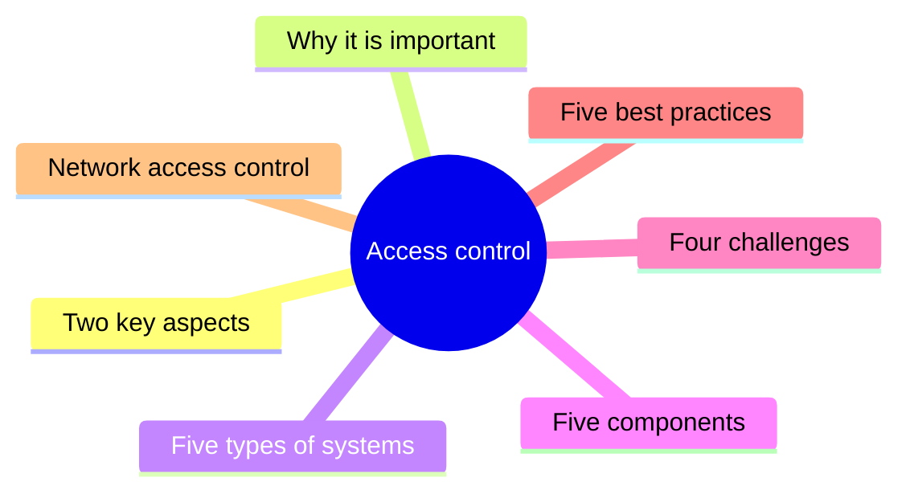
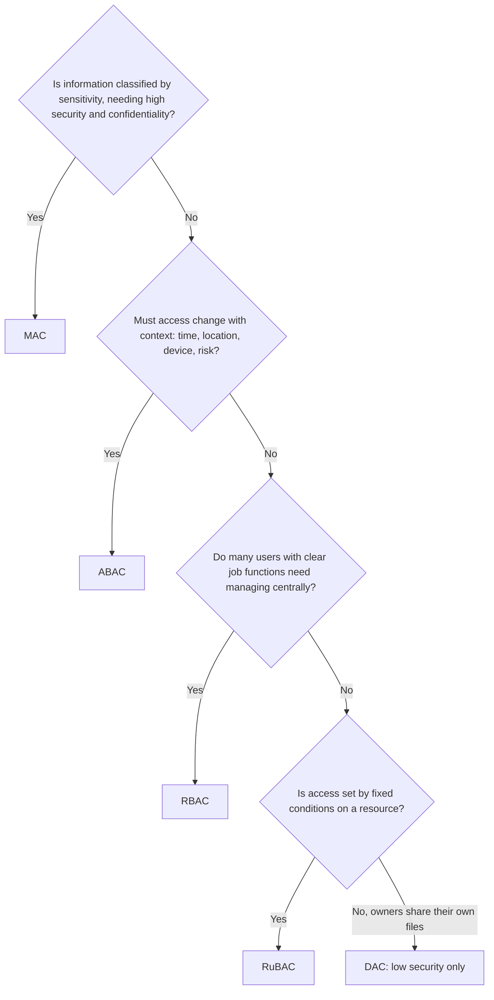

# Unit 8: Access control

*Courseware Chapter 8 (the second of two chapters numbered 8), pages 55–58.*

## At a glance

A short chapter made almost entirely of lists, so nearly every line is examinable. It answers six questions:

- **What is access control?** A proactive security technique that regulates **who can view, use, or access** resources, physical and digital.
- **What are its two key aspects?** **Physical** access control (locks, keycards, biometrics, CCTV) and **technology/logical** access control (authentication, role-based permissions).
- **Why does it matter?** Three benefits: **mitigating risks, enhancing data security, ensuring compliance** (GDPR, HIPAA, PCI DSS).
- **What kinds are there?** Five **types of access control systems**: **DAC, MAC, RBAC, ABAC, RuBAC**.
- **What makes a good system, what goes wrong, and how is it done well?** Five **components**, four **challenges** and five **best practices**.
- **How is access to the network itself controlled?** **Network access control (NAC)**: why it is needed, its **seven advantages**, and its **two types** (pre-admission and post-admission).

!!! warning "Courseware note"
    The courseware has **two chapters numbered 8**: "Wireless and Mobile Security" (pp.52–54, taught as [Unit 7](unit-7-wireless-mobile.md)) and this one, "Access Control" (pp.55–58). The site numbers its units 1–12 in page order; source tags keep the courseware's headings. If an exam paper says "Chapter 8", check which topic it means. The two chapters overlap: wireless security also "applies access control rules" ([Unit 7](unit-7-wireless-mobile.md#the-five-things-wireless-security-involves)).

## What you should be able to do

*The courseware lists no learning outcomes; these are written for this site.*

- Define access control and explain why it is called a proactive security measure.
- Explain the two key aspects of access control (physical and technology/logical), with the tools each uses.
- State the three reasons access control is important, and name the regulations it helps an organisation comply with.
- List and explain the five types of access control systems (DAC, MAC, RBAC, ABAC, RuBAC), compare them, and **recommend one for a given organisation, saying why not the others**.
- State and explain the five components of an effective access control system, and distinguish authentication from authorization.
- Explain the four challenges in access control and match each to the best practices that address it.
- Define network access control, explain why BYOD and IoT make it necessary, list its seven advantages, and differentiate pre-admission from post-admission NAC.

## What access control is

Chapter 8 (Access Control) opening · p.55

The chapter opens with a description of access control and of what the chapter will cover.

> Access control is an essential element of security and plays a crucial role in safeguarding both physical and digital resources. It is a proactive security measure that ensures only authorized individuals can access restricted areas or systems. This security process helps organizations mitigate risks, enhance data security, and comply with regulatory requirements.
>
> In this guide, we will explore what is access control in security, why it's important, the different types of systems, their components, and best practices for implementation. Whether you're looking to enhance identity management or improve overall security access, understanding these principles is crucial. It is a security technique that regulates who can view, use, or access certain resources within an organization. This security process ensures that sensitive areas, data, and systems are only available to authorized users

!!! note "In plain terms"
    Access control answers one question every time someone (or something) tries to reach a resource: **"Is this person allowed to do this, here, now?"**

    - It covers **both physical and digital resources**: a server room door and a payroll database are both "restricted".
    - It is **proactive**: it stops unauthorised access *before* it happens, rather than reacting after damage (as an investigation or a backup restore does).
    - The definition to learn is: **a security technique that regulates who can view, use, or access certain resources within an organization.** Note the three verbs: **view, use, access**.
    - It helps the organisation do **three things**: **mitigate risks, enhance data security, comply with regulatory requirements**. These return as the three benefits in the next-but-one section.

!!! example "Example"
    At a Nigerian university, only exam officers may enter the room where printed question papers are stored (physical), and only the lecturer for a course may enter marks for it in the results portal (digital). Both are access control: they decide **who** may view, use or access each resource.

Access control is not new to this course. It is the **first of the 17 essential security practices** in [Unit 1](unit-1-security-concepts.md#essential-security-practices) ("limit information system access to authorized users… and to the types of transactions and functions that authorized users are permitted to exercise"), and it is designed around Unit 1's principles of [least privilege](unit-1-security-concepts.md#least-privilege), [fail-safe defaults](unit-1-security-concepts.md#fail-safe-defaults) and [complete mediation](unit-1-security-concepts.md#complete-mediation). It is also one of the measures for protecting an operating system ([Unit 3](unit-3-os-security.md#access-control)) and a component of an information security policy ([Unit 6](unit-6-security-policy.md#components-of-an-information-security-policy)).

!!! tip "Exam angle"
    "Define access control" is a near-certain 2–3 mark part. Give the one-sentence definition (**regulates who can view, use, or access certain resources within an organization**), then add that it is **proactive**, protects **physical and digital** resources, and ensures only **authorized** users reach sensitive areas, data and systems.

!!! warning "Courseware note"
    The phrase "**In this guide**, we will explore…" and the underlined phrases later in the chapter (e.g. "bring-your-own-device (BYOD)", "incident response") suggest the chapter was adapted from web articles, with their links left in (an inference). The first paragraph also ends without a full stop. None of this changes the content.

**Check your understanding**

Which of these is the courseware's description of access control?

<ul class="quiz-options">
  <li>A reactive process that investigates who caused a breach</li>
  <li data-correct>A security technique that regulates who can view, use, or access certain resources within an organization</li>
  <li>A technique for scrambling data so that only key holders can read it</li>
  <li>A device that filters network traffic by rules</li>
</ul>

That is the courseware's definition, and it calls access control a **proactive** (not reactive) measure. Scrambling data is encryption ([Unit 4](unit-4-cryptography.md#what-cryptography-is-data-at-rest-and-data-in-transit)); filtering traffic by rules is a firewall ([Unit 5](unit-5-firewalls.md#what-a-firewall-is)). Both support access control but are not its definition (Chapter 8 opening, p.55).

Why does the courseware call access control "proactive"?

<ul class="quiz-options">
  <li>It is automated by artificial intelligence</li>
  <li>It restores systems after an attack</li>
  <li data-correct>It ensures only authorized individuals can access restricted areas or systems, preventing problems before they occur</li>
  <li>It only protects digital resources</li>
</ul>

A proactive measure acts **before** harm: access control "ensures only authorized individuals can access restricted areas or systems". Restoring systems is recovery (reactive). It protects **both physical and digital** resources, so the last option is wrong (p.55).

## Key aspects of access control: physical and logical

Key Aspects of Access Control · p.55

The courseware splits access control into two aspects, one for places and one for systems.

> 1. **Physical Access Control:** Manages entry to physical locations using tools like locks, biometric devices, or keycards. These systems regulate entry to physical locations, such as buildings, offices, or restricted areas. A door access control system can include smart card readers, biometric systems, or keypad locks. They ensure only authorised personnel can enter secured areas. These also includes integrated solutions that are designed to manage access across multiple points in a building or facility. They combine various technologies, such as CCTV, alarms, and door locking systems, to enhance overall security.
> 2. **Technology/Logical Access Control:** Manages connections to digital systems, including data access, applications, and networks. In the digital realm, access management ensures that sensitive information and systems are accessible only to authorised users. This includes user authentication systems, role-based permissions, and cybersecurity measures.
>
> Access control security combines these two aspects, creating a robust framework for protecting assets.

{ .diagram }

The two key aspects of access control. Drawn for this site from the courseware's list; the layout is ours.

| | Physical access control | Technology/logical access control |
|---|---|---|
| **Manages** | Entry to **physical locations** (buildings, offices, restricted areas) | **Connections to digital systems** (data access, applications, networks) |
| **Tools named by the courseware** | Locks, biometric devices, keycards; door systems with smart card readers, biometric systems or keypad locks; integrated CCTV, alarms and door locking systems | User authentication systems, role-based permissions, cybersecurity measures |
| **Ensures** | Only authorised **personnel** can enter **secured areas** | Sensitive **information and systems** are accessible only to authorised **users** |
| **Example** *(site example)* | A fingerprint reader on a bank's cash vault; a staff ID card that opens the server room | A login with password and one-time code to a hospital's patient-records system; a clerk's account that can read but not delete records |

!!! note "In plain terms"
    **Physical** = doors; **logical** = logins. Physical access control decides who gets **into the room**; logical access control decides who gets **into the system and what they can do there**. "Integrated solutions" link several physical technologies (cameras, alarms, door locks) across **multiple entry points** so they are managed together, e.g. a door forced open triggers the alarm and the nearest camera records.

    Neither is enough alone: a strong password is useless if anyone can walk into the server room and carry the disk away, and a locked door is useless if the database is reachable from the Internet with a default password. That is why access control security **combines** the two. Unit 3 lists [physical security](unit-3-os-security.md#physical-security) as an operating system measure for the same reason.

!!! example "Example"
    A Lagos data centre uses both: staff tap an access card **and** scan a fingerprint at the main gate, CCTV and alarms cover every door (integrated physical solution), and inside, administrators sign in to servers with multi-factor authentication and role-based permissions (logical).

!!! tip "Exam angle"
    "State and explain the two key aspects of access control" (4–6 marks): give each name exactly (**Physical Access Control**; **Technology/Logical Access Control**), what it manages, and **three tools** each. Finish with the sentence "access control security combines these two aspects, creating a robust framework for protecting assets".

!!! warning "Courseware note"
    "These also **includes**" should be "These also **include**". The chapter also mixes spellings ("authorised", "authorized"); both are correct.

**Check your understanding**

A hospital installs a system that links CCTV, alarms and door locks across all its wards so that they are managed from one console. What does the courseware call this?

<ul class="quiz-options">
  <li>Technology/logical access control</li>
  <li data-correct>An integrated solution under physical access control</li>
  <li>Network access control</li>
  <li>Centralized identity management</li>
</ul>

Physical access control "also includes integrated solutions… designed to manage access across multiple points in a building or facility", combining "CCTV, alarms, and door locking systems". Centralized identity management (a best practice) unifies **digital** identity systems, and NAC controls entry to a **network**, not a building (Key aspects, p.55).

Which item does the courseware list under technology/logical access control?

<ul class="quiz-options">
  <li>Keypad locks</li>
  <li>Smart card readers</li>
  <li data-correct>Role-based permissions</li>
  <li>CCTV</li>
</ul>

Logical access control "includes user authentication systems, role-based permissions, and cybersecurity measures". Keypad locks, smart card readers and CCTV are all named under **physical** access control. (A biometric scan can appear in both, as a door reader or as a login factor.) (p.55)

## Why access control is important for security

Why Is Access Control Important for Security? · p.55

> Access control is a security process that minimizes risks and ensures compliance. Its proactive nature provides multiple benefits, including:
>
> • **Mitigating Risks:** Prevents unauthorized access to sensitive areas and systems.
>
> • **Enhancing Data Security:** Protects critical information from breaches.
>
> • **Ensuring Compliance:** Aligns with regulations like GDPR, HIPAA, and PCI DSS.

!!! note "In plain terms"
    Three benefits (the courseware does not count them; the count is ours), each a word you can hang an answer on:

    | Benefit | What it means | Link to the course *(site summary)* |
    |---|---|---|
    | **Mitigating risks** | Stops unauthorised people reaching sensitive **areas and systems** | Reduces *risk* in Unit 1's sense (fewer threats can be carried out) |
    | **Enhancing data security** | Protects **critical information** from **breaches** | Protects confidentiality and integrity |
    | **Ensuring compliance** | Helps meet laws and standards (**GDPR, HIPAA, PCI DSS**) | Legal duties are taught in [Unit 10](unit-10-ethics-legal.md#legal-issues-in-information-security) |

    **Memory aid (the site's):** **R-D-C**, "**R**isks, **D**ata, **C**ompliance".

!!! info "Beyond the notes"
    The courseware names three regulations without expanding them:

    - **GDPR**: the European Union's **General Data Protection Regulation** (2018), on personal data of people in the EU.
    - **HIPAA**: the US **Health Insurance Portability and Accountability Act** (1996), on health information.
    - **PCI DSS**: the **Payment Card Industry Data Security Standard**, set by the card brands for anyone who stores, processes or transmits card data (an industry standard, not a law).

    The Nigerian equivalent of GDPR is the **Nigeria Data Protection Act (NDPA) 2023**, which replaced the 2019 Nigeria Data Protection Regulation (NDPR). All of these require that personal or card data can be reached only by those who need it, which is exactly what access control enforces.

!!! example "Example"
    A Nigerian payment company that stores card numbers must comply with **PCI DSS**, which requires restricting access to cardholder data by business need-to-know. Its access control system both **mitigates the risk** of an insider stealing card numbers and gives auditors evidence of **compliance**.

!!! tip "Exam angle"
    "Why is access control important for security?" (3 marks): the three bolded benefits, each with its one-line explanation. For an extra mark, name the three regulations, and expand them if you can.

**Check your understanding**

Which regulation is NOT named by the courseware as one access control helps an organisation comply with?

<ul class="quiz-options">
  <li>GDPR</li>
  <li>HIPAA</li>
  <li>PCI DSS</li>
  <li data-correct>ISO 27001</li>
</ul>

The courseware lists **GDPR, HIPAA, and PCI DSS** under "Ensuring Compliance". ISO 27001 is a real information security management standard (Unit 3 mentions it), but it is not in this list (p.55).

"Protects critical information from breaches" is the courseware's explanation of which benefit?

<ul class="quiz-options">
  <li>Mitigating risks</li>
  <li data-correct>Enhancing data security</li>
  <li>Ensuring compliance</li>
  <li>Audit and monitoring</li>
</ul>

Enhancing data security "protects critical information from breaches". Mitigating risks "prevents unauthorized access to sensitive areas and systems", the tempting near-miss. Audit and monitoring is a **component**, not one of the three benefits (p.55).

## Types of access control systems

Types of Access Control Systems · pp.55–56

The courseware describes five types (it does not count them; the count is ours). They differ in **who decides** access and **on what basis**.

> • Discretionary access control (DAC)
>
> • Mandatory access control (MAC)
>
> • Role-based access control (RBAC)
>
> • Attribute-based access control (ABAC)
>
> • Rule-based access control (RuBAC)

{ .diagram }

One request, five models. Drawn for this site: the questions are our paraphrase of the courseware's descriptions below.

!!! note "In plain terms"
    **Memory aid (the site's): "Do Managers Really Approve Rules?"** = **D**AC, **M**AC, **R**BAC, **A**BAC, **Ru**BAC, in the courseware's order. Watch the two "R"s: **RBAC is role-based; RuBAC is rule-based** (the extra "u" is for "rule").

### Discretionary access control (DAC)

Types of Access Control Systems · p.56

> **Discretionary access control (DAC):** With DAC models, the data owner decides to grant access rights based on rules that they specify. DAC is the least restrictive, and therefore the least recommended, type of access control for commercial and business security.

**The owner decides.** Whoever owns the data chooses who else may use it, at their own *discretion* (hence the name). It is flexible and simple, but it is the **least restrictive** model: security depends on every owner making good choices, and an owner can share with anyone. That is why the courseware calls it the **least recommended** for commercial and business security.

!!! example "Example"
    Sharing a Google Docs file or a OneDrive folder: you, the owner, pick who can view or edit it. On a Windows or Linux PC, the owner of a file can change its permissions. A small Abuja design studio where each designer shares their own project files with colleagues runs on DAC in practice.

### Mandatory access control (MAC)

Types of Access Control Systems · p.56

> **Mandatory access control (MAC):** MAC was developed using a non-discretionary model in which one person (e.g. the Chief Security Officer) has sole discretion over access permissions and security clearance. MAC subjects and objects are assigned clearances and labels, respectively, such as "confidential", "secret" and "top secret". This type of access control is best suited to organizations that require high security and confidentiality.

**A central authority decides, through labels.** Owners and users **cannot** pass on access as they please (non-discretionary). One person, such as the **Chief Security Officer**, controls permissions and clearances. Every **subject** (user or process) gets a **clearance**, and every **object** (file, record) gets a **label**, e.g. *confidential, secret, top secret*. Access depends on matching the two. It is the **most restrictive** of the five and is **best suited to organisations that require high security and confidentiality**.

!!! example "Example"
    A military or intelligence directorate: an officer cleared to "secret" can read "confidential" and "secret" documents, but not "top secret" ones, and cannot share a "secret" file with an uncleared colleague even if they wrote it.

!!! warning "Courseware note"
    The wording "a **non-discretionary** model in which one person… has **sole discretion**" sounds contradictory. "Non-discretionary" means the **users and data owners** have no discretion: they cannot change who may access what. The discretion sits with **one central authority** (e.g. the CSO), and the system enforces the clearances and labels. Also note "clearances and labels, **respectively**": **subjects get clearances, objects get labels**, not the other way round.

!!! info "Beyond the notes"
    The best-known MAC rule set is the **Bell–LaPadula model** (1973), built for military confidentiality: "**no read up**" (you cannot read above your clearance) and "**no write down**" (you cannot copy secret data into a lower-labelled file). Operating systems implement MAC through tools such as **SELinux**.

### Role-based access control (RBAC)

Types of Access Control Systems · p.56

> **Role-based access control (RBAC):** Under this model, access is granted based on the person's job function and the resources required to do their job. Key security principles, such as "least privilege" and "separation of privilege", are employed to give users the minimum level of access required to perform their role. RBAC is a user-friendly access control system, which allows admins to group users and adjust permissions from a central database.

**The job decides.** Permissions are attached to **roles** (job functions: cashier, lecturer, nurse), and people get the permissions of their role. Give each role only what it needs, and you have applied **least privilege** across the whole organisation. It is **user-friendly** for administrators: they **group users** and **adjust permissions from a central database**, so changing a role's permissions updates everyone in it, and moving a person to a new job means changing one role assignment.

RBAC is the courseware's own example of Unit 1's [least privilege](unit-1-security-concepts.md#least-privilege) principle ("each role is assigned only those permissions needed to perform its functions"), and it appears again among the operating system measures in [Unit 3](unit-3-os-security.md#access-control).

!!! example "Example"
    In a Nigerian bank, the **teller** role can post deposits and withdrawals up to a limit, the **branch manager** role can approve larger withdrawals, and the **auditor** role can read all transactions but post none. A new teller is simply added to the teller group.

!!! warning "Courseware note"
    The courseware says RBAC employs "**separation of privilege**". In [Unit 1](unit-1-security-concepts.md#separation-of-privilege), separation of privilege means requiring **multiple privilege attributes** to access a resource (e.g. password **and** smart card), or splitting a program by privilege. The principle usually paired with RBAC is **separation of duties**: no single role holds two permissions that together allow fraud (e.g. the role that creates a payment cannot also approve it). Quote "least privilege and separation of privilege" in the exam, but you may add separation of duties as the example.

### Attribute-based access control (ABAC)

Types of Access Control Systems · p.56

> **Attribute-based access control (ABAC):** In contrast to the role-based access control method of RBAC, ABAC is a complex strategy that assigns or denies access to users based on a set of attributes assigned by the owner or administrator. While more complicated than RBAC, it gives admins the flexibility to make decisions according to context and evolving levels of risk.

**Many characteristics decide, in context.** Instead of one role, ABAC looks at a **set of attributes** (e.g. department, seniority, location, device, time of day, sensitivity of the data) and grants or denies access by combining them. It is **more complex** than RBAC but **more flexible**: decisions can follow **context** and **evolving levels of risk**.

!!! example "Example"
    A telemedicine platform: "a doctor may open a patient's record **if** the patient is assigned to them, **and** the doctor is on shift, **and** the request comes from a hospital-managed device; from an unknown device, require a second factor and allow read-only access". No single role captures all those conditions.

!!! info "Beyond the notes"
    In standard ABAC (NIST SP 800-162), attributes describe four things: the **subject** (user), the **object** (resource), the **action** (read, write, delete), and the **environment** (time, location, threat level). Policies then combine them. The courseware's "attributes assigned by the owner or administrator" is a simplification.

### Rule-based access control (RuBAC)

Types of Access Control Systems · p.56

> **Rule-based access control (RuBAC):** RuBAC involves defining the rules that govern access to a resource; these are often based on conditions such as "only users in the finance department can access financial data".

**Rules on the resource decide.** An administrator writes condition-based rules for a resource, and every request is checked against them. The courseware's example: "**only users in the finance department can access financial data**".

!!! example "Example"
    "The payroll system accepts logins only between 8 a.m. and 6 p.m. on weekdays"; "the exam portal can be reached only from the campus network". A firewall rule list is also rule-based access control ([Unit 5](unit-5-firewalls.md#what-a-firewall-is)).

!!! warning "Courseware note"
    The courseware's RuBAC example ("only users in the finance department…") depends on a user's department, which could equally be a role (RBAC) or an attribute (ABAC). The cleaner distinction: in **RuBAC**, the **rules** attached to a resource decide, often based on conditions that apply to **everyone** (time of day, network location); in **RBAC**, the user's **role** decides. Learn the courseware's example word for word, and use a time-based rule if asked for your own example. Also note that **DAC's** description mentions "rules that they specify": in DAC the **owner** sets them, which is what makes it discretionary.

### Comparing the five models

Types of Access Control Systems · p.56

| Criterion | DAC | MAC | RBAC | ABAC | RuBAC |
|---|---|---|---|---|---|
| **Who decides** | The **data owner** | **One person** (e.g. the Chief Security Officer) | Admins, by **job function** | **Owner or administrator**, via attributes | Whoever defines the **rules** for the resource |
| **Basis of the decision** | Rules the owner specifies | **Clearances** (subjects) and **labels** (objects): confidential, secret, top secret | The person's **job function** and the resources the job needs | A **set of attributes**; **context** and **evolving risk** | **Conditions**, e.g. "only finance department users can access financial data" |
| **Courseware verdict** | **Least restrictive**, least recommended for business | Best for **high security and confidentiality** | **User-friendly**; uses least privilege and separation of privilege; central database | **Complex** but **flexible** | (none given) |
| **Main weakness** *(site summary)* | Owners may over-share; hard to enforce policy | Rigid; heavy to administer | Roles multiply ("role explosion"); ignores context | Hard to design, test and audit | Rules can conflict or grow unmanageable |
| **Typical user** *(site example)* | Small team, personal file sharing | Military, intelligence, classified government work | Banks, universities, hospitals, most businesses | Cloud services, remote/mobile work, risk-based access | Time- or location-restricted systems, firewalls |

!!! example "Choosing a model for an organisation"
    The same five questions settle most "recommend a model" scenarios. The flowchart is a site decision aid, not from the courseware.

!!! tip "Exam angle"
    Expect three kinds of question here: **(1)** "list and explain the types of access control systems" (all five, with their courseware verdicts); **(2)** "differentiate DAC and MAC" or "RBAC and ABAC" (use **who decides**, **basis**, **restrictiveness/flexibility**, **suitability** as your criteria); **(3)** a scenario: "recommend an access control model for organisation X and justify your choice". For (3), use I-A-J-A: identify what the organisation needs (secrecy? many staff? context?), apply the model's courseware description, justify with its verdict ("best suited to organizations that require high security…"), and **say why each alternative is worse** (DAC too permissive, MAC too rigid, ABAC too complex, and so on). Many real organisations combine models (e.g. RBAC as the base with ABAC conditions for remote access); saying so earns credit if you still name one primary model.

**Check your understanding**

Which model does the courseware call "the least restrictive, and therefore the least recommended, type of access control for commercial and business security"?

<ul class="quiz-options">
  <li>Rule-based access control (RuBAC)</li>
  <li data-correct>Discretionary access control (DAC)</li>
  <li>Role-based access control (RBAC)</li>
  <li>Attribute-based access control (ABAC)</li>
</ul>

In DAC the **data owner** decides who gets access, so control depends on each owner's choices: least restrictive and least recommended. RuBAC is tempting because DAC's description mentions "rules", but in DAC the owner specifies them; in RuBAC rules govern the resource itself (Types of access control systems, p.56).

In MAC, which statement is correct?

<ul class="quiz-options">
  <li>Objects are assigned clearances and subjects are assigned labels</li>
  <li data-correct>Subjects are assigned clearances and objects are assigned labels</li>
  <li>Each data owner decides who receives a clearance</li>
  <li>Access is based on job function from a central database</li>
</ul>

"MAC subjects and objects are assigned clearances and labels, **respectively**": subjects (users) get clearances, objects (data) get labels such as confidential, secret, top secret. Owners deciding is DAC; job function from a central database is RBAC (p.56).

A fintech wants staff to reach customer data from the office as normal, but to be blocked or asked for extra checks when logging in from a new country at 3 a.m. Which model fits best?

<ul class="quiz-options">
  <li>DAC</li>
  <li>MAC</li>
  <li>RBAC alone</li>
  <li data-correct>ABAC</li>
</ul>

ABAC "gives admins the flexibility to make decisions according to **context and evolving levels of risk**": location and time are attributes. RBAC alone gives the same access to everyone in a role regardless of context. MAC's labels are about data sensitivity, not context, and DAC leaves decisions to owners (p.56).

## Components of an effective access control system

Components of an Effective Access Control System · p.56

An access control system is more than a login screen. The courseware names five components.

> 1. **Authentication:** Authentication verifies identity using methods such as passwords, biometric scans, or multi-factor authentication.
> 2. **Authorization:** Authorization determines what level of access a user should have to specific data or areas. This ensures alignment with access policies.
> 3. **Audit and Monitoring:** Audit trails track user activity, helping organizations detect unauthorized access and identify security vulnerabilities.
> 4. **Access Management:** Efficient access management simplifies onboarding and off boarding while ensuring active accounts are secure and up-to-date.
> 5. **Integration:** Modern systems integrate seamlessly with cloud environments, identity management tools, and other security solutions to provide comprehensive protection.

{ .diagram }

The five components of an effective access control system. Drawn for this site; the arrangement (a request path plus supporting functions) is ours.

| Component | Question it answers *(site summary)* | Courseware detail |
|---|---|---|
| **1. Authentication** | **Who are you?** | Verifies identity: passwords, biometric scans, multi-factor authentication |
| **2. Authorization** | **What may you do?** | Level of access to specific data or areas; aligned with access policies |
| **3. Audit and monitoring** | **What did you do?** | Audit trails track activity; detect unauthorized access; identify vulnerabilities |
| **4. Access management** | **Is your account still right?** | Simplifies onboarding and offboarding; keeps active accounts secure and up to date |
| **5. Integration** | **Does it work with everything else?** | Integrates with cloud environments, identity management tools, other security solutions |

!!! note "In plain terms"
    Components 1–3 are the classic "**AAA**" of security: **A**uthentication, **A**uthorization, **A**udit (often called *accounting*). Authentication always comes **first**: you cannot decide what someone may do until you know who they are.

    - **Authentication vs authorization** is the most tested pair in this chapter. A student ID card at the library gate *authenticates* you (you are a registered student); the library system's rule that undergraduates may borrow 3 books and postgraduates 10 is *authorization*.
    - **Audit and monitoring** gives **accountability** ([Unit 1](unit-1-security-concepts.md#beyond-the-triad-authenticity-and-accountability)) and matches the Audit and Accountability practice; Unit 3 calls it [logging and monitoring](unit-3-os-security.md#logging-and-monitoring).
    - **Access management** handles the **lifecycle**: create the account when someone joins (onboarding), keep it correct while they work, remove it when they leave (offboarding). Done badly, it causes the *orphaned accounts* challenge below.
    - **Integration** means one access control system, not islands: it plugs into cloud services and identity tools (e.g. a single company login used by email, HR and the cloud storage).

!!! example "Example"
    A Nigerian state ministry staff portal: staff sign in with password + SMS code (**authentication**); a records officer may view files but only a director may approve them (**authorization**); every view and approval is logged and reviewed weekly (**audit and monitoring**); HR's joiner/leaver forms create and disable accounts the same day (**access management**); the same login works for the ministry's cloud email (**integration**).

Authentication methods are treated further in [Unit 3](unit-3-os-security.md#strong-authentication) (MFA and strong passwords) and Unit 1's [Identification and Authentication](unit-1-security-concepts.md#essential-security-practices) practice. Wireless networks make the same split: [Unit 7](unit-7-wireless-mobile.md#the-five-things-wireless-security-involves) lists "authenticate users and devices" and "apply access control rules" as separate steps.

!!! tip "Exam angle"
    "State and explain the components of an effective access control system" (5 marks: one per component). "Differentiate authentication and authorization" (2–4 marks): authentication **verifies identity**; authorization **determines the level of access** to specific data or areas, in line with access policies; authentication comes first.

!!! warning "Courseware note"
    "off boarding" is usually written "offboarding". The components are numbered 1–5 in the source.

**Check your understanding**

A system confirms Musa's fingerprint, then checks whether Musa's account may approve payments above ₦5 million. Which two components are at work, in order?

<ul class="quiz-options">
  <li>Authorization, then authentication</li>
  <li data-correct>Authentication, then authorization</li>
  <li>Access management, then integration</li>
  <li>Audit and monitoring, then authentication</li>
</ul>

The fingerprint **verifies identity** (authentication); deciding **what level of access** Musa has (approving large payments) is authorization. Authentication must come first: the system cannot decide what Musa may do until it knows it is Musa (Components, p.56).

Which component "simplifies onboarding and off boarding while ensuring active accounts are secure and up-to-date"?

<ul class="quiz-options">
  <li>Integration</li>
  <li>Authorization</li>
  <li data-correct>Access management</li>
  <li>Audit and monitoring</li>
</ul>

That is the courseware's description of **access management**. Audit and monitoring tracks activity through audit trails; integration connects the system with cloud environments and identity tools (p.56).

## Challenges in access control

Challenges in Access Control · pp.56–57

> Organizations face several challenges when implementing and managing access control systems, including:
>
> • **Managing Distributed IT Environments:** With resources spread across on-premises and cloud systems, consistent data access controls are essential to prevent vulnerabilities.
>
> • **Password Fatigue:** Employees managing multiple passwords may resort to weak practices, increasing the risk of unauthorized access.
>
> • **Orphaned Accounts:** Inactive accounts can lead to privilege escalation and security breaches if not properly managed.
>
> • **Complexity of Systems:** Complex access control systems can discourage proper usage, leading to gaps in identity governance.

The courseware lists four challenges (it does not count them; the count is ours).

| Challenge | The problem | Why it is dangerous *(site explanation)* |
|---|---|---|
| **Managing distributed IT environments** | Resources are spread across **on-premises and cloud** systems | Each place has its own access settings; an inconsistent rule in one place becomes the vulnerability |
| **Password fatigue** | Employees manage **multiple passwords** | They reuse passwords, choose weak ones or write them down, so guessing or stealing one opens many doors (see password guessing in [Unit 2](unit-2-attacks.md#avenues-of-attack-on-computer-networks)) |
| **Orphaned accounts** | **Inactive** accounts (e.g. of staff who left) stay enabled | Nobody watches them, so an attacker or ex-employee can use them unnoticed and escalate privileges; using one is a [masquerade](unit-2-attacks.md#masquerade) |
| **Complexity of systems** | Complex systems **discourage proper usage** | Users find workarounds (shared accounts, over-broad permissions), leaving **gaps in identity governance** |

!!! note "In plain terms"
    **Memory aid (the site's): "D-P-O-C", "Don't Put Old Computers" (away carelessly)**: **D**istributed environments, **P**assword fatigue, **O**rphaned accounts, **C**omplexity.

    *Identity governance* means knowing, and being able to prove, **who has access to what and why**. Complexity of systems is Unit 1's [psychological acceptability](unit-1-security-concepts.md#psychological-acceptability) problem: if security gets in the way, users bypass it. *Privilege escalation* (gaining higher privileges than intended) is also listed as an operating system vulnerability in [Unit 3](unit-3-os-security.md#vulnerabilities-of-operating-systems).

!!! example "Example"
    A lecturer leaves a Nigerian university for a job abroad, but her results-portal account is never disabled (**orphaned account**). Months later someone uses her still-valid password, which she had reused on a leaked shopping site (**password fatigue**), to change grades. The university's on-campus portal and its cloud learning system had separate user lists, so disabling her in one did not disable her in the other (**distributed IT environments**).

!!! tip "Exam angle"
    "Discuss the challenges in access control" (4–8 marks): name all four and explain each in one or two sentences, using the courseware's consequences: **prevent vulnerabilities**; **risk of unauthorized access**; **privilege escalation and security breaches**; **gaps in identity governance**. Scenario questions often hide an orphaned account (a former employee) or password fatigue (sticky notes, reused passwords): name the challenge, then recommend the matching best practice from the next section.

**Check your understanding**

An auditor finds 140 enabled accounts belonging to staff who left the company over the past two years. Which challenge is this?

<ul class="quiz-options">
  <li>Password fatigue</li>
  <li>Complexity of systems</li>
  <li data-correct>Orphaned accounts</li>
  <li>Managing distributed IT environments</li>
</ul>

Orphaned accounts are **inactive accounts** that "can lead to privilege escalation and security breaches if not properly managed". The cause is weak **access management** (offboarding). Password fatigue is about users juggling many passwords (Challenges, p.57).

According to the courseware, what is the result of complex access control systems?

<ul class="quiz-options">
  <li>Privilege escalation through inactive accounts</li>
  <li data-correct>They discourage proper usage, leading to gaps in identity governance</li>
  <li>Inconsistent controls across on-premises and cloud systems</li>
  <li>Employees resorting to weak password practices</li>
</ul>

"Complex access control systems can discourage proper usage, leading to gaps in identity governance." Each other option is the consequence of a different challenge: orphaned accounts, distributed environments and password fatigue respectively (p.57).

## Best practices for access control implementation

Best Practices for Access Control Implementation · p.57

> • **Principle of Least Privilege (PoLP)**Limit user access to the minimum resources needed for their role, ensuring privileged access is tightly controlled.
>
> • **Multi-Factor Authentication (MFA):** Combine passwords with other authentication methods like biometric scans for enhanced security.
>
> • **Regular Audits:** Review access logs periodically to identify and mitigate risks associated with unauthorized access or privilege creep.
>
> • **Centralized Identity Management:** Unify access control systems to avoid separate identity silos and improve efficiency.
>
> • **Employee Training:** Educate users on the importance of secure access management and proper use of the system.

Five best practices (the count is ours). Each answers one or more of the four challenges.

**Principle of least privilege (PoLP).** Give each user the **minimum resources needed for their role** and keep **privileged** (admin) access tightly controlled. If an account is compromised, the damage is limited to what that role could do. This is Unit 1's [least privilege](unit-1-security-concepts.md#least-privilege) principle, and RBAC is its usual tool.

**Multi-factor authentication (MFA).** Combine a password with another method, e.g. a **biometric scan** (or a one-time code), so a stolen or guessed password alone is not enough. Unit 1 uses MFA as the example of [separation of privilege](unit-1-security-concepts.md#separation-of-privilege).

**Regular audits.** **Review access logs periodically** to catch unauthorized access and **privilege creep**: the slow build-up of permissions as a person moves between jobs and keeps the old rights each time (the courseware uses the term without defining it).

**Centralized identity management.** **Unify** access control systems so there is **one identity per person** rather than separate "identity silos" in every application. One place to grant, change and remove access; more efficient and more consistent.

**Employee training.** Teach users **why** secure access management matters and **how** to use the system properly (no password sharing, no tailgating through secured doors, reporting lost access cards).

| Challenge | Best practices that address it *(site mapping)* | Why |
|---|---|---|
| Managing distributed IT environments | **Centralized identity management**; regular audits | One identity and one rule set across on-premises and cloud; audits catch inconsistencies |
| Password fatigue | **Centralized identity management** (one login, single sign-on); **MFA**; employee training | Fewer passwords to remember; a weak password is no longer enough on its own |
| Orphaned accounts | **Regular audits**; centralized identity management | Audits spot inactive accounts; a central system disables a leaver everywhere at once |
| Complexity of systems | **Employee training**; centralized identity management | Users understand and use the system; one simpler system instead of many |
| Privilege escalation / privilege creep | **PoLP**; regular audits | Minimum rights limit what can be escalated; audits remove rights no longer needed |

!!! tip "Exam angle"
    "Outline five best practices for access control implementation" (5 marks). For a higher-mark scenario, pair each **challenge** you identify with the **best practice** that fixes it and the **component** that delivers it (e.g. orphaned accounts → regular audits + access management offboarding). Learn the courseware's term **privilege creep** under regular audits.

!!! warning "Courseware note"
    "Principle of Least Privilege (PoLP)Limit user access…" is missing the colon and space after "(PoLP)"; it is quoted above as printed. The other four items have colons.

**Check your understanding**

Which best practice does the courseware link to "privilege creep"?

<ul class="quiz-options">
  <li>Multi-factor authentication</li>
  <li>Employee training</li>
  <li data-correct>Regular audits</li>
  <li>Centralized identity management</li>
</ul>

Regular audits: "Review access logs periodically to identify and mitigate risks associated with unauthorized access or **privilege creep**." PoLP prevents excess privilege in the first place, but the courseware places privilege creep under audits (Best practices, p.57).

A company has separate user accounts for email, HR, payroll and its cloud storage, each managed by a different team. Which best practice most directly addresses this?

<ul class="quiz-options">
  <li>Principle of least privilege</li>
  <li data-correct>Centralized identity management</li>
  <li>Regular audits</li>
  <li>Multi-factor authentication</li>
</ul>

Centralized identity management "unif[ies] access control systems to avoid separate **identity silos** and improve efficiency". Separate accounts per system are exactly identity silos. It also eases password fatigue and the distributed-environment challenge (p.57).

## Network access control (NAC)

Network Access Control · pp.57–58

The last part of the chapter moves from controlling access to resources to controlling access to **the network itself**.

> **Network access control (NAC)**, also known as network admission control, is the process of restricting unauthorized users and devices from gaining access to a corporate or private network. NAC ensures that only users who are authenticated and devices that are authorized and compliant with security policies can enter the network.

> As endpoints proliferate across an organization—typically driven by bring-your-own-device (BYOD) policies and an expansion in the use of Internet-of-Things (IoT) devices—more control is needed. Even the largest IT organizations do not have the resources to manually configure all the devices in use. The automated features of a NAC solution are a sizable benefit, reducing the time and associated costs with authenticating and authorizing users and determining that their devices are compliant.
>
> Further, cyber criminals are well aware of this increase in endpoint usage and continue to design and launch sophisticated campaigns that exploit common network vulnerabilities in corporate networks. With more endpoints, the attack surface increases, which means more opportunities for fraudsters to gain access. NAC solutions can be configured to detect any unusual or suspicious network activity and respond with immediate action, such as isolating the device from the network to prevent the potential spread of the attack.
>
> Although IoT and BYOD have changed NAC solutions, NAC also serves as a perpetual inventory of users, devices, and their level of access. It serves as an active discovery tool to uncover previously unknown devices that may have gained access to all or parts of the network, requiring IT administrators to adjust security policies.
>
> Further, organizations can choose how NAC will authenticate users who attempt to gain access to the network. IT admins can choose multi-factor authentication (MFA), which provides an additional layer of security to username and password combinations.
>
> Restricting network access also means control of the applications and data within the network, which is normally the target of cyber criminals. The stronger the network controls, the more difficult it will be for any cyberattack to infiltrate the network.

!!! note "In plain terms"
    NAC is a **gatekeeper for the network**. Before a laptop, phone or smart device can join, NAC checks two things: is the **user authenticated**, and is the **device authorized and compliant** with security policy (e.g. updated operating system, antivirus running)? The definition has **two halves**; learn both.

    The courseware gives six points about why NAC matters (the grouping and count are ours):

    1. **More endpoints:** BYOD (staff bringing their own phones and laptops) and IoT (cameras, sensors, smart printers) mean far more devices; nobody can configure them all by hand, so NAC's **automation** saves time and cost.
    2. **Bigger attack surface:** more endpoints mean more ways in for criminals ([attack surface](unit-2-attacks.md#attack-surfaces) in Unit 2).
    3. **Detect and respond:** NAC can spot **unusual or suspicious** activity and act at once, e.g. **isolating the device** so an attack (such as a worm, [Unit 9](unit-9-malware.md#viruses-and-worms)) cannot spread.
    4. **Inventory and discovery:** NAC keeps a **perpetual inventory** of users, devices and their level of access, and **actively discovers unknown devices**, so administrators can adjust security policies.
    5. **Choice of authentication:** admins choose how NAC authenticates users, e.g. **MFA** on top of username and password.
    6. **Protects what is inside:** controlling the network also controls the **applications and data** in it, the usual target; stronger network controls make infiltration harder.

!!! example "Example"
    A Nigerian teaching hospital lets doctors use their own phones on the hospital Wi-Fi (BYOD) and has hundreds of networked infusion pumps and CCTV cameras (IoT). With NAC, a doctor's phone joins only after the doctor signs in with MFA and the phone passes a check (screen lock on, OS up to date); it lands in a staff zone, not on the network that carries patient records. A camera that suddenly starts scanning other devices is automatically **isolated**.

!!! info "Beyond the notes"
    NAC is usually built on **IEEE 802.1X**, the same port-based authentication standard behind WPA2/WPA3-Enterprise Wi-Fi ([Unit 7](unit-7-wireless-mobile.md#the-four-wireless-network-security-protocols)): the switch or access point lets a device onto the network only after an authentication server (often RADIUS) approves it. Devices that fail the check are placed in a **quarantine VLAN** with access only to update servers. NAC is closely related to the **zero-trust network access (ZTNA)** capability of next-generation firewalls in [Unit 5](unit-5-firewalls.md#next-generation-firewalls-ngfw): never trust a device just because it is plugged in. Detecting unusual activity overlaps with intrusion detection ([Unit 12](unit-12-idps.md#anomaly-based-detection)).

!!! tip "Exam angle"
    "Define network access control" (2–3 marks): restricting unauthorized **users and devices** from gaining access to a corporate or private network; only **authenticated users** and **authorized, compliant devices** can enter. Give the alternative name, **network admission control**. "Why is NAC needed?" (4–6 marks): **BYOD and IoT**, automation, attack surface, detect-and-isolate, inventory and discovery.

**Check your understanding**

According to the courseware, NAC lets onto the network only…

<ul class="quiz-options">
  <li>devices that have a firewall installed</li>
  <li>users who have a role in the central database</li>
  <li data-correct>users who are authenticated and devices that are authorized and compliant with security policies</li>
  <li>devices owned by the organisation, never personal devices</li>
</ul>

"NAC ensures that only users who are **authenticated** and devices that are **authorized and compliant** with security policies can enter the network." NAC does not ban personal devices: it exists partly *because* of BYOD and lets them in under control (Network access control, p.57).

Which two trends does the courseware say make endpoints proliferate and NAC necessary?

<ul class="quiz-options">
  <li>Cloud computing and artificial intelligence</li>
  <li data-correct>Bring-your-own-device (BYOD) policies and Internet-of-Things (IoT) devices</li>
  <li>Remote work and VPNs</li>
  <li>Password fatigue and orphaned accounts</li>
</ul>

"As endpoints proliferate across an organization—typically driven by **BYOD** policies and an expansion in the use of **IoT** devices—more control is needed." Password fatigue and orphaned accounts are access control **challenges**, not causes of endpoint growth (p.57).

An unknown smart TV in a meeting room is found connected to the corporate network. Which NAC role does the courseware describe that uncovers it?

<ul class="quiz-options">
  <li>Pre-admission control</li>
  <li data-correct>An active discovery tool that uncovers previously unknown devices</li>
  <li>Multi-factor authentication</li>
  <li>Automated incident response</li>
</ul>

NAC "serves as an **active discovery tool** to uncover previously unknown devices that may have gained access to all or parts of the network", alongside its role as a **perpetual inventory**. Automated incident response would be what NAC does *next* (e.g. isolating the TV) (p.57).

### Advantages of network access control

What Are The Advantages of Network Access Control? · p.58

> Network access control comes with a number of benefits for organizations:
>
> 1. Control the users entering the corporate network
> 2. Control access to the applications and resources users aim to access
> 3. Allow contractors, partners, and guests to enter the network as needed but restrict their access
> 4. Segment employees into groups based on their job function and build role-based access policies
> 5. Protect against cyberattacks by putting in place systems and controls that detect unusual or suspicious activity
> 6. Automate incident response
> 7. Generate reports and insights on attempted access across the organization

!!! note "In plain terms"
    Seven advantages, which fall into three groups (the grouping is the site's):

    | Group *(site)* | Advantages | Short form |
    |---|---|---|
    | **Who gets in, and to what** | 1, 2, 3 | Control **users**; control access to **applications and resources**; let **contractors, partners and guests** in, with **restricted** access |
    | **How access is organised** | 4 | **Segment employees** by **job function** and build **role-based** access policies (RBAC applied to the network) |
    | **Defend, respond, report** | 5, 6, 7 | **Detect** unusual or suspicious activity; **automate incident response**; **generate reports and insights** on attempted access |

    **Memory aid (the site's): "U-A-G-S-D-I-R"**, "**U**sers **A**nd **G**uests **S**hould **D**o **I**t **R**ight": **U**sers, **A**pplications, **G**uests, **S**egment, **D**etect, **I**ncident response, **R**eports.

### Types of network access control

Types of Network Access Control · p.58

> **Pre-admission:** Pre-admission network access control occurs before access is granted. A user attempting to enter the network makes a request to enter. A pre-admission network control considers the request and provides access if the device or user can authenticate their identity.

> **Post-admission:** Post-admission network access control is the process of granting authorization to an authenticated device or user attempting to enter a new or different area of the network to which they have not been granted authorization. To receive authorization, a user or device must verify their identity again.

![Devices (employee laptop, BYOD phone, IoT device, guest or contractor) pass through a NAC pre-admission check (user authenticated, device authorized and compliant); failures or suspicious devices are denied or isolated; admitted devices reach a staff area or a restricted guest area; moving from the staff area to a new or different area such as finance servers requires a post-admission check that verifies identity again; NAC keeps an inventory, discovers unknown devices, detects unusual activity, automates incident response and reports](assets/diagrams/u8-nac.svg){ .diagram }

Pre-admission and post-admission NAC. Drawn for this site; the zones (staff, guest, finance) and device types are our examples.

| Criterion | Pre-admission NAC | Post-admission NAC |
|---|---|---|
| **When** | **Before** access to the network is granted | **After** admission, when moving to a **new or different area** of the network |
| **Who it applies to** | A user (or device) **requesting to enter** the network | An **already authenticated** device or user |
| **What happens** | The request is considered; access is provided **if the device or user can authenticate their identity** | Authorization is granted for the new area only after the user or device **verifies their identity again** |
| **Analogy** *(site example)* | The security post at the estate gate | The extra key card needed to enter the server room inside the building |

!!! example "Example"
    A bank officer's laptop joins the head-office network after signing in (**pre-admission**). Later she opens the treasury system, which sits in a separately protected segment; the network asks her to authenticate again with her hardware token before letting her in (**post-admission**).

!!! tip "Exam angle"
    "State and explain the two types of network access control" or "differentiate pre-admission and post-admission NAC" (4–6 marks): use **when** (before entry vs moving to a new area), **who** (a requester vs an already authenticated user/device) and **what** (authenticate identity vs verify identity again). "List the advantages of NAC" is a 7-mark list: learn all seven. With the aid of a diagram: draw the gate (pre-admission) and an inner gate between zones (post-admission).

!!! warning "Courseware note"
    The heading reads "Types of Network Access Control." with a stray full stop, and the advantages list's heading uses title case ("What Are The Advantages…"). The courseware names exactly **two** types and **seven** advantages.

**Check your understanding**

A contractor already on the guest network tries to reach the finance server segment and is asked to verify their identity again. Which type of NAC is this?

<ul class="quiz-options">
  <li>Pre-admission</li>
  <li data-correct>Post-admission</li>
  <li>Discretionary access control</li>
  <li>Active discovery</li>
</ul>

Post-admission NAC grants authorization to an **authenticated** user or device "attempting to enter a **new or different area** of the network"; "a user or device must verify their identity again". Pre-admission happens **before** any access is granted (Types of NAC, p.58).

Which of these is NOT one of the courseware's seven advantages of NAC?

<ul class="quiz-options">
  <li>Automate incident response</li>
  <li>Segment employees into groups based on job function and build role-based access policies</li>
  <li data-correct>Encrypt all data stored on employee devices</li>
  <li>Generate reports and insights on attempted access across the organization</li>
</ul>

Encrypting device storage is not in the list (encryption is [Unit 4](unit-4-cryptography.md)). The seven are: control users; control access to applications and resources; allow contractors, partners and guests with restricted access; segment employees and build role-based policies; detect unusual activity; automate incident response; generate reports and insights (Advantages, p.58).

## Telling similar ideas apart

| Pair | First | Second | One-line difference |
|---|---|---|---|
| Physical vs logical access control | Entry to **physical locations** (locks, keycards, biometrics, CCTV) | Connections to **digital systems** (authentication, role-based permissions) | Doors vs logins |
| DAC vs MAC | The **data owner** decides; least restrictive | **One central person** decides through clearances and labels; high security | Owner's discretion vs central mandate |
| RBAC vs ABAC | Access by **job function** (role); user-friendly, central database | Access by a **set of attributes**, context and risk; complex but flexible | One role vs many attributes in context |
| RBAC vs RuBAC | **Role**-based: the person's job decides | **Rule**-based: conditions defined for the resource decide | Who you are (role) vs what the rule says |
| Authentication vs authorization | **Verifies identity** (passwords, biometrics, MFA) | Determines the **level of access** to specific data or areas | Who you are vs what you may do |
| Audit and monitoring vs access management | **Tracks activity** (audit trails) to detect unauthorized access | Manages accounts through **onboarding, active use, offboarding** | Watching use vs maintaining accounts |
| Orphaned accounts vs privilege creep | **Inactive** accounts left enabled (a challenge) | **Active** users accumulating rights they no longer need (caught by regular audits) | Unused account vs over-privileged account |
| PoLP vs MFA | Limits **how much** access each user has | Strengthens **proof of identity** before access | Amount of access vs strength of login |
| Pre-admission vs post-admission NAC | **Before** entering the network: authenticate to get in | **Inside**, entering a **new area**: verify identity again | Front gate vs inner door |
| Access control vs NAC | Who can view, use or access **resources** (physical and digital) | Who and which **devices** can **enter the network** | NAC is access control applied to the network |

## Key terms

Access control
:   A security technique that regulates who can view, use, or access certain resources within an organization; a proactive security measure that ensures only authorized individuals can access restricted areas or systems.

Physical access control
:   The key aspect of access control that manages entry to physical locations (buildings, offices, restricted areas) using tools like locks, biometric devices, keycards, smart card readers and keypad locks, and integrated solutions combining CCTV, alarms and door locking systems.

Technology/logical access control
:   The key aspect of access control that manages connections to digital systems, including data access, applications, and networks, through user authentication systems, role-based permissions, and cybersecurity measures.

Discretionary access control (DAC)
:   An access control model in which the data owner decides to grant access rights based on rules that they specify; the least restrictive, and least recommended, type for commercial and business security.

Mandatory access control (MAC)
:   A non-discretionary access control model in which one person (e.g. the Chief Security Officer) has sole discretion over access permissions and security clearance; subjects are assigned clearances and objects labels (confidential, secret, top secret). Best suited to organizations that require high security and confidentiality.

Role-based access control (RBAC)
:   An access control model in which access is granted based on the person's job function and the resources required to do their job, using least privilege and separation of privilege; user-friendly, letting admins group users and adjust permissions from a central database.

Attribute-based access control (ABAC)
:   A complex access control strategy that assigns or denies access to users based on a set of attributes assigned by the owner or administrator; more complicated than RBAC but flexible according to context and evolving levels of risk.

Rule-based access control (RuBAC)
:   An access control model that defines the rules that govern access to a resource, often based on conditions such as "only users in the finance department can access financial data".

Clearance and label (MAC)
:   In MAC, subjects are assigned clearances and objects are assigned labels, such as "confidential", "secret" and "top secret".

Authentication
:   The component of an access control system that verifies identity using methods such as passwords, biometric scans, or multi-factor authentication.

Authorization
:   The component of an access control system that determines what level of access a user should have to specific data or areas, in alignment with access policies.

Audit trail
:   A record that tracks user activity, helping organizations detect unauthorized access and identify security vulnerabilities (the audit and monitoring component).

Access management
:   The component of an access control system that simplifies onboarding and offboarding while ensuring active accounts are secure and up to date.

Integration (access control)
:   The component by which modern access control systems integrate seamlessly with cloud environments, identity management tools, and other security solutions to provide comprehensive protection.

Password fatigue
:   The challenge that employees managing multiple passwords may resort to weak practices, increasing the risk of unauthorized access.

Orphaned account
:   An inactive account that can lead to privilege escalation and security breaches if not properly managed.

Identity governance
:   Knowing and controlling who has access to what and why; complex access control systems can leave gaps in it (site explanation of a courseware term).

Principle of least privilege (PoLP)
:   The best practice of limiting user access to the minimum resources needed for their role, ensuring privileged access is tightly controlled.

Multi-factor authentication (MFA)
:   Combining passwords with other authentication methods like biometric scans for enhanced security; an additional layer of security to username and password combinations.

Privilege creep
:   The gradual accumulation of access rights beyond what a user's current role needs (site definition); the courseware's regular audits best practice aims to identify and mitigate it.

Centralized identity management
:   The best practice of unifying access control systems to avoid separate identity silos and improve efficiency.

Network access control (NAC)
:   Also known as network admission control: the process of restricting unauthorized users and devices from gaining access to a corporate or private network, so that only authenticated users and authorized, compliant devices can enter.

Bring-your-own-device (BYOD)
:   Policies that let employees use their own devices on the organisation's network; with IoT, the main driver of endpoint growth that makes NAC necessary.

Internet of Things (IoT)
:   Network-connected devices such as sensors, cameras and smart equipment; their expanding use multiplies endpoints and the attack surface.

Pre-admission NAC
:   Network access control that occurs before access is granted: the request to enter is considered and access is provided if the device or user can authenticate their identity.

Post-admission NAC
:   Network access control that grants authorization to an authenticated device or user attempting to enter a new or different area of the network; the user or device must verify their identity again.

---

## Unit summary

- **Access control** = a security technique that regulates **who can view, use, or access** certain resources within an organization; **proactive**; protects **physical and digital** resources; helps organisations **mitigate risks, enhance data security, comply with regulatory requirements**.
- **Two key aspects:** **physical** (entry to locations: locks, biometric devices, keycards; door systems with smart card readers, biometric systems, keypad locks; integrated CCTV, alarms, door locking) and **technology/logical** (connections to digital systems: data access, applications, networks; user authentication systems, role-based permissions, cybersecurity measures). Combined = a robust framework for protecting assets.
- **Why important (3):** mitigating risks; enhancing data security; ensuring compliance (**GDPR, HIPAA, PCI DSS**).
- **Five types:** **DAC** (owner decides; least restrictive, least recommended for business); **MAC** (non-discretionary; one person, e.g. CSO; **subjects get clearances, objects get labels**: confidential, secret, top secret; best for high security and confidentiality); **RBAC** (job function; least privilege and separation of privilege; user-friendly, groups, central database); **ABAC** (set of attributes; complex but flexible to context and evolving risk); **RuBAC** (rules on a resource, e.g. only finance department users access financial data).
- **Five components:** authentication (verify identity: passwords, biometrics, MFA); authorization (level of access, aligned with policies); audit and monitoring (audit trails); access management (onboarding, offboarding, accounts up to date); integration (cloud, identity management tools, other security solutions).
- **Four challenges:** distributed IT environments (on-premises + cloud); password fatigue; orphaned accounts (privilege escalation); complexity of systems (gaps in identity governance).
- **Five best practices:** PoLP; MFA; regular audits (unauthorized access, **privilege creep**); centralized identity management (no identity silos); employee training.
- **NAC** (network admission control): restricts unauthorized users and devices from a corporate or private network; only **authenticated users** and **authorized, compliant devices** enter. Needed because **BYOD and IoT** multiply endpoints (automation saves time and cost; bigger attack surface); detects suspicious activity and **isolates** devices; **perpetual inventory** and **active discovery**; MFA option; protects applications and data. **Seven advantages:** control users; control access to applications and resources; restricted access for contractors, partners, guests; segment employees by job function (role-based policies); detect unusual activity; automate incident response; reports and insights. **Two types:** **pre-admission** (before access; authenticate to enter) and **post-admission** (entering a new or different area; verify identity again).

## Mixed review

NAC's advantage "segment employees into groups based on their job function and build role-based access policies" applies which access control model to the network?

<ul class="quiz-options">
  <li>MAC</li>
  <li data-correct>RBAC</li>
  <li>DAC</li>
  <li>RuBAC</li>
</ul>

Grouping by **job function** is the defining idea of role-based access control ("access is granted based on the person's job function"). MAC uses clearances and labels; DAC leaves decisions to owners (Types p.56; NAC advantages p.58).

Which pairing of challenge and best practice is the strongest match?

<ul class="quiz-options">
  <li>Orphaned accounts → multi-factor authentication</li>
  <li>Password fatigue → principle of least privilege</li>
  <li data-correct>Managing distributed IT environments → centralized identity management</li>
  <li>Complexity of systems → more separate access control systems</li>
</ul>

Distributed environments need **consistent** access controls across on-premises and cloud; centralized identity management **unifies** systems and removes identity silos. Orphaned accounts need audits and offboarding (MFA does not remove the account); PoLP limits privilege, not the number of passwords; more systems would add complexity (Challenges and best practices, p.57).

Which design principle from Unit 1 does the courseware say RBAC employs, together with least privilege?

<ul class="quiz-options">
  <li>Open design</li>
  <li>Complete mediation</li>
  <li data-correct>Separation of privilege</li>
  <li>Least common mechanism</li>
</ul>

"Key security principles, such as 'least privilege' and 'separation of privilege', are employed." See the Courseware note under RBAC: the principle usually paired with RBAC is separation of **duties**, but the courseware's wording is separation of privilege (p.56).

A visitor's laptop is refused entry to a company network because its antivirus is out of date, even though the visitor typed a valid guest password. Which part of the NAC definition explains the refusal?

<ul class="quiz-options">
  <li>Only authenticated users can enter</li>
  <li data-correct>Only devices that are authorized and compliant with security policies can enter</li>
  <li>NAC serves as a perpetual inventory</li>
  <li>Post-admission requires identity to be verified again</li>
</ul>

The **user** was authenticated, but the **device** was not **compliant** with security policy. NAC checks both halves. Post-admission is about entering a new area after admission; this refusal happened at the door (pre-admission) (NAC, p.57).

## Recall drill

Every definition, list, comparison and term in the access control chapter, as a short question. Answer aloud or on paper, then open the answer.

### What access control is

**R1.** Define *access control*.

??? success "Answer"
    A **security technique that regulates who can view, use, or access certain resources within an organization**. It ensures that sensitive areas, data, and systems are only available to authorized users.

**R2.** Why is access control described as a *proactive* security measure, and what kinds of resources does it safeguard?

??? success "Answer"
    It is a proactive security measure that **ensures only authorized individuals can access restricted areas or systems** (it prevents rather than reacts). It plays a crucial role in safeguarding **both physical and digital resources**.

**R3.** State the three things the access control process helps organisations do.

??? success "Answer"
    **Mitigate risks**, **enhance data security**, and **comply with regulatory requirements**.

### Key aspects of access control

**R4.** State the two key aspects of access control.

??? success "Answer"
    **1. Physical Access Control** and **2. Technology/Logical Access Control**. Access control security **combines** these two aspects, creating a robust framework for protecting assets.

**R5.** Explain *physical access control* and name three tools it uses.

??? success "Answer"
    Manages **entry to physical locations** using tools like **locks, biometric devices, or keycards**. These systems regulate entry to physical locations, such as buildings, offices, or restricted areas, and ensure only authorised personnel can enter secured areas.

**R6.** What can a *door access control system* include?

??? success "Answer"
    **Smart card readers, biometric systems, or keypad locks.**

**R7.** What are the *integrated solutions* of physical access control, and which technologies do they combine?

??? success "Answer"
    Solutions **designed to manage access across multiple points in a building or facility**. They combine various technologies, such as **CCTV, alarms, and door locking systems**, to enhance overall security.

**R8.** Explain *technology/logical access control*. What does it manage and what does it include?

??? success "Answer"
    Manages **connections to digital systems, including data access, applications, and networks**. In the digital realm, access management ensures that sensitive information and systems are accessible only to authorised users. It includes **user authentication systems, role-based permissions, and cybersecurity measures**.

**R9.** Differentiate physical access control from technology/logical access control.

??? success "Answer"
    **Physical** manages entry to **physical locations** (buildings, offices, restricted areas) with locks, biometric devices, keycards, door systems and integrated CCTV/alarms. **Logical** manages **connections to digital systems** (data access, applications, networks) with user authentication systems, role-based permissions and cybersecurity measures. Physical protects **areas**; logical protects **information and systems**.

### Why access control is important

**R10.** Access control is a security process that does which two things?

??? success "Answer"
    It **minimizes risks** and **ensures compliance**.

**R11.** State and explain the three benefits of access control. (There are three.)

??? success "Answer"
    - **Mitigating Risks:** prevents unauthorized access to sensitive areas and systems.
    - **Enhancing Data Security:** protects critical information from breaches.
    - **Ensuring Compliance:** aligns with regulations like GDPR, HIPAA, and PCI DSS.

**R12.** Name the three regulations the courseware says access control helps an organisation comply with. Expand them.

??? success "Answer"
    **GDPR, HIPAA, and PCI DSS.** *(Expansions are site answers:)* General Data Protection Regulation (EU); Health Insurance Portability and Accountability Act (US); Payment Card Industry Data Security Standard.

### Types of access control systems

**R13.** List the types of access control systems. (There are five.)

??? success "Answer"
    **Discretionary access control (DAC)**, **Mandatory access control (MAC)**, **Role-based access control (RBAC)**, **Attribute-based access control (ABAC)**, **Rule-based access control (RuBAC)**.

**R14.** Explain *discretionary access control (DAC)*. Why is it the least recommended for business?

??? success "Answer"
    With DAC models, **the data owner decides to grant access rights based on rules that they specify**. DAC is **the least restrictive**, and therefore the **least recommended**, type of access control for commercial and business security.

**R15.** Explain *mandatory access control (MAC)*.

??? success "Answer"
    MAC was developed using a **non-discretionary model** in which **one person (e.g. the Chief Security Officer) has sole discretion** over access permissions and security clearance. MAC **subjects and objects are assigned clearances and labels, respectively**, such as "confidential", "secret" and "top secret". It is **best suited to organizations that require high security and confidentiality**.

**R16.** In MAC, what is assigned to subjects and what to objects? Give three example levels.

??? success "Answer"
    **Subjects** are assigned **clearances**; **objects** are assigned **labels**. Examples: **"confidential", "secret" and "top secret"**.

**R17.** Explain *role-based access control (RBAC)*. Which two principles does it employ?

??? success "Answer"
    Access is granted **based on the person's job function and the resources required to do their job**. Key security principles, such as **"least privilege" and "separation of privilege"**, are employed to give users the **minimum level of access required to perform their role**.

**R18.** Why does the courseware call RBAC user-friendly?

??? success "Answer"
    It **allows admins to group users and adjust permissions from a central database**.

**R19.** Explain *attribute-based access control (ABAC)*, giving its advantage and drawback compared with RBAC.

??? success "Answer"
    ABAC is a **complex strategy that assigns or denies access to users based on a set of attributes assigned by the owner or administrator**. **Drawback:** more complicated than RBAC. **Advantage:** it gives admins the **flexibility to make decisions according to context and evolving levels of risk**.

**R20.** Explain *rule-based access control (RuBAC)* and give the courseware's example.

??? success "Answer"
    RuBAC involves **defining the rules that govern access to a resource**; these are often based on conditions such as **"only users in the finance department can access financial data"**.

**R21.** Which type of access control system is: (a) the least restrictive; (b) best suited to organisations requiring high security and confidentiality; (c) user-friendly with a central database; (d) flexible according to context and evolving risk; (e) based on rules that govern a resource?

??? success "Answer"
    (a) **DAC**; (b) **MAC**; (c) **RBAC**; (d) **ABAC**; (e) **RuBAC**.

**R22.** Differentiate DAC and MAC in terms of who decides, basis of the decision, and suitability.

??? success "Answer"
    **Who decides:** DAC, the **data owner**; MAC, **one person** (e.g. the Chief Security Officer), non-discretionary. **Basis:** DAC, rules the owner specifies; MAC, **clearances** (subjects) and **labels** (objects). **Suitability:** DAC is the **least restrictive** and least recommended for business; MAC is **best suited to high security and confidentiality**.

**R23.** Differentiate RBAC and ABAC.

??? success "Answer"
    **RBAC** grants access based on the person's **job function** (role); **user-friendly**, admins group users and adjust permissions from a central database. **ABAC** grants or denies access based on a **set of attributes** assigned by the owner or administrator; **more complicated** than RBAC but **flexible** to **context and evolving levels of risk**.

**R24.** Differentiate RBAC and RuBAC.

??? success "Answer"
    **RBAC (role-based):** access is granted by the person's **job function** and the resources the job requires. **RuBAC (rule-based):** access is governed by **rules defined for a resource**, often conditions such as "only users in the finance department can access financial data". Role decides vs rule decides.

**R25.** What does "non-discretionary" mean in the description of MAC? *(site answer)*

??? success "Answer"
    Users and data owners **cannot** decide who gets access to what; access permissions and security clearance are controlled by **one central authority** (e.g. the Chief Security Officer) and enforced through clearances and labels.

### Components of an effective access control system

**R26.** List the components of an effective access control system. (There are five.)

??? success "Answer"
    **1. Authentication, 2. Authorization, 3. Audit and Monitoring, 4. Access Management, 5. Integration.**

**R27.** Explain *authentication* and name three methods.

??? success "Answer"
    Authentication **verifies identity** using methods such as **passwords, biometric scans, or multi-factor authentication**.

**R28.** Explain *authorization*.

??? success "Answer"
    Authorization **determines what level of access a user should have to specific data or areas**. This ensures **alignment with access policies**.

**R29.** Differentiate authentication and authorization.

??? success "Answer"
    **Authentication** verifies **identity** (who you are: passwords, biometric scans, MFA). **Authorization** determines the **level of access** a user should have to specific data or areas (what you may do), in alignment with access policies. Authentication comes first.

**R30.** Explain *audit and monitoring*.

??? success "Answer"
    **Audit trails track user activity**, helping organizations **detect unauthorized access** and **identify security vulnerabilities**.

**R31.** Explain *access management* as a component.

??? success "Answer"
    Efficient access management **simplifies onboarding and off boarding** while **ensuring active accounts are secure and up-to-date**.

**R32.** Explain *integration* as a component.

??? success "Answer"
    Modern systems **integrate seamlessly with cloud environments, identity management tools, and other security solutions** to provide **comprehensive protection**.

### Challenges in access control

**R33.** List the challenges organisations face in implementing and managing access control systems. (There are four.)

??? success "Answer"
    **Managing Distributed IT Environments; Password Fatigue; Orphaned Accounts; Complexity of Systems.**

**R34.** Explain *managing distributed IT environments* as a challenge.

??? success "Answer"
    With resources spread across **on-premises and cloud systems**, **consistent data access controls** are essential to **prevent vulnerabilities**.

**R35.** Explain *password fatigue*.

??? success "Answer"
    **Employees managing multiple passwords may resort to weak practices**, increasing the **risk of unauthorized access**.

**R36.** Explain *orphaned accounts*.

??? success "Answer"
    **Inactive accounts** can lead to **privilege escalation and security breaches** if not properly managed.

**R37.** Explain *complexity of systems* as a challenge.

??? success "Answer"
    **Complex access control systems can discourage proper usage**, leading to **gaps in identity governance**.

### Best practices for access control implementation

**R38.** List the best practices for access control implementation. (There are five.)

??? success "Answer"
    **Principle of Least Privilege (PoLP); Multi-Factor Authentication (MFA); Regular Audits; Centralized Identity Management; Employee Training.**

**R39.** Explain the *principle of least privilege (PoLP)* as a best practice.

??? success "Answer"
    **Limit user access to the minimum resources needed for their role**, ensuring **privileged access is tightly controlled**.

**R40.** Explain *multi-factor authentication (MFA)* as a best practice.

??? success "Answer"
    **Combine passwords with other authentication methods like biometric scans** for enhanced security.

**R41.** Explain *regular audits*. Which two risks do they address?

??? success "Answer"
    **Review access logs periodically** to identify and mitigate risks associated with **unauthorized access** or **privilege creep**.

**R42.** What is *privilege creep*? *(site answer)*

??? success "Answer"
    The **gradual build-up of access rights** as a user changes jobs or tasks and keeps old permissions, so they hold more than their current role needs. Regular audits identify and mitigate it.

**R43.** Explain *centralized identity management*.

??? success "Answer"
    **Unify access control systems** to **avoid separate identity silos** and **improve efficiency**.

**R44.** Explain *employee training* as a best practice.

??? success "Answer"
    **Educate users on the importance of secure access management and proper use of the system.**

**R45.** For each of the four challenges, name a best practice that addresses it. *(site answer)*

??? success "Answer"
    **Distributed IT environments** → centralized identity management (and regular audits). **Password fatigue** → centralized identity management (one login), MFA, employee training. **Orphaned accounts** → regular audits (and access management offboarding). **Complexity of systems** → employee training and centralized identity management.

### Network access control

**R46.** Define *network access control (NAC)* and give its other name.

??? success "Answer"
    Network access control (NAC), also known as **network admission control**, is **the process of restricting unauthorized users and devices from gaining access to a corporate or private network**.

**R47.** According to the courseware, NAC ensures that only which users and devices can enter the network?

??? success "Answer"
    Only **users who are authenticated** and **devices that are authorized and compliant with security policies**.

**R48.** Which two trends drive the proliferation of endpoints that makes NAC necessary? Expand both.

??? success "Answer"
    **Bring-your-own-device (BYOD)** policies and an expansion in the use of **Internet-of-Things (IoT)** devices.

**R49.** Why are the automated features of a NAC solution a sizable benefit?

??? success "Answer"
    **Even the largest IT organizations do not have the resources to manually configure all the devices in use.** Automation **reduces the time and associated costs** with authenticating and authorizing users and determining that their devices are compliant.

**R50.** How does the growth in endpoints affect the attack surface, and how can NAC respond to an attack?

??? success "Answer"
    **With more endpoints, the attack surface increases**, which means more opportunities for fraudsters to gain access (cyber criminals launch sophisticated campaigns exploiting common network vulnerabilities). NAC solutions can be configured to **detect any unusual or suspicious network activity** and **respond with immediate action**, such as **isolating the device from the network** to prevent the potential spread of the attack.

**R51.** Explain NAC's role as a *perpetual inventory* and an *active discovery tool*.

??? success "Answer"
    NAC serves as a **perpetual inventory of users, devices, and their level of access**. It serves as an **active discovery tool to uncover previously unknown devices** that may have gained access to all or parts of the network, **requiring IT administrators to adjust security policies**.

**R52.** How can organisations choose to authenticate users through NAC?

??? success "Answer"
    IT admins can choose **multi-factor authentication (MFA)**, which provides **an additional layer of security to username and password combinations**.

**R53.** Why does restricting network access also protect applications and data?

??? success "Answer"
    Restricting network access also means **control of the applications and data within the network**, which is **normally the target of cyber criminals**. **The stronger the network controls, the more difficult it will be for any cyberattack to infiltrate the network.**

**R54.** List the advantages of network access control. (There are seven.)

??? success "Answer"
    1. **Control the users** entering the corporate network.
    2. **Control access to the applications and resources** users aim to access.
    3. **Allow contractors, partners, and guests** to enter the network as needed but **restrict their access**.
    4. **Segment employees into groups based on their job function** and build **role-based access policies**.
    5. **Protect against cyberattacks** by putting in place systems and controls that **detect unusual or suspicious activity**.
    6. **Automate incident response.**
    7. **Generate reports and insights** on attempted access across the organization.

**R55.** Name the two types of network access control.

??? success "Answer"
    **Pre-admission** and **post-admission**.

**R56.** Explain *pre-admission* network access control.

??? success "Answer"
    Pre-admission NAC **occurs before access is granted**. A user attempting to enter the network **makes a request to enter**. A pre-admission network control **considers the request and provides access if the device or user can authenticate their identity**.

**R57.** Explain *post-admission* network access control.

??? success "Answer"
    Post-admission NAC is **the process of granting authorization to an authenticated device or user attempting to enter a new or different area of the network** to which they have not been granted authorization. To receive authorization, **a user or device must verify their identity again**.

**R58.** Differentiate pre-admission and post-admission NAC.

??? success "Answer"
    **Pre-admission:** happens **before** access is granted; a user **requesting to enter** the network is admitted if the device or user can **authenticate their identity**. **Post-admission:** happens **after** admission, when an **already authenticated** device or user tries to enter a **new or different area** of the network; they must **verify their identity again**.

**R59.** Differentiate access control in general from network access control. *(site answer)*

??? success "Answer"
    **Access control** regulates who can view, use, or access **resources** (physical areas and digital systems, data, applications). **NAC** restricts which **users and devices** can **enter a corporate or private network** at all; it is access control applied at the network level, and it checks **device compliance** as well as user identity.

## Practice exercises

**Exercise 1: Name the model.** Which type of access control system is described?

1. Each researcher decides who may read the datasets they collected.
2. A defence ministry file marked "top secret" can be opened only by officers cleared to top secret.
3. All nurses get the same access to patient charts; all pharmacists get access to prescriptions.
4. Staff may approve payments only from a company laptop, during working hours, and only below a limit that tightens when the threat level is raised.
5. "Only users in the finance department can access financial data."
6. The Chief Security Officer alone sets who holds which clearance.

??? success "Answer"
    1 **DAC** (the data owner decides); 2 **MAC** (clearance vs label); 3 **RBAC** (job function); 4 **ABAC** (attributes: device, time, risk; context and evolving risk); 5 **RuBAC** (the courseware's own example); 6 **MAC** (one person has sole discretion).

**Exercise 2: Physical or logical?** Classify each control.

1. Keypad lock on the server room.
2. Role-based permissions in the HR system.
3. CCTV linked to door alarms across a campus.
4. A password plus fingerprint to log in to a laptop.
5. A keycard turnstile at the office entrance.

??? success "Answer"
    1 physical (door access control system); 2 logical; 3 physical (integrated solution); 4 logical (user authentication; the biometric here is a login factor); 5 physical.

**Exercise 3: Name the component.** Which of the five components does each describe?

1. HR's leaver form automatically disables the person's accounts on their last day.
2. A clerk can view loan files but not approve them.
3. A weekly report lists every failed login and every change to customer records.
4. The access system uses the same identities as the company's cloud email and storage.
5. Users scan a face and enter a PIN.

??? success "Answer"
    1 **access management** (offboarding); 2 **authorization**; 3 **audit and monitoring** (audit trails); 4 **integration**; 5 **authentication** (multi-factor: biometric + PIN).

**Exercise 4: Challenge and cure.** For each problem, name the challenge and one best practice that addresses it.

1. Staff have eleven different passwords and keep them in a notebook.
2. An accountant who moved to marketing two years ago can still approve payments.
3. Accounts of three dismissed IT staff are still active.
4. User lists in the on-premises ERP and the cloud CRM never match.
5. The new access system is so confusing that staff share one "team" login.

??? success "Answer"
    1 **password fatigue** → centralized identity management (single login) / MFA / training; 2 **privilege creep** (not one of the four challenges; the courseware places it under regular audits) → **regular audits** + PoLP; 3 **orphaned accounts** → regular audits, access management offboarding; 4 **managing distributed IT environments** → centralized identity management; 5 **complexity of systems** → employee training, simpler centralized system.

**Exercise 5: Pre or post?** Classify each NAC check, then draw the pre-/post-admission diagram from memory.

1. A guest's phone is asked for the visitor code before joining the Wi-Fi.
2. A logged-in engineer must authenticate again to reach the plant-control network segment.
3. A new IoT camera is checked for compliance before getting an address on the network.

??? success "Answer"
    1 **pre-admission**; 2 **post-admission** (new or different area, verify identity again); 3 **pre-admission**. Diagram: compare with the [NAC figure](#types-of-network-access-control): devices → NAC gate (authenticate user, check device authorized and compliant; failures isolated) → network zones; an inner check between zones (post-admission).

## Sample exam questions

**Question 1** *(recall-heavy)*

**1a.** Define access control and explain its two key aspects. (6 marks)

??? success "Model answer"
    **Access control** is a security technique that regulates who can view, use, or access certain resources within an organization. It is a proactive measure that ensures only authorized individuals can access restricted areas or systems.

    - **Physical access control:** manages entry to physical locations such as buildings, offices or restricted areas, using tools like locks, biometric devices or keycards. Door access control systems can include smart card readers, biometric systems or keypad locks, and integrated solutions combine CCTV, alarms and door locking systems across multiple points in a facility.
    - **Technology/logical access control:** manages connections to digital systems, including data access, applications and networks, so that sensitive information and systems are accessible only to authorised users. It includes user authentication systems, role-based permissions and cybersecurity measures.

    Access control security combines the two into a robust framework for protecting assets.

    **Marking points:** definition (2); physical aspect with tools (2); logical aspect with what it includes (2).

**1b.** State and explain the five components of an effective access control system. (5 marks)

??? success "Model answer"
    - **Authentication:** verifies identity using methods such as passwords, biometric scans, or multi-factor authentication.
    - **Authorization:** determines what level of access a user should have to specific data or areas, in alignment with access policies.
    - **Audit and monitoring:** audit trails track user activity, helping detect unauthorized access and identify security vulnerabilities.
    - **Access management:** simplifies onboarding and offboarding while ensuring active accounts are secure and up to date.
    - **Integration:** modern systems integrate seamlessly with cloud environments, identity management tools and other security solutions for comprehensive protection.

    **Marking points:** 1 per component with its explanation (1 × 5).

**1c.** Differentiate between discretionary access control (DAC), mandatory access control (MAC) and role-based access control (RBAC) in terms of who decides access, the basis of the decision, and the kind of organisation each suits. (9 marks)

??? success "Model answer"
    | Criterion | DAC | MAC | RBAC |
    |---|---|---|---|
    | **Who decides (3)** | The **data owner** grants access rights | **One person** (e.g. the Chief Security Officer) has sole discretion over permissions and clearance; non-discretionary for users | **Administrators**, who group users and adjust permissions from a **central database** |
    | **Basis (3)** | Rules the owner specifies | **Clearances** assigned to subjects and **labels** assigned to objects (confidential, secret, top secret) | The person's **job function** and the resources needed for the job, using least privilege and separation of privilege |
    | **Suits (3)** | Least restrictive, so **least recommended** for commercial and business security; at most small, low-risk settings | Organisations that **require high security and confidentiality** (e.g. military, intelligence) | Most businesses with clear job roles (banks, hospitals, universities); **user-friendly** |

    **Marking points:** 1 per cell (1 × 9).

**Question 2** *(applied: choosing an access control model)*

**2a.** Explain attribute-based access control (ABAC) and rule-based access control (RuBAC). (4 marks)

??? success "Model answer"
    - **ABAC:** a complex strategy that assigns or denies access to users based on a **set of attributes** assigned by the owner or administrator. More complicated than RBAC, but it gives admins the **flexibility to make decisions according to context and evolving levels of risk**.
    - **RuBAC:** involves **defining the rules that govern access to a resource**, often based on conditions such as "only users in the finance department can access financial data".

    **Marking points:** ABAC definition (1) and its trade-off (1); RuBAC definition (1) and example (1).

**2b.** Compare RBAC and ABAC, giving one advantage and one limitation of each. (6 marks)

??? success "Model answer"
    | | RBAC | ABAC |
    |---|---|---|
    | **Basis (2)** | Job function (role) | A set of attributes, context and risk |
    | **Advantage (2)** | **User-friendly**: admins group users and adjust permissions from a central database; applies least privilege role by role | **Flexible**: decisions follow context (time, location, device) and evolving levels of risk |
    | **Limitation (2)** | Ignores context: everyone in a role gets the same access wherever and whenever they log in; roles can multiply as exceptions grow *(site point)* | **Complex**: more complicated than RBAC to design, test and administer |

    **Marking points:** basis of each (1 × 2); one advantage each (1 × 2); one limitation each (1 × 2).

**2c.** *Scenario.* Three fictional organisations ask you to recommend an access control model:

- **Organisation A:** a defence intelligence unit in Abuja that stores reports classified as confidential, secret or top secret. Leaks could endanger lives.
- **Organisation B:** a Lagos microfinance bank with 400 staff in clear job functions (tellers, loan officers, branch managers, auditors) and frequent staff transfers between branches.
- **Organisation C:** a telemedicine start-up whose doctors work from home, hospital and on the road; access to a patient record should depend on whether the doctor is treating that patient, the device used, the location and the current risk level.

For each organisation, recommend one of the five types of access control system, justify your choice from the courseware, and explain why at least two alternatives are less suitable. (10 marks)

??? success "Model answer"
    **Organisation A: MAC.** The unit needs the **highest security and confidentiality**, and its data already carries the courseware's own **labels** (confidential, secret, top secret). Under MAC, each officer receives a **clearance** and each report a **label**, and **one person** (e.g. the Chief Security Officer) controls permissions, so no officer can pass a secret report to an uncleared colleague. *Why not others:* **DAC** would let the author of a report share it at will (least restrictive, least recommended even for ordinary business); **RBAC** groups by job function, but two analysts in the same job may hold different clearances, and it does not stop owners sharing.

    **Organisation B: RBAC.** Access follows **job function**, and the bank has clear roles. RBAC gives each role the **minimum access required** (least privilege): tellers post transactions, managers approve, auditors read only. Because admins **group users and adjust permissions from a central database**, a transfer is one role change, which suits frequent movement and prevents privilege creep. *Why not others:* **MAC** is too rigid and heavy to administer for a commercial bank whose data is not classified by secrecy levels; **ABAC** is more complex than the bank needs; **DAC** would let staff share customer files freely.

    **Organisation C: ABAC.** Access must depend on **several attributes** (treating relationship, device, location, risk level), which is exactly ABAC's strength: **flexibility to make decisions according to context and evolving levels of risk**. It is more complex, but the start-up's needs are context-driven. *Why not others:* **RBAC** alone would give every doctor the same access from any device or place; **RuBAC** handles fixed conditions but becomes unmanageable when many attributes interact; **MAC** labels do not capture context.

    **Marking points:** for each organisation: correct model (1), justification using courseware wording (1), two alternatives rejected with reasons (1) = 3 × 3 = 9; overall quality (recognising that real organisations may combine models, e.g. RBAC base with ABAC conditions) (1). Total 10.

**Question 3** *(applied: challenges and best practices)*

**3a.** State and explain the four challenges organisations face when implementing and managing access control systems. (6 marks)

??? success "Model answer"
    - **Managing distributed IT environments:** resources are spread across on-premises and cloud systems, so consistent data access controls are essential to prevent vulnerabilities.
    - **Password fatigue:** employees managing multiple passwords may resort to weak practices, increasing the risk of unauthorized access.
    - **Orphaned accounts:** inactive accounts can lead to privilege escalation and security breaches if not properly managed.
    - **Complexity of systems:** complex access control systems can discourage proper usage, leading to gaps in identity governance.

    **Marking points:** each challenge named (0.5 × 4 = 2) and explained (1 × 4 = 4). Total 6.

**3b.** Explain *privilege creep* and state two best practices that help prevent it. (4 marks)

??? success "Model answer"
    **Privilege creep** is the gradual accumulation of access rights: when a user changes jobs or takes on temporary tasks, new permissions are added but old ones are not removed, so the user ends up with more access than the current role needs.

    - **Regular audits:** review access logs periodically to identify and mitigate risks associated with unauthorized access or privilege creep (the courseware's own link).
    - **Principle of least privilege:** limit user access to the minimum resources needed for the role, so permissions that the new role does not need are removed.

    **Marking points:** explanation (2); two best practices with how they help (1 × 2).

**3c.** *Scenario.* An internal review at a fictional federal university finds the following:

- The accounts of 60 lecturers who retired or resigned are still active on the results portal.
- Staff use separate logins for the on-campus records system and the cloud learning platform; disabling a user in one does not disable them in the other.
- Many lecturers have seven or more passwords and reuse the same one everywhere.
- A new access request system is so complicated that departments share one login per office.
- A former exams officer who now works in admissions can still edit final results.

For each finding, name the challenge (or problem) it illustrates and recommend the best practice, and where relevant the component, that should fix it. Justify each recommendation. (10 marks)

??? success "Model answer"
    1. **Orphaned accounts.** Inactive accounts invite privilege escalation and breaches (e.g. grade tampering). *Fix:* **regular audits** to find and disable them, and stronger **access management** (offboarding the day a staff member leaves).
    2. **Managing distributed IT environments.** On-premises and cloud resources need **consistent** access controls. *Fix:* **centralized identity management** to unify the systems and remove identity silos, with **integration** of the access system with the cloud platform, so one action disables a user everywhere.
    3. **Password fatigue.** Reused passwords mean one leak opens every system. *Fix:* **centralized identity management** (one login to remember) plus **MFA**, so a stolen password alone is not enough; **employee training** on why reuse is dangerous.
    4. **Complexity of systems.** Complexity discourages proper usage, and shared logins create **gaps in identity governance** (actions cannot be traced to a person, losing accountability). *Fix:* **employee training** on proper use, and a simpler, centralized system; each person needs their own account (authentication).
    5. **Privilege creep** (and a breach of least privilege). The officer's rights grew with each job change. *Fix:* **regular audits** to review access, and **PoLP** applied through role-based permissions, so moving to admissions removes the exams role (**authorization** updated by **access management**).

    **Marking points:** for each finding: challenge correctly named (1) and a justified fix (1) = 2 × 5 = 10.

**Question 4** *(applied: network access control)*

**4a.** Define network access control (NAC) and explain why the growth of BYOD and IoT makes it necessary. (5 marks)

??? success "Model answer"
    **Network access control (NAC)**, also called network admission control, is the process of restricting unauthorized users and devices from gaining access to a corporate or private network. It ensures that only **users who are authenticated** and **devices that are authorized and compliant with security policies** can enter.

    **Why BYOD and IoT make it necessary:**

    - **Endpoints proliferate:** bring-your-own-device policies and the expanding use of Internet-of-Things devices mean more devices than even the largest IT organisations can configure manually; NAC's **automation** reduces the time and cost of authenticating users and checking device compliance.
    - **Bigger attack surface:** more endpoints give fraudsters more opportunities, and criminals target common network vulnerabilities; NAC can **detect suspicious activity and isolate the device** to stop an attack spreading.

    **Marking points:** definition (1) and the authenticated-user / compliant-device condition (1); endpoint growth and automation (1.5); attack surface and detect/isolate (1.5). Total 5.

**4b.** With the aid of a diagram, differentiate between pre-admission and post-admission network access control. (6 marks)

??? success "Model answer"
    *Diagram:* devices on the left → a NAC gate labelled **pre-admission** (authenticate user; device authorized and compliant) → the network, divided into zones (e.g. staff area, guest area); between the staff area and a **new or different area** (e.g. finance servers), a second check labelled **post-admission: verify identity again**. Failed or suspicious devices go to an "isolated" box. (See the [NAC figure](#types-of-network-access-control).)

    | Criterion | Pre-admission | Post-admission |
    |---|---|---|
    | **When** | **Before** access is granted | **After** admission, when entering a **new or different area** of the network |
    | **Who** | A user or device **requesting to enter** | An **already authenticated** device or user without authorization for that area |
    | **Condition** | Access is provided **if the device or user can authenticate their identity** | The user or device **must verify their identity again** to receive authorization |

    **Marking points:** labelled diagram (2); each criterion compared (4 = 1 + 1.5 + 1.5). Total 6.

**4c.** *Scenario.* A fictional private teaching hospital in Ibadan lets doctors and nurses use their own smartphones on the hospital network, has hundreds of networked infusion pumps and CCTV cameras, and regularly hosts visiting contractors who maintain equipment. Last year a contractor's infected laptop spread malware to the imaging servers. Using the advantages of NAC, explain how NAC would address the hospital's problems. (9 marks)

??? success "Model answer"
    - **Control the users entering the network (advantage 1):** pre-admission NAC lets only **authenticated** staff in, with **MFA** chosen by the IT admins as an additional layer to username and password.
    - **Device compliance at the gate:** the contractor's infected laptop would have failed the check for an **authorized and compliant** device (e.g. antivirus up to date) and been refused or quarantined.
    - **Allow contractors, partners and guests but restrict their access (advantage 3):** contractors get a guest zone that reaches only the equipment they maintain, never the imaging servers.
    - **Control access to applications and resources (advantage 2) and post-admission:** a nurse's phone joins the staff zone; reaching the imaging or patient-records servers (a new area) requires **verifying identity again**.
    - **Segment employees by job function, with role-based policies (advantage 4):** doctors, nurses, pharmacists and administrators get network access matched to their roles.
    - **Detect unusual or suspicious activity (advantage 5) and automate incident response (advantage 6):** if a pump or camera starts scanning the network, NAC **isolates the device** at once to prevent the spread of the attack.
    - **Perpetual inventory and active discovery:** NAC tracks every phone, pump and camera with its level of access and uncovers unknown devices, so administrators can adjust security policies. **Reports and insights on attempted access (advantage 7)** support audits and compliance.

    Together these would have stopped last year's incident at two points: at admission (non-compliant laptop) and inside (no route from the guest zone to the imaging servers, and isolation on suspicious activity).

    **Marking points:** any six NAC advantages or roles correctly applied to the hospital's facts (1 × 6); explicit link to last year's incident (pre-admission compliance and restricted contractor access) (2); post-admission explained in context (1). Total 9.
