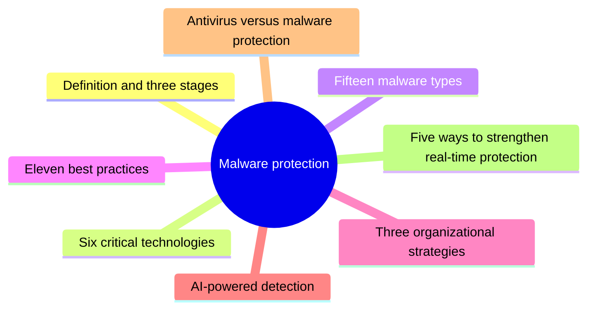
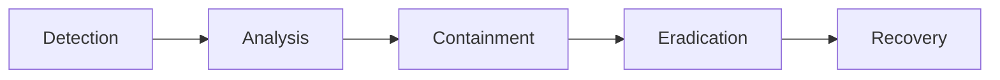

# Unit 9: Malware protection

*Courseware Chapter 9, pages 59–65.*

## At a glance

This unit is about keeping malicious software out, finding it when it gets in, and cleaning up after it. It answers six questions:

- **What is malware protection?** Tools, technologies and practices to **prevent, detect and remove** malicious software. It is a **layered system**, not a single tool, and it works in **three stages**: before a file runs, while it runs, and after it has run.
- **Which technologies does it use?** Six critical ones: **NGAV, EDR, sandboxing, behavioral analysis, threat intelligence integration and XDR**.
- **What are we fighting?** **Fifteen** numbered malware types (sixteen names, because the worm shares the virus's entry): from viruses and worms to fileless, polymorphic and cryptojacking malware.
- **What should every organisation do?** **Eleven** best practices (from careful e-mail handling to the 3-2-1 backup rule), plus **three** organisation-wide strategies (assessments, user education, an incident response plan).
- **Where does AI fit?** Five points on AI-powered detection, including its **limitations**.
- **Is antivirus enough?** No: the courseware's **five-factor table** shows antivirus is one component of malware protection. It ends with **five ways** to strengthen real-time protection.

## What you should be able to do

*The courseware lists no learning outcomes; these are written for this site.*

- Define malware protection, explain why it is a layered system, and describe the three malware protection stages with what happens in each.
- Explain the six critical malware protection technologies and tell NGAV, EDR and XDR apart.
- Define each of the fifteen malware types (including the worm) and distinguish confusable pairs such as virus and worm, Trojan and backdoor, spyware and keylogger.
- **Identify the malware type from a description of its symptoms** and recommend a response, stage by stage.
- State and explain the eleven malware protection best practices, including the 3-2-1 backup rule, and the three organizational strategies, including the five parts of an incident response plan.
- Explain how AI helps (and where it falls short) in malware detection.
- Differentiate antivirus software from malware protection on the courseware's five factors, and state the five ways to strengthen real-time malware protection.

## What malware protection is

Chapter 9 opening · p.59

The chapter opens with a definition and two ideas that run through everything after it: **layering** and **stages**.

> **Malware protection:** Malware protection refers to the tools, technologies, and practices used to prevent, detect, and remove malicious software from systems and networks. It covers threats like viruses, worms, trojans, ransomware, and spyware. Malware protection is not a single tool. It works as a layered system, combining multiple technologies to close gaps that no single solution can cover alone.

> For enterprises, malware protection is a core part of cybersecurity strategy. It safeguards sensitive data, maintains system integrity, and supports business continuity across growing IT environments. Malware protection operates across three stages: before a file runs, while it runs, and after it has run. Each stage plays a distinct role in stopping threats before they cause damage.

!!! note "In plain terms"
    - **Three kinds of means:** *tools* (e.g. antivirus), *technologies* (e.g. machine learning, sandboxing) and *practices* (e.g. backups, training).
    - **Three verbs:** **prevent** (keep it out), **detect** (find it), **remove** (get rid of it). Learn them in that order.
    - **Where:** on *systems* and across *networks*.
    - **Why layered:** every single defence has a gap; several overlapping defences "close gaps that no single solution can cover alone". This is Unit 1's [layering (defense in depth)](unit-1-security-concepts.md#layering) principle applied to malware.
    - **Three benefits for enterprises:** safeguards **sensitive data**, maintains **system integrity**, supports **business continuity**.

    The courseware does not define *malware* itself in this chapter; it is short for **mal**icious soft**ware**, and the opening names five examples (viruses, worms, trojans, ransomware, spyware), the same five that [Unit 3](unit-3-os-security.md#threats-to-operating-systems) lists as the "malware" threat to operating systems.

!!! example "Example"
    A Lagos microfinance bank installs antivirus on every PC (a **tool**), runs a sandbox that opens e-mail attachments before staff see them (a **technology**), and backs up its loan database every night (a **practice**). Antivirus alone would miss a brand-new ransomware strain; the sandbox might catch it; if both fail, the backup still lets the bank **continue business**. That is the layered system.

!!! tip "Exam angle"
    "Define malware protection" is a near-certain 2–4 mark part. Hit four points: **tools, technologies and practices**; **prevent, detect and remove**; **not a single tool, a layered system**; **three stages** (before, while, after a file runs). For "why is malware protection important to enterprises?", give the three benefits.

## The three malware protection stages

Malware Protection Stages · p.59

The "three stages" of the definition are set out as three headed bullets.

> • **Pre-execution detection**
>
> Files and processes are scanned against known threat signatures before they can execute. This stops known malware immediately, before it ever reaches the system. Pre-execution detection remains the fastest and most reliable layer for stopping common, well-documented threats.
>
> • **Runtime detection**
>
> Behavioral analysis and machine learning monitor processes as they run. This catches threats that signatures miss, including fileless malware, polymorphic code, and living-off-the-land attacks that abuse legitimate system tools. Suspicious files may also be tested in an isolated environment to confirm intent before further action is taken.
>
> • **Post-execution response**
>
> If malicious behavior is confirmed, automated response takes over. This includes isolating the endpoint, terminating the process, quarantining the file, and rolling back any changes made to the system. These actions happen without waiting for manual review, which limits how far a threat can spread.
>
> This layered approach reduces the time between detection and containment. It also lowers reliance on manual intervention for every alert, helping security teams contain threats faster and with less operational strain.

{ .diagram }

The three malware protection stages (drawn for this site from the p.59 text; the courseware has no figure here).

| | Pre-execution detection | Runtime detection | Post-execution response |
|---|---|---|---|
| **When** | Before the file runs | While it runs | After it has run (malicious behavior confirmed) |
| **How** | Scan files and processes against **known threat signatures** | **Behavioral analysis and machine learning** monitor processes; isolated testing of suspicious files | **Automated response**, without waiting for manual review |
| **What it stops / does** | **Known** malware, immediately | Threats signatures miss: **fileless malware, polymorphic code, living-off-the-land attacks** | **Isolate** the endpoint, **terminate** the process, **quarantine** the file, **roll back** changes (4 actions) |
| **Strength** | Fastest and most reliable for common, well-documented threats | Catches the unknown and the disguised | Limits how far a threat can spread |
| **Matching technology** *(site mapping)* | Traditional antivirus / NGAV signatures | NGAV, behavioral analysis, sandboxing, EDR | EDR / XDR automated response |

!!! note "In plain terms"
    Think of a university hostel gate. **Pre-execution** is the porter checking faces against a list of known troublemakers: fast and reliable, but useless against a stranger who is not on the list. **Runtime** is the warden watching *behaviour* inside: anyone forcing doors gets noticed, list or no list. **Post-execution** is what happens once someone is caught: lock the block (isolate), remove the person (terminate), hold the stolen goods (quarantine) and repair the damage (roll back).

    A **living-off-the-land** attack is one that "abuse[s] legitimate system tools": the attacker uses programs already on the computer (such as PowerShell) instead of bringing a malicious file, so there is nothing for a signature scanner to match.

    The two benefits of doing all three: **faster** containment, and **less manual work** per alert.

!!! tip "Exam angle"
    "State and explain the three malware protection stages" (6 marks) is the most predictable question in the chapter. For each stage give **when**, **how**, and **what it catches/does**, and learn the **four** automated post-execution actions by heart. A scenario may describe one event ("the file was quarantined and the laptop cut off the network") and ask which stage it shows.

!!! warning "Courseware note"
    Pre-execution detection is said to stop known malware "before it ever reaches the system". Strictly, the file *has* reached the system (it is on disk or in a download) but has not yet **run**; the scan stops it before it can **execute**, as the previous sentence says. Write "before it can execute".

**Check your understanding**

An endpoint tool sees a newly started process encrypting hundreds of documents per minute, although the program matches no known signature. Which stage has caught it?

<ul class="quiz-options">
  <li>Pre-execution detection</li>
  <li data-correct>Runtime detection</li>
  <li>Post-execution response</li>
  <li>Threat intelligence integration</li>
</ul>

The process is **already running** and was flagged by its **behaviour**, not a signature: that is runtime detection ("behavioral analysis and machine learning monitor processes as they run"). Pre-execution detection is the tempting answer for "detection", but it works only *before* execution and only against *known signatures*. What happens next (killing the process, rolling back) would be post-execution response (Malware Protection Stages, p.59).

Which of these is NOT one of the automated actions listed for post-execution response?

<ul class="quiz-options">
  <li>Isolating the endpoint</li>
  <li>Quarantining the file</li>
  <li>Rolling back any changes made to the system</li>
  <li data-correct>Paying the ransom to recover encrypted files</li>
</ul>

The four actions are isolating the endpoint, terminating the process, quarantining the file, and rolling back any changes. Rolling back is what *removes the need* to pay a ransom; paying is never listed (Malware Protection Stages, p.59).

According to the courseware, which stage is "the fastest and most reliable layer for stopping common, well-documented threats"?

<ul class="quiz-options">
  <li data-correct>Pre-execution detection</li>
  <li>Runtime detection</li>
  <li>Post-execution response</li>
  <li>Sandboxing</li>
</ul>

Signature scanning before execution is fast and reliable **for known threats**. Runtime detection is better at *unknown* threats (fileless, polymorphic, living-off-the-land) but is not described as the fastest. Sandboxing is a technology, not a stage (Malware Protection Stages, p.59).

## Critical malware protection technologies

Critical malware protection technologies · pp.59–60

The courseware next names the technologies that make up the layered system.

> Modern malware protection relies on several core technologies working together, not a single tool.

There are six; each is quoted and explained below.

### Next-generation antivirus (NGAV)

Critical malware protection technologies · pp.59–60

> **Next-generation antivirus (NGAV):** NGAV replaces signature-only detection with machine learning and behavioral analysis. This allows it to block zero-day attacks, fileless malware, and ransomware that traditional antivirus often misses.

**Antivirus that judges behaviour, not just names.** Traditional antivirus asks "is this file on my list of known bad files?" NGAV also asks "is this program *acting* like malware?" That is why it can block a **zero-day** attack (one using a flaw or a malware strain nobody has seen yet), **fileless** malware (no file to scan) and new **ransomware**. Note the word "replaces **signature-only**": NGAV does not throw signatures away; it stops relying *only* on them.

### Endpoint detection and response (EDR)

Critical malware protection technologies · p.60

> **Endpoint detection and response (EDR):** EDR continuously monitors endpoint activity and analyzes behavior patterns in real time. It detects advanced threats and supports faster investigation and remediation when an incident occurs.

**A flight recorder plus an alarm for each device.** An *endpoint* is any device at the edge of the network: a laptop, desktop, server or phone. EDR watches it **continuously**, records what happens, and when something bad occurs helps the team **investigate** (what happened, where did it start?) and **remediate** (fix it). NGAV is mainly about *blocking*; EDR adds *detection, investigation and response*.

### Sandboxing

Critical malware protection technologies · p.60

> **Sandboxing:** Sandboxing isolates suspicious files in a separate environment before they can affect the system. This allows security teams to observe file behavior safely and confirm intent before taking action.

**Let it run where it can do no harm, and watch.** A sandbox is a sealed, disposable environment. A suspicious attachment is opened there first; if it starts encrypting files or calling out to a strange server, its **intent is confirmed** without damage to the real system. This is the "isolated environment" of runtime detection, and the same sandboxing that [Unit 3](unit-3-os-security.md#virtualization-and-sandboxing) recommends for running untrusted applications (Unit 1's [isolation](unit-1-security-concepts.md#isolation) principle).

### Behavioral analysis

Critical malware protection technologies · p.60

> **Behavioral analysis:** Behavioral analysis studies patterns in file and process activity to flag anomalies. It identifies threats that bypass signature-based detection, including polymorphic and memory-based malware.

**Normal versus abnormal.** Instead of matching a known fingerprint, it learns what normal file and process activity looks like and **flags anomalies**. A polymorphic virus changes its fingerprint every time, and memory-based (fileless) malware has no file at all, but both still *behave* like malware, so behavioral analysis catches them.

### Threat intelligence integration

Critical malware protection technologies · p.60

> **Threat intelligence integration:** Threat intelligence feeds provide context on emerging attack patterns and indicators of compromise. This helps security teams anticipate threats and respond more effectively across the environment.

**News from the outside world, fed into your tools.** A threat intelligence feed is a constantly updated stream of information about current attacks. **Indicators of compromise (IoCs)** are the clues that a system has been attacked, such as a known malicious IP address, domain name or file hash (the courseware names IoCs but does not define them; this explanation is the site's). Plugging the feed into your tools lets them recognise an attack that hit another organisation yesterday.

### Extended detection and response (XDR)

Critical malware protection technologies · p.60

> **Extended detection and response (XDR):** XDR extends detection and response beyond endpoints to networks and cloud workloads. This gives organizations broader visibility across multi-cloud and hybrid environments.

**EDR, widened.** EDR sees only endpoints; XDR joins endpoint, **network** and **cloud workload** data so that one attack can be followed across all of them. "Multi-cloud" means using several cloud providers; "hybrid" means a mix of on-premises and cloud systems.

### Telling the technologies apart

Critical malware protection technologies · pp.59–60

| Technology | Key words (courseware) | Main job | Works where | Stage it mainly serves *(site mapping)* |
|---|---|---|---|---|
| **NGAV** | replaces signature-only detection with **ML and behavioral analysis**; blocks **zero-day, fileless, ransomware** | Block | Endpoint | Pre-execution and runtime |
| **EDR** | **continuously monitors endpoint** activity in **real time**; faster **investigation and remediation** | Detect, investigate, respond | Endpoint | Runtime and post-execution |
| **Sandboxing** | **isolates** suspicious files in a **separate environment**; **observe** behavior, **confirm intent** | Test safely | Separate environment | Runtime (before trusting a file) |
| **Behavioral analysis** | patterns in file and process activity; **flags anomalies**; catches **polymorphic and memory-based** | Detect the unknown | Files and processes | Runtime |
| **Threat intelligence integration** | feeds on **emerging attack patterns** and **indicators of compromise**; **anticipate** threats | Inform | Across the environment | All three |
| **XDR** | beyond endpoints to **networks and cloud workloads**; **broader visibility**, multi-cloud and hybrid | Detect and respond everywhere | Endpoints, networks, cloud | Runtime and post-execution |

!!! note "In plain terms"
    A memory aid (the site's, not the courseware's): **"Never Ever Skip Basic Threat eXercises"**: **N**GAV, **E**DR, **S**andboxing, **B**ehavioral analysis, **T**hreat intelligence, **X**DR, in the courseware's order.

    The confusable trio: **NGAV** = smarter antivirus (blocks); **EDR** = watch and respond **on endpoints**; **XDR** = EDR **extended** to networks and cloud.

!!! example "Example"
    A Nigerian bank's laptop receives a "salary review" spreadsheet. **Threat intelligence** reports the sender's domain as part of a current campaign; the **sandbox** opens the file and sees it launch PowerShell; **NGAV** blocks the launch on other laptops; **EDR** shows that one laptop had already opened it, and the team traces what it did; **XDR** shows the same malware then tried to reach a cloud storage bucket, and blocks it there too.

!!! tip "Exam angle"
    "List and explain **four** (or six) critical malware protection technologies" is a classic (b) part. Use the **name, one-line definition, and the threat it catches** for each. "Differentiate EDR and XDR" is answered in one line: **scope** (endpoints only vs endpoints, networks and cloud workloads).

**Check your understanding**

A company already has EDR on all laptops but cannot see attacks that move into its cloud workloads and network. Which technology extends detection and response to those areas?

<ul class="quiz-options">
  <li>NGAV</li>
  <li>Sandboxing</li>
  <li data-correct>XDR</li>
  <li>Threat intelligence integration</li>
</ul>

XDR "extends detection and response beyond endpoints to networks and cloud workloads". NGAV is also endpoint-based (a smarter antivirus), so it does not widen the scope. Threat intelligence provides context but is not a detection-and-response platform (Critical malware protection technologies, p.60).

Which technology's courseware description is "isolates suspicious files in a separate environment… to observe file behavior safely and confirm intent before taking action"?

<ul class="quiz-options">
  <li>Behavioral analysis</li>
  <li data-correct>Sandboxing</li>
  <li>EDR</li>
  <li>Pre-execution detection</li>
</ul>

That is sandboxing. Behavioral analysis also looks at behaviour, which makes it the tempting choice, but it studies activity on the real system to flag anomalies; it does not move the file into a separate environment (Critical malware protection technologies, p.60).

What does NGAV do that traditional antivirus does not, according to the courseware?

<ul class="quiz-options">
  <li>It scans files against a larger database of signatures</li>
  <li data-correct>It replaces signature-only detection with machine learning and behavioral analysis</li>
  <li>It filters network traffic at the perimeter</li>
  <li>It restores files from offline backups</li>
</ul>

NGAV "replaces signature-only detection with machine learning and behavioral analysis", which lets it block zero-day attacks, fileless malware and ransomware. A bigger signature database is still signature-only, so it would still miss new threats. Perimeter filtering is a firewall's job ([Unit 5](unit-5-firewalls.md#firewall-versus-antivirus)) (Critical malware protection technologies, pp.59–60).

## Malware types that threaten PC and enterprise systems

Malware Types That Threaten PC and Enterprise Systems · pp.60–61

You cannot defend against what you cannot recognise. The courseware gives the reason first:

> Understanding malware's central role in the threat landscape is essential for developing effective security measures and incident response plans – and this understanding starts with knowing which common types of malware organizations are exposed to:

It then lists **15 numbered items**. Item 1 also defines the **worm**, so there are **16 named types** in all. Each is quoted below with what to remember and a quick example.

### Viruses and worms

Malware Types That Threaten PC and Enterprise Systems · p.60

> **1. Viruses** are one of the first common types of malware. A virus replicates by attaching to files, and spreads when users transfer infected files. Viruses can potentially corrupt files or disrupt systems. Closely related is a **worm**, which can replicate on its own from machine to machine, without the help of a user.

**The difference is the human.** A **virus** needs a *host file* and a *user* to move it (sharing a document on a flash drive, e-mailing it). A **worm** needs neither: it copies itself across the network by itself. Both **replicate**; that is what makes them "closely related". *Example:* a virus-infected project file passed around a cybercafé on a USB stick, versus a worm that sweeps through every unpatched PC on a university LAN overnight.

### Trojan horse

Malware Types That Threaten PC and Enterprise Systems · p.60

> **2. A Trojan Horse** is a type of malware that disguises itself as legitimate software to trick users into installing it, delivering malicious payloads like backdoor access or data theft.

**Deception, not replication.** Named after the wooden horse of Troy: the user *invites it in* because it looks useful (a "free" cracked copy of Microsoft Office, a fake bank app, a game). Its *payload* (what it delivers) may be a **backdoor** or **data theft**. Unlike a virus or worm, a Trojan does not copy itself.

### Ransomware

Malware Types That Threaten PC and Enterprise Systems · p.60

> **3. Ransomware** is malware that encrypts files or locks users out of their systems, demanding a ransom for decryption or access restoration, with non-payment leading to data loss and disruption.

**Your data held hostage.** Two methods: **encrypt the files** or **lock the user out**. Then a demand: pay for the key or for access. Its target is **availability**. The best answer to it is a good offline backup plus post-execution **roll back**, so there is nothing to pay for. *Example:* a hospital's records server shows a note demanding payment in cryptocurrency before files can be opened.

### Spyware

Malware Types That Threaten PC and Enterprise Systems · p.60

> **4. Spyware** is specifically designed to secretly monitor user activity and collect personal information, transmitting it to attackers for purposes like identity theft.

**Three verbs: secretly monitor, collect, transmit.** It attacks **confidentiality** and stays quiet so it can keep watching. Keyloggers and infostealers (below) are specialised relatives.

### Adware

Malware Types That Threaten PC and Enterprise Systems · p.61

> **5. Adware** displays unwanted advertisements, often through pop-ups or browser redirects, and may not have malevolent intentions but can be classified as malware when it becomes disruptive and collects information without authorization.

**Annoying first, malicious when it crosses a line.** Pop-ups and browser redirects alone may not be malicious. Adware **becomes malware** under **two** conditions: when it becomes **disruptive**, and when it **collects information without authorization**. *Example:* a "free PDF converter" that keeps redirecting your browser to betting sites and records the sites you visit.

### Rootkits

Malware Types That Threaten PC and Enterprise Systems · p.61

> **6. Rootkits** provide unauthorized access to a system and hide their presence by modifying system files, making it difficult to detect and enabling system control.

**Access plus invisibility.** A rootkit gives the attacker access and control, and it **hides itself by modifying system files**, so ordinary tools (which ask the operating system what is running) are lied to. [Unit 3](unit-3-os-security.md#threats-to-operating-systems) adds that it grants **administrative** control.

### Botnets

Malware Types That Threaten PC and Enterprise Systems · p.61

> **7. Botnets** are networks of infected computers controlled by a single attacker (bot-herder). They can be used for mass spam campaigns, DDoS attacks, and financial theft. These networks can grow to massive sizes and cause widespread damage.

**Many machines, one master.** Each infected computer is a *bot* (or *zombie*); the controller is the **bot-herder**. Three uses: **mass spam**, **DDoS attacks** and **financial theft**. The DDoS link is Unit 2's [Denial of Service and Distributed Denial of Service](unit-2-attacks.md#denial-of-service-dos-and-distributed-denial-of-service-ddos) attack, which uses exactly such a botnet. *Example:* thousands of infected home routers flood a bank's website during salary week.

### Keyloggers

Malware Types That Threaten PC and Enterprise Systems · p.61

> **8. Keyloggers** record keystrokes to capture sensitive information like passwords and credit card numbers. Sometimes used legitimately by IT administrators, it's also true that cybercriminals often employ them for identity theft, corporate espionage, and financial fraud.

**Records what you type.** Captures **passwords and credit card numbers**. Two things examiners like: it can be **legitimate** (IT administrators), and criminals use it for **three** things: **identity theft, corporate espionage and financial fraud**. MFA limits the damage, because a stolen password alone is not enough.

### Backdoors

Malware Types That Threaten PC and Enterprise Systems · p.61

> **9. Backdoors** provide unauthorized entry points into systems – which in turn enables data exfiltration, installation of other types of malware, and persistent access.

**A secret door left open.** A backdoor *is* the entry point; it enables **three** things: **data exfiltration** (stealing data out), **installing other malware**, and **persistent access** (coming back whenever the attacker likes). A Trojan often *delivers* a backdoor (item 2).

### Mobile malware

Malware Types That Threaten PC and Enterprise Systems · p.61

> **10. Mobile malware** specifically targets smartphones, tablets, and smartwatches; and is a subcategory that includes the known malware types such as worms, bots, and trojans.

**Defined by the target, not the behaviour.** **Three** devices (smartphones, tablets, smartwatches). It is a **subcategory** containing the other types, e.g. **worms, bots and trojans** running on a phone. *Example:* a fake "loan app" outside the official app store that reads the phone's contacts and SMS one-time codes. [Unit 7](unit-7-wireless-mobile.md#what-about-mobile-security) covers mobile security further.

### Fileless malware

Malware Types That Threaten PC and Enterprise Systems · p.61

> **11. Fileless malware** operates entirely in memory without writing files to disk, working through legitimate systems such as PowerShell or WMI. It is a threat vector that is particularly difficult to detect using traditional security measures.

**No file, so nothing to scan.** It lives in **memory** (RAM) and uses tools already on the computer: **PowerShell** (Windows' scripting tool) and **WMI** (Windows Management Instrumentation). Traditional antivirus scans *files*, so it sees nothing. It is caught by **behavioral analysis / runtime detection**, which is why NGAV and EDR matter. This is the "living-off-the-land" idea from the stages section.

### Infostealers

Malware Types That Threaten PC and Enterprise Systems · p.61

> **12. Infostealers** are specialized malware designed to gather specific types of information from infected systems, from login credentials to browser history and cryptocurrency wallets.

**A shopping list of data.** Unlike general spyware, an infostealer goes after **specific** information: **login credentials, browser history, cryptocurrency wallets** (three examples). *Example:* malware hidden in a "free movie" download empties the saved passwords from a student's browser.

### Logic bombs

Malware Types That Threaten PC and Enterprise Systems · p.61

> **13. Logic bombs** execute when specific conditions are met, such as a particular date, time, or system event. Unlike other malware types that activate immediately, logic bombs lie dormant until their trigger conditions occur – which can mean that they are hard to detect, until it is too late.

**Waits for a trigger.** Three trigger examples: a **date**, a **time** or a **system event**. The key contrast: other malware **activates immediately**; a logic bomb **lies dormant**, so it is **hard to detect until it is too late**. *Example:* a contractor plants code in a payroll system that deletes the staff database if his own name is ever removed from the payroll (a system event). This is often an insider threat.

### Cryptojacking

Malware Types That Threaten PC and Enterprise Systems · p.61

> **14 Cryptojacking** malware hijacks a system's computing resources to mine cryptocurrency without the user's knowledge or consent, resulting in severely degraded system performance, overheating, increased electricity consumption, and shortened hardware lifespan.

**Steals your computing power, not your data.** It mines cryptocurrency for the attacker "without the user's knowledge or consent". Its **four** effects are the symptoms to look for: **severely degraded performance, overheating, increased electricity consumption, shortened hardware lifespan**. *Example:* a university lab's PCs run hot and slow all day, and the fans never stop, though nobody is using them.

### Polymorphic malware

Malware Types That Threaten PC and Enterprise Systems · p.61

> **15.** Finally, **polymorphic malware** continuously changes its code structure and signature to evade detection by traditional antivirus software. This type of malware uses encryption engines and code mutation engines to generate new variations of itself which makes it much harder to detect or defend against.

**A shape-shifter.** "Poly-morphic" = many shapes. It **changes its code structure and signature** every time, using **two** engines: **encryption engines** and **code mutation engines**. Each copy looks new to a signature scanner, so it evades **traditional antivirus**; behavioral analysis catches it because its *behaviour* stays the same.

!!! warning "Courseware note"
    - The list is numbered 1–15 but names **16** types, because the **worm** is defined inside item 1 ("Closely related is a worm…"). If asked "how many types", say "fifteen numbered types (sixteen including the worm)", and list the worm separately.
    - Item 14 is printed "14 Cryptojacking" without the full stop; item 15 starts "Finally,". Both are layout slips.
    - **Mobile malware** (item 10) is grouped by the **device it targets**, not by what it does, so it overlaps the other types (the courseware itself says it "includes… worms, bots, and trojans").
    - Fileless malware works "through legitimate **systems** such as PowerShell or WMI": PowerShell and WMI are **tools** (programs) built into Windows, not whole systems. Write "legitimate system tools", as the stages section does.

### Grouping the sixteen types

Malware Types That Threaten PC and Enterprise Systems · pp.60–61

Sixteen separate definitions are hard to hold in memory. Grouping them by what they mainly do makes them easier to recall and to recognise in a scenario.

{ .diagram }

The sixteen malware types of Chapter 9, grouped by what they mainly do. The grouping is drawn for this site; the courseware simply numbers them 1–15.

!!! note "In plain terms"
    A memory aid for the courseware's order (the site's, not the courseware's): **"Very Wise Teachers Read Slowly; All Readers Bring Keen Brains; Many Find Interesting Lessons Coming Promptly"**: **V**irus, **W**orm, **T**rojan, **R**ansomware, **S**pyware, **A**dware, **R**ootkit, **B**otnet, **K**eylogger, **B**ackdoor, **M**obile, **F**ileless, **I**nfostealer, **L**ogic bomb, **C**ryptojacking, **P**olymorphic.

### Telling similar malware types apart

Malware Types That Threaten PC and Enterprise Systems · pp.60–61

These pairs are the likely "differentiate" questions. The deciding point comes from the courseware's wording.

| Pair | First | Second | The one-line difference |
|---|---|---|---|
| **Virus vs worm** | Replicates by **attaching to files**; spreads when **users transfer** infected files | Replicates **on its own** from machine to machine, **without the help of a user** | Does it need a user (and a host file) to spread? |
| **Trojan horse vs virus** | **Disguises itself as legitimate software** to trick users into installing it | **Replicates** by attaching to files | Deception versus self-copying |
| **Trojan horse vs backdoor** | The **disguised delivery vehicle**; its payload may be backdoor access | The **unauthorized entry point** itself | A Trojan is *how* it gets in; a backdoor is *what* it leaves behind |
| **Rootkit vs backdoor** | Unauthorized access **and hides its presence** by modifying system files | Unauthorized **entry point**; enables exfiltration, more malware, persistent access | The rootkit's defining feature is **hiding** |
| **Spyware vs keylogger vs infostealer** | Spyware: **secretly monitors activity**, collects personal information | Keylogger: records **keystrokes** (passwords, card numbers). Infostealer: gathers **specific** information (credentials, browser history, crypto wallets) | General watching; typing only; a targeted shopping list |
| **Spyware vs adware** | Designed to **secretly** monitor and transmit information | **Displays unwanted ads**; may not be malevolent; malware when disruptive or collecting data without authorization | Adware is visible and may be harmless; spyware is hidden and always malicious |
| **Ransomware vs cryptojacking** | **Encrypts files or locks users out**; **demands a ransom** | **Hijacks computing resources** to **mine cryptocurrency**, without knowledge or consent | Ransomware wants you to *know* (to pay); cryptojacking wants you *not* to know |
| **Fileless vs polymorphic** | Runs **entirely in memory**, no files on disk, via PowerShell or WMI | **Changes its code structure and signature** using encryption and code mutation engines | No file to scan versus a file whose fingerprint keeps changing |
| **Logic bomb vs other malware** | **Lies dormant** until a date, time or system event | Other types **activate immediately** | Delayed trigger |
| **Botnet vs worm** | A **network of infected computers** controlled by a **bot-herder** | Self-replicating malware | A worm can *build* a botnet; the botnet is the controlled network |

### Identifying malware from its symptoms

Malware Types That Threaten PC and Enterprise Systems · pp.60–61

Scenario questions describe what users *see* and ask you to name the malware and the response. This table is a site synthesis built from the courseware definitions; the "first response" column draws on the stages and best practices later in this unit.

| Symptom described in the scenario *(site synthesis)* | Most likely type | Clue in the courseware definition | First response *(site synthesis from this chapter)* |
|---|---|---|---|
| Files renamed and unreadable; a note demands payment | **Ransomware** | "encrypts files or locks users out… demanding a ransom" | Isolate the endpoint; restore from the offline 3-2-1 backup; roll back |
| PCs slow, hot and noisy; electricity bill up; CPU always busy | **Cryptojacking** | "degraded system performance, overheating, increased electricity consumption" | Terminate the process; DNS filtering of mining pools; patch the entry point |
| Infection spreads to every PC on the LAN overnight, nobody opened anything | **Worm** | "replicate on its own… without the help of a user" | Isolate and segment the network; patch; EDR/XDR to trace spread |
| Infection follows a shared file or USB stick from PC to PC | **Virus** | "attaching to files… spreads when users transfer infected files" | Scan and quarantine; antivirus with real-time protection; user education |
| A free app or "crack" was installed, and soon after data started leaving | **Trojan horse** (often with a **backdoor**) | "disguises itself as legitimate software… backdoor access or data theft" | Remove the program; check for a backdoor; train users on downloads |
| Accounts taken over shortly after users typed passwords on a shared PC | **Keylogger** | "record keystrokes… passwords and credit card numbers" | Reset passwords from a clean device; enable MFA |
| Saved browser passwords, history and crypto wallet emptied | **Infostealer** | "login credentials… browser history and cryptocurrency wallets" | Reset credentials; MFA; endpoint protection |
| Pop-ups and browser redirects to unwanted sites | **Adware** | "pop-ups or browser redirects" | Remove it; check whether it collected data (then it is malware) |
| Security tools show nothing, yet the attacker clearly has admin control | **Rootkit** | "hide their presence by modifying system files" | Rebuild from a trusted image; behavioral/EDR tools, not the infected OS's own view |
| Damage happens on one specific date or after a staff exit, nothing before | **Logic bomb** | "lie dormant until their trigger conditions occur" | Code review; insider-threat checks; restore from backup |
| Antivirus finds nothing, but PowerShell is running odd commands in memory | **Fileless malware** | "operates entirely in memory… PowerShell or WMI" | Runtime behavioral detection, EDR, NGAV |
| Antivirus keeps finding "new" variants of the same thing every day | **Polymorphic malware** | "continuously changes its code structure and signature" | Behavioral analysis and NGAV rather than signatures alone |
| Your servers are among thousands sending spam or flooding a website | **Botnet** (your machines are bots) | "networks of infected computers controlled by a single attacker" | Find and clean the bots; block command-and-control with DNS security |

!!! tip "Exam angle"
    In an "identify the malware" scenario, **quote the symptom and the matching words of the definition**, then recommend a response by **stage** (detect, contain, recover) and say **why another type is wrong**: "it is cryptojacking, not ransomware, because no ransom is demanded and files are not encrypted; the only symptoms are degraded performance and overheating".

!!! example "Example"
    Staff at a Port Harcourt engineering firm report that their PCs have become very slow and hot since a "free CAD plugin" was installed; no files are missing and there is no ransom note. The plugin was a **Trojan horse** (disguised as legitimate software) whose **payload** is **cryptojacking** malware. Response: terminate the mining process and quarantine the plugin (post-execution response), block the mining domains with DNS filtering, and teach staff to download only from trusted sources.

**Check your understanding**

Malware spreads from computer to computer across a company network during the night, while no one is logged in or opening files. Which type best fits?

<ul class="quiz-options">
  <li>Virus</li>
  <li data-correct>Worm</li>
  <li>Trojan horse</li>
  <li>Logic bomb</li>
</ul>

A worm "can replicate on its own from machine to machine, without the help of a user". A virus is the tempting answer, but it "spreads when users transfer infected files", and here no user does anything. A Trojan needs the user to install it; a logic bomb waits for a trigger and does not spread (Malware types, p.60).

Which malware type does the courseware describe as sometimes "used legitimately by IT administrators"?

<ul class="quiz-options">
  <li>Adware</li>
  <li>Rootkits</li>
  <li data-correct>Keyloggers</li>
  <li>Backdoors</li>
</ul>

Keyloggers are "sometimes used legitimately by IT administrators", although cybercriminals use them for identity theft, corporate espionage and financial fraud. Adware is described as possibly "not hav[ing] malevolent intentions", which makes it tempting, but the "legitimate use by IT administrators" wording belongs to keyloggers (Malware types, p.61).

Why is polymorphic malware hard for traditional antivirus to detect?

<ul class="quiz-options">
  <li>It runs entirely in memory without writing files to disk</li>
  <li>It lies dormant until a particular date</li>
  <li data-correct>It uses encryption and code mutation engines to keep changing its code structure and signature</li>
  <li>It hides by modifying system files</li>
</ul>

Polymorphic malware "continuously changes its code structure and signature" using "encryption engines and code mutation engines", so no fixed signature matches it. Running in memory describes **fileless** malware; dormancy describes a **logic bomb**; hiding by modifying system files describes a **rootkit** (Malware types, p.61).

## Malware protection best practices

Malware Protection Best Practices · pp.61–62

After the threats, the defences. The courseware starts with simple, well-known steps.

> A range of relatively simple actions will go a long way to protect an organization against common malware, and against most threat actors. The following steps are all well-known cybersecurity good practice, and should be where an organization starts to build malware defenses:
>
> • **Email attachment and downloads:** Teach users to be careful when opening email attachments or clicking links, especially from unknown senders – and where emails are not expected. Make sure users know to always verify the sender's address and scrutinize the content for anything suspicious.
>
> • **Use antivirus software:** Always install reputable antivirus and anti-malware software on all endpoints (computers, laptops, smartphones, tablets) and keep it updated. Schedule regular scans and enable real-time protection to proactively detect and prevent malware infections.
>
> • **Regularly update systems:** Both endpoint and server operating systems should be regularly patched, while all apps, browsers and the like must be patched with the latest security updates to fix vulnerabilities that malware can exploit. Automatic updates are often the way to go, if the underlying system supports it.
>
> • **Strong passwords and MFA:** Employ strong, unique passwords for all accounts and enable multi-factor authentication (MFA) whenever possible. MFA adds an extra layer of security by requiring additional verification, such as a code sent to a phone.
>
> • **Implement data backups:** Regularly back up critical data to a secure, offline location (external hard drive, cloud storage) to enable recovery in case of a malware attack. Follow the 3-2-1 backup rule: 3 copies of data, on 2 different media, with 1 copy offsite.
>
> • **Network security measures:** Utilize firewalls to control network traffic and apply intrusion detection/prevention systems to monitor for and to block malicious activity. Regularly monitor network traffic for suspicious activity and anomalies, and apply network segmentation to slow the lateral spread of malware.
>
> • **Email security:** Deploy email security gateways that filter phishing attempts, malicious attachments, and spoofed senders before messages reach the inbox. This blocks one of the most common entry points for malware.
>
> • **DNS security:** Use DNS filtering to block access to known malicious domains and command-and-control servers. This stops malware from communicating with attackers, even if it reaches an endpoint.
>
> • **AI detection:** Apply AI-driven detection to identify unusual patterns in file behavior and network activity. This catches threats that traditional, signature-based tools often miss.
>
> • **Endpoint protection:** Deploy endpoint protection platforms across all devices to prevent, detect, and respond to malware at the point of entry. This reduces the attack surface across the organization.
>
> • **Cloud workload protection:** Secure cloud workloads with dedicated protection tools that monitor for misconfigurations, unauthorized access, and malware targeting cloud infrastructure. This closes gaps traditional endpoint tools do not cover.

There are **eleven** practices (the courseware does not number or count them; the count is ours).

| # | Practice | Key words to quote | Malware it mainly counters *(site mapping)* |
|---|---|---|---|
| 1 | **Email attachment and downloads** | **teach users**; unknown senders; unexpected e-mails; **verify the sender's address** | Trojans, viruses, ransomware delivered by phishing |
| 2 | **Use antivirus software** | **reputable** antivirus and anti-malware on **all endpoints** (computers, laptops, smartphones, tablets); **keep it updated**; **regular scans**; **real-time protection** | Known viruses, worms, Trojans |
| 3 | **Regularly update systems** | patch **endpoint and server OS**, apps, browsers; fix vulnerabilities malware can exploit; **automatic updates** | Worms and anything exploiting known flaws |
| 4 | **Strong passwords and MFA** | **strong, unique** passwords; **MFA** = extra layer, e.g. **a code sent to a phone** | Keyloggers, infostealers (stolen passwords are not enough) |
| 5 | **Implement data backups** | **secure, offline** location; recovery after an attack; **3-2-1 rule** | Ransomware, logic bombs (anything that destroys data) |
| 6 | **Network security measures** | **firewalls** control traffic; **IDPS** monitor and block; **monitor traffic** for anomalies; **network segmentation** slows **lateral spread** | Worms, botnets, spreading ransomware |
| 7 | **Email security** | **email security gateways** filter **phishing, malicious attachments, spoofed senders** **before the inbox** | Phishing-delivered malware |
| 8 | **DNS security** | **DNS filtering** blocks **malicious domains** and **command-and-control servers**; stops malware **communicating with attackers** | Botnets, infostealers, ransomware calling home |
| 9 | **AI detection** | **AI-driven** detection of unusual patterns in **file behavior and network activity**; catches what **signature-based** tools miss | Fileless, polymorphic, zero-day |
| 10 | **Endpoint protection** | **endpoint protection platforms** on **all devices**; prevent, detect, respond **at the point of entry**; **reduces the attack surface** | Everything arriving on devices |
| 11 | **Cloud workload protection** | dedicated tools monitor **misconfigurations, unauthorized access, malware** in cloud infrastructure; closes gaps endpoint tools miss | Malware targeting cloud workloads; cryptojacking in the cloud |

!!! note "In plain terms"
    Three groups make the eleven easier to recall (the grouping is the site's):

    - **People and accounts (2):** e-mail attachment and downloads (training); strong passwords and MFA.
    - **Devices (4):** antivirus software; regular updates; endpoint protection; AI detection.
    - **Network, data and cloud (5):** network security measures; e-mail security; DNS security; data backups; cloud workload protection.

    **The 3-2-1 backup rule:** keep **3** copies of the data (the original plus two backups), on **2** different kinds of media (e.g. the server's disk and an external hard drive), with **1** copy **offsite** (e.g. in another branch or a cloud service). If ransomware encrypts the server and the external drive in the office, the offsite copy survives.

    **Two e-mail practices, two different defences:** "Email attachment and downloads" trains the **user**; "Email security" deploys a **gateway** that filters messages before the user ever sees them. **Lateral spread** is malware moving sideways from one infected machine to others on the same network; **segmentation** splits the network into walled sections so it cannot.

!!! example "Example"
    A Nigerian state university applies the 3-2-1 rule to its student-records database: copy 1 on the main server, copy 2 on a NAS (network storage box) in the ICT centre, copy 3 encrypted and uploaded each night to a cloud provider (offsite). When ransomware encrypts the server **and** the NAS, which is mapped as a network drive, the cloud copy is restored. The lesson: a backup that the infected machine can write to is not **offline**.

!!! tip "Exam angle"
    "State and explain **five** (or eight) malware protection best practices" is a likely (b) part; name each and give its key action in one sentence. "Explain the 3-2-1 backup rule" is a short, easily scored part: **3 copies, 2 different media, 1 offsite**. Several practices link to other units: firewalls and IDPS ([Unit 5](unit-5-firewalls.md#what-a-firewall-does-inbound-and-outbound-protection), [Unit 12](unit-12-idps.md#what-an-idps-is-used-for)), patching and backups ([Unit 3](unit-3-os-security.md#regular-updates-and-patching), [backup and recovery](unit-3-os-security.md#backup-and-recovery)), MFA ([Unit 3](unit-3-os-security.md#strong-authentication), [Unit 8](unit-8-access-control.md#best-practices-for-access-control-implementation)), and "malicious code protections" as a policy component ([Unit 6](unit-6-security-policy.md#components-of-an-information-security-policy)).

!!! warning "Courseware note"
    The backup practice says "a secure, **offline** location (external hard drive, **cloud storage**)". Cloud storage is normally **online**: if it is permanently synced, ransomware can encrypt the cloud copy too. Read "offline" as **separated from the systems that could be infected** (disconnected, or protected so the infected machine cannot overwrite it); the 3-2-1 rule's **offsite** copy is what cloud storage provides.

**Check your understanding**

What does the courseware's 3-2-1 backup rule require?

<ul class="quiz-options">
  <li>3 backups a day, kept for 2 weeks, with 1 tested restore</li>
  <li data-correct>3 copies of data, on 2 different media, with 1 copy offsite</li>
  <li>3 media types, 2 offsite copies, 1 online copy</li>
  <li>3 administrators, 2 passwords, 1 backup server</li>
</ul>

"Follow the 3-2-1 backup rule: 3 copies of data, on 2 different media, with 1 copy offsite." The offsite copy is what survives an attack that reaches everything in the building (Best practices, p.62).

A piece of malware has already reached an endpoint, but it cannot contact its command-and-control server because the domain is blocked. Which best practice is at work?

<ul class="quiz-options">
  <li>Email security</li>
  <li data-correct>DNS security</li>
  <li>Cloud workload protection</li>
  <li>Use antivirus software</li>
</ul>

DNS filtering blocks "known malicious domains and command-and-control servers", which "stops malware from communicating with attackers, **even if it reaches an endpoint**". Email security is tempting but it works *before* the message reaches the inbox, not after the malware is on the device (Best practices, p.62).

Which practice does the courseware say slows "the lateral spread of malware"?

<ul class="quiz-options">
  <li>Regularly updating systems</li>
  <li>Strong passwords and MFA</li>
  <li data-correct>Network segmentation, under network security measures</li>
  <li>Endpoint protection platforms</li>
</ul>

Under network security measures: "apply network segmentation to slow the lateral spread of malware". Endpoint protection "reduces the attack surface" at the point of entry, which is about getting in, not spreading sideways once inside (Best practices, p.62).

## Organizational malware strategies

Organizational Malware Strategies · pp.62–63

Technical practices are not enough on their own. The courseware adds three organisation-wide strategies.

> Getting as close as possible to 100% tight protection against malware threats means a broad, organization-wide approach. That includes user training and awareness, plus incident response planning if things do go wrong:
>
> • **Regular security assessments:** Schedule periodic vulnerability assessments and penetration testing by qualified security professionals. Include both automated scanning and manual testing, covering external and internal systems, web applications, and cloud infrastructure. Document and track remediation efforts.
>
> • **Educate users:** Train users on cybersecurity best practices, including recognizing phishing attempts, identifying suspicious links, understanding the importance of strong passwords and regular updates, and practicing safe browsing habits. That includes clear guidelines on how to report potential security incidents.
>
> • **Incident response plan:** Create detailed incident response procedures. This must cover detection, analysis, containment, eradication, and recovery. Define roles and responsibilities – and make sure the communication protocols are clear. It's worth conducting a tabletop exercise to test and refine the plan.
>
> With essential anti-malware practices in place, alongside advanced methods and an organization geared to guard against malware, organizations can rest assured that they've done the maximum to reduce malware risk.

The five things an incident response plan must cover, in the courseware's order (drawn for this site).

| Strategy | What it involves (courseware) | Why it matters *(site explanation)* |
|---|---|---|
| **Regular security assessments** | **Periodic vulnerability assessments and penetration testing** by **qualified professionals**; **automated scanning and manual testing**; **external and internal** systems, **web applications, cloud infrastructure**; **document and track remediation** | Finds the weaknesses malware would use before attackers do |
| **Educate users** | Recognise **phishing**, identify **suspicious links**, importance of **strong passwords and regular updates**, **safe browsing**; clear guidelines on **how to report** incidents | Users are the most common entry point; early reports shorten an attack |
| **Incident response plan** | Detailed procedures covering **detection, analysis, containment, eradication, recovery**; **roles and responsibilities**; clear **communication protocols**; test with a **tabletop exercise** | When prevention fails, everyone knows what to do |

!!! note "In plain terms"
    - **Vulnerability assessment vs penetration testing:** an assessment *finds and lists* weaknesses (often by automated scanning); a penetration test *tries to exploit* them, as a real attacker would, to prove what damage is possible. The courseware wants **both**, done by **qualified** people.
    - **The five incident response phases:** **detect** (notice it), **analyse** (what is it, how far has it gone?), **contain** (stop it spreading: isolate machines), **eradicate** (remove the malware and its entry point), **recover** (restore systems and data, return to normal).
    - **Tabletop exercise:** the response team sits around a table and talks through a pretend incident ("it is Monday, 8 a.m., the finance server shows a ransom note…") to find gaps in the plan, without touching real systems.

!!! example "Example"
    A federal ministry's ICT department holds a tabletop exercise on a ransomware scenario. They discover that nobody knows who may order the e-mail server shut down (a **roles and responsibilities** gap) and that the plan lists only office phone numbers, which would be unusable if the phone system is down (a **communication protocols** gap). Both are fixed before a real incident.

!!! tip "Exam angle"
    "List the **five** things an incident response plan must cover" is a quick, high-value recall part: **detection, analysis, containment, eradication, recovery**. Add **roles and responsibilities**, **communication protocols** and the **tabletop exercise** for full marks on "explain". Unit 1's [Incident Response practice](unit-1-security-concepts.md#essential-security-practices) and [Unit 12](unit-12-idps.md#how-an-ips-responds-three-groups-of-response-techniques) connect here.

!!! warning "Courseware note"
    Two phrases overstate what is possible: "getting as close as possible to **100% tight protection**" and "organizations can **rest assured** that they've done the **maximum**". No set of measures removes malware risk completely; the chapter's own conclusion says "no single tool offers complete protection" and that protection "requires ongoing evaluation". In an answer, say these strategies **greatly reduce** malware risk.

!!! info "Beyond the notes"
    The courseware's five phases are a compressed version of the standard NIST incident-handling life cycle (SP 800-61), which adds **preparation** before detection and **post-incident activity** (lessons learned) after recovery. For the exam, give the courseware's five.

**Check your understanding**

Which list gives the five things an incident response plan must cover, in the courseware's order?

<ul class="quiz-options">
  <li>Preparation, detection, containment, recovery, lessons learned</li>
  <li data-correct>Detection, analysis, containment, eradication, recovery</li>
  <li>Identification, authentication, authorization, accounting, auditing</li>
  <li>Prevention, detection, removal, backup, reporting</li>
</ul>

The plan "must cover detection, analysis, containment, eradication, and recovery". The first option is close to the fuller NIST life cycle (see the Beyond box), which is the tempting distractor, but it is not the courseware's list (Organizational Malware Strategies, p.63).

Under "Regular security assessments", the courseware asks for which combination?

<ul class="quiz-options">
  <li>Automated scanning only, of internet-facing systems</li>
  <li>Manual testing by staff, once, before a system goes live</li>
  <li data-correct>Periodic vulnerability assessments and penetration testing, both automated and manual, of external and internal systems, web applications and cloud infrastructure</li>
  <li>An annual tabletop exercise</li>
</ul>

The strategy calls for **periodic** assessments and penetration testing by **qualified** professionals, **both automated and manual**, covering **external and internal** systems, web apps and cloud, with remediation documented and tracked. The tabletop exercise belongs to the incident response plan (Organizational Malware Strategies, p.62).

## AI-powered malware detection and prevention

AI-powered malware detection and prevention · p.63

The courseware then explains where artificial intelligence (AI) fits.

> AI has changed how malware is detected and stopped. Instead of relying only on signature matching, AI-driven tools analyze behavior, code structure, and network activity to catch threats signatures alone would miss.
>
> • **Behavioral detection:** AI models flag suspicious actions, such as a program encrypting large numbers of files or disabling security services, rather than matching a known signature. This is critical against fileless and polymorphic malware, which leaves no fixed signature to detect.
>
> • **EDR-driven analysis:** Endpoint detection and response tools use machine learning to correlate endpoint activity in real time. This helps security teams trace an attack from initial entry to full scope, rather than just blocking a single file.
>
> • **UEBA and anomaly detection:** User and entity behavior analytics establish a baseline of normal activity, then flag deviations, such as an account suddenly accessing data it never has before. This catches threats even when no malware signature exists.
>
> • **Speed and scale:** AI systems can analyze large volumes of files and traffic far faster than manual review, reducing the time between detection and containment.
>
> • **Limitations:** Attackers also use AI to generate new malware variants and evade detection. This makes continuous model updates and human oversight necessary, not optional.

| Point | What AI does | Example in the courseware | Threat it helps against |
|---|---|---|---|
| **Behavioral detection** | Flags **suspicious actions** instead of matching a signature | A program **encrypting large numbers of files** or **disabling security services** | **Fileless and polymorphic** malware |
| **EDR-driven analysis** | **Machine learning** correlates endpoint activity **in real time** | Tracing an attack **from initial entry to full scope** | Multi-step attacks, not just one file |
| **UEBA and anomaly detection** | Builds a **baseline of normal** activity, flags **deviations** | An account **suddenly accessing data it never has before** | Threats with **no malware signature** (e.g. a stolen account) |
| **Speed and scale** | Analyses large volumes **far faster than manual review** | (none given) | Shortens time from **detection to containment** |
| **Limitations** | Attackers **also use AI** to make new variants and evade detection | (none given) | Requires **continuous model updates** and **human oversight** |

!!! note "In plain terms"
    AI looks at three things: **behavior**, **code structure** and **network activity**. Four points are benefits; the fifth is the catch. **UEBA** (User and Entity Behavior Analytics) is the "this is not like you" detector: your bank notices when your card is suddenly used in another country at 3 a.m. "Entity" means non-human things too, such as servers and devices. The limitation matters: AI is an arms race, so **people must stay in charge** and models must keep learning.

!!! example "Example"
    At a Lagos fintech, the UEBA system flags that a customer-support account, which normally opens about 40 customer records a day, has opened 12,000 records since midnight. There is no malware signature at all: the account's password had been stolen by an infostealer. The analyst confirms it, disables the account, and the EDR shows the infostealer's entry point on the support agent's laptop.

!!! tip "Exam angle"
    "Explain how AI has changed malware detection" can be answered with the intro sentence (behavior, code structure, network activity instead of signatures only) plus the five points. Always include the **limitation**: an answer that presents AI as perfect misses a mark. AI detection also appears as the 9th best practice; the two sections support each other.

**Check your understanding**

An account that has never touched the payroll database suddenly downloads all of it at night. No malware is found. Which AI capability is designed to catch this?

<ul class="quiz-options">
  <li>Pre-execution signature scanning</li>
  <li data-correct>UEBA and anomaly detection</li>
  <li>Polymorphic code mutation</li>
  <li>Speed and scale</li>
</ul>

UEBA establishes "a baseline of normal activity, then flag[s] deviations, such as an account suddenly accessing data it never has before", catching threats "even when no malware signature exists". Signature scanning needs a known signature, which is absent here; speed and scale is a general benefit, not a detection method (AI-powered detection, p.63).

According to the courseware, why are continuous model updates and human oversight "necessary, not optional"?

<ul class="quiz-options">
  <li>Because AI cannot analyze network traffic</li>
  <li data-correct>Because attackers also use AI to generate new malware variants and evade detection</li>
  <li>Because AI is slower than manual review</li>
  <li>Because signature databases must be updated by hand</li>
</ul>

That is the stated limitation: "Attackers also use AI to generate new malware variants and evade detection." The other options contradict the courseware: AI analyses traffic and is "far faster than manual review" (AI-powered detection, p.63).

## Malware protection versus antivirus

Malware protection vs antivirus · pp.63–64

The courseware warns against a very common mix-up and sets out the difference in its only table.

> The terms are often used interchangeably, but they are not the same. Antivirus software is one component within a broader malware protection strategy, not a replacement for it.

> | Factor | Antivirus Software | Malware Protection |
> |---|---|---|
> | **Primary goal** | Detects and removes known viruses and a limited range of malware | Prevents, detects, and responds to a wide range of threats, including ransomware and file-less malware |
> | **Detection method** | Relies mainly on signature-based detection | Combines signature-based detection, behavioral analysis, machine learning, and threat intelligence |
> | **Scope** | Focuses on files on a single device | Covers endpoints, networks, cloud environments, and user behavior |
> | **Capabilities** | Basic scanning and quarantine | Includes EDR, sandboxing, network traffic analysis, and incident response |
> | **Response to new threats** | Struggles against zero-day and fileless malware | Detects and contains threats that bypass signature-based tools |

> Antivirus remains a necessary layer, but it cannot stop threats designed to evade signature detection. Malware protection closes that gap through layered, behavior-based defense across the entire environment.

{ .diagram }

Antivirus as one component inside malware protection (drawn for this site from the p.64 table; the layout is the site's).

!!! note "In plain terms"
    Antivirus is **one player**; malware protection is **the whole team**. Learn the five factors with "**G**ood **D**efence **S**tarts **C**arefully, **R**eally" (the site's memory aid): **G**oal, **D**etection method, **S**cope, **C**apabilities, **R**esponse to new threats. In each row, antivirus is the *narrow, signature-based, single-device* version, and malware protection is the *broad, behaviour-based, environment-wide* version. Neither replaces the other: antivirus "remains a necessary layer".

**Three tools students confuse.** [Unit 5](unit-5-firewalls.md#firewall-versus-antivirus) compares firewalls and antivirus; this table compares antivirus and malware protection. Together:

| *(site summary)* | Firewall (Unit 5) | Antivirus software | Malware protection |
|---|---|---|---|
| **Focus** | Controlling network traffic, preventing unauthorized access | Known viruses and a limited range of malware | A wide range of threats, including ransomware and fileless malware |
| **Where** | Mainly network level | Files on a single device (endpoint) | Endpoints, networks, cloud, user behavior |
| **How** | Monitors traffic, blocks malicious data before it enters | Signature-based scanning and quarantine | Signatures + behavioral analysis + ML + threat intelligence; EDR, sandboxing, incident response |
| **Relationship** | One layer | One layer (a component of malware protection) | The layered strategy that contains both |

!!! example "Example"
    A Kaduna logistics company says "we are protected; every PC has antivirus". An attacker sends fileless malware through a PowerShell script in a phishing e-mail. There is no file, so the antivirus (signature-based, single device) sees nothing. A malware protection strategy would have stopped it at several points: the **e-mail gateway**, **behavioral detection** of the odd PowerShell activity, **EDR** to trace it, and the **incident response plan** to contain it.

!!! tip "Exam angle"
    "Differentiate between antivirus software and malware protection" is the chapter's most likely (c) part, worth 5–10 marks: **one mark-earning row per factor** (five factors), plus the relationship sentence ("antivirus is **one component** within a broader malware protection strategy, not a replacement for it") and the conclusion ("antivirus remains a **necessary layer**"). Draw it as a table.

!!! warning "Courseware note"
    The table writes "**file-less** malware"; the rest of the chapter writes "**fileless**". They mean the same thing. The table is unnumbered and uncaptioned.

**Check your understanding**

In the courseware's table, which entry describes the <em>scope</em> of antivirus software?

<ul class="quiz-options">
  <li>Covers endpoints, networks, cloud environments, and user behavior</li>
  <li data-correct>Focuses on files on a single device</li>
  <li>Basic scanning and quarantine</li>
  <li>Relies mainly on signature-based detection</li>
</ul>

Scope of antivirus: "Focuses on files on a single device". The first option is malware protection's scope; "basic scanning and quarantine" is antivirus's **capabilities** row and "signature-based detection" its **detection method** row: right column, wrong row (Malware protection vs antivirus, p.64).

Which statement matches the courseware's conclusion on antivirus?

<ul class="quiz-options">
  <li>Antivirus is obsolete and should be replaced by malware protection</li>
  <li>Antivirus and malware protection are the same thing</li>
  <li data-correct>Antivirus remains a necessary layer, but it cannot stop threats designed to evade signature detection</li>
  <li>Antivirus is better than malware protection against zero-day threats</li>
</ul>

"Antivirus remains a necessary layer, but it cannot stop threats designed to evade signature detection." It is a component of malware protection, not obsolete and not identical. The table says antivirus "struggles against zero-day and fileless malware" (Malware protection vs antivirus, pp.63–64).

## Five ways to strengthen real-time malware protection

5 ways to strengthen real-time malware protection · pp.64–65

The courseware closes with five ways to make *real-time* protection (protection while attacks are happening) stronger.

> **Enable continuous, behavior-based monitoring:** Real-time protection depends on constant visibility, not periodic scans. Monitor endpoint activity continuously to catch threats as they emerge, rather than after damage occurs.
>
> **Deploy layered detection across the network:** Combine signature-based tools with behavioral analysis and network traffic inspection. This closes gaps that any single detection method leaves open.
>
> **Automate containment and response:** Configure systems to isolate infected endpoints and quarantine malicious files automatically. This reduces dwell time and limits how far a threat can spread before a human responds.
>
> **Strengthen visibility and governance around AI use:** As employees adopt AI tools and agents, unmanaged AI use becomes a new entry point for data exposure. Fortinet addressed this directly, expanding FortiEndpoint with AI visibility and governance, letting security teams identify sanctioned and unsanctioned AI applications, detect shadow AI, and apply native data loss prevention to sensitive information shared with AI tools.
>
> **Apply risk-based access control:** Continuously assess endpoint health and compliance, then adjust access dynamically based on real-time risk. Endpoints that fall out of compliance should lose access automatically, not after manual review.

| # | Way | Key words | Links to *(site mapping)* |
|---|---|---|---|
| 1 | **Continuous, behavior-based monitoring** | **constant visibility, not periodic scans**; catch threats **as they emerge** | Runtime detection; EDR |
| 2 | **Layered detection across the network** | **signature-based + behavioral analysis + network traffic inspection**; closes gaps of any **single** method | The layered system of the definition |
| 3 | **Automate containment and response** | **isolate** endpoints, **quarantine** files **automatically**; reduces **dwell time** | Post-execution response |
| 4 | **Visibility and governance around AI use** | unmanaged AI use = **new entry point for data exposure**; identify **sanctioned and unsanctioned** AI apps; detect **shadow AI**; **data loss prevention** | Data protection; policy (Unit 6) |
| 5 | **Risk-based access control** | continuously assess **endpoint health and compliance**; adjust access **dynamically**; non-compliant endpoints **lose access automatically** | Zero trust; access control ([Unit 8](unit-8-access-control.md#network-access-control-nac)) |

!!! note "In plain terms"
    - **Dwell time** is how long an attacker or malware stays inside before being removed. Automation cuts it from hours to seconds.
    - **Shadow AI** is staff using AI tools (chatbots, browser assistants) that the organisation has not approved or does not know about. The risk is not classic malware but **data exposure**: an employee pastes customer records into an unapproved AI tool. **Data loss prevention (DLP)** tools spot and block sensitive data leaving.
    - **Risk-based access control:** a laptop with antivirus switched off or missing patches is "out of compliance", so it is automatically cut off from the payroll system until it is fixed.

    Memory aid (the site's): **"Monitor, Layer, Automate, Govern, Restrict"**.

!!! warning "Courseware note"
    The fourth way names a specific vendor product: "**Fortinet** addressed this directly, expanding **FortiEndpoint** with AI visibility and governance…". This reads like a vendor's marketing text, and much of the chapter's wording appears to come from vendor material. The underlying point is generic and examinable: **organisations should be able to see and govern AI tools used by staff (sanctioned and unsanctioned), detect shadow AI, and apply data loss prevention to data shared with AI tools**. In an exam, give that general point; the product name is not needed, and any comparable product would do.

!!! tip "Exam angle"
    "State **five** ways to strengthen real-time malware protection" is a straightforward recall part (5 marks). For "explain", add one key phrase each: *constant visibility*; *closes gaps*; *reduces dwell time*; *shadow AI*; *lose access automatically*.

**Check your understanding**

Configuring systems to isolate infected endpoints and quarantine malicious files automatically mainly reduces what?

<ul class="quiz-options">
  <li>The number of signatures needed</li>
  <li data-correct>Dwell time, and how far a threat can spread before a human responds</li>
  <li>The cost of antivirus licences</li>
  <li>The need for backups</li>
</ul>

"Automate containment and response… This reduces dwell time and limits how far a threat can spread before a human responds." It does not remove the need for backups; recovery may still be needed (5 ways, p.64).

An employee pastes a confidential client list into an unapproved online AI chatbot. Which of the five ways addresses this risk?

<ul class="quiz-options">
  <li>Deploy layered detection across the network</li>
  <li>Apply risk-based access control</li>
  <li data-correct>Strengthen visibility and governance around AI use</li>
  <li>Enable continuous, behavior-based monitoring</li>
</ul>

Unmanaged AI use "becomes a new entry point for data exposure"; governance means identifying sanctioned and unsanctioned AI applications, detecting **shadow AI**, and applying **data loss prevention** to sensitive information shared with AI tools. Risk-based access control is about endpoint health and compliance, not data shared with AI (5 ways, pp.64–65).

## Enterprise malware protection: the big picture

Enterprise malware protection solutions and prevention approaches · p.65

The chapter ends with a summary paragraph that ties everything together.

> Malware threats will keep evolving, and so must the defenses built to stop them. No single tool offers complete protection. Real security comes from layering prevention, detection, and response across endpoints, networks, and cloud environments. Organizations that combine strong fundamentals with advanced technologies, like AI-driven detection and zero trust access, are better positioned to stop threats early and limit damage when incidents occur. Malware protection is not a one-time investment. It requires ongoing evaluation, timely updates, and a security culture that keeps pace with how attackers operate.

!!! note "In plain terms"
    Five messages to take away:

    1. **Threats evolve**, so defences must too.
    2. **No single tool** is enough (the same point as the opening definition).
    3. **Layer three functions across three places:** *prevention, detection, response* across *endpoints, networks, cloud*.
    4. **Fundamentals + advanced technologies:** the best practices *plus* AI-driven detection and **zero trust access** (never trust a device or user automatically; check every time, as in risk-based access control).
    5. **Not a one-time investment:** it needs **ongoing evaluation, timely updates, and a security culture**.

The whole chapter fits one grid: what each layer contributes at each stage.

| *(site synthesis)* | Before it runs (prevent) | While it runs (detect) | After it has run (respond and recover) |
|---|---|---|---|
| **People** | Educate users; e-mail attachment care; strong passwords and MFA | Report suspicious activity quickly | Incident response plan; tabletop-tested roles |
| **Endpoints** | Antivirus and NGAV signatures; regular updates | NGAV/behavioral analysis; EDR; sandboxing; continuous monitoring | Automated isolation, termination, quarantine, roll back |
| **Network** | Firewalls; e-mail security gateway; DNS filtering | IDPS; network traffic inspection; UEBA; XDR | Segmentation limits lateral spread; block command-and-control |
| **Data and cloud** | Cloud workload protection; risk-based access control | XDR across cloud workloads; DLP for AI use | 3-2-1 backups for recovery |

!!! tip "Exam angle"
    This paragraph is the model for a closing sentence in any long answer: "No single tool offers complete protection; real security comes from **layering prevention, detection and response across endpoints, networks and cloud environments**, and it is **not a one-time investment**." The heading promises "solutions and prevention approaches", but the section is only this summary; the solutions themselves are the technologies and practices earlier in the chapter.

## Key terms

Malware protection
:   The tools, technologies, and practices used to prevent, detect, and remove malicious software from systems and networks; a layered system, not a single tool.

Malware protection stages
:   The three stages at which malware protection operates: pre-execution detection (before a file runs), runtime detection (while it runs) and post-execution response (after it has run).

Pre-execution detection
:   Scanning files and processes against known threat signatures before they can execute; the fastest and most reliable layer for common, well-documented threats.

Runtime detection
:   Behavioral analysis and machine learning monitoring processes as they run, catching threats signatures miss (fileless malware, polymorphic code, living-off-the-land attacks).

Post-execution response
:   Automated response once malicious behavior is confirmed: isolating the endpoint, terminating the process, quarantining the file and rolling back changes, without waiting for manual review.

Living-off-the-land attack
:   An attack that abuses legitimate system tools already on the computer, so there is no malicious file for signatures to match.

Next-generation antivirus (NGAV)
:   Antivirus that replaces signature-only detection with machine learning and behavioral analysis, blocking zero-day attacks, fileless malware and ransomware.

Endpoint detection and response (EDR)
:   Continuously monitors endpoint activity and analyzes behavior patterns in real time; detects advanced threats and supports faster investigation and remediation.

Sandboxing (malware protection)
:   Isolating suspicious files in a separate environment before they can affect the system, so their behavior can be observed safely and intent confirmed.

Behavioral analysis
:   Studying patterns in file and process activity to flag anomalies; identifies threats that bypass signature-based detection, including polymorphic and memory-based malware.

Threat intelligence integration
:   Using threat intelligence feeds that give context on emerging attack patterns and indicators of compromise, to anticipate threats and respond more effectively.

Indicators of compromise (IoCs)
:   Clues that a system has been attacked, such as known malicious addresses, domains or file hashes (named, not defined, in the courseware).

Extended detection and response (XDR)
:   Extends detection and response beyond endpoints to networks and cloud workloads, giving broader visibility across multi-cloud and hybrid environments.

Virus
:   Malware that replicates by attaching to files and spreads when users transfer infected files; can corrupt files or disrupt systems.

Worm
:   Malware closely related to a virus that can replicate on its own from machine to machine, without the help of a user.

Trojan horse
:   Malware that disguises itself as legitimate software to trick users into installing it, delivering payloads such as backdoor access or data theft.

Ransomware (Chapter 9)
:   Malware that encrypts files or locks users out of their systems, demanding a ransom for decryption or access restoration.

Spyware
:   Malware designed to secretly monitor user activity and collect personal information, transmitting it to attackers (e.g. for identity theft).

Adware
:   Software that displays unwanted advertisements (pop-ups, browser redirects); classed as malware when it becomes disruptive and collects information without authorization.

Rootkit (Chapter 9)
:   Malware that provides unauthorized access to a system and hides its presence by modifying system files, making it difficult to detect and enabling system control.

Botnet
:   A network of infected computers controlled by a single attacker (the bot-herder), used for mass spam, DDoS attacks and financial theft.

Bot-herder
:   The single attacker who controls a botnet.

Keylogger
:   Malware (sometimes a legitimate administrator tool) that records keystrokes to capture passwords, credit card numbers and other sensitive information.

Backdoor
:   An unauthorized entry point into a system, enabling data exfiltration, installation of other malware, and persistent access.

Mobile malware
:   Malware that targets smartphones, tablets and smartwatches; a subcategory that includes known types such as worms, bots and trojans.

Fileless malware
:   Malware that operates entirely in memory without writing files to disk, working through legitimate tools such as PowerShell or WMI; hard to detect with traditional measures.

Infostealer
:   Specialized malware that gathers specific information from infected systems, such as login credentials, browser history and cryptocurrency wallets.

Logic bomb
:   Malware that lies dormant and executes when specific conditions are met, such as a particular date, time or system event.

Cryptojacking
:   Malware that hijacks a system's computing resources to mine cryptocurrency without the user's knowledge or consent, degrading performance and shortening hardware lifespan.

Polymorphic malware
:   Malware that continuously changes its code structure and signature, using encryption and code mutation engines, to evade traditional antivirus.

3-2-1 backup rule
:   Keep 3 copies of data, on 2 different media, with 1 copy offsite.

Network segmentation
:   Dividing a network into separate sections to slow the lateral spread of malware.

DNS filtering
:   Blocking access to known malicious domains and command-and-control servers, so malware cannot communicate with attackers.

Email security gateway
:   A filter that removes phishing attempts, malicious attachments and spoofed senders before messages reach the inbox.

Incident response plan (Chapter 9)
:   Detailed procedures covering detection, analysis, containment, eradication and recovery, with defined roles, clear communication protocols, tested by a tabletop exercise.

Tabletop exercise
:   A discussion-based rehearsal in which the response team talks through a simulated incident to test and refine the incident response plan.

UEBA (user and entity behavior analytics)
:   Establishes a baseline of normal activity for users and entities, then flags deviations, catching threats even when no malware signature exists.

Dwell time
:   How long a threat remains inside a system before it is contained; reduced by automated containment and response.

Shadow AI
:   AI tools and applications used by employees without the organisation's approval or knowledge; a new entry point for data exposure.

Risk-based access control
:   Continuously assessing endpoint health and compliance and adjusting access dynamically, so non-compliant endpoints lose access automatically.

---

## Unit summary

- **Malware protection** = tools, technologies and practices to **prevent, detect and remove** malicious software from systems and networks; covers viruses, worms, trojans, ransomware, spyware; **not a single tool but a layered system**. For enterprises it safeguards sensitive data, maintains system integrity, supports business continuity.
- **Three stages:** **pre-execution detection** (signatures; fastest, most reliable for known threats); **runtime detection** (behavioral analysis + ML; catches fileless, polymorphic, living-off-the-land; isolated testing); **post-execution response** (automated: isolate endpoint, terminate process, quarantine file, roll back). Benefits: faster containment, less manual intervention.
- **Six critical technologies:** NGAV (ML + behavior instead of signature-only), EDR (continuous endpoint monitoring, investigation, remediation), sandboxing (isolate and observe), behavioral analysis (flag anomalies; polymorphic and memory-based), threat intelligence integration (emerging patterns, indicators of compromise), XDR (endpoints + networks + cloud workloads).
- **Fifteen numbered malware types (16 with the worm):** virus (attaches to files, user spreads it) and worm (spreads itself); Trojan horse (disguised); ransomware (encrypt/lock, ransom); spyware (secret monitoring); adware (ads; malware when disruptive or collecting data); rootkits (access + hiding); botnets (bot-herder; spam, DDoS, theft); keyloggers (keystrokes; some legitimate use); backdoors (entry point: exfiltration, more malware, persistence); mobile malware (phones, tablets, watches); fileless (memory, PowerShell/WMI); infostealers (credentials, history, wallets); logic bombs (dormant until date/time/event); cryptojacking (mining; slow, hot, power-hungry, shorter hardware life); polymorphic (encryption + code mutation engines).
- **Eleven best practices:** e-mail attachment and download care; antivirus on all endpoints (updated, scans, real-time); regular updates; strong passwords and MFA; backups (offline, **3-2-1**); network security (firewalls, IDPS, monitoring, segmentation); e-mail security gateways; DNS filtering; AI detection; endpoint protection platforms; cloud workload protection.
- **Three organizational strategies:** regular security assessments (vulnerability assessments + penetration testing, automated + manual); educate users (incl. how to report); incident response plan (**detection, analysis, containment, eradication, recovery**; roles; communication; tabletop exercise).
- **AI-powered detection (5 points):** behavioral detection; EDR-driven analysis; UEBA and anomaly detection; speed and scale; **limitations** (attackers use AI too; continuous updates and human oversight needed).
- **Antivirus vs malware protection (5 factors):** primary goal, detection method, scope, capabilities, response to new threats. Antivirus is **one component**, still a **necessary layer**.
- **Five ways to strengthen real-time protection:** continuous behavior-based monitoring; layered detection across the network; automated containment (dwell time); AI visibility and governance (shadow AI, DLP; vendor example Fortinet/FortiEndpoint); risk-based access control.
- **Conclusion:** no single tool; layer prevention, detection and response across endpoints, networks and cloud; fundamentals + AI-driven detection + zero trust access; not a one-time investment.

## Mixed review

Fileless malware runs through PowerShell in memory. Which pairing of stage and technology is best placed to catch it?

<ul class="quiz-options">
  <li>Pre-execution detection with traditional signature-based antivirus</li>
  <li data-correct>Runtime detection with behavioral analysis (e.g. in NGAV or EDR)</li>
  <li>Post-execution response with the 3-2-1 backup rule</li>
  <li>Pre-execution detection with DNS filtering</li>
</ul>

Fileless malware writes no files, so signatures before execution have nothing to scan. Runtime detection's behavioral analysis and ML "catch threats that signatures miss, including fileless malware"; NGAV and EDR are the technologies that do this. Backups help recovery but do not catch anything (Stages p.59; Technologies p.60; Types p.61).

A company's e-mail gateway blocks most phishing, but one Trojan gets through and installs a backdoor that tries to reach its controller. Which practice is the <em>next</em> layer that can still stop the backdoor communicating?

<ul class="quiz-options">
  <li>Email attachment and downloads training</li>
  <li data-correct>DNS security (filtering command-and-control domains)</li>
  <li>Regular security assessments</li>
  <li>Strong passwords and MFA</li>
</ul>

DNS filtering blocks command-and-control servers and "stops malware from communicating with attackers, even if it reaches an endpoint". Training acts before the user clicks, which has already passed; assessments are periodic, not real-time. This is layering in action: each layer covers the gap left by the one before (Best practices, p.62).

Which item appears in the courseware as BOTH a critical technology and part of a malware protection stage?

<ul class="quiz-options">
  <li>The 3-2-1 backup rule</li>
  <li>The tabletop exercise</li>
  <li data-correct>Sandboxing (testing suspicious files in an isolated environment)</li>
  <li>Risk-based access control</li>
</ul>

Runtime detection says suspicious files "may also be tested in an isolated environment to confirm intent", and sandboxing is one of the six critical technologies ("isolates suspicious files in a separate environment… confirm intent"). Backups are a best practice; tabletop exercises belong to the IR plan; risk-based access control is one of the five ways.

A university's lab PCs all run hot and slow, and the electricity bill has risen, but no files are lost and no message appears. Which type and which first action fit best?

<ul class="quiz-options">
  <li>Ransomware; restore from backup</li>
  <li data-correct>Cryptojacking; terminate the mining process and find how it got in</li>
  <li>Adware; ignore it, as adware may not be malicious</li>
  <li>Logic bomb; wait for the trigger date</li>
</ul>

Degraded performance, overheating and increased electricity consumption are exactly the cryptojacking effects listed on p.61. Ransomware is the tempting answer for "malware on many PCs", but there is no encryption or ransom demand. Adware shows adverts, and a logic bomb would do nothing until triggered.

## Recall drill

Every definition, list, comparison and table in Chapter 9, as a short question. Answer aloud or on paper, then open the answer.

### Malware protection and its stages

**R1.** Define *malware protection*.

??? success "Answer"
    The **tools, technologies, and practices** used to **prevent, detect, and remove** malicious software from **systems and networks**.

**R2.** Name the five threats that the courseware says malware protection covers.

??? success "Answer"
    **Viruses, worms, trojans, ransomware, and spyware.**

**R3.** "Malware protection is not a single tool." Explain.

??? success "Answer"
    It works as a **layered system**, **combining multiple technologies** to **close gaps that no single solution can cover alone**.

**R4.** State three things malware protection does for enterprises.

??? success "Answer"
    It is a core part of cybersecurity strategy that **safeguards sensitive data**, **maintains system integrity**, and **supports business continuity** across growing IT environments.

**R5.** Name the three malware protection stages and say when each operates.

??? success "Answer"
    **Pre-execution detection** (before a file runs), **runtime detection** (while it runs), **post-execution response** (after it has run). Each stage plays a distinct role in stopping threats before they cause damage.

**R6.** Explain *pre-execution detection*.

??? success "Answer"
    Files and processes are **scanned against known threat signatures before they can execute**. This stops **known malware immediately**. It remains the **fastest and most reliable layer** for stopping **common, well-documented threats**.

**R7.** Explain *runtime detection*, naming the three kinds of threat it catches.

??? success "Answer"
    **Behavioral analysis and machine learning monitor processes as they run.** This catches threats that signatures miss, including **fileless malware, polymorphic code, and living-off-the-land attacks** that abuse legitimate system tools. Suspicious files may also be **tested in an isolated environment** to confirm intent.

**R8.** Explain *post-execution response* and list its four automated actions.

??? success "Answer"
    If malicious behavior is confirmed, **automated response** takes over: **isolating the endpoint, terminating the process, quarantining the file, and rolling back any changes** made to the system. These happen **without waiting for manual review**, which limits how far a threat can spread.

**R9.** State two benefits of the layered, three-stage approach.

??? success "Answer"
    It **reduces the time between detection and containment**, and it **lowers reliance on manual intervention** for every alert, helping teams contain threats faster and with less operational strain.

**R10.** What is a *living-off-the-land* attack?

??? success "Answer"
    An attack that **abuses legitimate system tools** (already on the system), so signatures miss it. It is caught by runtime detection.

**R11.** Differentiate between pre-execution detection and runtime detection.

??? success "Answer"
    **Pre-execution:** *before* execution; **signature** matching; stops **known** malware; fastest and most reliable for common threats. **Runtime:** *during* execution; **behavioral analysis and machine learning**; catches what signatures miss (**fileless, polymorphic, living-off-the-land**).

**R12.** Differentiate between runtime detection and post-execution response.

??? success "Answer"
    Runtime detection **finds** a threat by monitoring running processes. Post-execution response **acts** once malicious behavior is confirmed: automated isolation, termination, quarantine and roll back.

### Critical malware protection technologies

**R13.** List the six critical malware protection technologies.

??? success "Answer"
    **Next-generation antivirus (NGAV); endpoint detection and response (EDR); sandboxing; behavioral analysis; threat intelligence integration; extended detection and response (XDR).** (They work together, not as a single tool.)

**R14.** Explain *NGAV*.

??? success "Answer"
    NGAV **replaces signature-only detection with machine learning and behavioral analysis**. This allows it to block **zero-day attacks, fileless malware, and ransomware** that traditional antivirus often misses.

**R15.** Explain *EDR*.

??? success "Answer"
    EDR **continuously monitors endpoint activity** and **analyzes behavior patterns in real time**. It detects **advanced threats** and supports **faster investigation and remediation** when an incident occurs.

**R16.** Explain *sandboxing* as a malware protection technology.

??? success "Answer"
    Sandboxing **isolates suspicious files in a separate environment** before they can affect the system, allowing security teams to **observe file behavior safely** and **confirm intent** before taking action.

**R17.** Explain *behavioral analysis*.

??? success "Answer"
    It **studies patterns in file and process activity to flag anomalies**. It identifies threats that **bypass signature-based detection**, including **polymorphic and memory-based malware**.

**R18.** Explain *threat intelligence integration*.

??? success "Answer"
    **Threat intelligence feeds** provide context on **emerging attack patterns and indicators of compromise**. This helps security teams **anticipate threats** and respond more effectively across the environment.

**R19.** Explain *XDR*.

??? success "Answer"
    XDR **extends detection and response beyond endpoints to networks and cloud workloads**, giving **broader visibility across multi-cloud and hybrid environments**.

**R20.** Differentiate between NGAV and traditional antivirus.

??? success "Answer"
    Traditional antivirus relies on **signatures** (known threats). NGAV **replaces signature-only detection with machine learning and behavioral analysis**, so it can block **zero-day attacks, fileless malware and ransomware** that traditional antivirus often misses.

**R21.** Differentiate between EDR and XDR.

??? success "Answer"
    **EDR** monitors and responds on **endpoints**. **XDR** **extends** detection and response **beyond endpoints to networks and cloud workloads**, for broader visibility across multi-cloud and hybrid environments.

**R22.** Differentiate between behavioral analysis and signature-based detection.

??? success "Answer"
    **Signature-based** detection matches files against **known threat signatures** (fast, reliable for known threats). **Behavioral analysis** studies **patterns in activity to flag anomalies**, so it catches threats with no known signature, such as **polymorphic and memory-based** malware.

**R23.** What are *indicators of compromise*? *(site answer)*

??? success "Answer"
    Named but not defined in the courseware (under threat intelligence integration). They are **clues that a system has been compromised**, e.g. known malicious IP addresses, domain names or file hashes, supplied by threat intelligence feeds.

### Malware types

**R24.** Why does the courseware say understanding malware types is essential?

??? success "Answer"
    Understanding malware's central role in the threat landscape is essential for **developing effective security measures and incident response plans**, and this understanding starts with knowing which common types of malware organizations are exposed to.

**R25.** List the malware types that threaten PC and enterprise systems. (There are 15 numbered items, 16 types with the worm.)

??? success "Answer"
    1 **viruses** (with the closely related **worm**); 2 **Trojan horse**; 3 **ransomware**; 4 **spyware**; 5 **adware**; 6 **rootkits**; 7 **botnets**; 8 **keyloggers**; 9 **backdoors**; 10 **mobile malware**; 11 **fileless malware**; 12 **infostealers**; 13 **logic bombs**; 14 **cryptojacking**; 15 **polymorphic malware**.

**R26.** Define a *virus*.

??? success "Answer"
    One of the first common types of malware. A virus **replicates by attaching to files**, and **spreads when users transfer infected files**. Viruses can potentially **corrupt files or disrupt systems**.

**R27.** Define a *worm*.

??? success "Answer"
    Closely related to a virus, a worm **can replicate on its own from machine to machine, without the help of a user**.

**R28.** Differentiate between a virus and a worm.

??? success "Answer"
    A **virus** attaches to files and **needs users to transfer** infected files to spread. A **worm** replicates **on its own**, machine to machine, **without the help of a user**. Both replicate.

**R29.** Define a *Trojan horse*.

??? success "Answer"
    Malware that **disguises itself as legitimate software to trick users into installing it**, delivering malicious payloads like **backdoor access or data theft**.

**R30.** Define *ransomware*.

??? success "Answer"
    Malware that **encrypts files or locks users out of their systems**, **demanding a ransom** for decryption or access restoration, with **non-payment leading to data loss and disruption**.

**R31.** Define *spyware*.

??? success "Answer"
    Malware specifically designed to **secretly monitor user activity and collect personal information**, **transmitting it to attackers** for purposes like **identity theft**.

**R32.** Define *adware*. When can it be classified as malware?

??? success "Answer"
    Adware **displays unwanted advertisements**, often through **pop-ups or browser redirects**, and **may not have malevolent intentions**. It can be classified as malware **when it becomes disruptive and collects information without authorization**.

**R33.** Define *rootkits*.

??? success "Answer"
    Rootkits **provide unauthorized access to a system** and **hide their presence by modifying system files**, making it difficult to detect and **enabling system control**.

**R34.** Define *botnets*, name their controller and state three uses.

??? success "Answer"
    **Networks of infected computers controlled by a single attacker (bot-herder).** Used for **mass spam campaigns, DDoS attacks, and financial theft**. They can grow to massive sizes and cause widespread damage.

**R35.** Define *keyloggers*. State their legitimate user and three criminal uses.

??? success "Answer"
    Keyloggers **record keystrokes to capture sensitive information like passwords and credit card numbers**. Sometimes **used legitimately by IT administrators**; cybercriminals use them for **identity theft, corporate espionage, and financial fraud**.

**R36.** Define *backdoors* and state the three things they enable.

??? success "Answer"
    Backdoors **provide unauthorized entry points into systems**, which enables **data exfiltration, installation of other types of malware, and persistent access**.

**R37.** Define *mobile malware*, naming its three target devices.

??? success "Answer"
    Malware that specifically targets **smartphones, tablets, and smartwatches**; a **subcategory** that includes the known malware types such as **worms, bots, and trojans**.

**R38.** Define *fileless malware*, naming the two tools it works through.

??? success "Answer"
    Malware that **operates entirely in memory without writing files to disk**, working through legitimate systems such as **PowerShell or WMI**. It is particularly **difficult to detect using traditional security measures**.

**R39.** Define *infostealers* and give three examples of what they gather.

??? success "Answer"
    **Specialized malware designed to gather specific types of information** from infected systems: **login credentials, browser history and cryptocurrency wallets**.

**R40.** Define *logic bombs*, giving three trigger examples. How do they differ from other malware?

??? success "Answer"
    Logic bombs **execute when specific conditions are met**, such as a particular **date, time, or system event**. Unlike other malware types that **activate immediately**, logic bombs **lie dormant until their trigger conditions occur**, so they are **hard to detect until it is too late**.

**R41.** Define *cryptojacking* and state its four effects.

??? success "Answer"
    Cryptojacking malware **hijacks a system's computing resources to mine cryptocurrency without the user's knowledge or consent**, resulting in **severely degraded system performance, overheating, increased electricity consumption, and shortened hardware lifespan**.

**R42.** Define *polymorphic malware*, naming the two engines it uses.

??? success "Answer"
    Malware that **continuously changes its code structure and signature to evade detection by traditional antivirus software**. It uses **encryption engines and code mutation engines** to generate new variations of itself, making it much harder to detect or defend against.

**R43.** Differentiate between a Trojan horse and a backdoor.

??? success "Answer"
    A **Trojan horse** is malware **disguised as legitimate software** that tricks users into installing it; a **backdoor** is an **unauthorized entry point** into a system. A Trojan's payload may be backdoor access: the Trojan is the delivery, the backdoor is what it leaves.

**R44.** Differentiate between a rootkit and a backdoor.

??? success "Answer"
    Both give unauthorized access. A **rootkit** also **hides its presence by modifying system files** and enables system control. A **backdoor** is an **entry point** enabling data exfiltration, installation of other malware and persistent access.

**R45.** Differentiate between spyware, keyloggers and infostealers.

??? success "Answer"
    **Spyware** secretly **monitors user activity** and collects personal information. **Keyloggers** record **keystrokes** (passwords, credit card numbers). **Infostealers** gather **specific types of information** (login credentials, browser history, cryptocurrency wallets).

**R46.** Differentiate between spyware and adware.

??? success "Answer"
    **Spyware** is designed to **secretly** monitor and transmit information: always malicious. **Adware** **displays unwanted advertisements** and **may not have malevolent intentions**; it becomes malware when disruptive and collecting information without authorization.

**R47.** Differentiate between ransomware and cryptojacking.

??? success "Answer"
    **Ransomware** encrypts files or locks users out and **demands a ransom**. **Cryptojacking** **hijacks computing resources to mine cryptocurrency without the user's knowledge**; it causes degraded performance, overheating, higher electricity use and shorter hardware life, not data loss.

**R48.** Differentiate between fileless and polymorphic malware.

??? success "Answer"
    **Fileless** malware **operates entirely in memory without writing files to disk** (via PowerShell or WMI). **Polymorphic** malware **changes its code structure and signature** using encryption and code mutation engines. Both evade traditional antivirus: one has no file to scan, the other no fixed signature.

**R49.** Which two malware types does the courseware say leave "no fixed signature to detect", and which technique catches them?

??? success "Answer"
    **Fileless and polymorphic malware** (AI behavioral detection section). They are caught by **behavioral detection / behavioral analysis**, which flags suspicious actions rather than matching signatures.

### Best practices

**R50.** List the malware protection best practices. (There are 11.)

??? success "Answer"
    **Email attachment and downloads; use antivirus software; regularly update systems; strong passwords and MFA; implement data backups; network security measures; email security; DNS security; AI detection; endpoint protection; cloud workload protection.**

**R51.** What does the courseware say about these best practices as a group?

??? success "Answer"
    A range of **relatively simple actions** will go a long way to protect an organization against **common malware** and **most threat actors**; they are **well-known cybersecurity good practice** and should be **where an organization starts** to build malware defenses.

**R52.** Explain the *email attachment and downloads* practice.

??? success "Answer"
    **Teach users to be careful** when opening email attachments or clicking links, especially from **unknown senders** and where emails are **not expected**. Users should always **verify the sender's address** and **scrutinize the content** for anything suspicious.

**R53.** Explain the *use antivirus software* practice, naming the four endpoint kinds.

??? success "Answer"
    Always install **reputable antivirus and anti-malware software on all endpoints** (**computers, laptops, smartphones, tablets**) and **keep it updated**. **Schedule regular scans** and **enable real-time protection** to proactively detect and prevent malware infections.

**R54.** Explain the *regularly update systems* practice.

??? success "Answer"
    **Endpoint and server operating systems** should be regularly **patched**, and all **apps, browsers** and the like patched with the latest security updates to **fix vulnerabilities that malware can exploit**. **Automatic updates** are often the way to go, if supported.

**R55.** Explain the *strong passwords and MFA* practice.

??? success "Answer"
    Employ **strong, unique passwords** for all accounts and enable **multi-factor authentication (MFA)** whenever possible. MFA **adds an extra layer of security** by requiring **additional verification, such as a code sent to a phone**.

**R56.** Explain the *implement data backups* practice.

??? success "Answer"
    **Regularly back up critical data** to a **secure, offline location** (external hard drive, cloud storage) to **enable recovery** in case of a malware attack, following the **3-2-1 backup rule**.

**R57.** State the 3-2-1 backup rule.

??? success "Answer"
    **3 copies of data, on 2 different media, with 1 copy offsite.**

**R58.** Explain the *network security measures* practice. (Four measures.)

??? success "Answer"
    Use **firewalls** to control network traffic; apply **intrusion detection/prevention systems** to monitor for and block malicious activity; **regularly monitor network traffic** for suspicious activity and anomalies; apply **network segmentation** to **slow the lateral spread** of malware.

**R59.** Explain the *email security* practice.

??? success "Answer"
    Deploy **email security gateways** that filter **phishing attempts, malicious attachments, and spoofed senders before messages reach the inbox**. This blocks **one of the most common entry points** for malware.

**R60.** Explain the *DNS security* practice.

??? success "Answer"
    Use **DNS filtering** to block access to **known malicious domains and command-and-control servers**. This **stops malware from communicating with attackers, even if it reaches an endpoint**.

**R61.** Explain the *AI detection* practice.

??? success "Answer"
    Apply **AI-driven detection** to identify **unusual patterns in file behavior and network activity**. This catches threats that **traditional, signature-based tools often miss**.

**R62.** Explain the *endpoint protection* and *cloud workload protection* practices.

??? success "Answer"
    **Endpoint protection:** deploy **endpoint protection platforms across all devices** to **prevent, detect, and respond to malware at the point of entry**; this **reduces the attack surface** across the organization. **Cloud workload protection:** secure cloud workloads with **dedicated protection tools** that monitor for **misconfigurations, unauthorized access, and malware targeting cloud infrastructure**; this **closes gaps traditional endpoint tools do not cover**.

**R63.** Differentiate between the "email attachment and downloads" practice and the "email security" practice.

??? success "Answer"
    **Email attachment and downloads** is about **teaching users** to be careful and verify senders (a people control). **Email security** is about **deploying email security gateways** that filter phishing, malicious attachments and spoofed senders **before messages reach the inbox** (a technical control).

### Organizational strategies

**R64.** Why does the courseware call for organizational malware strategies?

??? success "Answer"
    Getting as close as possible to **100% tight protection** against malware means a **broad, organization-wide approach**, including **user training and awareness**, plus **incident response planning** if things do go wrong.

**R65.** List the three organizational malware strategies.

??? success "Answer"
    **Regular security assessments; educate users; incident response plan.**

**R66.** Explain *regular security assessments*.

??? success "Answer"
    Schedule **periodic vulnerability assessments and penetration testing by qualified security professionals**. Include **both automated scanning and manual testing**, covering **external and internal systems, web applications, and cloud infrastructure**. **Document and track remediation** efforts.

**R67.** Explain *educate users*, listing what users should be trained in.

??? success "Answer"
    Train users on cybersecurity best practices: **recognizing phishing attempts, identifying suspicious links, understanding the importance of strong passwords and regular updates, and practicing safe browsing habits**, including **clear guidelines on how to report potential security incidents**.

**R68.** State the five things an incident response plan must cover, and three other requirements of the plan.

??? success "Answer"
    **Detection, analysis, containment, eradication, and recovery.** Also: **define roles and responsibilities**; make sure the **communication protocols are clear**; conduct a **tabletop exercise** to test and refine the plan.

**R69.** What is a *tabletop exercise*? *(partly site answer)*

??? success "Answer"
    The courseware says it is worth conducting one **to test and refine the incident response plan**. It is a discussion-based rehearsal in which the team talks through a simulated incident without touching real systems.

**R70.** What does the courseware say organisations achieve with essential practices, advanced methods and an organization geared against malware?

??? success "Answer"
    Organizations can **rest assured that they've done the maximum to reduce malware risk**. (Overstated: see the Courseware note; risk is reduced, not removed.)

### AI-powered malware detection and prevention

**R71.** How has AI changed malware detection?

??? success "Answer"
    Instead of relying only on **signature matching**, AI-driven tools analyze **behavior, code structure, and network activity** to catch threats **signatures alone would miss**.

**R72.** List the five points the courseware makes about AI-powered malware detection.

??? success "Answer"
    **Behavioral detection; EDR-driven analysis; UEBA and anomaly detection; speed and scale; limitations.**

**R73.** Explain AI *behavioral detection*, with the courseware's two examples.

??? success "Answer"
    AI models **flag suspicious actions**, such as **a program encrypting large numbers of files** or **disabling security services**, rather than matching a known signature. This is critical against **fileless and polymorphic** malware, which leaves no fixed signature.

**R74.** Explain *EDR-driven analysis*.

??? success "Answer"
    EDR tools use **machine learning to correlate endpoint activity in real time**, helping security teams **trace an attack from initial entry to full scope**, rather than just blocking a single file.

**R75.** Explain *UEBA and anomaly detection*. What does UEBA stand for?

??? success "Answer"
    **User and entity behavior analytics** establish a **baseline of normal activity**, then **flag deviations**, such as **an account suddenly accessing data it never has before**. This catches threats **even when no malware signature exists**.

**R76.** Explain the *speed and scale* benefit of AI.

??? success "Answer"
    AI systems can analyze **large volumes of files and traffic far faster than manual review**, **reducing the time between detection and containment**.

**R77.** State the limitation of AI-powered detection and its consequence.

??? success "Answer"
    **Attackers also use AI to generate new malware variants and evade detection.** This makes **continuous model updates and human oversight necessary, not optional**.

### Malware protection vs antivirus

**R78.** What is the relationship between antivirus software and malware protection?

??? success "Answer"
    The terms are often used interchangeably, but **they are not the same**. **Antivirus software is one component within a broader malware protection strategy, not a replacement for it.**

**R79.** Differentiate between antivirus software and malware protection on the courseware's five factors.

??? success "Answer"
    | Factor | Antivirus software | Malware protection |
    |---|---|---|
    | **Primary goal** | Detects and removes **known viruses** and a **limited range** of malware | **Prevents, detects, and responds** to a **wide range** of threats, including ransomware and file-less malware |
    | **Detection method** | Relies mainly on **signature-based** detection | Combines **signature-based detection, behavioral analysis, machine learning, and threat intelligence** |
    | **Scope** | Focuses on **files on a single device** | Covers **endpoints, networks, cloud environments, and user behavior** |
    | **Capabilities** | **Basic scanning and quarantine** | Includes **EDR, sandboxing, network traffic analysis, and incident response** |
    | **Response to new threats** | **Struggles against zero-day and fileless malware** | **Detects and contains threats that bypass signature-based tools** |

**R80.** Is antivirus still needed? What closes its gap?

??? success "Answer"
    Yes: **antivirus remains a necessary layer**, but it **cannot stop threats designed to evade signature detection**. **Malware protection closes that gap through layered, behavior-based defense across the entire environment.**

### Five ways to strengthen real-time protection, and the conclusion

**R81.** List the five ways to strengthen real-time malware protection.

??? success "Answer"
    **Enable continuous, behavior-based monitoring; deploy layered detection across the network; automate containment and response; strengthen visibility and governance around AI use; apply risk-based access control.**

**R82.** Explain *continuous, behavior-based monitoring*.

??? success "Answer"
    Real-time protection depends on **constant visibility, not periodic scans**. **Monitor endpoint activity continuously** to catch threats **as they emerge**, rather than after damage occurs.

**R83.** Explain *layered detection across the network*.

??? success "Answer"
    **Combine signature-based tools with behavioral analysis and network traffic inspection.** This **closes gaps that any single detection method leaves open**.

**R84.** Explain *automate containment and response*.

??? success "Answer"
    Configure systems to **isolate infected endpoints and quarantine malicious files automatically**. This **reduces dwell time** and **limits how far a threat can spread before a human responds**.

**R85.** Explain *visibility and governance around AI use*. What is *shadow AI*?

??? success "Answer"
    As employees adopt AI tools and agents, **unmanaged AI use becomes a new entry point for data exposure**. Security teams should **identify sanctioned and unsanctioned AI applications, detect shadow AI, and apply data loss prevention** to sensitive information shared with AI tools (the courseware's example is Fortinet's FortiEndpoint). **Shadow AI** = AI tools used by staff without the organisation's approval or knowledge *(site definition)*.

**R86.** Explain *risk-based access control*.

??? success "Answer"
    **Continuously assess endpoint health and compliance**, then **adjust access dynamically based on real-time risk**. Endpoints that **fall out of compliance should lose access automatically**, not after manual review.

**R87.** Summarise the courseware's conclusion on enterprise malware protection.

??? success "Answer"
    Malware threats will **keep evolving**, and so must defenses. **No single tool offers complete protection.** Real security comes from **layering prevention, detection, and response across endpoints, networks, and cloud environments**. Organizations that combine **strong fundamentals with advanced technologies, like AI-driven detection and zero trust access**, are better positioned to stop threats early and limit damage.

**R88.** "Malware protection is not a one-time investment." What does it require?

??? success "Answer"
    **Ongoing evaluation, timely updates, and a security culture that keeps pace with how attackers operate.**

## Practice exercises

**Exercise 1: Name the malware.** Identify the malware type in each case and quote the clue.

1. A "free" Android flashlight app reads all SMS messages, including bank one-time codes.
2. A disgruntled programmer's code deletes the sales database on 1 January, months after he left.
3. A company's web servers start sending millions of spam e-mails on the orders of a remote controller.
4. A pop-up window offers prizes every few minutes and the browser home page keeps changing.
5. Antivirus detects a "new" malware family every morning, all with identical behaviour.
6. A cybercafé PC records every key customers type.
7. The IT team finds that system files have been modified and the usual tools show no suspicious process, yet the attacker retains control.
8. Nothing is written to disk, but WMI is running strange commands at night.

??? success "Answer"
    1 **Mobile malware** (here acting as spyware/a Trojan; "targets smartphones"; "collect personal information"). 2 **Logic bomb** ("particular date"; dormant). 3 **Botnet** (servers are bots; "mass spam campaigns"; "controlled by a single attacker"). 4 **Adware** ("pop-ups or browser redirects"; malware once disruptive). 5 **Polymorphic malware** ("continuously changes its code structure and signature"). 6 **Keylogger** ("record keystrokes"). 7 **Rootkit** ("hide their presence by modifying system files… enabling system control"). 8 **Fileless malware** ("entirely in memory… PowerShell or WMI").

**Exercise 2: Which stage?** Classify each action as pre-execution detection, runtime detection or post-execution response.

1. A downloaded file matches a known signature and is blocked before it opens.
2. A running process is killed and the files it changed are restored.
3. Machine learning notices a Word document launching PowerShell.
4. A suspicious attachment is opened in an isolated environment to confirm intent.
5. The infected laptop is cut off from the network automatically.

??? success "Answer"
    1 **Pre-execution detection** (signatures, before execution). 2 **Post-execution response** (terminate the process; roll back). 3 **Runtime detection** (behavioral analysis and machine learning on a running process). 4 **Runtime detection** ("suspicious files may also be tested in an isolated environment"). 5 **Post-execution response** (isolating the endpoint).

**Exercise 3: Fill the table.** Without looking, complete the antivirus vs malware protection table for the five factors.

??? success "Answer"
    Check against R79: goal (known viruses / wide range incl. ransomware and fileless); detection method (signatures / signatures + behavioral + ML + threat intelligence); scope (files on a single device / endpoints, networks, cloud, user behavior); capabilities (basic scanning and quarantine / EDR, sandboxing, network traffic analysis, incident response); response to new threats (struggles with zero-day and fileless / detects and contains what bypasses signatures).

**Exercise 4: Match the practice.** Name the single best practice (from the eleven) that answers each problem.

1. Ransomware encrypted the server and the backup drive in the same room.
2. A worm spread from the finance PCs to every department within an hour.
3. Staff keep opening invoices from senders they have never dealt with.
4. Malware on a laptop keeps trying to reach a known criminal server.
5. A misconfigured cloud storage bucket was found running mining software.
6. Passwords stolen by a keylogger were enough to log in to staff e-mail.

??? success "Answer"
    1 **Implement data backups** (offline; 3-2-1, with **1 copy offsite**). 2 **Network security measures** (network **segmentation** to slow lateral spread; patching helps too). 3 **Email attachment and downloads** (teach users; verify the sender's address); **email security** gateways also help. 4 **DNS security** (block command-and-control servers). 5 **Cloud workload protection** (monitors misconfigurations and malware targeting cloud infrastructure). 6 **Strong passwords and MFA** (a code sent to a phone is also needed).

**Exercise 5: Draw and label.** Draw the three malware protection stages as a timeline. Under each, write how it works and what it catches or does; under the last, list the four automated actions.

??? success "Answer"
    Check against the [stages diagram](#the-three-malware-protection-stages): **pre-execution** (known signatures; known malware; fastest and most reliable) → **runtime** (behavioral analysis + ML; fileless, polymorphic, living-off-the-land; isolated testing) → **post-execution** (isolate endpoint, terminate process, quarantine file, roll back changes; no manual review). Underneath: reduces detection-to-containment time; less manual intervention.

## Sample exam questions

**Question 1** *(recall-heavy)*

**1a.** Define malware protection and explain the three stages at which it operates. (7 marks)

??? success "Model answer"
    **Malware protection** refers to the tools, technologies, and practices used to prevent, detect, and remove malicious software from systems and networks. It is not a single tool but a **layered system** combining multiple technologies to close gaps no single solution can cover.

    - **Pre-execution detection (before a file runs):** files and processes are scanned against **known threat signatures** before they can execute, stopping known malware immediately. It is the fastest and most reliable layer for common, well-documented threats.
    - **Runtime detection (while it runs):** **behavioral analysis and machine learning** monitor running processes, catching what signatures miss: fileless malware, polymorphic code and living-off-the-land attacks. Suspicious files may be tested in an isolated environment.
    - **Post-execution response (after it has run):** once malicious behavior is confirmed, **automated response** isolates the endpoint, terminates the process, quarantines the file and rolls back changes, without waiting for manual review.

    Together they reduce the time between detection and containment and lower reliance on manual intervention.

    **Marking points:** definition (2: means + prevent/detect/remove; layered); each stage with when + how + what (1.5 × 3 = 4.5); benefit (0.5). Total 7.

**1b.** Explain the following malware types: virus, worm, Trojan horse, rootkit, logic bomb and polymorphic malware. (6 marks)

??? success "Model answer"
    - **Virus:** replicates by attaching to files and spreads when users transfer infected files; can corrupt files or disrupt systems.
    - **Worm:** closely related to a virus, but replicates on its own from machine to machine, without the help of a user.
    - **Trojan horse:** disguises itself as legitimate software to trick users into installing it, delivering payloads such as backdoor access or data theft.
    - **Rootkit:** provides unauthorized access and hides its presence by modifying system files, making it difficult to detect and enabling system control.
    - **Logic bomb:** executes when specific conditions are met (a date, time or system event); lies dormant until triggered, so it is hard to detect until too late.
    - **Polymorphic malware:** continuously changes its code structure and signature, using encryption and code mutation engines, to evade traditional antivirus.

    **Marking points:** 1 per type with its defining feature.

**1c.** Differentiate between antivirus software and malware protection in terms of primary goal, detection method, scope, capabilities and response to new threats. (7 marks)

??? success "Model answer"
    Antivirus software is **one component within a broader malware protection strategy, not a replacement for it**.

    | Factor | Antivirus software | Malware protection |
    |---|---|---|
    | **Primary goal** | Detects and removes known viruses and a limited range of malware | Prevents, detects and responds to a wide range of threats, including ransomware and fileless malware |
    | **Detection method** | Mainly signature-based | Signatures + behavioral analysis + machine learning + threat intelligence |
    | **Scope** | Files on a single device | Endpoints, networks, cloud environments, user behavior |
    | **Capabilities** | Basic scanning and quarantine | EDR, sandboxing, network traffic analysis, incident response |
    | **Response to new threats** | Struggles against zero-day and fileless malware | Detects and contains threats that bypass signature-based tools |

    Antivirus remains a **necessary layer**, but it cannot stop threats designed to evade signature detection.

    **Marking points:** relationship sentence (1); five factors (1 × 5); conclusion that antivirus is still necessary (1). Total 7.

**Question 2** *(applied: identifying malware and choosing a response)*

**2a.** State and explain any four critical malware protection technologies. (6 marks)

??? success "Model answer"
    - **Next-generation antivirus (NGAV):** replaces signature-only detection with machine learning and behavioral analysis, blocking zero-day attacks, fileless malware and ransomware that traditional antivirus often misses.
    - **Endpoint detection and response (EDR):** continuously monitors endpoint activity and analyzes behavior patterns in real time; detects advanced threats and supports faster investigation and remediation.
    - **Sandboxing:** isolates suspicious files in a separate environment before they can affect the system, so teams can observe behavior safely and confirm intent.
    - **Extended detection and response (XDR):** extends detection and response beyond endpoints to networks and cloud workloads, giving broader visibility across multi-cloud and hybrid environments.

    (Behavioral analysis and threat intelligence integration are equally acceptable.)

    **Marking points:** 1.5 per technology (name 0.5, explanation 1) × 4.

**2b.** Differentiate between (i) a virus and a worm and (ii) spyware and a keylogger. (4 marks)

??? success "Model answer"
    - **(i)** A **virus** replicates by **attaching to files** and spreads **when users transfer** infected files. A **worm** replicates **on its own** from machine to machine **without the help of a user**. The deciding point is whether a user is needed.
    - **(ii)** **Spyware** **secretly monitors user activity** and collects personal information, transmitting it to attackers. A **keylogger** specifically **records keystrokes** to capture passwords and credit card numbers; it is sometimes used legitimately by IT administrators, unlike spyware.

    **Marking points:** 2 per pair (1 per side).

**2c.** *Scenario.* Kogi Valley Microfinance Bank (a fictional bank) reports four incidents in one quarter. Read them and answer the question that follows.

- **Incident A:** Ten branch PCs become very slow and hot; their fans run constantly and the branch's electricity costs rise. No files are missing and no message appears.
- **Incident B:** A loan officer installs a "free loan calculator" from a website. A week later, customer records are found on a criminal forum, sent out through a hidden connection on her PC.
- **Incident C:** The head-office file server shows a message: all documents are encrypted and will be released only after payment in cryptocurrency. The backup drive, plugged into the same server, is also encrypted.
- **Incident D:** The bank's antivirus finds nothing, but PowerShell on a teller PC runs encoded commands in memory every night.

For each incident, (i) identify the malware type, quoting the evidence, and (ii) recommend the response, naming the protection stage, technology or practice, and say why the bank's existing antivirus was not enough where relevant. (10 marks)

??? success "Model answer"
    **Incident A: cryptojacking.** Evidence: "severely degraded system performance, overheating, increased electricity consumption"; no ransom or data loss, so not ransomware. **Response:** post-execution response (terminate the mining process, quarantine the file); **DNS security** to block mining and command-and-control domains; **regular updates** to close the entry point; **behavioral analysis/AI detection** to spot abnormal CPU use.

    **Incident B: Trojan horse delivering a backdoor (with data exfiltration).** Evidence: the app was "disguise[d] as legitimate software to trick users into installing it", and the hidden connection is an "unauthorized entry point… which enables data exfiltration". **Response:** isolate the PC and remove the program (post-execution); **educate users** and the **email attachment and downloads** practice (download only trusted software); **EDR** to trace the attack "from initial entry to full scope"; **DNS security** to block the outbound connection; follow the **incident response plan** (customers' data was exposed).

    **Incident C: ransomware.** Evidence: "encrypts files… demanding a ransom". The backup failed because it was not **offline**: the drive was connected to the infected server. **Response:** isolate the server (containment), eradicate, then recover from a clean copy; adopt the **3-2-1 backup rule** (3 copies, 2 media, **1 offsite**) with an offline copy; add **network segmentation** to slow lateral spread; **NGAV**, which blocks ransomware traditional antivirus often misses.

    **Incident D: fileless malware.** Evidence: "operates entirely in memory without writing files to disk, working through… PowerShell or WMI". **Why antivirus missed it:** antivirus "relies mainly on signature-based detection" and "focuses on files on a single device"; there is no file. **Response:** **runtime detection** with **behavioral analysis**, **NGAV** or **EDR**; continuous, behavior-based monitoring.

    **Marking points:** for each incident, correct type with quoted evidence (1) and a justified response naming a stage, technology or practice (1.5); 2.5 × 4 = 10.

**Question 3** *(applied: best practices and organizational strategies)*

**3a.** State six malware protection best practices and explain the 3-2-1 backup rule. (6 marks)

??? success "Model answer"
    Any six of: **email attachment and downloads** (teach users to be careful; verify senders); **use antivirus software** (reputable, on all endpoints, updated, scans and real-time protection); **regularly update systems** (patch OS, apps, browsers; automatic updates); **strong passwords and MFA**; **implement data backups** (secure, offline location); **network security measures** (firewalls, IDPS, traffic monitoring, segmentation); **email security** (gateways filter phishing, malicious attachments, spoofed senders); **DNS security** (block malicious and command-and-control domains); **AI detection**; **endpoint protection** (platforms on all devices); **cloud workload protection**.

    **3-2-1 backup rule:** keep **3 copies** of data, on **2 different media**, with **1 copy offsite**, so at least one copy survives an attack on the main site.

    **Marking points:** 0.5 per practice named with its key action (3); 3-2-1 rule with all three numbers explained (3).

**3b.** Explain the three organizational malware strategies, stating the five things an incident response plan must cover. (6 marks)

??? success "Model answer"
    - **Regular security assessments:** periodic vulnerability assessments and penetration testing by qualified professionals, both automated scanning and manual testing, covering external and internal systems, web applications and cloud infrastructure; document and track remediation.
    - **Educate users:** train users to recognise phishing, identify suspicious links, understand strong passwords and regular updates, and browse safely, with clear guidelines on how to report potential incidents.
    - **Incident response plan:** detailed procedures that must cover **detection, analysis, containment, eradication and recovery**; define roles and responsibilities; make communication protocols clear; test and refine with a tabletop exercise.

    **Marking points:** assessments (1.5); education (1.5); IR plan: five phases (2.5, 0.5 each) and roles/communication/tabletop (0.5). Total 6.

**3c.** *Scenario.* Unity Specialist Hospital, Abuja (a fictional hospital), was hit by ransomware that arrived as an e-mailed "lab results" attachment, spread from the reception PC to the records and pharmacy systems, and encrypted the backups stored on a network drive. The hospital paid nothing but was offline for six days, because nobody knew who could authorise shutting systems down. The board asks you which **four** measures from the courseware would have most reduced the damage, and why. Recommend four, justify each against the facts, and say why simply "buying a better antivirus" would not have been enough. (8 marks)

??? success "Model answer"
    1. **Email security and user education (the entry point).** The malware came in an e-mailed attachment. An **email security gateway** filters "malicious attachments… before messages reach the inbox", and **educated users** verify the sender before opening unexpected attachments. This blocks "one of the most common entry points for malware".
    2. **Network segmentation (the spread).** The infection moved from reception to records and pharmacy. **Segmentation** "slow[s] the lateral spread of malware", so reception would have been contained.
    3. **3-2-1, offline backups (the recovery).** The backups were on a network drive the malware could reach, so they were not **offline**. Following "3 copies of data, on 2 different media, with 1 copy offsite" would have left a clean copy and cut the six-day outage.
    4. **A tested incident response plan (the delay).** The outage was prolonged because nobody knew who could authorise a shutdown, a missing **roles and responsibilities** definition. A plan covering detection, analysis, **containment**, eradication and recovery, rehearsed in a **tabletop exercise**, would have allowed fast containment.

    **Why not just better antivirus:** antivirus is "**one component** within a broader malware protection strategy, not a replacement for it"; it focuses on **files on a single device** and relies mainly on **signatures**, so it would not stop the spread across the network, protect the backups, or fix the decision-making failure. "No single tool offers complete protection."

    **Marking points:** four measures, each tied to a fact in the scenario (1.5 × 4 = 6); why antivirus alone is insufficient, using the courseware's comparison (2). Total 8.

**Question 4** *(applied: AI and real-time protection)*

**4a.** Explain how AI has changed malware detection, covering the five points made in the courseware. (6 marks)

??? success "Model answer"
    AI-driven tools analyze **behavior, code structure and network activity** instead of relying only on signature matching.

    - **Behavioral detection:** AI flags suspicious actions (a program encrypting large numbers of files, disabling security services); critical against fileless and polymorphic malware, which leave no fixed signature.
    - **EDR-driven analysis:** machine learning correlates endpoint activity in real time, so teams can trace an attack from initial entry to full scope.
    - **UEBA and anomaly detection:** user and entity behavior analytics set a baseline of normal activity and flag deviations (an account suddenly accessing data it never has), even with no malware signature.
    - **Speed and scale:** AI analyses large volumes of files and traffic far faster than manual review, cutting detection-to-containment time.
    - **Limitations:** attackers also use AI to generate variants and evade detection, so continuous model updates and human oversight are necessary.

    **Marking points:** intro (1); five points (1 each).

**4b.** State and explain the five ways to strengthen real-time malware protection. (5 marks)

??? success "Model answer"
    - **Continuous, behavior-based monitoring:** constant visibility, not periodic scans; catch threats as they emerge.
    - **Layered detection across the network:** combine signature-based tools, behavioral analysis and network traffic inspection to close the gaps of any single method.
    - **Automate containment and response:** isolate endpoints and quarantine files automatically, reducing dwell time.
    - **Visibility and governance around AI use:** identify sanctioned and unsanctioned AI applications, detect shadow AI, apply data loss prevention to data shared with AI tools.
    - **Risk-based access control:** continuously assess endpoint health and compliance; non-compliant endpoints lose access automatically.

    **Marking points:** 1 per way with its explanation.

**4c.** *Scenario.* PayNaija (a fictional Lagos fintech) runs its payment platform on a hybrid of office servers and two cloud providers. An attacker stole a support agent's password with an infostealer, logged in at 2 a.m., and used legitimate admin tools (PowerShell) to copy customer data to a cloud storage account over three weeks. The company's antivirus raised no alert at any point, and the theft was found only when customers complained. The CTO proposes "upgrading to the most expensive antivirus on the market". Advise the board. Explain why the attack went undetected, recommend a better approach using the courseware's technologies and AI capabilities, and say why the CTO's proposal is not enough. (9 marks)

??? success "Model answer"
    **Why it went undetected (Identify).** This is a **living-off-the-land** attack using a **stolen account**: no malicious file ran on the servers (only legitimate PowerShell), and the login used a valid password. Antivirus "relies mainly on signature-based detection" and "focuses on files on a single device", so there was nothing for it to match. Three weeks of undetected activity is long **dwell time**.

    **Recommended approach (Apply and justify).**

    - **UEBA and anomaly detection:** a support account logging in at 2 a.m. and bulk-copying data "it never has before" is exactly the deviation UEBA flags, "even when no malware signature exists".
    - **EDR with runtime behavioral detection:** EDR correlates endpoint activity in real time and would have shown the abnormal PowerShell use and traced the attack "from initial entry to full scope".
    - **XDR:** the data left for **cloud** storage across a **hybrid, multi-cloud** environment; XDR "extends detection and response beyond endpoints to networks and cloud workloads".
    - **Strong passwords and MFA, and risk-based access control:** MFA would have made the stolen password useless; access adjusted on real-time risk would have challenged an unusual 2 a.m. login.
    - **Automated containment:** isolating the session automatically "reduces dwell time".

    **Why the CTO's proposal is not enough (Act).** Even the best **antivirus** is "one component within a broader malware protection strategy, not a replacement for it"; it "struggles against zero-day and fileless malware". This attack used no malware file at all on the servers. The courseware's conclusion applies: "No single tool offers complete protection"; protection must layer **prevention, detection and response across endpoints, networks and cloud environments**.

    **Marking points:** why undetected, with antivirus limits quoted (2); four justified technologies or practices tied to the facts (1.25 × 4 = 5); why antivirus alone is insufficient (2). Total 9.

